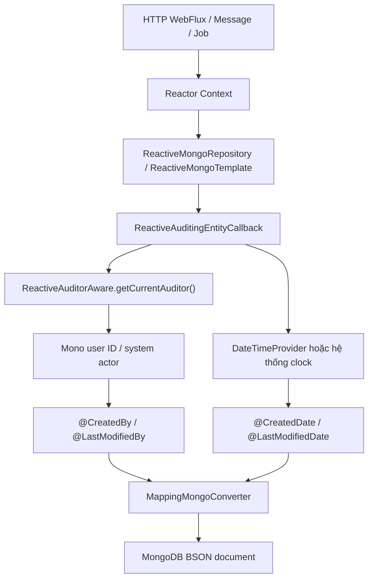
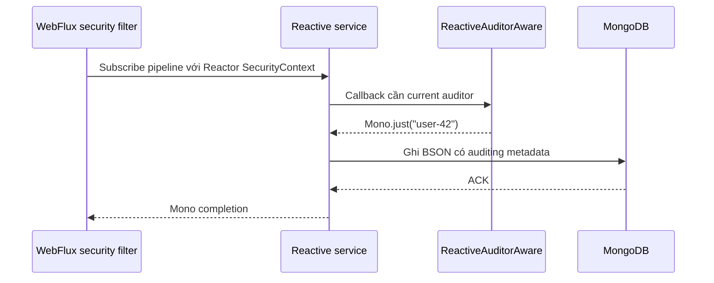
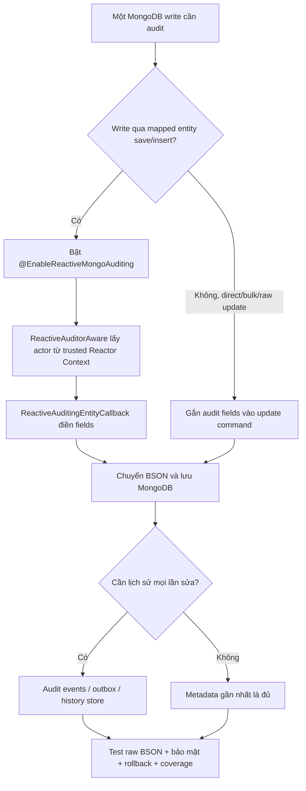

# @EnableReactiveMongoAuditing và ReactiveAuditorAware trong Spring Data MongoDB

## 1. Bài toán: ai tạo, ai sửa và vào lúc nào trong một ứng dụng reactive?

Trong hệ thống Spring Data MongoDB, một document đơn hàng có thể được tạo bởi người dùng, sửa bởi nhân viên vận hành, cập nhật từ một consumer hoặc được xử lý bởi scheduled job. Các câu hỏi thường gặp:

- Ai tạo document và tạo lúc nào?
- Ai cập nhật document lần gần nhất?
- Metadata được gắn **trước khi lưu**, hay phải tự truyền từ controller?
- Khi xử lý bằng WebFlux, danh tính người dùng nằm ở đâu khi execution chuyển thread?
- Có thể dùng một cấu hình auditing chung cho `ReactiveMongoTemplate` và `ReactiveMongoRepository` không?
- Những lệnh `updateFirst`, `findAndModify` hoặc raw driver update có tự động điền `lastModifiedBy` không?

Spring Data cung cấp **auditing metadata** trên entity bằng các annotation:

| Annotation | Mục đích | Kiểu Java thường gặp |
|---|---|---|
| `@CreatedBy` | Danh tính tác nhân tạo entity | `String`, user ID/value object tương thích |
| `@LastModifiedBy` | Tác nhân sửa entity gần nhất | Cùng kiểu với `ReactiveAuditorAware<T>` |
| `@CreatedDate` | Thời điểm tạo entity | `Instant`, `Date` và kiểu thời gian được hỗ trợ |
| `@LastModifiedDate` | Thời điểm sửa gần nhất | `Instant` hoặc kiểu thời gian tương ứng |

Trong **reactive MongoDB**, hai thành phần trung tâm là:

1. `@EnableReactiveMongoAuditing`: bật hạ tầng auditing reactive.
2. `ReactiveAuditorAware<T>`: cung cấp **ai là tác nhân hiện tại** thông qua `Mono<T>`, thường từ Reactor/Spring Security context.

Nội dung thuộc chương **Auditing**, trong phạm vi module **SPRING_DATA_MONGODB**: kết nối và ánh xạ BSON document, truy xuất bằng template/repository, reactive access, transaction, kiểm thử và hiệu năng. Mục tiêu chính là **ghi đúng audit metadata cho các thao tác lưu entity theo reactive pipeline**; không được đánh đồng metadata auditing với audit history hay bảo đảm bảo mật.

### 1.1. Mục tiêu học tập

Kết thúc bài, người học có thể:

1. Khai báo entity mang các annotation auditing và bật auditing reactive.
2. Triển khai `ReactiveAuditorAware<String>` qua `ReactiveSecurityContextHolder` đúng cách.
3. Giải thích tại sao `SecurityContextHolder` kiểu ThreadLocal không phải lựa chọn phù hợp khi lấy principal trong reactive chain.
4. Chọn `auditorAwareRef` khi có nhiều auditing providers, cấu hình `setDates`, `modifyOnCreate` và `dateTimeProviderRef`.
5. Hiểu callback `ReactiveAuditingEntityCallback` và giới hạn giữa `insert/save` với update/bulk/raw commands.
6. Xử lý background jobs, message consumers, tenant isolation và trường hợp anonymous/missing context.
7. Kiểm thử bằng `StepVerifier`, Spring Security test context và MongoDB thật.
8. Thiết kế transaction/retry, tránh ghi đè metadata và phân biệt auditing với append-only audit log.

## 2. Mô hình hoạt động của auditing reactive

### 2.1. Luồng dữ liệu tổng quan



Khi entity được lưu qua đường mapping/callback được hỗ trợ, hạ tầng auditing có thể xác định entity là **mới hay đã tồn tại**, lấy auditor từ `ReactiveAuditorAware`, tính thời điểm và điền metadata **trước khi chuyển entity thành BSON**.

Điểm cần nhớ:

- **Auditing ở Spring Data layer**, không phải một MongoDB server trigger.
- `@CreatedBy`/`@LastModifiedBy` cần một auditor provider phù hợp.
- `@CreatedDate`/`@LastModifiedDate` vẫn hữu ích khi không lưu principal; trường ngày không nhất thiết phải có `ReactiveAuditorAware`.
- Metadata được gắn tại các operation có chạy **entity lifecycle callbacks**; không phải mọi MongoDB write đều tạo callbacks.
- Hạ tầng auditing không tự xác thực người dùng, không kiểm tra authorization và không tạo lịch sử đầy đủ của các lần cập nhật.

### 2.2. Reactive khác imperative ở chỗ nào?

| Thành phần | Imperative MongoDB | Reactive MongoDB |
|---|---|---|
| Bật auditing | `@EnableMongoAuditing` | `@EnableReactiveMongoAuditing` |
| Current principal SPI | `AuditorAware<T>` | `ReactiveAuditorAware<T>` |
| Kết quả SPI | `Optional<T>` | `Mono<T>` |
| Truy cập tài nguyên | `MongoTemplate`, `MongoRepository` | `ReactiveMongoTemplate`, `ReactiveMongoRepository` |
| Security context thường dùng | `SecurityContextHolder` | `ReactiveSecurityContextHolder` |
| Transaction context | Thread-bound resource với `MongoTransactionManager` | Reactor Context với `ReactiveMongoTransactionManager` |
| Auditing callback | `AuditingEntityCallback` | `ReactiveAuditingEntityCallback` |

Đừng chỉ thay `MongoRepository` thành `ReactiveMongoRepository` mà tiếp tục dựa vào ThreadLocal user context trong một `AuditorAware` cũ. Reactive request có thể được thực thi trên các threads khác nhau và context của nó được truyền thông qua **Reactor Context**.

### 2.3. Dữ liệu trước và sau auditing

Ứng dụng tạo entity:

```java
OrderDocument order = new OrderDocument("O-101", "NEW");
```

Sau khi `repository.save(order)` hoàn thành thành công, BSON minh họa:

```javascript
{
  _id: "O-101",
  status: "NEW",
  createdBy: "user-42",
  lastModifiedBy: "user-42",
  createdAt: ISODate("2026-11-20T03:00:00Z"),
  lastModifiedAt: ISODate("2026-11-20T03:00:00Z")
}
```

Giá trị thời gian/actor ở đây **chỉ minh họa**. Cả hai trường last-modified được gắn ngay lúc tạo khi cấu hình mặc định `modifyOnCreate = true`. Tên field trong BSON có thể đổi nếu dùng `@Field`/custom converters; đừng đoán kết quả mapping từ tên Java class.

## 3. Khai báo entity với bốn auditing annotations

### 3.1. Ví dụ entity có thể lưu bằng repository

```java
import java.time.Instant;
import org.springframework.data.annotation.CreatedBy;
import org.springframework.data.annotation.CreatedDate;
import org.springframework.data.annotation.Id;
import org.springframework.data.annotation.LastModifiedBy;
import org.springframework.data.annotation.LastModifiedDate;
import org.springframework.data.annotation.Version;
import org.springframework.data.mongodb.core.mapping.Document;

@Document(collection = "orders")
public class OrderDocument {

    @Id
    private String id;

    private String tenantId;

    private String status;

    @CreatedBy
    private String createdBy;

    @LastModifiedBy
    private String lastModifiedBy;

    @CreatedDate
    private Instant createdAt;

    @LastModifiedDate
    private Instant lastModifiedAt;

    @Version
    private Long version;

    protected OrderDocument() {
    }

    public OrderDocument(String id, String status) {
        this.id = id;
        this.status = status;
    }

    public OrderDocument(
            String id, String tenantId, String status) {
        this.id = id;
        this.tenantId = tenantId;
        this.status = status;
    }

    public String getId() { return id; }
    public String getTenantId() { return tenantId; }
    public String getStatus() { return status; }
    public void setStatus(String status) {
        this.status = status;
    }
    public String getCreatedBy() { return createdBy; }
    public String getLastModifiedBy() { return lastModifiedBy; }
    public Instant getCreatedAt() { return createdAt; }
    public Instant getLastModifiedAt() { return lastModifiedAt; }
    public Long getVersion() { return version; }
}
```

Ở ví dụ này:

- `@Id` định danh order; dùng ID minh họa dạng `O-101` để tránh nhầm giữa String và ObjectId khi thảo luận BSON. Constructor hai tham số chỉ phục vụ ví dụ tối giản; trong hệ thống multi-tenant thực tế, hãy dùng constructor có `tenantId` đáng tin cậy và validate phạm vi tenant trước mọi write.
- `@Version` là optimistic-locking/version metadata **khác** auditing. Nó giúp xác định trạng thái mới/cũ theo Spring Data mapping và xử lý cập nhật đồng thời trong các operation được hỗ trợ.
- `createdBy`/`createdAt` là metadata tạo, về nguyên tắc không bị ghi lại khi update entity được nhận diện đúng là đã tồn tại.
- `lastModifiedBy`/`lastModifiedAt` cập nhật khi save entity đã tồn tại qua auditing callback.
- Không cung cấp public setters cho audit fields trong API/domain flow thông thường; client không được tự gửi giá trị người tạo/sửa.

### 3.2. Vì sao chọn đúng kiểu auditor quan trọng?

`ReactiveAuditorAware<T>` có kiểu generic `T` phải phù hợp với các property `@CreatedBy`/`@LastModifiedBy`.

Nếu provider:

```java
ReactiveAuditorAware<String>
```

thì thuộc tính audit nên là `String`, hoặc kiểu conversion được cấu hình rõ và test đầy đủ. Nếu muốn lưu một user ID kiểu `UUID` hoặc object `ActorRef`, hãy chọn `ReactiveAuditorAware<UUID>`/`ReactiveAuditorAware<ActorRef>` và matching field type/mapping.

Không trả về một `Authentication` hay JWT object trong khi entity chỉ có `String createdBy` rồi mong framework tự biết phần nào cần lưu. Không lưu raw security principal/token có thông tin nhạy cảm vào document.

### 3.3. Embedded audit metadata

Auditing fields có thể tổ chức thành một object nhúng, ví dụ:

```java
import java.time.Instant;
import org.springframework.data.annotation.CreatedBy;
import org.springframework.data.annotation.CreatedDate;
import org.springframework.data.annotation.LastModifiedBy;
import org.springframework.data.annotation.LastModifiedDate;

public class AuditMetadata {
    @CreatedBy
    private String createdBy;
    @CreatedDate
    private Instant createdAt;
    @LastModifiedBy
    private String lastModifiedBy;
    @LastModifiedDate
    private Instant lastModifiedAt;

    protected AuditMetadata() {}
    // Getters; các constructors/wither nếu dùng immutable mapping.
}
```

```java
import org.springframework.data.annotation.Id;
import org.springframework.data.mongodb.core.mapping.Document;

@Document("customer_profiles")
public class CustomerProfile {
    @Id
    private String id;
    private String displayName;
    private AuditMetadata audit;

    protected CustomerProfile() {}
    // Constructor, getters và business setters cần thiết.
}
```

Nếu chọn embedded metadata, phải tạo/khởi tạo object theo cách mapping/auditing thực sự hỗ trợ trong phiên bản Spring Data đang dùng. Với immutable value object hoặc Java record, nên test mapping/callback copy để không giả định framework có thể mutate một đối tượng bất biến. Tên BSON vật lý có thể là `audit.createdBy` thay vì field cấp root.

### 3.4. Auditing không dựa vào tên property

`createdBy` hoặc `updatedAt` là tên do ứng dụng đặt. Auditing được nhận diện bằng annotation hoặc SPI/interface tương ứng, không phải do MongoDB tự tìm các field mang tên gần giống. Chỉ thêm:

```java
private Instant updatedAt;
```

mà không có `@LastModifiedDate`/callback thủ công thì **không có cơ sở** để khẳng định Spring Data sẽ cập nhật field đó tự động.

## 4. Bật @EnableReactiveMongoAuditing

### 4.1. Cấu hình đơn giản

```java
import org.springframework.context.annotation.Configuration;
import org.springframework.data.mongodb.config.EnableReactiveMongoAuditing;

@Configuration
@EnableReactiveMongoAuditing
public class ReactiveAuditingConfiguration {
}
```

Annotation kích hoạt các thành phần auditing reactive trong Spring ApplicationContext. Nếu entity chỉ dùng các annotation ngày/giờ, có thể không cần provider người dùng; nhưng khi có `@CreatedBy` hoặc `@LastModifiedBy`, phải cung cấp một nguồn actor thích hợp nếu muốn các field đó được điền.

`@EnableReactiveMongoAuditing` không tự kích hoạt Spring Security hay authentication filter, không tự tạo MongoDB collections/indexes, và không buộc tất cả writes ở driver-level phải chạy callbacks.

### 4.2. Đăng ký một ReactiveAuditorAware bean

Một cấu hình thực tế dùng bean tên xác định:

```java
import org.springframework.context.annotation.Bean;
import org.springframework.context.annotation.Configuration;
import org.springframework.data.domain.ReactiveAuditorAware;
import org.springframework.data.mongodb.config.EnableReactiveMongoAuditing;

@Configuration
@EnableReactiveMongoAuditing(
    auditorAwareRef = "reactiveAuditorAware")
public class ReactiveAuditingConfiguration {

    @Bean("reactiveAuditorAware")
    ReactiveAuditorAware<String> reactiveAuditorAware() {
        return new SecurityContextReactiveAuditorAware();
    }
}
```

`SecurityContextReactiveAuditorAware` được triển khai ở mục 5. Bean name trong `auditorAwareRef` phải khớp chính xác tên thực được register. Khi chỉ có một provider, Spring Data có thể tự phát hiện bean phù hợp; chỉ định rõ tên giúp tránh mơ hồ nếu sau này có thêm provider cho jobs hoặc tenants.

Không khai báo hai configuration cùng bật auditing reactive mà không kiểm soát bean definitions/callbacks. Nên duy trì **một điểm cấu hình rõ ràng** và test những profiles môi trường cần bật.

### 4.3. Các attributes có thể dùng

```java
@EnableReactiveMongoAuditing(
    auditorAwareRef = "reactiveAuditorAware",
    dateTimeProviderRef = "auditingDateTimeProvider",
    setDates = true,
    modifyOnCreate = true
)
```

| Attribute | Giá trị mặc định | Tác dụng |
|---|---|---|
| `auditorAwareRef` | `""` | Chọn bean `ReactiveAuditorAware<?>` theo tên |
| `dateTimeProviderRef` | `""` | Chọn bean `DateTimeProvider` để cung cấp thời gian |
| `setDates` | `true` | Cho phép hạ tầng auditing tự điền creation/modification dates |
| `modifyOnCreate` | `true` | Cập nhật last-modified metadata ngay khi entity được tạo |

Đây là properties của **annotation cấu hình auditing**, không phải một cấu trúc JSON Schema của MongoDB. Nếu đặt `setDates=false`, các trường ngày không còn được hạ tầng auditing tự điền, kể cả khi entity có `@CreatedDate`/`@LastModifiedDate`; ứng dụng phải có nguồn dữ liệu riêng khi muốn lưu chúng.

### 4.4. @EnableMongoAuditing khác @EnableReactiveMongoAuditing

```java
@EnableMongoAuditing
// Dành cho imperative auditing + AuditorAware.

@EnableReactiveMongoAuditing
// Dành cho reactive auditing + ReactiveAuditorAware.
```

Nếu một ứng dụng có cả `MongoTemplate` và `ReactiveMongoTemplate`, không giả định chỉ bật một annotation là auditing tự động chạy đúng cả hai đường. Các stacks có callback/provider khác nhau. Cân nhắc cấu hình cả hai **khi thực sự có hai đường ghi** và kiểm thử riêng để tránh hiện tượng metadata lúc có lúc không.

## 5. Triển khai ReactiveAuditorAware từ Spring Security

### 5.1. Đọc Authentication từ ReactiveSecurityContextHolder

```java
import org.springframework.data.domain.ReactiveAuditorAware;
import org.springframework.security.authentication.AnonymousAuthenticationToken;
import org.springframework.security.core.Authentication;
import org.springframework.security.core.context.ReactiveSecurityContextHolder;
import reactor.core.publisher.Mono;

public final class SecurityContextReactiveAuditorAware
        implements ReactiveAuditorAware<String> {

    @Override
    public Mono<String> getCurrentAuditor() {
        return ReactiveSecurityContextHolder.getContext()
            .flatMap(context ->
                Mono.justOrEmpty(context.getAuthentication()))
            .filter(auth ->
                auth.isAuthenticated()
                && !(auth instanceof AnonymousAuthenticationToken))
            .flatMap(auth ->
                Mono.justOrEmpty(auth.getName()))
            .filter(name -> !name.isBlank());
    }
}
```

`ReactiveSecurityContextHolder.getContext()` lấy security context từ **Reactor Context** của subscription đang chạy. Khi không có context hoặc không có principal hợp lệ, pipeline trả `Mono.empty()` thay vì ném lỗi NPE hoặc tự nhận một người dùng tùy ý.

**Lưu ý khi chọn actor:** `Authentication.getName()` là tên do authentication mechanism quyết định; với JWT có thể là `sub` hoặc một claim được mapping, với username/password có thể là username. Với yêu cầu audit lâu dài, nên chuẩn hóa thành **ID ổn định, không đổi theo tên hiển thị**. Tránh ghi raw access token, full JWT, email/PII khi không cần.

### 5.2. Vì sao không dùng SecurityContextHolder.getContext()?

Trong imperative MVC, `SecurityContextHolder` thường sử dụng ThreadLocal:

```java
// ANTI-PATTERN trong reactive auditor:
Authentication auth =
    SecurityContextHolder.getContext().getAuthentication();
```

Một reactive pipeline có thể chuyển execution giữa threads, và cùng một thread phục vụ nhiều subscriptions theo thời gian. ThreadLocal không biểu diễn đúng ngữ cảnh của subscriber. Lỗi có thể xuất hiện **không ổn định**: actor rỗng, sai hoặc bị mất sau scheduler/async boundary.

Không copy security principal vào một global static variable hoặc ThreadLocal thủ công để “giữ người dùng” — đây là rủi ro cross-request/cross-tenant.

### 5.3. isAuthenticated chưa đủ để loại anonymous

Trong một số cấu hình Spring Security, anonymous authentication token có thể được coi là `authenticated=true` cho một số kiểm tra API. Nếu provider chỉ dùng `Authentication::isAuthenticated`, một request anonymous có thể ghi `createdBy = "anonymousUser"` ngoài ý muốn.

Đoạn provider ở trên loại `AnonymousAuthenticationToken`. Chính sách nghiệp vụ phải quyết định anonymous write có bị từ chối, được dùng một actor khách như `GUEST` hay chỉ gắn timestamps. **AuditorAware không phải chỗ thay cho authorization**; controller/security filter vẫn phải bảo vệ endpoint.

### 5.4. Nếu người dùng không có quyền ghi?

Một principal hợp lệ về mặt authentication chưa có nghĩa họ được sửa tất cả orders. `ReactiveAuditorAware` chỉ cho biết **ai đang được xác nhận**, không kiểm tra họ được phép cập nhật `orderId`/`tenantId` nào.

```text
Authentication thành công
         ↓
Authorization: tenant + role + ownership
         ↓
Business mutation
         ↓
Auditing callback ghi actor thực sự
```

Không tin `createdBy`, `lastModifiedBy` hoặc `tenantId` do client gửi vào body; chỉ ánh xạ business DTO đã validate và lấy authenticated tenant từ nguồn tin cậy.

## 6. Reactor Context: truyền actor qua subscription đúng cách

### 6.1. Đọc từ context của subscriber, không phải thời điểm tạo Mono

Reactive code thường có hai thời điểm khác nhau:

1. **Assembly:** xây pipeline `Mono` hoặc `Flux`.
2. **Subscription:** một subscriber kích hoạt xử lý, các operators truy cập Reactor Context và MongoDB driver thực sự chạy.

Auditing cần lấy principal **tại subscription**. Ví dụ:

```java
Mono<OrderDocument> save =
    repository.save(new OrderDocument(null, "NEW"));

// Ở thời điểm xây Mono chưa biết subscription đang chạy
// cho người dùng nào, và database write chưa được thực hiện.
```

Khi pipeline được subscribe trong một WebFlux request đã xác thực, Spring Security cung cấp Reactive SecurityContext theo cơ chế của nó. `ReactiveAuditorAware` truy xuất context tại lúc auditing callback chạy.



Không tự gán một static `currentUser` tại thời điểm controller tạo publisher; nếu publisher được retry, share hoặc subscribe ở ngữ cảnh khác, static value có thể sai request.

### 6.2. publishOn và subscribeOn không tự làm mất Reactor Context

Ví dụ:

```java
import reactor.core.scheduler.Schedulers;

Mono<OrderDocument> flow =
    repository.save(new OrderDocument(null, "NEW"))
        .publishOn(Schedulers.parallel());
```

Reactor Context được truyền theo reactive subscriber chain; thay scheduler bằng `publishOn` không tự đồng nghĩa mất context. Vấn đề phát sinh khi:

- Gọi `subscribe()` độc lập ở một callback và không truyền context tương ứng.
- Tách xử lý ra một thread pool/`CompletableFuture` hoặc thư viện không tham gia Reactor chain.
- Dùng `SecurityContextHolder` ThreadLocal thay vì `ReactiveSecurityContextHolder`.
- Tạo một publisher hot được share cho nhiều users/tenants mà không có isolation hợp lý.

Thực hành tốt nhất là **compose các MongoDB operations bằng `flatMap`, `then`, `concatMap`** trong cùng reactive chain và chỉ có một subscription ở tầng WebFlux/runtime.

### 6.3. contextWrite trong kiểm thử và tác vụ tin cậy

Trong test, có thể tạo `Authentication` rồi gắn security context:

```java
import java.util.List;
import org.springframework.security.authentication.UsernamePasswordAuthenticationToken;
import org.springframework.security.core.Authentication;
import org.springframework.security.core.authority.SimpleGrantedAuthority;
import org.springframework.security.core.context.ReactiveSecurityContextHolder;

Authentication auth =
    UsernamePasswordAuthenticationToken.authenticated(
        "user-42",
        "N/A",
        List.of(new SimpleGrantedAuthority("ROLE_USER"))
    );

Mono<OrderDocument> flow =
    repository.save(new OrderDocument(null, "NEW"))
        .contextWrite(
            ReactiveSecurityContextHolder.withAuthentication(auth));
```

Đây là **cách tạo context có kiểm soát trong test hoặc một entrypoint được xác thực**. Không gắn `Authentication` giả từ input header của client trong production: nếu client có thể chọn `"user-42"` tùy ý, auditing sẽ trở thành dữ liệu giả mạo.

### 6.4. Background jobs và message consumers không mặc định có security context

Một scheduled job chạy hàng đêm hoặc consumer nhận Kafka event **thường không có WebFlux SecurityContext**. Khi `getCurrentAuditor()` trả `Mono.empty()`, các field actor có thể không được điền hoặc không thay đổi theo ngữ nghĩa callback, dù timestamps vẫn được gắn.

Nếu cần ghi lại actor hệ thống, hãy xác định **identity đáng tin cậy của job** ở service boundary (ví dụ `"system:nightly-reconciliation"`) và truyền nó qua một Reactor Context key hoặc một cơ chế authentication service-account phù hợp.

Đừng mặc định mọi missing user đều là `"system"`, vì điều đó có thể che mất lỗi context trong request đã xác thực.

### 6.5. Reactor Context-based auditor cho công việc nền

Một provider thay thế có thể lấy actor từ một context key được nội bộ ứng dụng tạo:

```java
import org.springframework.data.domain.ReactiveAuditorAware;
import reactor.core.publisher.Mono;

public final class ContextKeyReactiveAuditorAware
        implements ReactiveAuditorAware<String> {

    public static final String AUDIT_ACTOR_KEY = "audit.actor";

    @Override
    public Mono<String> getCurrentAuditor() {
        return Mono.deferContextual(ctx ->
            Mono.justOrEmpty(
                ctx.<String>getOrEmpty(AUDIT_ACTOR_KEY)));
    }
}
```

Caller **nội bộ đã được tin cậy** có thể đặt:

```java
Mono<OrderDocument> job =
    repository.save(new OrderDocument(null, "PENDING_REVIEW"))
        .contextWrite(ctx ->
            ctx.put(ContextKeyReactiveAuditorAware.AUDIT_ACTOR_KEY,
                "system:nightly-reconciliation"));
```

Khi cấu hình bean `ContextKeyReactiveAuditorAware`, auditing dùng giá trị từ context key này. Với hệ thống có cả WebFlux requests và background jobs, có thể triển khai provider kết hợp **SecurityContext trước, service actor sau**; nhưng phải có chính sách rõ ràng để caller không thể giả danh user khác thông qua context key do request input điều khiển.

### 6.6. Khi actor bắt buộc, đừng silently bỏ qua

Một hệ thống có quy định rằng mọi thao tác ghi phải có actor hợp lệ. Trong trường hợp này, `Mono.empty()` có thể là **lỗi ứng dụng** thay vì kết quả được phép.

Ví dụ:

```java
public Mono<String> requireAuditor(
        ReactiveAuditorAware<String> auditorAware) {
    return auditorAware.getCurrentAuditor()
        .switchIfEmpty(Mono.error(
            new IllegalStateException(
                "Missing trusted audit actor")));
}
```

Tuy nhiên, chỉ gọi `requireAuditor` trong một service khác **không tự buộc tất cả MongoDB write paths** phải qua nó. Muốn thực thi quy tắc bắt buộc, cần policy thống nhất trong service/callback, kiểm thử negative cases và có thể thêm **MongoDB JSON Schema validator** yêu cầu các field. Validator database kiểm tra **có field/đúng kiểu**, nhưng không thể tự biết actor được cấp quyền thao tác.

## 7. Thời gian auditing: @CreatedDate và @LastModifiedDate

### 7.1. Mặc định lấy thời gian từ đâu?

Auditing có thể cung cấp thời điểm hiện tại qua `DateTimeProvider`. Nếu không đặt một provider riêng, hạ tầng Spring Data auditing dùng cơ chế thời gian mặc định theo version/configuration.

`@CreatedDate` được gắn cho entity mới; `@LastModifiedDate` được gắn cho entity sửa và, theo mặc định `modifyOnCreate=true`, thường được gắn ngay lần insert đầu tiên.

Không khẳng định thời điểm audit tự động là **thời điểm MongoDB server commit**. Auditing callback chạy **trước write**, thời gian thường được lấy ở ứng dụng. Giữa lúc callback chạy và lúc commit có thể có latency, transaction retries hoặc network delay.

### 7.2. Dùng DateTimeProvider với Clock kiểm soát được

```java
import java.time.Clock;
import java.time.Instant;
import java.time.temporal.TemporalAccessor;
import java.util.Optional;
import org.springframework.context.annotation.Bean;
import org.springframework.context.annotation.Configuration;
import org.springframework.data.auditing.DateTimeProvider;
import org.springframework.data.mongodb.config.EnableReactiveMongoAuditing;

@Configuration
@EnableReactiveMongoAuditing(
    auditorAwareRef = "reactiveAuditorAware",
    dateTimeProviderRef = "auditingDateTimeProvider")
public class AuditingClockConfiguration {

    @Bean
    Clock auditingClock() {
        return Clock.systemUTC();
    }

    @Bean("auditingDateTimeProvider")
    DateTimeProvider auditingDateTimeProvider(Clock clock) {
        return new DateTimeProvider() {
            @Override
            public Optional<TemporalAccessor> getNow() {
                return Optional.of(Instant.now(clock));
            }
        };
    }
}
```

Ví dụ này giả định **đã có** bean `reactiveAuditorAware` được đăng ký bởi cấu hình khác. Khi thực hành, không khai báo đồng thời nhiều `@EnableReactiveMongoAuditing` configurations gây đăng ký trùng hạ tầng; nên gộp bean/provider vào **một** configuration chính.

Điểm quan trọng: `dateTimeProviderRef` tham chiếu tới `DateTimeProvider` (SPI đồng bộ trả `Optional<TemporalAccessor>`), **không phải một `ReactiveAuditorAware` khác**. Clock gọi tức thì, không thực hiện blocking network I/O trong provider.

### 7.3. setDates và modifyOnCreate

Hai ví dụ:

```java
@EnableReactiveMongoAuditing(
    auditorAwareRef = "reactiveAuditorAware",
    modifyOnCreate = true)
// Tạo mới: gắn created và lastModified metadata.
```

```java
@EnableReactiveMongoAuditing(
    auditorAwareRef = "reactiveAuditorAware",
    modifyOnCreate = false)
// Tạo mới: không tự coi là một lần "modified" để điền lastModified.
```

Nếu nghiệp vụ yêu cầu `lastModifiedAt` chỉ xuất hiện **sau một lần sửa sau khi tạo**, `modifyOnCreate=false` là lựa chọn có lý. Nếu cần dữ liệu audit luôn có một mốc sửa gần nhất ngay từ khi tạo, để default `true`.

`setDates=false` tắt việc auditing tự set các date fields; vẫn có thể lưu `@CreatedBy`/`@LastModifiedBy`. Đừng bật/tắt một cách tùy ý giữa nhiều services đang ghi cùng collection mà không có migration/contract rõ ràng.

### 7.4. Instant, BSON Date và precision

`Instant` thường được ánh xạ sang BSON Date với độ chính xác **milli-second**. Một Java `Instant.now()` có thể chứa nanoseconds; khi đọc lại BSON, những chữ số dưới millisecond có thể không còn.

Trong test, đừng viết:

```java
assertThat(saved.getCreatedAt())
    .isEqualTo(Instant.now());
```

vì `Instant.now()` gọi lần sau luôn khác và precision có thể bị cắt. Thay bằng kiểm tra thuộc khoảng hợp lý hoặc dùng `Clock.fixed(...)`, cùng phép chuyển sang độ chính xác milli-second phù hợp với BSON.

### 7.5. Múi giờ và thứ tự thời gian

Nên lưu một **instant tuyệt đối** thay vì một local date/time thiếu timezone cho audit events. Khi hiển thị, chuyển sang timezone người dùng. Nhưng đừng coi timestamps auditing là **global total order** giữa các services: clocks có thể lệch và callback chạy trước commit.

Nếu cần thứ tự sự kiện mạnh, dùng aggregate version, event sequence, MongoDB transaction semantics, event ID hoặc cơ chế logical ordering phù hợp.

## 8. Khi nào callback auditing được thực thi?

### 8.1. ReactiveAuditingEntityCallback chạy trước khi convert

Spring Data MongoDB sử dụng `ReactiveAuditingEntityCallback`, là một `ReactiveBeforeConvertCallback<Object>`. Callback được dùng để điền audit metadata trên entity **trước khi entity được chuyển thành BSON document**.

```text
reactiveMongoRepository.save(entity)
                  |
                  v
Reactive EntityCallbacks
  └─ ReactiveAuditingEntityCallback (order 100)
                  |
                  v
MappingMongoConverter
                  |
                  v
MongoDB insert / save
```

Do đó auditing là một phần của **entity mapping lifecycle**. MongoDB không biết annotation `@CreatedBy` trên class Java; server chỉ nhận BSON fields sau mapping.

### 8.2. insert và save trên mapped entity

Những thao tác thường đi qua callback:

```java
Mono<OrderDocument> created =
    reactiveMongoTemplate.insert(new OrderDocument(null, "NEW"));

Mono<OrderDocument> saved =
    reactiveMongoTemplate.save(existingOrder);

Mono<OrderDocument> viaRepository =
    orderRepository.save(existingOrder);
```

Lưu ý chúng là các thao tác **riêng biệt**; chỉ thao tác đã được subscribe thực sự chạy. Hãy dùng `StepVerifier` hoặc WebFlux runtime làm subscriber. Đừng gọi `subscribe()` tự phát trong service chỉ để “kích hoạt auditing”.

### 8.3. updateFirst không giống save

Lệnh:

```java
Mono<UpdateResult> result =
    reactiveMongoTemplate.updateFirst(
        Query.query(Criteria.where("id").is("O-101")),
        new Update().set("status", "PAID"),
        OrderDocument.class);
```

là **update command** trực tiếp; nó không đưa toàn bộ `OrderDocument` qua `ReactiveAuditingEntityCallback` như `save(entity)`. Vì vậy **không nên kỳ vọng** `lastModifiedBy`/`lastModifiedAt` tự điền chỉ nhờ annotation.

Tương tự cần kiểm tra các đường:

- `findAndModify` cập nhật trực tiếp theo `Update`.
- `updateMulti`, `upsert` và `bulkOps`.
- Raw reactive MongoDB Java Driver `MongoCollection.updateOne`/`replaceOne`.
- MongoDB shell scripts hoặc aggregation pipeline ghi bằng `$merge`.
- Các service khác ghi trực tiếp vào cùng collection không dùng Spring Data.

Không mọi operation đều đi qua domain entity lifecycle. **Audit coverage phải kiểm tra theo write path thực**, không chỉ theo sự tồn tại của annotations trên class.

### 8.4. Bulk operations và entity lifecycle events

Bulk operations được tối ưu để gửi nhiều operations, thường **không phát entity lifecycle callbacks** tương tự `save` từng entity. Nếu dùng:

```java
reactiveMongoTemplate.bulkOps(
    org.springframework.data.mongodb.core.BulkOperations.BulkMode.UNORDERED,
    OrderDocument.class);
```

thì đừng mặc định `@LastModifiedBy` tự xử lý cho mỗi row. Cần thiết kế bulk update gắn audit fields tường minh, hoặc dùng cơ chế auditing riêng cho batch.

### 8.5. Callback thứ tự và custom callbacks

Spring Data cho phép đăng ký nhiều `ReactiveBeforeConvertCallback`; callback auditing có order riêng, được công bố là **100** trong tài liệu lifecycle events. Một custom callback chạy trước/sau có thể vô tình ghi đè các field audit.

Nếu custom callbacks cần bổ sung metadata hoặc chuyển trạng thái, hãy quy định rõ order và kiểm thử raw BSON cuối. Tránh một callback có hiệu ứng HTTP hoặc blocking I/O kéo dài save transaction.

### 8.6. Không xem auditing là event-sourcing

`lastModifiedBy`/`lastModifiedAt` lưu **thông tin lần sửa gần nhất**, không ghi đầy đủ những phiên bản trước hoặc nội dung diff. Một document được sửa 10 lần chỉ giữ các field gần nhất nếu không có một history model khác.

Nếu cần lịch sử “ai đổi trường nào, từ giá trị gì sang gì, theo request nào”, cần thiết kế audit events/append-only logs/change streams/outbox với retention, tamper evidence và quyền truy cập riêng. Reactive auditing annotations **không đủ** cho một yêu cầu forensic/compliance nếu không có phần đó.

## 9. Gắn audit fields cho updateFirst và findAndModify

### 9.1. Hai chiến lược với entity mutation

Khi cập nhật một entity đã tồn tại, có hai nhóm thao tác:

**Cách A — load → modify → save.**

```java
public Mono<OrderDocument> markPaid(
        ReactiveMongoRepository<OrderDocument, String> repository,
        String orderId) {

    return repository.findById(orderId)
        .switchIfEmpty(Mono.error(
            new IllegalArgumentException("Order not found")))
        .flatMap(order -> {
            order.setStatus("PAID");
            return repository.save(order);
        });
}
```

Đây là phương thức minh họa, cần imports và dependency ngoài snippet. Vì dùng `save(entity)`, auditing callback thường điền `lastModifiedBy` và `lastModifiedAt`. Với `@Version`, optimistic locking giúp phát hiện những cuộc cập nhật cạnh tranh trong đường lưu entity được hỗ trợ.

Hạn chế: có **ít nhất một read và một write**; business authorization/tenant guard vẫn cần được thực thi. Không lấy việc đã đọc bằng ID làm bằng chứng user được quyền sửa.

**Cách B — update atomic theo predicate.**

```java
reactiveMongoTemplate.updateFirst(
    Query.query(Criteria.where("id").is(orderId)),
    new Update().set("status", "PAID"),
    OrderDocument.class);
```

Cách B tránh round trip load toàn entity và hỗ trợ điều kiện atomic, nhưng `ReactiveAuditingEntityCallback` của `save` không tự chạy cho update command; phải tự bổ sung actor/time hoặc có một abstraction/callback ở tầng application cho đường update.

### 9.2. Ví dụ atomic update có actor từ ReactiveAuditorAware

```java
import org.springframework.data.domain.ReactiveAuditorAware;
import org.springframework.data.mongodb.core.ReactiveMongoTemplate;
import org.springframework.data.mongodb.core.query.Criteria;
import org.springframework.data.mongodb.core.query.Query;
import org.springframework.data.mongodb.core.query.Update;
import org.springframework.stereotype.Service;
import reactor.core.publisher.Mono;
import com.mongodb.client.result.UpdateResult;

@Service
public class ReactiveOrderUpdateService {
    private final ReactiveMongoTemplate template;
    private final ReactiveAuditorAware<String> auditorAware;

    public ReactiveOrderUpdateService(
            ReactiveMongoTemplate template,
            ReactiveAuditorAware<String> auditorAware) {
        this.template = template;
        this.auditorAware = auditorAware;
    }

    public Mono<UpdateResult> markPaid(
            String orderId, String trustedTenantId) {
        return auditorAware.getCurrentAuditor()
            .switchIfEmpty(Mono.error(
                new IllegalStateException(
                    "Trusted audit actor required")))
            .flatMap(actor -> {
                Query query = Query.query(
                    Criteria.where("id").is(orderId)
                        .and("tenantId").is(trustedTenantId)
                        .and("status").is("NEW"));

                Update update = new Update()
                    .set("status", "PAID")
                    .set("lastModifiedBy", actor)
                    .currentDate("lastModifiedAt");

                return template.updateFirst(
                    query, update, OrderDocument.class);
            });
    }
}
```

Ở đây:

- `trustedTenantId` đến từ authenticated context/domain authorization, **không** lấy tùy tiện từ request header.
- Điều kiện `status = "NEW"` bảo vệ transition; kết quả `getMatchedCount() == 0` cần được diễn giải: không tồn tại, không thuộc tenant hoặc trạng thái không còn đúng.
- `lastModifiedBy` lấy từ reactive provider, còn `currentDate` do **MongoDB server** gán bằng BSON Date tại write. Thời gian này có thể khác với `DateTimeProvider` của `save` (thường lấy app clock).
- `updateFirst` **không tự điền `@CreatedDate`/`@CreatedBy`**, và ở đây không cố ghi đè các trường đó.
- Nếu `version` được sử dụng, một raw `updateFirst` không nhất thiết áp cùng optimistic-lock check như `save`. Cần thiết kế điều kiện version và tăng version đúng trong các đường ghi chủ động.

### 9.3. Cập nhật với Clock thống nhất thay vì $currentDate

Nếu muốn update command lấy thời gian từ `Clock` ở ứng dụng (giống `DateTimeProvider` custom), có thể dùng:

```java
import java.time.Clock;
import java.time.Instant;

Instant modificationTime = Instant.now(clock);

Update update = new Update()
    .set("status", "PAID")
    .set("lastModifiedBy", actor)
    .set("lastModifiedAt", modificationTime);
```

`clock` và `actor` là dependencies/giá trị đã được chuẩn bị từ nguồn tin cậy. Phải cân nhắc clock skew giữa app nodes; server-side `$currentDate` thống nhất với thời gian node xử lý write nhưng vẫn không phải một global commit timestamp trên mọi hệ thống.

### 9.4. Upsert phải điền cả created metadata

Một `upsert` có thể **tạo document mới hoặc sửa document hiện có**, nhưng không nhất thiết qua auditing callback entity. Nếu muốn điều kiện:

- Khi insert: điền `createdBy`/`createdAt`.
- Khi update: điền `lastModifiedBy`/`lastModifiedAt`.

có thể dùng `$setOnInsert` cho creation fields và `$set`/`$currentDate` cho modified fields:

```java
Update update = new Update()
    .set("status", "NEW")
    .set("lastModifiedBy", actor)
    .currentDate("lastModifiedAt")
    .setOnInsert("createdBy", actor)
    .setOnInsert("createdAt", now);

Mono<UpdateResult> result =
    reactiveMongoTemplate.upsert(
        Query.query(
            Criteria.where("id").is(orderId)
                .and("tenantId").is(trustedTenantId)),
        update,
        OrderDocument.class);
```

`now` là `Instant` do application clock cung cấp, đã được tính trước trong operation. Đây chỉ là một ví dụ **upsert có audit fields**, không phải thiết kế đầy đủ trạng thái đơn hàng: cần set tenantId/required business fields, kiểm soát unique index và việc query predicate được server áp dụng như thế nào khi insert.

Nếu muốn thống nhất createdAt/lastModifiedAt trong cùng update, dùng cùng một instant hoặc server expressions có ngữ nghĩa tương thích thay vì trộn app clock và server clock mà không biết chênh lệch.

### 9.5. Bulk update cần abstraction riêng

Một job cập nhật 10.000 documents bằng bulk operations có thể không gọi `ReactiveAuditingEntityCallback` trên từng entity. Do đó:

1. Xác định actor của job (`system:cleanup-job`, có nguồn tin cậy).
2. Gắn metadata sửa vào **từng update command**.
3. Giữ nguyên `createdBy`/`createdAt`.
4. Phân loại những docs không match vì optimistic guard/version.
5. Test raw BSON sau bulk và kiểm tra error/partial success semantics.

Không đơn giản thêm `@LastModifiedDate` rồi tuyên bố bulk updates đã được audit đầy đủ.

### 9.6. Khi nào nên chọn save thay vì update?

| Nhu cầu | Cách làm | Cần lưu ý |
|---|---|---|
| Chỉnh sửa entity qua domain model có callbacks | `findById → modify → save` | Xử lý concurrency và tenant guard |
| Chỉ đổi vài fields bằng atomic predicate | `updateFirst`/`findAndModify` | Tự gắn audit fields |
| Upsert tạo hoặc sửa | `upsert` + `setOnInsert` | Metadata create khác modify |
| Bulk migration | Bulk commands + audit fields tường minh | Không mặc định callbacks |
| Raw MongoDB driver/mongosh | Cập nhật BSON fields trực tiếp | Không có Spring auditing |
| Bắt buộc có lịch sử tất cả changes | Audit event/outbox/change stream | Bốn annotations không đủ |

## 10. Auditing trong reactive transaction

### 10.1. Transaction không tự tạo principal

`ReactiveMongoTransactionManager` giúp nhiều MongoDB operations dùng cùng session/transaction context. Nó **không** biết người thao tác nào được xác thực trừ khi một `ReactiveAuditorAware` có thể lấy principal từ Reactor/Security context.

Một transaction có thể commit thành công mà actor audit rỗng nếu no principal và model cho phép null. Điều này cần được xem là **lỗ hổng coverage** nếu sản phẩm yêu cầu mọi write đều có actor.

### 10.2. Cấu hình transaction manager và operator

```java
import com.mongodb.ReadConcern;
import com.mongodb.TransactionOptions;
import com.mongodb.WriteConcern;
import org.springframework.beans.factory.annotation.Qualifier;
import org.springframework.context.annotation.Bean;
import org.springframework.context.annotation.Configuration;
import org.springframework.data.mongodb.ReactiveMongoDatabaseFactory;
import org.springframework.data.mongodb.ReactiveMongoTransactionManager;
import org.springframework.transaction.ReactiveTransactionManager;
import org.springframework.transaction.reactive.TransactionalOperator;

@Configuration
public class MongoTransactionConfiguration {

    @Bean("reactiveMongoTransactionManager")
    ReactiveMongoTransactionManager transactionManager(
            ReactiveMongoDatabaseFactory factory) {
        TransactionOptions options = TransactionOptions.builder()
            .readConcern(ReadConcern.SNAPSHOT)
            .writeConcern(WriteConcern.MAJORITY)
            .build();
        return new ReactiveMongoTransactionManager(factory, options);
    }

    @Bean("mongoTx")
    TransactionalOperator mongoTx(
            @Qualifier("reactiveMongoTransactionManager")
            ReactiveTransactionManager manager) {
        return TransactionalOperator.create(manager);
    }
}
```

Đây là transaction configuration minh họa, cần chạy trên MongoDB deployment hỗ trợ transactions. Spring Boot có thể đã cấu hình client/factory; không tạo hai transaction managers trùng nhau nếu không có lý do. `readConcern.SNAPSHOT` và majority commit dùng ở đây nhằm minh họa lựa chọn consistency, không phải bắt buộc cho mọi auditing update.

### 10.3. Hai entity saves cùng MongoDB transaction

Giả sử phải lưu order và audit intent document trong **cùng deployment**:

```java
import org.springframework.data.mongodb.core.ReactiveMongoTemplate;
import org.springframework.transaction.reactive.TransactionalOperator;
import reactor.core.publisher.Mono;

public Mono<OrderDocument> createWithAuditIntent(
        ReactiveMongoTemplate template,
        TransactionalOperator mongoTx,
        OrderDocument order,
        AuditIntent intent) {

    return template.insert(order)
        .flatMap(saved ->
            template.insert(intent).thenReturn(saved))
        .as(mongoTx::transactional);
}
```

`AuditIntent` là entity riêng cho workflow đã được thiết kế và định nghĩa ở ứng dụng, không phải annotation của Spring Data. Ý nghĩa ví dụ:

- `insert(order)` qua entity auditing callback.
- `insert(intent)` là một write khác có thể nằm cùng MongoDB transaction.
- Nếu insert intent lỗi làm transaction abort, order insert cũng không commit thành công.
- Audit actor lấy từ Reactor Context nếu context được truyền vào subscription.
- Không đặt một HTTP call hoặc Kafka publish bên trong transaction rồi mong MongoDB rollback side effect của chúng.

### 10.4. Retry của transaction có thể chạy lại auditing callback

Nếu write conflict làm attempt đầu abort, code retry toàn transaction sẽ **thực hiện lại callback auditing** ở attempt sau. Hệ quả:

- `lastModifiedAt` có thể đổi giữa attempts vì callback lấy thời gian mới.
- `ReactiveAuditorAware` được gọi lại theo context của subscription.
- Không dùng callback audit để tự gửi external HTTP/Kafka message, vì một attempt abort vẫn có thể đã tạo side effect ngoài MongoDB.
- Nếu nghiệp vụ cần event ID ổn định qua retry, tạo idempotency key **ở business command**, không tạo một ID mới trong callback trên mỗi attempt.

Một retry sau **unknown commit outcome** không tự an toàn dù transaction chứa audit fields; phải kiểm tra kết quả bằng command ID/unique key theo cơ chế phù hợp.

### 10.5. Không tự subscribe song song trong transaction

```java
// ANTI-PATTERN:
template.save(order)
    .doOnNext(x -> template.insert(intent).subscribe())
    .as(mongoTx::transactional);
```

`subscribe()` phụ tạo một pipeline khác, không có guarantee cùng session, không được transaction operator chờ và có thể chạy sau/ngoài commit. Dùng `flatMap` hoặc `then` như mục 10.3.

Không dùng `Mono.when(saveOrder, saveIntent)` để chạy MongoDB writes **song song** trên cùng transaction session nếu driver/server không hỗ trợ operation concurrency đó; ưu tiên compose tuần tự.

### 10.6. Reactive và imperative managers không thay thế nhau

| Thao tác | Transaction manager phù hợp |
|---|---|
| `ReactiveMongoTemplate`/reactive repository | `ReactiveMongoTransactionManager` |
| `MongoTemplate`/imperative repository | `MongoTransactionManager` |
| Reactive SQL (R2DBC) | `R2dbcTransactionManager` hoặc manager R2DBC tương ứng |
| JDBC/SQL imperative | `DataSourceTransactionManager`/`JdbcTransactionManager` |

Một `@Transactional` dùng sai manager không làm MongoDB reactive pipeline tự có transaction. MongoDB local transaction cũng không tự bao trùm SQL/Kafka. Khi phối hợp nhiều resources, dùng outbox/saga/idempotency thay vì dựa vào annotation auditing để giải quyết distributed consistency.

## 11. Auditing, optimistic locking và bảo vệ tính đúng đắn

### 11.1. Auditing không ngăn lost updates

Hai request cùng đọc order ở trạng thái `NEW`:

```text
Request A: NEW -> PAID
Request B: NEW -> CANCELLED
```

Nếu cả hai gọi `save` mà không có concurrency guard, update cuối có thể ghi đè update trước; `lastModifiedBy` có thể chỉ thể hiện người ghi sau cùng, không phản ánh lịch sử xung đột. `@Version` giúp phát hiện stale entity khi dùng đúng mapping operations.

### 11.2. @Version dùng cùng auditing như thế nào?

Entity ở mục 3 có:

```java
@Version
private Long version;
```

Trong `save`, Spring Data MongoDB có thể dùng version trong query/update để phát hiện optimistic locking failure. Khi mất khớp, có thể ném `OptimisticLockingFailureException`, và operation không được xem là thành công.

Đừng hiểu `@Version` như một audit history log; nó chỉ là **metadata cạnh tranh cập nhật**. Audit fields cũng không thay thế optimistic lock predicate.

### 11.3. updateFirst phải chủ động kiểm tra version nếu cần

Ví dụ:

```java
Query optimistic = Query.query(
    Criteria.where("id").is(orderId)
        .and("tenantId").is(trustedTenantId)
        .and("version").is(expectedVersion));

Update update = new Update()
    .set("status", "PAID")
    .set("lastModifiedBy", actor)
    .currentDate("lastModifiedAt")
    .inc("version", 1L);
```

Code này chỉ là phần xây `Query`/`Update`; caller phải gọi `template.updateFirst(...)` và kiểm tra `matchedCount == 1` để xác nhận. Không cập nhật version một cách không phối hợp với những code paths khác, nếu không sẽ gây bất nhất optimistic-locking semantics.

### 11.4. createdBy không phải owner/authorization field mặc định

`createdBy` nói **ai đã tạo document**; nó không nhất thiết là chủ sở hữu hiện tại. Một order có thể được tạo bởi customer, được agent hỗ trợ, rồi chuyển tenant qua workflow được phê duyệt. Không dùng:

```java
Criteria.where("createdBy").is(currentUser)
```

như chính sách authorization chung nếu domain không định nghĩa “người tạo luôn là chủ sở hữu”. Nên có `tenantId`, `ownerId` và access policy độc lập; dùng auditor để ghi nhận **actor thao tác**, không để định nghĩa toàn bộ quyền truy cập.

### 11.5. Last modified metadata không đồng nghĩa business change thực sự

`save(entity)` có thể được gọi khi business fields không đổi; audit callback vẫn có thể cập nhật thời gian/actor sửa. Vì vậy `lastModifiedAt` không chứng minh đã có một field quan trọng thay đổi.

Nếu cần chỉ ghi audit khi business state thay đổi thực sự, hãy điều khiển tại domain/service layer (dirty checking/change detection/version/conditional update) và test rõ. Đừng giả định MongoDB auditing tự diff toàn bộ object và bỏ qua no-op saves.

## 12. Kiểm thử ReactiveAuditorAware bằng StepVerifier

### 12.1. Test đơn vị: có principal trong Reactor SecurityContext

Kiểm thử provider độc lập trước khi kết nối database:

```java
import java.util.List;
import org.junit.jupiter.api.Test;
import org.springframework.security.authentication.UsernamePasswordAuthenticationToken;
import org.springframework.security.core.Authentication;
import org.springframework.security.core.authority.SimpleGrantedAuthority;
import org.springframework.security.core.context.ReactiveSecurityContextHolder;
import reactor.test.StepVerifier;

class SecurityContextReactiveAuditorAwareTest {

    private final SecurityContextReactiveAuditorAware provider =
        new SecurityContextReactiveAuditorAware();

    private static Authentication auth(String userId) {
        return UsernamePasswordAuthenticationToken.authenticated(
            userId,
            "N/A",
            List.of(new SimpleGrantedAuthority("ROLE_USER")));
    }

    @Test
    void resolvesAuthenticatedUserFromReactorContext() {
        StepVerifier.create(
                provider.getCurrentAuditor()
                    .contextWrite(
                        ReactiveSecurityContextHolder
                            .withAuthentication(auth("user-42"))))
            .expectNext("user-42")
            .verifyComplete();
    }

    @Test
    void hasNoAuditorWhenSecurityContextIsAbsent() {
        StepVerifier.create(provider.getCurrentAuditor())
            .verifyComplete();
    }
}
```

Test này xác nhận provider **đọc đúng Reactor Context**, không xác nhận MongoDB đã ghi fields xuống document. Nó cũng không chứng minh người dùng thực sự có quyền sửa document; authorization phải được test riêng.

### 12.2. Test anonymous actor

Trong môi trường có Spring Security:

```java
import org.springframework.security.authentication.AnonymousAuthenticationToken;
import org.springframework.security.core.authority.AuthorityUtils;

var anonymous = new AnonymousAuthenticationToken(
    "test-key",
    "anonymousUser",
    AuthorityUtils.createAuthorityList("ROLE_ANONYMOUS"));

StepVerifier.create(
        provider.getCurrentAuditor()
            .contextWrite(
                ReactiveSecurityContextHolder
                    .withAuthentication(anonymous)))
    .verifyComplete();
```

Đoạn này là **phần thân của một test** với `provider` đã có từ mục 12.1. Provider lọc anonymous nên trả `Mono.empty()`. Nếu sản phẩm cần audit các thao tác anonymous, phải xây chính sách actor khác; không lén cho anonymous quyền ghi bằng cách bỏ filter.

### 12.3. Test context key cho job

```java
import reactor.test.StepVerifier;

ContextKeyReactiveAuditorAware jobAuditor =
    new ContextKeyReactiveAuditorAware();

StepVerifier.create(
        jobAuditor.getCurrentAuditor()
            .contextWrite(ctx ->
                ctx.put(
                    ContextKeyReactiveAuditorAware.AUDIT_ACTOR_KEY,
                    "system:reconciliation")))
    .expectNext("system:reconciliation")
    .verifyComplete();
```

Đừng gắn key này từ request header chưa xác thực. Một context key là **cơ chế truyền dữ liệu**, không phải chứng chỉ định danh.

## 13. Integration test: audit fields được lưu thật vào BSON

### 13.1. Hạ tầng cần chuẩn bị

Một integration test nên sử dụng:

- MongoDB riêng cho test, có reactive driver tương ứng.
- Spring test context với cấu hình `@EnableReactiveMongoAuditing` và đúng `ReactiveAuditorAware<String>` bean.
- Một `OrderRepository` thực tế, không mock.
- `ReactiveMongoTemplate` để đọc raw BSON.
- `StepVerifier` làm subscriber cho Mono/Flux.

Repository:

```java
import org.springframework.data.mongodb.repository.ReactiveMongoRepository;

public interface OrderRepository
        extends ReactiveMongoRepository<OrderDocument, String> {
}
```

Trong bài test, tạo ID độc lập mỗi lần để không phải xóa dữ liệu chung. Đừng chạy `dropCollection` trên database production/shared development. Nếu Spring Boot test slice không auto-scan cấu hình reactive auditing, hãy `@Import` đúng configuration hoặc dùng `@SpringBootTest` với profile test phù hợp.

### 13.2. Test insert qua repository với actor user-42

```java
import java.util.Date;
import java.util.List;
import java.util.UUID;

import com.mongodb.client.model.Filters;
import org.bson.Document;
import org.junit.jupiter.api.Test;
import org.springframework.beans.factory.annotation.Autowired;
import org.springframework.boot.test.context.SpringBootTest;
import org.springframework.data.mongodb.core.ReactiveMongoTemplate;
import org.springframework.security.authentication.UsernamePasswordAuthenticationToken;
import org.springframework.security.core.Authentication;
import org.springframework.security.core.authority.SimpleGrantedAuthority;
import org.springframework.security.core.context.ReactiveSecurityContextHolder;
import reactor.core.publisher.Mono;
import reactor.test.StepVerifier;

import static org.assertj.core.api.Assertions.assertThat;

@SpringBootTest
class ReactiveAuditingIntegrationTest {

    @Autowired
    OrderRepository orders;

    @Autowired
    ReactiveMongoTemplate template;

    private static Authentication auth(String id) {
        return UsernamePasswordAuthenticationToken.authenticated(
            id,
            "N/A",
            List.of(new SimpleGrantedAuthority("ROLE_USER")));
    }

    private Mono<Document> raw(String id) {
        return template.getCollection("orders")
            .flatMap(collection ->
                Mono.from(
                    collection.find(Filters.eq("_id", id))
                        .first()));
    }

    @Test
    void savePopulatesActorAndDates() {
        String orderId = "AUD-" + UUID.randomUUID();
        OrderDocument order = new OrderDocument(
            orderId, "T-TEST", "NEW");

        StepVerifier.create(
                orders.save(order)
                    .contextWrite(
                        ReactiveSecurityContextHolder
                            .withAuthentication(auth("user-42"))))
            .assertNext(saved -> {
                assertThat(saved.getCreatedBy())
                    .isEqualTo("user-42");
                assertThat(saved.getLastModifiedBy())
                    .isEqualTo("user-42");
                assertThat(saved.getCreatedAt()).isNotNull();
                assertThat(saved.getLastModifiedAt()).isNotNull();
            })
            .verifyComplete();

        StepVerifier.create(raw(orderId))
            .assertNext(doc -> {
                assertThat(doc.getString("createdBy"))
                    .isEqualTo("user-42");
                assertThat(doc.getString("lastModifiedBy"))
                    .isEqualTo("user-42");
                assertThat(doc.get("createdAt"))
                    .isInstanceOf(Date.class);
                assertThat(doc.get("lastModifiedAt"))
                    .isInstanceOf(Date.class);
            })
            .verifyComplete();
    }

    @Test
    void secondSaveKeepsCreatorAndUpdatesModifier() {
        String orderId = "AUD-" + UUID.randomUUID();

        Mono<OrderDocument> firstSave =
            orders.save(new OrderDocument(
                    orderId, "T-TEST", "NEW"))
                .contextWrite(
                    ReactiveSecurityContextHolder
                        .withAuthentication(auth("creator-1")));

        Mono<OrderDocument> secondSave =
            firstSave.flatMap(saved -> {
                saved.setStatus("PAID");
                return orders.save(saved)
                    .contextWrite(
                        ReactiveSecurityContextHolder
                            .withAuthentication(auth("agent-7")));
            });

        StepVerifier.create(secondSave)
            .assertNext(saved -> {
                assertThat(saved.getStatus())
                    .isEqualTo("PAID");
                assertThat(saved.getCreatedBy())
                    .isEqualTo("creator-1");
                assertThat(saved.getLastModifiedBy())
                    .isEqualTo("agent-7");
                assertThat(saved.getCreatedAt()).isNotNull();
                assertThat(saved.getLastModifiedAt())
                    .isNotNull();
            })
            .verifyComplete();
    }
}
```

Những test này giả định **cấu hình auditing mặc định** `setDates=true`, `modifyOnCreate=true`. Nếu project đặt `modifyOnCreate=false`, test insert cần kỳ vọng last-modified metadata chưa có. Nếu `ReactiveAuditorAware` custom dùng một kiểu khác `String`, thay assertions tương ứng.

**Lưu ý quan trọng:** ví dụ chỉ kiểm tra fields sau save. Không lấy một instance `OrderDocument` đã được callback mutate trong bộ nhớ làm bằng chứng duy nhất về BSON; vì vậy test bổ sung `raw(orderId)`, sử dụng reactive driver's `MongoCollection.find`. Raw BSON field names trong ví dụ không dùng `@Field`; nếu thêm `@Field("created_by")`, phải đọc đúng tên vật lý.

### 13.3. Test chính xác callback có chạy khi updateFirst không

Sau khi tạo order và ghi auditing metadata của `creator-1`, thực hiện:

```java
Mono<UpdateResult> update =
    template.updateFirst(
        Query.query(Criteria.where("id").is(orderId)),
        new Update().set("status", "PAID"),
        OrderDocument.class);
```

Đây là code **trong test/service** với `template`, `orderId` và imports `UpdateResult`/`Query`/`Criteria`/`Update` phù hợp. Sau khi subscribe và đọc raw BSON, bạn sẽ thấy command tự thân **không khai báo** cập nhật `lastModifiedBy`/`lastModifiedAt`; entity auditing callback không tự được gọi như một `save`.

Để test chặt hơn:

1. Seed order có `lastModifiedBy = "creator-1"`.
2. Chạy `updateFirst` chỉ `$set status` dưới context `agent-7`.
3. Đọc raw doc; kiểm tra `lastModifiedBy` vẫn là `creator-1` (không tự chuyển thành `agent-7`).
4. Chạy `ReactiveOrderUpdateService.markPaid` ở một order tương tự và kiểm tra audit fields do **update command tường minh** điền.

Nếu chỉ assert status đã đổi mà không kiểm tra audit fields, test có thể bỏ sót lỗ hổng audit coverage.

### 13.4. Test thiếu Reactor SecurityContext

```java
StepVerifier.create(
        orders.save(new OrderDocument(
            "AUD-" + UUID.randomUUID(),
            "T-TEST", "NEW")))
    .assertNext(saved -> {
        // Với provider trả Mono.empty khi không có context,
        // không được tự suy "user-42".
        assertThat(saved.getCreatedBy()).isNull();
        assertThat(saved.getCreatedAt()).isNotNull();
    })
    .verifyComplete();
```

Trong cấu hình yêu cầu actor bắt buộc (tùy policy/callback riêng), kỳ vọng đúng phải là **onError/rollback**, không phải lưu document không có createdBy. Test phản ánh **chính sách mà dự án đã chọn**, không có một phương án đúng cho mọi nghiệp vụ.

### 13.5. Chọn test MongoDB phù hợp

- MongoDB standalone có thể đủ để test basic create/save auditing, nhưng không chứng minh transaction/failover.
- Nếu test reactive transaction với auditing, dùng replica set test deployment tương thích.
- Test `DateTimeProvider` nên dùng `Clock.fixed` trong một test-specific configuration; so sánh milliseconds khi đọc BSON Date.
- Spring Security test context có thể được cung cấp bởi `ReactorContextTestExecutionListener` hoặc `contextWrite` tùy loại test và framework version.
- Không dùng `Thread.sleep(...)` để “đợi auditing hoàn tất”: completion của publisher chính là tín hiệu phù hợp, trừ khi pipeline có side effect/background work khác được thiết kế riêng.

## 14. Bảo mật và giới hạn của audit metadata

### 14.1. Ai cung cấp auditor là ranh giới tin cậy

`ReactiveAuditorAware` trả về actor, nhưng không tự xác minh rằng request hợp lệ. Không dùng trực tiếp:

```java
// ANTI-PATTERN:
Mono.just(request.getHeader("X-Actor-Id"));
```

nếu header được client ngoài quyền kiểm soát gửi đến. Điều này cho phép tự ghi `createdBy = "admin"`. Actor phải đến từ authenticated principal, trusted service account hoặc một context do lớp bảo mật/worker tin cậy sinh ra.

### 14.2. Actor ID, tenant ID và quyền là ba thông tin khác nhau

| Thuộc tính | Trả lời câu hỏi | Ví dụ |
|---|---|---|
| `actorId` / `createdBy` | Ai tạo/sửa? | `user-42` |
| `tenantId` | Data thuộc tenant nào? | `T-A` |
| Role/authorization | Actor có được phép làm hành động này? | `ORDER_WRITE` |

Một audit actor hợp lệ không có nghĩa actor được phép ghi bất kỳ document nào. Update query phải scope theo tenant/ownership và bảo vệ business invariants; auditing là bằng chứng danh tính, không phải thay thế access control.

### 14.3. Tránh lưu thông tin nhạy cảm trong audit fields

Không lưu:

- Raw JWT/access token/refresh token.
- Password, OAuth client secret hoặc credential.
- Toàn bộ `Authentication`/`SecurityContext` serialized.
- Email/địa chỉ/IP khi không cần hoặc không có retention/legal basis.

Ưu tiên một stable user/service ID. Nếu cần IP/device metadata cho security audit, lưu trong một **audit event model** có policy rõ ràng thay vì âm thầm đính kèm thêm vào mọi document.

### 14.4. Không coi createdBy là dữ liệu không thể sửa

Spring auditing chỉ là logic phía ứng dụng. Người có quyền viết raw MongoDB hoặc service không đi qua callbacks vẫn có thể sửa `createdBy`/`createdAt` nếu không có database-level policy và ràng buộc riêng.

Đối với yêu cầu forensic/compliance nghiêm ngặt, cân nhắc:

- Phân quyền tối thiểu cho database users.
- Append-only audit events có retention và hạn chế sửa/xóa.
- Dùng write-once/immutable storage hoặc tamper-evident hashing nếu cần.
- Tách quyền đọc thông tin audit khỏi quyền truy cập dữ liệu nghiệp vụ.
- Thiết kế log retention/backup, clock synchronization và event correlation.

MongoDB JSON Schema có thể yêu cầu audit fields có mặt và đúng kiểu, nhưng không tự xác minh identity thật hay ngăn tất cả thay đổi metadata sau khi tạo.

### 14.5. Quy định với người dùng bị xóa hoặc đổi tên

Nếu `createdBy` lưu username có thể đổi, sau một thời gian khó truy vết. Nếu user bị xóa, một embedded user object có thể stale hoặc chứa PII không còn phù hợp retention policy.

Ưu tiên stable actor ID + policy tra cứu/tombstone. Hãy cân nhắc pháp lý về xóa/anonymization thông tin định danh nhưng vẫn giữ được audit trail theo yêu cầu. Không gắn nguyên user profile vào mọi document chỉ để hiển thị tên người sửa.

## 15. Nâng cao: nhiều auditor providers, immutable entities và context lifecycle

### 15.1. Khi có nhiều ReactiveAuditorAware beans

Một ứng dụng có thể có:

```java
@Bean("securityReactiveAuditor")
ReactiveAuditorAware<String> securityReactiveAuditor() {
    return new SecurityContextReactiveAuditorAware();
}

@Bean("jobReactiveAuditor")
ReactiveAuditorAware<String> jobReactiveAuditor() {
    return new ContextKeyReactiveAuditorAware();
}
```

Nếu cả hai cùng nằm trong context, hãy chỉ định:

```java
@EnableReactiveMongoAuditing(
    auditorAwareRef = "securityReactiveAuditor")
```

`auditorAwareRef` chọn **một provider** để auditing infrastructure dùng. Nó **không** tự áp provider A cho HTTP request và provider B cho jobs dựa trên loại request. Nếu cần logic kết hợp, hãy tạo một `ReactiveAuditorAware` duy nhất có policy rõ ràng về thứ tự ưu tiên nguồn actor, hoặc tách configuration/process theo boundary được phép.

Không viết một fallback `"system"` rộng làm mất dấu lỗi thiếu SecurityContext của người dùng thực.

### 15.2. ReactiveAuditorAware trả Mono<T>, không được block

```java
// ANTI-PATTERN trong reactive auditor:
User user = reactiveUserRepository.findById(userId).block();
return Mono.just(user.getId());
```

Blocking trong reactive callback có thể gây deadlock/độ trễ lớn hoặc lỗi trên non-blocking event loop. Nếu bắt buộc phải lookup actor metadata, **compose bằng reactive operators** và xem xét hiệu năng/tránh tạo vòng lặp callbacks:

```java
return ReactiveSecurityContextHolder.getContext()
    .flatMap(context ->
        Mono.justOrEmpty(context.getAuthentication()))
    .filter(Authentication::isAuthenticated)
    .flatMap(auth -> Mono.justOrEmpty(auth.getName()))
    .flatMap(actorId ->
        identityRepository.findStableId(actorId));
```

`identityRepository` ở đây là API ứng dụng minh họa. Truy vấn này có thể thêm một read **mỗi lần save**; cần cache an toàn, timeout và resilience nếu identity store chậm. Nếu nó tự lưu entity được audit trong quá trình resolve actor, có thể tạo **vòng gọi auditing**. Giải pháp đơn giản hơn thường là đưa stable user ID vào trusted authentication principal, không đọc database mỗi lần auditing.

### 15.3. Immutable class, Java record và withers

Nếu entity dùng Java record/immutable fields:

```java
@Document("read_models")
public record ReadModel(
    @Id String id,
    String value,
    @CreatedBy String createdBy,
    @CreatedDate Instant createdAt
) {}
```

Spring Data hỗ trợ nhiều hình thức immutable mapping tùy version, nhưng auditing cần **tạo ra entity phiên bản mới** hoặc sử dụng cơ chế property access/constructor tương thích để gắn giá trị. Không giả định mọi record, Lombok `@Value` hoặc custom constructor đều được audit chỉ vì Java compilation thành công.

Cần integration test để xác minh:

- Audit fields được gắn trước conversion.
- Repository trả về entity đã được audit (hoặc instance tương ứng).
- Raw BSON chứa giá trị.
- Không lỗi constructor binding, `with...` methods hoặc accessors.

Đối với domain model có rất nhiều immutable types, có thể tách audit metadata thành type phù hợp với constructor mapping và dùng kiểm thử cụ thể cho Spring Data version.

### 15.4. Reactive auditing và nhiều publishers trong cùng HTTP request

Một request có thể làm:

```java
Mono<OrderDocument> create =
    repository.save(order);

Mono<OrderDocument> modify =
    create.flatMap(saved -> {
        saved.setStatus("PAID");
        return repository.save(saved);
    });
```

Nếu `modify` được subscribe dưới một security context thống nhất, hai callbacks có thể ghi **cùng actor**. Nhưng nếu code gắn một context khác chỉ cho một nhánh, tác nhân có thể khác dù vẫn trong một HTTP request. Đây là tính năng cần dùng có kiểm soát, không nên cho tầng repository tùy tiện đổi actor mà không có lý do.

**Mỗi subscription có context riêng**. Không giữ một `Mono` ghi DB trong singleton bean rồi share/cache giữa người dùng khác nhau; vừa rủi ro dữ liệu cross-tenant, vừa khiến auditing metadata không phản ánh đúng yêu cầu.

### 15.5. Transaction retry và idempotency khác auditing

Khi một reactive transaction có `retryWhen` bên ngoài transaction boundary, entity save callbacks có thể chạy lại. Vì thế:

- Audit date có thể đổi sau retry; không đồng nghĩa đã có hai commits.
- Audit actor được lấy lại từ context; không tạo user identity từ mutable global state.
- Một event ID sinh mới trong callback trên mỗi attempt không phải idempotency key ổn định.
- `@CreatedDate` không thay unique request key/`@Version` để chống duplicate.
- Lỗi `UnknownTransactionCommitResult` phải được xử lý qua transaction guidance/idempotency outcome lookup, không coi cả business workflow chắc chắn chưa commit.

Auditing được thiết kế để **gắn metadata**, không phải framework giải quyết commit ambiguity hoặc phân phối event exactly-once.

### 15.6. Clock provider và multi-region deployments

Ở nhiều regions hoặc pods, `Clock.systemUTC()` thống nhất timezone nhưng **không bảo đảm mọi máy có đồng hồ chính xác tuyệt đối như nhau**. Hãy quản lý clock synchronization và đo drift. Cần phân biệt:

- `createdAt` do auditing callback tại app tạo.
- `lastModifiedAt` do `$currentDate` server thực hiện trong atomic update.
- `operationTime`/cluster timestamps của MongoDB.
- `businessOccurredAt` trong event theo nghiệp vụ.

Những giá trị này có ngữ nghĩa khác nhau; đừng so sánh một cách máy móc để khẳng định hệ thống đã vi phạm ordering nếu chênh vài milliseconds do clocks và I/O latency.

## 16. Hiệu năng và quan sát reactive auditing

### 16.1. Một auditor lookup đắt có thể làm mọi save chậm

Nếu mỗi lần `ReactiveAuditorAware.getCurrentAuditor()` gọi một external identity API, tất cả saves có thể phụ thuộc vào độ trễ của dịch vụ đó. Auditing callback xuất hiện trên hot write path.

Ưu tiên principal đã được xác thực và chứa stable actor ID. Nếu cần lookup:

- Sử dụng API reactive không blocking.
- Cache có TTL và tenant isolation đúng.
- Có deadline và policy khi identity service không khả dụng.
- Không trả actor giả nếu kết quả không xác minh được.
- Tránh circular dependency nếu identity lookup cũng trigger auditing.

### 16.2. Metrics nên theo dõi

| Metric | Ý nghĩa |
|---|---|
| `audit_actor_resolve_count` | Số lần truy xuất auditor |
| `audit_actor_missing_count` | Saves không có actor hợp lệ |
| `audit_actor_latency_p95` | Độ trễ provider, nhất là khi gọi remote |
| `audit_callback_error_count` | Lỗi trong callbacks |
| `mongo_save_duration_p95` | Save latency tổng thể |
| `audit_raw_update_without_metadata_count` | Đường update cần audit nhưng không set fields |
| `audit_background_actor_count` | Saves do service accounts/jobs |
| `audit_clock_skew_warnings` | Cảnh báo timestamp bất thường |
| `audit_history_delivery_lag` | Độ trễ nếu có outbox/change-stream audit history riêng |
| `audit_tenant_mismatch_attempts` | Ghi sai tenant scope hoặc không match access guards |

Tên chỉ số mang tính minh họa. Quan trọng hơn là phân biệt **lỗi không có auditor** với **lỗi lưu MongoDB**. Nếu auditor trả `Mono.empty()` không tạo exception, chỉ nhìn error rate có thể không phát hiện audit coverage thấp.

### 16.3. Không log raw Authentication hoặc entity khi lỗi

Khi audit callback lỗi, logging nên chứa:

```text
requestId / traceId
operation: INSERT / SAVE / UPDATE
collection
actorResolution: PRESENT / MISSING / ERROR
actorType: USER / SERVICE / JOB (nếu đã tin cậy)
tenantScope: token hoặc ID đã được chính sách cho phép
errorClass
elapsedMs
```

Không log raw JWT, password, full user profile hoặc toàn bộ BSON document chứa dữ liệu cá nhân. Đối với thông tin tenant nhạy cảm, áp dụng chính sách redaction/tokenization.

### 16.4. Auditing metadata không nên biến thành index vô tội vạ

Không phải vì collection có `createdBy`/`lastModifiedAt` mà phải index mọi field. Index tạo chi phí thêm cho write, storage và replication.

Ví dụ chỉ khi dashboard thực sự lọc theo user và thời gian:

```javascript
db.orders.createIndex(
  { tenantId: 1, lastModifiedBy: 1, lastModifiedAt: -1 },
  { name: "ix_tenant_actor_modified" }
);
```

Benchmark `explain("executionStats")` trên workload thật, cân nhắc cardinality, index size và tenant filtering. `@EnableReactiveMongoAuditing` **không tự tạo index** cho audit fields.

### 16.5. Retry không giải quyết lỗi principal

`ReactiveAuditorAware` có thể trả lỗi do security context không được truyền hoặc identity service down. Retry toàn Mongo transaction có thể chỉ làm tăng tải, không khiến principal xuất hiện.

Phân loại lỗi:

- **Missing authenticated context:** thường là lỗi wiring/security boundary, không nên retry MongoDB save vô hạn.
- **Temporary identity service failure:** có thể retry lookup có giới hạn nếu contract cho phép, nhưng tránh giữ MongoDB transaction mở chờ remote call.
- **Database transient transaction error:** retry toàn transaction theo hướng dẫn, với idempotency/commit ambiguity policy.
- **Business authorization failure:** từ chối ngay, không retry.

### 16.6. Auditing callback là một phần hot path nhưng không phải hook bảo mật duy nhất

Ứng dụng có thể có nhiều write paths: repository, template, raw driver, batch, scripts, aggregation `$merge`. Nếu doanh nghiệp bắt buộc mọi đường ghi đều có actor, cần:

1. Liệt kê tất cả writers.
2. Quy định lớp repository/service API cho operations phải audit.
3. Tạo integration tests cho từng loại write.
4. Cân nhắc schema validator và quyền database phù hợp.
5. Giám sát write paths đặc thù không chạy callbacks.

Không trình bày auditing callback như **security reference monitor không thể bypass**.

## 17. Chẩn đoán lỗi auditing thường gặp

### 17.1. Bảng triệu chứng

| Hiện tượng | Nguyên nhân thường gặp | Hướng kiểm tra/sửa |
|---|---|---|
| `createdBy` luôn null nhưng `createdAt` có giá trị | Thiếu provider, provider trả `Mono.empty()`, không có security context | Xác minh bean và context tại subscription |
| `@EnableReactiveMongoAuditing` đã có nhưng actor vẫn null | Provider sai loại `AuditorAware`, sai `auditorAwareRef` hoặc entity callback không chạy | Kiểm tra bean type và lifecycle |
| Actor thành `anonymousUser` | Chỉ check `isAuthenticated` mà không loại anonymous | Lọc `AnonymousAuthenticationToken` |
| Actor đúng ở controller nhưng rỗng trong service | Mất Reactor Context vì subscription tách rời | Compose chain, dùng `ReactiveSecurityContextHolder` |
| Actor đôi khi sai khi load tăng | Static/ThreadLocal/shared context không an toàn | Bỏ mutable global, test concurrent users |
| Background job không có actor | Không có HTTP SecurityContext | Dùng service identity tin cậy, context key riêng |
| `lastModifiedAt` không đổi khi `updateFirst` | Update command bypass save callbacks | Gắn audit fields trong `Update` |
| Bulk update không có actor | Bulk API không chạy entity callbacks như save | Thêm audit fields tường minh cho từng update |
| `lastModifiedAt` đã có ngay lúc insert | `modifyOnCreate=true` mặc định | Đặt `modifyOnCreate=false` nếu domain muốn khác |
| Dates không được tự điền | `setDates=false`, sai provider hoặc field type không hỗ trợ | Kiểm tra cấu hình/time mapping |
| Timestamp chênh mili giây khi đọc lại | BSON Date millisecond precision | Normalize precision, dùng fixed Clock khi test |
| Hai provider bị chọn sai hoặc ambiguous | Nhiều `ReactiveAuditorAware` beans | Dùng `auditorAwareRef` rõ ràng |
| Entity immutable không cập nhật audit values | Mapping/constructor/wither không tương thích | Test entity callback và raw BSON |
| `save` bị optimistic-lock error | `@Version` không khớp vì concurrent writer | Đọc lại, xử lý conflict có guard |
| createdBy bị ghi lại khi update | Entity được nhận diện nhầm là mới hoặc bị manual overwrite | Kiểm tra `@Id`, `@Version`, isNew detection và code |
| Audit ngày đúng nhưng user sai tenant | Authorization không kiểm tra tenant | Enforce tenant scope trước update |
| Có audit actor nhưng không có lịch sử các thay đổi | Bốn metadata fields chỉ giữ giá trị gần nhất | Dùng append-only audit events/change stream/outbox |
| @EnableMongoAuditing chỉ áp cho imperative đường ghi | Sai auditing mode cho reactive stack | Bật `@EnableReactiveMongoAuditing` và test reactive |
| @Transactional làm Mongo save nhưng raw driver write không cùng context | Raw driver/session không được tham gia đúng | Dùng template/repository trong transaction hoặc session wiring đúng |
| Audit callback chậm ở mọi save | Provider lookup gọi HTTP/DB mỗi lần | Tối ưu stable actor ID từ security principal |

### 17.2. Quy trình debug theo từng lớp

1. **Metadata entity:** field có `@CreatedBy`/`@LastModifiedBy`/`@CreatedDate`/`@LastModifiedDate` đúng package chưa? Kiểu có khớp provider không?
2. **Configuration:** `@EnableReactiveMongoAuditing` có được Spring scan? `auditorAwareRef` có đúng tên bean không? `setDates`/`modifyOnCreate` đang ở chế độ nào?
3. **Security context:** request có authenticated principal? `ReactiveSecurityContextHolder` có context trong subscription đang chạy không?
4. **Write path:** code dùng `save/insert` qua mapping callbacks hay `updateFirst`/bulk/raw driver?
5. **Entity newness:** Spring Data xác định entity là new hay existing bằng cách nào? `@Id`, `@Version` và custom `Persistable` có làm sai không?
6. **Persistence layer:** raw BSON có các audit fields với tên/kiểu như kỳ vọng không? `@Field`/custom converters có đổi representation?
7. **Concurrency/transaction:** có optimistic-lock conflict, transaction abort hoặc retry không? Auditing callback có chạy lại nhưng commit đã thất bại không?
8. **Coverage monitoring:** các jobs/batches có set audit fields riêng không? Có writer khác ngoài ứng dụng không?

Không sửa mọi vấn đề bằng cách thêm `@EnableMongoAuditing` hoặc tạo `createdBy="system"` mặc định. Trước tiên phải tìm đúng lớp đang làm mất actor hoặc bypass callback.

### 17.3. Phân biệt “field null” và “lưu sai”

`createdBy = null` có thể xuất hiện vì:

- Domain không yêu cầu actor khi import dữ liệu cũ.
- AuditorAware chủ động trả `Mono.empty()` cho request không có principal.
- Callback không chạy.
- Entity là immutable mà mapping không điền được.
- Một raw update xóa field.

Tất cả có cùng triệu chứng nhưng ý nghĩa khác. Muốn sửa đúng, cần đối chiếu operation path, logs/metrics và raw BSON. Không suy một lần thấy null là “MongoDB auditing hỏng”.

## 18. Bài thực hành: theo dõi actor qua WebFlux, repository, job và update

### 18.1. Bối cảnh

Một hệ thống bán hàng dùng Spring WebFlux + Spring Security + Spring Data MongoDB reactive. Collection `orders` cần metadata:

```javascript
{
  _id: "O-101",
  tenantId: "T-A",
  status: "NEW",
  createdBy: "user-42",
  createdAt: ISODate("2026-11-20T08:00:00Z"),
  lastModifiedBy: "user-42",
  lastModifiedAt: ISODate("2026-11-20T08:00:00Z"),
  version: NumberLong(0)
}
```

Đây là BSON minh họa; `version` có kiểu/giá trị theo mapping/version configuration hiện hành và cần được đọc lại bằng integration test. Không hardcode timestamp hiện tại cho mọi document.

Luồng nghiệp vụ:

1. Customer `user-42` tạo đơn.
2. Agent `agent-7` chuyển đơn sang trạng thái `PAID` qua repository `save`.
3. Scheduled job `system:reconciliation` chuyển một đơn quá hạn sang `REVIEW_REQUIRED` qua một update command.
4. Một batch migration dùng raw driver sửa dữ liệu cũ.

### 18.2. Phần A — Bật auditing

1. Tạo Spring Boot project có WebFlux, Reactive Spring Data MongoDB và Spring Security reactive theo versions tương thích.
2. Khai báo `OrderDocument` với `@CreatedBy`, `@CreatedDate`, `@LastModifiedBy`, `@LastModifiedDate` và `@Version`.
3. Bật `@EnableReactiveMongoAuditing(auditorAwareRef = "reactiveAuditorAware")`.
4. Viết `SecurityContextReactiveAuditorAware` dùng `ReactiveSecurityContextHolder`, loại anonymous.
5. Định nghĩa actor là **stable user ID**, không phải email hay request-supplied name.
6. Viết test provider với `StepVerifier` để chứng minh có/không có Reactor SecurityContext.

### 18.3. Phần B — Kiểm thử repository save

1. Gắn `Authentication` cho user-42 vào test subscription.
2. Insert order mới bằng `repository.save(...)` và xác minh bốn audit fields.
3. Đọc raw BSON bằng `ReactiveMongoTemplate.getCollection("orders")` để xác nhận kiểu Date và actor String.
4. Gắn authentication `agent-7` cho lần `save` tiếp theo; sửa `status`.
5. Kiểm tra `createdBy`/`createdAt` được giữ nguyên, `lastModifiedBy` đổi thành agent-7 và `lastModifiedAt` có giá trị.
6. Thử thay `modifyOnCreate=false` và cập nhật kỳ vọng của last-modified fields khi insert.
7. Thử `@Version` với hai bản entity đọc cùng lúc, xử lý stale update đúng semantics.

### 18.4. Phần C — Kiểm thử updateFirst và upsert

1. Tạo order với auditor user-42.
2. Gọi `updateFirst` chỉ `$set status` dưới context agent-7.
3. Đọc lại BSON và chứng minh `lastModifiedBy` **không tự đổi**.
4. Sửa `Update` để set `lastModifiedBy` từ `ReactiveAuditorAware` và `currentDate("lastModifiedAt")`.
5. Với `upsert`, dùng `setOnInsert` cho creation fields, `set`/`currentDate` cho modification fields.
6. So sánh timestamps do `DateTimeProvider`/app clock với `$currentDate` server-side.
7. Ghi nhận Mongo update result: `matchedCount`, `modifiedCount` và `upsertedId` để phân biệt điều kiện không match, no-op và insert.

### 18.5. Phần D — Scheduled job có actor hệ thống

1. Viết `ContextKeyReactiveAuditorAware` hoặc một provider kết hợp được kiểm soát.
2. Đặt actor `"system:reconciliation"` trong Reactor Context từ job entrypoint nội bộ.
3. Gọi `repository.save(...)` cho một entity test, kiểm tra `lastModifiedBy` ghi đúng actor hệ thống.
4. Thử job không có context, quan sát `Mono.empty()`/policy error tùy thiết kế.
5. Bảo đảm context key không được lấy tùy tiện từ HTTP header.
6. Tạo test đồng thời hai jobs với actor khác nhau và xác minh không bị rò actor giữa subscriptions.

### 18.6. Phần E — MongoDB transaction và rollback

1. Cấu hình `ReactiveMongoTransactionManager` trên replica set test.
2. Trong một `TransactionalOperator`, insert order và audit intent document đã thiết kế.
3. Inject exception giữa hai writes, assert transaction abort.
4. Kiểm tra không có business document mới trong database sau rollback.
5. Thử transaction thành công, đọc metadata của order đã commit.
6. Thử retry lỗi transient, xác minh callback có thể được gọi lại nhưng chỉ transaction cuối commit.
7. Không thực hiện external email/Kafka side effect trong callback hoặc transaction retry.

### 18.7. Phần F — Bảo mật và auditing coverage

1. Thử request chưa xác thực; endpoint phải từ chối nếu nghiệp vụ yêu cầu authentication.
2. Thử user-42 sửa order thuộc tenant khác; phải bị từ chối hoặc update không match.
3. Thử request gửi payload có `createdBy="admin"`; domain mapping bỏ qua field này.
4. Thử raw driver update `lastModifiedBy` để hiểu giới hạn database permissions.
5. Định nghĩa audit event history riêng nếu business yêu cầu lưu **mọi** lần sửa.
6. Liệt kê tất cả writers: save/insert/updateFirst/findAndModify/bulk/raw scripts/consumers.
7. Viết một bảng test cho audit coverage của từng đường ghi.

### 18.8. Tiêu chí hoàn thành

Người học cần chứng minh:

- `@EnableReactiveMongoAuditing` và `ReactiveAuditorAware` được cấu hình đúng loại và bean.
- Reactive auditor lấy principal đúng từ Reactor SecurityContext.
- `@CreatedBy` và `@CreatedDate` khác `@LastModifiedBy`/`@LastModifiedDate`.
- `modifyOnCreate`/`setDates` thay đổi semantics theo cấu hình.
- `save/insert` qua callback điền metadata, còn `updateFirst` cần audit fields tường minh.
- Background jobs dùng actor đáng tin cậy, không giả danh user.
- BSON Date precision và actor type được xác minh bằng MongoDB thật.
- Auditing, optimistic locking, authorization và transaction giải quyết các yêu cầu khác nhau.
- Có test concurrent requests và no-context cases, không chỉ happy path.
- Khi cần full history, sử dụng event/history model thay vì chỉ bốn fields.

## 19. Checklist triển khai reactive auditing

### 19.1. Cấu hình và mapping

- [ ] Có đúng `@EnableReactiveMongoAuditing` trên configuration được scan.
- [ ] Bean `ReactiveAuditorAware<T>` có type phù hợp entity audit fields.
- [ ] Nếu nhiều providers, `auditorAwareRef` trỏ đúng bean.
- [ ] `dateTimeProviderRef`/`setDates`/`modifyOnCreate` được xác định theo hợp đồng.
- [ ] Entity có đủ `@CreatedBy`/`@CreatedDate`/`@LastModifiedBy`/`@LastModifiedDate` theo nhu cầu.
- [ ] `@Field`/custom converters và immutable constructors được kiểm thử.
- [ ] `@Version` được dùng khi cần chống stale writes và không nhầm với audit metadata.

### 19.2. Security và actor

- [ ] WebFlux security thiết lập đúng Reactive SecurityContext.
- [ ] Auditor đọc `ReactiveSecurityContextHolder`, không dựa vào ThreadLocal.
- [ ] Anonymous và no-auth được xử lý theo policy rõ ràng.
- [ ] Actor là stable, trusted ID; không lưu raw token/PII thừa.
- [ ] Jobs/consumers có service identity riêng, không dùng fallback mơ hồ.
- [ ] Tenant authorization kiểm tra trước write; không dùng `createdBy` làm owner mặc định.
- [ ] Không có request-supplied actor header nào được tin vô điều kiện.

### 19.3. Lifecycle và tính đúng đắn

- [ ] Có test `insert`/`save` qua repository/template.
- [ ] Có test `updateFirst`/`findAndModify`/`upsert` và bulk paths.
- [ ] Direct updates set `lastModifiedBy`/`lastModifiedAt` tường minh nếu yêu cầu.
- [ ] Creation fields không bị overwrite trên update bình thường.
- [ ] Có kiểm thử raw BSON Date/String và field name mapping.
- [ ] Transaction error/rollback không được hiểu là audit đã commit.
- [ ] Retry không tạo external side effects hoặc duplicate business commands.
- [ ] Có chính sách bảo vệ audit history riêng nếu cần forensic/compliance.

### 19.4. Vận hành

- [ ] Đo tỷ lệ missing actor và callback failures.
- [ ] Theo dõi độ trễ actor provider và save.
- [ ] Đồng bộ clock và ghi rõ app time so với MongoDB server time.
- [ ] Không index mọi audit field không có workload chứng minh.
- [ ] Logs không tiết lộ credentials hoặc dữ liệu nhạy cảm.
- [ ] Có integration tests trên test database cô lập; không chạy destructive tests trên production.
- [ ] Mỗi write path được gán owner chịu trách nhiệm audit coverage.

## 20. Bảng ghi nhớ và sơ đồ quyết định

### 20.1. Bảng tra cứu nhanh

| Câu hỏi | Trả lời |
|---|---|
| Bật auditing reactive bằng gì? | `@EnableReactiveMongoAuditing` |
| Lấy principal current user bằng gì? | `ReactiveAuditorAware<T>.getCurrentAuditor()` |
| Interface trả kiểu gì? | `Mono<T>` |
| Context nào dùng trong WebFlux/Spring Security? | `ReactiveSecurityContextHolder` và Reactor Context |
| Trường ghi người tạo? | `@CreatedBy` |
| Trường ghi người sửa gần nhất? | `@LastModifiedBy` |
| Trường ghi thời gian tạo? | `@CreatedDate` |
| Trường ghi thời gian sửa? | `@LastModifiedDate` |
| Chọn một provider trong nhiều providers? | `auditorAwareRef` |
| Tùy biến thời gian từ Clock? | `DateTimeProvider` + `dateTimeProviderRef` |
| Có cập nhật last-modified khi insert? | Mặc định có khi `modifyOnCreate=true` |
| Có thể tắt tự điền timestamps? | `setDates=false` |
| Callback auditing chạy giai đoạn nào? | Reactive before convert (`ReactiveAuditingEntityCallback`) |
| `repository.save` có áp auditing không? | Có, nếu hạ tầng/mapping/callback đúng |
| `updateFirst` có tự chạy callback như save không? | Không; phải cập nhật audit fields bằng write command |
| `bulkOps` có tự fill audit fields từng entity không? | Không được mặc định như vậy; cần xử lý riêng |
| Chạy scheduled job không có user context? | Dùng service actor tin cậy theo policy |
| Auditing có ngăn concurrent update? | Không; cần `@Version`/conditional writes |
| Auditing có xác minh user được quyền sửa? | Không; cần authorization riêng |
| Auditing có lưu full history không? | Không; chỉ metadata hiện tại, cần audit events/history riêng |
| Có thể kiểm tra chính xác bằng mock không? | Không đủ; test MongoDB + raw BSON + Reactor Context |

### 20.2. Quy trình quyết định



### 20.3. Năm nguyên tắc nhớ nhanh

1. **Reactive auditing lấy actor qua Reactor Context**, không phải một biến ThreadLocal toàn cục.
2. **@EnableReactiveMongoAuditing bật hạ tầng; ReactiveAuditorAware cung cấp principal** — hai phần cần phối hợp với entity annotations.
3. **Save/insert và direct update là hai write paths khác nhau**; đừng mặc định `@LastModifiedDate` sẽ được set trên mọi `updateFirst`/bulk operation.
4. **Auditing không thay authorization, optimistic locking, transaction hoặc immutable history**. Chúng bảo vệ những ràng buộc khác nhau.
5. **Kiểm thử ở mức raw BSON và subscription thật** để phát hiện thiếu context, sai actor, sai field type và bypassed callbacks.

**Kết luận:** `@EnableReactiveMongoAuditing` cho phép Spring Data MongoDB tự điền metadata tạo/sửa khi mapped entity được lưu qua reactive callbacks. `ReactiveAuditorAware<T>` quyết định **ai là tác nhân**, lý tưởng lấy từ authenticated Reactor SecurityContext hoặc một service context đáng tin cậy; `DateTimeProvider` quyết định nguồn thời gian nếu cần tùy biến. Cấu hình đúng giúp dữ liệu nhất quán hơn, nhưng chỉ có giá trị khi ứng dụng còn **kiểm tra quyền, bảo vệ các đường update không đi qua callback, xử lý transaction/retry và kiểm thử MongoDB thật**.

### 20.4. Tài liệu tham khảo chính thức

- [Spring Data MongoDB — Auditing](https://docs.spring.io/spring-data/mongodb/reference/mongodb/auditing.html): bật imperative/reactive auditing và lựa chọn provider.
- [Spring Data Commons — Auditing](https://docs.spring.io/spring-data/commons/reference/auditing.html): metadata annotations, `AuditorAware` và `ReactiveAuditorAware`.
- [Spring Data MongoDB — Lifecycle Events](https://docs.spring.io/spring-data/mongodb/reference/mongodb/lifecycle-events.html): `ReactiveAuditingEntityCallback`, `ReactiveBeforeConvertCallback` và callback order.
- [Spring Data MongoDB — EnableReactiveMongoAuditing Javadoc](https://docs.spring.io/spring-data/mongodb/docs/current/api/org/springframework/data/mongodb/config/EnableReactiveMongoAuditing.html): `auditorAwareRef`, `dateTimeProviderRef`, `setDates`, `modifyOnCreate`.
- [Spring Data MongoDB — ReactiveMongoTemplate Javadoc](https://docs.spring.io/spring-data/mongodb/docs/current/api/org/springframework/data/mongodb/core/ReactiveMongoTemplate.html): `getCollection`, save, insert, update và direct operations.
- [Spring Data MongoDB — Sessions & Transactions](https://docs.spring.io/spring-data/mongodb/reference/mongodb/client-session-transactions.html): reactive transaction manager và Reactor Context.
- [Spring Security — Reactive Authentication](https://docs.spring.io/spring-security/reference/reactive/authentication/index.html): reactive principal và security context.
- [Project Reactor — Context](https://projectreactor.io/docs/core/release/reference/advancedFeatures/context.html): `contextWrite`/`deferContextual` và subscriber context.
- [Project Reactor — Testing](https://projectreactor.io/docs/core/release/reference/testing.html): `StepVerifier` và kiểm thử publishers.

**Lưu ý phiên bản:** API, constructor mapping/immutable auditing, exception translation, Spring Security context và Spring Data entity callback behavior có thể khác nhau giữa các phiên bản Spring Boot, Spring Data MongoDB, Spring Security và Reactor. Các snippets là tài liệu hướng dẫn; cần đối chiếu dependency/Javadoc thực tế và chạy integration tests trước khi dùng cho hệ thống sản xuất.
