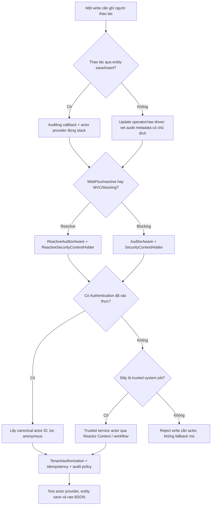

# Lấy người thao tác từ ngữ cảnh bảo mật tương ứng

Một đơn hàng được tạo bởi người dùng `user-123` và sau đó được cập nhật bởi nhân viên `staff-456`. Để truy vết thay đổi, MongoDB có thể lưu `createdBy` và `lastModifiedBy` bên cạnh `createdAt` và `lastModifiedAt`. Nhưng **Spring Data MongoDB không thể tự đoán người thao tác từ một HTTP request, JWT hay thread bất kỳ**. Ứng dụng phải cung cấp một cách lấy identity **đáng tin cậy** từ ngữ cảnh xác thực tương ứng với mô hình thực thi.

Trong ứng dụng Spring MVC sử dụng driver blocking, ngữ cảnh thường được đọc qua `SecurityContextHolder` và tích hợp với `AuditorAware<T>`. Trong ứng dụng WebFlux với **Spring Data MongoDB Reactive**, ngữ cảnh bảo mật nằm trong **Reactor Context** và auditing phải dùng `ReactiveAuditorAware<T>` kết hợp `ReactiveSecurityContextHolder`. Trộn lẫn hai mô hình này có thể khiến trường người thao tác bị trống, ghi sai tài khoản hoặc thậm chí lấy identity của một request khác.

Ví dụ dữ liệu mong muốn:

```javascript
{
  _id: ObjectId("..."),
  tenantId: "T1",
  externalId: "ORDER-100",
  status: "PAID",
  createdBy: "idp:user-123",
  lastModifiedBy: "idp:staff-456",
  createdAt: ISODate("2026-11-20T09:00:00Z"),
  lastModifiedAt: ISODate("2026-11-20T09:05:00Z")
}
```

Hai giá trị `createdBy` và `lastModifiedBy` trên đây là **định danh ổn định**, không phải tên hiển thị, bearer token, mật khẩu hay địa chỉ IP. Quy ước cụ thể của định danh phụ thuộc identity provider và thiết kế của ứng dụng; nếu có nhiều issuer hoặc nhiều tenant, phải chuẩn hóa để tránh trùng danh tính.

Bài thuộc chương **Auditing** của module **SPRING_DATA_MONGODB**: sử dụng Spring Data MongoDB để kết nối, ánh xạ document và thao tác qua `MongoTemplate` hoặc repository; thực hành truy vấn, aggregation, index, transaction, reactive access, kiểm thử và chẩn đoán dữ liệu. Trọng tâm của bài là **lấy đúng người thao tác tại thời điểm auditing** trên cả luồng synchronous và reactive, chứ không chỉ thêm annotation vào entity.

Sau bài này, bạn có thể:

1. Phân biệt vai trò của `@CreatedBy`, `@LastModifiedBy` với `@CreatedDate`, `@LastModifiedDate`.
2. Sử dụng đúng `AuditorAware<T>`/`@EnableMongoAuditing` cho **imperative** và `ReactiveAuditorAware<T>`/`@EnableReactiveMongoAuditing` cho **reactive**.
3. Hiểu nguồn identity từ `SecurityContextHolder` so với `ReactiveSecurityContextHolder`, và lý do `ThreadLocal` không phải nguồn ổn định trong pipeline WebFlux.
4. Phân biệt user thật, anonymous authentication, JWT subject, username và service account.
5. Tạo `createdBy`/`lastModifiedBy` đáng tin cậy, không lấy trực tiếp từ request body/header do client sửa được.
6. Thiết kế hành vi khi **không có security context** trong batch job, message consumer hoặc tác vụ nền.
7. Nhận diện đường ghi `insert/save` có auditing và đường `updateFirst/updateMulti/raw driver` không đi qua entity auditing callback tương tự.
8. Kiểm thử người tạo/người sửa khác nhau, chuyển đổi Reactor Context, không có auditor, nhiều tenant và dữ liệu BSON thực.

## 1. Auditing lưu những dữ liệu gì?

### 1.1. Bốn trường phổ biến

Spring Data cung cấp metadata annotations trong package `org.springframework.data.annotation`:

| Annotation | Trường Java điển hình | Ý nghĩa |
| --- | --- | --- |
| `@CreatedBy` | `String createdBy` | Ai tạo document/aggregate |
| `@LastModifiedBy` | `String lastModifiedBy` | Ai thực hiện thay đổi được ghi nhận gần nhất |
| `@CreatedDate` | `Instant createdAt` | Thời điểm tạo theo auditing |
| `@LastModifiedDate` | `Instant lastModifiedAt` | Thời điểm cập nhật theo auditing |

`@CreatedBy` và `@LastModifiedBy` **không tự biết** identity. Chúng chỉ đánh dấu field cần điền bằng thông tin do `AuditorAware<T>` hoặc `ReactiveAuditorAware<T>` cung cấp khi auditing infrastructure thực thi.

### 1.2. Phân biệt audit actor với audit time

Thời điểm có thể lấy từ `DateTimeProvider`/clock khi auditing được cấu hình; người thao tác cần một **identity source**. Nếu có timestamp nhưng `createdBy` rỗng, điều đó không nhất thiết chứng minh không có ai thao tác: có thể auditing actor provider chưa đăng ký, security context không tồn tại trong subscription, hoặc thao tác ghi đã bypass entity callbacks.

Ngược lại, một field `createdBy` có giá trị **không tự chứng minh** nó được tạo bởi Spring Security; mọi script có quyền ghi có thể tự gửi một field cùng tên nếu database không có kiểm soát thích hợp. Auditing là metadata hữu ích để truy vết, nhưng không phải log pháp chứng bất biến chỉ bằng cách gắn annotation.

### 1.3. Tên người thao tác nên là một identity ổn định

Không nên lưu:

- `authentication.toString()`: có thể chứa thông tin nội bộ/không ổn định.
- JWT đầy đủ hoặc header `Authorization`: lộ bearer credential.
- `password`, `credentials`, session ID.
- Display name hoặc email như một khóa vĩnh viễn nếu chúng có thể thay đổi.
- `"anonymousUser"` như thể đó là một người dùng đã xác thực.
- `tenantId` thay cho user ID: tenant là **phạm vi**, không phải cá nhân thao tác.

Nên dùng một định danh đã chuẩn hóa, ví dụ `"user:internal-42"`, hoặc cặp `issuer + subject` đã được xác thực. Nếu dùng `Authentication.getName()`, phải hiểu **ý nghĩa của getName theo loại Authentication** và chính sách của hệ thống. Trong một số cơ chế nó là username, trong JWT có thể là `sub` hoặc claim được cấu hình lại, không phải một định nghĩa bất biến cho mọi nhà cung cấp.

## 2. Nguồn dữ liệu: thực thể, yêu cầu HTTP và ngữ cảnh xác thực

### 2.1. Không lấy actor từ request body

Ví dụ API không an toàn:

```json
{
  "externalId": "ORDER-100",
  "status": "NEW",
  "createdBy": "admin"
}
```

Client có thể gửi `createdBy` tùy ý. Dù `@NotBlank` kiểm tra chuỗi này, nó vẫn có thể giả mạo người thao tác.

Một DTO tạo đơn nên chỉ chứa dữ liệu client được phép cung cấp:

```java
public record CreateOrderRequest(
    String externalId,
    java.math.BigDecimal totalAmount
) {}
```

Service tạo entity bằng **tenant/identity đã được xác thực**, còn `createdBy` do auditing điền từ security context khi thực sự save.

### 2.2. Vai trò của `Authentication`

Sau khi Spring Security xác thực request, `Authentication` mô tả principal, quyền và trạng thái xác thực. Những thuộc tính đáng quan tâm:

| API/thông tin | Dùng để làm gì | Điểm cần cẩn trọng |
| --- | --- | --- |
| `isAuthenticated()` | Cho biết authentication được đánh dấu là đã xác thực | Anonymous authentication mặc định cũng có thể có `true` |
| `getName()` | Tên định danh theo implementation | Không luôn là internal user ID |
| `getPrincipal()` | Đối tượng principal | Có thể là `UserDetails`, OAuth principal hoặc object khác |
| `getAuthorities()` | Quyền/role | Role không phải identity |
| JWT `sub` | Subject claim được issuer cấp | Có thể cần ghép issuer để tránh trùng |
| JWT `iss` | Issuer claim | Chỉ tin khi token đã được **xác thực/kiểm chứng** |

**Không tự parse một JWT chưa qua authentication rồi dùng `sub` làm auditor.** Chỉ dùng thông tin của một `Authentication` đã được Spring Security xác thực theo cấu hình phù hợp, hoặc một identity được trust boundary tương đương xác nhận.

### 2.3. Sơ đồ dòng thông tin

```text
HTTP request / message / scheduled command
                  │
                  ▼
Authentication / trusted execution boundary
                  │
       ┌──────────┴──────────┐
       │                     │
       ▼                     ▼
Servlet SecurityContext    Reactor SecurityContext
ThreadLocal thường dùng    Subscriber Context
       │                     │
       ▼                     ▼
AuditorAware<T>         ReactiveAuditorAware<T>
       │                     │
       ▼                     ▼
Mongo auditing           Reactive Mongo auditing
       └──────────┬──────────┘
                  ▼
          createdBy / lastModifiedBy
                  │
                  ▼
        BSON được ghi vào MongoDB
```

Các nhánh ở đây biểu diễn **hai cấu hình ứng dụng khác nhau**, không khuyến nghị bật cả hai loại auditor cùng lúc chỉ vì một dự án có Spring Security.

## 3. Imperative: `AuditorAware<T>` và `SecurityContextHolder`

### 3.1. Hợp đồng `AuditorAware<T>`

Với ứng dụng Spring MVC hoặc service dùng `MongoTemplate`/`MongoRepository` blocking, Spring Data Commons cung cấp:

```java
import java.util.Optional;
import org.springframework.data.domain.AuditorAware;

public interface AuditorAware<T> {
    Optional<T> getCurrentAuditor();
}
```

`Optional.empty()` có nghĩa ở lần gọi đó **không tìm thấy identity** từ provider. Nó không nên được tự động biến thành `"SYSTEM"` cho mọi request HTTP, vì như vậy có thể che lỗi cấu hình security hoặc thao tác trái phép.

### 3.2. Implementation lấy từ Spring Security

```java
package com.example.audit.imperative;

import java.util.Optional;
import org.springframework.data.domain.AuditorAware;
import org.springframework.security.authentication.AnonymousAuthenticationToken;
import org.springframework.security.core.Authentication;
import org.springframework.security.core.context.SecurityContextHolder;
import org.springframework.stereotype.Component;

@Component("mvcAuditorAware")
public class SecurityAuditorAware
        implements AuditorAware<String> {

    @Override
    public Optional<String> getCurrentAuditor() {
        Authentication authentication =
            SecurityContextHolder.getContext()
                .getAuthentication();

        if (authentication == null
                || !authentication.isAuthenticated()
                || authentication instanceof AnonymousAuthenticationToken) {
            return Optional.empty();
        }

        String name = authentication.getName();
        if (name == null || name.isBlank()) {
            return Optional.empty();
        }

        return Optional.of("user:" + name);
    }
}
```

Ở ví dụ này, `"user:" + name` chỉ phù hợp **nếu cấu hình xác thực của ứng dụng đảm bảo `getName()` là internal user ID ổn định**. Nếu có nhiều identity providers, JWT, OAuth2 login hoặc user có thể đổi username, phải thay cách map bằng một canonical actor ID phù hợp, như phần 6.

### 3.3. Bật auditing cho MongoDB imperative

```java
package com.example.audit.imperative;

import org.springframework.context.annotation.Configuration;
import org.springframework.data.mongodb.config.EnableMongoAuditing;

@Configuration
@EnableMongoAuditing(auditorAwareRef = "mvcAuditorAware")
public class MongoAuditingConfiguration {
}
```

`auditorAwareRef` chọn đúng bean cung cấp người thao tác. Nếu có nhiều bean `AuditorAware` nhưng không chỉ định bean rõ ràng, cấu hình có thể trở nên mơ hồ; nên đặt tên có chủ đích.

### 3.4. Tại sao cách này không đủ cho WebFlux?

`SecurityContextHolder` mặc định gắn context vào **ThreadLocal**. Trong reactive pipeline, execution có thể di chuyển qua threads hoặc được subscriber điều phối bất đồng bộ. Một callback MongoDB reactive đọc ThreadLocal không được bảo đảm thấy cùng authentication với HTTP request khởi tạo tác vụ.

Ví dụ sai:

```java
// KHÔNG NÊN dùng cho ReactiveAuditorAware trong WebFlux:
Authentication auth = SecurityContextHolder
    .getContext().getAuthentication();
```

Ngay cả khi đoạn này “có vẻ chạy” trong một test đơn giản, nó không phải hợp đồng nguồn security context phù hợp cho Reactor. Với WebFlux, chuyển sang `ReactiveSecurityContextHolder` và `ReactiveAuditorAware<T>`.

## 4. Reactive: `ReactiveAuditorAware<T>` và `ReactiveSecurityContextHolder`

### 4.1. Hợp đồng reactive

Trong Spring Data Commons, `ReactiveAuditorAware<T>` cung cấp người thao tác bằng một Publisher:

```java
import org.springframework.data.domain.ReactiveAuditorAware;
import reactor.core.publisher.Mono;

public interface ReactiveAuditorAware<T> {
    Mono<T> getCurrentAuditor();
}
```

Khác với `Optional<T>` của imperative, `Mono<T>` cho phép lấy identity **khi có subscription**, phù hợp với Reactor Context. Những signal quan trọng:

| Publisher | Ý nghĩa |
| --- | --- |
| `Mono.just(actorId)` | Có một người thao tác đáng tin cậy |
| `Mono.empty()` | Không có auditor ở lần gọi này |
| `Mono.error(error)` | Không thể xác định identity do lỗi thật |

**`Mono.empty()` không phải `Mono.just(null)`.** Reactor không cho phép phát `null` như một `onNext`. Khi không có context, provider có thể hoàn thành rỗng; nếu nghiệp vụ yêu cầu bắt buộc có người thao tác, service/boundary phải biến trường hợp đó thành lỗi có chủ đích trước khi ghi.

### 4.2. Lấy security context từ Reactor

`ReactiveSecurityContextHolder.getContext()` trả `Mono<SecurityContext>`. Security context được lưu trong **Reactor subscriber Context**, không phải một biến thread-local tĩnh cho mọi pipeline.

Một implementation tối thiểu:

```java
package com.example.audit.reactive;

import org.springframework.data.domain.ReactiveAuditorAware;
import org.springframework.security.authentication.AnonymousAuthenticationToken;
import org.springframework.security.core.Authentication;
import org.springframework.security.core.context.ReactiveSecurityContextHolder;
import org.springframework.security.core.context.SecurityContext;
import org.springframework.stereotype.Component;
import reactor.core.publisher.Mono;

@Component("securityAuditorAware")
public class SecurityReactiveAuditorAware
        implements ReactiveAuditorAware<String> {

    @Override
    public Mono<String> getCurrentAuditor() {
        return ReactiveSecurityContextHolder.getContext()
            .flatMap(ctx ->
                Mono.justOrEmpty(ctx.getAuthentication())
            )
            .filter(auth -> auth.isAuthenticated()
                && !(auth instanceof AnonymousAuthenticationToken))
            .map(Authentication::getName)
            .filter(name -> !name.isBlank())
            .map(name -> "user:" + name);
    }
}
```

Mẫu trên phù hợp để hiểu **đường lấy context**, nhưng chưa phải canonical identity mapping đầy đủ cho JWT, nhiều issuer hay service accounts. Điều kiện `isAuthenticated()` **một mình không đủ**: Spring Security có thể đại diện anonymous bằng `AnonymousAuthenticationToken` với `isAuthenticated() == true`. Khi áp dụng nhiều phương thức xác thực hoặc custom authentication, nên dùng `AuthenticationTrustResolver`/policy kiểm tra anonymous phù hợp.

### 4.3. Bật reactive MongoDB auditing

```java
package com.example.audit.reactive;

import org.springframework.context.annotation.Configuration;
import org.springframework.data.mongodb.config.EnableReactiveMongoAuditing;

@Configuration
@EnableReactiveMongoAuditing(
    auditorAwareRef = "securityAuditorAware"
)
public class ReactiveMongoAuditingConfiguration {
}
```

Đây là cấu hình dành cho **reactive MongoDB infrastructure**; nó không phải một cách “làm async” của `@EnableMongoAuditing`. Tùy ứng dụng và phiên bản Spring Data, bạn phải có `ReactiveMongoTemplate` hoặc `ReactiveMongoRepository` kết nối với MongoDB reactive driver, và bean `ReactiveAuditorAware<String>` đúng kiểu.

**Chọn đúng cặp:**

| Kiểu ứng dụng/lưu trữ | Cấu hình bật auditing | Provider |
| --- | --- | --- |
| `MongoTemplate`, `MongoRepository` blocking | `@EnableMongoAuditing` | `AuditorAware<T>` |
| `ReactiveMongoTemplate`, `ReactiveMongoRepository` | `@EnableReactiveMongoAuditing` | `ReactiveAuditorAware<T>` |

Không khai báo `AuditorAware<String>` rồi kỳ vọng auditing reactive gọi nó tự động. Tương tự, `ReactiveAuditorAware` không thay thế provider của imperative path.

### 4.4. Đặt provider trong pipeline, không subscribe thủ công

Sai:

```java
@Override
public Mono<String> getCurrentAuditor() {
    ReactiveSecurityContextHolder.getContext()
        .subscribe(ctx -> log.debug(
            "Authentication: {}", ctx.getAuthentication()
        ));
    return Mono.just("SYSTEM");
}
```

Mã trên tách một subscription không có đảm bảo giữ nguyên Reactor Context từ luồng cần auditing, rồi trả một giá trị SYSTEM giả. Auditing có thể ghi sai người thao tác.

Đúng:

```java
@Override
public Mono<String> getCurrentAuditor() {
    return ReactiveSecurityContextHolder.getContext()
        .flatMap(ctx ->
            Mono.justOrEmpty(ctx.getAuthentication())
        )
        .filter(Authentication::isAuthenticated)
        .flatMap(auth -> Mono.justOrEmpty(
            actorIdFromTrustedAuthentication(auth)
        ));
}
```

`actorIdFromTrustedAuthentication` là hàm do ứng dụng cung cấp, phải kiểm tra anonymous/identity hợp lệ như phần 6. **Return Publisher** cho Spring Data; không gọi `block()` hoặc `subscribe()` trong provider.

## 5. Entity audit và luồng `insert/save`

### 5.1. Entity rõ ràng về kiểu người thao tác

```java
package com.example.audit.domain;

import java.math.BigDecimal;
import java.time.Instant;
import org.bson.types.ObjectId;
import org.springframework.data.annotation.CreatedBy;
import org.springframework.data.annotation.CreatedDate;
import org.springframework.data.annotation.Id;
import org.springframework.data.annotation.LastModifiedBy;
import org.springframework.data.annotation.LastModifiedDate;
import org.springframework.data.annotation.Version;
import org.springframework.data.mongodb.core.mapping.Document;
import org.springframework.data.mongodb.core.mapping.Field;
import org.springframework.data.mongodb.core.mapping.FieldType;

@Document(collection = "orders_auditing_lab")
public class OrderDocument {

    @Id
    private ObjectId id;

    private String tenantId;
    private String externalId;
    private String status;

    @Field(targetType = FieldType.DECIMAL128)
    private BigDecimal totalAmount;

    @CreatedBy
    private String createdBy;

    @LastModifiedBy
    private String lastModifiedBy;

    @CreatedDate
    private Instant createdAt;

    @LastModifiedDate
    private Instant lastModifiedAt;

    @Version
    private Long version;

    protected OrderDocument() {}

    public OrderDocument(
            String tenantId,
            String externalId,
            BigDecimal totalAmount) {
        this.tenantId = tenantId;
        this.externalId = externalId;
        this.totalAmount = totalAmount;
        this.status = "NEW";
    }

    public ObjectId getId() { return id; }
    public String getTenantId() { return tenantId; }
    public String getExternalId() { return externalId; }
    public String getStatus() { return status; }
    public BigDecimal getTotalAmount() { return totalAmount; }
    public String getCreatedBy() { return createdBy; }
    public String getLastModifiedBy() { return lastModifiedBy; }
    public Instant getCreatedAt() { return createdAt; }
    public Instant getLastModifiedAt() { return lastModifiedAt; }
    public Long getVersion() { return version; }

    public void markPaid() {
        if (!"NEW".equals(status)) {
            throw new IllegalStateException(
                "Order không còn ở trạng thái NEW"
            );
        }
        status = "PAID";
    }
}
```

Ví dụ dùng `String` cho actor ID; do đó provider tương ứng phải là `ReactiveAuditorAware<String>` hoặc `AuditorAware<String>` theo stack. Không dùng `ReactiveAuditorAware<User>` để cấp một object User cho field `String` nếu chưa có chuyển đổi/mapping rõ ràng.

`@Version` giúp Spring Data hỗ trợ optimistic locking trên những đường entity save phù hợp; nó **không liên quan trực tiếp** tới việc lấy người thao tác. Kết quả new/update cần được test với chiến lược nhận diện entity mới: `id`, version và `Persistable` (nếu dùng) ảnh hưởng tới auditing tạo mới/cập nhật.

### 5.2. Diễn biến khi tạo document mới

Trong ứng dụng WebFlux đã cấu hình auditing:

```text
HTTP request của user-123
        │
        ▼
Spring Security xác thực → Reactive SecurityContext
        │
        ▼
Controller/service gọi repository.insert(order)
        │
        ▼
Subscriber kích hoạt reactive save pipeline
        │
        ▼
Reactive auditing callback ở before-convert
        │
        ├─ ReactiveAuditorAware.getCurrentAuditor()
        │      → "user:user-123"
        │
        ├─ createdBy = "user:user-123"
        └─ createdAt = thời điểm auditing
        │
        ▼
MappingMongoConverter → BSON → MongoDB insert
        │
        ▼
Subscriber nhận saved entity / completion
```

Tùy cấu hình `modifyOnCreate` và version, các trường `lastModifiedBy`/`lastModifiedAt` cũng có thể được đặt khi **insert**. Vì vậy không nên assert chúng bắt buộc là `null` ngay sau insert trừ khi đã cấu hình rõ chính sách đó.

### 5.3. Diễn biến khi chỉnh sửa

```text
Update request của staff-456
        │
        ▼
Reactive SecurityContext chứa staff-456
        │
        ▼
Repository find → entity (có createdBy user-123)
        │
        ▼
Service đổi trạng thái → repository.save(entity)
        │
        ▼
Auditing phát hiện update theo isNew/version mapping
        │
        ├─ Giữ createdBy/createdAt ban đầu
        ├─ lastModifiedBy = "user:staff-456"
        └─ lastModifiedAt = thời điểm update
        │
        ▼
MongoDB write → updated entity
```

Không được mặc định một lời gọi `save` luôn là update: nếu object bị xem là **new** do ID/version/mapping, auditing có thể đi nhánh create. Đối với thao tác sửa, nên load document đã tồn tại và giữ version để tránh tạo/ghi đè ngoài ý định.

### 5.4. Auditing không phải lịch sử đầy đủ mọi thay đổi

`lastModifiedBy` chỉ lưu actor gần nhất theo cơ chế ghi hiện tại. Nó không kể lại các lần trước, không cho biết field nào đã thay đổi và không tự giải thích **vì sao** actor đó được phép thao tác.

Nếu cần lịch sử bất biến:

- Lưu audit events riêng với command ID và thay đổi có chủ đích.
- Xác định trách nhiệm của log ứng dụng, outbox và MongoDB change streams.
- Cân nhắc retention, quyền truy cập, masking dữ liệu cá nhân và chính sách đối soát.
- Không coi trường `lastModifiedBy` là chứng cứ đầy đủ của mọi thao tác trong hệ thống.

## 6. Chọn canonical actor ID từ JWT và các loại principal

### 6.1. Vì sao `getName()` có thể chưa đủ?

Trong một hệ thống đơn giản, `Authentication.getName()` có thể là username nội bộ. Nhưng trong ứng dụng OAuth2 resource server:

- `JwtAuthenticationToken` có JWT và các claim `sub`, `iss`.
- `getName()` có thể được đặt theo claim khác khi tùy chỉnh converter.
- Hai identity providers có thể cấp cùng `sub = "123"` cho hai cá nhân khác nhau.
- Username/display name có thể đổi theo thời gian.
- Một JWT service-to-service có thể có subject là **service account**, không phải nhân viên.

Nên định nghĩa **identity policy** tường minh. Ví dụ với JWT nhiều issuer, khóa định danh có thể gồm namespace và một cặp `(issuer,subject)` đã được xác thực, hoặc ánh xạ sang user ID nội bộ qua một service tin cậy.

### 6.2. Provider reactive có kiểm tra anonymous và JWT

```java
package com.example.audit.reactive;

import java.net.URI;
import org.springframework.data.domain.ReactiveAuditorAware;
import org.springframework.security.authentication.AuthenticationTrustResolver;
import org.springframework.security.authentication.AuthenticationTrustResolverImpl;
import org.springframework.security.core.Authentication;
import org.springframework.security.core.context.ReactiveSecurityContextHolder;
import org.springframework.security.core.context.SecurityContext;
import org.springframework.security.oauth2.server.resource.authentication.JwtAuthenticationToken;
import org.springframework.stereotype.Component;
import reactor.core.publisher.Mono;

@Component("securityAuditorAware")
public final class SecurityReactiveAuditorAware
        implements ReactiveAuditorAware<String> {

    private final AuthenticationTrustResolver trustResolver =
        new AuthenticationTrustResolverImpl();

    @Override
    public Mono<String> getCurrentAuditor() {
        return ReactiveSecurityContextHolder.getContext()
            .flatMap(ctx ->
                Mono.justOrEmpty(ctx.getAuthentication())
            )
            .filter(auth -> auth.isAuthenticated()
                && !trustResolver.isAnonymous(auth))
            .flatMap(auth -> Mono.justOrEmpty(
                canonicalActorId(auth)
            ));
    }

    private String canonicalActorId(Authentication auth) {
        if (auth instanceof JwtAuthenticationToken jwtAuth) {
            String subject = jwtAuth.getToken().getSubject();
            URI issuer = jwtAuth.getToken().getIssuer();

            if (subject == null || subject.isBlank()
                    || issuer == null) {
                return null;
            }

            // Ví dụ minh họa: phải chuẩn hóa namespace/issuer
            // theo chính sách identity của ứng dụng.
            return "jwt:" + issuer + "#sub=" + subject;
        }

        // Chỉ dùng với authentication provider mà ứng dụng
        // đã xác nhận getName() là stable internal principal ID.
        String name = auth.getName();
        if (name == null || name.isBlank()) {
            return null;
        }
        return "local:" + name;
    }
}
```

Đây là **phiên bản đầy đủ hơn** của implementation tối thiểu ở mục 4.2. Chọn **một** class provider trong dự án thật, không đăng ký cả hai dưới cùng tên bean `securityAuditorAware`.

Đối với JWT:

1. `sub` và `iss` chỉ được đọc từ `JwtAuthenticationToken` do **Spring Security đã xác thực**.
2. `issuer` dùng để phân biệt cùng subject ở nhiều nhà cấp token. Nếu ứng dụng chỉ cho phép một issuer, quy ước có thể đơn giản hơn nhưng phải rõ ràng.
3. Chuỗi ghép chỉ minh họa. Trong production, nên dùng encoding/canonical mapping không tạo va chạm, đồng thời giới hạn độ dài actor ID.
4. Nếu principal đại diện **service account**, cần định nghĩa cách lưu actor type riêng; không tự ghi rằng đó là người dùng cuối.
5. Nếu dùng `OAuth2AuthenticationToken`, opaque-token authentication hoặc custom `Authentication`, phải có mapping riêng tương ứng với cơ chế đã xác thực của hệ thống.

### 6.3. Email, username, subject và internal ID

| Ứng viên làm actor ID | Ưu điểm | Rủi ro |
| --- | --- | --- |
| Display name | Dễ đọc | Trùng và có thể đổi |
| Email | Dễ đối chiếu | Có thể đổi, chứa PII |
| Username | Dễ lấy từ `getName` | Không luôn duy nhất trên mọi provider |
| JWT `sub` | Thường ổn định trong issuer | Cần phân biệt issuer |
| `(issuer, sub)` | Phân biệt nguồn danh tính | Cần canonical encoding và xác thực issuer |
| Internal immutable user ID | Hợp với domain dài hạn | Cần mapping tin cậy từ principal |
| Service account ID | Rõ actor máy/tác vụ | Không đại diện người dùng cuối |

Lựa chọn tốt trong nhiều hệ thống là lưu **internal immutable user ID** và các metadata nguồn cần thiết. Nếu không có internal identity, `(issuer,sub)` đã xác thực là một lựa chọn khả thi; không lưu token thô.

### 6.4. Nhiều issuer và tenant

`tenantId`, `userId`, `issuer` và `role` không cùng chức năng:

```text
issuer   = nguồn xác thực
subject  = định danh principal trong issuer
userId   = canonical ID trong domain (nếu có)
tenantId = phạm vi dữ liệu/người dùng được phép truy cập
role     = tập quyền
```

Auditing có thể lưu actor ID, nhưng điều kiện write **vẫn phải kiểm tra tenant** từ authentication/authorization. Một người dùng có thể được phép thao tác trong nhiều tenant; ngược lại hai người có cùng email hiển thị không được xem là cùng actor nếu identity khác.

## 7. Khi không có security context: empty, lỗi hay system actor?

Một hệ thống Spring Data MongoDB có nhiều đường ghi:

```text
HTTP request có JWT / session       → người dùng cuối
Scheduled reconciliation            → service account
Kafka/RabbitMQ consumer             → người gửi sự kiện hoặc service account
Data migration chạy có kiểm soát    → migration actor
Integration test                    → test actor
Admin script / mongosh              → không qua Spring Data auditing
```

Nếu chỉ viết `ReactiveSecurityContextHolder.getContext()`, một batch job thường **không có HTTP SecurityContext**. Điều đó không có nghĩa mọi batch job là “anonymous”; nó có thể là thao tác **được hệ thống ủy quyền** cần gắn actor riêng.

### 7.1. Ba chính sách hợp lệ nhưng có ý nghĩa khác nhau

| Trường hợp | Cách xử lý nên cân nhắc | Tại sao |
| --- | --- | --- |
| API ghi dữ liệu do người dùng thực hiện nhưng thiếu authentication | **Reject** ở security/service boundary | Không ghi mù dưới tên SYSTEM |
| Luồng đọc công khai không cần auditing actor | `Mono.empty()` có thể được chấp nhận | Không phải mọi read đều cần auditor |
| Job hệ thống đã được cho phép ghi | Truyền actor hệ thống **có danh tính** | Phân biệt `svc:reconciliation` với user |
| Consumer xử lý thay mặt user từ message | Xác thực nguồn message và subject được ủy quyền | Không tin một trường `actorId` do producer không đáng tin gửi |
| Migration admin | Gắn actor migration trong workflow riêng | Điều tra lịch sử thay đổi sau này |

Không viết:

```java
// Nguy hiểm nếu dùng toàn cục cho mọi request WebFlux:
return securityActor.defaultIfEmpty("SYSTEM");
```

Vì một route thiếu security context do cấu hình sai sẽ âm thầm được ghi thành SYSTEM, khiến audit không còn phản ánh chính xác request.

### 7.2. Bắt buộc có người thao tác ngay tại service boundary

Giả sử mọi lệnh tạo đơn HTTP phải có actor xác thực. Service có thể kiểm tra sớm:

```java
package com.example.audit.reactive;

import java.math.BigDecimal;
import com.example.audit.domain.OrderDocument;
import org.springframework.data.domain.ReactiveAuditorAware;
import org.springframework.security.access.AccessDeniedException;
import org.springframework.stereotype.Service;
import reactor.core.publisher.Mono;

@Service
public class ReactiveOrderWriteService {

    private final ReactiveOrderRepository repository;
    private final ReactiveAuditorAware<String> auditorAware;

    public ReactiveOrderWriteService(
            ReactiveOrderRepository repository,
            ReactiveAuditorAware<String> auditorAware) {
        this.repository = repository;
        this.auditorAware = auditorAware;
    }

    public Mono<OrderDocument> create(
            String trustedTenantId,
            String externalId,
            BigDecimal amount) {

        if (trustedTenantId == null || trustedTenantId.isBlank()
                || externalId == null || externalId.isBlank()
                || amount == null || amount.signum() < 0) {
            return Mono.error(
                new IllegalArgumentException("Payload không hợp lệ")
            );
        }

        return auditorAware.getCurrentAuditor()
            .switchIfEmpty(Mono.error(
                new AccessDeniedException(
                    "Yêu cầu một người thao tác đã xác thực"
                )
            ))
            .flatMap(ignoredAuditor ->
                repository.insert(
                    new OrderDocument(
                        trustedTenantId, externalId, amount
                    )
                )
            );
    }
}
```

`ReactiveOrderRepository` là interface minh họa:

```java
package com.example.audit.reactive;

import com.example.audit.domain.OrderDocument;
import org.bson.types.ObjectId;
import org.springframework.data.mongodb.repository.ReactiveMongoRepository;

public interface ReactiveOrderRepository
        extends ReactiveMongoRepository<OrderDocument, ObjectId> {
}
```

**Hai lần lấy auditor có thể xảy ra:** service gọi `getCurrentAuditor()` để yêu cầu actor, sau đó auditing callback gọi lại lúc `insert`. Vì cả hai cùng thuộc một **reactive subscriber context** hợp lệ, chúng nên thấy cùng authentication. Nếu bạn có identity resolver phụ thuộc nguồn bên ngoài hoặc có thể thay đổi giữa hai lần, cần thiết kế cách snapshot/propagate canonical actor ổn định theo command thay vì đọc từ hai nguồn không nhất quán.

Service không trực tiếp đặt `createdBy` từ một tham số user gửi. Nó để auditing callback lấy actor chính thức từ context. Ngoài ra, `trustedTenantId` phải đến từ một **trusted tenant resolver** của security layer; việc đặt tên biến không tự khiến một String đáng tin.

### 7.3. Một cách tránh phụ thuộc vào việc auditor field tự enforce NOT NULL

Nếu collection yêu cầu `createdBy` bắt buộc cho mọi document, có thể cấu hình MongoDB `$jsonSchema` phù hợp (ví dụ field cần là String không blank), sau khi đã giải quyết migration dữ liệu cũ. Tuy nhiên:

- MongoDB schema chỉ kiểm tra BSON field, **không chứng minh** actor đó đã qua authentication.
- Một script có thể cố ghi `createdBy = "admin"` nếu tài khoản có quyền ghi.
- Cấu hình `validationAction: "warn"` không chặn write vi phạm.
- API vẫn phải xác thực và phân quyền trước ghi.

Vì vậy, **service authentication + auditor provider + DB validation/permissions** là những lớp bổ sung, không thay thế nhau.

## 8. Tác vụ nền: truyền system actor qua Reactor Context có chủ đích

Đối với batch job không có HTTP security context, có thể gắn actor hệ thống từ **mã nội bộ đáng tin**, rồi để auditor reactive đọc từ Reactor Context khi không có principal xác thực.

### 8.1. Khóa context không phải request header

```java
package com.example.audit.reactive;

import reactor.util.context.Context;
import java.util.function.Function;

public final class AuditActorContext {

    public static final String KEY =
        AuditActorContext.class.getName() + ".actorId";

    private AuditActorContext() {}

    public static Function<Context, Context> systemActor(
            String actorId) {
        if (actorId == null
                || !actorId.startsWith("svc:")
                || actorId.length() <= 4
                || actorId.isBlank()) {
            throw new IllegalArgumentException(
                "System actor ID không hợp lệ"
            );
        }
        return context -> context.put(KEY, actorId);
    }
}
```

`KEY` phải chỉ được set bởi code orchestration đã được phép thực hiện thao tác hệ thống. **Không** nhận giá trị actor từ HTTP header hay body rồi đặt trực tiếp vào context này. `Reactor Context` là cơ chế vận chuyển metadata trong ứng dụng, **không tự xác thực giá trị**.

### 8.2. Provider ưu tiên security actor, chỉ fallback có điều kiện

Thay implementation provider đơn nguồn ở mục 6 bằng biến thể **chỉ dùng khi hệ thống thật sự có batch actor policy**:

```java
package com.example.audit.reactive;

import java.net.URI;
import org.springframework.data.domain.ReactiveAuditorAware;
import org.springframework.security.authentication.AuthenticationTrustResolver;
import org.springframework.security.authentication.AuthenticationTrustResolverImpl;
import org.springframework.security.core.Authentication;
import org.springframework.security.core.context.ReactiveSecurityContextHolder;
import org.springframework.security.core.context.SecurityContext;
import org.springframework.security.oauth2.server.resource.authentication.JwtAuthenticationToken;
import org.springframework.stereotype.Component;
import reactor.core.publisher.Mono;

@Component("securityAuditorAware")
public final class ContextAwareReactiveAuditorAware
        implements ReactiveAuditorAware<String> {

    private final AuthenticationTrustResolver trustResolver =
        new AuthenticationTrustResolverImpl();

    @Override
    public Mono<String> getCurrentAuditor() {
        return authenticatedActor()
            .switchIfEmpty(Mono.deferContextual(context -> {
                if (!context.hasKey(AuditActorContext.KEY)) {
                    return Mono.empty();
                }

                String actorId = context.get(
                    AuditActorContext.KEY
                );
                if (!actorId.startsWith("svc:")
                        || actorId.length() <= 4) {
                    return Mono.error(
                        new IllegalStateException(
                            "Invalid system actor context"
                        )
                    );
                }
                return Mono.just(actorId);
            }));
    }

    private Mono<String> authenticatedActor() {
        return ReactiveSecurityContextHolder.getContext()
            .flatMap(ctx ->
                Mono.justOrEmpty(ctx.getAuthentication())
            )
            .filter(auth -> auth.isAuthenticated()
                && !trustResolver.isAnonymous(auth))
            .flatMap(auth ->
                Mono.justOrEmpty(mapActor(auth))
            );
    }

    private String mapActor(Authentication auth) {
        if (auth instanceof JwtAuthenticationToken jwt) {
            String subject = jwt.getToken().getSubject();
            URI issuer = jwt.getToken().getIssuer();
            if (issuer == null || subject == null
                    || subject.isBlank()) {
                return null;
            }
            return "jwt:" + issuer + "#sub=" + subject;
        }

        String name = auth.getName();
        return name == null || name.isBlank()
            ? null
            : "local:" + name;
    }
}
```

Lưu ý:

1. Đây là **implementation thay thế**, **không** đăng ký cùng lúc với `SecurityReactiveAuditorAware` của mục 6 dưới cùng bean name.
2. `authenticatedActor()` được ưu tiên. Khi đã có người dùng xác thực, một actor hệ thống trong context không được tự ghi đè principal.
3. Fallback chỉ xảy ra nếu security actor **không phát giá trị**, và chỉ khi context có marker do trusted code set.
4. Nó không tự định nghĩa *ai được phép gắn marker*. Quyền tạo marker cần được giới hạn bằng kiến trúc/module và review code; request không đáng tin phải không thể đi tới đường gắn marker.
5. Nếu không có hai nguồn actor, cách đơn giản hơn ở mục 6 thường dễ kiểm soát hơn.

### 8.3. Truyền actor cho job

```java
package com.example.audit.reactive;

import reactor.core.publisher.Flux;
import reactor.core.publisher.Mono;
import com.example.audit.domain.OrderDocument;

public Mono<Void> importOrders(
        ReactiveOrderRepository repository,
        Iterable<OrderDocument> preparedOrders) {

    return Flux.fromIterable(preparedOrders)
        .concatMap(repository::insert)
        .then()
        .contextWrite(
            AuditActorContext.systemActor("svc:nightly-import")
        );
}
```

Đây là method minh họa bên trong job service, trong đó `preparedOrders` được tạo từ dữ liệu đã xác minh. `concatMap` xử lý tuần tự để dễ quan sát; nếu cần throughput cao, xem xét concurrency/transaction/idempotency tương ứng. **Method trả `Mono<Void>` chưa tự chạy**: một scheduler/worker runtime đủ điều kiện phải sở hữu subscription và xử lý lỗi/completion, không fire-and-forget tùy tiện.

Khi publisher được subscribe, `contextWrite` gắn `"svc:nightly-import"` vào context của chain. Nếu không có security authentication của user, `ContextAwareReactiveAuditorAware` có thể trả system actor này. Các bản ghi tạo ra có `createdBy = "svc:nightly-import"`, giúp phân biệt với người thao tác qua HTTP.

### 8.4. Message consumer cần phân biệt actor hiện tại và actor gốc

Một message có thể do `user-123` yêu cầu nhưng được xử lý bởi `svc:order-consumer`. Hai ý nghĩa:

```text
initiatedBy = user-123   // ai yêu cầu nghiệp vụ ban đầu
executedBy  = svc:order-consumer // tiến trình nào thật sự ghi
```

Một field `createdBy` không đủ diễn đạt cả hai nếu hệ thống có **delegation/impersonation**. Cân nhắc lưu riêng `initiatedBy`, `executedBy`, `onBehalfOf` và command/correlation ID theo policy, và chỉ chấp nhận original actor từ message **được xác thực, ký hoặc qua broker permission phù hợp**. Không tự coi mọi chuỗi `actor` trong payload queue là đáng tin.

### 8.5. Tác vụ migration và danh tính máy

Khi migration có quyền đặc biệt sửa hàng triệu document:

- Gán actor cụ thể như `svc:schema-migration-2026-11`.
- Giữ run ID và change request ID riêng nếu cần điều tra.
- Dùng quyền tối thiểu, scope theo collection/tenant.
- Không ép tất cả migration vào `"SYSTEM"` chung chung làm mất khả năng truy vết.
- Khi migration dùng `updateMany`/raw driver, `@LastModifiedBy` **không tự được điền**; cần update field có chủ đích hoặc lịch sử migration riêng.

## 9. WebFlux controller và service: giữ authentication đến tận thao tác save

### 9.1. Controller không nhận `createdBy` từ client

Một controller nhận request nghiệp vụ và lấy tenant từ **identity đã xác thực**:

```java
package com.example.audit.reactive;

import java.math.BigDecimal;
import org.springframework.web.bind.annotation.PostMapping;
import org.springframework.web.bind.annotation.RequestBody;
import org.springframework.web.bind.annotation.RequestMapping;
import org.springframework.web.bind.annotation.RestController;
import reactor.core.publisher.Mono;

public record CreateOrderRequest(
    String externalId,
    BigDecimal totalAmount
) {}

public record CreatedOrderResponse(
    String id,
    String externalId,
    String createdBy
) {}

public interface TrustedTenantResolver {
    Mono<String> requireTenant();
}

@RestController
@RequestMapping("/api/orders")
public class ReactiveOrderController {

    private final TrustedTenantResolver tenantResolver;
    private final ReactiveOrderWriteService writeService;

    public ReactiveOrderController(
            TrustedTenantResolver tenantResolver,
            ReactiveOrderWriteService writeService) {
        this.tenantResolver = tenantResolver;
        this.writeService = writeService;
    }

    @PostMapping
    public Mono<CreatedOrderResponse> create(
            @RequestBody Mono<CreateOrderRequest> request) {

        return Mono.zip(
                tenantResolver.requireTenant(),
                request
            )
            .flatMap(tuple -> writeService.create(
                tuple.getT1(),
                tuple.getT2().externalId(),
                tuple.getT2().totalAmount()
            ))
            .map(saved -> new CreatedOrderResponse(
                saved.getId().toHexString(),
                saved.getExternalId(),
                saved.getCreatedBy()
            ));
    }
}
```

**Đây là mã minh họa cấu trúc.** Các `record` và `interface` là các top-level types, nên khi đưa vào Java project thực phải đặt trong các file phù hợp. `TrustedTenantResolver` cần được ứng dụng tự triển khai dựa trên authentication và authorization đã xác thực; nó không phải một bean có sẵn trong Spring Data. Cần bổ sung validation cho DTO và error mapping phù hợp.

### 9.2. Không đọc principal bằng `ThreadLocal` trong service reactive

Sai:

```java
String username = SecurityContextHolder
    .getContext().getAuthentication().getName();

return repository.insert(order);
```

Đúng về ý tưởng:

```java
return auditorAware.getCurrentAuditor()
    .switchIfEmpty(Mono.error(
        new AccessDeniedException("Missing authenticated actor")
    ))
    .flatMap(actor -> repository.insert(order));
```

Provider được gọi trong chain và Spring Data reactive auditing tiếp tục dùng cùng security context của subscription khi insert. Nếu code dùng service blocking riêng, hãy thiết kế boundary rõ và kiểm thử cách chuyển authentication; đừng ép `SecurityContextHolder` nhận dữ liệu của một Reactor pipeline bằng cách đoán thread.

### 9.3. Nếu định danh được lấy từ remote profile service

Đôi khi JWT `sub` là external ID và ứng dụng cần ánh xạ thành internal user ID. Nếu ánh xạ phải gọi MongoDB/service khác, hãy cân nhắc hiệu năng:

```java
return ReactiveSecurityContextHolder.getContext()
    .flatMap(ctx ->
        Mono.justOrEmpty(ctx.getAuthentication())
    )
    .flatMap(authentication ->
        userIdentityService.resolveCanonicalId(authentication)
    );
```

`userIdentityService` ở đây là một service **do ứng dụng cung cấp**, được giả định trả `Mono<String>` thật sự non-blocking. Tuy nhiên, đặt một network lookup trong **mọi lần auditing** có thể tạo N+1, tăng latency, khiến database write phụ thuộc hệ thống nhận dạng và gây lỗi vòng lặp nếu service lookup cũng dùng cùng audited repository.

Thường nên:

- Chuẩn hóa principal khi xác thực request nếu có đủ dữ liệu.
- Cache/memoize identity theo security context hoặc command với policy rõ ràng.
- Dùng immutable internal ID từ token/identity store nếu đã được xác minh.
- Chỉ gọi remote mapping khi thật sự cần, có timeout/observability và không dùng fallback actor giả.

### 9.4. Reactive context được truyền theo subscriber

Một pipeline:

```java
return tenantResolver.requireTenant()
    .flatMap(tenant ->
        writeService.create(tenant, externalId, amount)
    )
    .map(saved -> saved.getCreatedBy());
```

Khi được WebFlux subscribe trong ngữ cảnh Spring Security, các toán tử Reactor thường giữ `Context` dọc chuỗi, ngay cả khi `publishOn`/`subscribeOn` thay scheduler theo semantics Reactor. Điều này **khác** cách `SecurityContextHolder` dùng ThreadLocal thông thường.

Nếu tự tạo `CompletableFuture`, một thread ngoài Reactor, hoặc gọi `subscribe()` ở nhánh riêng, việc mang context **không tự được bảo đảm**. Hãy giữ các thao tác trong một Publisher chain hoặc dùng cơ chế context propagation chính thức của framework được cấu hình.

## 10. Lifecycle auditing: khi nào `@CreatedBy` và `@LastModifiedBy` được điền?

### 10.1. Trong MongoDB entity lifecycle

Spring Data MongoDB auditing tích hợp với entity lifecycle callback, thường tại **before-convert** đối với thao tác entity save:

```text
Reactive repository/template insert/save
          │
          ▼
Reactive auditing entity callback
          │ lấy current actor từ ReactiveAuditorAware
          │ set createdBy / lastModifiedBy tùy isNew
          │ set audit dates tùy cấu hình
          ▼
Java entity → BSON Document
          │
          ▼
MongoDB write
          │
          ▼
Saved entity / completion
```

Auditing phải có:

1. Annotation trên field/entity hoặc một audited metadata model được Spring Data nhận diện.
2. Cấu hình auditing (`@EnableReactiveMongoAuditing` hoặc imperative tương ứng).
3. Provider auditor được đăng ký và chọn đúng bean.
4. Đường ghi đi qua **entity mapping pipeline**.
5. Security context/actor khả dụng nếu muốn có giá trị người thao tác.
6. Điều kiện isNew/version đúng để phân biệt tạo và sửa.

### 10.2. Thứ tự với custom callbacks

Khi có nhiều `ReactiveBeforeConvertCallback`, Spring sử dụng cơ chế `Ordered`/`@Order` để xác định thứ tự **trong cùng phase**. Tài liệu Spring Data MongoDB mô tả `ReactiveAuditingEntityCallback` thuộc before-convert và có order mặc định **100** trong các phiên bản được đề cập.

```text
@Order(50) normalize externalId
      ↓
ReactiveAuditingEntityCallback (default order 100)
      ↓
@Order(150) validate fields
      ↓
MappingMongoConverter → BSON
```

Điều này có ích nếu validation cần nhìn giá trị đã audit; nhưng không dựa vào con số 100 cho mọi phiên bản/tùy chỉnh mà không kiểm chứng. Khi logic bắt buộc phụ thuộc thứ tự, **test với cấu hình thực**. Và `@Order(1)` của `ReactiveAfterSaveCallback` **không thể chạy trước** before-convert chỉ vì số nhỏ hơn: hai callback thuộc phase khác nhau.

### 10.3. Khi entity được xem là mới

Spring Data xác định entity mới dựa vào mapping metadata như ID, `@Version`, và đôi khi `Persistable.isNew()` nếu dùng. Một entity có ID do client tự gán từ trước có thể làm cơ chế nhận biết mới khác với entity ID null.

Hệ quả:

- Không thiết kế audit create/update chỉ dựa vào `createdAt == null`.
- Khi dùng `repository.save` như upsert, xác minh behavior isNew trong integration test.
- Với lệnh create, dùng `insert` và unique business key khi phù hợp để tránh ghi đè.
- Với update, load entity hiện tại, giữ `@Version` và tuân thủ optimistic locking.
- Không cho client tự sửa `createdBy` chỉ bằng cách gửi một entity đầy đủ vào `save`.

### 10.4. `modifyOnCreate` và tính nhất quán của trường modified

Một số cấu hình auditing cho phép điều chỉnh việc đặt modified metadata **ngay khi tạo mới**, thường qua `modifyOnCreate`. Nếu bật, một entity mới có thể có cả:

```text
createdBy      = user-123
lastModifiedBy = user-123
createdAt      = T0
lastModifiedAt = T0
```

Nếu tắt, trường modified có thể chưa được đặt khi create. Hãy xác định chính sách của dự án và **test theo cấu hình đó**, thay vì viết test chung luôn kỳ vọng modified field null hoặc luôn bằng created field.

### 10.5. Không phải mọi operation đều tự cập nhật auditor

| API/đường ghi | Entity auditing tự động theo lifecycle? | Cần làm gì |
| --- | --- | --- |
| `MongoRepository.insert/save(entity)` | Có thể áp dụng nếu bật imperative auditing | Xác nhận `AuditorAware` và context |
| `ReactiveMongoRepository.insert/save(entity)` | Có thể áp dụng nếu bật reactive auditing | Xác nhận `ReactiveAuditorAware` và subscriber context |
| `MongoTemplate.insert/save(entity)` | Có trên đường entity mapping tương ứng | Test BSON thực |
| `ReactiveMongoTemplate.insert/save(entity)` | Có trên đường entity mapping tương ứng | Test `StepVerifier` |
| `updateFirst/query update` | **Không chạy toàn bộ entity auditing như save** | Set `lastModifiedBy`/time có chủ đích |
| `updateMulti`/`updateMany` | Không thể xem là N lần save entity | Có audit logic riêng |
| `findAndModify`/update pipeline | Không mặc định chạy before-convert audited entity | Kiểm tra API và update metadata |
| Repository method `@Update` | Thao tác query-based update; không đồng nhất với save | Áp actor/time nếu contract yêu cầu |
| Raw MongoDB Java Driver | Không gọi Spring Data auditing entity callback | Database invariant/log riêng |
| `mongosh`/ETL/ngoại ngữ | Không gọi Spring callbacks | Chỉ ghi field nếu producer chủ động |
| `deleteById`/`remove` | Không thể ghi `lastModifiedBy` trên document sau khi đã xóa | Audit event/tombstone nếu cần |

### 10.6. Đặc biệt: thao tác đọc không có “người sửa gần nhất” mới

Đọc bằng `findById` hoặc một aggregation mapping không có nghĩa entity bị thay đổi. Auditing không nên thay `lastModifiedBy` mỗi lần đọc; đó là **metadata của write**, không phải “ai vừa xem record”. Nếu cần theo dõi ai đã xem dữ liệu, thiết kế access log/audit event riêng theo chính sách bảo mật và riêng tư, không dùng `@LastModifiedBy`.

### 10.7. Không bảo đảm tính bất biến chỉ nhờ annotation

Nếu code nhận một entity từ client rồi gán `createdBy` thủ công, việc auditing có thể không xóa mọi dữ liệu giả mạo theo cách bạn kỳ vọng; đặc biệt ở đường update có thể vẫn giữ giá trị do code đã sửa. Hãy:

- Không đưa audit fields vào DTO chỉnh sửa.
- Không cho mapper từ DTO ghi các field audit vào entity.
- Giữ `createdBy` của record đã tồn tại qua update.
- Dùng permission và test để ngăn script hoặc service không được phép ghi đè audit fields.
- Khi cần bằng chứng lịch sử độc lập, dùng audit event append-only/đối soát và quyền ghi hạn chế.

## 11. Query-based update: lấy auditor rồi set field rõ ràng

Một lỗi phổ biến là mặc định `ReactiveMongoTemplate.updateFirst` sẽ gọi `ReactiveAuditorAware` giống `repository.save(entity)`. Trong thực tế, query update sử dụng **MongoDB update operators**, không phải vòng chuyển đổi một entity đầy đủ rồi chạy reactive auditing callback tương ứng.

### 11.1. Update không ghi người thao tác

```java
Query scope = Query.query(
    Criteria.where("_id").is(orderId)
        .and("tenantId").is(trustedTenantId)
        .and("status").is("NEW")
);

Update update = new Update().set("status", "PAID");

Mono<UpdateResult> result =
    reactiveMongoTemplate.updateFirst(
        scope, update, OrderDocument.class
    );
```

Đoạn này có thể đổi `status` nhưng **không nên được xem là đã tự ghi actor `lastModifiedBy`** theo logic của `@LastModifiedBy`. Nếu cần audit field đúng trên đường update, service phải chủ động lấy actor và thêm vào update.

### 11.2. Update có actor lấy từ provider reactive

```java
package com.example.audit.reactive;

import com.mongodb.client.result.UpdateResult;
import com.example.audit.domain.OrderDocument;
import org.bson.types.ObjectId;
import org.springframework.data.domain.ReactiveAuditorAware;
import org.springframework.data.mongodb.core.ReactiveMongoTemplate;
import org.springframework.data.mongodb.core.query.Criteria;
import org.springframework.data.mongodb.core.query.Query;
import org.springframework.data.mongodb.core.query.Update;
import org.springframework.security.access.AccessDeniedException;
import reactor.core.publisher.Mono;

public class ScopedOrderUpdateService {

    private final ReactiveMongoTemplate template;
    private final ReactiveAuditorAware<String> auditorAware;

    public ScopedOrderUpdateService(
            ReactiveMongoTemplate template,
            ReactiveAuditorAware<String> auditorAware) {
        this.template = template;
        this.auditorAware = auditorAware;
    }

    public Mono<UpdateResult> markPaid(
            String trustedTenantId, ObjectId orderId) {

        if (trustedTenantId == null || trustedTenantId.isBlank()
                || orderId == null) {
            return Mono.error(
                new IllegalArgumentException("Tenant/ID không hợp lệ")
            );
        }

        return auditorAware.getCurrentAuditor()
            .switchIfEmpty(Mono.error(
                new AccessDeniedException("Missing auditor")
            ))
            .flatMap(actorId -> {
                Query scoped = Query.query(
                    Criteria.where("_id").is(orderId)
                        .and("tenantId").is(trustedTenantId)
                        .and("status").is("NEW")
                );

                Update change = new Update()
                    .set("status", "PAID")
                    .set("lastModifiedBy", actorId)
                    .currentDate("lastModifiedAt");

                return template.updateFirst(
                    scoped, change, OrderDocument.class
                );
            });
    }
}
```

Ở đây:

- `actorId` đến từ provider đã đọc security/Reactor Context, không phải request body.
- `tenantId` và `status` được đặt trong filter theo business/security requirements.
- `currentDate("lastModifiedAt")` dùng thời gian MongoDB server cho update; nó có thể khác với clock của `@LastModifiedDate` phía auditing. Nếu ứng dụng yêu cầu một clock policy duy nhất, phải thiết kế/kiểm thử thống nhất.
- `UpdateResult.getMatchedCount() == 0` có thể do không có record, sai tenant hoặc trạng thái không phải NEW; không tự coi là lỗi MongoDB.
- Lỗi network/`wtimeout` có thể là **unknown write outcome**, không mặc định update chưa xảy ra.

### 11.3. Soft delete cần actor có nguồn tin cậy

Nếu hệ thống không xóa cứng ngay:

```java
Update softDelete = new Update()
    .set("deleted", true)
    .set("deletedBy", actorId)
    .currentDate("deletedAt");
```

`actorId` trong đoạn này được lấy từ `ReactiveAuditorAware` trong service được xác thực. Query phải giới hạn tenant, ID và trạng thái chưa xóa, ví dụ:

```java
Query scope = Query.query(
    Criteria.where("_id").is(orderId)
        .and("tenantId").is(trustedTenantId)
        .and("deleted").ne(true)
);
```

Đây là một **policy riêng cho delete**: `@LastModifiedBy` không tự cung cấp “ai xóa” khi document đã bị remove khỏi database. Nếu cần truy vết xóa cứng, lưu audit event/tombstone phù hợp trước/đồng thời với xóa trong workflow an toàn.

### 11.4. Transaction nhiều document và consistency

Một workflow sửa order, ghi audit event rồi commit cần đảm bảo:

```text
Trusted actor
  │
  ▼
Transaction (nếu deployment hỗ trợ)
  ├─ Conditional update order + lastModifiedBy
  ├─ Insert audit event với actor/commandId
  └─ Commit
```

Nếu event và order update nằm trong transaction MongoDB, chúng có thể được commit/rollback cùng nhau theo transaction semantics phù hợp. Nhưng email/message broker bên ngoài **không tự rollback** cùng MongoDB transaction. Nếu cần phát event, cân nhắc transactional outbox và consumer idempotency.

## 12. Các trường hợp actor phức tạp: service, delegated action và impersonation

### 12.1. Actor thực thi khác người yêu cầu

Ví dụ user `U1` yêu cầu chuyển trạng thái, nhưng batch processor `S1` thực hiện sau vài phút. Có hai cách diễn giải:

| Thuộc tính | Giá trị | Ý nghĩa |
| --- | --- | --- |
| `initiatedBy` | `user:U1` | Ai khởi phát nghiệp vụ |
| `executedBy` | `svc:S1` | Tiến trình nào thực hiện write |
| `lastModifiedBy` | Theo audit policy được chọn | Actor nào được xem là người sửa |
| `commandId` | `cmd-123` | Liên kết các bước của cùng nghiệp vụ |
| `correlationId` | `trace-xyz` | Hỗ trợ quan sát chuỗi xử lý |

Nếu tổ chức quy định “người thao tác” phải là người đã **khởi phát nghiệp vụ**, không được tùy tiện lấy user ID từ message không xác thực rồi thay thành current auditor. Message cần được ký/xác thực hoặc xác lập quyền thông qua trust boundary, và audit schema cần nêu rõ actor đang đại diện cho ý nghĩa nào.

### 12.2. Admin acting on behalf of user

Ví dụ `admin-7` thao tác “thay mặt” `customer-19`:

```javascript
{
  lastModifiedBy: "user:admin-7",
  onBehalfOf: "user:customer-19",
  reasonCode: "SUPPORT_APPROVED_CHANGE"
}
```

Nếu chỉ lưu `lastModifiedBy = customer-19`, có thể khiến lịch sử bị hiểu nhầm là customer trực tiếp sửa. Hãy lưu danh tính **actor thật** và **target/on-behalf-of** riêng, có permission và lý do được ghi nhận.

### 12.3. Resource server, OAuth2 login và opaque tokens

Không phải request nào cũng tạo `JwtAuthenticationToken`:

- JWT resource server thường cung cấp `JwtAuthenticationToken`.
- Opaque token/introspection có thể dùng loại authentication/principal khác.
- OAuth2 Login có thể dùng `OAuth2AuthenticationToken`.
- Username/password có thể dùng `UsernamePasswordAuthenticationToken`.
- API keys/service identities có thể dùng custom authentication.

Một `ReactiveAuditorAware` tốt phải phù hợp với **authentication providers thực sự được bật**. Không ép mọi principal thành `JwtAuthenticationToken` bằng cast. Dùng một mapping strategy theo từng loại/identity source, trả empty/error có chủ đích nếu gặp loại chưa được hỗ trợ; không tự gán `"unknown"` rồi cho qua mọi write.

### 12.4. Một nguyên tắc audit cho hệ thống nhiều tenant

Mỗi audit record quan trọng nên có thể trả lời:

1. **Ai** đã thực hiện (canonical actor ID)?
2. **Trong tenant nào** và quyền nào đã được kiểm tra?
3. **Khi nào** và theo clock policy nào?
4. **Tác vụ nào** (command ID/operation type)?
5. **Đối tượng nào** đã thay đổi?
6. **Thành công ở mức nào** (ACK/transaction commit/side effect)?
7. **Ai yêu cầu** nếu khác actor thực thi?

`@CreatedBy`/`@LastModifiedBy` chủ yếu trả lời câu hỏi **ai** cho entity hiện tại; đừng ép hai annotation này giải quyết toàn bộ audit/compliance lifecycle.

## 13. Security Context trong Reactor: tính đúng đắn và các bẫy timing

### 13.1. `contextWrite` gắn ngữ cảnh với subscription

Trong test hoặc một trusted orchestration:

```java
import org.springframework.security.authentication.UsernamePasswordAuthenticationToken;
import org.springframework.security.core.authority.AuthorityUtils;
import org.springframework.security.core.context.ReactiveSecurityContextHolder;

var authentication = new UsernamePasswordAuthenticationToken(
    "user-123",
    "N/A",
    AuthorityUtils.createAuthorityList("ROLE_USER")
);

Mono<OrderDocument> operation = repository.insert(order)
    .contextWrite(
        ReactiveSecurityContextHolder
            .withAuthentication(authentication)
    );
```

Việc dùng token này chỉ dành cho **test hoặc trusted internal context**, không phải cách xác thực HTTP production bằng cách nhận username trong request rồi tự tạo authentication đã xác thực. Trong production, Spring Security phải xác thực credential/token qua filter chain và thiết lập context.

Khi một subscriber dùng `StepVerifier.create(operation)`, reactive auditor có thể lấy `Authentication` từ context và map `"user-123"` theo policy.

### 13.2. `publishOn` không phải quyền làm rơi Context

```java
Mono<OrderDocument> result = repository.insert(order)
    .publishOn(reactor.core.scheduler.Schedulers.parallel())
    .map(saved -> saved);
```

Các toán tử Reactor chuẩn truyền subscriber context theo semantics của chúng, kể cả khi thay scheduler. Điều đó không có nghĩa **ThreadLocal** của `SecurityContextHolder` luôn được mang qua các scheduler. Nếu thư viện ngoài Reactor tự mở thread hoặc quản lý callbacks mà không gắn context, cần dùng cơ chế context propagation phù hợp thay vì đoán.

### 13.3. `subscribe()` thủ công trong service có thể làm mất context

Sai:

```java
public Mono<OrderDocument> create(OrderDocument order) {
    repository.insert(order).subscribe();
    return repository.findById(order.getId());
}
```

Subscription insert bị tách khỏi publisher trả về, có thể không cùng authentication/transaction context và có race về ID/ACK. Service còn có nguy cơ tạo side effect nhưng caller không nhận được lỗi thật của insert.

Đúng:

```java
public Mono<OrderDocument> create(OrderDocument order) {
    return repository.insert(order);
}
```

Một chain xuyên suốt cho phép Spring Security context tiếp tục đến auditing callback và cho caller quản lý error/completion. Không dùng `block()` trong WebFlux service để “giữ lại” security context.

### 13.4. `Mono.defer` và thời điểm lấy actor

```java
Mono<String> actorPublisher =
    auditorAware.getCurrentAuditor();
```

Publisher này là một mô tả tác vụ reactive; trong thiết kế đúng, kết quả actor được xác định ở **thời điểm subscription** theo context của subscriber. Nếu dùng `SecurityContextHolder.getContext()` ngay ngoài Publisher rồi `Mono.just(...)`, bạn đã snapshot ThreadLocal của thread tạo pipeline, **không nhất thiết là context của người subscribe sau đó**.

Ví dụ được trì hoãn rõ ràng:

```java
Mono<String> actor = Mono.defer(
    auditorAware::getCurrentAuditor
);
```

`Mono.defer` hữu ích khi việc tạo Publisher phụ thuộc trạng thái tại subscription; tuy nhiên `ReactiveSecurityContextHolder.getContext()` vốn đã là API reactive đúng. Không thêm `defer` ở mọi nơi vô nghĩa.

### 13.5. Không nhầm Reactor Context với authorization

Reactor Context có thể lưu giá trị như `actorId` hoặc `tenantId`, nhưng **bất kỳ code nào được phép gắn Context trong cùng process cũng có thể đặt giá trị**. Vì vậy:

- Chỉ trusted boundary được quyền set identity vào context.
- Không map HTTP header `X-Actor-Id` thành audit identity khi chưa xác thực.
- Không để client gửi `tenantId` rồi dùng thẳng trong query.
- Không dùng user-provided JSON field `createdBy` làm fallback.
- Kiểm soát permission ở service/database, không chỉ trong auditor provider.

Auditing ghi nhận actor được **chọn từ một trust boundary**; bản thân Reactor Context không phải chữ ký điện tử và không chứng minh nguồn của dữ liệu.

## 14. Lỗi, retry, transaction và auditing khi kết quả ghi chưa rõ

### 14.1. Không đồng nhất “auditing callback đã chạy” với “document đã được ghi”

Với một save reactive, auditing thường cập nhật entity tại checkpoint **before convert**. Ngay sau đó vẫn còn các bước mapping, validation, MongoDB write, write concern và có thể transaction commit. Vì vậy:

```text
ReactiveAuditorAware → "local:alice"
       │
       ▼
Auditing set lastModifiedBy=local:alice
       │
       ▼
MongoDB write có thể THÀNH CÔNG / THẤT BẠI / CHƯA RÕ
```

Lấy được actor không bảo đảm MongoDB đã lưu. Khi client gặp network timeout hoặc write concern timeout, không coi thao tác thất bại tuyệt đối rồi phát lại một **nghiệp vụ mới** chỉ vì auditing đã cập nhật object Java.

### 14.2. Lỗi trước ghi và lỗi sau ghi khác nhau

Một `ReactiveBeforeConvertCallback` custom có thể reject dữ liệu **trước** MongoDB write. Một `ReactiveAfterSaveCallback` khác có thể phát lỗi **sau** khi write đã được server xử lý. Hai lỗi đều có thể xuất hiện trong `Mono.onError` của caller, nhưng ý nghĩa nghiệp vụ khác nhau.

Nếu service viết:

```java
// Không nên dùng retry(3) như mặc định cho mọi write.
return repository.insert(order).retry(3);
```

Một lần insert đã thành công nhưng ACK hoặc afterSave callback bị lỗi có thể khiến subscription retry và tạo duplicate key hoặc side effect lặp. Cần command ID ổn định, unique index và reconciliation. `ReactiveAuditorAware` không tự tạo exactly-once.

### 14.3. Auditing trong transaction reactive

Giả sử transaction thực hiện:

```text
start transaction
  ├─ save Order → auditing callback đặt lastModifiedBy
  ├─ save AuditEvent → metadata của event
  └─ commit transaction
```

Auditing callback của một `save` có thể đã chạy **trước khi transaction cuối cùng commit**. Nếu transaction abort, BSON được ghi trong transaction không trở thành kết quả committed như kỳ vọng. Một email gửi trong callback không tự rollback theo transaction.

Khi dùng `TransactionalOperator` hoặc `@Transactional` reactive, giữ toàn bộ publisher liên quan trong **cùng reactive transaction context**. Không gọi `subscribe()` nội bộ trong auditor hoặc callback.

### 14.4. Actor phải ổn định qua retry cùng command

Một command tạo đơn có identity:

```text
tenantId   = T1
commandId  = checkout-123
actorId    = user:alice
```

Nếu retry sau timeout, cần giữ cùng business command ID. Trong một workflow dài, security context của request gốc có thể không còn tồn tại khi worker xử lý lại; lúc đó phải có **thông tin actor đã được xác thực và lưu/ủy quyền đúng** trong command/outbox, không lấy actor từ request bất kỳ mới hoặc gán `"SYSTEM"` để che sự thiếu hụt.

Nếu user đã đổi tên hiển thị, actor canonical ID vẫn nên chỉ cùng identity. Nếu quyền của user đã bị thu hồi, worker phải có policy rõ việc **revalidate authorization** ở thời điểm thực thi hay tiếp tục một command đã được cấp quyền trước đó.

### 14.5. Không dùng audit fields để suy ra chắc chắn kết quả cuối

Sau ambiguous write, đọc lại document có `lastModifiedBy = "user:alice"` là bằng chứng về **trạng thái dữ liệu quan sát được**, nhưng:

- Cần đối chiếu command/version/tenant để biết đây có phải write vừa gửi không.
- Một request khác của Alice có thể sửa cùng record.
- Document được đọc từ secondary có thể có replication lag.
- Nếu có transaction/outbox, update metadata chưa chắc đại diện toàn bộ workflow end-to-end.

Với nghiệp vụ quan trọng, dùng command ID, version/conditional update và read/write concern thích hợp; không dựa một field `lastModifiedBy` để đoán chính xác attempt nào đã commit.

## 15. Thực hành `mongosh`: thấy rõ dữ liệu auditing là BSON

`mongosh` **không truy cập Spring Security Context** và không gọi `AuditorAware`/`ReactiveAuditorAware`. Thực hành này nhằm xác nhận một trường audit là **giá trị BSON đã được ghi**, không phải bằng chứng về cơ chế tạo ra nó.

Chỉ sử dụng **MongoDB test**, không chạy script trên production. Các lệnh tạo collection **ngẫu nhiên cho mỗi phiên**, tránh xung đột với dữ liệu khác.

### 15.1. Tạo collection riêng

Trong cùng một phiên `mongosh`:

```javascript
use spring_data_training

const labName = "auditing_007_lab_" +
  new ObjectId().toHexString();
const tenantId = "T1-" + new ObjectId().toHexString();

db.createCollection(labName);

const lab = db.getCollection(labName);
const orderId = new ObjectId();

printjson({ labName, tenantId, orderId });
```

### 15.2. Ghi một document có audit fields bằng tay

```javascript
lab.insertOne({
  _id: orderId,
  tenantId,
  externalId: "ORDER-100",
  status: "NEW",
  totalAmount: NumberDecimal("100.00"),
  createdBy: "user:alice",
  lastModifiedBy: "user:alice",
  createdAt: ISODate("2026-11-20T09:00:00Z"),
  lastModifiedAt: ISODate("2026-11-20T09:00:00Z")
});

printjson(lab.findOne({ _id: orderId }));
```

MongoDB chỉ thấy BSON được gửi. **Không có Spring authentication được kiểm tra** trong lệnh `insertOne` này; `createdBy` là một chuỗi do script tự cung cấp. Đây là lý do field audit một mình không thể thay quyền ghi, authentication hoặc audit log bất biến.

### 15.3. Raw `$set` không tự đổi `lastModifiedBy`

```javascript
lab.updateOne(
  { _id: orderId, tenantId, status: "NEW" },
  { $set: { status: "PAID" } }
);

printjson(lab.findOne({ _id: orderId }));
// status thành PAID nhưng lastModifiedBy vẫn là user:alice.
```

Đây là minh họa raw driver; với query update của `ReactiveMongoTemplate`, bạn cũng không nên trông chờ entity auditing callback tự bổ sung `lastModifiedBy` như một lần `save(entity)`.

### 15.4. Cập nhật field audit một cách có chủ đích

```javascript
lab.updateOne(
  { _id: orderId, tenantId, status: "PAID" },
  {
    $set: {
      status: "CANCELLED",
      lastModifiedBy: "svc:order-reconciliation"
    },
    $currentDate: {
      lastModifiedAt: true
    }
  }
);

printjson(lab.findOne({ _id: orderId }));
```

Trong ví dụ, `"svc:order-reconciliation"` được viết trực tiếp vì đây là **lab với service actor giả định**. Ở production, actor phải được xác định bởi một trusted execution boundary, không lấy tùy ý từ HTTP body/header.

### 15.5. Kiểm tra BSON type và field tồn tại

```javascript
printjson(lab.aggregate([
  { $match: { _id: orderId } },
  {
    $project: {
      _id: 0,
      createdBy: 1,
      lastModifiedBy: 1,
      createdByType: { $type: "$createdBy" },
      modifiedByType: { $type: "$lastModifiedBy" },
      createdAtType: { $type: "$createdAt" },
      modifiedAtType: { $type: "$lastModifiedAt" },
      amountType: { $type: "$totalAmount" }
    }
  }
]).toArray());
```

Với dataset ở trên, actor fields có BSON type `string`, timestamps là `date` và amount là `decimal`. Nhưng phép kiểm tra type **không chứng minh** actor đã qua authentication; type validation và identity trust là hai vấn đề riêng.

### 15.6. Thử “giả mạo” để hiểu giới hạn

```javascript
lab.insertOne({
  tenantId,
  externalId: "ORDER-UNTRUSTED",
  status: "NEW",
  totalAmount: NumberDecimal("20.00"),
  createdBy: "user:administrator",
  createdAt: new Date()
});

printjson(lab.findOne({
  tenantId,
  externalId: "ORDER-UNTRUSTED"
}));
```

Nếu collection chỉ có quyền ghi thông thường và không có cơ chế kiểm soát riêng, MongoDB không thể biết chuỗi `"user:administrator"` do một script gửi có phải identity thật hay không. **Điều này không có nghĩa nên cho phép client không tin cậy tự ghi DB**. Nó nhấn mạnh nguyên tắc thực thi security ở application, phân quyền DB và audit event có độ tin cậy phù hợp.

### 15.7. Cleanup

```javascript
printjson({
  labName,
  documents: lab.countDocuments({})
});

// Chỉ chạy sau khi xác nhận collection này được
// tạo riêng bởi chính phiên lab ở mục 15.1.
lab.drop();
```

`drop()` xóa toàn collection; chỉ phù hợp với collection ngẫu nhiên do phiên thực hành tạo. **Không** drop `orders` hoặc collection dùng chung/production.

## 16. Kiểm thử: unit test actor mapping và integration test auditing

Một test chỉ gọi `getCurrentAuditor()` với username giả chưa chứng minh MongoDB đã persist `createdBy`. Ngược lại, test chỉ đọc trường `createdBy` mà không mô phỏng hai identity khác nhau có thể bỏ sót lỗi lấy sai Reactor Context.

Cần tách:

1. **Unit test provider:** authentication có/không có/anonymous/JWT/system context cho ra đúng `Mono<String>`.
2. **Integration test:** insert/save entity qua Spring Data reactive ghi đúng audit fields trên MongoDB.
3. **Negative test:** `updateFirst` không tự chạy entity auditing; nếu cần actor phải đặt chủ động.
4. **Concurrency test:** hai subscriptions có security context khác nhau không lẫn actor.
5. **Failure test:** không có actor ở HTTP boundary được reject trước write, không gán SYSTEM ngầm.

### 16.1. Ma trận kiểm thử

| Trường hợp | Nguồn ngữ cảnh | Kết quả mong đợi |
| --- | --- | --- |
| HTTP user đã xác thực | Authentication user-123 | `Mono.just("local:user-123")` theo policy demo |
| Không có context | Không Authentication | `Mono.empty()` ở provider |
| Anonymous token | `AnonymousAuthenticationToken` | `Mono.empty()` |
| JWT có issuer + subject | `JwtAuthenticationToken` đã được tạo trong test | `jwt:<issuer>#sub=<sub>` |
| JWT thiếu subject hoặc issuer | Token không đủ identity | Không tự đặt một identity giả |
| Batch có service marker | Reactor Context từ trusted job | `svc:nightly-import` |
| Có auth user và service marker | Hai nguồn trong context | Ưu tiên user actor theo policy |
| Insert qua repository với Alice | Reactive auditing đã bật | `createdBy = local:alice` |
| Save cập nhật với Bob | Entity đã tồn tại | `createdBy` giữ Alice, `lastModifiedBy` là Bob |
| Query update chỉ set status | Không set actor field | `lastModifiedBy` không tự đổi |
| Query update có auditor | Service lấy actor rồi `$set` | Actor/time mới được ghi |
| Hai requests đồng thời | Context Alice và Bob riêng | Không rò rỉ actor giữa documents |
| Raw MongoDB insert | Không Spring callbacks | Không có actor tự sinh |

### 16.2. Unit test: một user được lấy từ Reactor Context

Đoạn dưới dùng `SecurityReactiveAuditorAware` của mục 6 và Reactor Test. Không cần MongoDB để kiểm tra publisher:

```java
package com.example.audit.reactive;

import static org.junit.jupiter.api.Assertions.*;

import org.junit.jupiter.api.Test;
import org.springframework.security.authentication.UsernamePasswordAuthenticationToken;
import org.springframework.security.core.Authentication;
import org.springframework.security.core.authority.AuthorityUtils;
import org.springframework.security.core.context.ReactiveSecurityContextHolder;
import reactor.test.StepVerifier;

class SecurityReactiveAuditorAwareTest {

    private final SecurityReactiveAuditorAware provider =
        new SecurityReactiveAuditorAware();

    private Authentication user(String name) {
        return new UsernamePasswordAuthenticationToken(
            name,
            "TEST_ONLY",
            AuthorityUtils.createAuthorityList("ROLE_USER")
        );
    }

    @Test
    void authenticatedUserComesFromSubscriberContext() {
        StepVerifier.create(
            provider.getCurrentAuditor()
                .contextWrite(
                    ReactiveSecurityContextHolder
                        .withAuthentication(user("alice"))
                )
        )
        .expectNext("local:alice")
        .verifyComplete();
    }

    @Test
    void absentSecurityContextProducesEmptyMono() {
        StepVerifier.create(provider.getCurrentAuditor())
            .verifyComplete();
    }
}
```

**Giải thích:** đây là test dùng một `Authentication` nhân tạo **trong bộ nhớ test**, không phải cơ chế đăng nhập production. `UsernamePasswordAuthenticationToken` với constructor ba tham số chứa authorities được đánh dấu authenticated cho mục đích kiểm thử. Ở production, chỉ các security filters/authentication managers được cấu hình mới được quyền tạo/đặt context đáng tin cậy.

### 16.3. Unit test: anonymous không được xem là user thật

```java
import org.springframework.security.authentication.AnonymousAuthenticationToken;

@Test
void anonymousIsNotAnAuditingUser() {
    Authentication anonymous = new AnonymousAuthenticationToken(
        "test-anonymous-key",
        "anonymousUser",
        AuthorityUtils.createAuthorityList("ROLE_ANONYMOUS")
    );

    StepVerifier.create(
        provider.getCurrentAuditor()
            .contextWrite(
                ReactiveSecurityContextHolder
                    .withAuthentication(anonymous)
            )
    )
    .verifyComplete();
}
```

Method trên thuộc cùng test class ở mục 16.2. Nó chỉ ra lý do **`isAuthenticated()` không đủ để kết luận principal là người dùng hợp lệ**: `AnonymousAuthenticationToken` phải được loại bằng trust resolver/policy.

### 16.4. Unit test: JWT subject đi kèm issuer

```java
import org.springframework.security.oauth2.jwt.Jwt;
import org.springframework.security.oauth2.server.resource.authentication.JwtAuthenticationToken;

@Test
void jwtActorUsesIssuerAndSubject() {
    Jwt testJwt = Jwt.withTokenValue("test-only-not-a-real-token")
        .header("alg", "none")
        .claim("iss", "https://identity.example.test")
        .claim("sub", "account-123")
        .build();

    Authentication jwtAuth =
        new JwtAuthenticationToken(testJwt);

    StepVerifier.create(
        provider.getCurrentAuditor()
            .contextWrite(
                ReactiveSecurityContextHolder
                    .withAuthentication(jwtAuth)
            )
    )
    .expectNext(
        "jwt:https://identity.example.test#sub=account-123"
    )
    .verifyComplete();
}
```

**Cực kỳ quan trọng:** đây là JWT object tự dựng trong test để kiểm tra **mapping của provider**. Nó **không được ký/validate như một bearer token thật** và không được dùng để xác thực HTTP production. Trong môi trường thực, JWT phải qua Spring Security resource server hoặc một thành phần xác thực được phê duyệt, có kiểm tra chữ ký, issuer, audience, expiry và các claim liên quan.

### 16.5. Unit test: service actor chỉ đến từ trusted context

Đây là test của **biến thể `ContextAwareReactiveAuditorAware` ở mục 8**, không đăng ký đồng thời hai provider:

```java
package com.example.audit.reactive;

import org.junit.jupiter.api.Test;
import org.springframework.security.authentication.UsernamePasswordAuthenticationToken;
import org.springframework.security.core.authority.AuthorityUtils;
import org.springframework.security.core.context.ReactiveSecurityContextHolder;
import reactor.test.StepVerifier;

class ContextAwareReactiveAuditorAwareTest {

    private final ContextAwareReactiveAuditorAware provider =
        new ContextAwareReactiveAuditorAware();

    @Test
    void trustedBatchContextSuppliesSystemActor() {
        StepVerifier.create(
            provider.getCurrentAuditor()
                .contextWrite(
                    AuditActorContext.systemActor(
                        "svc:nightly-import"
                    )
                )
        )
        .expectNext("svc:nightly-import")
        .verifyComplete();
    }

    @Test
    void authenticatedUserWinsOverSystemMarker() {
        var authentication =
            new UsernamePasswordAuthenticationToken(
                "alice", "TEST_ONLY",
                AuthorityUtils.createAuthorityList("ROLE_USER")
            );

        StepVerifier.create(
            provider.getCurrentAuditor()
                .contextWrite(
                    ReactiveSecurityContextHolder
                        .withAuthentication(authentication)
                )
                .contextWrite(
                    AuditActorContext.systemActor(
                        "svc:nightly-import"
                    )
                )
        )
        .expectNext("local:alice")
        .verifyComplete();
    }
}
```

Hai case chứng minh policy **security actor trước, trusted system actor sau**. Chúng không chứng minh một header do client gửi là đáng tin; quyền gắn `AuditActorContext.KEY` vẫn phải được kiểm soát ở kiến trúc ứng dụng.

### 16.6. Cấu hình integration test MongoDB reactive

Các integration tests tiếp theo dùng **Spring Data MongoDB Reactive, JUnit 5, Reactor Test và một MongoDB test instance** (ví dụ Testcontainers). Mã là ví dụ học tập, **chưa được chạy khi soạn tài liệu**; cần điều chỉnh dependency imports và bootstrap theo phiên bản Spring Boot/Spring Data thật.

```java
package com.example.audit.reactive;

import com.example.audit.domain.OrderDocument;
import java.math.BigDecimal;
import java.util.UUID;
import java.util.function.Function;
import org.junit.jupiter.api.AfterEach;
import org.junit.jupiter.api.BeforeEach;
import org.junit.jupiter.api.Test;
import org.springframework.beans.factory.annotation.Autowired;
import org.springframework.boot.test.autoconfigure.data.mongo.DataMongoTest;
import org.springframework.context.annotation.Import;
import org.springframework.data.mongodb.core.ReactiveMongoTemplate;
import org.springframework.data.mongodb.core.query.Criteria;
import org.springframework.data.mongodb.core.query.Query;
import org.springframework.security.authentication.UsernamePasswordAuthenticationToken;
import org.springframework.security.core.Authentication;
import org.springframework.security.core.authority.AuthorityUtils;
import org.springframework.security.core.context.ReactiveSecurityContextHolder;
import reactor.test.StepVerifier;
import reactor.util.context.Context;

@DataMongoTest
@Import({
    ReactiveMongoAuditingConfiguration.class,
    SecurityReactiveAuditorAware.class
})
class ReactiveMongoAuditingIntegrationTest {

    @Autowired
    ReactiveOrderRepository repository;

    @Autowired
    ReactiveMongoTemplate template;

    @Autowired
    SecurityReactiveAuditorAware provider;

    private String tenant;

    @BeforeEach
    void setup() {
        tenant = "auditing-007-" + UUID.randomUUID();
    }

    @AfterEach
    void cleanup() {
        Query query = Query.query(
            Criteria.where("tenantId").is(tenant)
        );

        StepVerifier.create(
            template.remove(query, OrderDocument.class)
        )
        .expectNextCount(1)
        .verifyComplete();
    }

    private Function<Context, Context> asUser(String name) {
        Authentication auth =
            new UsernamePasswordAuthenticationToken(
                name,
                "TEST_ONLY",
                AuthorityUtils.createAuthorityList("ROLE_USER")
            );
        return ReactiveSecurityContextHolder
            .withAuthentication(auth);
    }
}
```

**Các code snippets sau là methods đặt bên trong class test ở mục 16.6**, với các imports tương ứng. Nếu test slice không tìm thấy repository/bean, cấu hình `@Import`, package scanning hoặc `@EnableReactiveMongoRepositories` phù hợp với project. Không bật đồng thời `ContextAwareReactiveAuditorAware` vì hai provider sẽ trùng bean name trong ví dụ này.

Test dùng tenant marker ngẫu nhiên và cleanup **chỉ các document của tenant đó**; không `drop()` collection production/chia sẻ.

### 16.7. Case 1 — Insert dưới context Alice

Thêm imports:

```java
import static org.junit.jupiter.api.Assertions.*;
import org.bson.Document;
import org.bson.types.ObjectId;
import reactor.core.publisher.Mono;
import java.util.concurrent.atomic.AtomicReference;
```

Test:

```java
@Test
void insertPersistsCreatedByFromReactiveSecurityContext() {
    OrderDocument input = new OrderDocument(
        tenant, "ORDER-A", new BigDecimal("100.00")
    );

    AtomicReference<ObjectId> id = new AtomicReference<>();

    StepVerifier.create(
        repository.insert(input).contextWrite(asUser("alice"))
    )
    .assertNext(saved -> {
        assertNotNull(saved.getId());
        id.set(saved.getId());
        assertEquals("local:alice", saved.getCreatedBy());
        assertNotNull(saved.getCreatedAt());
    })
    .verifyComplete();

    // Raw MongoDB read: không gọi Spring Data entity auditing.
    Mono<Document> raw = template
        .getCollection("orders_auditing_lab")
        .flatMap(collection -> Mono.from(
            collection.find(
                new Document("_id", id.get())
            ).first()
        ));

    StepVerifier.create(raw)
        .assertNext(document -> {
            assertEquals(
                "local:alice", document.getString("createdBy")
            );
            assertNotNull(document.getDate("createdAt"));
        })
        .verifyComplete();
}
```

Ý nghĩa:

- `asUser("alice")` gắn Authentication vào **Reactor subscriber context của riêng insert publisher**.
- `ReactiveAuditorAware` đọc actor và Spring Data auditing điền `createdBy`.
- Đọc raw BSON xác nhận giá trị **đã persist**, không chỉ tồn tại trong Java object.
- Test không assert `lastModifiedBy` là null hoặc không null trên create, vì điều đó phụ thuộc `modifyOnCreate` đang cấu hình.

### 16.8. Case 2 — Alice tạo, Bob cập nhật

```java
@Test
void updateKeepsCreatorAndChangesLastModifier() {
    OrderDocument input = new OrderDocument(
        tenant, "ORDER-B", new BigDecimal("250.00")
    );

    AtomicReference<OrderDocument> created =
        new AtomicReference<>();

    StepVerifier.create(
        repository.insert(input).contextWrite(asUser("alice"))
    )
    .assertNext(created::set)
    .verifyComplete();

    assertEquals(
        "local:alice", created.get().getCreatedBy()
    );

    StepVerifier.create(
        Mono.defer(() -> {
            created.get().markPaid();
            return repository.save(created.get());
        }).contextWrite(asUser("bob"))
    )
    .assertNext(updated -> {
        assertEquals("PAID", updated.getStatus());
        assertEquals("local:alice", updated.getCreatedBy());
        assertEquals("local:bob", updated.getLastModifiedBy());
        assertNotNull(updated.getLastModifiedAt());
    })
    .verifyComplete();
}
```

**Điểm kiểm tra:** `createdBy` phải giữ người tạo ban đầu trong luồng cập nhật entity hợp lệ; `lastModifiedBy` phản ánh Bob là actor của lần save mới. Nếu code tự map `createdBy` từ request update hoặc làm sai `isNew/version`, kết quả có thể khác; đó chính là lý do cần integration test.

### 16.9. Case 3 — Service từ chối ghi khi không có actor

Sử dụng field `@Autowired SecurityReactiveAuditorAware provider;` đã khai báo trong test class ở mục 16.6:

```java
@Test
void httpWriteWithoutAuditorMustFailBeforeInsert() {
    var service = new ReactiveOrderWriteService(
        repository, provider
    );

    StepVerifier.create(
        service.create(
            tenant,
            "ORDER-UNAUTHENTICATED",
            new BigDecimal("10.00")
        )
    )
    .expectError(
        org.springframework.security.access.AccessDeniedException.class
    )
    .verify();

    StepVerifier.create(
        template.count(
            Query.query(
                Criteria.where("tenantId").is(tenant)
            ),
            OrderDocument.class
        )
    )
    .expectNext(0L)
    .verifyComplete();
}
```

Test này **không** kỳ vọng Spring Data auditing tự reject mọi write không có context. Nó kiểm tra **policy của service**: trước khi tạo document, yêu cầu một auditor đã xác thực. Nếu bạn gọi `repository.insert` trực tiếp mà không có context, behavior của audit field phụ thuộc infrastructure/mapping/validator; đừng coi nó tương đương policy trên.

### 16.10. Case 4 — Hai subscriptions không lẫn người thao tác

```java
import reactor.core.publisher.Flux;
import java.util.Map;
import java.util.stream.Collectors;

@Test
void parallelSubscriptionsKeepActorsSeparated() {
    Mono<OrderDocument> byAlice = repository.insert(
        new OrderDocument(
            tenant, "ALICE-ORDER",
            new BigDecimal("10.00")
        )
    ).contextWrite(asUser("alice"));

    Mono<OrderDocument> byBob = repository.insert(
        new OrderDocument(
            tenant, "BOB-ORDER",
            new BigDecimal("20.00")
        )
    ).contextWrite(asUser("bob"));

    StepVerifier.create(
        Flux.merge(byAlice, byBob).collectList()
    )
    .assertNext(saved -> {
        assertEquals(2, saved.size());

        Map<String, String> actors = saved.stream()
            .collect(Collectors.toMap(
                OrderDocument::getExternalId,
                OrderDocument::getCreatedBy
            ));

        assertEquals(
            "local:alice", actors.get("ALICE-ORDER")
        );
        assertEquals(
            "local:bob", actors.get("BOB-ORDER")
        );
    })
    .verifyComplete();
}
```

Không assert thứ tự Alice/Bob hoàn thành vì `Flux.merge` có thể phát kết quả theo thời điểm mỗi publisher hoàn thành. Test quan tâm **mỗi document có actor đúng**, không phải thứ tự toàn hệ thống. Đây cũng là lý do không lưu current user trong field mutable của singleton auditor bean.

### 16.11. Case 5 — Query update không tự thay `lastModifiedBy`

```java
import com.mongodb.client.result.UpdateResult;
import org.springframework.data.mongodb.core.query.Update;

@Test
void queryUpdateDoesNotUseEntityAuditorAutomatically() {
    AtomicReference<OrderDocument> created =
        new AtomicReference<>();

    StepVerifier.create(
        repository.insert(
            new OrderDocument(
                tenant, "ORDER-QUERY",
                new BigDecimal("80.00")
            )
        ).contextWrite(asUser("alice"))
    )
    .assertNext(created::set)
    .verifyComplete();

    String originalModifiedBy =
        created.get().getLastModifiedBy();

    Query scope = Query.query(
        Criteria.where("_id").is(created.get().getId())
            .and("tenantId").is(tenant)
    );

    StepVerifier.create(
        template.updateFirst(
            scope,
            new Update().set("status", "PAID"),
            OrderDocument.class
        ).contextWrite(asUser("bob"))
    )
    .assertNext(result ->
        assertEquals(1L, result.getMatchedCount())
    )
    .verifyComplete();

    StepVerifier.create(
        template.getCollection("orders_auditing_lab")
            .flatMap(collection -> Mono.from(
                collection.find(
                    new Document("_id", created.get().getId())
                ).first()
            ))
    )
    .assertNext(raw -> {
        assertEquals("PAID", raw.getString("status"));
        assertEquals(
            originalModifiedBy,
            raw.getString("lastModifiedBy")
        );
    })
    .verifyComplete();
}
```

Ở case này, actor Bob có trong Reactor Context nhưng **query update không tự gọi entity auditing callback để đổi `lastModifiedBy`**. Để ghi Bob trong kiểu update này, gọi service ở mục 11.2 hoặc đặt audit metadata có chủ đích trong update.

### 16.12. Case 6 — Query update được bổ sung audit actor rõ ràng

```java
@Test
void scopedUpdateServiceWritesActorExplicitly() {
    AtomicReference<OrderDocument> created =
        new AtomicReference<>();

    StepVerifier.create(
        repository.insert(
            new OrderDocument(
                tenant, "ORDER-C",
                new BigDecimal("10.00")
            )
        ).contextWrite(asUser("alice"))
    )
    .assertNext(created::set)
    .verifyComplete();

    var scopedService = new ScopedOrderUpdateService(
        template, provider
    );

    StepVerifier.create(
        scopedService.markPaid(
            tenant, created.get().getId()
        ).contextWrite(asUser("bob"))
    )
    .assertNext(result ->
        assertEquals(1L, result.getMatchedCount())
    )
    .verifyComplete();

    StepVerifier.create(
        template.getCollection("orders_auditing_lab")
            .flatMap(collection -> Mono.from(
                collection.find(
                    new Document("_id", created.get().getId())
                ).first()
            ))
    )
    .assertNext(raw -> {
        assertEquals("PAID", raw.getString("status"));
        assertEquals(
            "local:bob", raw.getString("lastModifiedBy")
        );
        assertNotNull(raw.getDate("lastModifiedAt"));
    })
    .verifyComplete();
}
```

Test này xác nhận nguyên tắc quan trọng: **actor của query update đến từ trusted provider và phải được đưa vào `Update`**, không phải tự sinh từ `@LastModifiedBy` trên entity khi update operator bỏ qua entity callback.

### 16.13. Những giới hạn của bộ test

Các snippets ở trên chưa được chạy khi biên soạn bài. Khi tích hợp:

- Dùng Java/JUnit/Spring Boot/Spring Data MongoDB đúng phiên bản project.
- Đảm bảo `@DataMongoTest` có reactive repository/template, test DB hoạt động và được cách ly.
- Đăng ký **một** provider reactive phù hợp với cấu hình auditing, tránh duplicate beans.
- Chạy MongoDB test thật hoặc Testcontainers phù hợp; mock publisher không chứng minh BSON đã persist.
- Nếu dùng `@Version`, giữ entity state giữa insert/save đúng cách.
- Tránh chạy các case chung singleton test context với thay đổi global config song song gây ảnh hưởng lẫn nhau.
- Với hệ thống nhiều issuer, kiểm thử JWT của mọi identity provider được chấp nhận.
- Khi đổi chính sách `modifyOnCreate`, cập nhật assertion theo contract được phê duyệt.

## 17. Các lỗi thường gặp và cách chẩn đoán

| Triệu chứng | Nguyên nhân có thể | Cách kiểm tra và xử lý |
| --- | --- | --- |
| `createdBy` luôn `null` | Chưa bật auditing hoặc thiếu auditor bean | Kiểm tra `@EnableMongoAuditing`/`@EnableReactiveMongoAuditing` và `auditorAwareRef` |
| Spring không tìm được `AuditorAware` | Đăng ký provider sai kiểu hoặc sai bean name | Xác minh interface/type và tên bean được cấu hình |
| Mongo reactive dùng `SecurityContextHolder`, actor rỗng | Đọc ThreadLocal thay Reactor Context | Dùng `ReactiveSecurityContextHolder` và `ReactiveAuditorAware` |
| MVC dùng `ReactiveAuditorAware` nhưng không thấy auditor | Sai kiểu provider cho imperative auditing | Dùng `AuditorAware<T>` cho blocking path |
| `isAuthenticated=true` nhưng actor là `anonymousUser` | Anonymous token có thể được đánh dấu authenticated | Dùng `AuthenticationTrustResolver`/kiểm tra anonymous |
| Actor bất ngờ là `anonymousUser` | Code chỉ gọi `auth.getName()` | Lọc anonymous trước khi lấy name |
| JWT actor là email thay vì internal ID | `getName()` được cấu hình từ claim khác | Dùng canonical mapping/subject/issuer theo policy |
| Hai IdP có actor `123` bị xem là cùng người | Chỉ lưu `sub` mà bỏ issuer | Phân biệt cặp `(issuer,sub)` hoặc internal ID |
| Actor chứa token/credentials | Dùng `Authentication.toString()` hoặc log principal thô | Chỉ lấy identifier đã được phép, redact log |
| Một request nhận audit actor của request khác | Dùng shared field mutable hoặc sai ThreadLocal | Tránh state trên singleton; lấy context theo subscription |
| Audit rỗng ở batch job | Batch không có HTTP SecurityContext | Đặt actor hệ thống từ trusted orchestration |
| Mọi request bị ghi `SYSTEM` | Fallback toàn cục `defaultIfEmpty("SYSTEM")` | Tách HTTP policy reject khỏi batch system actor |
| Actor từ HTTP header bị giả mạo | Tin `X-Actor-Id` của client | Lấy actor từ Authentication đã được xác thực |
| `createdBy` của đơn đã lưu bị đổi | DTO mapper/save code ghi đè audit field | Không expose audit fields trong write DTO; test preserve creator |
| `lastModifiedBy` không đổi khi gọi `updateFirst` | Query update bypass entity auditing callback | Lấy actor và set vào `Update`, kiểm soát tenant |
| `@LastModifiedBy` không đổi khi gọi `updateMany` | Không có entity đầy đủ để callback audit như save | Batch update chủ động ghi audit metadata |
| Xóa cứng không để lại `deletedBy` | Document bị xóa nên field không còn | Soft delete hoặc audit event/tombstone |
| `@CreatedDate` được điền, `@CreatedBy` rỗng | Actor provider empty hoặc không có Authentication | Phân biệt date provider và auditor provider |
| `lastModifiedBy` đã có ngay khi create | `modifyOnCreate` hoặc default auditing policy | Xác minh cấu hình, không assert null theo giả định |
| `@CreatedBy` bị điền như “update” khi entity tạo | Sai logic isNew/`@Version`/`Persistable` | Test ID và newness determination |
| `save` thành insert/upsert ngoài ý định | Entity ID/version/newness không như mong đợi | Dùng `insert` cho create; version/unique index và test |
| Auditor gọi network lookup làm save rất chậm | Lookup identity cho từng entity | Chuẩn hóa ID lúc auth, giảm I/O/N+1 |
| Actor trống sau `subscribe()` thủ công | Subscription tách khỏi context ban đầu | Return Publisher, để WebFlux/scheduler subscriber sở hữu |
| Actor trống sau `CompletableFuture` | Context không được propagate sang thread ngoài Reactor | Dùng context propagation được hỗ trợ hoặc redesign |
| Unit test provider pass nhưng BSON không có field | Auditing callback không bật/đường raw driver | Thêm integration test `@DataMongoTest` và raw BSON read |
| `@DataMongoTest` không tìm được auditor bean | Test slice không import component | `@Import` config/provider và đúng package scanning |
| Nhiều bean cùng tên `securityAuditorAware` | Đăng ký hai biến thể provider | Chỉ đăng ký một policy provider |
| Có provider nhưng raw script không ghi auditing | `mongosh` không đi qua Spring Data callbacks | Script phải ghi có chủ đích; bảo vệ quyền DB |
| `lastModifiedBy` có Bob nhưng update status không thực hiện | Update filter `matchedCount=0` hoặc lỗi ghi | Phân biệt kết quả matched/modified và exception |
| Actor từ consumer không đúng người khởi phát | Nhầm executor với initiator | Lưu `initiatedBy`/`executedBy` với trust policy |
| `lastModifiedBy` là service account trong job | Job đang chạy dưới system actor | Đây có thể đúng; xem hợp đồng actor của workflow |
| Exception sau save bị coi là chưa ghi | Callback/transport có thể lỗi sau write | Đối soát theo command ID và write concern |

### 17.1. Quy trình debug khi `createdBy` không được điền

1. Kiểm tra entity có `@CreatedBy` trên **đúng field** và field type phù hợp provider không.
2. Kiểm tra bean config có `@EnableReactiveMongoAuditing` hoặc `@EnableMongoAuditing` đúng stack không.
3. Kiểm tra `auditorAwareRef` chọn đúng bean và bean đó không bị duplicate.
4. Kiểm tra phương thức thực hiện có đi qua `repository.insert/save` hoặc template entity save hay chỉ là query update/raw driver.
5. Kiểm tra `isNew`, ID, `@Version` và luồng create/update.
6. Kiểm tra publisher đã được subscribe trong **đúng security context** chưa.
7. Gọi `auditorAware.getCurrentAuditor()` bằng `StepVerifier` với context test đã biết để tách lỗi security khỏi lỗi MongoDB.
8. Đọc raw BSON sau insert để thấy actor có thực sự được persist hay không.
9. Kiểm tra server validator, exception, transaction và write acknowledgment nếu write không hoàn tất.

### 17.2. Quy trình debug khi actor khác mong đợi

Đặt câu hỏi theo thứ tự:

- Authentication thực sự là loại nào: JWT, OAuth2 Login, opaque token hay service principal?
- `isAuthenticated` có đúng không và có anonymous token không?
- `getName` đang map từ claim nào? `sub` và `iss` đã được kiểm chứng chưa?
- Actor đang là user thực thi hay user khởi phát business command?
- Có nhiều identity providers hoặc tenant dùng ID trùng không?
- Có callback/thread tự subscribe làm mất context hoặc dùng mutable singleton state không?
- Có code mapping entity từ request ghi đè `createdBy/lastModifiedBy` không?
- Có hai lần subscribe hoặc retry cùng command làm actor lần sau khác lần đầu không?

Không nên sửa lỗi bằng cách lấy `Principal.toString()` hay bật fallback `SYSTEM` ở toàn ứng dụng. Những cách đó có thể làm log “có giá trị” nhưng mất tính đúng đắn của audit.

### 17.3. Debug khi `lastModifiedBy` không đổi

Với một lần update:

1. Tìm chính xác API: `repository.save(entity)` hay `template.updateFirst(query, update)`?
2. Nếu `save`: kiểm tra auditing enabled, provider và newness/`@Version`.
3. Nếu query update: kiểm tra `Update` có `set("lastModifiedBy", actorId)` và timestamp không.
4. Kiểm tra `tenantId`, ID, status và version có nằm trong filter đúng không.
5. Xem `UpdateResult.matchedCount`/`modifiedCount` và lỗi write.
6. Kiểm tra BSON thực, không chỉ entity Java đang giữ trong memory.
7. Nếu transaction, xem kết quả commit chứ không chỉ callback đã chạy.

## 18. Quy trình quyết định nguồn actor cho một write



Sơ đồ là **hướng chọn kiến trúc**, không phải mã nguồn tự động xác thực actor. Với thao tác query update/raw driver, vẫn có thể dùng cùng một identity resolver đáng tin, nhưng metadata phải được set có chủ đích. Với job đáng tin, system actor cần có nguồn/ủy quyền rõ ràng.

### 18.1. Checklist cho code review

1. **Stack:** ứng dụng dùng imperative hay reactive MongoDB?
2. **Enable:** đã bật `@EnableMongoAuditing` hoặc `@EnableReactiveMongoAuditing` đúng loại?
3. **Provider:** bean `AuditorAware`/`ReactiveAuditorAware` đúng generic type và `auditorAwareRef`?
4. **Trust:** actor lấy từ authentication đã xác thực, không từ request body/header?
5. **Anonymous:** đã loại anonymous dù `isAuthenticated()` là true?
6. **Identity:** lưu ID ổn định, có policy issuer/sub/internal ID?
7. **Privacy:** không lưu token/credentials/PII không cần thiết vào audit field?
8. **Tenant:** đã có authorization và scoped query theo tenant?
9. **Service accounts:** tác vụ nền có actor riêng và không giả mạo user cuối?
10. **Delegation:** initiator và executor có cần field riêng không?
11. **Context:** pipeline giữ Reactor subscriber Context, không tự subscribe/block?
12. **Registration:** provider có bị đăng ký trùng hoặc không được scan trong test không?
13. **Entity:** `@CreatedBy`, `@LastModifiedBy`, dates và `@Version` đã có hợp đồng rõ?
14. **Newness:** logic isNew có đúng khi ID được set trước không?
15. **Create policy:** `modifyOnCreate` có được hiểu và test theo cấu hình?
16. **Update API:** query-based update có chủ động set `lastModifiedBy`/date?
17. **Delete:** có audit event/tombstone nếu phải truy vết xóa?
18. **Transaction:** có phân biệt auditing callback và transaction commit?
19. **Retry:** command ID và policy xử lý unknown outcome có phù hợp không?
20. **Test:** có StepVerifier, JWT/anonymous test, two-actor test và raw BSON read?
21. **Migration:** legacy documents thiếu actor có rollout/backfill phù hợp không?
22. **Observability:** có log error/callback/actor mapping an toàn và không lộ credential?

### 18.2. Những điều không nên kỳ vọng từ auditing annotations

`@CreatedBy`/`@LastModifiedBy` **không**:

- Xác thực một HTTP request.
- Kiểm tra user có quyền sửa một document của tenant khác.
- Bảo đảm actor ID không đổi/không bị giả mạo nếu producer khác có quyền write.
- Chạy trên mọi `updateMany`, raw driver hoặc `mongosh`.
- Đảm bảo transaction nhiều collection đã commit.
- Lưu lịch sử từng lần thay đổi hay từng field.
- Bảo đảm một external event được phát exactly once.

Chúng là **metadata hooks hữu ích**, phải được đặt trong mô hình bảo mật và nhất quán dữ liệu đầy đủ.

## 19. Bài tập thực hành

**Bài 1 — Bốn annotation auditing.** Giải thích khác biệt giữa `@CreatedBy`, `@LastModifiedBy`, `@CreatedDate` và `@LastModifiedDate`. Đâu là thông tin cần current auditor, đâu là thông tin lấy từ time provider?

**Bài 2 — Chọn provider theo stack.** Một dự án có WebFlux controller, `ReactiveMongoRepository` và reactive MongoDB driver. Chọn `AuditorAware` hay `ReactiveAuditorAware`? Chọn `SecurityContextHolder` hay `ReactiveSecurityContextHolder`? Viết lý do thay vì chỉ nêu tên API.

**Bài 3 — Cấu hình imperative.** Viết `@EnableMongoAuditing(auditorAwareRef="mvcAuditorAware")` và bean `AuditorAware<String>` lấy username ổn định của request Spring MVC. Test trường hợp principal null và anonymous.

**Bài 4 — Cấu hình reactive.** Viết `@EnableReactiveMongoAuditing(auditorAwareRef="securityAuditorAware")` và bean `ReactiveAuditorAware<String>` dựa trên Reactor SecurityContext. Giải thích vì sao return `Mono<String>` thay vì `Optional<String>`.

**Bài 5 — Anonymous không phải authenticated user.** Một `AnonymousAuthenticationToken` trả `isAuthenticated() == true`. Nếu provider chỉ filter `isAuthenticated()`, trường `createdBy` sẽ có thể nhận giá trị gì? Sửa bằng `AuthenticationTrustResolver` hoặc kiểm tra anonymous tương đương.

**Bài 6 — Missing SecurityContext.** Gọi `getCurrentAuditor()` ngoài security context. Viết `StepVerifier` assert publisher rỗng. Vì sao không mặc định ghi `"SYSTEM"` cho mọi request HTTP?

**Bài 7 — Security Context tại subscription.** Tạo `Mono<OrderDocument> insertPublisher` mà chưa subscribe. Sau đó dùng `contextWrite(ReactiveSecurityContextHolder.withAuthentication(...))` và `StepVerifier` để thực thi. Chứng minh actor được lấy tại subscription trong context phù hợp.

**Bài 8 — Sửa lỗi ThreadLocal.** Một `ReactiveAuditorAware` đọc `SecurityContextHolder.getContext().getAuthentication()`. Hãy nêu ít nhất ba tình huống actor rỗng/sai và viết lại dùng `ReactiveSecurityContextHolder.getContext()`.

**Bài 9 — JWT subject.** Token đã xác thực có `iss = https://idp-a.example.test` và `sub = 123`. Token khác có `iss = https://idp-b.example.test` và cùng `sub = 123`. Thiết kế canonical actor ID không trùng giữa hai tài khoản.

**Bài 10 — Principal name policy.** Một ứng dụng đặt `Authentication.getName()` bằng email, ứng dụng khác dùng internal user ID. Nếu cả hai ghi vào cùng collection audit, điều gì có thể sai? Đề xuất policy identity thống nhất.

**Bài 11 — Không lưu token.** Một lập trình viên đặt `createdBy = authentication.toString()`. Xác định rủi ro bảo mật, PII và ổn định. Viết mapping sang canonical identifier được phép.

**Bài 12 — Người tạo và người sửa.** Alice tạo order; Bob đổi trạng thái từ NEW sang PAID. Dùng `StepVerifier` xác nhận `createdBy` vẫn là Alice và `lastModifiedBy` là Bob sau `save`.

**Bài 13 — `modifyOnCreate`.** Một integration test luôn kỳ vọng `lastModifiedBy == null` ngay sau insert. Vì sao assertion này có thể sai? Nêu cách kiểm tra cấu hình và viết test tương ứng.

**Bài 14 — Newness detection.** Một entity có `@Id` được set trước khi gọi `save` và `@Version` nullable. Hãy tìm hiểu cách Spring Data xác định isNew trong version đang dùng; test create/update để chắc auditing không đi sai nhánh.

**Bài 15 — Request body giả mạo.** Client gửi JSON có `createdBy = "administrator"`. Thiết kế DTO, mapper và security boundary để giá trị này không thể được dùng làm audit actor.

**Bài 16 — System actor của scheduled job.** Job tạo đơn không có HTTP SecurityContext. Thiết kế cách gắn `svc:nightly-import` vào Reactor Context từ trusted scheduling code và test `getCurrentAuditor()` nhận đúng actor.

**Bài 17 — Không fallback cho unauthorized HTTP.** Một request HTTP thiếu authentication gọi service write. Viết code `switchIfEmpty(Mono.error(new AccessDeniedException(...)))` và test không có document được insert.

**Bài 18 — User và system marker cùng tồn tại.** Trong context có authentication Alice và marker `svc:nightly-import`. Theo policy của `ContextAwareReactiveAuditorAware`, giá trị nào thắng? Vì sao service marker không được làm mất identity của user đã xác thực?

**Bài 19 — Consumer thay mặt user.** User U1 yêu cầu workflow, message được xử lý bởi S1 sau khi user offline. Đề xuất hai field `initiatedBy` và `executedBy`, cách xác minh nguồn message và cách quyết định `lastModifiedBy` theo hợp đồng audit.

**Bài 20 — Update operator bypass.** Alice tạo order. Bob gọi `ReactiveMongoTemplate.updateFirst` chỉ `$set(status="PAID")`. `@LastModifiedBy` có tự thay Bob không? Sửa bằng code lấy actor rồi `set("lastModifiedBy",actorId)`.

**Bài 21 — Soft delete.** Thiết kế `deletedBy`, `deletedAt` và filter tenant/version khi dùng soft delete. Nếu xóa cứng, làm thế nào lưu bằng chứng người đã xóa?

**Bài 22 — Two subscribers.** Dùng `Flux.merge` của hai inserts, mỗi insert có `contextWrite` chứa Authentication khác nhau. Viết `StepVerifier` khẳng định không có actor nào “lọt” sang document của người khác. Vì sao không thể dùng field `lastUsername` của singleton provider?

**Bài 23 — Lỗi mất context.** Service tạo Publisher rồi gọi `subscribe()` thủ công, sau đó controller trả Publisher khác. Hãy chỉ ra race/context mismatch, sửa thành một chain và nêu người sở hữu subscription.

**Bài 24 — Transaction.** Một transaction gồm sửa order, ghi audit event rồi commit. Nếu auditing callback chạy nhưng commit cuối bị timeout, có thể khẳng định write đã commit không? Thiết kế đối soát theo command ID.

**Bài 25 — Raw MongoDB.** Dùng `mongosh` insert document có `createdBy="admin"` mà không qua Spring. Nó có chứng minh admin thật đã thao tác không? Đề xuất database permissions, audit event và trusted identity boundary.

**Bài 26 — Audit metadata không phải authorization.** Một actor Alice đã xác thực nhưng chỉ có quyền trên tenant T1. Alice gọi update order thuộc T2. `createdBy` có thể vẫn nhận Alice nhưng request có hợp lệ không? Hãy thiết kế tenant-scoped query và permission check.

**Bài 27 — Performance.** Một bulk import save 100.000 entity, provider gọi external identity service cho từng entity. Phân tích N+1 network lookup và đề xuất batch/identity cache/context snapshot có chính sách đúng.

**Bài 28 — Test ba tầng.** Viết kế hoạch test riêng cho (a) `ReactiveAuditorAware`, (b) entity auditing callback, (c) raw query update. Với mỗi tầng, nêu những gì test chứng minh và những gì nó **chưa** chứng minh.

**Bài 29 — Legacy migration.** Collection cũ có hai triệu document không có `createdBy`. Một JSON Schema mới muốn field bắt buộc. Hãy đề xuất khảo sát, chọn actor migration có chủ đích, backfill có kiểm soát, rollout validator và quan sát lỗi. Vì sao không được tự gán mọi document cũ là do user hiện đang đăng nhập tạo?

**Bài 30 — Thiết kế end-to-end.** Một hệ thống có Spring MVC API cho admin, WebFlux API cho user, Kafka consumer, MongoDB repository và query updates. Lập bảng nguồn actor, auditing configuration, identity policy, authorization, manual update metadata, transaction/outbox và các test bắt buộc cho từng đường ghi.

### Gợi ý kiểm tra lời giải

- **Bài 2:** reactive MongoDB dùng `ReactiveAuditorAware<T>` với `ReactiveSecurityContextHolder`; blocking MongoDB dùng `AuditorAware<T>` và nguồn security context imperative.
- **Bài 5:** anonymous authentication có thể được đánh dấu `authenticated=true`; phải dùng anonymous trust policy.
- **Bài 6:** provider có thể trả `Mono.empty()`, nhưng HTTP write quan trọng nên fail ở security/service thay vì dùng fallback `SYSTEM` vô điều kiện.
- **Bài 9:** subject chỉ duy nhất trong phạm vi issuer; cần cặp identity đã xác thực hoặc internal immutable ID.
- **Bài 12:** creator giữ Alice; last modifier nhận Bob khi update thông qua audited entity save và được nhận là update.
- **Bài 16:** actor hệ thống phải do **trusted code** đặt vào Reactor Context; không nhận tùy tiện từ request.
- **Bài 20:** `updateFirst` không đi qua entity auditing callback như `save(entity)`; service phải đặt audit metadata trong `Update`.
- **Bài 22:** hai subscription độc lập cần hai context độc lập; không giữ current user trong singleton field.
- **Bài 24:** callback/ACK bị mất không đủ để xác nhận commit; cần transaction outcome và command-level reconciliation.
- **Bài 25:** một BSON String không chứng minh identity được xác thực.
- **Bài 30:** tách authentication, authorization, auditing field, DB invariant và workflow consistency; không cố dùng một annotation cho mọi yêu cầu.

## 20. Tổng kết

**Lấy người thao tác đúng** trong Spring Data MongoDB đòi hỏi kết nối **auditing metadata** với **security context tương ứng với mô hình thực thi**.

Với **MongoDB imperative**, cấu hình `@EnableMongoAuditing` và `AuditorAware<T>`, thường lấy authentication từ `SecurityContextHolder` trong luồng servlet/blocking đã được Spring Security quản lý. Với **MongoDB Reactive**, cấu hình `@EnableReactiveMongoAuditing` và `ReactiveAuditorAware<T>`, lấy context từ `ReactiveSecurityContextHolder`, giữ luồng Publisher từ service đến subscriber.

Không dùng `Authentication.isAuthenticated()` một mình để chấp nhận anonymous, không lấy actor từ JSON/header do client sửa được, không lưu bearer token hoặc tên hiển thị làm canonical audit key. Khi cần JWT, định nghĩa rõ `issuer + subject` hoặc map sang internal immutable ID được tin cậy; khi cần batch, dùng **service actor có danh tính** trong trusted Reactor Context, không fallback `SYSTEM` vô điều kiện.

`@CreatedBy` và `@LastModifiedBy` làm việc tại **những đường entity save được auditing hỗ trợ**. Query update, raw driver, `mongosh`, delete và message side effects cần policy riêng. Auditing callback chạy cũng không chứng minh transaction đã commit hoặc toàn bộ workflow đã hoàn tất. Với dữ liệu quan trọng, kết hợp **authorization, tenant-scoped queries, unique index, transaction/outbox, idempotency và reconciliation**.

**Điều cốt lõi:** *Người thao tác phải đến từ nguồn identity đã được xác thực, được truyền trong đúng ngữ cảnh của thao tác ghi, và được kiểm chứng trên BSON thực tế.* Chữ ký `ReactiveAuditorAware`, annotation `@CreatedBy` hay một field `createdBy` có giá trị đều không thể thay thế ba bước đó.


