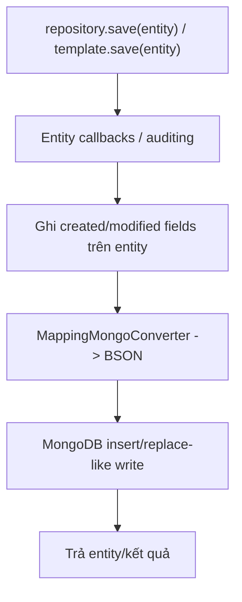
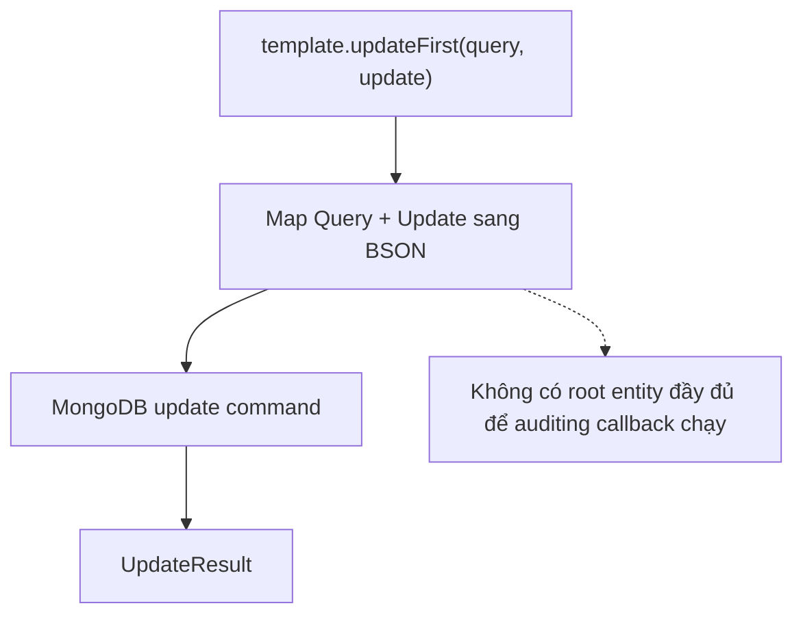
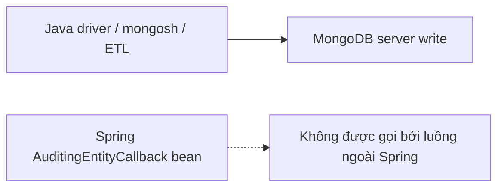
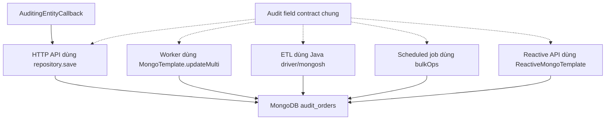

# Giới hạn auditing khi ghi bằng update hoặc driver trực tiếp

## 1. Bài toán: cập nhật trạng thái thành công nhưng updatedAt không đổi

Một ứng dụng Spring Data MongoDB dùng `@EnableMongoAuditing` và bốn annotation:

- `@CreatedDate`: thời điểm entity được tạo.
- `@LastModifiedDate`: thời điểm entity được sửa gần nhất theo cơ chế auditing.
- `@CreatedBy`: người/tác nhân tạo entity.
- `@LastModifiedBy`: người/tác nhân sửa entity theo cơ chế auditing.

Khi gọi `repository.save(order)`, các trường auditing thường được điền đúng. Nhưng một luồng cập nhật hiệu năng cao lại dùng:

```java
mongoTemplate.updateFirst(
    Query.query(Criteria.where("id").is(orderId)),
    new Update().set("status", "PAID"),
    AuditOrder.class
);
```

Sau lệnh này, `status` trong MongoDB đã là `PAID`, còn `lastModifiedAt` và `lastModifiedBy` có thể **giữ nguyên giá trị cũ**. Hệ thống giám sát dựa vào `lastModifiedAt` tưởng rằng đơn hàng chưa được thay đổi.

Đây không nhất thiết là lỗi cấu hình `@EnableMongoAuditing`. Lý do là **entity auditing callback chạy khi Spring Data xử lý một entity theo vòng đời mapping thích hợp; một lệnh cập nhật bằng `Query + Update` không cần nạp, chuyển đổi rồi lưu lại toàn bộ entity**.

Một đường ghi khác cũng bỏ qua cơ chế Java auditing:

```javascript
db.audit_orders.updateOne(
  { _id: "order-101" },
  { $set: { status: "PAID" } }
);
```

`mongosh` và các ứng dụng dùng MongoDB driver trực tiếp không chạy bean callback của Spring Data trong JVM.

**Mục tiêu bài học** thuộc chương **Auditing** trong module **SPRING_DATA_MONGODB**: nắm được ranh giới của auditing với repository, `MongoTemplate`, partial updates, bulk/upsert, driver trực tiếp, reactive access và transaction; thiết kế metadata được ghi **tường minh và nhất quán**; kiểm thử truy vết người sửa, timestamp, concurrency và lỗi vận hành. Spring Data MongoDB vẫn là công cụ kết nối, ánh xạ document, truy vấn, aggregation, index, transaction, reactive access, kiểm thử và chẩn đoán hiệu năng, nhưng auditing không tự bao phủ mọi lệnh MongoDB.

## 2. Phân biệt auditing của entity và audit trail nghiệp vụ

Từ “audit” có thể chỉ nhiều tầng khác nhau:

| Khái niệm | Dữ liệu được ghi | Câu hỏi trả lời được |
| --- | --- | --- |
| **Entity auditing** | `createdAt`, `createdBy`, `lastModifiedAt`, `lastModifiedBy` trên document hiện tại | Ai tạo/sửa và khi nào theo đường ghi đã áp dụng auditing? |
| **Audit trail** | Các event trước/sau, hành động, lý do, correlation ID | Trạng thái thay đổi từ đâu sang đâu qua thời gian? |
| **Database change stream** | Sự kiện thay đổi được MongoDB phát theo khả năng hỗ trợ | Document/collection thay đổi thế nào ở tầng database? |
| **Application logs/traces** | Request, actor, endpoint, latency, error | Đường xử lý nào tạo ra thao tác? |
| **Authorization** | Quyết định cho phép/từ chối quyền truy cập | Actor này có quyền đổi document không? |

Entity auditing chỉ giữ **trạng thái metadata hiện tại**. Nếu document được sửa năm lần, một field `lastModifiedBy` không tự lưu cả năm người sửa.

Điều quan trọng hơn: **metadata không được tạo tự động ở mọi write path**. Nếu chỉ một producer bỏ qua auditing, field “người sửa cuối” có thể không còn phản ánh thay đổi cuối cùng.

### 2.1. Ba câu không được đánh đồng

1. “Trong Java class có `@LastModifiedDate`” **không có nghĩa** MongoDB tự cập nhật thời gian ở mọi `updateOne`.
2. “Lệnh update đã thành công” **không có nghĩa** Spring Data đã chạy `AuditingEntityCallback`.
3. “Document có `lastModifiedBy="alice"`” **không chứng minh** Alice là người thực hiện mọi thao tác gần đây nhất nếu có raw/bulk update không ghi metadata.

Nếu hệ thống cần chứng cứ bất biến phục vụ tuân thủ, hãy thiết kế audit trail riêng với kiểm soát truy cập, retention, integrity và khả năng đối soát. Đừng sử dụng bốn field auditing làm bằng chứng duy nhất.

## 3. Cơ chế auditing trong Spring Data MongoDB

Spring Data MongoDB tích hợp cơ chế auditing của Spring Data Commons. Khi được bật và đăng ký đúng callback, framework xác định entity mới/cũ, lấy thời gian và thông tin auditor rồi điền các field được đánh dấu.

### 3.1. Khai báo entity có audit fields

```java
package example.auditing;

import java.time.Instant;
import org.springframework.data.annotation.CreatedBy;
import org.springframework.data.annotation.CreatedDate;
import org.springframework.data.annotation.Id;
import org.springframework.data.annotation.LastModifiedBy;
import org.springframework.data.annotation.LastModifiedDate;
import org.springframework.data.annotation.Version;
import org.springframework.data.mongodb.core.mapping.Document;

@Document(collection = "audit_orders")
public class AuditOrder {

    @Id
    private String id;

    // Cho phép Spring Data nhận diện entity mới ngay cả
    // khi ứng dụng đã gán sẵn ID trước lần insert.
    @Version
    private Long version;

    private String tenantId;
    private String status;

    @CreatedDate
    private Instant createdAt;

    @CreatedBy
    private String createdBy;

    @LastModifiedDate
    private Instant lastModifiedAt;

    @LastModifiedBy
    private String lastModifiedBy;

    protected AuditOrder() {}

    public AuditOrder(
            String id, String tenantId, String status) {
        this.id = id;
        this.tenantId = tenantId;
        this.status = status;
    }

    public String getId() { return id; }
    public Long getVersion() { return version; }
    public String getTenantId() { return tenantId; }
    public String getStatus() { return status; }
    public Instant getCreatedAt() { return createdAt; }
    public String getCreatedBy() { return createdBy; }
    public Instant getLastModifiedAt() { return lastModifiedAt; }
    public String getLastModifiedBy() { return lastModifiedBy; }
}
```

Đây là entity mutable cho ví dụ mapping. Trong ứng dụng thật có thể bổ sung constructor/setter được kiểm soát, validation và quy tắc immutable entity. `@Version Long version` **bắt đầu bằng null**, nhờ đó Spring Data có thể nhận diện entity mới ngay cả khi ID được gán trước khi gọi `insert`; nó cũng hữu ích cho optimistic locking trên các write paths được hỗ trợ. Nếu chỉ có `@Id` đã được gán sẵn mà không có chiến lược newness phù hợp, entity có thể bị coi là **đã tồn tại** khi auditing xét created fields. `@CreatedDate`/`@LastModifiedDate` đặt trên entity **không tự làm server có trigger**.

### 3.2. Bật auditing và cung cấp AuditorAware

```java
package example.auditing;

import java.util.Optional;
import org.springframework.context.annotation.Bean;
import org.springframework.context.annotation.Configuration;
import org.springframework.data.domain.AuditorAware;
import org.springframework.data.mongodb.config.EnableMongoAuditing;

@Configuration
@EnableMongoAuditing(auditorAwareRef = "currentAuditor")
public class MongoAuditConfiguration {

    @Bean("currentAuditor")
    AuditorAware<String> currentAuditor() {
        return () -> Optional.of("service-batch");
    }
}
```

`"service-batch"` là actor **cố định để minh họa**, không phải khuyến nghị ghi mọi thay đổi production dưới một danh tính. Khi có người dùng đăng nhập, auditor phải được giải quyết từ **server-side authenticated security context**; với job hệ thống, dùng một service identity được định nghĩa rõ.

### 3.3. Thời gian được lấy ở đâu?

Auditing có thể dùng cơ chế `DateTimeProvider`/clock do Spring Data cấu hình, hoặc nguồn thời gian mặc định tùy phiên bản. Nó là **thời gian do tầng ứng dụng cung cấp theo cấu hình**, không mặc nhiên là thời điểm MongoDB server tự ghi vào document.

Nếu có nhiều JVM lệch đồng hồ, thời gian ứng dụng có thể khác nhau. Ngược lại, khi dùng `$currentDate` hoặc `$$NOW` trên MongoDB server, timestamp theo thời gian phía server. Phải chọn chính sách thống nhất cho ý nghĩa `lastModifiedAt`.

### 3.4. Khi nào created và last-modified được điền?

| Thao tác entity qua mapping | Kỳ vọng auditing thông thường |
| --- | --- |
| Insert root entity chưa có thông tin audit | `createdAt`/`createdBy` được thiết lập nếu cấu hình cung cấp |
| Save root entity đang tồn tại | Các trường last-modified được cập nhật |
| Tạo entity mới với `modifyOnCreate` mặc định | Các trường last-modified cũng có thể được điền ngay khi tạo |
| Update raw BSON | Không tự chạy callback Java |
| Partial update theo Query + Update | Không tự sửa các trường auditing chỉ nhờ annotation |

Mặc định của `modifyOnCreate` và cách xác định “new entity” phụ thuộc Spring Data configuration và trạng thái ID/version. Đừng viết test khẳng định `lastModifiedAt` luôn `null` ngay sau insert nếu cấu hình thực tế bật cập nhật last-modified khi tạo.

## 4. Đường thực thi: save entity khác với gửi update command

### 4.1. Root entity save



Với đường save entity, auditing có cơ hội xử lý **root entity** trong lifecycle conversion.

### 4.2. Query + Update



`Update` có thể dùng mapping metadata để đổi tên field Java thành field MongoDB, nhưng đó **không phải** một lần `save(AuditOrder)`. Framework không cần đọc entity cũ để biết creator hoặc current last-modified metadata, vì vậy không thể suy ra annotation sẽ được thực thi.

### 4.3. Raw driver hoặc mongosh



MongoDB server xử lý write concern, validator, index, transaction, authorization... nhưng **không biết annotation Java `@LastModifiedDate`**. Tầng mapping callback chỉ tồn tại trong ứng dụng Spring sử dụng nó.

## 5. Ma trận các write path và phạm vi auditing

| API/đường ghi | Có root entity conversion/auditing callback? | Cần làm gì nếu bắt buộc cập nhật audit? |
| --- | --- | --- |
| `MongoRepository.save(entity)` | Thường có khi auditing được bật | Kiểm tra bean, entity newness, auditor |
| `MongoTemplate.insert(entity)` | Thường có | Kiểm tra created fields |
| `MongoTemplate.save(entity)` | Thường có | Kiểm tra last-modified và lost update |
| `MongoTemplate.updateFirst(Query, Update, …)` | **Không phải entity save** | Gắn `lastModifiedAt/By` tường minh |
| `MongoTemplate.updateMulti(...)` | **Không** tự auditing từng entity | Audit tất cả document bằng update fields |
| `MongoTemplate.upsert(...)` | **Không** tự auditing entity vừa upsert | `$setOnInsert` + `$set`/`$currentDate` |
| `MongoTemplate.findAndModify(...)` | Update command; không tự auditing save-side | Gắn fields vào Update |
| `BulkOperations.updateOne/updateMulti` | Không có vòng save entity cho từng document | Chuẩn hóa audit trong từng operation |
| `BulkOperations.insert(...)` | Không được mặc định coi như `template.insert(entity)` auditing đầy đủ | Điền metadata trước khi đưa vào bulk, test version cụ thể |
| `repository method dùng @Update` | Repository phát update query trực tiếp | Khai báo audit trong update hoặc đi qua service |
| `MongoCollection<Document>.updateOne` | Không chạy Spring Data entity auditing | Ghi fields qua driver |
| `mongosh/ETL/microservice khác` | Không biết Java callbacks | Có hợp đồng writer/audit metadata |
| `ReactiveMongoTemplate.updateFirst` | Không tự đi qua reactive auditing của root | Compose actor + thời gian trong update |
| `ReactiveMongoRepository.save(entity)` | Có thể qua reactive auditing callbacks khi cấu hình đúng | Kiểm tra `ReactiveAuditorAware`, context, subscription |

**Ghi chú phiên bản:** các operation phức tạp, custom converters và callbacks có thể thay đổi chi tiết theo Spring Data MongoDB version. Ma trận mô tả **ranh giới nguyên tắc**: chỉ vì một API nhận `entityClass` không có nghĩa nó thực thi vòng đời `save(entity)`.

## 6. Baseline: repository.save cập nhật auditing

### 6.1. Repository

```java
package example.auditing;

import org.springframework.data.mongodb.repository.MongoRepository;

public interface AuditOrderRepository
        extends MongoRepository<AuditOrder, String> {
}
```

### 6.2. Tạo đơn qua save

```java
AuditOrder order = new AuditOrder(
    "order-101", "shop-a", "PENDING"
);

AuditOrder saved = repository.save(order);

System.out.println(saved.getCreatedAt());
System.out.println(saved.getCreatedBy());
System.out.println(saved.getLastModifiedAt());
System.out.println(saved.getLastModifiedBy());
```

Với auditing cấu hình đúng, Spring Data có thể điền created/modified metadata theo chính sách hiện hành. Entity ví dụ dùng `@Version Long version` ở trạng thái `null` để làm rõ **newness** dù ID đã gán trước. Với entity khác, phải xác định **“entity mới”**: ID đã đặt trước hay chưa, có field `@Version` hay không, có `Persistable.isNew()` tùy biến hay không, và chiến lược `isNew` của mapping ảnh hưởng trực tiếp đến created/update auditing.

### 6.3. Save entity sau khi sửa

```java
AuditOrder existing =
    repository.findById("order-101").orElseThrow();

// Ví dụ entity này chưa có setter cho status.
// Trong ứng dụng thật, dùng method chuyển trạng thái
// hoặc một entity immutable có copy-with rõ ràng.

AuditOrder resaved = repository.save(existing);
```

Đoạn trên minh họa lifecycle, **không phải thao tác sửa trạng thái**: `existing` chưa được đổi, nên save có thể cập nhật audit metadata dù nghiệp vụ không thay đổi. Thiết kế production cần tránh save vô ích và phải xét concurrency.

**Lưu ý quan trọng:** đổi mọi partial update thành `find → modify → save` chỉ để auditing chạy là cách đơn giản nhưng có thể tạo **lost update**, truyền nhiều dữ liệu hơn và tăng số round-trip. Không coi nó là giải pháp mặc định trên hệ thống có nhiều writer.

## 7. updateFirst: auditing annotations không tự sửa lastModified*

### 7.1. Đoạn code trông hợp lệ nhưng thiếu audit

```java
Query target = Query.query(
    Criteria.where("id").is("order-101")
        .and("tenantId").is("shop-a")
);

Update statusOnly = new Update()
    .set("status", "PAID");

UpdateResult result = template.updateFirst(
    target, statusOnly, AuditOrder.class
);
```

Thao tác có thể sửa `status` thành `PAID` mà **không** cập nhật `lastModifiedAt` hay `lastModifiedBy`. `@LastModifiedDate` trên `AuditOrder` không được MongoDB server thực thi.

### 7.2. Đường đúng: gắn audit fields rõ ràng

```java
String authorizedTenant = "shop-a";
String authenticatedActor = "user-42";
String orderId = "order-101";

Query target = Query.query(
    Criteria.where("id").is(orderId)
        .and("tenantId").is(authorizedTenant)
        .and("status").is("PENDING")
);

Update withAudit = new Update()
    .set("status", "PAID")
    .set("lastModifiedBy", authenticatedActor)
    .currentDate("lastModifiedAt");

UpdateResult result = template.updateFirst(
    target, withAudit, AuditOrder.class
);

if (result.getMatchedCount() != 1) {
    throw new IllegalStateException(
        "Đơn không tồn tại, sai tenant hoặc trạng thái đã đổi"
    );
}
```

`Update.currentDate("lastModifiedAt")` tạo operator `$currentDate` yêu cầu MongoDB server đặt BSON Date tại thời điểm xử lý update. `lastModifiedBy` được lấy từ **nguồn xác thực phía server**, không lấy tùy ý từ request JSON.

### 7.3. BSON tương ứng

```javascript
db.audit_orders.updateOne(
  {
    _id: "order-101",
    tenantId: "shop-a",
    status: "PENDING"
  },
  {
    $set: {
      status: "PAID",
      lastModifiedBy: "user-42"
    },
    $currentDate: {
      lastModifiedAt: true
    }
  }
);
```

`$set` và `$currentDate` được áp dụng trong **một update trên một document**. Điều này tốt hơn mô hình “cập nhật status ở lệnh một, cập nhật audit ở lệnh hai”, vì mô hình hai lệnh có thể gặp partial failure hoặc race.

### 7.4. Cần hiểu write result

`UpdateResult.getMatchedCount()` cho biết có document phù hợp điều kiện, còn `getModifiedCount()` cho biết có document được sửa theo semantics MongoDB. Nếu không match, không được tuyên bố actor đã sửa đơn; nếu write error hoặc write concern error, phải xử lý riêng.

Đặt audit fields vào **cùng update** bảo đảm một document không bị trạng thái mới nhưng audit fields cũ chỉ vì hai lệnh viết tách biệt. Nó **không** thay thế kiểm tra permission, idempotency, transaction hoặc business validation.

### 7.5. Nên dùng currentDate hay Instant.now()?

Hai cách đều có ích nhưng mang ngữ nghĩa hơi khác:

| Cách tạo thời gian | Nguồn | Điểm cần cân nhắc |
| --- | --- | --- |
| `new Update().currentDate("lastModifiedAt")` | Đồng hồ MongoDB server | Ghi nhất quán cùng lệnh; khác nguồn auditing Java mặc định |
| `new Update().set("lastModifiedAt", Instant.now(clock))` | Đồng hồ ứng dụng | Dễ làm cùng nguồn `DateTimeProvider`; JVM có thể lệch clock |
| `$$NOW` trong aggregation update pipeline | Thời gian hệ thống tại server trong pipeline | Phù hợp pipeline; cần semantics và version server |

Không khẳng định mọi timestamp từ ba cách có thể so sánh tuyệt đối ở cấp nano giây. BSON Date có độ phân giải mili giây, còn Java `Instant` có thể biểu diễn chi tiết hơn; mapping/driver có thể làm tròn tới mức BSON hỗ trợ.

## 8. updateMulti: nhiều document thay đổi nhưng không có auditing callback riêng

Giả sử cần khóa các đơn ở trạng thái `PENDING` của một tenant:

```java
Query query = Query.query(
    Criteria.where("tenantId").is("shop-a")
        .and("status").is("PENDING")
);

Update update = new Update()
    .set("status", "CANCELLED")
    .set("lastModifiedBy", "system-expiration-job")
    .currentDate("lastModifiedAt");

UpdateResult result = template.updateMulti(
    query, update, AuditOrder.class
);
```

Các document khớp có thể được cập nhật bằng một MongoDB command, **không** phải Spring Data lấy từng entity, gọi `AuditingEntityCallback` và save lại. Vì vậy:

- Không thể dựa vào `AuditorAware` tự chạy một lần cho từng document.
- Mọi document khớp nhận cùng actor `system-expiration-job` (đúng nếu đó là actor thực sự).
- `$currentDate` đặt timestamp theo server trong lúc xử lý update; không tự tạo một audit event riêng cho mỗi document.
- `getModifiedCount` không cung cấp danh sách IDs đã thay đổi.
- Nếu cần audit trail chi tiết từng đơn, phải thiết kế event/outbox/đối soát riêng.

### 8.1. Tiêu chí bảo mật của tác nhân hệ thống

Một job hàng đêm có thể dùng một service identity đã đăng ký, ví dụ `"system-expiration-job"`. Không dùng `"admin"` để che nguồn ghi thật. Cần lưu job run ID/correlation ID ở audit trail hoặc logs nếu có yêu cầu truy dấu batch.

### 8.2. Không lẫn updateMulti với transaction

MongoDB update từng document có tính nguyên tử theo phạm vi document, nhưng một `updateMulti` không mặc nhiên là **transaction đa document**. Khi có lỗi, tùy cơ chế MongoDB và thao tác, có thể xảy ra thay đổi ở một phần tập document. Nếu yêu cầu all-or-nothing, đánh giá transaction và chi phí vận hành.

## 9. findAndModify: trả entity đã sửa không đồng nghĩa entity auditing

`findAndModify` kết hợp query, update và khả năng trả về document cũ/mới trong một operation:

```java
Query query = Query.query(
    Criteria.where("id").is("order-101")
        .and("tenantId").is("shop-a")
        .and("status").is("PENDING")
);

Update update = new Update()
    .set("status", "PAID")
    .set("lastModifiedBy", "user-42")
    .currentDate("lastModifiedAt");

FindAndModifyOptions options =
    FindAndModifyOptions.options().returnNew(true);

AuditOrder updated = template.findAndModify(
    query, update, options, AuditOrder.class
);
```

Ví dụ cần imports `Query`, `Criteria`, `Update` và `FindAndModifyOptions` từ Spring Data. Trả về một `AuditOrder` đã được mapping **không chứng minh** root entity đã đi qua auditing before-convert như `save(entity)`. Trong ví dụ, audit được cập nhật vì **chính `Update` đã khai báo nó**.

`findAndModify` có thể trả `null` nếu không match hoặc tùy lựa chọn upsert/returnNew; luôn kiểm tra trước khi ghi nhận nghiệp vụ thành công.

### 9.1. @Query + @Update trên repository

Repository MongoDB có thể khai báo update query methods tùy phiên bản, chẳng hạn phối hợp `@Query` với `@Update`. Chúng tạo **update command**, không trở thành `repository.save(entity)` chỉ vì method nằm trong repository interface.

Với dạng query update, phải khai báo `lastModifiedAt/By` tường minh nếu cần; đồng thời không nên nhồi current authenticated actor dưới dạng chuỗi tin từ client mà chưa xác thực. Nếu binding actor vào annotation quá phức tạp, dùng một custom repository/service với `MongoTemplate` thường rõ ràng và dễ test hơn.

## 10. Upsert: phân biệt tạo mới và sửa entity đã có

`upsert` có nghĩa **update document khớp, hoặc insert document mới nếu không khớp**. Khác với `save(entity)`, Spring Data không nhất thiết có sẵn một root entity để chạy `@CreatedDate`/`@LastModifiedDate`.

### 10.1. Bài toán cần giải

Với document mới:

- `createdAt` = thời điểm tạo.
- `createdBy` = người tạo.
- `lastModifiedAt` = thời điểm ghi hiện tại.
- `lastModifiedBy` = người ghi hiện tại.

Với document đã tồn tại:

- **Không sửa** `createdAt` và `createdBy`.
- Chỉ cập nhật `lastModifiedAt` và `lastModifiedBy` cùng business fields.

### 10.2. Sử dụng $setOnInsert

```java
Instant now = clock.instant();
String actor = authenticatedActor;

Query key = Query.query(
    Criteria.where("id").is(orderId)
        .and("tenantId").is(authorizedTenantId)
);

Update update = new Update()
    .setOnInsert("createdAt", now)
    .setOnInsert("createdBy", actor)
    .set("status", "PENDING")
    .set("lastModifiedBy", actor)
    .currentDate("lastModifiedAt");

UpdateResult result = template.upsert(
    key, update, AuditOrder.class
);
```

`clock`, `authenticatedActor`, `orderId` và `authorizedTenantId` do service cung cấp. `setOnInsert` chỉ có tác dụng khi thao tác thực sự insert một document mới. `$set` và `$currentDate` tác động cả nhánh insert lẫn nhánh update.

### 10.3. BSON minh họa

```javascript
db.audit_orders.updateOne(
  {
    _id: "order-101",
    tenantId: "shop-a"
  },
  {
    $setOnInsert: {
      createdAt: ISODate("2026-11-20T09:00:00Z"),
      createdBy: "user-42"
    },
    $set: {
      status: "PENDING",
      lastModifiedBy: "user-42"
    },
    $currentDate: {
      lastModifiedAt: true
    }
  },
  { upsert: true }
);
```

Đây là lệnh mẫu theo một thời điểm giả định. Trong production, không hardcode ngày giờ; sử dụng clock phù hợp hoặc operator server.

### 10.4. Cảnh giác conflict đường field

Không dùng `$setOnInsert` và `$set`/`$currentDate` **đối với cùng một field** trong một update classic rồi mong MongoDB giải quyết theo thứ tự:

```javascript
// Sai: trùng đường field createdAt ở hai operator.
{
  $setOnInsert: { createdAt: ISODate("2026-11-20") },
  $set:         { createdAt: ISODate("2026-11-21") }
}
```

Đường field trùng có thể bị MongoDB từ chối do xung đột cập nhật. Tách `createdAt` chỉ ở `$setOnInsert`, `lastModifiedAt` chỉ ở `$currentDate`/`$set`.

### 10.5. Upsert không xác thực danh tính

Một actor được lấy từ HTTP request body không phải audit actor đáng tin. `createdBy` phải do server xác định; với admin acting on behalf of user, tách **actor thực hiện** và **subject chịu tác động** nếu nghiệp vụ yêu cầu. Các field này không thay thế permission checks trong query.

## 11. Raw MongoDB Java driver: không có Spring callbacks

Khi dùng `MongoClient` đồng bộ và `MongoCollection<Document>` trực tiếp:

```java
import com.mongodb.client.MongoCollection;
import com.mongodb.client.model.Filters;
import com.mongodb.client.model.Updates;
import org.bson.Document;

MongoCollection<Document> collection =
    mongoClient.getDatabase("store")
        .getCollection("audit_orders");

collection.updateOne(
    Filters.and(
        Filters.eq("_id", "order-101"),
        Filters.eq("tenantId", "shop-a")
    ),
    Updates.set("status", "PAID")
);
```

`@LastModifiedDate` trên một Java entity ở nơi khác **không thể ảnh hưởng** lệnh này: driver gửi BSON operation thẳng đến MongoDB.

### 11.1. Driver update có audit đầy đủ

```java
import static com.mongodb.client.model.Filters.and;
import static com.mongodb.client.model.Filters.eq;
import static com.mongodb.client.model.Updates.combine;
import static com.mongodb.client.model.Updates.currentDate;
import static com.mongodb.client.model.Updates.set;

var result = collection.updateOne(
    and(
        eq("_id", "order-101"),
        eq("tenantId", "shop-a"),
        eq("status", "PENDING")
    ),
    combine(
        set("status", "PAID"),
        set("lastModifiedBy", "user-42"),
        currentDate("lastModifiedAt")
    )
);

if (result.getMatchedCount() != 1) {
    throw new IllegalStateException(
        "Không tìm thấy đơn ở trạng thái cần chuyển"
    );
}
```

Đây là cách ứng dụng **chủ động** cập nhật metadata ở raw driver. Mã `"user-42"` chỉ minh họa; nguồn actor phải được xác thực.

### 11.2. Driver insert cũng cần audit fields

```java
Instant now = clock.instant();
Document doc = new Document("_id", orderId)
    .append("tenantId", authorizedTenantId)
    .append("status", "PENDING")
    .append("createdAt", java.util.Date.from(now))
    .append("createdBy", authenticatedActor)
    .append("lastModifiedAt", java.util.Date.from(now))
    .append("lastModifiedBy", authenticatedActor);

collection.insertOne(doc);
```

Khi dùng `Document`, MongoDB driver lưu BSON Date từ `java.util.Date`. Nó **không gọi** `AuditorAware`, `BeforeConvertCallback<AuditOrder>` hoặc converter của `MongoTemplate` theo cách root save.

Lợi thế là kiểm soát rõ ràng; nhược điểm là **tất cả producer phải tuân thủ cùng một audit contract** để không bỏ sót fields.

## 12. BulkOperations: không nhầm tối ưu ghi hàng loạt với auditing đầy đủ

Một bulk update có thể gom nhiều command và giảm round-trips:

```java
BulkOperations bulk = template.bulkOps(
    BulkOperations.BulkMode.ORDERED,
    AuditOrder.class
);

bulk.updateOne(
    Query.query(Criteria.where("id").is("order-101")),
    new Update()
        .set("status", "PAID")
        .set("lastModifiedBy", "system-import")
        .currentDate("lastModifiedAt")
);

bulk.updateOne(
    Query.query(Criteria.where("id").is("order-102")),
    new Update()
        .set("status", "CANCELLED")
        .set("lastModifiedBy", "system-import")
        .currentDate("lastModifiedAt")
);

BulkWriteResult result = bulk.execute();
```

Trong mã thực tế cần imports `BulkOperations`, `Query`, `Criteria`, `Update` và `com.mongodb.bulk.BulkWriteResult`. Nếu bulk chỉ gồm các update commands, auditing callback của mỗi root entity **không tự chạy**. Vì thế từng operation cần metadata rõ.

### 12.1. Bulk insert không nên giả định giống repository.save

`BulkOperations.insert(entity)` không được mặc định coi như `MongoTemplate.insert(entity)` có đầy đủ auditing/entity callback trong mọi phiên bản. Khi dùng bulk, hãy **chủ động điền created/modified metadata trước khi xếp lệnh vào bulk** và viết integration test đối chiếu raw BSON.

Điều này đặc biệt quan trọng với import 10 triệu document: một field `createdBy` bị thiếu có thể làm toàn bộ lịch sử nguồn dữ liệu khó truy vết.

### 12.2. Ordered, unordered và partial success

Một bulk gồm nhiều update không tự trở thành **multi-document transaction**. Với ordered mode, MongoDB thường dừng chuỗi sau lỗi theo semantics bulk; với unordered mode, các operation khác có thể vẫn được thực hiện.

Nếu operation thứ ba thất bại, những document đầu có thể đã nhận trạng thái và audit fields mới. `BulkWriteResult` và exception cần được kiểm tra; không chỉ dựa vào một biến `success=true`.

Nếu bắt buộc all-or-nothing qua nhiều document, cần transaction trên topology hỗ trợ hoặc thiết kế workflow bù trừ. Ngay cả khi có transaction, audit metadata vẫn phải được **ghi rõ trong các operations**.

### 12.3. Mọi document có cùng timestamp không?

Nếu mỗi operation dùng `$currentDate`, server đặt thời điểm theo lệnh/điều kiện thực thi; đừng khẳng định tất cả document trong bulk có timestamp giống hệt nhau.

Nếu nghiệp vụ muốn một mốc `jobStartedAt` chung, lưu field riêng từ **một clock do job định nghĩa**, không đánh đồng nó với thời điểm từng document thực tế được cập nhật.

## 13. Aggregation pipeline update: ghi thời gian bằng $$NOW

MongoDB hỗ trợ update bằng aggregation pipeline. Trong pipeline, biến hệ thống `$$NOW` có thể biểu diễn thời gian hiện tại phía server cho thao tác được hỗ trợ.

### 13.1. Ví dụ mongosh

```javascript
const actor = "user-42"; // Đã được xác thực ở server.

db.audit_orders.updateOne(
  {
    _id: "order-101",
    tenantId: "shop-a",
    status: "PENDING"
  },
  [
    {
      $set: {
        status: "PAID",
        lastModifiedAt: "$$NOW",
        lastModifiedBy: { $literal: actor }
      }
    }
  ]
);
```

`$$NOW` được MongoDB hiểu là **biến trong aggregation expression**, không phải String ngày giờ được lưu nguyên xi. Với trường văn bản có thể bắt đầu bằng `$`, dùng `$literal` trong pipeline để tránh việc chuỗi bị diễn giải thành biểu thức tham chiếu field.

### 13.2. Pipeline khác update classic ở đâu?

| Classic update | Pipeline update |
| --- | --- |
| `$set`, `$inc`, `$currentDate`, `$setOnInsert` | Những stages như `$set`/`$unset` với aggregation expressions |
| `$currentDate` tạo timestamp server | `$$NOW` dùng trong expression |
| Dễ dàng cập nhật vài field độc lập | Hữu ích khi phải tính lại field dựa trên document hiện tại |
| Upsert có `$setOnInsert` | Upsert bằng pipeline cần xử lý nhánh tạo/sửa theo biểu thức và dữ liệu thực |

**Không copy nguyên `$setOnInsert` của update classic vào pipeline rồi giả định semantics y hệt.** Hai dạng update có operator contract khác nhau. Khi triển khai upsert bằng pipeline, cần test cả insert branch và update branch, đặc biệt là bảo toàn `createdAt/By`.

### 13.3. Bảo vệ field createdAt

Nếu pipeline muốn điền `createdAt` khi thiếu, `$ifNull` có thể dùng làm giá trị mặc định:

```javascript
db.audit_orders.updateOne(
  { _id: "order-101", tenantId: "shop-a" },
  [
    {
      $set: {
        createdAt: { $ifNull: ["$createdAt", "$$NOW"] },
        lastModifiedAt: "$$NOW"
      }
    }
  ],
  { upsert: true }
);
```

Nhưng đây là **chính sách backfill field thiếu**, không giống tuyệt đối “chỉ set khi insert”. Một document cũ **đang tồn tại nhưng thiếu `createdAt`** cũng sẽ bị điền createdAt bằng thời điểm update hiện tại. Nếu nghiệp vụ yêu cầu createdAt phản ánh thời gian tạo lịch sử, hành vi này có thể **sai dữ liệu**. Hãy chọn `$setOnInsert` với update classic, hoặc viết một migration được kiểm chứng thay vì coi `$$NOW` là dữ liệu lịch sử.

## 14. Reactive auditing: Reactor Context không tự sửa partial update

### 14.1. Bật reactive auditing

Với Spring Data MongoDB reactive, có cơ chế auditing và auditor provider theo reactive API:

```java
package example.auditing;

import org.springframework.context.annotation.Bean;
import org.springframework.context.annotation.Configuration;
import org.springframework.data.domain.ReactiveAuditorAware;
import org.springframework.data.mongodb.config.EnableReactiveMongoAuditing;
import org.springframework.security.core.context.ReactiveSecurityContextHolder;

@Configuration
@EnableReactiveMongoAuditing(
    auditorAwareRef = "reactiveCurrentAuditor"
)
public class ReactiveAuditConfiguration {

    @Bean("reactiveCurrentAuditor")
    ReactiveAuditorAware<String> reactiveCurrentAuditor() {
        return () -> ReactiveSecurityContextHolder
            .getContext()
            .flatMap(context ->
                reactor.core.publisher.Mono.justOrEmpty(
                    context.getAuthentication()
                )
            )
            .filter(authentication ->
                authentication != null
                    && authentication.isAuthenticated()
            )
            .map(authentication ->
                authentication.getName()
            );
    }
}
```

Đây là một cấu hình mẫu khi ứng dụng có **Spring Security WebFlux**. Cần thêm xử lý anonymous authentication, impersonation và authorization theo chính sách hệ thống. `ReactiveAuditorAware` cung cấp actor cho auditing callbacks thích hợp khi reactive entity được save; **nó không khiến `ReactiveMongoTemplate.updateFirst` tự bổ sung audit fields**.

### 14.2. Reactive update phải compose actor vào chính lệnh

```java
package example.auditing;

import com.mongodb.client.result.UpdateResult;
import org.springframework.data.mongodb.core.ReactiveMongoTemplate;
import org.springframework.data.mongodb.core.query.Criteria;
import org.springframework.data.mongodb.core.query.Query;
import org.springframework.data.mongodb.core.query.Update;
import org.springframework.security.core.context.ReactiveSecurityContextHolder;
import org.springframework.stereotype.Service;
import reactor.core.publisher.Mono;

@Service
public class ReactiveAuditOrderUpdateService {

    private final ReactiveMongoTemplate template;

    public ReactiveAuditOrderUpdateService(
            ReactiveMongoTemplate template) {
        this.template = template;
    }

    public Mono<UpdateResult> markPaid(
            String orderId, String authorizedTenantId) {

        if (orderId == null || orderId.isBlank()
                || authorizedTenantId == null
                || authorizedTenantId.isBlank()) {
            return Mono.error(
                new IllegalArgumentException("Thiếu ID/tenant")
            );
        }

        return ReactiveSecurityContextHolder.getContext()
            .flatMap(ctx ->
                Mono.justOrEmpty(ctx.getAuthentication())
            )
            .filter(auth -> auth != null
                && auth.isAuthenticated())
            .switchIfEmpty(Mono.error(
                new IllegalStateException(
                    "Chưa xác định authenticated actor"
                )
            ))
            .flatMap(auth -> {
                Query query = Query.query(
                    Criteria.where("id").is(orderId)
                        .and("tenantId").is(authorizedTenantId)
                        .and("status").is("PENDING")
                );

                Update update = new Update()
                    .set("status", "PAID")
                    .set("lastModifiedBy", auth.getName())
                    .currentDate("lastModifiedAt");

                return template.updateFirst(
                    query, update, AuditOrder.class
                );
            })
            .flatMap(result -> {
                if (result.getMatchedCount() != 1) {
                    return Mono.error(
                        new IllegalStateException(
                            "Order không khớp điều kiện"
                        )
                    );
                }
                return Mono.just(result);
            });
    }
}
```

Trong WebFlux, Spring Security xác thực/ủy quyền phải thực sự cung cấp context. `authorizedTenantId` là **tenant đã được server xác thực**, không phải tenant do client tự khai rồi tin tưởng. Code còn cần business rules, error mapping và idempotency trước khi dùng với thanh toán thật.

### 14.3. Vì sao không dùng ThreadLocal cho mọi reactive write?

Reactive pipeline có thể chuyển thread giữa các operators. Một auditor đọc `ThreadLocal` từ thread hiện tại có thể không phải actor của request gốc. Với reactive security/transaction, hãy dùng **Reactor Context** hoặc cơ chế chính thức của framework.

```java
Mono<UpdateResult> update = service.markPaid(id, tenant);

// Không tự subscribe trong service/controller WebFlux.
return update;
```

Nếu tự `subscribe()` trong một callback, bạn có thể tách query khỏi security context/transaction/error propagation đang có. Trả Publisher cho WebFlux hoặc compose bằng `flatMap`.

### 14.4. Auditing không được thực thi trước subscription

`ReactiveMongoTemplate.save(entity)` thường tạo một Publisher; chính lúc subscription thì thao tác mapping/ghi diễn ra. Với partial update, `ReactiveMongoTemplate.updateFirst(...)` cũng lazy, nhưng khi subscribe nó vẫn không biến thành root-entity save callback.

**Lazy execution và auditing eligibility là hai vấn đề khác nhau.** Đừng suy luận “khi có subscribe thì `@LastModifiedDate` tự chạy” trên mọi Publisher MongoDB.

## 15. Cơ chế tiện ích: tránh quên audit trong mọi write service

### 15.1. Một helper cho modified metadata

```java
package example.auditing;

import java.time.Clock;
import org.springframework.data.mongodb.core.query.Update;

public final class AuditUpdates {

    private final Clock clock;

    public AuditUpdates(Clock clock) {
        this.clock = clock;
    }

    public Update markModified(
            Update businessUpdate,
            String authenticatedActor) {

        if (authenticatedActor == null
                || authenticatedActor.isBlank()) {
            throw new IllegalArgumentException(
                "Audit actor không hợp lệ"
            );
        }

        return businessUpdate
            .set("lastModifiedBy", authenticatedActor)
            .set("lastModifiedAt", clock.instant());
    }
}
```

Helper này chọn **clock ứng dụng**, phù hợp khi muốn audit manual update có nguồn thời gian giống `DateTimeProvider`. Nếu toàn hệ thống muốn **server time**, thay hai dòng cuối bằng `.set("lastModifiedBy", actor).currentDate("lastModifiedAt")` và document hóa khác biệt.

**Không dùng cùng một Update instance cho nhiều thao tác concurrent** rồi mutate nó với actor khác nhau. `Update` là một builder có trạng thái; mỗi operation nên tạo một instance riêng.

### 15.2. Ví dụ service gọi helper

```java
Update business = new Update().set("status", "PAID");

Update audited = auditUpdates.markModified(
    business, authenticatedActor
);

UpdateResult result = template.updateFirst(
    Query.query(
        Criteria.where("id").is(orderId)
            .and("tenantId").is(authorizedTenant)
            .and("status").is("PENDING")
    ),
    audited,
    AuditOrder.class
);
```

Lợi thế: nhiều service dùng cùng một quy tắc cập nhật actor/timestamp. Hạn chế: helper **không ép** những writer bỏ qua nó phải tuân thủ. Để bảo đảm mọi producer, cần code review, API boundary, kiểm thử và có thể thêm MongoDB validator cho field bắt buộc.

### 15.3. Không cất actor trong singleton mutable field

```java
// Anti-pattern:
@Service
class SharedAuditContext {
    private String currentActor;
}
```

Một singleton phục vụ nhiều request đồng thời có thể làm actor của request A ghi vào document của request B. Actor nên là **giá trị cục bộ của use case hoặc được giải quyết từ context chính xác theo subscription**.

### 15.4. Khi nào cần một shared data-access boundary?

Nếu nhiều service cùng cập nhật `audit_orders`, có thể cung cấp các method nghiệp vụ chuyên biệt:

```java
interface AuditOrderCommands {
    UpdateResult markPaid(
        String orderId,
        String authorizedTenant,
        String authenticatedActor
    );

    UpdateResult cancelPending(
        String orderId,
        String authorizedTenant,
        String systemActor
    );
}
```

Đây là interface ứng dụng, không phải API mặc định của Spring Data. Nó giúp tập trung **tenant filter, state transition, actor và audit metadata**. Không cung cấp một method update arbitrary field không kiểm soát rồi mong callback bảo vệ tất cả.

## 16. Concurrency: metadata đúng không có nghĩa cập nhật không bị ghi đè

Giả sử hai writer cùng đọc `status=PENDING`:

```text
T1: service A đọc PENDING
T2: service B đọc PENDING
T3: service A save status=PAID, updatedBy=A
T4: service B save status=CANCELLED, updatedBy=B
```

Cuối cùng, document có thể `CANCELLED` với `lastModifiedBy=B`. Auditing đã ghi danh tính người sửa cuối, nhưng **không ngăn lost update** hoặc bảo vệ business transition.

### 16.1. Conditional update trên trạng thái

```java
Query query = Query.query(
    Criteria.where("id").is(orderId)
        .and("tenantId").is(authorizedTenant)
        .and("status").is("PENDING")
);

Update update = new Update()
    .set("status", "PAID")
    .set("lastModifiedBy", authenticatedActor)
    .currentDate("lastModifiedAt");

UpdateResult result = template.updateFirst(
    query, update, AuditOrder.class
);
```

Nếu một writer đã chuyển trạng thái trước, writer thứ hai có thể `matchedCount=0` thay vì ghi đè. Đây là optimistic conditional write theo trạng thái.

### 16.2. @Version và raw driver

`@Version` là cơ chế optimistic locking của Spring Data trên các thao tác được hỗ trợ. Nhưng **raw driver không biết annotation Java `@Version`**. Nếu muốn version-based optimistic update bằng raw driver, phải tự khai báo điều kiện version và phép tăng version:

```java
var result = collection.updateOne(
    com.mongodb.client.model.Filters.and(
        com.mongodb.client.model.Filters.eq("_id", orderId),
        com.mongodb.client.model.Filters.eq(
            "tenantId", authorizedTenant
        ),
        com.mongodb.client.model.Filters.eq(
            "version", expectedVersion
        )
    ),
    com.mongodb.client.model.Updates.combine(
        com.mongodb.client.model.Updates.set(
            "status", "PAID"
        ),
        com.mongodb.client.model.Updates.set(
            "lastModifiedBy", authenticatedActor
        ),
        com.mongodb.client.model.Updates.currentDate(
            "lastModifiedAt"
        ),
        com.mongodb.client.model.Updates.inc(
            "version", 1L
        )
    )
);

if (result.getMatchedCount() != 1) {
    throw new OptimisticConflictException(
        "Document đã thay đổi"
    );
}
```

`expectedVersion` là giá trị version đọc/truyền theo protocol đáng tin; `OptimisticConflictException` là **exception nghiệp vụ tự định nghĩa**, không phải MongoDB built-in type.

**Lưu ý:** một số thao tác update theo mapping trong Spring Data có cơ chế quản lý `@Version` riêng tùy version/API. Đừng copy phép `$inc("version",1)` thủ công vào một `MongoTemplate.updateFirst` trên entity `@Version` mà chưa xác minh framework có tự tăng version hay không; có thể tăng kép hoặc lệch semantics. Raw driver trong ví dụ **không sử dụng** cơ chế mapping này.

### 16.3. Transaction không tự sinh audit metadata

Trong MongoDB transaction, hai update có thể commit/rollback chung. Nhưng nếu cả hai đều bỏ qua `lastModifiedAt/By`, việc dùng transaction **không khiến metadata tự xuất hiện**. Phải viết audit fields vào từng update ngay cả khi đang ở trong transaction.

## 17. Hệ thống dùng nhiều đường ghi: kiến trúc metadata nhất quán

### 17.1. Vẽ các producer thực tế



Ở đây, auditing callback của repository chỉ bao phủ một phần hệ thống. **Nguồn sự thật về dữ liệu** nằm trong MongoDB; mọi writer phải hiểu audit field contract.

### 17.2. Quy ước metadata đề xuất

| Field | Kiểu BSON | Quy tắc |
| --- | --- | --- |
| `createdAt` | Date | Ghi lần đầu; không sửa trong update nghiệp vụ thông thường |
| `createdBy` | String/service actor | Ghi lần đầu; không giả danh actor |
| `lastModifiedAt` | Date | Cập nhật khi nghiệp vụ thật sự làm document thay đổi |
| `lastModifiedBy` | String/service actor | Cùng thao tác với business change |
| `revision` hoặc `version` | Int32/Int64 theo contract | Cập nhật có điều kiện cho concurrency |
| `sourceSystem` | String khi cần | Ghi nguồn import/job nếu cần |
| `correlationId` | String khi cần | Hỗ trợ truy vết; kiểm soát retention/PII |

Phải thống nhất thời gian lấy từ **server** hay **app clock**, cách đặt actor cho job và cách xử lý lỗi khi **không có authenticated principal**. Một hệ thống ghi actor `"unknown"` cho tất cả lỗi xác thực không thể tạo audit đáng tin.

### 17.3. Không đánh đồng lastModifiedAt với write traffic

Một document có thể được cập nhật kỹ thuật (ví dụ cập nhật TTL marker, cache field, backfill metadata) mà không có thay đổi nghiệp vụ. Hãy xác định field `lastModifiedAt` theo nghĩa:

- **Last physical write**: mọi write tác động document đều cập nhật.
- **Last business modification**: chỉ thay đổi nghiệp vụ mới cập nhật.

Hai cách có giá trị khác nhau. Không để callback mặc định và raw update hiểu hai nghĩa trái ngược mà vẫn dùng chung một field.

## 18. MongoDB JSON Schema validator: bảo vệ hình dạng, không tự điền metadata

Nếu cần các field audit hiện diện ở server, MongoDB collection validator có thể giúp từ chối những document không phù hợp, ví dụ:

```javascript
const auditSchema = {
  bsonType: "object",
  required: [
    "tenantId",
    "status",
    "createdAt",
    "createdBy",
    "lastModifiedAt",
    "lastModifiedBy"
  ],
  properties: {
    tenantId: { bsonType: "string" },
    status: { bsonType: "string" },
    createdAt: { bsonType: "date" },
    createdBy: { bsonType: "string" },
    lastModifiedAt: { bsonType: "date" },
    lastModifiedBy: { bsonType: "string" }
  }
};
```

Sau khi kiểm kê dữ liệu cũ và triển khai đúng quy trình quản trị, validator có thể dùng `$jsonSchema` để yêu cầu các field này khi write.

**Tuy nhiên validator không phải auditing trigger**:

- Nó không tự sinh `createdAt` hoặc `lastModifiedAt`.
- Nó không biết authenticated user thực tế là ai.
- Nó không biết field `lastModifiedAt` có thật sự đổi khi `status` đổi, nếu schema chỉ kiểm tra kiểu/required.
- Nó không lưu lịch sử giá trị cũ.
- Với `validationLevel: moderate`, document legacy vốn không hợp lệ có thể được cập nhật mà không bị kiểm tra theo cách strict.

Vì vậy, validator là **lớp bảo vệ schema**, không phải phương án thay thế service/driver code điền audit metadata.

### 18.1. Nâng validator khi dữ liệu legacy thiếu fields

Không bật `strict + error` trên production mà bỏ qua dữ liệu cũ chưa có `createdAt`, vì những lần update trên chúng có thể bị từ chối. Cần:

1. Kiểm kê các document thiếu/sai kiểu audit fields.
2. Xác định trường nào khôi phục được từ dữ liệu lịch sử.
3. Phân biệt dữ liệu thật với giá trị backfill **ước đoán**.
4. Nâng cấp mọi producer và ETL.
5. Chạy migration/đối soát trước cutover chặt.

Nếu ngày tạo lịch sử không biết, không đặt `createdAt=now()` rồi trình bày đó là ngày document thật sự được tạo. Có thể dùng field `auditBackfilledAt` tách biệt để mô tả ngày backfill.

## 19. Auditing và audit trail: Change Streams có giải quyết hết không?

MongoDB **change streams** cho phép ứng dụng quan sát những thay đổi ở collection/database/cluster được hỗ trợ. Có thể dùng để cập nhật read model, index tìm kiếm hoặc audit pipeline, nhưng:

1. Không tự có **người dùng đăng nhập tại request** nếu metadata actor không được lưu từ ứng dụng.
2. Không tự cho biết mọi giá trị **trước thay đổi** nếu pre-image/history chưa được cấu hình, hoặc đã hết retention.
3. Có điều kiện về resume token, topology, xử lý lỗi, deduplication và vận hành.
4. Không thể chắc chắn bù đầy đủ mọi sự kiện quá khứ đã hết retention.
5. Consumer có thể bị trễ hoặc chạy lại, nên audit sink cần idempotency.

### 19.1. Tại sao không gửi audit event từ AfterSave callback?

`AfterSave` ở Spring Data không mặc nhiên có nghĩa transaction đã **commit**. Nếu listener publish event ra hệ thống khác rồi MongoDB transaction rollback, event đó có thể mô tả một thay đổi **chưa từng được commit**.

### 19.2. Outbox khi cần lịch sử có tính bền vững cao

Một phương án:

```text
Trong cùng MongoDB transaction:
  update order (status + audit fields)
  insert outbox event (actor, action, orderId, version)
  commit

Sau commit:
  worker đọc outbox
  publish tới audit sink/message broker
  đánh dấu/retry với idempotency
```

Outbox không miễn việc thiết kế **đồng bộ, retry, transaction và retention** đúng; nhưng nó tránh nhầm một mapping callback thành bảo đảm phát sự kiện “exactly once sau commit”.

### 19.3. Soft delete so với physical delete

Nếu xóa hẳn document, bốn audit fields trong document đó cũng không còn để truy vấn trực tiếp. Nếu cần truy dấu:

- Dùng **soft delete**: `deletedAt`, `deletedBy`, trạng thái phù hợp và index/TTL policy.
- Hoặc ghi event xóa trong audit trail/outbox được quản lý riêng.

Xóa bằng `collection.deleteOne` không tạo `@LastModifiedBy` tự động trên document đã biến mất.

## 20. Kiểm thử tích hợp: chứng minh save có auditing nhưng update thì không

Một integration test có giá trị phải xác minh **raw BSON được lưu trong MongoDB**, không chỉ object Java mà callback trả ra.

### 20.1. Cấu hình test với AuditorAware và fixed clock

```java
package example.auditing;

import java.time.Instant;
import java.util.Optional;
import org.springframework.boot.test.context.TestConfiguration;
import org.springframework.context.annotation.Bean;
import org.springframework.data.auditing.DateTimeProvider;
import org.springframework.data.domain.AuditorAware;
import org.springframework.data.mongodb.config.EnableMongoAuditing;

@TestConfiguration
@EnableMongoAuditing(
    auditorAwareRef = "testAuditor",
    dateTimeProviderRef = "testDateTimeProvider",
    modifyOnCreate = true
)
public class TestAuditConfiguration {

    @Bean("testAuditor")
    AuditorAware<String> testAuditor() {
        return () -> Optional.of("auditor-test");
    }

    @Bean("testDateTimeProvider")
    DateTimeProvider testDateTimeProvider() {
        return () -> Optional.of(
            Instant.parse("2024-01-01T00:00:00Z")
        );
    }
}
```

`modifyOnCreate=true` khiến các trường last-modified có thể được điền ngay khi insert; nhờ vậy test có giá trị so sánh timestamp **trước** và **sau** partial update.

### 20.2. Test: MongoTemplate.insert được auditing, updateFirst không

```java
package example.auditing;

import static com.mongodb.client.model.Filters.eq;
import static org.junit.jupiter.api.Assertions.*;

import com.mongodb.client.MongoCollection;
import java.util.Date;
import java.util.UUID;
import org.bson.Document;
import org.junit.jupiter.api.Test;
import org.springframework.beans.factory.annotation.Autowired;
import org.springframework.boot.test.autoconfigure.data.mongo.DataMongoTest;
import org.springframework.context.annotation.Import;
import org.springframework.data.mongodb.core.MongoTemplate;
import org.springframework.data.mongodb.core.query.Criteria;
import org.springframework.data.mongodb.core.query.Query;
import org.springframework.data.mongodb.core.query.Update;

@DataMongoTest
@Import(TestAuditConfiguration.class)
class AuditWritePathsIntegrationTest {

    @Autowired MongoTemplate template;

    private MongoCollection<Document> collection() {
        return template.getCollection("audit_orders");
    }

    @Test
    void saveHasAuditButPartialUpdateDoesNotRefreshIt() {
        String id = "order-" + UUID.randomUUID();

        template.insert(new AuditOrder(
            id, "shop-a", "PENDING"
        ));

        Document before = collection()
            .find(eq("_id", id)).first();
        assertNotNull(before);
        assertEquals("auditor-test",
            before.getString("createdBy"));
        assertNotNull(before.getDate("createdAt"));
        assertEquals("auditor-test",
            before.getString("lastModifiedBy"));

        Date originalModifiedAt =
            before.getDate("lastModifiedAt");
        assertNotNull(originalModifiedAt);

        var updateResult = template.updateFirst(
            Query.query(
                Criteria.where("id").is(id)
            ),
            new Update().set("status", "PAID"),
            AuditOrder.class
        );
        assertEquals(1L,
            updateResult.getMatchedCount());

        Document after = collection()
            .find(eq("_id", id)).first();
        assertNotNull(after);
        assertEquals("PAID",
            after.getString("status"));

        // @LastModifiedDate/@LastModifiedBy không
        // được tự động gọi bởi partial update.
        assertEquals(originalModifiedAt,
            after.getDate("lastModifiedAt"));
        assertEquals("auditor-test",
            after.getString("lastModifiedBy"));
    }

    @Test
    void explicitAuditUpdateChangesActorAndServerTimestamp() {
        String id = "order-" + UUID.randomUUID();

        template.insert(new AuditOrder(
            id, "shop-a", "PENDING"
        ));

        var result = template.updateFirst(
            Query.query(
                Criteria.where("id").is(id)
                    .and("status").is("PENDING")
            ),
            new Update()
                .set("status", "PAID")
                .set("lastModifiedBy", "payment-service")
                .currentDate("lastModifiedAt"),
            AuditOrder.class
        );
        assertEquals(1L, result.getMatchedCount());

        Document raw = collection()
            .find(eq("_id", id)).first();
        assertNotNull(raw);
        assertEquals("payment-service",
            raw.getString("lastModifiedBy"));
        assertEquals("PAID", raw.getString("status"));

        // Fixed auditing clock là 2024; $currentDate
        // do server đặt, chỉ assert Date hiện diện.
        assertNotNull(raw.getDate("lastModifiedAt"));
        assertEquals("auditor-test",
            raw.getString("createdBy"));
    }
}
```

**Điều kiện chạy:** `@DataMongoTest` cần MongoDB test instance thực sự; dùng MongoDB Testcontainers hoặc test database cô lập theo Spring Boot version. Không chạy test xóa/sửa vào production. Với test nhiều writer, dùng ID ngẫu nhiên và teardown phù hợp.

### 20.3. Test: raw driver không tự điền audit

Thêm vào class test `AuditWritePathsIntegrationTest`:

```java
@Test
void directDriverInsertDoesNotRunSpringAuditing() {
    String id = "raw-" + UUID.randomUUID();

    collection().insertOne(
        new Document("_id", id)
            .append("tenantId", "shop-a")
            .append("status", "PENDING")
    );

    Document raw =
        collection().find(eq("_id", id)).first();
    assertNotNull(raw);
    assertFalse(raw.containsKey("createdAt"));
    assertFalse(raw.containsKey("createdBy"));
    assertFalse(raw.containsKey("lastModifiedAt"));
    assertFalse(raw.containsKey("lastModifiedBy"));
}
```

Mục đích: chứng minh **đường write trực tiếp** không thông qua mapping auditing, dù cùng database và cùng Spring test context đang có bean `AuditorAware`. Nếu collection có MongoDB validator yêu cầu các audit fields, **insert này phải thất bại**; khi đó cần test trong một collection/test setup cho phép fixture không audit hoặc xác minh rejection thay vì tưởng callback đã chạy.

## 21. Test upsert: created fields không đổi khi update

Đây là một invariant rất quan trọng: `createdAt/By` không được bị thay đổi vì một upsert sau đó khớp document cũ.

### 21.1. Trường hợp insert lần đầu

```java
String id = "upsert-" + UUID.randomUUID();
Instant createdAt = Instant.parse(
    "2025-03-01T10:00:00Z"
);

Query target = Query.query(
    Criteria.where("id").is(id)
        .and("tenantId").is("shop-a")
);

Update first = new Update()
    .setOnInsert("createdAt", createdAt)
    .setOnInsert("createdBy", "import-job-v1")
    .set("status", "PENDING")
    .set("lastModifiedBy", "import-job-v1")
    .currentDate("lastModifiedAt");

template.upsert(target, first, AuditOrder.class);
```

### 21.2. Upsert lại với cùng key

```java
Update second = new Update()
    .setOnInsert("createdAt", Instant.parse(
        "2026-11-20T12:00:00Z"))
    .setOnInsert("createdBy", "new-job")
    .set("status", "PAID")
    .set("lastModifiedBy", "new-job")
    .currentDate("lastModifiedAt");

template.upsert(target, second, AuditOrder.class);

Document raw = template.getCollection("audit_orders")
    .find(new Document("_id", id))
    .first();

assertNotNull(raw);
assertEquals("import-job-v1",
    raw.getString("createdBy"));
assertEquals(java.util.Date.from(createdAt),
    raw.getDate("createdAt"));
assertEquals("new-job",
    raw.getString("lastModifiedBy"));
```

Đây là **đoạn test bổ sung** dùng `template`, `UUID`, `Instant` và `assert*` trong test context đã có imports cần thiết. Nó chứng minh `$setOnInsert` không áp dụng lại cho document đã tồn tại, còn modified fields được thay.

### 21.3. Upsert với query thiếu khóa duy nhất

Nếu không có unique index phù hợp và nhiều writer upsert đồng thời trên một khóa nghiệp vụ không được bảo vệ, có thể sinh document trùng. Khi đó created fields của từng bản ghi vẫn đúng theo lệnh, nhưng **nghiệp vụ đã tạo duplicate**.

Hãy dùng `_id`/unique index phù hợp, condition/update atomically và idempotency key; auditing không thay thế uniqueness/concurrency safeguards.

## 22. Những trường hợp audit sai dù code “có set field”

### 22.1. Actor đến từ tham số không đáng tin

```java
// Sai nếu request body.userId do caller tự quyết định:
Update update = new Update()
    .set("status", "PAID")
    .set("lastModifiedBy", request.userId());
```

Một request giả mạo có thể ghi audit actor của người khác. Lấy actor từ **authenticated principal**, đánh giá quyền trên tenant/document và chỉ cho phép impersonation khi có protocol riêng.

### 22.2. Update metadata tách làm hai lệnh

```java
template.updateFirst(query,
    new Update().set("status", "PAID"),
    AuditOrder.class);

template.updateFirst(query,
    new Update().set("lastModifiedBy", actor)
        .currentDate("lastModifiedAt"),
    AuditOrder.class);
```

Nếu lệnh thứ hai thất bại hoặc document đổi giữa hai lệnh, audit fields có thể không phản ánh trạng thái thực. **Gộp metadata và business change trong một update trên một document** khi có thể.

### 22.3. Upsert ghi đè createdAt

```java
// Sai với record đã tồn tại:
new Update().set("createdAt", Instant.now());
```

Hãy dùng `setOnInsert` hoặc logic creation riêng; không coi thời gian import/replay là ngày tạo dữ liệu ban đầu.

### 22.4. @CreatedBy và @LastModifiedBy bị tráo

Created actor là người **tạo lần đầu**; modified actor là người **thực hiện thay đổi hiện tại**. Một migration từ legacy v1 sang v2 bởi job hệ thống không có nghĩa job đó là người tạo order ban đầu. Dữ liệu không khôi phục được nên được biểu thị có quy ước, không giả mạo.

### 22.5. Retrying làm thay đổi timestamp

Một retry của `$currentDate` có thể cập nhật thời gian một lần nữa nếu query vẫn match. Nếu retry cần **idempotent business operation**, dùng trạng thái/khóa điều kiện hoặc version thay vì chỉ dựa vào audit fields.

### 22.6. Last modified time không đủ làm concurrency token

Hai update có thể có timestamp cùng một mili giây do độ phân giải BSON Date. Đừng dùng so sánh `lastModifiedAt` như cơ chế optimistic locking duy nhất nếu nghiệp vụ cần phát hiện mọi xung đột; dùng `version`/conditional update phù hợp.

## 23. Checklist chẩn đoán lỗi auditing trong production

| Hiện tượng | Nguyên nhân khả dĩ | Cách xử lý |
| --- | --- | --- |
| `repository.save` không có `createdAt` | Auditing chưa bật/bean không đăng ký, newness sai | Kiểm tra `@EnableMongoAuditing`, model, context |
| `createdBy` trống khi save | `AuditorAware` trả empty hoặc không có security context | Kiểm tra actor provider, job fallback policy |
| `updateFirst` đổi status nhưng `lastModifiedAt` giữ nguyên | Partial update không chạy entity auditing callback | Thêm `$set`/`$currentDate` |
| `findAndModify` trả entity mới nhưng thiếu audit | Nhầm returned entity mapping với write-side auditing | Khai báo audit trong Update |
| `updateMulti` có nhiều record không đồng bộ audit | Chỉ một số write paths gắn audit | Dùng shared contract và audit lại data |
| `BulkOperations` bỏ mất created metadata | Giả định bulk insert = repository.save | Điền trước và kiểm tra raw BSON |
| Raw driver insert thiếu audit | Không có Spring mapping callbacks | Thêm fields ở driver, validator tùy policy |
| `@Update` repository không cập nhật actor | Method update query không gọi entity auditing | Đưa actor vào update/service |
| `$setOnInsert` không thay createdBy lần hai | Đúng semantics khi document đã tồn tại | Không coi đây là lỗi |
| Upsert bị conflict đường field | Cùng field trong `$set` và `$setOnInsert` | Phân tách đường field |
| Timestamp từ `$currentDate` lệch Java clock | Khác nguồn thời gian hoặc server clock | Quy ước nguồn thời gian, kiểm tra NTP |
| Reactive actor bằng người dùng khác | ThreadLocal/scope dùng sai | Reactor Context, authenticated principal |
| Transaction commit nhưng thiếu audit | Transaction không tự điền field | Gắn audit trong từng write command |
| AfterSave phát message dù transaction rollback | Mapping hook không phải after-commit hook | Outbox/transaction-aware workflow |
| `@Version` mismatch khi raw update | Driver không biết annotation | CAS filter + tăng version tường minh |
| Change stream không cho biết user | Server event không chứa actor application theo mặc định | Ghi actor vào document/outbox |
| createdAt của legacy bằng ngày migration | Backfill giả làm ngày tạo | Dùng auditBackfilledAt, dữ liệu nguồn |
| Hai người sửa làm mất dữ liệu dù updatedBy đúng | Auditing không phải optimistic locking | Version/conditional update |
| $currentDate không chạy khi matchedCount=0 | Không có document khớp | Kiểm tra query/tenant/state |

### 23.1. Quy trình điều tra tám bước

1. **Xác định write path**: `save`, `updateFirst`, `upsert`, `findAndModify`, bulk, raw driver, mongosh hay ETL?
2. **Xem raw BSON** trước/sau; đừng chỉ xem object Java hoặc DTO.
3. **Kiểm tra auditing config**: auditing enabled, auditor provider, clock và bean lifecycle.
4. **Xem command thực tế** qua driver command monitoring/test: có `$set.lastModifiedBy`, `$currentDate.lastModifiedAt` không?
5. **Kiểm tra actor trust**: authenticated principal, service identity, tenant filter, impersonation.
6. **Kiểm tra kết quả write**: matched/modified counts, errors, write concern, transaction commit.
7. **Kiểm tra concurrency/retry**: trạng thái conditional, version, idempotency và xung đột.
8. **Đối chiếu dữ liệu lịch sử**: chỉ backfill theo nguồn thật, đo mức thiếu metadata sau migration.

### 23.2. Theo dõi bằng metrics không lộ dữ liệu nhạy cảm

- Số write commands theo nguồn: repository/entity save, partial update, bulk, raw.
- Tỷ lệ document thiếu `createdAt/By` và `lastModifiedAt/By` theo tenant/collection.
- Số lỗi audit actor không xác định.
- Số optimistic conflict, duplicate idempotency keys và failed upserts.
- Độ trễ update p95/p99 khi thêm audit fields.
- Số job migration/reconciliation và document còn chờ xác minh.

Không log toàn bộ PII hoặc access token chỉ để chứng minh actor. Dùng correlation IDs, redaction và retention phù hợp.

## 24. Bài tập thực hành

### Bài 1 — So sánh save và updateFirst

Bật `@EnableMongoAuditing` với `AuditorAware<String>` cố định trong test. Insert một `AuditOrder` rồi cập nhật trạng thái bằng `template.updateFirst` chỉ có `$set.status`. Đọc raw BSON trước/sau và giải thích vì sao `lastModifiedAt/By` không đổi.

### Bài 2 — Thêm audit fields vào update

Viết update duy nhất gồm `$set.status`, `$set.lastModifiedBy` và `$currentDate.lastModifiedAt`. Kiểm tra `matchedCount` và các field trong MongoDB. Thử trạng thái không khớp để xác minh không ghi audit “ảo”.

### Bài 3 — Upsert không ghi đè created

Viết `upsert` có `$setOnInsert.createdAt/createdBy`, `$set.lastModifiedBy` và `$currentDate.lastModifiedAt`. Chạy hai lần với actor khác nhau, chứng minh created fields được giữ nguyên.

### Bài 4 — Driver direct write

Tạo một raw `MongoCollection<Document>` trong integration test. Insert document chỉ có `_id, tenantId, status`, quan sát không có audit fields. Thêm fields bằng driver insert/update và giải thích vai trò của MongoDB validator.

### Bài 5 — Batch update

Dùng `MongoTemplate.bulkOps` cập nhật ba order. Trong operation thứ hai cố ý bỏ `lastModifiedBy`. Viết query phát hiện document thiếu hoặc stale audit, sau đó sửa bulk builder để mọi operation tuân thủ contract.

### Bài 6 — Reactive actor

Viết `ReactiveAuditorAware<String>` dựa trên Reactor Security Context và một `ReactiveMongoTemplate.updateFirst` phải tự gắn actor. Dùng `StepVerifier`, xác minh reactive save có auditing khi cấu hình đúng nhưng partial update vẫn không tự điền fields.

### Bài 7 — Optimistic conflict

Tạo document có `version=1`. Hai clients cùng thử update với điều kiện `version=1` và `$inc.version`. Chỉ một update nên match; giải thích auditing không tự ngăn lost update.

### Bài 8 — Transaction và audit trail

Viết transaction cập nhật order và insert outbox event. Giả lập rollback, kiểm tra không có outbox event commit. So sánh với listener `AfterSave` trực tiếp gửi message.

### Bài 9 — Backfill legacy đúng sự thật

Có 100.000 documents thiếu `createdAt`. Một nửa có original creation time trong hệ thống khác, nửa còn lại không biết. Thiết kế kế hoạch phân nhóm, khôi phục có bằng chứng, lưu `auditBackfilledAt` và không giả mạo ngày tạo.

### Bài 10 — Server time và app time

So sánh `DateTimeProvider`/`Clock` với `$currentDate`/`$$NOW`. Viết test kiểm tra BSON type Date, độ phân giải mili giây và sự khác nhau giữa timestamp của job với timestamp update thực tế.

### Câu hỏi tự kiểm tra

- Vì sao `@EnableMongoAuditing` không tự làm `updateFirst` cập nhật `lastModifiedAt`?
- `save(entity)` khác `updateFirst(Query,Update)` ở bước xử lý root entity nào?
- Vì sao `@CreatedDate` trên Java class không tự chạy trong `mongosh`?
- `AuditorAware` có được gọi cho mỗi document trong `updateMulti` không?
- `findAndModify` trả entity đã cập nhật có chứng minh callback before-convert chạy không?
- `$setOnInsert` khác `$set` ở nhánh upsert đã tồn tại?
- Có nên đặt `createdAt` ở cả `$setOnInsert` và `$set` không?
- `Update.currentDate(...)` lấy thời gian từ app hay MongoDB server?
- Vì sao một actor trong request body không thể được tin là `lastModifiedBy`?
- Bulk operations có tự bảo đảm nhiều document commit/rollback cùng nhau không?
- Có thể dùng `lastModifiedAt` làm version token tin cậy khi hai writes cách nhau dưới một mili giây không?
- `@Version` có tự được raw driver hiểu không?
- `ReactiveAuditorAware` khác `AuditorAware` ở đâu?
- Trong WebFlux, vì sao không lưu actor vào singleton mutable field?
- `@Transactional` có làm audit fields tự sinh trong raw update không?
- Vì sao MongoDB JSON Schema validator không thay thế auditing?
- Change streams có tự biết principal của HTTP request đã cập nhật document không?
- `AfterSave` có đồng nghĩa transaction đã commit không?
- Vì sao backfill `createdAt=now()` có thể làm sai lịch sử?
- Làm sao chứng minh một lệnh đã thực sự ghi audit metadata vào BSON?

## Ghi nhớ

**Auditing của Spring Data MongoDB gắn với lifecycle mapping entity, không tự động bao phủ mọi write command.** `@CreatedDate`, `@LastModifiedDate`, `@CreatedBy` và `@LastModifiedBy` thường hoạt động khi `MongoRepository.save`/`MongoTemplate.save`/`insert` đi qua auditing callbacks đã cấu hình, nhưng **`updateFirst`, `updateMulti`, `findAndModify`, `upsert`, bulk, repository update queries và raw Java driver/mongosh không tự chạy auditing của root entity**. Với partial update, hãy đưa `lastModifiedAt/By` **vào chính update command** bằng `$set` cùng `$currentDate`/clock nhất quán; với upsert, chỉ đặt `createdAt/By` ở `$setOnInsert` để không ghi đè giá trị lúc tạo. Với reactive access, phải lấy actor từ context được xác thực và compose vào lệnh; `ReactiveAuditorAware` không tự bổ sung metadata cho raw updates. Cuối cùng, **auditing không phải audit trail, authorization, transaction hoặc optimistic locking**: cần idempotency, kiểm soát concurrency, test raw BSON, quy tắc cho mọi producer và lịch sử sự kiện/outbox khi nghiệp vụ đòi truy dấu đầy đủ.

## Tài liệu tham khảo

- [Spring Data MongoDB Reference — Auditing](https://docs.spring.io/spring-data/mongodb/reference/mongodb/auditing.html)
- [Spring Data MongoDB Reference — Entity Callbacks](https://docs.spring.io/spring-data/mongodb/reference/mongodb/entity-callbacks.html)
- [Spring Data MongoDB Reference — Template CRUD Operations](https://docs.spring.io/spring-data/mongodb/reference/mongodb/template-crud-operations.html)
- [Spring Data MongoDB Reference — Template Update Operations](https://docs.spring.io/spring-data/mongodb/reference/mongodb/template-crud-operations.html#mongodb-template-update)
- [Spring Data MongoDB Reference — Reactive MongoDB Operations](https://docs.spring.io/spring-data/mongodb/reference/mongodb/template-api.html)
- [Spring Data MongoDB Reference — MongoDB Transactions](https://docs.spring.io/spring-data/mongodb/reference/mongodb/client-session-transactions.html)
- [Spring Data MongoDB API — Update](https://docs.spring.io/spring-data/mongodb/docs/current/api/org/springframework/data/mongodb/core/query/Update.html)
- [Spring Data MongoDB API — BulkOperations](https://docs.spring.io/spring-data/mongodb/docs/current/api/org/springframework/data/mongodb/core/BulkOperations.html)
- [Spring Data Commons Reference — Auditing](https://docs.spring.io/spring-data/commons/reference/auditing.html)
- [MongoDB Manual — $currentDate](https://www.mongodb.com/docs/manual/reference/operator/update/currentDate/)
- [MongoDB Manual — $setOnInsert](https://www.mongodb.com/docs/manual/reference/operator/update/setOnInsert/)
- [MongoDB Manual — Updates with Aggregation Pipeline](https://www.mongodb.com/docs/manual/tutorial/update-documents-with-aggregation-pipeline/)
- [MongoDB Manual — Change Streams](https://www.mongodb.com/docs/manual/changeStreams/)
- [MongoDB Manual — Schema Validation](https://www.mongodb.com/docs/manual/core/schema-validation/)
- [MongoDB Java Sync Driver — Update Documents](https://www.mongodb.com/docs/drivers/java/sync/current/crud/update-documents/)
