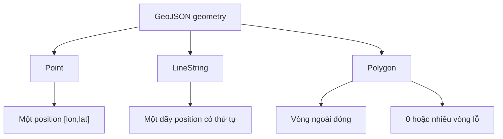

# GeoJSON và các kiểu Point, LineString, Polygon

Ứng dụng giao hàng cần lưu vị trí cửa hàng, đường đi dự kiến của tài xế và khu vực có thể phục vụ. Nếu chỉ lưu chuỗi `"Quận 1, TP.HCM"`, MongoDB khó trả lời trực tiếp những câu hỏi như “cửa hàng nào cách khách hàng không quá 2 km?”, “đoạn tuyến nào giao cắt khu vực cấm?” hoặc “điểm nhận hàng nằm trong vùng giao hàng nào?”. **GeoJSON** cung cấp một định dạng dữ liệu không gian chuẩn để mô tả các đối tượng này bằng tọa độ và kiểu hình học cụ thể.

Trong module `SPRING_DATA_MONGODB` — sử dụng Spring Data MongoDB để kết nối, ánh xạ document và truy cập dữ liệu qua `MongoTemplate` hoặc repository, đồng thời thực hành truy vấn, aggregation, index, transaction, reactive access, kiểm thử và chẩn đoán hiệu năng — chương **Truy vấn không gian** bắt đầu từ nền tảng: **GeoJSON và ba kiểu `Point`, `LineString`, `Polygon`**. Hiểu đúng hình học và hệ tọa độ là điều kiện tiên quyết trước khi tạo chỉ mục `2dsphere` hoặc viết query địa lý.

Sau bài này, bạn có thể:

1. Đọc và tạo GeoJSON theo cấu trúc `type` và `coordinates`, với hệ tọa độ địa lý WGS84.
2. Phân biệt `Point` (vị trí), `LineString` (đường) và `Polygon` (vùng), cùng các ràng buộc tối thiểu về tọa độ.
3. Ánh xạ đối tượng GeoJSON qua `GeoJsonPoint`, `GeoJsonLineString`, `GeoJsonPolygon` trong Spring Data MongoDB.
4. Hiểu cách tạo index `2dsphere`, và khi nào dùng `$geoWithin`, `$geoIntersects` hoặc `$near`.
5. Tránh nhầm **longitude/latitude**, đơn vị độ/mét, thứ tự vòng polygon, vùng có lỗ và giới hạn dữ liệu tại đường đổi ngày.
6. Kiểm tra dữ liệu không gian ở service/ETL, thử truy vấn thực trên MongoDB và đọc `explain("executionStats")`.
7. Phân biệt GeoJSON với một chuỗi danh sách tọa độ hoặc với kiểu hình học phẳng `Point`/`Polygon` kế thừa từ Spring Data Commons.

## 1. GeoJSON là gì và MongoDB dùng nó vào việc nào?

GeoJSON là định dạng dựa trên JSON để mô tả geometry, feature và feature collection, được chuẩn hóa trong **RFC 7946**. Ở mức geometry đơn giản nhất:

```json
{
  "type": "Point",
  "coordinates": [106.700981, 10.776889]
}
```

Một geometry có hai trường quan trọng:

- `type` xác định kiểu hình học, chẳng hạn `Point`, `LineString` hoặc `Polygon`.
- `coordinates` chứa tọa độ với cấu trúc lồng nhau **phụ thuộc vào kiểu hình học**.

MongoDB hiểu các đối tượng GeoJSON và hỗ trợ **geospatial query operators** cùng **`2dsphere` index** để tìm kiếm theo vị trí, khoảng cách và quan hệ hình học trên bề mặt gần cầu của Trái Đất.

### 1.1. Chọn kiểu geometry theo yêu cầu nghiệp vụ

| Nhu cầu | Kiểu GeoJSON | Ví dụ |
| --- | --- | --- |
| Vị trí một cửa hàng, điểm giao, trạm sạc | `Point` | Vị trí hiện tại của quán |
| Tuyến đường vận chuyển dự kiến, đường biên khảo sát | `LineString` | Dãy tọa độ GPS mô tả một tuyến |
| Ranh giới khu giao hàng, khu vực cấm, địa bàn hành chính | `Polygon` | Vùng được phép giao |
| Một đối tượng gồm nhiều phần không liên tục | `MultiPoint`/`MultiLineString`/`MultiPolygon` | Nhiều vùng giao hàng tách biệt |

**Geometry không phải thực thể nghiệp vụ hoàn chỉnh.** Một document `DeliveryZone` còn cần `tenantId`, `zoneCode`, `active`, phiên bản quy tắc và các field khác. GeoJSON chỉ mô tả phần **hình học**, không xác định quyền giao hàng, thời gian hoạt động, lịch sử điều chỉnh hoặc chính sách giá.

### 1.2. Geometry, Feature và FeatureCollection

RFC 7946 còn có hai cấu trúc chứa metadata:

```json
{
  "type": "Feature",
  "geometry": {
    "type": "Point",
    "coordinates": [106.700981, 10.776889]
  },
  "properties": {
    "label": "Điểm A"
  }
}
```

Một `FeatureCollection` là tập nhiều `Feature`. Tuy nhiên, một field MongoDB được truy vấn bằng `$geometry` thường nhận một **GeoJSON geometry** có `type` như `Point`/`Polygon`, không phải toàn bộ wrapper `Feature`.

Trong Spring Data MongoDB, nên **đặt geometry vào field rõ ràng**, ví dụ `location` hoặc `boundary`; các thuộc tính nghiệp vụ lưu ở các field khác của document. Nếu nhập dữ liệu từ một GeoJSON `FeatureCollection` bên ngoài, ETL cần tách `feature.geometry` và ánh xạ `feature.properties` một cách có chủ đích.

## 2. Hệ tọa độ: WGS84 và thứ tự `[longitude, latitude]`

Đây là lỗi thường gặp và nguy hiểm nhất khi làm GeoJSON. Theo RFC 7946, GeoJSON sử dụng hệ tọa độ địa lý **WGS84**, trong đó hai phần tử đầu của mỗi vị trí là:

```text
coordinates = [longitude, latitude]
             = [kinh độ, vĩ độ]
                    x        y
```

Ví dụ minh họa một tọa độ tại Thành phố Hồ Chí Minh:

```json
{
  "type": "Point",
  "coordinates": [106.700981, 10.776889]
}
```

**Không đảo thành `[10.776889, 106.700981]`.** Kinh độ được viết trước vĩ độ, dù giao diện GPS hoặc một số API thường hiển thị “latitude, longitude”. Nếu đảo hai giá trị, vĩ độ `106.700981` nằm ngoài phạm vi hợp lệ.

### 2.1. Phạm vi và đơn vị

| Thành phần | Ý nghĩa | Miền phổ biến | Đơn vị |
| --- | --- | --- | --- |
| `longitude` | Kinh độ đông/tây | Từ -180 đến +180 | **Độ** |
| `latitude` | Vĩ độ bắc/nam | Từ -90 đến +90 | **Độ** |
| `altitude` (nếu có) | Độ cao so với mốc được chọn | Phụ thuộc nguồn dữ liệu | Thường mét theo RFC, cần quy ước rõ |
| `distance` trong `$near` với GeoJSON/`2dsphere` | Khoảng cách bề mặt được query | Số không âm | **Mét** |

Trong GeoJSON, position có thể có phần tử thứ ba như `[longitude, latitude, altitude]`. Tuy nhiên **không giả định index `2dsphere` và mọi toán tử địa lý của MongoDB tự tính khoảng cách 3D theo altitude**. Ứng dụng cần phân biệt bài toán mặt đất 2D với đo đạc độ cao ba chiều.

### 2.2. Degrees không phải meters

Nếu hai điểm cách nhau `0.01` độ kinh độ, không thể kết luận khoảng cách bằng `0.01 m`, `0.01 km` hoặc một số mét cố định. Độ dài một độ kinh tuyến thay đổi theo vĩ độ; Trái Đất không phải mặt phẳng Cartesian với một tỉ lệ cố định.

Đối với tìm kiếm trong phạm vi **1,5 km**, dùng query địa lý có đơn vị **1.500 mét** khi làm việc với GeoJSON và `2dsphere`, không tự cộng `0.015` vào longitude rồi gọi đó là bán kính 1,5 km.

### 2.3. Kiểm tra giá trị đầu vào

Ví dụ validation biên cơ bản:

```java
public static void validateLonLat(
        double longitude, double latitude
) {
    if (!Double.isFinite(longitude)
            || !Double.isFinite(latitude)
            || longitude < -180 || longitude > 180
            || latitude < -90 || latitude > 90) {
        throw new IllegalArgumentException(
                "Tọa độ WGS84 không hợp lệ");
    }
}
```

Điều này ngăn giá trị `NaN`, `Infinity` và tọa độ ngoài phạm vi, **không tự chứng minh người dùng đã nhập đúng thứ tự**. Một cặp số nằm trong cả hai khoảng hợp lệ vẫn có thể bị đảo mà validation không phát hiện. Khi tích hợp API, phải biết chính xác bên nguồn dùng `lat/lon` hay `lon/lat`.

### 2.4. Những điều không nên suy từ GeoJSON

GeoJSON không tự đảm bảo:

- Điểm nằm trong lãnh thổ được phép; `[0,0]` hoàn toàn có thể hợp lệ về số học.
- Tọa độ GPS chính xác ở mức centimet; dữ liệu thu thập có sai số và jitter.
- Đường nối hai điểm là đường xe máy có thể đi được.
- Polygon là ranh giới pháp lý được chứng thực.
- Hình học không tự cắt, không có khe hở và có topology đúng khi dữ liệu do người dùng tự vẽ.

Validation có thể cần thêm rule GIS, bản đồ đường giao thông, nguồn dữ liệu đáng tin cậy và phê duyệt nghiệp vụ.

## 3. `Point`: một vị trí địa lý

`Point` là geometry đơn giản nhất: **một position duy nhất**.

```json
{
  "type": "Point",
  "coordinates": [106.701, 10.777]
}
```

Một document cửa hàng:

```javascript
db.stores.insertOne({
  _id: "STORE-001",
  tenantId: "T-A",
  name: "Cửa hàng trung tâm",
  active: true,
  location: {
    type: "Point",
    coordinates: [106.701, 10.777]
  }
});
```

### 3.1. Ánh xạ `GeoJsonPoint` trong Spring Data MongoDB

`org.springframework.data.mongodb.core.geo.GeoJsonPoint` biểu diễn một GeoJSON Point. Dù class này liên quan đến `org.springframework.data.geo.Point`, **đừng dùng nhầm `new Point(longitude, latitude)` rồi suy rằng mapper chắc chắn lưu thành GeoJSON có `type: "Point"`**.

```java
import org.springframework.data.mongodb.core.geo.GeoJsonPoint;

GeoJsonPoint location =
        new GeoJsonPoint(106.701, 10.777);

double longitude = location.getX();
double latitude = location.getY();
```

Tương ứng BSON:

```json
{
  "type": "Point",
  "coordinates": [106.701, 10.777]
}
```

**Tên hàm `getX()`/`getY()` không thay đổi thứ tự GeoJSON:** x là kinh độ, y là vĩ độ. Với code dùng các DTO có tên `latitude` và `longitude`, luôn tạo `new GeoJsonPoint(longitude, latitude)`.

### 3.2. Từ form/map sang entity

```java
public record SetLocationRequest(
        double latitude,
        double longitude
) {}

public GeoJsonPoint toGeoJsonPoint(SetLocationRequest request) {
    validateLonLat(
            request.longitude(), request.latitude());
    return new GeoJsonPoint(
            request.longitude(), request.latitude());
}
```

DTO cố tình nhận `latitude` trước `longitude` như một số form UI; bước mapping **đảo về đúng thứ tự** trong GeoJSON. Code nên đặt tên rõ thay vì dùng biến `x`/`y` không có ngữ cảnh.

### 3.3. Point dùng được cho những query nào?

- `$near`: tìm cửa hàng gần một điểm truy vấn, kết quả thường được sắp xếp theo độ gần.
- `$geoWithin`: tìm các điểm nằm trong một vùng hình học.
- `$geoIntersects`: xác định một điểm có giao với một geometry, bao gồm trường hợp điểm thuộc vùng.

Để query hiệu quả khi dữ liệu lớn, chọn index `2dsphere` cho field `location` nếu lưu GeoJSON và có geospatial workload phù hợp.

## 4. `LineString`: một đường gồm nhiều vị trí

`LineString` mô tả **một dãy position có thứ tự**, thường dùng để lưu đường đi dự kiến, tuyến khảo sát, đoạn đường hoặc ranh giới dạng đường.

```json
{
  "type": "LineString",
  "coordinates": [
    [106.697, 10.775],
    [106.702, 10.778],
    [106.709, 10.782]
  ]
}
```

Điểm đầu và điểm cuối **không bắt buộc trùng nhau**. Một `LineString` hợp lệ theo GeoJSON cần **ít nhất hai position**. Nếu chỉ có một GPS sample, dùng `Point` hoặc chờ dữ liệu đủ để hình thành một đường.

### 4.1. Thứ tự position biểu thị đường đi

Thứ tự trong array có ý nghĩa:

```text
A [106.697,10.775]
      |
      v
B [106.702,10.778]
      |
      v
C [106.709,10.782]
```

Hai LineString có cùng tập tọa độ nhưng thứ tự khác nhau có thể mô tả **đường khác nhau**. Đừng sắp xếp các điểm theo longitude hoặc latitude để “chuẩn hóa” LineString; như vậy bạn có thể phá tuyến.

### 4.2. Ánh xạ `GeoJsonLineString`

Spring Data MongoDB cung cấp `GeoJsonLineString` để giữ đúng cấu trúc đường GeoJSON:

```java
import org.springframework.data.geo.Point;
import org.springframework.data.mongodb.core.geo.GeoJsonLineString;

GeoJsonLineString route = new GeoJsonLineString(
        new Point(106.697, 10.775),
        new Point(106.702, 10.778),
        new Point(106.709, 10.782)
);
```

Ví dụ dùng `Point` làm **các đỉnh** trong constructor của `GeoJsonLineString`; không có nghĩa field route được lưu dưới dạng một array legacy location tùy ý. Spring Data chuyển geometry thành BSON tương ứng:

```json
{
  "type": "LineString",
  "coordinates": [
    [106.697, 10.775],
    [106.702, 10.778],
    [106.709, 10.782]
  ]
}
```

Nếu project dùng một phiên bản Spring Data có overload khác, hãy kiểm tra API của `GeoJsonLineString` trong dependency đang sử dụng, hoặc dùng `List<Point>` theo constructor mà version đó hỗ trợ. Điều quan trọng là tạo geometry được Spring Data mapping thành **`type: "LineString"`** và test lại BSON, thay vì tự đoán cấu trúc.

### 4.3. Đường không tự trở thành route mạng lưới giao thông

Một LineString chỉ kết nối các đỉnh bằng các segment hình học; nó **không chứa**:

- Thông tin đường một chiều, biển cấm, độ rộng đường.
- Tốc độ và thời gian di chuyển theo giao thông.
- Tên đường, nút giao, quy tắc rẽ, ùn tắc.
- Chính sách di chuyển của xe máy so với xe tải.

Vì vậy, không dùng độ dài hình học LineString làm “quãng đường tài xế phải chạy” khi dữ liệu chỉ có hai điểm đầu-cuối. Muốn routing thực tế, cần hệ thống bản đồ đường hoặc dịch vụ định tuyến phù hợp.

### 4.4. Đường tự cắt hoặc có đỉnh trùng nhau

LineString có thể quay lại một đỉnh cũ, tự giao hoặc có segment rất ngắn; không phải mọi trường hợp đều là JSON sai. Nhưng với nghiệp vụ như một tuyến vận tải đã tối ưu, ứng dụng thường cần **quy tắc chất lượng riêng**: loại GPS jitter, điểm trùng liên tiếp, đoạn dài bất thường hoặc tuyến đi qua vùng cấm.

**Không tự xóa mọi điểm trùng**: có trường hợp xe quay đầu hoặc lặp tuyến có ý nghĩa thời gian. Nếu muốn mô hình chuyển động, cần thêm timestamps tách biệt; GeoJSON LineString không lưu thời gian cho từng position theo chuẩn core RFC.

### 4.5. Phân biệt `LineString` và `MultiLineString`

Một tuyến bị gián đoạn không nhất thiết phải tạo một LineString nối thẳng khoảng trống. `MultiLineString` biểu diễn nhiều dãy đường riêng:

```json
{
  "type": "MultiLineString",
  "coordinates": [
    [
      [106.697, 10.775],
      [106.702, 10.778]
    ],
    [
      [106.716, 10.788],
      [106.720, 10.790]
    ]
  ]
}
```

Sử dụng kiểu geometry theo ý nghĩa dữ liệu, không chỉ theo hình dạng mảng array dễ viết.

## 5. `Polygon`: một vùng có đường bao khép kín

`Polygon` mô tả vùng bằng **một hoặc nhiều linear ring**. Vòng thứ nhất là **đường bao ngoài**; những vòng sau (nếu có) là **lỗ** nằm bên trong.

Ví dụ một hình chữ nhật nhỏ minh họa vùng giao hàng:

```json
{
  "type": "Polygon",
  "coordinates": [
    [
      [106.690, 10.770],
      [106.720, 10.770],
      [106.720, 10.790],
      [106.690, 10.790],
      [106.690, 10.770]
    ]
  ]
}
```

Hãy đọc số lớp array:

```text
Polygon.coordinates
  └── [ ring ngoài, ring lỗ 1, ring lỗ 2, ... ]
        └── [ position 1, position 2, ..., position 1 ]
              └── [ longitude, latitude ]
```

### 5.1. Vì sao vòng phải đóng?

Một **linear ring** có ít nhất **bốn position** và position đầu trùng position cuối. Ba đỉnh phân biệt tạo tam giác cần bốn phần tử vì phải lặp lại điểm đầu:

```json
{
  "type": "Polygon",
  "coordinates": [
    [
      [106.700, 10.770],
      [106.720, 10.770],
      [106.710, 10.790],
      [106.700, 10.770]
    ]
  ]
}
```

Một vòng chỉ có ba phần tử không đóng, hoặc có bốn phần tử nhưng tất cả nằm thẳng hàng, **không nên coi là một vùng hợp lệ về hình học**. Ngoài shape/schema, cần kiểm tra diện tích dương, tính không tự cắt và những quy tắc topology khác.

### 5.2. Tạo `GeoJsonPolygon` trong Spring Data

`org.springframework.data.mongodb.core.geo.GeoJsonPolygon` là kiểu tương ứng để mapping một polygon. Với một đường bao:

```java
import org.springframework.data.geo.Point;
import org.springframework.data.mongodb.core.geo.GeoJsonPolygon;

GeoJsonPolygon zone = new GeoJsonPolygon(
        new Point(106.690, 10.770),
        new Point(106.720, 10.770),
        new Point(106.720, 10.790),
        new Point(106.690, 10.790),
        new Point(106.690, 10.770)
);
```

Ví dụ cố ý **đóng vòng**. Không nhầm `new org.springframework.data.geo.Polygon(...)` (kiểu hình học nền của Spring Data Commons) với `GeoJsonPolygon` khi muốn lưu đúng đối tượng GeoJSON có `type`/`coordinates`.

### 5.3. Vùng có lỗ

Một Polygon có thể có khu vực *không được tính là bên trong*, ví dụ vùng giao hàng trừ một khu cấm:

```json
{
  "type": "Polygon",
  "coordinates": [
    [
      [106.690, 10.760],
      [106.730, 10.760],
      [106.730, 10.800],
      [106.690, 10.800],
      [106.690, 10.760]
    ],
    [
      [106.705, 10.775],
      [106.705, 10.785],
      [106.715, 10.785],
      [106.715, 10.775],
      [106.705, 10.775]
    ]
  ]
}
```

Vòng thứ hai mô tả **lỗ**, nên một điểm ở tọa độ `[106.710, 10.780]` nằm trong đường bao ngoài nhưng **không thuộc phần diện tích được phủ**. Trái lại, điểm `[106.700, 10.770]` nằm trong vùng ngoài và ngoài lỗ.

### 5.4. Right-hand rule và hướng vòng

RFC 7946 quy định quy tắc **right-hand rule**: khi nhìn trên mặt phẳng kinh–vĩ độ trong tình huống thông thường, **vòng ngoài đi ngược chiều kim đồng hồ (counter-clockwise)** và **vòng lỗ đi cùng chiều kim đồng hồ (clockwise)**. Trên dữ liệu đã tồn tại, nhiều parser có thể chấp nhận hướng khác trong một số trường hợp tương thích ngược, nhưng **không nên phụ thuộc vào sự dễ dãi đó**.

Trong MongoDB, cách hiểu polygon diện tích lớn và hướng vòng có thể chịu ảnh hưởng từ quy tắc GeoJSON/`2dsphere`, nhất là với polygon lớn hơn một bán cầu và toán tử `$geometry`. Với vùng lớn hoặc qua **antimeridian**, cần kiểm tra tài liệu server về strict winding/CRS và test dữ liệu thực, không áp quy tắc 2D đơn giản một cách mù quáng.

### 5.5. Polygon tự cắt là lỗi nghiệp vụ lớn

Ví dụ “hình nơ”:

```json
{
  "type": "Polygon",
  "coordinates": [
    [
      [106.70, 10.77],
      [106.72, 10.79],
      [106.70, 10.79],
      [106.72, 10.77],
      [106.70, 10.77]
    ]
  ]
}
```

Đường bao đi chéo và tự cắt. Kết quả “điểm nằm bên trong” có thể bị từ chối hoặc có ý nghĩa không mong đợi tùy engine/version. **Không giải quyết bằng cách đổi `2dsphere` thành `2d`**; cần validate/repair topology trước khi lưu vào hệ thống dùng cho quyết định giao hàng.

### 5.6. Đường biên thuộc vùng hay không?

Khi xét một điểm **nằm chính xác trên ranh giới** polygon, semantics của từng toán tử, loại index và độ chính xác số học có thể quan trọng. Đối với tính cước/quyền giao ở biên giới vùng, không nên chỉ dựa vào nhận định bằng mắt hoặc float equality.

Định nghĩa chính sách rõ: điểm biên được phép hay không, có sử dụng tolerance hay buffer, ai chịu trách nhiệm giải quyết vùng chồng lấn. Viết **integration tests cho điểm nằm trong, ngoài, trong lỗ, trên cạnh và tại đỉnh** trên MongoDB Server đang dùng.

## 6. So sánh ba geometry và mức lồng `coordinates`

| Kiểu | Hình dạng tọa độ | Ràng buộc tối thiểu | Câu hỏi thực tế |
| --- | --- | --- | --- |
| `Point` | `[lon, lat]` | Một position hợp lệ | Khách ở đâu? |
| `LineString` | `[[lon,lat],[lon,lat],...]` | Từ 2 position | Tuyến đi qua đâu? |
| `Polygon` | `[[[lon,lat],...closed...], [hole...]]` | Vòng ngoài khép kín, ít nhất 4 position | Điểm có ở trong vùng? |

### 6.1. Sơ đồ tư duy



### 6.2. Một JSON array không đủ để biết geometry type

`[[106.70,10.77],[106.71,10.78]]` có thể là tọa độ của một LineString, một đoạn đường trong polygon chưa đóng, hoặc một tập điểm thiếu wrapper. Trường `type` giúp xác định ý nghĩa và cách MongoDB xử lý.

Đừng lưu:

```json
{
  "location": [106.701, 10.777]
}
```

rồi khẳng định nó tương đương hoàn toàn với:

```json
{
  "location": {
    "type": "Point",
    "coordinates": [106.701, 10.777]
  }
}
```

MongoDB có kiểu tọa độ legacy pair được một số toán tử/index hỗ trợ, nhưng **ngữ nghĩa, đơn vị, giới hạn và cách ánh xạ không giống mặc định GeoJSON**. Chọn một schema thống nhất cho mỗi field.

## 7. Mô hình document cho cửa hàng, tuyến đường và vùng giao hàng

Trong một ứng dụng nhiều tenant, ba loại geometry có thể nằm trong ba collection khác nhau: `stores` lưu point, `deliveryRoutes` lưu line, `deliveryZones` lưu polygon.

### 7.1. Entity cửa hàng với `GeoJsonPoint`

```java
import org.springframework.data.mongodb.core.geo.GeoJsonPoint;
import org.springframework.data.mongodb.core.index.GeoSpatialIndexType;
import org.springframework.data.mongodb.core.index.GeoSpatialIndexed;
import org.springframework.data.mongodb.core.mapping.Document;
import org.springframework.data.mongodb.core.mapping.MongoId;

@Document(collection = "stores")
public class Store {
    @MongoId
    private String id;
    private String tenantId;
    private String name;
    private boolean active;

    @GeoSpatialIndexed(type = GeoSpatialIndexType.GEO_2DSPHERE)
    private GeoJsonPoint location;

    protected Store() {}

    public Store(
            String id, String tenantId, String name,
            boolean active, GeoJsonPoint location
    ) {
        this.id = id;
        this.tenantId = tenantId;
        this.name = name;
        this.active = active;
        this.location = location;
    }

    public String getId() { return id; }
    public String getTenantId() { return tenantId; }
    public String getName() { return name; }
    public boolean isActive() { return active; }
    public GeoJsonPoint getLocation() { return location; }
}
```

`@GeoSpatialIndexed(type = GeoSpatialIndexType.GEO_2DSPHERE)` khai báo **metadata index**, không chứng minh index vật lý đã có trên server. Tùy cấu hình Spring Data MongoDB, **automatic index creation** có thể đang tắt; khi đó cần bootstrap/migration để tạo index đúng trước traffic.

### 7.2. Entity tuyến đường với `GeoJsonLineString`

```java
import org.springframework.data.mongodb.core.geo.GeoJsonLineString;
import org.springframework.data.mongodb.core.index.GeoSpatialIndexType;
import org.springframework.data.mongodb.core.index.GeoSpatialIndexed;
import org.springframework.data.mongodb.core.mapping.Document;
import org.springframework.data.mongodb.core.mapping.MongoId;

@Document(collection = "deliveryRoutes")
public class DeliveryRoute {
    @MongoId
    private String id;
    private String tenantId;
    private String routeCode;

    @GeoSpatialIndexed(type = GeoSpatialIndexType.GEO_2DSPHERE)
    private GeoJsonLineString path;

    protected DeliveryRoute() {}

    public DeliveryRoute(
            String id, String tenantId, String routeCode,
            GeoJsonLineString path
    ) {
        this.id = id;
        this.tenantId = tenantId;
        this.routeCode = routeCode;
        this.path = path;
    }

    public String getId() { return id; }
    public String getTenantId() { return tenantId; }
    public String getRouteCode() { return routeCode; }
    public GeoJsonLineString getPath() { return path; }
}
```

Index địa lý trên `path` hữu ích nếu workload hỏi **“tuyến nào giao cắt vùng này?”**. Không tạo `2dsphere` chỉ vì field có geometry: index tốn dung lượng và chi phí ghi; nếu ứng dụng chỉ hiển thị một route đã biết theo ID, query theo `_id` có thể đủ.

### 7.3. Entity vùng với `GeoJsonPolygon`

```java
import org.springframework.data.mongodb.core.geo.GeoJsonPolygon;
import org.springframework.data.mongodb.core.index.GeoSpatialIndexType;
import org.springframework.data.mongodb.core.index.GeoSpatialIndexed;
import org.springframework.data.mongodb.core.mapping.Document;
import org.springframework.data.mongodb.core.mapping.MongoId;

@Document(collection = "deliveryZones")
public class DeliveryZone {
    @MongoId
    private String id;
    private String tenantId;
    private String zoneCode;
    private boolean active;

    @GeoSpatialIndexed(type = GeoSpatialIndexType.GEO_2DSPHERE)
    private GeoJsonPolygon boundary;

    protected DeliveryZone() {}

    public DeliveryZone(
            String id, String tenantId, String zoneCode,
            boolean active, GeoJsonPolygon boundary
    ) {
        this.id = id;
        this.tenantId = tenantId;
        this.zoneCode = zoneCode;
        this.active = active;
        this.boundary = boundary;
    }

    public String getId() { return id; }
    public String getTenantId() { return tenantId; }
    public String getZoneCode() { return zoneCode; }
    public boolean isActive() { return active; }
    public GeoJsonPolygon getBoundary() { return boundary; }
}
```

Với hệ thống phức tạp, có thể cần `MultiPolygon` nếu một zone gồm các phần tách biệt. **Không vẽ đường nối giả qua vùng không phục vụ** chỉ để biến nhiều vùng thành một Polygon đơn.

### 7.4. Repository không tự suy ra mọi truy vấn GIS

```java
import java.util.List;
import org.springframework.data.mongodb.repository.MongoRepository;

public interface StoreRepository
        extends MongoRepository<Store, String> {

    List<Store> findByTenantIdAndActive(
            String tenantId, boolean active);
}
```

Repository xử lý các truy vấn thông thường, nhưng một query như “tìm `Store` trong `Polygon`” thường cần **`MongoTemplate`/`@Query`/Geo API** được thiết kế rõ. Không đặt tên một derived method đoán mò rồi coi Spring Data chắc chắn chuyển thành `$geoWithin` đúng kiểu geometry/đơn vị.

## 8. Index `2dsphere`: GeoJSON dùng đúng loại chỉ mục

MongoDB có nhiều loại geospatial index, trong đó hai loại dễ nhầm:

| Index | Hướng sử dụng | Khi nào nên chọn |
| --- | --- | --- |
| `2dsphere` | Tọa độ địa lý trên mặt gần cầu, hỗ trợ GeoJSON geometry | **GeoJSON Point/LineString/Polygon** và các query địa lý |
| `2d` | Cặp tọa độ trong mặt phẳng 2D, geospatial legacy | Chỉ khi dữ liệu/ngữ nghĩa thật sự phù hợp planar coordinate |

Nếu đang lưu GeoJSON WGS84, hãy ưu tiên **`2dsphere`**. Index `2d` không phải “phiên bản tiết kiệm” thay thế được toàn bộ semantics GeoJSON.

### 8.1. Tạo index bằng `mongosh`

```javascript
db.stores.createIndex(
  { location: "2dsphere" },
  { name: "ix_stores_location_geo" }
);

db.deliveryRoutes.createIndex(
  { path: "2dsphere" },
  { name: "ix_routes_path_geo" }
);

db.deliveryZones.createIndex(
  { boundary: "2dsphere" },
  { name: "ix_zones_boundary_geo" }
);
```

Tên field ở đây là **tên lưu trong BSON**. Nếu entity dùng `@Field("geo_location")` thay vì `location`, lệnh tạo index thủ công phải dùng đường BSON tương ứng. Không chỉ đọc tên Java property rồi giả định server lưu cùng tên.

### 8.2. Tạo index qua Java Driver trong Spring

Ví dụ triển khai **một lần trong migration/bootstrapping có kiểm soát**:

```java
import com.mongodb.client.model.IndexOptions;
import com.mongodb.client.model.Indexes;
import org.springframework.data.mongodb.core.MongoTemplate;

public void ensureGeoIndexes(MongoTemplate template) {
    template.getCollection("stores").createIndex(
            Indexes.geo2dsphere("location"),
            new IndexOptions().name("ix_stores_location_geo"));

    template.getCollection("deliveryRoutes").createIndex(
            Indexes.geo2dsphere("path"),
            new IndexOptions().name("ix_routes_path_geo"));

    template.getCollection("deliveryZones").createIndex(
            Indexes.geo2dsphere("boundary"),
            new IndexOptions().name("ix_zones_boundary_geo"));
}
```

Phương thức `getCollection(...).createIndex(...)` dùng **MongoDB Java Driver**. Nếu đang có index tên này với key/options khác, server có thể báo conflict; không dùng đoạn này như cơ chế tự sửa index drift bằng cách drop/create tùy tiện ở mỗi replica.

### 8.3. `2dsphere` index có bảo đảm mọi shape hợp lệ không?

Index có thể từ chối một số tọa độ/geometry không hợp lệ khi build hoặc insert, nhưng **không phải bộ validator GIS hoàn chỉnh** cho mọi ràng buộc nghiệp vụ. Ví dụ index không biết khu giao hàng có được phép bao phủ sông, có chồng lấn zone khác hay chiều rộng tuyến đường có phù hợp xe tải không.

Validation nên có nhiều lớp:

```text
Input API → kiểm tra kiểu/số/toạ độ
         → validate geometry/topology
         → kiểm tra quy tắc nghiệp vụ/tenant
         → ghi MongoDB với 2dsphere index
         → integration tests/query checks
```

### 8.4. Kiểm chứng index tồn tại

```javascript
db.stores.getIndexes();
db.deliveryRoutes.getIndexes();
db.deliveryZones.getIndexes();
```

Đối chiếu field, index type, name và options. **Có annotation `@GeoSpatialIndexed` trong source không đủ**: nếu index không tồn tại trên server, nhiều truy vấn geospatial có thể chậm hoặc `$near` có thể thất bại khi thiếu index phù hợp.

### 8.5. Compound geospatial index trong ứng dụng nhiều tenant

Khi phần lớn query có `tenantId` và `active`, có thể nghiên cứu index compound như:

```javascript
db.stores.createIndex(
  { tenantId: 1, location: "2dsphere" },
  { name: "ix_stores_tenant_location" }
);
```

Nhưng không tự cho rằng thêm `tenantId` vào index luôn tốt hơn. Việc chọn key/order, cardinality tenant, query shape và giới hạn của `2dsphere` compound index cần đo bằng `explain` trên dữ liệu đại diện.

**Quy tắc quan trọng:** khi kiểm soát quyền truy cập theo tenant, **luôn có filter tenant ở query**, dù đã tạo compound index. Index là tối ưu hiệu năng, không phải cơ chế authorization.

## 9. Ba truy vấn địa lý cốt lõi: `$geoWithin`, `$geoIntersects`, `$near`

Định dạng GeoJSON trở nên hữu ích khi có câu hỏi về **quan hệ hình học**. Ba toán tử không gian thông dụng có ý nghĩa khác nhau:

| Toán tử | Câu hỏi | Kiểu dữ liệu liên quan |
| --- | --- | --- |
| `$geoWithin` | Geometry được lưu **nằm trong** vùng truy vấn? | Point/LineString/Polygon tùy cấu trúc và semantics |
| `$geoIntersects` | Geometry được lưu **giao cắt** geometry truy vấn? | Point/LineString/Polygon |
| `$near` | Các vị trí nào **gần nhất** với một điểm và nằm trong khoảng cách yêu cầu? | Thường tìm Point theo vị trí |

Đừng đổi `$geoWithin` thành `$geoIntersects` chỉ vì cả hai đều có từ “geo”. Với một tuyến đường đi xuyên qua một polygon, **giao cắt** và **nằm trọn trong vùng** cho kết quả khác nhau.

### 9.1. `$geoWithin`: tìm cửa hàng trong một polygon

Cho vùng `deliveryArea`:

```javascript
const deliveryArea = {
  type: "Polygon",
  coordinates: [[
    [106.690, 10.770],
    [106.720, 10.770],
    [106.720, 10.790],
    [106.690, 10.790],
    [106.690, 10.770]
  ]]
};

db.stores.find({
  tenantId: "T-A",
  active: true,
  location: {
    $geoWithin: {
      $geometry: deliveryArea
    }
  }
});
```

Query chọn **các Point location** nằm trong vùng. `$geoWithin` có thể hoạt động khi không có geospatial index trong một số trường hợp, nhưng với dữ liệu lớn cần đánh giá index `2dsphere` để tăng hiệu năng.

Một ứng dụng có thể yêu cầu “trong vòng 1 km” thay vì polygon; khi đó không tự tạo một hình chữ nhật bằng cách cộng/trừ 0.01 độ rồi giả làm vùng tròn 1 km.

### 9.2. `$geoIntersects`: điểm giao với vùng lưu trong collection

Một câu hỏi đảo chiều: khách ở tọa độ `[106.700, 10.775]` thuộc những delivery zone nào?

```javascript
db.deliveryZones.find({
  tenantId: "T-A",
  active: true,
  boundary: {
    $geoIntersects: {
      $geometry: {
        type: "Point",
        coordinates: [106.700, 10.775]
      }
    }
  }
});
```

Ở đây **geometry lưu là Polygon**, geometry truyền vào query là Point. Hai geometry giao nhau khi điểm thuộc vùng theo semantics của server.

Với polygon có lỗ ở mục 5, một điểm nằm trong lỗ không nên được nhận như điểm được phục vụ. Viết test thật thay vì chỉ vẽ hình trên UI.

### 9.3. `$geoIntersects`: tuyến đường có cắt qua khu vực cấm?

```javascript
const restrictedArea = {
  type: "Polygon",
  coordinates: [[
    [106.700, 10.775],
    [106.710, 10.775],
    [106.710, 10.785],
    [106.700, 10.785],
    [106.700, 10.775]
  ]]
};

db.deliveryRoutes.find({
  tenantId: "T-A",
  path: {
    $geoIntersects: {
      $geometry: restrictedArea
    }
  }
});
```

Đường có thể chỉ **cắt một đoạn ngắn** của vùng mà vẫn match. Nếu yêu cầu “toàn bộ tuyến phải ở trong một vùng cho phép”, cần xem `$geoWithin` và semantics toàn geometry; không dùng `$geoIntersects` như điều kiện thay thế.

### 9.4. `$near`: tìm cửa hàng gần khách hàng

```javascript
db.stores.find({
  tenantId: "T-A",
  active: true,
  location: {
    $near: {
      $geometry: {
        type: "Point",
        coordinates: [106.700981, 10.776889]
      },
      $maxDistance: 1500
    }
  }
}).limit(20);
```

Với GeoJSON Point và `2dsphere`, `$maxDistance: 1500` được hiểu là **1.500 mét**, không phải 1.500 độ hoặc 1.500 km. Query `$near` cần geospatial index phù hợp và thông thường trả kết quả theo thứ tự gần trước.

**Khoảng cách địa lý không phải ETA hoặc quãng đường lái xe.** Một cửa hàng cách khách 700 m theo khoảng cách hình học có thể cần chạy 2 km theo đường giao thông vì sông/cầu/đường một chiều.

### 9.5. `$geoWithin` và `$geoIntersects` khác nhau ở đường biên

Giả sử một `LineString` chỉ chạm cạnh polygon rồi đi ra ngoài:

- `$geoIntersects` kiểm tra có **giao nhau** theo mô hình geometry; có thể match vì chạm/cắt biên.
- `$geoWithin` yêu cầu geometry được lưu nằm trong vùng truy vấn theo semantics của MongoDB; **chỉ cắt** qua một vùng không đồng nghĩa nằm trọn trong vùng.

Với dữ liệu float và polygon phức tạp, các điểm sát biên cần integration test; không dựa vào việc hai số longitude có vẻ bằng nhau khi in 3 chữ số thập phân.

### 9.6. Giới hạn với `$near` trong các ngữ cảnh khác

`$near` có yêu cầu index và quy tắc query planner riêng. Không ghép bừa với các toán tử khác trên cùng field hoặc đặt vào transaction/aggregation tùy tiện mà không đọc tài liệu phiên bản server. Với **aggregation cần kèm distance field**, dùng `$geoNear` theo quy tắc riêng; nó không đơn thuần là `$match` thông thường có `$near`.

## 10. Viết query GeoJSON qua `MongoTemplate`

Spring Data MongoDB hỗ trợ các kiểu `GeoJson...` và query DSL. Với query đơn giản, bạn có thể sử dụng API `Criteria`; với query GeoJSON phức tạp, `BasicQuery` giúp biểu đạt chính xác toán tử MongoDB.

### 10.1. `BasicQuery` từ JSON cố định

```java
import java.util.List;
import org.springframework.data.mongodb.core.MongoTemplate;
import org.springframework.data.mongodb.core.query.BasicQuery;
import org.springframework.data.mongodb.core.query.Query;

public List<DeliveryZone> zonesCoveringExamplePoint(
        MongoTemplate template
) {
    Query query = new BasicQuery("""
        {
          "tenantId": "T-A",
          "active": true,
          "boundary": {
            "$geoIntersects": {
              "$geometry": {
                "type": "Point",
                "coordinates": [106.700, 10.775]
              }
            }
          }
        }
        """);

    return template.find(query, DeliveryZone.class);
}
```

Đây là **query mẫu với dữ liệu cố định**, dùng Java text block (Java 15+). Không tạo một chuỗi JSON bằng cách nối trực tiếp latitude, tenant ID hay dữ liệu từ HTTP request vào JSON: cần tránh injection và sai định dạng.

### 10.2. `BasicQuery` từ `org.bson.Document` an toàn hơn cho tham số động

```java
import java.util.List;
import org.bson.Document;
import org.springframework.data.mongodb.core.MongoTemplate;
import org.springframework.data.mongodb.core.query.BasicQuery;
import org.springframework.data.mongodb.core.query.Query;

public List<DeliveryZone> findZonesForPoint(
        MongoTemplate template,
        String authorizedTenantId,
        double longitude,
        double latitude
) {
    if (authorizedTenantId == null
            || authorizedTenantId.isBlank()) {
        throw new IllegalArgumentException("Tenant chưa xác thực");
    }
    validateLonLat(longitude, latitude);

    Document point = new Document("type", "Point")
            .append("coordinates", List.of(longitude, latitude));
    Document intersects = new Document("$geoIntersects",
            new Document("$geometry", point));

    Document filter = new Document(
            "tenantId", authorizedTenantId)
            .append("active", true)
            .append("boundary", intersects);

    Query query = new BasicQuery(filter);
    return template.find(query, DeliveryZone.class);
}
```

`BasicQuery` nhận BSON `Document` giúp giữ **kiểu numeric** của tọa độ và giảm lỗi từ việc nối JSON thủ công. `authorizedTenantId` phải đến từ security context đã xác thực, **không** lấy nguyên xi từ user input để xác định quyền.

### 10.3. Query lân cận với tham số động

```java
import java.util.List;
import org.bson.Document;
import org.springframework.data.mongodb.core.MongoTemplate;
import org.springframework.data.mongodb.core.query.BasicQuery;

public List<Store> findNearbyStores(
        MongoTemplate template,
        String authorizedTenantId,
        double longitude,
        double latitude,
        double radiusMeters
) {
    validateLonLat(longitude, latitude);
    if (authorizedTenantId == null
            || authorizedTenantId.isBlank()
            || !Double.isFinite(radiusMeters)
            || radiusMeters <= 0
            || radiusMeters > 50_000) {
        throw new IllegalArgumentException("Search không hợp lệ");
    }

    Document point = new Document("type", "Point")
            .append("coordinates", List.of(longitude, latitude));
    Document near = new Document("$near",
            new Document("$geometry", point)
                    .append("$maxDistance", radiusMeters));

    Document filter = new Document(
            "tenantId", authorizedTenantId)
            .append("active", true)
            .append("location", near);

    return template.find(
            new BasicQuery(filter).limit(20),
            Store.class);
}
```

Đây là một ví dụ chủ động **giới hạn bán kính và số lượng kết quả** để tránh request tra cứu hàng chục nghìn kilomet. Giới hạn 50.000 m là chính sách ví dụ, không phải giới hạn bắt buộc của MongoDB.

### 10.4. Mapper, tên BSON và query đầu vào

Nếu entity có `@Field("geo_boundary")`, hãy xác minh cách `BasicQuery` được map theo target entity trong Spring Data version đang dùng; có thể cần dùng tên BSON thực trong raw criteria. Không ghép lẫn tên Java property và tên MongoDB BSON tùy tiện.

Việc truyền tham số động bằng `Document` không thay thế **authorization** và input validation. Query có `tenantId` đúng về hiệu năng/bảo mật chỉ khi tenant được xác nhận ở tầng application.

### 10.5. MongoDB Java Driver có thể dùng khi query rất đặc thù

Một số hệ thống cần query/operator mới chưa có DSL hỗ trợ đầy đủ. Có thể dùng driver `MongoCollection<Document>` hoặc aggregation pipeline với `Document`, nhưng khi làm vậy phải tự chịu trách nhiệm mapping, session/transaction propagation và lifecycle behavior tương ứng.

**Không giả định mọi raw driver call tự sử dụng Spring Data entity callbacks, auditing hoặc transaction manager.** Với những thao tác cần giao dịch, truyền session đúng và kiểm thử trên replica set.

## 11. Aggregation `$geoNear`: trả khoảng cách cùng kết quả

Toán tử `$near` thường dùng trong `find` để tìm những điểm gần nhất. Khi cần một cột **distanceMeters** đi kèm từng kết quả, MongoDB cung cấp aggregation stage **`$geoNear`**.

### 11.1. Ví dụ aggregation tìm 20 cửa hàng gần nhất

```javascript
db.stores.aggregate([
  {
    $geoNear: {
      near: {
        type: "Point",
        coordinates: [106.700981, 10.776889]
      },
      distanceField: "distanceMeters",
      maxDistance: 1500,
      spherical: true,
      key: "location",
      query: {
        tenantId: "T-A",
        active: true
      }
    }
  },
  {
    $project: {
      _id: 1,
      name: 1,
      location: 1,
      distanceMeters: 1
    }
  },
  { $limit: 20 }
]);
```

Các điểm cần nhớ:

- `$geoNear` phải đứng ở vị trí stage được server quy định (thông thường **stage đầu tiên** trong pipeline top-level); đừng thêm `$match` trước rồi hy vọng query vẫn chạy.
- `key: "location"` xác định field địa lý, đặc biệt hữu ích nếu collection có **nhiều geospatial index**.
- `distanceField` là tên field đầu ra; ở GeoJSON/`2dsphere`, khoảng cách được biểu thị bằng **mét** nếu không áp dụng hệ số nhân khác.
- `query` giúp lọc `tenantId` và `active` ngay trong `$geoNear`.
- `$limit` đặt giới hạn số kết quả, không thể thay thế bằng việc bỏ filter tenant.

### 11.2. `$near` và `$geoNear` không hoàn toàn hoán đổi

| Tiêu chí | `$near` trong find | `$geoNear` trong aggregation |
| --- | --- | --- |
| Mục tiêu chính | Query các điểm theo độ gần | Geo query + output distance để xử lý tiếp |
| Output khoảng cách thành field | Không trực tiếp như `distanceField` của stage | Có |
| Vị trí trong API | Field filter | Stage aggregation có quy tắc vị trí |
| Index địa lý | Cần index phù hợp | Cần index địa lý phù hợp |
| Điều kiện tenant | Các field cùng query | `query` của stage |

Nếu ứng dụng cần hiển thị “cách bạn 750 m”, nên làm rõ liệu muốn **distance địa lý** hay **quãng đường thực tế**. `distanceMeters` từ `$geoNear` không được coi là thời gian di chuyển.

### 11.3. Không lạm dụng aggregation vì chỉ muốn lọc vùng

Nếu chỉ cần “các cửa hàng nằm trong khu vực giao hàng”, `find` với `$geoWithin` thường diễn đạt đúng và đơn giản hơn. Chọn `$geoNear` khi bài toán thực sự cần **xếp hạng theo khoảng cách hoặc distance metadata**, và kiểm chứng chi phí/giới hạn trong server version đang dùng.

## 12. Validation geometry: đúng JSON chưa chắc đúng hình học

Một API có thể nhận một cấu trúc JSON hợp lệ nhưng dữ liệu không gian vô nghĩa, ví dụ polygon tự cắt, LineString chỉ có một đỉnh hoặc tọa độ bị đảo.

### 12.1. Các lớp validation

| Lớp | Cần kiểm tra | Ví dụ lỗi |
| --- | --- | --- |
| JSON/schema | `type` đúng, số lớp array đúng | `Point.coordinates` là string |
| WGS84 | Lon/lat hữu hạn, đúng phạm vi | Latitude = 106 |
| Line topology | Có ít nhất hai đỉnh, tuyến hợp lý | Chỉ một điểm GPS |
| Polygon topology | Vòng ngoài đóng, có ít nhất 4 vị trí, không tự cắt | Hình nơ, vòng chưa đóng |
| Holes | Lỗ nằm trong vùng ngoài, không giao cắt trái quy tắc | Vòng lỗ nằm ngoài |
| Winding | Hướng vòng phù hợp chuẩn và ngữ nghĩa server | Vòng lỗ đảo hướng |
| Nghiệp vụ | Khu vực thuộc tenant, diện tích/độ dài hợp lệ | Zone phủ toàn Trái Đất do lỗi nhập |
| Bảo mật | Không tin tenant, không lạm dụng geometry quá lớn | User gửi polygon với hàng triệu đỉnh |

### 12.2. Kiểm tra ring cơ bản bằng Java

Hàm sau chỉ là **lớp validation đầu vào tối thiểu**, chưa thay thế thư viện GIS có topology checking:

```java
import java.util.List;
import org.springframework.data.geo.Point;

public static void validateLinearRing(List<Point> vertices) {
    if (vertices == null || vertices.size() < 4) {
        throw new IllegalArgumentException(
                "Vòng Polygon phải có ít nhất bốn vị trí");
    }

    for (Point point : vertices) {
        if (point == null) {
            throw new IllegalArgumentException(
                    "Không được có point null");
        }
        validateLonLat(point.getX(), point.getY());
    }

    Point first = vertices.get(0);
    Point last = vertices.get(vertices.size() - 1);

    if (Double.compare(first.getX(), last.getX()) != 0
            || Double.compare(first.getY(), last.getY()) != 0) {
        throw new IllegalArgumentException(
                "Vòng Polygon phải khép kín");
    }
}
```

Kiểm tra **đúng số học** ở first/last có ý nghĩa cho vòng GeoJSON do chính ứng dụng tạo, nhưng khi nhận dữ liệu GPS/nhập khẩu có sai số, cần một bước chuẩn hóa/đóng vòng có chính sách rõ. **Không âm thầm thay đổi ranh giới pháp lý** chỉ để hai điểm “gần nhau” thành đúng bằng nhau.

### 12.3. Hàm trên còn thiếu gì?

Nó **chưa kiểm tra**:

- Ít nhất ba **đỉnh phân biệt không thẳng hàng**.
- Segment tự cắt, chạm nhau hoặc chồng lên nhau.
- Vòng lỗ có nằm trọn trong đường bao ngoài không.
- Hướng winding của vòng ngoài và vòng lỗ.
- Polygon quá lớn, quá phức tạp hoặc đi qua antimeridian.
- Giới hạn diện tích/độ dài được phê duyệt theo nghiệp vụ.

Đối với hệ thống GIS nghiêm túc, có thể dùng thư viện hình học hỗ trợ validation phù hợp (và quy tắc chuyển đổi tọa độ rõ ràng), hoặc kiểm tra bằng một pipeline GIS/ETL được kiểm nghiệm. Tuy nhiên, nhiều thư viện topology hoạt động trên **mặt phẳng**, còn MongoDB `2dsphere` mô hình địa lý trên bề mặt gần cầu; cần hiểu sai khác khi dùng thuật toán planar cho vùng rộng.

### 12.4. Tránh để client gửi geometry cực lớn

Một Polygon chứa hàng trăm nghìn đỉnh làm tăng:

- Kích thước BSON, thời gian parse và validation.
- Dung lượng/chỉ phí ghi `2dsphere` index.
- Độ trễ `$geoIntersects`/`$geoWithin`.
- Tải CPU và nguy cơ request làm cạn tài nguyên.

Nên giới hạn **số đỉnh, số ring, độ dài payload, diện tích và độ phức tạp** theo use case. Khi cần đơn giản hóa hình học (simplification), phải kiểm tra sự thay đổi vùng và điểm biên; không dùng một thuật toán làm giảm điểm bất kỳ rồi khẳng định kết quả vẫn đúng về địa lý/pháp lý.

## 13. Những trường hợp địa lý đặc biệt thường bị bỏ sót

### 13.1. Antimeridian: khu vực qua kinh tuyến ±180°

Một vùng quanh đường đổi ngày có thể có điểm ở kinh độ `179.8°` và `-179.8°` sát nhau về mặt địa lý. Trên mặt phẳng x/y đơn giản, hai số này tưởng chừng cách nhau gần 360 độ.

RFC 7946 khuyến nghị xử lý geometry qua **antimeridian** theo cách chia hoặc biểu diễn phù hợp; trong MongoDB, `2dsphere`/spherical semantics và các giới hạn của polygon lớn cần được kiểm tra riêng. Không tự lấy `min(longitude)`, `max(longitude)` để vẽ một rectangle đơn giản rồi dùng làm vùng gần đường đổi ngày.

### 13.2. Hai cực và vĩ độ cao

Ở vĩ độ rất cao, khoảng cách ứng với một độ longitude khác mạnh so với vùng gần xích đạo. Nếu ứng dụng hoạt động toàn cầu, mọi phép tính khoảng cách bằng xấp xỉ “1 độ ≈ 111 km” cần được đánh giá lại; sử dụng geospatial query với đơn vị rõ ràng hoặc thư viện địa lý phù hợp.

### 13.3. Đường biên polygon và sai số GPS

GPS điện thoại có thể lệch vài mét hoặc nhiều hơn tùy môi trường. Một khách đứng sát ranh giới giao hàng có thể được map vào trong hoặc ngoài qua hai lần đo.

Nếu nghiệp vụ tính phí nhạy cảm với ranh giới, hãy định nghĩa **buffer/tolerance** ở tầng quy tắc và giải thích cho UI, không chỉ dựa trên so sánh hai cặp số float. Với quyết định pháp lý, cần dữ liệu GIS đã được kiểm định.

### 13.4. Polygon có nhiều phần tách biệt

Nếu vùng phục vụ gồm hai khu vực tách rời, dùng `MultiPolygon` thay vì một Polygon nối bằng một hành lang hẹp giả tạo. MongoDB hỗ trợ GeoJSON `MultiPolygon` trong query/index; việc ánh xạ Spring Data có thể sử dụng kiểu `GeoJsonMultiPolygon` tùy dependency.

Một transaction cập nhật vùng không tự đảm bảo client đang dùng bản polygon mới nhất; nếu đồng thời sửa dữ liệu GIS, cân nhắc **versioning** và lưu lại bản phát hành geometry cho các đơn hàng đã tính phí.

### 13.5. GeometryCollection không phải FeatureCollection

`GeometryCollection` chứa nhiều geometry khác kiểu, còn `FeatureCollection` chứa nhiều `Feature` có properties. Hai cấu trúc có thể trông giống nhau vì đều chứa mảng JSON, nhưng **không giống nhau** và không được coi là một geometry đơn giản cho mọi toán tử MongoDB.

Khi nhập tập dữ liệu GIS phức tạp, nên chuyển thành các record có field `geometry` đúng kiểu server hỗ trợ, không lưu nguyên FeatureCollection vào `location` rồi kỳ vọng index `2dsphere` hoạt động như Point.

### 13.6. CRS và hệ tọa độ từ nguồn khác

GeoJSON theo RFC 7946 có semantics WGS84 longitude/latitude. Nếu nguồn dữ liệu được xuất từ hệ chiếu phẳng (ví dụ UTM với đơn vị mét), **không gắn thêm `type: "Point"`** cho hai giá trị Easting/Northing rồi lưu như WGS84. Phải chuyển đổi sang tọa độ địa lý đúng hệ.

MongoDB có những hỗ trợ CRS đặc thù trong một số trường hợp như polygon lớn/strict winding, nhưng đó không phải lời cho phép trộn tùy ý hệ tọa độ cũ vào GeoJSON RFC 7946. Hãy chuẩn hóa CRS và lưu metadata nguồn khi thực sự cần truy xuất.

## 14. Kiểm thử tích hợp GeoJSON trên MongoDB Server thật

Một unit test cho `new GeoJsonPoint(106.7, 10.77)` chỉ chứng minh Java object được tạo, **không chứng minh** Spring Data lưu ra BSON GeoJSON, MongoDB xây index đúng, hoặc `$geoWithin`/`$geoIntersects` trả kết quả hình học đúng. Vì vậy, nên có integration test với MongoDB test instance riêng.

### 14.1. Setup test và index

Ví dụ dùng Spring Boot 3.x, Java 17, JUnit 5 và AssertJ. Cần **MongoDB Server đang chạy ở database test riêng**, có thể là Testcontainers. Không chạy fixture trên production.

```java
import static org.assertj.core.api.Assertions.assertThat;

import com.mongodb.client.model.IndexOptions;
import com.mongodb.client.model.Indexes;
import java.util.List;
import org.bson.Document;
import org.junit.jupiter.api.BeforeEach;
import org.junit.jupiter.api.Test;
import org.springframework.beans.factory.annotation.Autowired;
import org.springframework.boot.test.autoconfigure.data.mongo.DataMongoTest;
import org.springframework.data.geo.Point;
import org.springframework.data.mongodb.core.MongoTemplate;
import org.springframework.data.mongodb.core.geo.GeoJsonPoint;
import org.springframework.data.mongodb.core.geo.GeoJsonLineString;
import org.springframework.data.mongodb.core.geo.GeoJsonPolygon;
import org.springframework.data.mongodb.core.query.BasicQuery;

@DataMongoTest
class GeoJsonIntegrationTest {

    @Autowired
    MongoTemplate template;

    @BeforeEach
    void setUp() {
        // CHỈ trong MongoDB test riêng.
        template.getCollection("stores").deleteMany(new Document());
        template.getCollection("deliveryZones").deleteMany(new Document());
        template.getCollection("deliveryRoutes").deleteMany(new Document());

        template.getCollection("stores").createIndex(
                Indexes.geo2dsphere("location"),
                new IndexOptions().name("ix_stores_location_geo"));
        template.getCollection("deliveryZones").createIndex(
                Indexes.geo2dsphere("boundary"),
                new IndexOptions().name("ix_zones_boundary_geo"));
        template.getCollection("deliveryRoutes").createIndex(
                Indexes.geo2dsphere("path"),
                new IndexOptions().name("ix_routes_path_geo"));

        template.insert(new Store(
                "STORE-IN", "T-A", "Trong vùng", true,
                new GeoJsonPoint(106.701, 10.777)));
        template.insert(new Store(
                "STORE-OUT", "T-A", "Ngoài vùng", true,
                new GeoJsonPoint(106.750, 10.810)));
        template.insert(new Store(
                "STORE-OTHER-TENANT", "T-B", "Tenant khác", true,
                new GeoJsonPoint(106.705, 10.775)));
    }

    private Document deliveryPolygon() {
        return Document.parse("""
            {
              "type": "Polygon",
              "coordinates": [[
                [106.690, 10.770],
                [106.720, 10.770],
                [106.720, 10.790],
                [106.690, 10.790],
                [106.690, 10.770]
              ]]
            }
            """);
    }

    // Các test ở mục sau được thêm vào cùng class này.
}
```

**Lưu ý:** Spring Boot test slice `@DataMongoTest` không tự khởi tạo MongoDB Server trong mọi cấu hình. Hãy cung cấp URI đến MongoDB test độc lập. `deleteMany(new Document())` xóa toàn collection tương ứng, **không bao giờ** chạy với database chia sẻ hoặc production.

### 14.2. Test 1 — Spring Data thật sự lưu `GeoJsonPoint` thành BSON

```java
@Test
void storePointIsPersistedAsGeoJson() {
    Document stored = template.getCollection("stores")
            .find(new Document("_id", "STORE-IN"))
            .first();

    assertThat(stored).isNotNull();

    Document location = stored.get(
            "location", Document.class);
    assertThat(location.getString("type"))
            .isEqualTo("Point");

    @SuppressWarnings("unchecked")
    List<Number> coordinates =
            (List<Number>) location.get("coordinates");

    assertThat(coordinates).hasSize(2);
    assertThat(coordinates.get(0).doubleValue())
            .isEqualTo(106.701);
    assertThat(coordinates.get(1).doubleValue())
            .isEqualTo(10.777);
}
```

Test này đọc raw `Document` qua MongoDB Driver để **không dựa vào việc converter tự đọc lại đúng những gì nó vừa viết**. Đặc biệt, nó phát hiện lỗi đảo longitude/latitude ở tầng DTO–entity.

### 14.3. Test 2 — `$geoWithin` lọc đúng Point trong vùng và tenant

```java
@Test
void geoWithinReturnsOnlyStoresInsideTenantRegion() {
    Document filter = new Document(
            "tenantId", "T-A")
            .append("active", true)
            .append("location",
                    new Document("$geoWithin",
                            new Document(
                                    "$geometry", deliveryPolygon())));

    List<Store> found = template.find(
            new BasicQuery(filter), Store.class);

    assertThat(found)
            .extracting(Store::getId)
            .containsExactly("STORE-IN");
}
```

`STORE-OUT` ở ngoài vùng, còn `STORE-OTHER-TENANT` tuy nằm trong vùng nhưng **thuộc T-B**, nên đều không được trả về. Với ứng dụng thực, filter tenant phải dựa trên ngữ cảnh người dùng đã xác thực.

### 14.4. Test 3 — tìm zone giao cắt một Point

```java
@Test
void geoIntersectsFindsZoneCoveringPoint() {
    GeoJsonPolygon boundary = new GeoJsonPolygon(
            new Point(106.690, 10.770),
            new Point(106.720, 10.770),
            new Point(106.720, 10.790),
            new Point(106.690, 10.790),
            new Point(106.690, 10.770));

    template.insert(new DeliveryZone(
            "ZONE-1", "T-A", "CENTER", true, boundary));

    Document point = new Document("type", "Point")
            .append("coordinates",
                    List.of(106.700, 10.775));
    Document intersects = new Document("$geoIntersects",
            new Document("$geometry", point));
    Document filter = new Document("tenantId", "T-A")
            .append("active", true)
            .append("boundary", intersects);

    List<DeliveryZone> zones = template.find(
            new BasicQuery(filter), DeliveryZone.class);

    assertThat(zones)
            .extracting(DeliveryZone::getId)
            .containsExactly("ZONE-1");
}
```

Test này xác nhận luồng đầy đủ: **Java `GeoJsonPolygon` → BSON polygon → `2dsphere` index → `$geoIntersects` query → Java `DeliveryZone`**. Nó không chỉ kiểm tra JSON shape bằng mắt.

### 14.5. Test 4 — LineString giao với polygon

```java
@Test
void lineCrossingPolygonIsFoundByGeoIntersects() {
    GeoJsonLineString path = new GeoJsonLineString(
            new Point(106.680, 10.780),
            new Point(106.730, 10.780));

    template.insert(new DeliveryRoute(
            "ROUTE-CROSS", "T-A", "CROSS-01", path));

    Document intersects = new Document("$geoIntersects",
            new Document("$geometry", deliveryPolygon()));
    Document query = new Document("tenantId", "T-A")
            .append("path", intersects);

    List<DeliveryRoute> routes = template.find(
            new BasicQuery(query), DeliveryRoute.class);

    assertThat(routes)
            .extracting(DeliveryRoute::getId)
            .containsExactly("ROUTE-CROSS");
}
```

LineString có hai đầu ở ngoài polygon nhưng **đoạn nối đi qua vùng**. Do đó nó match `$geoIntersects`. Nếu thay toán tử thành `$geoWithin`, cần hiểu toàn geometry có nằm trong vùng hay không trước khi dự đoán kết quả.

### 14.6. Test 5 — điểm nằm trong lỗ polygon không được bao phủ

Với polygon nhiều ring, test trực tiếp **raw BSON** giúp tách kiểm tra MongoDB geometry semantics khỏi cách một phiên bản Spring Data ánh xạ `GeoJsonPolygon` có lỗ:

```java
@Test
void pointInPolygonHoleIsNotCovered() {
    Document zone = Document.parse("""
        {
          "_id": "ZONE-HOLE",
          "tenantId": "T-A",
          "active": true,
          "boundary": {
            "type": "Polygon",
            "coordinates": [
              [
                [106.690, 10.760],
                [106.730, 10.760],
                [106.730, 10.800],
                [106.690, 10.800],
                [106.690, 10.760]
              ],
              [
                [106.705, 10.775],
                [106.705, 10.785],
                [106.715, 10.785],
                [106.715, 10.775],
                [106.705, 10.775]
              ]
            ]
          }
        }
        """);
    template.getCollection("deliveryZones").insertOne(zone);

    Document inHole = new Document("type", "Point")
            .append("coordinates", List.of(106.710, 10.780));
    Document inCoveredArea = new Document("type", "Point")
            .append("coordinates", List.of(106.700, 10.770));

    Document holeQuery = new Document("tenantId", "T-A")
            .append("boundary", new Document("$geoIntersects",
                    new Document("$geometry", inHole)));

    Document coveredQuery = new Document("tenantId", "T-A")
            .append("boundary", new Document("$geoIntersects",
                    new Document("$geometry", inCoveredArea)));

    assertThat(template.getCollection("deliveryZones")
            .countDocuments(holeQuery)).isZero();

    assertThat(template.getCollection("deliveryZones")
            .countDocuments(coveredQuery)).isEqualTo(1);
}
```

Test kiểm tra hai trường hợp **bên trong lỗ** và **bên trong phần diện tích được phủ**, không chỉ assert MongoDB chấp nhận JSON. Với hình học phức tạp, nên thêm test cho điểm biên và vòng có hướng không đúng theo server version.

### 14.7. Test 6 — `$near` dùng mét và lọc tenant

```java
@Test
void nearFindsLocalStoreWithinOnePointFiveKm() {
    Document point = new Document("type", "Point")
            .append("coordinates",
                    List.of(106.700981, 10.776889));

    Document filter = new Document("tenantId", "T-A")
            .append("active", true)
            .append("location", new Document("$near",
                    new Document("$geometry", point)
                            .append("$maxDistance", 1500)));

    List<Store> found = template.find(
            new BasicQuery(filter).limit(20),
            Store.class);

    assertThat(found)
            .extracting(Store::getId)
            .containsExactly("STORE-IN");
}
```

Test không assert **khoảng cách bằng đúng một số float cứng** vì phép tính địa lý và độ chính xác hiển thị có thể khác ở những ranh giới. Nó xác minh rằng điểm gần được chọn, điểm xa bị loại, tenant khác không bị lộ.

### 14.8. Test 7 — xác minh index thực trên server

```java
import java.util.ArrayList;

@Test
void geoIndexesExistInMongoDb() {
    List<Document> indexes = template.getCollection("stores")
            .listIndexes()
            .into(new ArrayList<>());

    assertThat(indexes).anySatisfy(index -> {
        assertThat(index.getString("name"))
                .isEqualTo("ix_stores_location_geo");

        Document keys = index.get(
                "key", Document.class);
        assertThat(keys.getString("location"))
                .isEqualTo("2dsphere");
    });
}
```

Index metadata trên server là bằng chứng tốt hơn việc chỉ nhìn `@GeoSpatialIndexed`. Khi có migration thay key/index name/options, hãy so khớp định nghĩa thật thay vì tự động drop index từ một test chạy production.

### 14.9. Test validation đầu vào mà không cần server

```java
import static org.assertj.core.api.Assertions.assertThatThrownBy;

@Test
void latitudeOutsideWgs84RangeIsRejected() {
    assertThatThrownBy(() ->
            validateLonLat(10.77, 106.70))
            .isInstanceOf(IllegalArgumentException.class);
}

@Test
void unclosedPolygonRingIsRejected() {
    assertThatThrownBy(() ->
            validateLinearRing(List.of(
                    new Point(106.69, 10.77),
                    new Point(106.72, 10.77),
                    new Point(106.72, 10.79),
                    new Point(106.69, 10.79))))
            .isInstanceOf(IllegalArgumentException.class);
}
```

Các hàm `validateLonLat` và `validateLinearRing` từ mục 2 và 12 phải nằm trong utility class hoặc được import tương ứng khi viết test Java thật; ở đây chúng được đặt cùng bài để người học hiểu luồng validation. Unit test chỉ kiểm tra dữ liệu đầu vào; integration test xác nhận MongoDB geometry/index behavior.

### 14.10. Những test cần thêm trong hệ thống thật

| Tình huống | Kỳ vọng |
| --- | --- |
| `Point` latitude/longitude bị đảo | Bị phát hiện bởi validation hoặc test dữ liệu nguồn |
| `LineString` có một position | Từ chối vì không đủ đỉnh |
| `Polygon` vòng không đóng | Từ chối/chuẩn hóa có kiểm soát trước save |
| `Polygon` tự cắt | Từ chối bởi validation topology |
| `Polygon` có lỗ | Điểm trong lỗ không được tính là được phủ |
| Point trên ranh giới | Theo semantics server và business policy đã test |
| Route cắt qua vùng cấm | `$geoIntersects` trả route |
| Route nằm một phần ngoài vùng | Không coi `$geoWithin` như `$geoIntersects` |
| Point cách khách quá radius | `$near` không trả kết quả |
| Tenant khác cùng tọa độ | Không được trả khi filter theo tenant |
| Không có `2dsphere` index | Bài test phải phát hiện query/index setup thiếu |
| Geometry bị import dưới dạng legacy pair | Không nhầm với GeoJSON type có `coordinates` |
| Dữ liệu qua antimeridian | Kiểm thử riêng bằng hình học/điều kiện thực |
| Read/query khác nhau giữa Spring versions | Dùng integration test trên dependency thực của dự án |

**Lưu ý về cô lập:** các test có `@BeforeEach` xóa toàn collection sẽ phá nhau nếu chạy song song trong cùng database. Sử dụng test database riêng, fixture ID duy nhất hoặc điều phối test để tránh dữ liệu bất ổn không liên quan tới geometry.

## 15. Kiểm tra dữ liệu trước khi migration sang GeoJSON

Ứng dụng cũ có thể lưu vị trí:

```javascript
{
  _id: "OLD-001",
  location: [10.776889, 106.700981]
}
```

Đây là một legacy coordinate pair và còn **đảo thứ tự** nếu mong muốn GeoJSON. Không thể chỉ đổi tên field:

```javascript
{
  location: {
    type: "Point",
    coordinates: [10.776889, 106.700981]
  }
}
```

vì latitude ở vị trí thứ hai là 106.700981 — ngoài miền cho phép. Migration phải hiểu **schema đầu vào thực sự là [lat,lon] hay [lon,lat]**, có dữ liệu ngoài miền không, và xử lý những record không đủ metadata nguồn.

### 15.1. Inventory dữ liệu theo type

```javascript
db.stores.aggregate([
  {
    $project: {
      _id: 1,
      geometryType: "$location.type",
      coordinateType: { $type: "$location.coordinates" },
      legacyLocationType: { $type: "$location" }
    }
  }
]);
```

Nếu `location` là array cũ thì `location.type` có thể missing; nếu đã là GeoJSON Point thì `geometryType` là `"Point"`. Từ kết quả, chia nhóm để migrate có kiểm soát, không áp dụng một phép swap tọa độ cho toàn bộ collection nếu dữ liệu có nhiều nguồn.

### 15.2. Quy trình migration đề xuất

1. Liệt kê các dạng dữ liệu đang tồn tại: legacy pair, GeoJSON, null, string, document thiếu field.
2. Xác định **hệ tọa độ và thứ tự** của từng nguồn dựa trên metadata hoặc nguồn gốc đáng tin.
3. Viết mapper chuyển về `GeoJsonPoint/LineString/Polygon` và validation tương ứng.
4. Tạo bản chuyển đổi trên tập dữ liệu test/staging; rà điểm bất thường trên bản đồ do người có chuyên môn kiểm tra.
5. Đối với polygon, validate ring, hole, winding, self-intersection và giới hạn diện tích.
6. Chuẩn bị index `2dsphere` khi schema đã đủ sạch, cân nhắc chi phí xây index và ứng dụng đang ghi đồng thời.
7. Triển khai code đọc/ghi hỗ trợ schema mới, tránh song song hai cách ghi không nhất quán.
8. Đo `explain` và chạy integration test cho query gần, trong vùng, giao cắt.
9. Giữ backup/checkpoint/rollback plan của migration; không dùng `dropIndex`/`dropCollection` tùy tiện khi xử lý lỗi dữ liệu.

### 15.3. Không tự động sửa mọi coordinate “trông có vẻ đảo”

Ví dụ `[10.7, 20.5]` có cả hai giá trị nằm trong miền hợp lệ cho longitude và latitude. Không có thuật toán dựa trên phạm vi đơn thuần để biết nó là `[lon,lat]` hay `[lat,lon]`.

Cần metadata nguồn, vị trí dự kiến, địa bàn vận hành hoặc quy tắc mapping đã được thống nhất; với dữ liệu không thể phân loại, nên đánh dấu để con người rà soát thay vì suy đoán rồi tạo GeoJSON sai.

## 16. Phân tích hiệu năng: `explain` và chỉ mục địa lý

Thêm index `2dsphere` không tự đảm bảo mọi geospatial query đều nhanh. Hiệu năng còn phụ thuộc kích thước collection, phân phối tọa độ, tính chọn lọc của filter tenant, độ phức tạp polygon và số lượng bản ghi phải xét.

### 16.1. Chạy `explain("executionStats")`

```javascript
const area = {
  type: "Polygon",
  coordinates: [[
    [106.690, 10.770],
    [106.720, 10.770],
    [106.720, 10.790],
    [106.690, 10.790],
    [106.690, 10.770]
  ]]
};

db.stores.find({
  tenantId: "T-A",
  active: true,
  location: {
    $geoWithin: {
      $geometry: area
    }
  }
}).explain("executionStats");
```

Quan sát:

- Index địa lý phù hợp có được query planner sử dụng không?
- Có `COLLSCAN` hoặc stage geo/index scan tốn kém không?
- `totalKeysExamined`, `totalDocsExamined` và `nReturned` chênh nhau thế nào?
- Có cần lọc lại nhiều document sau khi quét index không?
- Query trên tenant nhỏ hoặc vùng rất lớn có hành vi khác nhau ra sao?
- Kết quả có đúng với test correctness trước khi tối ưu không?

**Tên stage trong `winningPlan` thay đổi theo MongoDB Server version và query engine**; không viết monitoring chỉ dựa trên một chuỗi stage cố định như `IXSCAN` nếu deployment có thể dùng operator/stage geo khác.

### 16.2. Không benchmark chỉ trên ba document

Trong ví dụ test có ba Store, `COLLSCAN` có thể đủ nhanh và được planner chọn. Điều đó không chứng minh index vô dụng. Ngược lại, có index trên một triệu Store cũng không đảm bảo truy vấn Polygon cực lớn luôn rẻ.

Hãy benchmark trên dữ liệu đại diện:

| Workload | Điều cần đo |
| --- | --- |
| Tìm 20 Store trong 1,5 km | Latency p50/p95, keys/docs examined |
| Tìm Store trong vùng rộng | Số geometry candidates, selectivity vùng |
| Kiểm tra Point trong zone polygon nhiều đỉnh | CPU/latency, số zone match và độ phức tạp geometry |
| Tìm route cắt polygon | Độ dài LineString, độ phức tạp polygon, index behavior |
| Insert/update Store với `2dsphere` | Write latency, size/index maintenance cost |
| Migrate polygon lớn | Build index time, lỗi geometry, storage |

### 16.3. Bán kính quá lớn làm query ít chọn lọc

Một request “cửa hàng gần tôi” với radius `500.000 m` có thể trả một số lượng lớn candidates. Ngay cả khi có `$limit`, DB vẫn cần thực hiện geospatial search theo điều kiện. Đặt **giới hạn bán kính hợp lý** theo nghiệp vụ, có pagination/search strategy phù hợp và không cho user gửi GeoJSON cực lớn không kiểm soát.

### 16.4. Polygon quá phức tạp

Một khu giao hàng có hàng chục nghìn đỉnh có thể tăng chi phí index và query. Có thể tạo **bản geometry đơn giản hóa** để phục vụ gợi ý/preview, và giữ bản chính xác để quyết định pháp lý/tính phí; không dùng bản đơn giản hóa để trả lời một câu hỏi cần độ chính xác cao mà không có chính sách tolerance.

### 16.5. Đo cả write path

`2dsphere` index có chi phí cập nhật khi:

- Cửa hàng thay `location`.
- Tuyến đường được ghi lại với hàng nghìn đỉnh.
- Vùng giao hàng thay đổi đường bao và lỗ.

Nếu các geometry thay đổi thường xuyên, phải đo **write throughput, index size, lock contention và latency của các thao tác query khác**. Không thêm nhiều index chỉ vì một endpoint tìm gần chạy nhanh hơn.

### 16.6. Kiểm tra index drift giữa môi trường

Một môi trường dev có thể bật auto-index creation còn production tắt, làm `$near` chạy được ở dev nhưng lỗi ở production. Viết migration/index inventory và health check:

```javascript
db.stores.getIndexes();
```

Đối chiếu `location: "2dsphere"`, index name, compound key/options và lịch sử migration. Không cho mọi replica tự `dropIndex` rồi tạo lại khi phát hiện drift, vì điều đó có thể gây downtime và làm chậm ghi.

## 17. Chẩn đoán lỗi thường gặp khi dùng GeoJSON

| Hiện tượng | Nguyên nhân thường gặp | Hướng xử lý |
| --- | --- | --- |
| Point nằm sai châu lục | Đảo longitude/latitude | Kiểm tra thứ tự `[lon,lat]`, test DTO mapping |
| Server từ chối tọa độ | Latitude ngoài ±90 hoặc longitude ngoài ±180 | Validate WGS84 trước insert |
| `$near` báo thiếu index | Không có `2dsphere` trên đúng field | Tạo/kiểm tra index bằng migration |
| `$geoWithin` không trả điểm rõ ràng đang trong vùng | Polygon sai cấu trúc, winding, CRS hoặc đặt nhầm lat/lon | Đọc raw BSON, test geometry và index |
| `$geoIntersects` trả cả tuyến chỉ chạm vùng | Toán tử giao cắt chứ không yêu cầu nằm trọn trong | Xem yêu cầu thật là intersects hay within |
| Điểm nằm trong đường bao nhưng bị loại | Có hole hoặc polygon sai topology | Kiểm tra các vòng, hướng và point-in-hole |
| Điểm nằm trong hole vẫn được tính | Hole không nằm trong ring ngoài, winding/topology sai | Validate vòng/lỗ và test server |
| `LineString` chỉ có một điểm | Thiếu position tối thiểu | Đợi đủ GPS samples hoặc lưu Point |
| Polygon không build được index | Vòng không đóng/tự cắt/geometry invalid | Repair geometry ngoài DB, ghi lại với validation |
| Độ dài đường đi không khớp thực tế | LineString không phải network route | Dùng routing engine cho đường thực tế |
| Khoảng cách query sai 1.000 lần | Nhầm mét/km | `$maxDistance` với GeoJSON/`2dsphere` dùng mét |
| `$geoNear` báo lỗi vị trí stage | Stage không đặt đúng vị trí | Đưa `$geoNear` lên đầu pipeline phù hợp |
| `$geoNear` không biết index nào | Collection có nhiều geo indexes | Chỉ rõ `key`, xem explain/index |
| `BasicQuery` không match đúng field | Tên BSON khác tên Java property | Kiểm tra `@Field` và raw BSON |
| Query chạy được ở mongosh nhưng Java ra rỗng | Dữ liệu, tenant filter, mapping, index/connection khác môi trường | Log filter đã che PII, xác minh DB/collection |
| `@GeoSpatialIndexed` nhưng server không có index | Auto index creation tắt | Bootstrap/migration và readback index metadata |
| Route kết quả sai vì các điểm bị đảo thứ tự | Code sort tọa độ theo longitude | Giữ nguyên thứ tự các position của LineString |
| Polygon “bao toàn bộ thế giới” | Vùng qua antimeridian hoặc polygon lớn có semantics khác | Phân tích CRS/strict winding và test địa lý đặc biệt |
| Bản đồ hiển thị một điểm khác query | Map UI dùng lat/lon, DB dùng lon/lat | Chuẩn hóa adapter ở biên giao tiếp |
| Query trả vị trí của tenant khác | Thiếu filter `tenantId` | Áp authorization ở service, kiểm thử tenant isolation |
| Insert vài document không có location nhưng index ít entries | `2dsphere` có semantics sparse đặc biệt | Kiểm tra null/missing và quy tắc index server |
| Build index chậm hoặc disk tăng | Geometry nhiều đỉnh/index quá nhiều | Giới hạn độ phức tạp, đo dữ liệu thật |
| GeoJSON đọc từ FeatureCollection không được index | Lưu nguyên Feature thay vì geometry field | ETL tách `geometry`/`properties` đúng schema |
| Tọa độ nguồn UTM bị xem là WGS84 | Sai hệ quy chiếu | Chuyển đổi CRS trước persistence |

### 17.1. Quy trình xử lý một query `$geoWithin` không trả kết quả

1. Lấy một document thực từ MongoDB bằng `findOne`, xem `location.type` và `location.coordinates`.
2. Kiểm tra **kinh độ trước, vĩ độ sau**, không có NaN/null/string bất ngờ.
3. In ra polygon query với cấu trúc **hai lớp array** ở `Polygon.coordinates` và vòng ngoài khép kín.
4. Kiểm tra point có nằm trong ring ngoài **và ngoài mọi hole** không.
5. Chạy query nhỏ bằng `mongosh` trên đúng database/collection với cùng tọa độ.
6. Xác minh filter `tenantId`/`active` có loại document trước khi xét geometry không.
7. Xác minh `2dsphere` index thực bằng `getIndexes()`.
8. Chạy `explain("executionStats")` để phân biệt không match với query plan chậm.
9. Nếu kết quả khác ở Java, kiểm tra field mapping, converter/`@Field` và JSON/query serialization.
10. Viết integration test tái hiện case và lưu nó làm regression test.

### 17.2. Quy trình xử lý lỗi đảo tọa độ

Nếu hệ thống nhập data từ nguồn có dạng:

```json
{
  "latitude": 10.776889,
  "longitude": 106.700981
}
```

Đừng truyền theo thứ tự khai báo:

```java
// SAI: latitude ở vị trí x/longitude.
new GeoJsonPoint(
        request.latitude(), request.longitude());
```

Mà phải:

```java
// ĐÚNG: longitude đứng trước latitude.
new GeoJsonPoint(
        request.longitude(), request.latitude());
```

Tạo unit test với một điểm mà **latitude và longitude dễ phân biệt**. Đồng thời, integration test BSON phải kiểm tra cặp số theo đúng thứ tự, không chỉ assert rằng có GeoJSON `type: Point`.

### 17.3. Khi điểm ở đúng tọa độ nhưng query gần trả sai “độ dài”

Kiểm tra:

- Query dùng `GeoJSON Point` và `2dsphere` hay legacy coordinate pair?
- `$maxDistance` có được truyền bằng **mét** không?
- Tọa độ source và query có cùng CRS không?
- User muốn **khoảng cách đường chim bay** hay đường đi thực tế?
- Có điều kiện tenant/active hoặc `$minDistance` làm thay đổi kết quả không?
- UI có hiển thị m/km bằng một bước format đúng không?

**Không ép khoảng cách trong MongoDB thành “quãng đường giao hàng”** nếu chưa có routing engine hoặc bản đồ giao thông.

### 17.4. Vì sao chỉ kiểm tra JSON hợp lệ là chưa đủ?

Ví dụ một polygon tự cắt vẫn có thể là JSON đúng cú pháp và mọi tọa độ nằm trong phạm vi WGS84. Nhưng nó có thể bị MongoDB từ chối khi index/query hoặc có kết quả không phù hợp nghiệp vụ. Validation phải kiểm **topology**, không chỉ JSON schema.

Tương tự, một Point `[106.700,10.770]` có thể hợp lệ về số, nhưng không thuộc vùng cửa hàng được vận hành; business validation phải kiểm tra địa bàn, quyền tenant và chính sách.

## 18. Bài tập tình huống: thiết kế chức năng “giao hàng trong vùng”

Một ứng dụng thương mại điện tử có ba yêu cầu:

1. Mỗi cửa hàng có một **tọa độ** được đăng ký.
2. Mỗi nhóm cửa hàng có một **vùng phục vụ** do quản trị viên vẽ trên bản đồ, có thể có khu vực cấm ở giữa.
3. Hệ thống quản lý một **tuyến giao hàng dự kiến**, muốn cảnh báo khi tuyến đó cắt qua khu vực cấm.

### 18.1. Phân loại geometry

| Object | GeoJSON type | Field đề xuất |
| --- | --- | --- |
| Store | `Point` | `stores.location` |
| Delivery route | `LineString` | `deliveryRoutes.path` |
| Delivery zone | `Polygon` hoặc `MultiPolygon` | `deliveryZones.boundary` |
| Restricted area | `Polygon` | `restrictedAreas.boundary` |

Lựa chọn `Point` cho Store vì một cửa hàng có một vị trí đại diện. `LineString` lưu các đỉnh tuyến có thứ tự. `Polygon` mô tả một diện tích; nếu nhiều vùng tách rời thì cân nhắc `MultiPolygon`.

### 18.2. Tạo dữ liệu mẫu

```javascript
db.stores.insertOne({
  _id: "EX-STORE",
  tenantId: "EX-TENANT",
  active: true,
  name: "Cửa hàng thử nghiệm",
  location: {
    type: "Point",
    coordinates: [106.701, 10.777]
  }
});

db.deliveryRoutes.insertOne({
  _id: "EX-ROUTE",
  tenantId: "EX-TENANT",
  routeCode: "R-001",
  path: {
    type: "LineString",
    coordinates: [
      [106.680, 10.780],
      [106.730, 10.780]
    ]
  }
});

db.deliveryZones.insertOne({
  _id: "EX-ZONE",
  tenantId: "EX-TENANT",
  active: true,
  zoneCode: "CENTRAL",
  boundary: {
    type: "Polygon",
    coordinates: [[
      [106.690, 10.770],
      [106.720, 10.770],
      [106.720, 10.790],
      [106.690, 10.790],
      [106.690, 10.770]
    ]]
  }
});
```

Chỉ chạy fixture này trong database test độc lập và không dùng ID `EX-*` trong dữ liệu thật. Tạo các index `2dsphere` trước khi thử query theo quy trình migration đã trình bày.

### 18.3. Câu hỏi A — Store có nằm trong vùng?

Chọn toán tử:

```javascript
db.stores.find({
  tenantId: "EX-TENANT",
  location: {
    $geoWithin: {
      $geometry: {
        type: "Polygon",
        coordinates: [[
          [106.690, 10.770],
          [106.720, 10.770],
          [106.720, 10.790],
          [106.690, 10.790],
          [106.690, 10.770]
        ]]
      }
    }
  }
});
```

Kết quả mong đợi: `EX-STORE` được trả vì tọa độ nằm trong vùng. Vẫn cần kiểm tra `active` nếu yêu cầu chỉ xét cửa hàng đang hoạt động.

### 18.4. Câu hỏi B — Điểm khách hàng thuộc vùng nào?

```javascript
db.deliveryZones.find({
  tenantId: "EX-TENANT",
  active: true,
  boundary: {
    $geoIntersects: {
      $geometry: {
        type: "Point",
        coordinates: [106.705, 10.775]
      }
    }
  }
});
```

Kết quả mong đợi: `EX-ZONE`. Nếu nhiều zone chồng lấn, query **có thể trả nhiều zone**; chính sách chọn zone ưu tiên/giá giao hàng phải do ứng dụng quyết định, không tự suy từ thứ tự query.

### 18.5. Câu hỏi C — Tuyến có đi qua vùng không?

```javascript
db.deliveryRoutes.find({
  tenantId: "EX-TENANT",
  path: {
    $geoIntersects: {
      $geometry: {
        type: "Polygon",
        coordinates: [[
          [106.690, 10.770],
          [106.720, 10.770],
          [106.720, 10.790],
          [106.690, 10.790],
          [106.690, 10.770]
        ]]
      }
    }
  }
});
```

`EX-ROUTE` có hai đầu nằm ngoài vùng nhưng segment đi xuyên qua polygon, vì vậy **giao cắt** với vùng. Nếu chỉ kiểm tra endpoints, bạn có thể kết luận sai. Đây là lý do LineString có giá trị hơn một cặp origin/destination khi cần xét quan hệ không gian.

### 18.6. Câu hỏi D — Nếu khách đứng trong lỗ của zone?

Sửa `EX-ZONE.boundary.coordinates` thành polygon có vòng lỗ hợp lệ, rồi query Point trong lỗ. Kết quả mong đợi là zone **không bao phủ** điểm đó. Dùng hai test:

- Điểm nằm trong hole: không match.
- Điểm nằm trong exterior nhưng ngoài hole: match.

Không chỉ assert `coordinates` có hai vòng rồi cho rằng logic point-in-polygon đã đúng.

### 18.7. Câu hỏi E — Nếu cửa hàng ở cách khách 1,2 km?

Với yêu cầu “bán kính 1,5 km theo khoảng cách địa lý”, dùng `$near` với `$maxDistance: 1500` và GeoJSON Point. Nếu yêu cầu “có thể giao trong 8 phút”, **kết quả `$near` chưa đủ** vì phải xét tuyến đường, giao thông, thời gian lấy hàng và tải của tài xế.

### 18.8. Câu hỏi tự kiểm tra

1. **GeoJSON position có thứ tự `[latitude,longitude]` không?** Không; là `[longitude,latitude]`.
2. **`Point.coordinates` là mảng mấy lớp?** Một position, thường `[lon,lat]`.
3. **LineString ít nhất bao nhiêu position?** Hai.
4. **Polygon cần lặp lại điểm đầu ở cuối ring không?** Có.
5. **Một ring tam giác tối thiểu bao nhiêu phần tử?** Bốn position, vì đầu và cuối giống nhau.
6. **Vòng đầu của Polygon là gì?** Đường bao ngoài.
7. **Các vòng tiếp theo là gì?** Các lỗ, nếu có.
8. **Dùng geometry nào cho vùng có hai phần rời nhau?** `MultiPolygon`.
9. **`$geoWithin` và `$geoIntersects` có đồng nghĩa không?** Không.
10. **`$near.maxDistance` dùng km cho GeoJSON không?** Không; dùng mét.
11. **`2d` có tương đương `2dsphere` cho GeoJSON không?** Không.
12. **Có `@GeoSpatialIndexed` là đủ để đảm bảo index trên production không?** Không; phải kiểm tra index thực.
13. **Có thể dùng `$geoNear` để trả distance metadata không?** Có, theo stage/index requirements.
14. **Tọa độ GPS hợp lệ có chắc đúng địa chỉ không?** Không.
15. **`LineString` giữa A và B có tự biết đường xe máy hợp lệ không?** Không.
16. **Điểm trong lỗ Polygon có được tính là trong vùng được phủ không?** Không.
17. **Point nằm sát biên có cần test không?** Có, xét semantics/tolerance.
18. **`BasicQuery` có thay authorization không?** Không.
19. **GeoJSON FeatureCollection có được coi là một Point field không?** Không.
20. **Khi migration, có thể đoán chắc thứ tự tọa độ từ hai giá trị đều hợp lệ không?** Không.

## 19. Checklist triển khai GeoJSON với Spring Data MongoDB

### 19.1. Thiết kế dữ liệu

1. **Đã chọn đúng geometry chưa?** Point cho một vị trí, LineString cho tuyến, Polygon cho vùng.
2. **Tất cả tọa độ có dùng WGS84 và `[lon,lat]` chưa?** Không nhầm UI `lat/lon`.
3. **Đã phân biệt GeoJSON với legacy coordinate pair chưa?** Không trộn hai schema trong một field.
4. **Có giữ đúng thứ tự đỉnh của LineString không?** Không sort điểm theo longitude.
5. **Polygon đã khép kín và có ít nhất bốn position/ring chưa?** Tránh vòng hở.
6. **Đã kiểm tra hole và hướng vòng chưa?** Không để khu cấm bị tính thành vùng được phục vụ.
7. **Có dùng MultiPolygon cho nhiều vùng rời nhau không?** Không nối bằng đường giả.
8. **Dữ liệu từ hệ CRS khác có được chuyển đổi đúng chưa?** Không dùng tọa độ phẳng làm WGS84.

### 19.2. Mapping và query

9. **Có dùng `GeoJsonPoint`/`GeoJsonLineString`/`GeoJsonPolygon` đúng không?** Không chỉ lưu array tùy ý.
10. **Có test BSON sau khi mapper lưu không?** Kiểm tra `type` và các mức `coordinates`.
11. **Index `2dsphere` đã tồn tại trên field BSON thực chưa?** Xem `getIndexes()`.
12. **Có chọn đúng `$geoWithin`, `$geoIntersects` hay `$near` chưa?** Theo câu hỏi nghiệp vụ.
13. **Đơn vị khoảng cách có là mét với GeoJSON/`2dsphere` không?** Không nhầm độ/km.
14. **Có cần output khoảng cách thì đã dùng `$geoNear` đúng stage/index chưa?** Không ép find trả distanceField giả.
15. **Query có filter tenant và trạng thái hợp lệ không?** Index không thực thi quyền truy cập.
16. **Có tránh nối JSON query từ input thô không?** Dùng `Document`/DSL và validation.

### 19.3. Validation, bảo mật và vận hành

17. **Đã validate số học, geometry topology và giới hạn kích thước chưa?** Không chỉ kiểm tra JSON hợp lệ.
18. **Điểm biên, lỗ và polygon tự cắt đã có test chưa?** Không đoán bằng mắt.
19. **Có chính sách với GPS accuracy và tolerance chưa?** Đặc biệt với tính phí/bảo hiểm/pháp lý.
20. **Có xử lý antimeridian và vùng rộng khi hệ thống hoạt động toàn cầu không?** Không dùng bounding box đơn giản cho mọi trường hợp.
21. **Có kiểm soát độ phức tạp polygon/route không?** Ngăn request làm cạn CPU/storage.
22. **Có versioning/approval cho vùng giao hàng không?** Không để sửa vùng sau làm thay đổi nghĩa đơn hàng cũ.
23. **Migration có phân loại schema cũ và backup không?** Không swap tọa độ hàng loạt khi thiếu metadata.
24. **Có đo `explain("executionStats")` và write cost không?** `2dsphere` vẫn có overhead.

### 19.4. Kiểm thử và giám sát

25. **Đã chạy integration test trên MongoDB thật chưa?** Không chỉ kiểm tra Java constructor.
26. **Đã test Point trong/ngoài vùng và tenant khác chưa?** Bao gồm authorization.
27. **Đã test LineString giao vùng khi hai đầu ở ngoài chưa?** Không chỉ xét endpoints.
28. **Đã test Polygon có lỗ không?** Điểm trong hole phải có kết quả đúng.
29. **Đã test `$near` với radius và đơn vị mét chưa?** Kiểm tra điểm xa bị loại.
30. **Đã kiểm tra index metadata, query plan và latency chưa?** Không mặc định annotation tạo index.
31. **Có metric lỗi geometry, query latency và index drift không?** Theo dõi xu hướng, không ghi nguyên tọa độ/tenant nhạy cảm vào labels.
32. **Có phân biệt quãng đường địa lý với route/ETA không?** Không sử dụng distance “đường chim bay” làm cam kết giao hàng.

**Quy tắc ghi nhớ:** GeoJSON dùng **`[longitude, latitude]`**. `Point` là **một vị trí**; `LineString` là **đường có thứ tự đỉnh**; `Polygon` là **vùng có vòng khép kín và có thể có lỗ**. Trong Spring Data MongoDB, ánh xạ chúng bằng **`GeoJsonPoint`, `GeoJsonLineString`, `GeoJsonPolygon`**, dùng **`2dsphere`** khi có geospatial workload và chọn đúng query **`$geoWithin` / `$geoIntersects` / `$near`**. Trước khi tin một kết quả, hãy kiểm tra **schema, topology, CRS, index thực và query trên MongoDB thật**.

### Tài liệu tham khảo chính thức

- [RFC 7946 — The GeoJSON Format](https://www.rfc-editor.org/rfc/rfc7946): định nghĩa `Point`, `LineString`, `Polygon`, vòng, right-hand rule, tọa độ WGS84 và antimeridian.
- [MongoDB Manual — GeoJSON Objects](https://www.mongodb.com/docs/manual/reference/geojson/): cấu trúc GeoJSON và các loại geometry MongoDB hỗ trợ.
- [MongoDB Manual — Geospatial Queries](https://www.mongodb.com/docs/manual/geospatial-queries/): toán tử geospatial, index và ví dụ truy vấn.
- [MongoDB Manual — `2dsphere` Indexes](https://www.mongodb.com/docs/manual/core/indexes/index-types/geospatial/2dsphere/): cách tạo/thiết kế geospatial index cho GeoJSON.
- [MongoDB Manual — `$geoWithin`](https://www.mongodb.com/docs/manual/reference/operator/query/geoWithin/): geometry nằm trong vùng.
- [MongoDB Manual — `$geoIntersects`](https://www.mongodb.com/docs/manual/reference/operator/query/geoIntersects/): geometry giao cắt.
- [MongoDB Manual — `$near`](https://www.mongodb.com/docs/manual/reference/operator/query/near/): tìm theo vị trí gần, khoảng cách và index.
- [MongoDB Manual — `$geoNear`](https://www.mongodb.com/docs/manual/reference/operator/aggregation/geoNear/): aggregation trả distance và các quy tắc pipeline.
- [MongoDB Manual — `explain` Results](https://www.mongodb.com/docs/manual/reference/explain-results/): đọc query plan, keys examined, docs examined.
- [Spring Data MongoDB — Geospatial Queries](https://docs.spring.io/spring-data/mongodb/reference/mongodb/repositories/query-methods.html): repository query và hỗ trợ geometry.
- [Spring Data MongoDB — Querying Documents](https://docs.spring.io/spring-data/mongodb/reference/mongodb/template-query-operations.html): `MongoTemplate`, `Query`, `Criteria`, `BasicQuery`.
- [Spring Data MongoDB — Index Creation](https://docs.spring.io/spring-data/mongodb/reference/mongodb/mapping/mapping-index-management.html): `@GeoSpatialIndexed`, index metadata và quản lý index.
- [Spring Data MongoDB — `GeoJsonPoint` API](https://docs.spring.io/spring-data/mongodb/docs/current/api/org/springframework/data/mongodb/core/geo/GeoJsonPoint.html): kiểu Point được Spring Data MongoDB mapping.
- [Spring Data MongoDB — `GeoJsonLineString` API](https://docs.spring.io/spring-data/mongodb/docs/current/api/org/springframework/data/mongodb/core/geo/GeoJsonLineString.html): kiểu LineString.
- [Spring Data MongoDB — `GeoJsonPolygon` API](https://docs.spring.io/spring-data/mongodb/docs/current/api/org/springframework/data/mongodb/core/geo/GeoJsonPolygon.html): kiểu Polygon.
