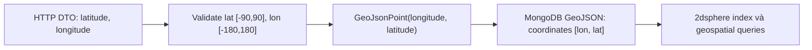

# Thứ tự kinh độ–vĩ độ và hệ tọa độ

Trong **Spring Data MongoDB**, lỗi geospatial phổ biến nhất không nằm ở cú pháp `$near` hay thiếu index, mà ở việc **đảo hai giá trị tọa độ** hoặc dùng tọa độ thuộc **hệ quy chiếu khác** mà không chuyển đổi. MongoDB có thể nhận một điểm GeoJSON hợp lệ về mặt cấu trúc nhưng nằm sai nửa vòng Trái Đất nếu ứng dụng ghi `[latitude, longitude]` thay vì **`[longitude, latitude]`**.

Bài thuộc chương **Truy vấn không gian** của module **SPRING_DATA_MONGODB**, nơi học cách kết nối và ánh xạ document, thao tác qua `MongoTemplate`/repository, thiết kế truy vấn và aggregation, index, transaction, reactive access, kiểm thử và chẩn đoán hiệu năng dữ liệu.

Trọng tâm:

- Phân biệt **kinh độ (longitude, x)** và **vĩ độ (latitude, y)**.
- Phân biệt **GeoJSON/WGS84**, cặp tọa độ **legacy**, hệ tọa độ **phẳng** và các hệ **projected** như Web Mercator.
- Chọn đúng `GeoJsonPoint`, `Point`, chỉ mục `2dsphere`/`2d` và đơn vị khoảng cách.
- Chuẩn hóa dữ liệu ở ranh giới HTTP, import, frontend và MongoDB.
- Viết kiểm thử phát hiện **đảo trục bị từ chối** và **đảo trục vẫn lọt validation**.

**Quy tắc cần nhớ:** với dữ liệu địa lý GeoJSON trong MongoDB, dùng **`[longitude, latitude]`** — kinh độ trước, vĩ độ sau — dưới dạng **độ thập phân** trên WGS84.

## 1. Hai con số không tự nói lên chúng biểu diễn điều gì

Một điểm trong ứng dụng có thể được mô tả bằng nhiều API:

```text
Đầu vào ứng dụng:
  latitude  = 10.776889
  longitude = 106.700981

GeoJSON lưu MongoDB:
  coordinates = [106.700981, 10.776889]

Spring Data MongoDB:
  new GeoJsonPoint(106.700981, 10.776889)
                     longitude    latitude
```

Nếu code vô tình dùng:

```java
// SAI: tham số bị đảo.
new GeoJsonPoint(latitude, longitude);
```

MongoDB hiểu **`x=latitude`**, **`y=longitude`**, không tự dò ý định người lập trình.



Sai thứ tự ở **một** điểm chuyển đổi có thể ảnh hưởng toàn chuỗi: dữ liệu lưu, tìm bán kính, polygon, distance, kết quả sắp xếp theo gần nhất và thao tác chuyển ngược ra frontend.

## 2. Kinh độ và vĩ độ: định nghĩa, dấu và miền hợp lệ

| Khái niệm | Ký hiệu | Trục trong GeoJSON | Miền giá trị | Đơn vị |
| --- | --- | --- | --- | --- |
| Kinh độ (*longitude*) | lon, lng, λ | **x**, phần tử 0 | **−180 đến 180** | Độ thập phân |
| Vĩ độ (*latitude*) | lat, φ | **y**, phần tử 1 | **−90 đến 90** | Độ thập phân |
| Độ cao tùy chọn | elevation, h | Phần tử 2 nếu có trong GeoJSON standard | Phụ thuộc miền nghiệp vụ | Mét theo WGS84 trong RFC 7946 |
| Tọa độ projected | easting, northing | x, y của hệ phẳng | Phụ thuộc CRS | Thường mét, không phải độ |

Hướng và dấu:

- **Kinh độ dương**: phía Đông kinh tuyến gốc Greenwich.
- **Kinh độ âm**: phía Tây kinh tuyến gốc.
- **Vĩ độ dương**: Bắc xích đạo.
- **Vĩ độ âm**: Nam xích đạo.
- `0,0` là một vị trí địa lý hợp lệ, **không** phải mặc định “không có vị trí”.

MongoDB kiểm tra miền kinh/vĩ độ khi dùng dạng địa lý phù hợp như GeoJSON trên `2dsphere`. Tuy nhiên **cả hai số hợp miền không chứng minh thứ tự đúng**.

## 3. Ví dụ Việt Nam: đảo trục có thể gây lỗi ngay

Một điểm minh họa tại TP.HCM:

```text
longitude = 106.700981
latitude  = 10.776889
```

Đúng:

```json
{
  "type": "Point",
  "coordinates": [106.700981, 10.776889]
}
```

Sai:

```json
{
  "type": "Point",
  "coordinates": [10.776889, 106.700981]
}
```

Nếu MongoDB diễn giải phần tử thứ hai là **vĩ độ**, `106.700981` vượt quá `90` nên dữ liệu có thể bị từ chối khi đánh chỉ mục `2dsphere` hoặc thực hiện thao tác địa lý.

**Nhưng đừng chỉ trông chờ server bắt lỗi:** các tọa độ ở những khu vực có cả lon và lat nằm trong khoảng `[-90, 90]` có thể **đảo trục mà vẫn hợp lệ**.

Các số trong bài là ví dụ tọa độ điểm tham chiếu dùng để kiểm thử định dạng, không đại diện cho một địa chỉ giao nhận cụ thể.

## 4. Ví dụ Paris: đảo trục vẫn hợp lệ nhưng sai vị trí

Điểm minh họa:

```text
longitude = 2.3522
latitude  = 48.8566
```

GeoJSON đúng:

```json
{ "type": "Point", "coordinates": [2.3522, 48.8566] }
```

GeoJSON sai nhưng **vẫn qua kiểm tra miền**:

```json
{ "type": "Point", "coordinates": [48.8566, 2.3522] }
```

Hai số sau khi đảo đều thỏa:

```text
−180 <= x <= 180
 −90 <= y <= 90
```

MongoDB không có cách biết `[48.8566, 2.3522]` là lỗi nếu chỉ nhìn một GeoJSON Point. Kết quả tìm kiếm gần Paris có thể **không trả document đó**, còn query ở vùng khác lại thấy nó.

**Bài học:** validation theo miền giá trị là điều kiện cần, không đủ. Cần **contract rõ thứ tự**, unit tests với vị trí đã biết và kiểm thử trên database thực.

## 5. GeoJSON Point là gì?

MongoDB hỗ trợ GeoJSON như một subdocument có:

```javascript
{
  type: "Point",
  coordinates: [longitude, latitude]
}
```

Ví dụ document nghiệp vụ:

```javascript
db.geo_places.insertOne({
  tenant_id: "T1",
  name: "Điểm minh họa TP.HCM",
  category: "demo",
  location: {
    type: "Point",
    coordinates: [106.700981, 10.776889]
  }
});
```

Đặc điểm:

1. `type` phải đúng loại hình học, ở đây là `"Point"`.
2. `coordinates` là **mảng có thứ tự**, không phải hai thuộc tính không phân biệt thứ tự.
3. Hai số đầu là **longitude, latitude**.
4. MongoDB hiểu GeoJSON cho phép toán địa lý theo mô hình Trái Đất dạng cầu với WGS84.
5. GeoJSON **không lưu tên địa điểm** hay đường đi; nó chỉ diễn đạt hình học theo hệ tọa độ đã quy định.

Đừng tự thay thứ tự thành `[lat,lon]` vì frontend hay một thư viện bản đồ của bạn dùng API khác.

## 6. Chuẩn GeoJSON và WGS84

**WGS84** (*World Geodetic System 1984*) là hệ quy chiếu địa lý dùng phổ biến cho GPS và dữ liệu bản đồ toàn cầu. Trong bối cảnh GeoJSON, ta sử dụng:

- **Độ thập phân** cho kinh/vĩ độ, không phải mét.
- **Longitude trước latitude** trong từng position.
- Tham chiếu WGS84 theo cách diễn đạt **OGC CRS84** trong **RFC 7946**.

Tài liệu MongoDB mô tả GeoJSON với CRS mặc định **EPSG:4326** trong ngữ cảnh `$geometry`. Có một lưu ý quan trọng khi tích hợp GIS:

**Một số GIS/CRS APIs thể hiện thứ tự trục chính thức của EPSG:4326 là latitude–longitude, trong khi định dạng GeoJSON/RFC 7946 và MongoDB yêu cầu x=longitude, y=latitude.** Vì vậy đừng suy thứ tự mảng từ **mã EPSG** mà không xem quy ước trục của **API/format cụ thể**.

| Nhãn/hệ | Ý nghĩa chính | Thứ tự khi ghi GeoJSON MongoDB |
| --- | --- | --- |
| WGS84 geographic | Tọa độ địa lý trên Trái Đất, đơn vị độ | **[lon, lat]** |
| OGC CRS84 / GeoJSON RFC 7946 | Quy ước WGS84 với trục lon rồi lat | **[lon, lat]** |
| EPSG:4326 qua một GIS API | Cùng datum/hệ địa lý nhưng axis order trong API có thể khác | **Kiểm tra và chuyển về [lon, lat] khi tạo GeoJSON** |
| EPSG:3857 / Web Mercator | Hệ projected, thường có x/y đơn vị mét | **Phải biến đổi tọa độ**, không ghi thẳng |
| Local engineering grid | Hệ phẳng tùy định nghĩa x/y | **Không phải GeoJSON geographic WGS84** nếu chưa chuyển đổi |

Với GeoJSON hiện đại theo RFC 7946, không gắn một trường `crs` tùy ý rồi hy vọng MongoDB tự chuyển từ Web Mercator sang WGS84.

## 7. Tọa độ projected không phải kinh độ và vĩ độ

Một tọa độ projected như EPSG:3857 có thể có dạng:

```text
x = 11800000  (mét, Web Mercator)
y =  1200000  (mét, Web Mercator)
```

Không hợp lệ để dùng trực tiếp làm:

```javascript
// SAI: x/y là số mét projected, không phải lon/lat độ.
{ type: "Point", coordinates: [11800000, 1200000] }
```

Đây **không phải lỗi đảo trục đơn thuần**. Đổi hai số cho nhau cũng không đúng. Cần thực hiện **coordinate transformation** từ CRS nguồn sang WGS84/GeoJSON bằng thư viện GIS đáng tin cậy, với mã CRS nguồn đã được xác nhận.

```text
Projected (EPSG:3857, mét)
        |
        | Coordinate transformation được định nghĩa rõ
        v
WGS84 longitude/latitude (độ)
        |
        v
GeoJSON Point [lon, lat]
```

Nếu nguồn là VN-2000, UTM hay một lưới bản đồ chuyên ngành, còn cần xác định zone/datum/axis units và tham số chuyển hệ chính xác. **Không đoán rằng số lớn là “longitude dạng mét” rồi tự chia hằng số**.

## 8. Legacy coordinate pairs: cùng hai số nhưng biểu diễn khác

MongoDB còn hỗ trợ **legacy coordinate pairs**:

```javascript
// Legacy coordinates:
{ location: [106.700981, 10.776889] }
```

Đây là một **mảng hai số `[x, y]`**, không có `type: "Point"`.

Nếu hai số là tọa độ địa lý, quy ước là:

```text
x = longitude
y = latitude
```

Nhưng legacy pairs còn dùng được cho **mặt phẳng Euclidean** với `2d` index. Khi `x,y` là tọa độ một sơ đồ kho, một bản vẽ kỹ thuật hay game map, không nhất thiết có ý nghĩa kinh/vĩ độ.

| Dạng lưu | Ví dụ BSON | Ý nghĩa | Index thường dùng |
| --- | --- | --- | --- |
| GeoJSON | `{type:"Point", coordinates:[lon,lat]}` | Địa lý WGS84 trên cầu | **`2dsphere`** |
| Legacy geographic pair | `[lon,lat]` | Hai góc theo thứ tự x/y | `2dsphere` nếu truy vấn địa lý cầu |
| Legacy planar pair | `[x,y]` | Hai tọa độ phẳng theo unit tự xác định | **`2d`** |

`2dsphere` có thể index cả GeoJSON và cặp legacy địa lý hợp lệ. Tuy nhiên với dữ liệu Earth coordinates mới, **ưu tiên GeoJSON Point** vì rõ ý nghĩa và ít nhầm đơn vị/query hơn.

## 9. Vì sao Point và GeoJsonPoint trong Java không giống nhau?

Spring Data có hai loại dễ nhầm:

```java
import org.springframework.data.geo.Point;
import org.springframework.data.mongodb.core.geo.GeoJsonPoint;

Point legacy = new Point(106.700981, 10.776889);
GeoJsonPoint geoJson =
    new GeoJsonPoint(106.700981, 10.776889);
```

Theo Spring Data MongoDB:

- `Point` biểu diễn một cặp x/y. Với MongoDB geospatial queries, nó thường được render thành cặp legacy `[x,y]`.
- `GeoJsonPoint` biểu diễn GeoJSON `{type:"Point", coordinates:[x,y]}`.
- `GeoJsonPoint` mở rộng ngữ nghĩa Point nhưng **thay cách biểu diễn BSON** và cách các lệnh truy vấn diễn giải khoảng cách.
- Với cả hai khi đang biểu diễn kinh/vĩ độ, truyền **`(longitude, latitude)`**.

```java
GeoJsonPoint p = new GeoJsonPoint(106.700981, 10.776889);

double longitude = p.getX(); // 106.700981
double latitude  = p.getY(); // 10.776889
```

**Không suy rằng `getX()` là latitude chỉ vì một UI form có trường `lat` đứng trước.** `x` luôn là trục đầu của dữ liệu; với GeoJSON geographic, `x` là longitude.

## 10. Entity Spring Data MongoDB với GeoJsonPoint

Ví dụ collection `geo_places`:

```java
import org.bson.types.ObjectId;
import org.springframework.data.annotation.Id;
import org.springframework.data.mongodb.core.geo.GeoJsonPoint;
import org.springframework.data.mongodb.core.index.GeoSpatialIndexed;
import org.springframework.data.mongodb.core.index.GeoSpatialIndexType;
import org.springframework.data.mongodb.core.mapping.Document;
import org.springframework.data.mongodb.core.mapping.Field;

@Document("geo_places")
public class GeoPlace {

    @Id
    private ObjectId id;

    @Field("tenant_id")
    private String tenantId;

    private String name;

    @GeoSpatialIndexed(
        type = GeoSpatialIndexType.GEO_2DSPHERE,
        name = "ix_geo_places_location"
    )
    private GeoJsonPoint location;

    public GeoPlace() {}

    public GeoPlace(
            ObjectId id, String tenantId,
            String name, GeoJsonPoint location) {
        this.id = id;
        this.tenantId = tenantId;
        this.name = name;
        this.location = location;
    }

    public ObjectId getId() { return id; }
    public String getTenantId() { return tenantId; }
    public String getName() { return name; }
    public GeoJsonPoint getLocation() { return location; }
}
```

Đặt `GeoJsonPoint` trên property `location` cho Spring Data mapping, không cần tự có một `List<Double>` nếu domain là điểm địa lý.

Quan trọng: `@GeoSpatialIndexed` **mặc định chọn GEO_2D**, không phải `2dsphere`. Với dữ liệu GeoJSON trên Trái Đất, khai báo **`type = GEO_2DSPHERE` một cách tường minh**.

Annotation mô tả index, **không chứng minh index đã tồn tại trên server**; việc tạo index tự động mặc định tắt từ Spring Data MongoDB 3.0.

## 11. HTTP API dùng lat trước vẫn được — nhưng phải chuyển đổi

Một API ngoài có thể đặt tên fields theo thói quen bản đồ:

```json
{
  "latitude": 10.776889,
  "longitude": 106.700981
}
```

Không có vấn đề gì nếu code **chuyển đổi rõ** khi đi vào domain:

```java
public record LocationRequest(
    double latitude,
    double longitude
) {}

public record Wgs84Position(
    double longitude,
    double latitude
) {

    public Wgs84Position {
        if (!Double.isFinite(longitude)
                || !Double.isFinite(latitude)) {
            throw new IllegalArgumentException(
                "Tọa độ phải là số hữu hạn"
            );
        }

        if (longitude < -180 || longitude > 180) {
            throw new IllegalArgumentException(
                "Longitude phải thuộc [-180, 180]"
            );
        }

        if (latitude < -90 || latitude > 90) {
            throw new IllegalArgumentException(
                "Latitude phải thuộc [-90, 90]"
            );
        }
    }

    public static Wgs84Position fromRequest(
            LocationRequest request) {
        return new Wgs84Position(
            request.longitude(), request.latitude()
        );
    }

    public GeoJsonPoint toGeoJsonPoint() {
        return new GeoJsonPoint(longitude, latitude);
    }
}
```

`Wgs84Position` tạo một **ranh giới dữ liệu có tên rõ ràng**. Dù HTTP DTO có thứ tự constructor `(latitude, longitude)`, conversion chỉ dùng các **getter mang tên**.

Đừng viết `new GeoJsonPoint(request.latitude(), request.longitude())`. Hai fields có cùng kiểu `double` nên Java compiler **không phát hiện đảo**.

## 12. Validation: cần cả kiểm tra cấu trúc lẫn ngữ nghĩa

Đối với GeoJSON/WGS84 Point:

- Có đủ hai tọa độ `lon`, `lat`.
- Cả hai là số hữu hạn: không `NaN`, `Infinity`.
- Longitude nằm trong `[-180,180]`.
- Latitude nằm trong `[-90,90]`.
- Hai số được gán vào **đúng ý nghĩa**.
- Không dùng `[0,0]` để thay giá trị trống.
- Không nhận x/y projected meters rồi đưa thẳng vào GeoJSON.
- Có provenance hoặc quy ước vị trí từ nguồn import.

Ví dụ sai sẽ bị validator chặn:

```java
// Vĩ độ 106.700981 nằm ngoài miền hợp lệ.
new Wgs84Position(10.776889, 106.700981);
```

Nhưng ví dụ Paris đảo trục vẫn hợp miền. Do đó hệ thống cần **bộ test với vị trí đối chứng**, không chỉ validation theo range.

**Không áp range này cho dữ liệu planar `[x,y]`**. Một bản vẽ có x=2500, y=600 hoàn toàn hợp lệ với hệ phẳng riêng; vấn đề là không được quảng bá nó thành GeoJSON geographic.

## 13. Type-safe conversion cho nhiều nguồn đầu vào

Bốn kiểu nguồn phổ biến:

| Nguồn | Biểu diễn có thể gặp | Conversion cần làm |
| --- | --- | --- |
| REST DTO | `{"latitude":10.77,"longitude":106.70}` | `new GeoJsonPoint(longitude, latitude)` |
| Browser Geolocation API | `coords.latitude` và `coords.longitude` | Đọc hai thuộc tính theo **tên**, không theo thứ tự |
| Một UI bản đồ | Có API nhận `(lat,lng)` hoặc array `[lat,lng]` | Đọc contract của **thư viện cụ thể**, đổi sang GeoJSON |
| GeoJSON chuẩn | `coordinates:[lon,lat]` | Giữ thứ tự, validate |
| CSV/GPS export | Có thể `lat,lon`, `lon,lat` hoặc projected x/y | Đọc header/CRS metadata trước, không tự đoán |

Với CSV, ưu tiên cột có tên tường minh:

```csv
id,tenant_id,latitude,longitude
p1,T1,10.776889,106.700981
p2,T1,48.8566,2.3522
```

Import code nên parse **theo tên cột**, không lấy cột số 2/3 rồi giả định:

```java
double latitude = parseDouble(row.get("latitude"));
double longitude = parseDouble(row.get("longitude"));

GeoJsonPoint point = new Wgs84Position(
    longitude, latitude
).toGeoJsonPoint();
```

`row.get(...)` và `parseDouble(...)` là API minh họa của CSV parser mà bạn chọn. Trong production, parser phải kiểm soát locale (dấu `.` / `,`), ô trống, encoding và dấu âm.

## 14. Chọn 2dsphere thay vì 2d cho vị trí trên Trái Đất

MongoDB có hai index geospatial chính:

| Index | Mô hình hình học | Dạng dữ liệu | Khi dùng |
| --- | --- | --- | --- |
| **`2dsphere`** | Hình học cầu | GeoJSON và legacy points hợp lệ | GPS, vị trí trên Trái Đất, khoảng cách địa lý |
| **`2d`** | Mặt phẳng Euclidean | Legacy coordinate pairs | Bản vẽ, không gian nội bộ theo x/y, dữ liệu phẳng |

MongoDB có một số hỗ trợ phép toán cầu với `2d`, nhưng **không nên dựa vào `2d` để tính vị trí địa lý toàn cầu**, đặc biệt gần cực hoặc kinh tuyến ±180.

```javascript
// ĐÚNG cho field GeoJSON Point:
db.geo_places.createIndex(
  { location: "2dsphere" },
  { name: "ix_geo_places_location" }
);
```

Nếu ứng dụng dùng `@GeoSpatialIndexed`, cần bảo đảm migration/auto-index tạo đúng BSON index:

```javascript
db.geo_places.getIndexes();
```

Kỳ vọng có key pattern:

```javascript
{ location: "2dsphere" }
```

Index `2dsphere` không tự chuyển dữ liệu Web Mercator thành WGS84. Nó chỉ dùng đúng những tọa độ bạn đưa vào.

## 15. Annotation index có thực sự tạo index không?

Từ Spring Data MongoDB 3.0, **automatic index creation tắt theo mặc định** để tránh tác động bất ngờ tới lifecycle collection và hiệu năng.

```java
@GeoSpatialIndexed(type = GeoSpatialIndexType.GEO_2DSPHERE)
private GeoJsonPoint location;
```

Đoạn annotation này **chỉ khai báo ý định index** khi Spring Data đọc mapping metadata.

Quy trình production nên là:

1. Migrations tạo collection nếu cần.
2. Kiểm tra dữ liệu cũ có tọa độ lỗi hoặc đảo trục.
3. Tạo `2dsphere` index với migration hoặc `IndexOperations`.
4. Kiểm tra `getIndexes()` thực tế.
5. Test các geospatial queries bằng dữ liệu đã biết.
6. Mới mở traffic phụ thuộc `$near`/`$geoNear`.

Nếu tạo `2dsphere` index trên một collection có điểm sai miền, **index build có thể thất bại**, làm lộ lỗi dữ liệu tồn đọng. Đó là tín hiệu cần sửa dữ liệu trước, không phải lý do bỏ validation.

## 16. 2dsphere sparse: document thiếu vị trí không được index

MongoDB `2dsphere` index có tính chất **sparse**:

- Nếu field index không tồn tại, `null` hoặc là mảng rỗng ở các trường hợp được quy định, document có thể **không có entry** trong geospatial index.
- Bật/tắt option `sparse` không thay đổi bản chất sparse của `2dsphere`.
- Với compound index chứa geospatial key, geospatial field quyết định document có được đưa vào index hay không.

Điều này hữu ích khi một số địa điểm chưa có tọa độ, nhưng cũng tạo một bẫy:

**Không có geospatial hit không nhất thiết nghĩa document không tồn tại.** Nó có thể chưa được geocode, bị bỏ trống vị trí hoặc bị lưu sai cấu trúc.

Nên lưu trạng thái rõ ràng:

```javascript
{
  tenant_id: "T1",
  name: "Chưa xác nhận vị trí",
  geocoding_status: "PENDING",
  location: null
}
```

Không dùng `location:[0,0]` để thay thế missing data; `[0,0]` là một điểm hợp lệ về mặt tọa độ nhưng không phải ý nghĩa “chưa biết vị trí”.

## 17. Truy vấn $near với GeoJSON: khoảng cách tính bằng mét

Sau khi đã có `2dsphere` index:

```javascript
db.geo_places.find({
  tenant_id: "T1",
  location: {
    $near: {
      $geometry: {
        type: "Point",
        coordinates: [106.700981, 10.776889]
      },
      $maxDistance: 2000
    }
  }
});
```

Trong lệnh này:

- `[106.700981,10.776889]` là **[longitude, latitude]**.
- `$near` với GeoJSON Point trên `2dsphere` sử dụng **khoảng cách địa lý**.
- `$maxDistance:2000` có nghĩa **2.000 mét**, không phải 2.000 độ hoặc 2.000 kilômét.
- `$near` trả kết quả theo khoảng cách gần trước trong những điều kiện hỗ trợ.
- `tenant_id` lọc theo tenant, không dùng location để thay thế authorization.

**Nhớ:** khoảng cách địa lý do MongoDB tính không phải khoảng cách di chuyển thực tế trên mạng đường bộ.

## 18. Spring Data MongoTemplate: nearSphere và GeoJsonPoint

Tương đương ở Java:

```java
import java.util.List;

import org.springframework.data.mongodb.core.MongoOperations;
import org.springframework.data.mongodb.core.geo.GeoJsonPoint;
import org.springframework.data.mongodb.core.query.Criteria;
import org.springframework.data.mongodb.core.query.Query;

public List<GeoPlace> findNearby(
        MongoOperations operations,
        String tenantId,
        double longitude, double latitude,
        double radiusMeters) {

    Wgs84Position origin =
        new Wgs84Position(longitude, latitude);

    if (!Double.isFinite(radiusMeters)
            || radiusMeters <= 0
            || radiusMeters > 50_000) {
        throw new IllegalArgumentException("Bán kính không hợp lệ");
    }

    Query query = new Query(
        Criteria.where("location")
            .nearSphere(origin.toGeoJsonPoint())
            .maxDistance(radiusMeters)
    );

    query.addCriteria(
        Criteria.where("tenantId").is(tenantId)
    );

    return operations.find(query, GeoPlace.class);
}
```

Lưu ý:

- `GeoJsonPoint` làm điểm truy vấn mang **GeoJSON semantics**.
- `Criteria.nearSphere(...)` chỉ rõ phép tìm theo hình cầu.
- Khi dùng `GeoJsonPoint`, `maxDistance` của `$nearSphere` được diễn giải theo **mét**.
- `Criteria.where("tenantId")` trong typed query được mapping sang `tenant_id` nhờ `@Field`.
- Giới hạn radius 50.000 mét chỉ là **policy minh họa** chống query quá rộng; sản phẩm có thể chọn khác.

**Đừng thay `GeoJsonPoint` bằng `new Point(longitude,latitude)` mà quên kiểm tra lại đơn vị.** Cặp legacy có quy tắc khoảng cách khác khi truy vấn cầu.

## 19. $geoNear aggregation: khoảng cách trả về là mét với GeoJSON

Khi cần vừa tìm vừa lấy khoảng cách:

```javascript
db.geo_places.aggregate([
  {
    $geoNear: {
      near: {
        type: "Point",
        coordinates: [106.700981, 10.776889]
      },
      key: "location",
      query: { tenant_id: "T1" },
      distanceField: "distanceMeters",
      maxDistance: 3000,
      spherical: true
    }
  },
  {
    $project: {
      name: 1,
      location: 1,
      distanceMeters: 1
    }
  },
  { $limit: 20 }
]);
```

Trong MongoDB `$geoNear`:

- Stage này phải là **stage đầu tiên** của pipeline theo các phiên bản server được tài liệu hóa.
- Cần có geospatial index phù hợp.
- `near` là GeoJSON Point, nên distance đơn vị **mét**.
- `key` giúp chọn đúng index nếu collection có nhiều geospatial indexes.
- `query` áp filter không gian/thuộc tính bổ sung, ví dụ tenant.
- `$limit` nên được đặt phù hợp để tránh trả dữ liệu quá lớn.

Từ MongoDB 8.1, `distanceField` có thể không còn bắt buộc với non-timeseries collection, nhưng **ghi tường minh** giúp ví dụ dễ đọc và tương thích hơn.

## 20. Spring Data NearQuery và Distance: kiểm soát metric

Với Spring Data MongoDB, `NearQuery` hỗ trợ metric để tránh sai đơn vị:

```java
import org.springframework.data.geo.Distance;
import org.springframework.data.geo.GeoResults;
import org.springframework.data.geo.Metrics;
import org.springframework.data.mongodb.core.query.NearQuery;
import org.springframework.data.mongodb.core.query.Criteria;
import org.springframework.data.mongodb.core.query.Query;
import org.springframework.data.mongodb.core.geo.GeoJsonPoint;

GeoJsonPoint center =
    new GeoJsonPoint(106.700981, 10.776889);

NearQuery near = NearQuery.near(center)
    .maxDistance(new Distance(3, Metrics.KILOMETERS))
    .query(Query.query(
        Criteria.where("tenantId").is("T1")
    ))
    .spherical(true);

GeoResults<GeoPlace> hits =
    mongoTemplate.geoNear(near, GeoPlace.class);

// Theo Metric đã chọn, kết quả có thể đọc bằng:
// hits.getContent().get(0).getDistance()
```

Ví dụ dùng `mongoTemplate` được inject trong service. `Distance` và `Metrics.KILOMETERS` giúp biểu thị radius **3 km**; Spring Data chuẩn hóa theo đơn vị mà câu lệnh MongoDB thực sự yêu cầu.

**Không cộng trừ các số distance mà không xét `Metric`.** `GeoResults`/`GeoResult` có thể mang đơn vị đã cấu hình (ví dụ km), trong khi raw `$geoNear` với GeoJSON trả meter nếu không dùng distance multiplier. Test phải hiểu rõ giá trị nào đang được hiển thị.

## 21. Bảng đơn vị: GeoJSON, legacy và mặt phẳng

| Lệnh/hình học | Cách đưa điểm vào | Đơn vị đầu vào khoảng cách |
| --- | --- | --- |
| `$near` với GeoJSON Point + `2dsphere` | `$geometry:{type:"Point",coordinates:[lon,lat]}` | **Mét** |
| `$nearSphere` với GeoJSON Point | `$geometry` GeoJSON | **Mét** |
| `$geoNear` với `near` là GeoJSON Point | `{type:"Point",coordinates:[lon,lat]}` | **Mét** |
| `$nearSphere` với legacy pair | `[lon,lat]` | **Radian** cho spherical distance |
| `$centerSphere` | `[[lon,lat], radius]` | **Radian** |
| `$near` với legacy pair và `2d` | `[x,y]` | **Đơn vị tọa độ phẳng** của cặp x/y |

Đây là khác biệt thực tế quan trọng:

```javascript
// GeoJSON: 2 km = 2000 mét.
{ $near: {
    $geometry: {
      type: "Point",
      coordinates: [106.700981, 10.776889]
    },
    $maxDistance: 2000
} }
```

Trong khi một phép tìm trên hình cầu với **legacy pair** có thể yêu cầu radius bằng **radian**, không phải 2000. Không copy trực tiếp giá trị giữa hai cấu trúc truy vấn.

## 22. Chuyển khoảng cách mét sang radian khi cần

Với phép tính trên hình cầu:

\[
\theta_{\mathrm{rad}} = \frac{d_{\mathrm{meters}}}{R_{\mathrm{meters}}}
\]

Trong đó `R` là bán kính hình cầu dùng làm xấp xỉ. Ví dụ lấy `R≈6.378.100 m`:

```text
d = 2.000 mét
R = 6.378.100 mét

radiusRadians ≈ 2000 / 6378100
              ≈ 0.00031357 radian
```

Dùng với `$centerSphere`:

```javascript
const lon = 106.700981;
const lat = 10.776889;
const radiusMeters = 2000;
const earthRadiusMeters = 6378100; // xấp xỉ, minh họa

db.geo_places.find({
  location: {
    $geoWithin: {
      $centerSphere: [
        [lon, lat],
        radiusMeters / earthRadiusMeters
      ]
    }
  }
});
```

**Cảnh báo:** phép chia này chỉ cần trong các operator yêu cầu **radian**, không áp dụng cho `$near`/`$geoNear` với GeoJSON point yêu cầu mét. Các mô hình bán kính Trái Đất và tính toán địa lý không đồng nhất hoàn toàn; với nhu cầu đo đạc chuyên ngành cần mô hình geodesic/ellipsoid phù hợp.

## 23. Độ không phải mét: không dùng delta kinh độ để đo trực tiếp

Một sai lầm khác:

```java
double distance =
    Math.hypot(lon2 - lon1, lat2 - lat1);

// Giá trị là "độ" theo tọa độ góc,
// KHÔNG phải số mét ngoài thực địa.
```

Chênh lệch **1 độ vĩ độ** xấp xỉ hơn 100 km, nhưng **1 độ kinh độ** thay đổi theo vĩ độ: lớn ở xích đạo, giảm dần về phía cực.

Một xấp xỉ đơn giản:

```text
độ dài 1° kinh độ ≈ 111 km × cos(latitude)
```

Tại vĩ độ cao, hai địa điểm có chênh lệch kinh độ lớn vẫn có thể gần nhau theo đường cầu. Do đó:

- Không dùng `Math.hypot(lonDelta,latDelta)` rồi coi là mét.
- Không dùng một hệ `2d` planar cho dữ liệu GPS toàn cầu.
- Dùng MongoDB `2dsphere` khi yêu cầu khoảng cách trên Trái Đất.
- Nếu cần **quãng đường đi xe/đi bộ**, dùng hệ thống routing riêng; khoảng cách đường chim bay không thay đường mạng giao thông.

## 24. Đường đổi ngày quốc tế: +179.9 và −179.9 rất gần nhau

Hai kinh độ:

```text
A = [ 179.9, 10.0 ]
B = [-179.9, 10.0 ]
```

Nếu trừ trực tiếp:

```text
179.9 - (-179.9) = 359.8 độ
```

Có vẻ cách xa gần trọn vòng Trái Đất. Nhưng trên hình cầu, chúng chỉ cách nhau **0,2 độ kinh độ qua antimeridian** (khoảng vài chục km tùy vĩ độ).

MongoDB `2dsphere` diễn giải vị trí địa lý với khả năng wrap qua kinh tuyến ±180. Dữ liệu này làm **test case tốt** để phân biệt query hình cầu với code đo khoảng cách planar sai.

Với **LineString/Polygon** cắt qua antimeridian, cần xử lý geometry theo GeoJSON RFC 7946 và thiết kế miền truy vấn. Không mặc định một polygon có các đỉnh ở ±179 là hình chữ nhật nhỏ như trên bản đồ; cách nối cạnh, winding và chia geometry có thể quyết định phần Trái Đất được chọn.

## 25. GeoJSON nhiều điểm, đường và vùng vẫn giữ cùng thứ tự

Quy tắc `[longitude, latitude]` lặp lại ở **mọi position** trong geometry.

```javascript
const multipoint = {
  type: "MultiPoint",
  coordinates: [
    [106.700981, 10.776889],
    [106.710000, 10.780000]
  ]
};

const line = {
  type: "LineString",
  coordinates: [
    [106.700981, 10.776889],
    [106.705000, 10.778000],
    [106.710000, 10.780000]
  ]
};

const polygon = {
  type: "Polygon",
  coordinates: [[
    [106.69, 10.77],
    [106.71, 10.77],
    [106.71, 10.79],
    [106.69, 10.79],
    [106.69, 10.77]
  ]]
};
```

Với `Polygon`:

- Mảng `coordinates` chứa các **linear rings**.
- Ring ngoài là phần tử đầu; các ring sau có thể là **lỗ**.
- Ring được **đóng**: phần tử cuối lặp lại phần tử đầu.
- Mỗi đỉnh vẫn là **`[lon,lat]`**.
- Winding/right-hand rule, antimeridian và các polygon lớn hơn bán cầu cần xem tài liệu MongoDB/GeoJSON chi tiết.

Không đảo từng cặp tọa độ chỉ vì một thư viện GIS trả points theo `(lat,lng)`; cần chuẩn hóa **mọi vị trí**, không chỉ đỉnh đầu.

## 26. Spring Data GeoJsonPolygon: thứ tự và đóng vòng

Spring Data cung cấp `GeoJsonPolygon`:

```java
import org.springframework.data.geo.Point;
import org.springframework.data.mongodb.core.geo.GeoJsonPolygon;

GeoJsonPolygon area = new GeoJsonPolygon(
    new Point(106.69, 10.77),
    new Point(106.71, 10.77),
    new Point(106.71, 10.79),
    new Point(106.69, 10.79),
    new Point(106.69, 10.77)
);
```

Ở đây **`Point(x,y)` dùng làm các đỉnh của `GeoJsonPolygon`**; mỗi điểm vẫn theo **x=longitude, y=latitude**. `GeoJsonPolygon` chịu trách nhiệm render `$geometry` theo loại GeoJSON.

Truy vấn dạng:

```java
import org.springframework.data.mongodb.core.query.Criteria;
import org.springframework.data.mongodb.core.query.Query;

Query insideArea = Query.query(
    Criteria.where("location").within(area)
);
```

Dùng đúng entity mapping để query location trên collection có `2dsphere` index. Test polygon với những điểm **đã biết nằm trong và ngoài**, không dựa vào việc query không ném exception.

**Không nhầm** `org.springframework.data.geo.Polygon` dạng legacy với `GeoJsonPolygon`: chúng có thể tạo MongoDB operators khác nhau.

## 27. Một CRS đặc biệt trong MongoDB không thay thế chuyển hệ tùy ý

MongoDB có hỗ trợ một dạng CRS đặc biệt liên quan đến GeoJSON polygon với **strict winding**:

```javascript
{
  type: "Polygon",
  coordinates: [
    // Ring với thứ tự winding thích hợp.
  ],
  crs: {
    type: "name",
    properties: {
      name: "urn:x-mongodb:crs:strictwinding:EPSG:4326"
    }
  }
}
```

Dạng này chỉ dành cho trường hợp MongoDB tài liệu hóa (đặc biệt `$geoWithin`/`$geoIntersects` với single-ringed polygon); **không phải công cụ nhận EPSG:3857, UTM hoặc VN-2000 rồi tự chuyển thành WGS84**.

Hãy phân biệt hai câu hỏi:

1. Dữ liệu đang thuộc **CRS nào** và đơn vị là gì?
2. Polygon có cách diễn giải **winding/interior** nào?

Giải quyết câu 1 bằng **coordinate transformation** có metadata nguồn. Giải quyết câu 2 bằng quy tắc MongoDB/GeoJSON đúng loại geometry.

## 28. GeoJSON 3D/altitude: đừng kỳ vọng query khoảng cách không gian 3 chiều

RFC 7946 cho phép position chứa một phần tử thứ ba là **độ cao**:

```json
{
  "type": "Point",
  "coordinates": [106.700981, 10.776889, 12.5]
}
```

Nhưng các geospatial queries MongoDB thông dụng với `2dsphere` hoạt động trên **bề mặt địa lý hai chiều** cho các phép tìm gần/vùng. Không được suy rằng altitude `12.5` sẽ được tính vào khoảng cách 3D hoặc giúp phân biệt tầng 1 với tầng 20.

Mẫu domain rõ ràng hơn khi nghiệp vụ cần tầng/độ cao:

```javascript
{
  location: {
    type: "Point",
    coordinates: [106.700981, 10.776889]
  },
  floor: 20,
  altitude_meters: 75.0
}
```

Sau khi dùng geo query để tìm điểm gần, áp dụng **bộ lọc nghiệp vụ riêng** cho tầng, chiều cao, khả năng di chuyển hoặc đường đi thực tế.

## 29. Một geospatial index không thể thay toàn bộ schema validation

Tạo `2dsphere` index giúp MongoDB hiểu và truy vấn field hình học; nhưng không bảo đảm:

- `tenant_id` có mặt và hợp lệ.
- Địa chỉ không sai/không giả.
- Nguồn là GPS thật hay geocode suy đoán.
- Đúng trục nếu hai số đều hợp miền.
- Không có một writer khác thay `location` bằng dữ liệu cũ.
- Điểm không bị mất quyền truy cập hoặc vi phạm chính sách dữ liệu.

Hệ thống cần validation **ở ranh giới input**, có thể bổ sung **MongoDB JSON Schema validation** cho cấu trúc, và quy trình kiểm thử địa lý. MongoDB JSON Schema cơ bản có thể kiểm tra kiểu và số phần tử của `coordinates`, nhưng **không tự biết** hai số hợp lệ đã bị đảo ý nghĩa.

## 30. Truy vấn đa tenant và index compound

Với dữ liệu nhiều tenant, query nên lọc theo **tenant đã xác thực**.

```javascript
db.geo_places.find({
  tenant_id: "T1",
  location: {
    $nearSphere: {
      $geometry: {
        type: "Point",
        coordinates: [106.700981, 10.776889]
      },
      $maxDistance: 2000
    }
  }
});
```

Có thể cân nhắc compound geospatial index theo workload:

```javascript
db.geo_places.createIndex(
  { tenant_id: 1, location: "2dsphere" },
  { name: "ix_geo_places_tenant_location" }
);
```

Tùy query planner, data distribution và MongoDB version, compound index có thể giúp filter tenant với geospatial operations. Nhưng:

- Chọn index theo `explain`/workload, không đoán rằng compound index luôn tốt hơn.
- Geospatial index không làm thay **authorization**.
- Geospatial field trong compound `2dsphere` quyết định tính sparse.
- Với sharded collection, geospatial index không được dùng làm **shard key**; cần thiết kế shard key riêng.
- Migration index phải chạy có kiểm soát để tránh build nhiều index không cần thiết.

## 31. Kết quả $geoNear không phải khoảng cách đường đi

Nếu `$geoNear` trả `distanceMeters=1500`:

```text
MongoDB: hai vị trí cách nhau khoảng 1.500 mét
         theo phép đo không gian địa lý.

Không suy ra:
  - đi xe chỉ mất 1,5 km,
  - có đường nối trực tiếp,
  - đến nơi trong 3 phút,
  - hai địa điểm cùng bên một con sông,
  - có thể đi bộ qua rào chắn.
```

Với ứng dụng logistics hoặc delivery:

1. MongoDB `2dsphere` dùng **bộ lọc sơ bộ** các ứng viên gần.
2. Routing engine/GIS dùng mạng đường và phương tiện để đánh giá ETA/quãng đường.
3. Business rules xét phí, khu vực phục vụ, trạng thái hoạt động, quyền truy cập.
4. UI trình bày khoảng cách theo đơn vị rõ ràng, không ghi “2 km lái xe” nếu chỉ tính spherical distance.

Vấn đề tọa độ đúng là **điều kiện cần**; geospatial proximity không thay thế route planning.

## 32. Khi dữ liệu nguồn bị trộn thứ tự: đừng sửa hàng loạt bằng phỏng đoán

Giả sử collection cũ chứa hỗn hợp:

```javascript
{ location: [106.700981, 10.776889] } // có thể [lon,lat]
{ location: [10.776889, 106.700981] } // rõ ràng lat/lon bị đảo
{ location: [2.3522, 48.8566] }       // có thể đúng
{ location: [48.8566, 2.3522] }       // vẫn hợp miền nhưng sai
```

Không thể viết một migration an toàn kiểu “nếu cả hai số đều nhỏ hơn 90 thì giữ nguyên” rồi tin mọi thứ đúng.

Quy trình:

1. **Xác định nguồn dữ liệu**: endpoint, CSV schema, SDK, version app, ngày import.
2. Chia thành nhóm theo **source version / ingestion path** và kiểm chứng thứ tự thực tế.
3. Đánh dấu các bản ghi có `latitude > 90` là **suspicious**, không tự kết luận tất cả records còn lại đều đúng.
4. Dùng đối chứng địa lý/địa chỉ nếu có, kiểm tra độ gần vị trí hợp lý theo phạm vi kinh doanh.
5. Chạy **dry run** trên staging/copy có snapshot.
6. Chỉ biến đổi các nhóm **chắc chắn được lưu [lat,lon]** thành `[lon,lat]`.
7. Xây/rebuild `2dsphere` index sau khi dọn dữ liệu theo migration plan.
8. Kiểm thử queries trước/sau, giữ audit trail và khả năng rollback.

Nếu legacy source là **projected CRS**, phải chuyển hệ hình học thay vì đảo các số.

## 33. Chuyển legacy thành GeoJSON: cần biết nguồn từ trước

Chỉ khi đã xác nhận **nguồn cũ là [longitude, latitude]**:

```javascript
// Minh họa trên một document test đã xác minh:
const source = [106.700981, 10.776889];

const geojson = {
  type: "Point",
  coordinates: [source[0], source[1]]
};

printjson(geojson);
```

Nếu nguồn cũ đã được xác nhận là **[latitude, longitude]**:

```javascript
const oldLatLon = [10.776889, 106.700981];

const geojson = {
  type: "Point",
  coordinates: [oldLatLon[1], oldLatLon[0]]
};
```

**Không dùng script trên quét toàn collection production nếu chưa biết provenance.** Sau chuyển đổi, nên lưu source metadata/version audit ở migration logs. Những coordinates vừa hợp lệ vừa bị đảo chỉ có thể được phát hiện nhờ dữ liệu ngữ cảnh hoặc kiểm thử đối chứng.

## 34. Unit test: đảm bảo DTO → GeoJsonPoint không đảo

JUnit 5 + AssertJ:

```java
import static org.assertj.core.api.Assertions.assertThat;
import static org.assertj.core.api.Assertions.assertThatThrownBy;

import org.junit.jupiter.api.Test;
import org.springframework.data.mongodb.core.geo.GeoJsonPoint;

class Wgs84PositionTest {

    @Test
    void convertsLatLonRequestToLongitudeFirst() {
        LocationRequest req =
            new LocationRequest(10.776889, 106.700981);

        GeoJsonPoint point = Wgs84Position
            .fromRequest(req)
            .toGeoJsonPoint();

        assertThat(point.getX()).isEqualTo(106.700981);
        assertThat(point.getY()).isEqualTo(10.776889);
    }

    @Test
    void swappedHcmCoordinatesAreRejected() {
        assertThatThrownBy(() ->
            new Wgs84Position(10.776889, 106.700981)
        ).isInstanceOf(IllegalArgumentException.class);
    }

    @Test
    void parisRequiresKnownExpectedOrder() {
        LocationRequest req =
            new LocationRequest(48.8566, 2.3522);

        GeoJsonPoint point = Wgs84Position
            .fromRequest(req)
            .toGeoJsonPoint();

        // Cả hai giá trị đều hợp lệ khi đảo.
        // Assert expected order để bắt lỗi logic.
        assertThat(point.getX()).isEqualTo(2.3522);
        assertThat(point.getY()).isEqualTo(48.8566);
    }

    @Test
    void rejectsNaNAndInfinity() {
        assertThatThrownBy(() ->
            new Wgs84Position(Double.NaN, 10)
        ).isInstanceOf(IllegalArgumentException.class);

        assertThatThrownBy(() ->
            new Wgs84Position(106.7, Double.POSITIVE_INFINITY)
        ).isInstanceOf(IllegalArgumentException.class);
    }
}
```

Test này không cần MongoDB, chạy nhanh trong CI và chặn bug ngay tại **boundary conversion**. Nhưng nó chưa chứng minh `MappingMongoConverter` lưu đúng BSON hoặc `2dsphere` query hoạt động.

## 35. Integration test: kiểm tra BSON coordinates thật

Dùng một MongoDB instance **dành riêng cho test**, cấu hình Spring Data MongoDB theo project. Entity `GeoPlace` như mục 10.

```java
import static org.assertj.core.api.Assertions.assertThat;

import java.util.List;
import org.bson.Document;
import org.bson.types.ObjectId;
import org.junit.jupiter.api.Test;
import org.springframework.beans.factory.annotation.Autowired;
import org.springframework.boot.test.autoconfigure.data.mongo.DataMongoTest;
import org.springframework.data.mongodb.core.MongoTemplate;

@DataMongoTest
class GeoJsonMappingIntegrationTest {
    @Autowired MongoTemplate template;

    @Test
    void storesLongitudeBeforeLatitudeInBson() {
        ObjectId id = new ObjectId();

        template.insert(new GeoPlace(
            id, "test-T1", "HCM-Demo",
            new GeoJsonPoint(106.700981, 10.776889)
        ));

        Document raw = template.getCollection("geo_places")
            .find(new Document("_id", id))
            .first();

        assertThat(raw).isNotNull();

        Document geometry =
            raw.get("location", Document.class);

        assertThat(geometry.getString("type"))
            .isEqualTo("Point");

        List<Double> coordinates =
            geometry.getList("coordinates", Double.class);

        assertThat(coordinates)
            .containsExactly(106.700981, 10.776889);
    }
}
```

Điểm kiểm chứng quan trọng: **đọc raw BSON** qua MongoDB driver, không chỉ đọc lại entity Java bằng converter; nếu converter vừa lưu vừa đọc đảo sai theo cùng quy ước, round-trip Java-only có thể không bắt được lỗi.

## 36. Integration test: $near trả về đúng vùng địa lý

Trên MongoDB test, tạo index rõ ràng thay vì dựa vào auto-index:

```java
import static org.assertj.core.api.Assertions.assertThat;

import java.util.List;

import com.mongodb.client.model.IndexOptions;
import org.bson.Document;
import org.bson.types.ObjectId;
import org.junit.jupiter.api.BeforeEach;
import org.junit.jupiter.api.Test;
import org.springframework.beans.factory.annotation.Autowired;
import org.springframework.boot.test.autoconfigure.data.mongo.DataMongoTest;
import org.springframework.data.mongodb.core.MongoTemplate;
import org.springframework.data.mongodb.core.geo.GeoJsonPoint;
import org.springframework.data.mongodb.core.query.Criteria;
import org.springframework.data.mongodb.core.query.Query;

@DataMongoTest
class GeoNearIntegrationTest {
    @Autowired MongoTemplate template;

    @BeforeEach
    void ensureGeospatialIndex() {
        template.getCollection("geo_places")
            .createIndex(
                new Document("location", "2dsphere"),
                new IndexOptions()
                    .name("ix_geo_places_location")
            );
    }

    @Test
    void nearParisDoesNotReturnHcmPoint() {
        String tenant = "test-" + new ObjectId().toHexString();

        template.insert(new GeoPlace(
            new ObjectId(), tenant, "Paris-Demo",
            new GeoJsonPoint(2.3522, 48.8566)
        ));

        template.insert(new GeoPlace(
            new ObjectId(), tenant, "HCM-Demo",
            new GeoJsonPoint(106.700981, 10.776889)
        ));

        Query nearParis = new Query(
            Criteria.where("location")
                .nearSphere(
                    new GeoJsonPoint(2.3522, 48.8566)
                )
                .maxDistance(1_000)
        );

        nearParis.addCriteria(
            Criteria.where("tenantId").is(tenant)
        );

        List<GeoPlace> hits =
            template.find(nearParis, GeoPlace.class);

        assertThat(hits)
            .extracting(GeoPlace::getName)
            .contains("Paris-Demo")
            .doesNotContain("HCM-Demo");
    }
}
```

Đây là một **integration test chức năng**: index tồn tại, dữ liệu đúng WGS84, điểm gần được tìm trong 1.000 m, điểm xa không bị nhận nhầm.

**Yêu cầu môi trường:** MongoDB dành riêng cho test, version compatible, index đã build xong, no shared production data. Với Spring Boot major mới, test slice import/package có thể khác; điều chỉnh theo project, giữ nguyên ý nghĩa kiểm chứng.

## 37. Test giả lập lỗi đảo mà vẫn qua range validation

Một test negative có ích: chèn một điểm Paris bị đảo trục nhưng **vẫn hợp lệ**:

```java
GeoJsonPoint correctParis =
    new GeoJsonPoint(2.3522, 48.8566);

GeoJsonPoint swappedParis =
    new GeoJsonPoint(48.8566, 2.3522);
```

MongoDB `2dsphere` có thể index cả hai vì `48.8566` hợp miền longitude và `2.3522` hợp miền latitude. Tạo hai documents, query gần `correctParis` với bán kính nhỏ:

```text
Kết quả kỳ vọng:
  - Document correctParis xuất hiện.
  - Document swappedParis không xuất hiện.

Đây là lỗi dữ liệu/nghiệp vụ, không phải lỗi index syntax.
```

Do đó:

- Dùng **vị trí đối chứng** trong test suite.
- Test HTTP contract khi API dùng `latitude` trước.
- Test raw BSON khi mapping GeoJSON.
- Test geospatial query kết quả thật khi index đã tạo.
- Không coi “MongoDB nhận document không ném lỗi” là chứng nhận tọa độ đúng.

## 38. Khi nào dùng geospatial index với dữ liệu planar?

Nếu ứng dụng đo khoảng cách trên một bản vẽ kho:

```javascript
{
  aisle: "A1",
  position: [12.5, 8.0]
}
```

Thì `[12.5,8.0]` có thể là mét trong một hệ phẳng cục bộ. Lúc này:

```javascript
db.warehouse_bins.createIndex({
  position: "2d"
});
```

Nếu chạy `$near` planar, khoảng cách sẽ có đơn vị **phù hợp với hệ tọa độ x/y của bạn**, ví dụ mét khi x/y đã định nghĩa bằng mét.

**Không gán `GeoJsonPoint(12.5,8.0)` chỉ vì class nghe giống “point”.** Điều đó biến vị trí kho thành một điểm địa lý ở kinh độ 12,5°, vĩ độ 8°, hoàn toàn khác ý nghĩa. Tên kiểu dữ liệu nên thể hiện **CRS và unit**.

## 39. Các lỗi thường gặp khi tích hợp frontend và backend

| Tình huống | Sai lầm | Cách sửa |
| --- | --- | --- |
| UI library dùng `LatLng(lat,lng)` | Truyền mảng này trực tiếp vào GeoJSON | Map theo tên, xuất `[lng,lat]` |
| Browser Geolocation | Đọc `latitude` vào x | Tạo `GeoJsonPoint(coords.longitude,coords.latitude)` |
| REST DTO có `latitude` đứng đầu | Pass thẳng constructor `GeoJsonPoint(lat,lon)` | Conversion explicit và unit tests |
| CSV hai cột không header | Tự giả định cột 1=longitude | Bắt buộc metadata/schema nguồn |
| Input EPSG:3857 | Ghi x/y mét thành GeoJSON degree | GIS coordinate transformation |
| Điểm địa lý dùng `@GeoSpatialIndexed` mặc định | Tạo `2d` index thay vì `2dsphere` | Chỉ định `GEO_2DSPHERE` |
| `GeoJsonPoint` đổi thành `Point` | Query distance đơn vị đổi | Giữ GeoJSON hoặc re-check metric |
| `$maxDistance:2` | Tưởng là 2 km | Với GeoJSON phải truyền **2000 mét** |
| `$centerSphere` radius 2000 | Tưởng là 2 km | Đổi 2000 m sang radian |
| Legacy array bị đảo ở Paris | Vẫn qua validation | Test benchmark và import provenance |
| Địa điểm không có location | Đặt `[0,0]` | Dùng null/status rõ |
| Chưa tạo geospatial index | `$near`/`$geoNear` lỗi hoặc không dùng được | Provision index trước |
| Bỏ `tenant_id` khỏi query | Trả dữ liệu tenant khác | Query scoped theo authorization |
| Tính đường đi bằng `$geoNear` distance | ETA sai | Dùng routing engine |
| Vùng cắt antimeridian | Polygon không như mong muốn | Split/correct geometry theo RFC |
| Độ cao bị bỏ qua | Tìm cùng điểm GPS nhưng khác tầng | Filter tầng/altitude riêng |
| Test chỉ round-trip object | Không thấy lỗi BSON | Test raw Document và query |
| Auto-index assume mặc định ON | Index không có trong production | Migration/readiness validation |

## 40. Chẩn đoán geospatial query trả kết quả sai

Khi query “địa điểm trong 2 km” trả về không đúng:

1. **Xem raw BSON**: `location` là GeoJSON hay mảng legacy? `coordinates[0]` có phải longitude?
2. **Kiểm tra miền**: longitude `[-180,180]`, latitude `[-90,90]`, finite.
3. **Kiểm tra CRS nguồn**: WGS84 decimal degrees hay projected/UTM/Web Mercator?
4. **Kiểm tra điểm truy vấn**: `new GeoJsonPoint(lon,lat)` hay `new Point(...)`?
5. **Kiểm tra index**: `getIndexes()` có `2dsphere` đúng field/path không?
6. **Kiểm tra distance unit**: `$maxDistance` là mét, radian hay đơn vị phẳng?
7. **Kiểm tra tenant/filter**: query có scope đúng và data thật thuộc tenant đó?
8. **Kiểm tra dữ liệu missing/null**: `2dsphere` sparse có thể không index các documents này.
9. **Kiểm tra kết quả ở ±180/poles**: code client có tính delta longitude sai?
10. **Kiểm tra shape geometry**: polygon đóng vòng, winding, hole, MultiPolygon đúng format?
11. **So sánh với điểm đối chứng** từ geocode/GPS tin cậy.
12. **Dùng `explain`/command monitoring** để xem query plan và số keys/docs examined.
13. **Theo dõi dữ liệu từ frontend tới DB** bằng logs đã được ẩn thông tin cá nhân.
14. **Kiểm thử trên MongoDB thật** thay vì chỉ mock repository.

Đặc biệt, **không “sửa” bằng cách đảo toàn bộ documents** trước khi biết nhóm dữ liệu nào sai.

## 41. Checklist triển khai production

- [ ] Tài liệu API ghi rõ đầu vào `latitude`, `longitude`; GeoJSON đầu ra luôn `[longitude,latitude]`.
- [ ] Dùng `GeoJsonPoint` cho dữ liệu địa lý WGS84, không dùng `Point` legacy nếu chưa có lý do.
- [ ] Không đưa tọa độ projected EPSG:3857/UTM/VN-2000 vào GeoJSON nếu chưa transform.
- [ ] Có một module conversion/validation chung, kiểm tra finite/ranges.
- [ ] Không dùng `[0,0]` đại diện dữ liệu chưa có.
- [ ] Mapping entity BSON có `location.type="Point"` và `coordinates:[lon,lat]`.
- [ ] `@GeoSpatialIndexed(type=GEO_2DSPHERE)` hoặc migration `2dsphere` tương đương.
- [ ] Kiểm tra thực tế `getIndexes()`; không chỉ tin annotation.
- [ ] Dùng metres với GeoJSON `$near`/`$geoNear`; dùng radians khi operator legacy yêu cầu.
- [ ] Khi dùng Spring `Distance/Metrics`, xác minh metric của input và output.
- [ ] Mọi geospatial query có tenant/authorization filter phù hợp.
- [ ] Test một điểm có longitude ngoài miền latitude (TP.HCM) và một điểm đảo vẫn hợp miền (Paris).
- [ ] Test raw BSON và geospatial index trên MongoDB test thật.
- [ ] Có migration plan/provenance khi sửa dữ liệu nguồn bị đảo trục.
- [ ] Có xử lý geometry cross-antimeridian nếu nghiệp vụ cần vùng toàn cầu.
- [ ] Không dùng distance cầu làm routing distance/ETA.
- [ ] Hạn chế radius/limit và theo dõi performance qua `explain`.
- [ ] Phân loại dữ liệu GPS nhạy cảm, kiểm soát độ chính xác/retention và quyền xem.

## 42. Câu hỏi tự đánh giá

**1.** Trong GeoJSON MongoDB, cặp tọa độ có thứ tự nào?  
**Đáp án:** **`[longitude,latitude]`**.

**2.** `new GeoJsonPoint(106.700981,10.776889)` có `getX()` là gì?  
**Đáp án:** kinh độ `106.700981`.

**3.** Range hợp lệ của latitude là bao nhiêu?  
**Đáp án:** từ `−90` đến `90` độ.

**4.** Vì sao một điểm Paris bị đảo vẫn lọt kiểm tra range?  
**Đáp án:** cả `2.3522` và `48.8566` đều hợp miền cho cả trục, nhưng bị gán sai ý nghĩa.

**5.** MongoDB có tự biết một điểm `[48.8566,2.3522]` là Paris bị đảo không?  
**Đáp án:** không, cần context/bộ test đối chứng.

**6.** GeoJSON WGS84 dùng đơn vị tọa độ mét hay độ?  
**Đáp án:** longitude/latitude là **độ thập phân**; khoảng cách trong các lệnh GeoJSON `$near`/`$geoNear` thường là **mét**.

**7.** `Point` và `GeoJsonPoint` của Spring Data khác nhau ở đâu?  
**Đáp án:** cách render BSON và semantics khoảng cách cho các query dùng chúng; `GeoJsonPoint` là GeoJSON geometry.

**8.** `@GeoSpatialIndexed` không ghi `type` thì mặc định index gì?  
**Đáp án:** `GEO_2D`, nên phải chỉ định `GEO_2DSPHERE` cho dữ liệu địa lý GeoJSON.

**9.** `2d` index có thích hợp cho toàn bộ tọa độ GPS trên Trái Đất không?  
**Đáp án:** không nên; ưu tiên `2dsphere` cho hình học địa lý cầu.

**10.** `$maxDistance:2000` với `$near` GeoJSON là bao xa?  
**Đáp án:** **2.000 mét**.

**11.** `$centerSphere` nhận bán kính theo đơn vị gì?  
**Đáp án:** **radian**.

**12.** EPSG:3857 `x,y` có thể đưa thẳng vào GeoJSON để MongoDB tự transform không?  
**Đáp án:** không; cần phép chuyển hệ có metadata CRS chính xác.

**13.** `[0,0]` có phải biểu diễn MongoDB cho location missing không?  
**Đáp án:** không; đó là điểm địa lý hợp lệ.

**14.** Vì sao cần tạo `2dsphere` index trước `$near`?  
**Đáp án:** `$near` dạng GeoJSON yêu cầu geospatial index phù hợp; annotation có thể chưa tạo index trên server.

**15.** Vì sao khoảng cách MongoDB `$geoNear` không phải quãng đường xe chạy?  
**Đáp án:** nó tính khoảng cách địa lý, không giải bài toán mạng đường/ETA.

**16.** Với Polygon GeoJSON, tọa độ mỗi đỉnh vẫn có thứ tự gì?  
**Đáp án:** `[longitude,latitude]`; ring còn phải đóng và có cấu trúc lồng đúng.

## 43. Bài thực hành

**Phần A — Ranh giới API:** xây `LocationRequest(latitude,longitude)` và `Wgs84Position(longitude,latitude)`. Thử dữ liệu TP.HCM để chắc code không đảo và dữ liệu Paris để bắt lỗi âm thầm.

**Phần B — MongoDB:** trên database **test** riêng, tạo collection `geo_places` với GeoJSON Points đúng, chạy `createIndex({location:"2dsphere"})`. Thực hiện `$near` radius 2.000 m và `$geoNear` trả `distanceMeters`. Đổi `$maxDistance` thành 2 để xem radius chỉ còn 2 m.

**Phần C — Spring Data:** tạo `GeoPlace` với `GeoJsonPoint` và `@GeoSpatialIndexed(type=GEO_2DSPHERE)`. Ghi bằng `MongoTemplate.insert`, đọc raw BSON và chạy `Criteria.nearSphere` với `GeoJsonPoint`. So sánh `NearQuery` với `Distance/Metrics.KILOMETERS`.

**Phần D — Dữ liệu sai:** chèn hai điểm Paris `[2.3522,48.8566]` và `[48.8566,2.3522]` để quan sát cùng hợp lệ nhưng gần nhau **không đúng**. Viết integration test chứng minh query quanh Paris chỉ trả điểm thứ nhất.

**Phần E — Hệ tọa độ:** lấy một point của nguồn EPSG:3857 hoặc VN-2000 trong **dataset test có CRS metadata**. Dùng thư viện GIS biến đổi sang WGS84, so sánh tọa độ với reference. Không tự đổi thứ tự/đơn vị bằng phỏng đoán.

**Phần F — Hiệu năng và bảo mật:** đo `explain("executionStats")` với và không có filter `tenant_id`. Hạn chế radius/limit, xác minh không thể tra điểm tenant khác bằng cách thay request body.

## 44. Tài liệu chính thức và tổng kết

Nguồn tham khảo theo phiên bản MongoDB/Spring Data đang dùng:

- [MongoDB Manual — Geospatial Queries](https://www.mongodb.com/docs/manual/geospatial-queries/).
- [MongoDB Manual — GeoJSON Objects](https://www.mongodb.com/docs/manual/reference/geojson/).
- [MongoDB Manual — Geospatial Indexes](https://www.mongodb.com/docs/manual/core/indexes/index-types/index-geospatial/).
- [MongoDB Manual — 2dsphere Indexes](https://www.mongodb.com/docs/manual/core/indexes/index-types/geospatial/2dsphere/).
- [MongoDB Manual — $near](https://www.mongodb.com/docs/manual/reference/operator/query/near/).
- [MongoDB Manual — $nearSphere](https://www.mongodb.com/docs/manual/reference/operator/query/nearsphere/).
- [MongoDB Manual — $geoNear Aggregation Stage](https://www.mongodb.com/docs/manual/reference/operator/aggregation/geonear/).
- [MongoDB Manual — $geometry và CRS](https://www.mongodb.com/docs/manual/reference/operator/query/geometry/).
- [MongoDB Manual — Convert Distance to Radians](https://www.mongodb.com/docs/manual/core/indexes/index-types/geospatial/2d/calculate-distances/).
- [Spring Data MongoDB — Querying Documents / GeoJSON Support](https://docs.spring.io/spring-data/mongodb/reference/mongodb/template-query-operations.html).
- [Spring Data MongoDB — Index Creation](https://docs.spring.io/spring-data/mongodb/reference/mongodb/mapping/mapping-index-management.html).
- [Spring Data MongoDB — GeoSpatialIndexed API](https://docs.spring.io/spring-data/mongodb/reference/api/java/org/springframework/data/mongodb/core/index/GeoSpatialIndexed.html).
- [Spring Data MongoDB — NearQuery API](https://docs.spring.io/spring-data/mongodb/reference/api/java/org/springframework/data/mongodb/core/query/NearQuery.html).
- [RFC 7946 — The GeoJSON Format](https://www.rfc-editor.org/rfc/rfc7946.html).

**Kết luận:** trong Spring Data MongoDB, **đặt đúng trục trước khi nghĩ đến query**: GeoJSON lưu và nhận vị trí WGS84 dưới dạng **`[longitude,latitude]`**, còn `GeoJsonPoint.getX()` là kinh độ và `getY()` là vĩ độ. Dữ liệu geographic cần **`2dsphere`**, trong khi `2d` chủ yếu dành cho tọa độ phẳng; projected CRS phải **được biến đổi thật sự** chứ không chỉ đổi tên hay đảo số. Với GeoJSON `$near`/`$geoNear`, distance thường là **mét**; các phép spherical legacy như `$centerSphere` dùng **radian**. Tránh lỗi “đảo trục mà vẫn hợp range” bằng DTO có tên rõ, validation, test đối chứng, kiểm tra raw BSON và integration test địa lý trên MongoDB thật.

