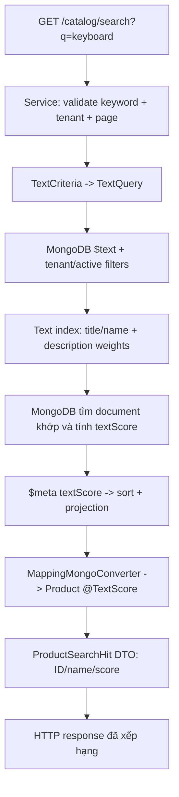

# @TextScore và sắp xếp theo độ liên quan

## 1. Bài toán: tìm đúng sản phẩm thôi chưa đủ

Trong Mini Commerce, khách hàng nhập **“keyboard”** vào ô tìm kiếm. Collection `products` chứa nhiều Product có cùng từ khóa này ở tên hoặc mô tả. Nếu chỉ lọc những document khớp, kết quả có thể xuất hiện theo thứ tự khó hiểu: sản phẩm có từ khóa ngay trong tên bị đặt sau sản phẩm chỉ nhắc tới từ khóa một lần trong mô tả dài.

Đối với tìm kiếm, chúng ta thường cần hai việc **khác nhau**:

1. **Matching:** document nào phù hợp với điều kiện văn bản? MongoDB có toán tử `$text` trên một **text index**.
2. **Ranking:** trong số document khớp, document nào liên quan nhiều hơn? MongoDB tính điểm `textScore` và cho phép sắp xếp bằng `{ $meta: "textScore" }`.

Spring Data MongoDB cung cấp `@TextIndexed` để khai báo field tham gia text index và trọng số, `@TextScore` để ánh xạ **điểm do server tính** về property Java, và `TextCriteria`/`TextQuery.sortByScore()` để tìm kiếm theo độ liên quan.

Bài **“@TextScore và sắp xếp theo độ liên quan”** thuộc chương **“Tìm kiếm nâng cao”** của mô-đun `SPRING_DATA_MONGODB`. Bối cảnh xuyên suốt là kết nối và ánh xạ MongoDB qua `MongoTemplate`/repository, thực hành truy vấn, index, transaction, reactive access, kiểm thử và chẩn đoán hiệu năng.

### Mục tiêu học tập

Sau bài này, bạn có thể:

1. Giải thích tại sao `$text` và `textScore` là hai khái niệm khác nhau.
2. Sử dụng `@TextIndexed(weight=...)`, `@TextScore Float score` và text index có cấu hình ngôn ngữ phù hợp.
3. Hiểu `@TextScore` **không tự tính điểm, không tự tạo index và không lưu score vào document**.
4. Thực hiện text search bằng `TextCriteria`/`TextQuery` và `sortByScore()` với `MongoTemplate`.
5. Dùng repository với `TextCriteria`, `Sort.by("score")`, `Pageable` và giới hạn dữ liệu theo tenant.
6. So sánh kết quả khi chỉ lọc, chỉ project score, sắp xếp bằng score và thêm khóa phụ ổn định.
7. Phân biệt score server tính theo text index với business score (giá, lượng bán, tồn kho).
8. Thiết kế index với field weights, `default_language`, text normalization và kiểm tra tiếng Việt.
9. Phân trang kết quả tìm kiếm, kiểm soát sự thay đổi rank khi dữ liệu/index thay đổi.
10. Triển khai một phiên bản reactive `Flux<Product>` và kiểm thử bằng `StepVerifier`.
11. Chẩn đoán query/index bằng `explain("executionStats")` và nhận biết giới hạn của MongoDB `$text` so với MongoDB Search.

**Điều kiện:** Java 17+, Spring Boot với Spring Data MongoDB, MongoDB đang chạy, hiểu `@Document`, `@Id`, `@Field`, `MongoTemplate`, `MongoRepository`, `Query` và chỉ mục. Tất cả lệnh tạo index/fixture trong bài được minh họa cho **database test riêng**; không chạy nguyên xi trên production.

## 2. Kiến trúc truy vấn có điểm liên quan



Ở sơ đồ này, `@TextScore` nằm **sau bước tính điểm ở server**. Nó chỉ đánh dấu property Java để Spring Data nhận giá trị từ kết quả query; không phải công thức ranking chạy trong Java.

### 2.1. Ba điều kiện để score có ý nghĩa

| Điều kiện | Nếu thiếu |
| --- | --- |
| Có text index thích hợp | `$text` thường báo lỗi không tìm được text index |
| Query dùng `$text` để tìm kiếm | Query thông thường không có text-score metadata |
| Query project hoặc sort bằng `$meta: "textScore"` | Không đảm bảo property `@TextScore` có giá trị và không có thứ tự relevance |

Chỉ thêm `@TextScore` vào entity **không** làm `findAll()` tự xếp theo điểm. Và `$text` mặc định **không bảo đảm** kết quả đã sắp từ cao xuống thấp: phải yêu cầu sort.

### 2.2. TextScore là score của **truy vấn hiện tại**

Một Product có thể có score khác nhau khi người dùng tìm `"keyboard"`, `"bluetooth"` hoặc `"wireless keyboard"`. Điểm phụ thuộc từ khóa truy vấn, trường được index, trọng số, tần suất/đặc điểm văn bản và phiên bản/query engine.

Vì thế:

- Không lưu `textScore` thành field cố định trong Product.
- Không so sánh score của **hai truy vấn từ khóa khác nhau** như cùng một thang điểm kinh doanh.
- Không coi `score=0.8` nghĩa là có xác suất 80% phù hợp.
- Không lấy textScore làm giá trị tài chính, điểm đánh giá sao hay ML confidence được hiệu chỉnh.

## 3. MongoDB $text và $meta: "textScore" qua mongosh

Ví dụ sau giả sử `products` đã có text index trên `name` và `description`. Một truy vấn chỉ để lấy document:

```javascript
db.products.find({
  tenant_id: "shop-a",
  active: true,
  $text: { $search: "keyboard" }
});
```

Lệnh trên **lọc**, nhưng không nêu một thứ tự score. Để nhận điểm:

```javascript
db.products.find(
  {
    tenant_id: "shop-a",
    active: true,
    $text: { $search: "keyboard" }
  },
  {
    name: 1,
    description: 1,
    relevance: { $meta: "textScore" }
  }
);
```

Trường `relevance` là **projection metadata tạm thời**, không phải một field bắt buộc có sẵn trên document lưu ở database.

Để **sắp xếp** từ liên quan nhất:

```javascript
db.products.find(
  {
    tenant_id: "shop-a",
    active: true,
    $text: { $search: "keyboard" }
  },
  {
    name: 1,
    description: 1,
    relevance: { $meta: "textScore" }
  }
).sort({
  relevance: { $meta: "textScore" },
  _id: 1
});
```

`$meta: "textScore"` trong sort đặt các score cao lên trước; `_id:1` là **tie-breaker** để có thứ tự xác định khi score bằng nhau. MongoDB không yêu cầu tên field `relevance` trong sort phải là field thực; nó được dùng làm khóa đại diện cho metadata sort.

### 3.1. Bốn truy vấn thường bị nhầm

| Truy vấn | Có lọc bằng text? | Có trả điểm? | Có sort theo điểm? |
| --- | --- | --- | --- |
| `find({active:true})` | Không | Không | Không |
| `find({$text:{$search:"keyboard"}})` | Có | Không bắt buộc | **Không tự động** |
| `find(query, {relevance:{$meta:"textScore"}})` | Có | Có | Không tự động |
| `find(...).sort({relevance:{$meta:"textScore"}})` | Có | Có thể không project score | **Có** |

Score có thể dùng **để sort mà không project** về client. Nhưng nếu frontend cần giải thích hoặc debug thứ hạng, thêm projection metadata phù hợp và không hiển thị raw score như một “phần trăm độ đúng”.

## 4. @TextIndexed và @TextScore trên Product

### 4.1. Entity với score là property chỉ đọc kết quả search

```java
package com.example.minicommerce.domain;

import java.math.BigDecimal;
import java.time.Instant;

import org.springframework.data.annotation.Id;
import org.springframework.data.mongodb.core.index.TextIndexed;
import org.springframework.data.mongodb.core.mapping.Document;
import org.springframework.data.mongodb.core.mapping.Field;
import org.springframework.data.mongodb.core.mapping.FieldType;
import org.springframework.data.mongodb.core.mapping.TextScore;

@Document(collection = "products", language = "none")
public class Product {

    @Id
    private String id;

    @Field("tenant_id")
    private String tenantId;

    @TextIndexed(weight = 10)
    private String name;

    @TextIndexed(weight = 2)
    private String description;

    private boolean active;

    @Field(name = "unit_price", targetType = FieldType.DECIMAL128)
    private BigDecimal price;

    private int stock;
    private Instant updatedAt;

    @TextScore
    private Float score;

    public Product() {}

    public Product(String id, String tenantId,
                   String name, String description,
                   boolean active, BigDecimal price,
                   int stock) {
        this.id = id;
        this.tenantId = tenantId;
        this.name = name;
        this.description = description;
        this.active = active;
        this.price = price;
        this.stock = stock;
    }

    public String getId() { return id; }
    public String getTenantId() { return tenantId; }
    public String getName() { return name; }
    public String getDescription() { return description; }
    public boolean isActive() { return active; }
    public BigDecimal getPrice() { return price; }
    public int getStock() { return stock; }
    public Instant getUpdatedAt() { return updatedAt; }
    public Float getScore() { return score; }

    public void setId(String id) { this.id = id; }
    public void setTenantId(String tenantId) { this.tenantId = tenantId; }
    public void setName(String name) { this.name = name; }
    public void setDescription(String text) { this.description = text; }
    public void setActive(boolean active) { this.active = active; }
    public void setPrice(BigDecimal value) { this.price = value; }
    public void setStock(int value) { this.stock = value; }
    public void setUpdatedAt(Instant at) { this.updatedAt = at; }
}
```

**Vai trò chính xác của các annotation:**

- `@TextIndexed(weight=10)` trên `name`: đánh dấu field tham gia text index với trọng số tương đối cao.
- `@TextIndexed(weight=2)` trên `description`: cho từ khóa trong mô tả ảnh hưởng đến score thấp hơn từ khóa trong tên, khi các điều kiện khác tương đương.
- `@Document(language="none")`: chọn text-index language `none` theo metadata mapping. Chính sách này **không cung cấp tokenizer tiếng Việt thông minh**; phần 11 giải thích.
- `@TextScore Float score`: nhận giá trị textScore khi query có metadata score; **không được ghi vào MongoDB khi save**.
- `@Field("tenant_id")`: Spring mapping biết field BSON của tenant.
- `price` lưu bằng BSON Decimal128, không tham gia textScore.

`Float` là object có thể `null`. Không dùng `float` primitive cho score nếu entity còn được dùng trong `findById` hoặc `findAll` bình thường, vì **không có text score thì không nên biến “chưa có điểm” thành 0**.

### 4.2. @TextScore không làm field persistent

Tài liệu chính thức nêu rằng property có `@TextScore` **không được ghi khi lưu entity**. Khi gọi:

```java
Product loaded = mongoTemplate.findById(
    "p-kbd-001", Product.class);

Float score = loaded == null ? null : loaded.getScore();
```

`score` thông thường là `null` vì query không yêu cầu text-score metadata. Không có nghĩa Product không liên quan; đơn giản là **query này không tính điểm**.

Đừng đặt `@TextScore` lên `stock`/`price` hoặc tái sử dụng field score như “điểm bán chạy” của Product. Nếu hệ thống cần business score, tạo property riêng `popularityScore` hoặc tính từ nguồn nghiệp vụ rõ ràng.

### 4.3. Field weight không phải score cố định

`weight=10` **không có nghĩa** Product chứa từ khóa trong name sẽ luôn có score đúng bằng 10 hay gấp 5 lần Product chứa từ khóa trong description. MongoDB có thuật toán score và có thể kết hợp nhiều match/frequency; weight chỉ điều chỉnh tầm quan trọng tương đối của field.

Kiểm thử nên xác minh kết quả **được sắp giảm dần theo score**, không đóng đinh giá trị floating-point của score cho mọi MongoDB version/dataset.

## 5. Tạo text index đúng cách

### 5.1. Một collection chỉ có một text index kiểu $text

MongoDB cho phép **một text index mỗi collection**, nhưng index đó có thể bao gồm nhiều field:

```javascript
db.products.createIndex(
  {
    name: "text",
    description: "text"
  },
  {
    name: "products_name_description_text",
    weights: {
      name: 10,
      description: 2
    },
    default_language: "none"
  }
);
```

Lệnh này dành cho database test mới hoặc migration đã được lên kế hoạch. Nếu collection đã có text index khác, không tạo thêm một text index độc lập rồi kỳ vọng MongoDB giữ cả hai. Phải kiểm tra index hiện tại và **thay đổi có kiểm soát**, tính đến thời gian build và write load.

### 5.2. Vì sao cần index thật dù có @TextIndexed?

`@TextIndexed` mô tả metadata của entity; nó **không chứng minh index đã được tạo trong database**. Các dòng Spring Data MongoDB hiện đại tắt tự động tạo index theo mặc định trong nhiều cấu hình. Có thể:

- Quản lý text index bằng migration (phương án ưu tiên trong production).
- Cấu hình auto-index-creation thích hợp trong môi trường phát triển khi đã hiểu hệ quả.
- Dùng `MongoTemplate.indexOps(Product.class).ensureIndex(...)` trong bootstrap/migration.

Sau khi cấu hình, kiểm tra:

```javascript
db.products.getIndexes();
```

Trong index thực, cần thấy text index với các trường, weights và `default_language` dự kiến. `@TextScore` **không tạo text index**.

### 5.3. Index qua Spring Data

```java
import org.springframework.data.mongodb.core.index.TextIndexDefinition;

TextIndexDefinition index = TextIndexDefinition.builder()
    .named("products_name_description_text")
    .onField("name", 10F)
    .onField("description", 2F)
    .withDefaultLanguage("none")
    .build();

mongoTemplate.indexOps(Product.class).ensureIndex(index);
```

`mongoTemplate` là bean được inject trong một migration/bootstrap component. **Không chạy `ensureIndex` ở mỗi request tìm kiếm**. Đây là **một cách thay thế** cho lệnh `db.products.createIndex` ở trên; tránh tạo duplicate index definitions do thay đổi tên hoặc options.

Với `@Field` khác tên BSON, cần kiểm tra liệu field names của index definition được mapping như mong đợi; xem `getIndexes()` thay vì đoán. Hai field `name` và `description` ở ví dụ có tên Java/BSON giống nhau.

### 5.4. Text index và index B-tree thông thường

Một text index phục vụ `$text` không thay thế:

- Unique index `{tenant_id:1, sku:1}` cho mã hàng.
- Compound B-tree index cho listing/filter/sort theo `updatedAt`.
- `2dsphere` index cho truy vấn địa lý.
- MongoDB Search indexes (một hệ thống khác với text index `$text`).

MongoDB cũng có hạn chế với compound text index: trường index đứng **trước** phần text thường phải có điều kiện equality để truy vấn `$text` dùng được; text index không tự tăng tốc sort thông thường. Index theo từng use case và đo `explain`, không cố nhét mọi nhu cầu vào một index.

## 6. Chuẩn bị fixture Mini Commerce

Ví dụ tạo các document có độ liên quan khác nhau với từ **keyboard**:

```javascript
use mini_commerce

db.products.insertMany([
  {
    _id: "p-keyboard-001",
    tenant_id: "shop-a",
    name: "Bàn phím cơ keyboard",
    description: "Keyboard cơ với switch bền và LED",
    active: true,
    stock: 12,
    unit_price: NumberDecimal("129900.00")
  },
  {
    _id: "p-keyboard-002",
    tenant_id: "shop-a",
    name: "Bàn phím không dây",
    description: "Thiết kế keyboard không dây cho văn phòng",
    active: true,
    stock: 8,
    unit_price: NumberDecimal("249900.00")
  },
  {
    _id: "p-mouse-003",
    tenant_id: "shop-a",
    name: "Chuột máy tính",
    description: "Sản phẩm kết hợp tốt với keyboard và màn hình",
    active: true,
    stock: 20,
    unit_price: NumberDecimal("99000.00")
  },
  {
    _id: "p-keyboard-004",
    tenant_id: "shop-a",
    name: "Keyboard bản cũ",
    description: "Đã ngừng bán",
    active: false,
    stock: 0,
    unit_price: NumberDecimal("199900.00")
  },
  {
    _id: "p-keyboard-005",
    tenant_id: "shop-b",
    name: "Keyboard chuyên nghiệp",
    description: "Sản phẩm thuộc cửa hàng khác",
    active: true,
    stock: 4,
    unit_price: NumberDecimal("399900.00")
  },
  {
    _id: "p-monitor-006",
    tenant_id: "shop-a",
    name: "Màn hình đồ họa",
    description: "Màn hình độ phân giải cao",
    active: true,
    stock: 6,
    unit_price: NumberDecimal("4999000.00")
  }
]);
```

Chỉ chạy trong database test đã chuẩn bị text index như phần 5. Các ID có tiền tố chữ tránh nhập nhằng giữa String `@Id` và BSON ObjectId. Nếu collection test có JSON Schema/unique indexes khác, phải seed đủ field hợp lệ. Không chạy lại insert cùng `_id` mà không cleanup.

### 6.1. Tập hợp kết quả mong đợi

Với điều kiện:

```javascript
{
  tenant_id: "shop-a",
  active: true,
  $text: { $search: "keyboard" }
}
```

Ba Product `p-keyboard-001`, `p-keyboard-002` và `p-mouse-003` là các ứng viên khớp theo từ khóa ASCII. `p-keyboard-004` bị loại do inactive; `p-keyboard-005` bị loại do tenant; `p-monitor-006` không chứa từ khóa trong các trường được index.

Không khẳng định **giá trị score cụ thể** hay thứ tự giữa hai document trùng score trong bài. Những điều đó phải được quan sát bằng query thực tế trên phiên bản MongoDB đang dùng, với index options và dữ liệu kiểm soát.

### 6.2. So sánh kết quả qua mongosh

```javascript
// 1. Chỉ lọc.
db.products.find({
  tenant_id: "shop-a",
  active: true,
  $text: { $search: "keyboard" }
});

// 2. Lọc + project score, nhưng chưa yêu cầu sort.
db.products.find(
  {
    tenant_id: "shop-a",
    active: true,
    $text: { $search: "keyboard" }
  },
  { name: 1, score: { $meta: "textScore" } }
);

// 3. Lọc + project score + sort relevance, có tie-breaker.
db.products.find(
  {
    tenant_id: "shop-a",
    active: true,
    $text: { $search: "keyboard" }
  },
  { name: 1, score: { $meta: "textScore" } }
).sort({ score: { $meta: "textScore" }, _id: 1 });
```

Đối chiếu ba kết quả để thấy: **projection score và sort score là hai yêu cầu khác nhau**.

## 7. MongoTemplate: TextCriteria và TextQuery.sortByScore()

Spring Data MongoDB có:

```java
import org.springframework.data.mongodb.core.query.TextCriteria;
import org.springframework.data.mongodb.core.query.TextQuery;
```

Hai kiểu này bọc ý định `$text` và `$meta` mà không cần tự ghép chuỗi BSON JSON trong Java.

### 7.1. Ví dụ cơ bản

```java
TextCriteria terms = TextCriteria
    .forDefaultLanguage()
    .matchingAny("keyboard");

TextQuery query = TextQuery
    .queryText(terms)
    .sortByScore()
    .includeScore();

List<Product> products = mongoTemplate.find(
    query, Product.class);

for (Product product : products) {
    System.out.printf("%s : score=%s%n",
        product.getName(), product.getScore());
}
```

`TextCriteria.forDefaultLanguage()` để MongoDB sử dụng ngôn ngữ mặc định của text index; trong ví dụ này là `none`. `sortByScore()` yêu cầu sắp xếp theo metadata điểm. `includeScore()` yêu cầu trả metadata để Spring Data ánh xạ vào `@TextScore`.

Tài liệu `TextQuery` hiện hành còn nêu `sortByScore()` **cũng thêm score vào projection**; dùng `includeScore()` tường minh ở đây giúp diễn đạt rõ mục đích và nhất quán với ví dụ tài liệu Spring Data.

### 7.2. TextCriteria matchingAny, matching, phrase và notMatching

```java
// Một hoặc nhiều term: theo text-search semantics.
TextCriteria any = TextCriteria.forDefaultLanguage()
    .matchingAny("keyboard", "bluetooth");

// Tìm một từ/biểu thức text.
TextCriteria single = TextCriteria.forDefaultLanguage()
    .matching("keyboard");

// Tìm một cụm từ liên tiếp.
TextCriteria phrase = TextCriteria.forDefaultLanguage()
    .phrase("wireless keyboard");

// Tìm keyboard nhưng loại các document có "damaged".
TextCriteria withoutDamaged = TextCriteria.forDefaultLanguage()
    .matching("keyboard")
    .notMatching("damaged");
```

Các phương thức không mang semantics của SQL `LIKE`:

- Từ đơn `keyboard` không tự có nghĩa tìm mọi chuỗi con như `keyb`.
- Nhiều term thông thường của `$text` có semantics **OR** khi không chỉ định exact phrase hay ràng buộc bổ sung.
- Cụm từ dùng cú pháp full-text phrase, không phải so khớp substring tùy ý.
- Dấu `-` đứng trước term có thể được hiểu là điều kiện loại trừ.

**Đừng ghép ký tự text-search từ input chưa kiểm soát** rồi nghĩ rằng user chỉ yêu cầu tìm một chuỗi literal. TextCriteria giúp tạo query object thay vì JSON concatenation, nhưng cú pháp text-search trong giá trị từ khóa vẫn có nghĩa đặc biệt. Service cần xác định có cho phép người dùng nhập phrase/negation hay chỉ từ khóa thông thường.

### 7.3. Giới hạn theo tenant và active

Trong Mini Commerce, một endpoint tìm kiếm **không được** trả dữ liệu của shop khác:

```java
TextCriteria criteria = TextCriteria.forDefaultLanguage()
    .matching("keyboard");

TextQuery query = TextQuery.queryText(criteria)
    .sortByScore()
    .includeScore();

query.addCriteria(
    Criteria.where("tenantId").is(verifiedTenantId)
        .and("active").is(true));

List<Product> hits = mongoTemplate.find(
    query, Product.class);
```

Vì query gắn `Product.class`, Spring Data ánh xạ `tenantId` thành BSON `tenant_id`. `verifiedTenantId` phải đến từ security context/service authorization đã xác thực, **không** lấy tùy ý từ JSON body của user.

MongoDB thực hiện text matching và filter trong query; không được tìm toàn bộ collection rồi lọc tenant bằng `Stream.filter` trong JVM. Lọc sau khi query vừa tốn tài nguyên vừa có thể làm rò dữ liệu qua caching/logging hoặc nhầm pagination.

### 7.4. Kết quả trả về dạng DTO

```java
package com.example.minicommerce.service;

import java.math.BigDecimal;
import com.example.minicommerce.domain.Product;

public record ProductSearchHit(
    String productId,
    String name,
    BigDecimal price,
    Float relevance
) {
    public static ProductSearchHit from(Product product) {
        return new ProductSearchHit(
            product.getId(),
            product.getName(),
            product.getPrice(),
            product.getScore());
    }
}
```

Không đưa mọi field trong `Product` ra public API; ví dụ chi phí nhập hàng, ghi chú nội bộ và dữ liệu supplier không nên đi theo search response. `relevance` là **giá trị kỹ thuật** để debug hoặc hiển thị tương đối, không phải điểm thang 0–100.

Nếu client chỉ cần thứ tự kết quả, có thể **không trả score ra ngoài API**. Trong trường hợp đó vẫn sort bằng `$meta` trên server, nhưng DTO chỉ gồm Product ID, name, price.

## 8. Service tìm Product theo độ liên quan

### 8.1. Chính sách input

Ví dụ áp dụng chính sách:

- Từ khóa không null/rỗng sau khi strip.
- Dài không quá 120 Unicode code points.
- Page zero-based, pageSize từ 1 đến 50.
- Không cho offset quá sâu; hướng dẫn dùng cursor hoặc search-after phù hợp khi cần.
- Tenant lấy từ server/security context.
- Nếu UI chỉ tìm từ khóa tự do, không cho khách nhập query syntax phức tạp ngoài hợp đồng.

Giới hạn là **chính sách ví dụ**, không phải giới hạn cứng của MongoDB.

### 8.2. MongoTemplate search service

```java
package com.example.minicommerce.service;

import java.util.List;

import org.springframework.data.mongodb.core.MongoTemplate;
import org.springframework.data.mongodb.core.query.Criteria;
import org.springframework.data.mongodb.core.query.TextCriteria;
import org.springframework.data.mongodb.core.query.TextQuery;
import org.springframework.stereotype.Service;

import com.example.minicommerce.domain.Product;

@Service
public class ProductTextSearchService {

    private final MongoTemplate mongoTemplate;

    public ProductTextSearchService(MongoTemplate mongoTemplate) {
        this.mongoTemplate = mongoTemplate;
    }

    public List<ProductSearchHit> search(
            String verifiedTenantId,
            String keyword,
            int page,
            int size) {

        if (verifiedTenantId == null ||
                verifiedTenantId.isBlank()) {
            throw new IllegalArgumentException("Tenant required");
        }
        if (keyword == null || keyword.isBlank() ||
                keyword.codePointCount(0, keyword.length()) > 120) {
            throw new IllegalArgumentException(
                "Invalid keyword length");
        }
        if (page < 0 || size < 1 || size > 50) {
            throw new IllegalArgumentException(
                "Invalid page/size");
        }

        long offset = (long) page * size;
        if (offset > 10_000L) {
            throw new IllegalArgumentException(
                "Deep relevance paging is not supported");
        }

        String input = keyword.strip();

        // Chế độ advanced search: input tuân theo MongoDB
        // $text syntax (term, phrase, exclusion).
        TextCriteria text = TextCriteria.forDefaultLanguage()
            .matching(input);

        TextQuery query = TextQuery.queryText(text)
            .sortByScore()
            .includeScore();

        query.addCriteria(
            Criteria.where("tenantId").is(verifiedTenantId)
                .and("active").is(true));

        query.skip(offset);
        query.limit(size);

        return mongoTemplate.find(query, Product.class)
            .stream()
            .map(ProductSearchHit::from)
            .toList();
    }
}
```

Đây là một service synchronous có dependency rõ ràng. Nếu API chỉ cho phép **literal search terms**, service phải tokenize/validate keyword trước khi gọi `TextCriteria` thay vì đưa nguyên cú pháp `$text` cho user. Ví dụ này chủ động gọi chế độ **advanced search**, hỗ trợ MongoDB text-search syntax sau validation độ dài.

### 8.3. Hạn chế về sort tie

`TextQuery.sortByScore()` sắp theo score giảm dần. Khi nhiều Product có **score bằng nhau**, nếu không có khóa phụ thì thứ tự giữa chúng không được bảo đảm. Với `PageRequest`/`skip`, tie có thể gây duplicate/bỏ sót qua các trang.

Ở mức BSON, ta có thể đặt:

```javascript
{ relevance: { $meta: "textScore" }, _id: 1 }
```

Khi dùng `TextQuery` và `Sort` bổ sung, cần kiểm tra **BSON sort cuối** theo Spring Data version đang dùng, vì `TextQuery` tạo meta sort riêng. Không tùy tiện thay `sortByScore()` bằng `with(Sort.by("id"))` rồi mất sắp xếp theo score. Với API yêu cầu pagination ổn định, có thể dùng template/aggregation hoặc raw query được kiểm thử để bảo đảm score là khóa đầu, `_id` là khóa phụ.

## 9. Repository: TextCriteria và Sort.by("score")

Spring Data MongoDB hỗ trợ repository method nhận `TextCriteria` như một special parameter và kết hợp với điều kiện derived query.

### 9.1. Interface repository

```java
package com.example.minicommerce.repository;

import java.util.List;

import org.springframework.data.domain.Page;
import org.springframework.data.domain.Pageable;
import org.springframework.data.domain.Sort;
import org.springframework.data.mongodb.core.query.TextCriteria;
import org.springframework.data.mongodb.repository.MongoRepository;

import com.example.minicommerce.domain.Product;

public interface ProductSearchRepository
        extends MongoRepository<Product, String> {

    List<Product> findByTenantIdAndActiveTrue(
        String tenantId,
        TextCriteria criteria,
        Sort sort);

    Page<Product> findByTenantIdAndActiveTrue(
        String tenantId,
        TextCriteria criteria,
        Pageable pageable);
}
```

`TextCriteria` được Spring Data thêm vào truy vấn như điều kiện `$text` kết hợp **AND** với `tenantId`/`active`. Hai overload nhận `Sort` hoặc `Pageable` riêng biệt; không khai báo đồng thời hai special parameters mâu thuẫn trên một method.

### 9.2. Sắp xếp bằng score

```java
TextCriteria criteria = TextCriteria
    .forDefaultLanguage()
    .matchingAny("keyboard");

List<Product> hits = productSearchRepository
    .findByTenantIdAndActiveTrue(
        verifiedTenantId, criteria,
        Sort.by("score"));
```

Trong Spring Data MongoDB, nếu `Product.score` được đánh dấu `@TextScore`, `Sort.by("score")` trong repository text query có thể được chuyển thành **meta sort theo text score**, như ví dụ chính thức của Spring Data. Không nhầm với một BSON field tên `score` được lưu trước đó.

### 9.3. Pageable trong repository

```java
import org.springframework.data.domain.Page;
import org.springframework.data.domain.PageRequest;
import org.springframework.data.domain.Pageable;
import org.springframework.data.domain.Sort;

Pageable pageable = PageRequest.of(
    0, 20, Sort.by("score"));

Page<Product> page = productSearchRepository
    .findByTenantIdAndActiveTrue(
        verifiedTenantId,
        TextCriteria.forDefaultLanguage().matching("keyboard"),
        pageable);

long total = page.getTotalElements();
List<Product> visible = page.getContent();
```

Repository synchronous `Page<Product>` có thể thực hiện thêm count query để cung cấp total; với text search, count có thể tốn kém trên dữ liệu lớn. Ở reactive repository không thể dùng trực tiếp `Mono<Page<Product>>`; xem phần reactive.

### 9.4. Sort.by("score") cần đúng entity mapping

Nếu property trên Product tên `relevanceScore`:

```java
@TextScore
private Float relevanceScore;
```

thì repository nên sort theo property annotated này:

```java
Sort.by("relevanceScore");
```

Không dùng `Sort.by("score")` cho entity không có property `@TextScore` rồi mong Spring Data tự biết đó là textScore meta. Tương tự, nếu một field BSON thật tên `score` tồn tại cho mục đích khác, cần tách rõ ranking metadata và persisted business field.

## 10. @TextScore trong projection và aggregation

### 10.1. MongoDB projection

Ở mức raw query, metadata score được tạo bằng:

```javascript
db.products.find(
  { $text: { $search: "keyboard" } },
  {
    _id: 1,
    name: 1,
    searchScore: { $meta: "textScore" }
  }
);
```

`searchScore` chỉ là **tên trong query result**, không bắt buộc phải có trong BSON document được lưu.

### 10.2. TextQuery.includeScore(fieldName)

```java
TextQuery query = TextQuery
    .queryText(TextCriteria.forDefaultLanguage()
        .matching("keyboard"))
    .sortByScore()
    .includeScore("relevance");
```

`includeScore("relevance")` cho phép điều chỉnh **tên field score được project**. Nếu ánh xạ kết quả trực tiếp sang `Product` có `@TextScore Float score`, cần xác nhận metadata binding/field alias có tương ứng; khi thay tên projection, DTO chuyên dụng hoặc `Document` có thể dễ kiểm soát hơn:

```java
List<org.bson.Document> raw = mongoTemplate.find(
    query, org.bson.Document.class, "products");
```

Ví dụ raw `Document` chỉ nhằm minh họa trường metadata; khi dùng `Document.class` không có property mapping `tenantId` của Product, nên query trong production phải viết BSON field name đúng hoặc dùng query typed đã kiểm soát.

### 10.3. Aggregation pipeline

`$text` trong aggregation phải nằm trong `$match` ở **stage đầu tiên** khi được sử dụng; sau đó có thể project và sort bằng score:

```javascript
db.products.aggregate([
  {
    $match: {
      $text: { $search: "keyboard" },
      tenant_id: "shop-a",
      active: true
    }
  },
  {
    $addFields: {
      relevance: { $meta: "textScore" }
    }
  },
  {
    $sort: { relevance: -1, _id: 1 }
  },
  {
    $project: {
      _id: 1,
      name: 1,
      unit_price: 1,
      relevance: 1
    }
  },
  { $limit: 20 }
]);
```

Đây là ví dụ pipeline MongoDB; thứ tự `$match` trước hết rất quan trọng với `$text`. Khi bạn dùng Spring Data Aggregation DSL, hãy kiểm tra stage serialization và mapping field names thay vì chỉ copy `$meta` syntax sang bất kỳ vị trí nào. Aggregation có thể giúp bổ sung business filters/projection, nhưng phải **benchmark** hiệu năng so với finder + `TextQuery`.

## 11. Ngôn ngữ, tiếng Việt và cách dùng text index

### 11.1. English mặc định không phải lựa chọn hiển nhiên cho dữ liệu tiếng Việt

MongoDB text index có cấu hình `default_language`; khi không chỉ định, mặc định thường là `english`. Ngôn ngữ ảnh hưởng tới stop words và stemming. Dữ liệu Mini Commerce bằng tiếng Việt có thể không khớp giả định xử lý tiếng Anh, và `$text` không cung cấp một language analyzer tiếng Việt đầy đủ tương đương một hệ thống search chuyên dụng.

Để thử nghiệm từ khóa tiếng Việt đơn giản, bài dùng:

```javascript
db.products.createIndex(
  { name: "text", description: "text" },
  { default_language: "none" }
);
```

`none` tắt stop-word filtering và stemming theo ngôn ngữ, nhưng **không biến MongoDB text index thành công cụ tách từ tiếng Việt theo nghĩa/ngữ cảnh**. Các từ ghép như `“bàn phím”`, dấu thanh, ký tự `đ` hoặc kiểu gõ không dấu cần được kiểm thử thực tế.

### 11.2. Case và dấu

Với text index phiên bản 3, `$text` mặc định hỗ trợ case-insensitive và diacritic-insensitive theo quy tắc được MongoDB định nghĩa. Có thể yêu cầu case/diacritic sensitivity khi cần:

```javascript
db.products.find({
  $text: {
    $search: "Bàn phím",
    $caseSensitive: false,
    $diacriticSensitive: false
  }
});
```

**Không suy ra** mọi vấn đề tiếng Việt đã được giải quyết: MongoDB index version, analyzer, token boundaries và từ `đ` cần được test với dữ liệu thực. Kết quả trong cơ sở dữ liệu gồm các chuỗi Việt/Anh khác nhau có thể không tương đương với người dùng về ngữ nghĩa.

### 11.3. Normalized search field

Khi doanh nghiệp yêu cầu người dùng gõ `"ban phim"` vẫn tìm `"bàn phím"`, có thể tạo một **field chuẩn hóa** ở write path:

```javascript
{
  name: "Bàn phím cơ",
  name_search: "ban phim co"
}
```

Và text index riêng các source fields đã được thiết kế (nhưng MongoDB chỉ có **một text index mỗi collection**, nên phải kết hợp chúng vào cùng index definition). Nếu hệ thống chọn index `name_search` thì `@TextIndexed` và migration cũng cần trỏ vào đúng field đó, không giữ index cũ đồng thời.

Normalization cần cùng logic cho insert/save/direct update/bulk, và không được mất `name_search` khi đổi `name`. Tránh tạo derived field mà không có protocol cập nhật nhất quán.

### 11.4. Khi cần search chuyên sâu

MongoDB hiện khuyến nghị giải pháp **MongoDB Search** (và MongoDB Vector Search cho semantic search) thay vì `$text` khi cần ranking/analyzers nâng cao. MongoDB Search dùng `$search`/`$searchMeta`, search index riêng và metadata score khác với text index `$text`.

**Không đánh đồng**:

- `$text` + `$meta: "textScore"` của native text index.
- `$search` + metadata `searchScore`/search stages trên MongoDB Search.

`@TextScore` trong bài này gắn với **`$text`** của Spring Data MongoDB. Nếu chuyển sang MongoDB Search, cần thiết kế pipeline, metadata mapping và ranking riêng theo API đang dùng.

## 12. Điểm score, trọng số và quy tắc ranking nghiệp vụ

### 12.1. Ý nghĩa của weight

Giả sử người dùng tìm `keyboard`:

```text
Product A:
    name        = "Keyboard cơ cao cấp"
    description = "Switch bền"

Product B:
    name        = "Bàn phím cơ"
    description = "Keyboard cho người dùng văn phòng"
```

Nếu index có:

```javascript
weights: { name: 10, description: 2 }
```

thì match trong `name` được **ưu tiên tương đối**. Tuy nhiên, không có công thức đơn giản `score = 10 × số lần tên chứa từ + 2 × số lần mô tả chứa từ` bảo đảm đúng cho mọi trường hợp. MongoDB có thuật toán tính score từ text index; term frequency, nhiều match, quy tắc phân tích ngôn ngữ đều có thể ảnh hưởng.

### 12.2. Score không phải “độ nổi bật” kinh doanh

Một Product liên quan cao có thể:

- Tạm hết hàng.
- Đã ngừng bán.
- Giá quá cao so với ngân sách.
- Bị chặn theo chính sách vùng/tenant.
- Có đánh giá thấp.

Thường cần kết hợp **filter nghiệp vụ** ngay trong query:

```javascript
{
  tenant_id: "shop-a",
  active: true,
  stock: { $gt: 0 },
  $text: { $search: "keyboard" }
}
```

Nhưng filter `stock > 0` là **điều kiện đủ hàng tại thời điểm truy vấn**, không bảo đảm hàng còn khi checkout. Khi đặt hàng vẫn phải CAS tồn kho/transaction theo nghiệp vụ.

### 12.3. Relevance-first khác popularity-first

| Chính sách | Ưu tiên | Rủi ro |
| --- | --- | --- |
| Score-first | Từ khóa khớp nội dung | Item score cao nhưng bán kém vẫn đứng đầu |
| Popularity-first | Sản phẩm bán chạy | Item ít liên quan có thể lên đầu |
| Recent-first | Sản phẩm mới | Thứ tự không còn theo text relevance |
| Combined ranking | Relevance + popularity + tồn kho + thời gian | Cần thiết kế công thức, normalization, giải thích và A/B test |

Trong bài này **score-first** là hành vi cần học. Khi muốn công thức kết hợp phức tạp, không nên tùy tiện `Sort.by("popularity")` trước `Sort.by("score")` rồi nói đó là “score kết hợp”. Cần một công thức/ranking pipeline rõ và dữ liệu được giám sát, có thể phù hợp hơn với MongoDB Search.

## 13. Pagination theo độ liên quan

Một API `GET /products/search?q=keyboard&page=0&size=20` cần:

- Giới hạn `page` và `size`.
- Chạy **server-side sort theo score trước skip/limit**.
- Tránh `findAll()` rồi sort Java list: như vậy chỉ có thể sắp **tập đã tải**, không bảo đảm thứ hạng toàn collection.
- Bảo đảm filter tenant/active giống nhau giữa content và count.
- Xử lý tie score và dữ liệu thay đổi giữa hai trang.

### 13.1. Score và offset

```javascript
db.products.find(
  {
    tenant_id: "shop-a",
    active: true,
    $text: { $search: "keyboard" }
  },
  { name: 1, score: { $meta: "textScore" } }
)
.sort({ score: { $meta: "textScore" }, _id: 1 })
.skip(20)
.limit(20);
```

`skip(20)` nghĩa là bỏ qua 20 document đầu **sau khi sort**. Offset lớn có thể tốn tài nguyên, nhất là khi query phải tính score và sort nhiều match.

### 13.2. Count không phải score

`totalElements` của một trang là **số Product khớp filter**, không phải tổng điểm hay số Product nằm trên một ngưỡng score ngầm nào đó.

```javascript
db.products.countDocuments({
  tenant_id: "shop-a",
  active: true,
  $text: { $search: "keyboard" }
});
```

Nếu hệ thống cần một kết quả `Page<Product>`, count query phải mang **cùng text search terms và filters**, nhưng không mang `skip/limit`. Count có thể tốn đáng kể tài nguyên; cân nhắc `Slice` hay “load more” khi không cần tổng.

### 13.3. Tạo hai TextQuery riêng trong template

```java
TextCriteria textForContent = TextCriteria
    .forDefaultLanguage()
    .matching("keyboard");

TextQuery content = TextQuery
    .queryText(textForContent)
    .sortByScore()
    .includeScore();

content.addCriteria(
    Criteria.where("tenantId").is(tenantId)
        .and("active").is(true));
content.skip((long) page * size);
content.limit(size);

TextCriteria textForCount = TextCriteria
    .forDefaultLanguage()
    .matching("keyboard");

TextQuery count = TextQuery.queryText(textForCount);
count.addCriteria(
    Criteria.where("tenantId").is(tenantId)
        .and("active").is(true));

List<Product> items = mongoTemplate.find(
    content, Product.class);
long total = mongoTemplate.count(count, Product.class);
```

Đây là **đoạn service** với `tenantId` đã xác thực, `page/size` đã validate và `mongoTemplate` được inject. **Count query là object mới**, không nhận score projection, sort, skip hoặc limit của content query. Việc count hỗ trợ `$text` có thể phụ thuộc đặc điểm MongoDB/Spring Data version; integration test cùng index cần xác nhận.

### 13.4. Ranking thay đổi giữa các request

Một request trang 0 và request trang 1 có thể dùng cùng từ khóa nhưng khác tập kết quả khi:

- Product được thêm/xóa.
- `name`/`description` được sửa.
- Text index được rebuild/thay đổi weights hoặc language.
- Quyền truy cập/stock/active thay đổi.
- Hai Product có cùng score và thứ tự phụ không ổn định.

Không nói `Pageable` cung cấp snapshot bất biến qua các HTTP requests. Nếu nghiệp vụ thực sự cần duyệt một tập kết quả **giữ nguyên**, cân nhắc materialize danh sách IDs kèm thời hạn/tenant hoặc chiến lược snapshot được định nghĩa rõ. Cursor theo score cũng phức tạp khi score thay đổi theo query/index, không giống cursor theo khóa thời gian cố định.

## 14. Sort textScore và khóa phụ ổn định

### 14.1. Vì sao có thể bị trùng Product giữa hai trang?

```text
Product A score = 2.5
Product B score = 1.8
Product C score = 1.8
Product D score = 1.8

Page 0 size=2: A, B
Page 1 size=2: C, D

Nếu MongoDB không có thứ tự xác định trong nhóm score=1.8:
Page 1 ở request sau có thể lại chứa B.
```

Giải pháp ở mức BSON là dùng:

```javascript
.sort({ score: { $meta: "textScore" }, _id: 1 })
```

Metadata score được đặt làm khóa chính; `_id` duy nhất đóng vai trò tiebreaker. Không sử dụng `{_id:1,score:{$meta:"textScore"}}` nếu mục tiêu là score-first, vì sắp ID trước làm ranking vô nghĩa.

### 14.2. Chú ý trong Spring Data repository

```java
Sort relevance = Sort.by("score");
Sort relevanceThenId =
    relevance.and(Sort.by("id"));
```

Với `@TextScore`, repository có thể ánh xạ score sort bằng meta; khi thêm `id` cần xác minh BSON được tạo như mong muốn, kể cả vị trí khóa. API `TextQuery.sortByScore()` tạo meta sort riêng, nên cách kết hợp `TextQuery` với `Sort` không nhất thiết giống cách repository xử lý.

**QA cần chạy:** integration test với ít nhất ba Product có score bằng nhau, request hai trang và xác minh tổng thứ tự theo `score DESC, _id ASC`. Nếu Spring Data version không tạo đúng sort, dùng một query/pipeline raw có kiểm soát thay vì giả định.

### 14.3. Không so sánh score floating-point bằng ==

Điểm là số floating point. Khi kiểm tra sort:

```java
for (int i = 1; i < products.size(); i++) {
    Float previous = products.get(i - 1).getScore();
    Float current = products.get(i).getScore();

    assertNotNull(previous);
    assertNotNull(current);
    assertTrue(previous >= current,
        "Scores must be non-increasing");
}
```

Đây là đoạn **thân integration test**, cần imports JUnit. Đừng assert `score == 1.234567` vì thuật toán/query engine có thể thay đổi giữa phiên bản MongoDB và dữ liệu.

## 15. Một API REST an toàn cho relevance search

### 15.1. Response DTO

```java
package com.example.minicommerce.api;

import java.util.List;
import com.example.minicommerce.service.ProductSearchHit;

public record ProductSearchResponse(
    String query,
    int page,
    int size,
    List<ProductSearchHit> items
) {}
```

Phần UI chỉ cần tên, giá và thứ tự, **không bắt buộc phải trả `relevance`**. Có thể giữ field trong DTO nội bộ và loại khỏi public JSON nếu sợ người dùng hiểu score như xác suất hoặc muốn có quyền điều chỉnh thuật toán mà không làm thay đổi API.

### 15.2. Web layer nhận từ khóa

```java
package com.example.minicommerce.api;

import org.springframework.web.bind.annotation.GetMapping;
import org.springframework.web.bind.annotation.RequestMapping;
import org.springframework.web.bind.annotation.RequestParam;
import org.springframework.web.bind.annotation.RestController;

import com.example.minicommerce.service.ProductTextSearchService;

@RestController
@RequestMapping("/api/catalog")
public class ProductSearchController {

    private final ProductTextSearchService service;
    private final TenantResolver tenantResolver;

    public ProductSearchController(
            ProductTextSearchService service,
            TenantResolver tenantResolver) {
        this.service = service;
        this.tenantResolver = tenantResolver;
    }

    @GetMapping("/search")
    public ProductSearchResponse search(
            @RequestParam String q,
            @RequestParam(defaultValue = "0") int page,
            @RequestParam(defaultValue = "20") int size) {

        String tenantId = tenantResolver.requireVerifiedTenant();
        return new ProductSearchResponse(
            q, page, size,
            service.search(tenantId, q, page, size));
    }
}
```

`TenantResolver` là **abstraction cần được dự án triển khai** từ Spring Security/JWT/session tenant đã xác thực. Đây không phải API có sẵn của Spring Data; không lấy `tenantId` từ request body một cách không kiểm chứng. Cần bổ sung `@RestControllerAdvice`/validation để chuyển input sai thành HTTP 400, timeout thành error có kiểm soát và tránh log nguyên query chứa PII.

### 15.3. Query syntax contract

Với một search box đơn giản, có thể chọn:

1. **Basic mode:** tách keyword thành các term được kiểm soát, giới hạn số lượng và ký tự; bỏ qua cú pháp phrase/negative do user tự nhập.
2. **Advanced mode:** cho phép `"exact phrase"` và `-exclude` theo cú pháp `$text`, cung cấp hướng dẫn UI và validation rõ.

`TextCriteria.matching(userInput)` tránh việc nối BSON operators thẳng vào JSON string, nhưng MongoDB **vẫn diễn giải nội dung `$search`**. Đây là khác biệt giữa **BSON query injection** và **text-search syntax được user sử dụng**; phải thiết kế contract cho cả hai.

## 16. ReactiveMongoTemplate và Flux<Product>

Reactive Spring Data MongoDB có cùng semantics text index và score ở server, nhưng query trả publisher thay vì List đồng bộ:

```java
package com.example.minicommerce.service;

import org.springframework.data.mongodb.core.ReactiveMongoTemplate;
import org.springframework.data.mongodb.core.query.Criteria;
import org.springframework.data.mongodb.core.query.TextCriteria;
import org.springframework.data.mongodb.core.query.TextQuery;
import org.springframework.stereotype.Service;

import reactor.core.publisher.Flux;

import com.example.minicommerce.domain.Product;

@Service
public class ReactiveProductTextSearchService {

    private final ReactiveMongoTemplate template;

    public ReactiveProductTextSearchService(
            ReactiveMongoTemplate template) {
        this.template = template;
    }

    public Flux<ProductSearchHit> search(
            String tenantId,
            String keyword,
            int limit) {

        if (tenantId == null || tenantId.isBlank() ||
                keyword == null || keyword.isBlank() ||
                limit < 1 || limit > 50) {
            return Flux.error(new IllegalArgumentException(
                "Invalid search request"));
        }

        // Mỗi subscription tạo một Query riêng.
        return Flux.defer(() -> {
            TextCriteria text = TextCriteria
                .forDefaultLanguage()
                .matching(keyword.strip());

            TextQuery query = TextQuery
                .queryText(text)
                .sortByScore()
                .includeScore();

            query.addCriteria(
                Criteria.where("tenantId").is(tenantId)
                    .and("active").is(true));
            query.limit(limit);

            return template.find(query, Product.class)
                .map(ProductSearchHit::from);
        });
    }
}
```

Các publisher từ reactive database operations thường là **cold**. `Flux.defer` tạo query per subscription, giúp tránh vô tình share state mutable của `Query` qua nhiều subscriptions; tuy nhiên mỗi subscription vẫn là **một lần truy vấn MongoDB**.

### 16.1. Không block trong WebFlux

```java
Flux<ProductSearchHit> hits =
    reactiveService.search(
        verifiedTenantId, "keyboard", 20);
```

Nếu endpoint streaming items, có thể return `Flux`. Nếu muốn **một JSON object** chứa metadata và items, `collectList()` là hợp lý **sau khi query đã có limit tại MongoDB**:

```java
Mono<List<ProductSearchHit>> items =
    reactiveService.search(
            verifiedTenantId, "keyboard", 20)
        .collectList();
```

Không gọi `block()` trên WebFlux event loop để biến Flux thành List. Backpressure không tự sửa lỗi query không giới hạn hoặc deep pagination.

### 16.2. Reactive repository và TextCriteria

```java
package com.example.minicommerce.repository;

import org.springframework.data.domain.Sort;
import org.springframework.data.mongodb.core.query.TextCriteria;
import org.springframework.data.mongodb.repository.ReactiveMongoRepository;
import reactor.core.publisher.Flux;

import com.example.minicommerce.domain.Product;

public interface ReactiveProductSearchRepository
        extends ReactiveMongoRepository<Product, String> {

    Flux<Product> findByTenantIdAndActiveTrue(
        String tenantId,
        TextCriteria criteria,
        Sort sort);
}
```

Gọi:

```java
Flux<Product> ranked = reactiveRepository
    .findByTenantIdAndActiveTrue(
        verifiedTenantId,
        TextCriteria.forDefaultLanguage()
            .matching("keyboard"),
        Sort.by("score"));
```

Reactive repository không hỗ trợ trực tiếp `Mono<Page<Product>>` như repository synchronous. Muốn cung cấp total, hãy tạo **publisher đếm riêng** với cùng text/filter semantics, rồi combine. Khi cần strict consistency, phải xem transaction/session requirements; một `Mono.zip` độc lập **không** tạo snapshot nhất quán.

### 16.3. Reactive pagination đúng mức

Với API “load more” chỉ cần 20 kết quả đầu, query với `limit(20)` đủ. Với trang 2, cần áp dụng `skip(offset)` và `limit(pageSize)` ở **MongoDB**. Không gọi:

```java
// Phản ví dụ: tải tất cả Product khớp rồi cắt sau.
reactiveRepository.findAll()
    .filter(p -> p.getName().contains("keyboard"))
    .skip(1000)
    .take(20);
```

Phép `skip(1000)` ở Reactor trong ví dụ trên **không giống** server-side index-aware query; nó tải/kiểm tra dữ liệu phía application trước khi đủ phần tử. Đặc biệt không lọc tenant **sau** khi đã phát stream.

## 17. Transaction và session liên quan gì tới @TextScore?

Tìm kiếm văn bản đa số là **read-only**, không cần MongoDB transaction chỉ để có một score. Nếu kết hợp search với các cập nhật khác:

- `@TextScore` được tính khi đọc, không phải version của Product.
- Score không tham gia optimistic locking và không bảo đảm dữ liệu còn nguyên khi checkout.
- Giao dịch nhiều document có transaction lifetime và các giới hạn query/index riêng; không mở transaction dài chỉ để phân trang hàng nghìn trang search.
- Nếu vừa đọc score, vừa điều chỉnh inventory, lệnh giảm kho phải dùng CAS `stock >= quantity` hoặc protocol transaction của nghiệp vụ.

### 17.1. Search result không phải reservation

```text
T0: Search xếp Product A đầu tiên, stock=3.
T1: Khách khác mua 3 chiếc.
T2: Khách hiện tại đặt 1 chiếc.
=> T2 phải kiểm tra stock hiện tại tại write.
```

Không cho Product được mua chỉ vì nó có score cao hoặc `stock>0` tại thời điểm search.

### 17.2. Score không được lưu trong audit log như truth tuyệt đối

Nếu lưu dữ liệu phục vụ kiểm tra ranking:

```text
query="keyboard"
productId="p-keyboard-001"
score=...
searchIndexVersion=...
timestamp=...
```

Hãy đánh dấu score là **đánh giá tại thời điểm truy vấn**, phụ thuộc index/dataset/algorithm. Không dùng nó như thuộc tính cố định của Product hay hợp đồng tài chính. Tránh log raw search terms chứa dữ liệu nhạy cảm nếu không có chính sách retention/consent.

## 18. Các giới hạn của MongoDB $text

`$text` là một operator được MongoDB hỗ trợ rộng rãi, nhưng có giới hạn cần biết trước khi thiết kế API:

| Giới hạn | Hệ quả trong Mini Commerce |
| --- | --- |
| Một text index mỗi collection | Phải thiết kế chung những field muốn tìm kiếm |
| Query chỉ có một biểu thức `$text` | Không ghép nhiều `$text` độc lập |
| `$text` không được đặt tùy ý trong `$or`/`$not` | Phải xem lại cách kết hợp filter |
| `$text` không dùng cùng những special index operators không tương thích như `$near` | Tìm kiếm địa lý + text cần thiết kế khác |
| Không được `hint()` text query bằng một index tùy ý | Không dùng query hint chữa lỗi index |
| Trong aggregation, `$match` chứa `$text` phải ở stage đầu tiên | Không đặt `$project`/`$lookup` trước text match |
| Text index không tăng tốc sort thông thường | Sort theo `updatedAt`/giá có thể cần index/query strategy khác |
| Text index hỗ trợ binary/simple collation | Không coi collation ICU là text-search analyzer |
| Score không có phạm vi chuẩn hóa 0–1 | Không trình bày score là xác suất phù hợp |
| Stemming/stop words phụ thuộc language | Tiếng Việt cần test và có thể cần search engine phù hợp |

Một số ràng buộc và giới hạn bộ nhớ phụ thuộc **MongoDB version**; ví dụ các phiên bản mới bổ sung cơ chế memory limit/spilling cho phần xử lý text sort. Không sao chép các giới hạn số cụ thể giữa các phiên bản mà không kiểm tra MongoDB manual đúng server đang chạy.

### 18.1. Tránh kết hợp $text với $near trong một query

```javascript
// Phản ví dụ: không trông chờ MongoDB cho phép hai
// special index requirements kiểu $text + $near cùng query.
db.products.find({
  $text: { $search: "keyboard" },
  location: {
    $near: {
      $geometry: {
        type: "Point",
        coordinates: [106.7, 10.8]
      }
    }
  }
});
```

Nếu sản phẩm cần “tìm keyboard ở cửa hàng gần đây”, cần đánh giá kiến trúc search + geo phù hợp, ví dụ bước lọc theo khu vực đã chọn hoặc MongoDB Search pipeline hỗ trợ tính năng tương ứng. Không ép text index làm công việc của geospatial index.

### 18.2. Chỉ một $text trên top-level query

```javascript
// Đúng: một $text, thêm filter thường bằng AND.
db.products.find({
  tenant_id: "shop-a",
  active: true,
  $text: { $search: "keyboard" }
});
```

Không tạo hai `$text` riêng rồi đặt chúng trong `$or` để thay cho `matchingAny(...)`; MongoDB không hỗ trợ cách ghép đó theo giới hạn operator. Dùng cú pháp text search hợp lệ hoặc chọn pipeline/search platform phù hợp.

## 19. Index và hiệu năng: xem explain thay vì đoán

### 19.1. Tối ưu trước tiên là đúng text index

Với:

```javascript
db.products.createIndex(
  { name: "text", description: "text" },
  {
    weights: { name: 10, description: 2 },
    default_language: "none"
  }
);
```

MongoDB tạo chỉ mục cho những term trong các field. Một Product thay đổi `name` hoặc `description` có thể khiến index được cập nhật khi write, nên text index có chi phí storage/write maintenance.

Không tạo cả `{name:"text"}` và `{description:"text"}` riêng biệt trên cùng collection: đó là **hai text indexes**, trái giới hạn one-text-index.

### 19.2. Explain text query

```javascript
db.products.find(
  {
    tenant_id: "shop-a",
    active: true,
    $text: { $search: "keyboard" }
  },
  {
    name: 1,
    score: { $meta: "textScore" }
  }
)
.sort({ score: { $meta: "textScore" }, _id: 1 })
.limit(20)
.explain("executionStats");
```

Quan sát:

- `winningPlan` có dùng text index hay không.
- Các stage liên quan tới `TEXT_MATCH`/`TEXT_OR`/score sort, nếu server version hiển thị chúng.
- `totalKeysExamined`, `totalDocsExamined` và `nReturned`.
- Dữ liệu có bao nhiêu match trước khi lấy 20 Product.
- Latency/CPU/memory khi query nhiều term, score sort và deep offset.

Tên stage trong explain có thể thay đổi theo query engine/MongoDB version. Đừng assert một JSON explain plan cụ thể như public API bất biến.

### 19.3. Count có thể trở thành bottleneck

Một trang chỉ trả 20 Product nhưng `Page.getTotalElements()` có thể yêu cầu count tất cả match. Với từ khóa chung như `"keyboard"`, count vẫn có thể quét nhiều index entries hoặc work lớn.

Hãy đo **finder** và **counter** riêng. Nếu giao diện chỉ cần “Xem thêm”, lựa chọn `Slice` hay `size+1` sẽ tránh một count đắt, nhưng vẫn phải bảo đảm query relevance server-side.

### 19.4. Không hint() text index

MongoDB hạn chế việc dùng `hint()` trên query có `$text`. Khi text query chậm, không ép `hint("products_name_description_text")` như mẹo chung. Thay vào đó:

1. Kiểm tra text index tồn tại, đúng fields/weights/language.
2. Đo số lượng term match và mức độ chọn lọc.
3. Giảm page size và deep offset.
4. Kiểm tra tenant filter, active filter và business predicates.
5. Cân nhắc MongoDB Search cho workload ranking phức tạp.

### 19.5. Giám sát thực tế

| Metric | Ý nghĩa |
| --- | --- |
| `text_search_latency_ms` | Thời gian truy vấn relevance |
| `text_search_count_latency_ms` | Chi phí đếm tất cả match |
| `text_search_result_count` | Bao nhiêu kết quả đã trả |
| `text_search_offset_bucket` | Có truy cập offset sâu hay không |
| `text_search_timeout_rate` | Tỷ lệ query timeout |
| `text_search_index_error_rate` | Lỗi text index không tồn tại/sai options |
| `text_search_empty_rate` | Tỷ lệ tìm không thấy, có thể là analyzer/ngữ nghĩa |
| `text_search_sort_cost` | Thời gian/bộ nhớ dành cho score sort |

Không dùng raw query string hoặc tenant ID có cardinality vô hạn làm metric label; dễ lộ thông tin và làm nổ số lượng time series. Dùng bucket/sampling và privacy policy thích hợp.

## 20. Integration test trên MongoDB thật

Mock `MongoTemplate` không chứng minh:

- `@TextIndexed` có index đúng trên database.
- `@TextScore` thực sự map metadata score về Float.
- MongoDB sort đúng `$meta`.
- `tenant_id`/`active` được áp dụng trước khi trả kết quả.
- Không có field `score` trong stored BSON.
- Score cao xuống thấp trong tập kết quả.

Vì vậy cần một **integration test với MongoDB thật** hoặc Testcontainers và **database test riêng**. Không đòi replica set chỉ để đọc bằng `$text`, trừ khi test có thêm MongoDB transactions.

### 20.1. Mô hình fixture an toàn

Tạo ba Product trong một tenant test riêng và thêm một Product ở tenant khác. Dùng suffix ngẫu nhiên để tránh xung đột IDs. Đảm bảo collection `products` đã có text index phù hợp qua migration/bootstrap test:

```javascript
db.products.getIndexes();
```

Nếu index thiếu, **test phải fail với thông báo rõ**, không được “chữa” bằng cách tự âm thầm tạo index mỗi request. Với một test suite độc lập, có thể tạo text index một lần trong setup database/collection test riêng.

### 20.2. Integration test cho score, sort và tenant

```java
package com.example.minicommerce;

import static org.junit.jupiter.api.Assertions.*;

import java.math.BigDecimal;
import java.util.ArrayList;
import java.util.List;
import java.util.Set;
import java.util.UUID;
import java.util.stream.Collectors;

import org.bson.Document;
import org.junit.jupiter.api.Test;
import org.springframework.beans.factory.annotation.Autowired;
import org.springframework.boot.test.context.SpringBootTest;
import org.springframework.data.mongodb.core.MongoTemplate;
import org.springframework.data.mongodb.core.query.Criteria;
import org.springframework.data.mongodb.core.query.TextCriteria;
import org.springframework.data.mongodb.core.query.TextQuery;

import com.example.minicommerce.domain.Product;

@SpringBootTest
class ProductTextScoreIntegrationTest {

    @Autowired
    MongoTemplate template;

    @Test
    void mapsScoresSortsAndKeepsTenantIsolation() {
        String suffix = UUID.randomUUID().toString();
        String tenant = "search-test-" + suffix;
        String otherTenant = tenant + "-other";

        String a = "s-a-" + suffix;
        String b = "s-b-" + suffix;
        String c = "s-c-" + suffix;
        String other = "s-other-" + suffix;

        List<String> ids = List.of(a, b, c, other);
        var collection = template.getCollection("products");

        try {
            template.insertAll(List.of(
                product(a, tenant, "Keyboard cơ",
                    "Switch bền, keyboard gọn", true),
                product(b, tenant, "Bàn phím văn phòng",
                    "Keyboard gọn cho công việc", true),
                product(c, tenant, "Chuột máy tính",
                    "Phụ kiện cho keyboard", true),
                product(other, otherTenant, "Keyboard khác",
                    "Keyboard chuyên nghiệp", true)
            ));

            TextQuery query = TextQuery
                .queryText(TextCriteria
                    .forDefaultLanguage()
                    .matching("keyboard"))
                .sortByScore()
                .includeScore();

            query.addCriteria(
                Criteria.where("tenantId").is(tenant)
                    .and("active").is(true));

            List<Product> matches = template.find(
                query, Product.class);

            assertEquals(3, matches.size());
            assertEquals(
                Set.of(a, b, c),
                matches.stream()
                    .map(Product::getId)
                    .collect(Collectors.toSet()));

            for (Product product : matches) {
                assertNotNull(product.getScore());
                assertTrue(Float.isFinite(product.getScore()));
            }

            // Chỉ so sánh thứ tự; không đóng đinh score value.
            for (int i = 1; i < matches.size(); i++) {
                assertTrue(
                    matches.get(i - 1).getScore()
                        >= matches.get(i).getScore());
            }

            // @TextScore không persist vào stored BSON.
            Document raw = collection
                .find(new Document("_id", a)).first();
            assertNotNull(raw);
            assertFalse(raw.containsKey("score"));

            Product ordinary = template.findById(
                a, Product.class);
            assertNotNull(ordinary);
            assertNull(ordinary.getScore());

        } finally {
            collection.deleteMany(
                new Document("_id",
                    new Document("$in", ids)));
        }
    }

    private static Product product(
            String id, String tenant,
            String name, String description,
            boolean active) {
        return new Product(
            id, tenant, name, description, active,
            new BigDecimal("199900.00"), 10);
    }
}
```

**Điều kiện/giới hạn của test:**

- Test dùng database riêng và index có `default_language="none"` hoặc một cấu hình xử lý `keyboard` tương đương.
- `Product` phải được scan trong Spring mapping context, có `@TextScore` và `@TextIndexed` như phần 4.
- Nếu collection có JSON Schema yêu cầu thêm field, fixture phải được bổ sung đúng schema.
- Test đặt `_id` và tenant theo UUID, cleanup chỉ xóa đúng các document của test.
- Text engine thường match từ ASCII `keyboard` ổn định hơn các tình huống dấu/segmentation tiếng Việt phức tạp.
- Test **không assert thứ tự cụ thể giữa các Product** nếu score bằng nhau; kiểm tra tie-breaker ở test riêng.
- `template.insertAll(...)` là đường ghi entity Spring Data; với batch/bulk raw phải xem lifecycle khác.

### 20.3. Test score sort bằng BSON với tie-breaker

Để kiểm tra chính xác sort `score DESC, _id ASC`, dùng raw query có đầy đủ meta:

```java
Document predicate = new Document(
    "tenant_id", tenant)
    .append("active", true)
    .append("$text",
        new Document("$search", "keyboard"));

Document projection = new Document("name", 1)
    .append("score",
        new Document("$meta", "textScore"));

Document ordering = new Document(
    "score", new Document("$meta", "textScore"))
    .append("_id", 1);

List<Document> sorted = collection
    .find(predicate)
    .projection(projection)
    .sort(ordering)
    .into(new ArrayList<>());
```

Đây là **thân integration test** với `tenant`/`collection` đã được seed và imports `Document`, `ArrayList`, `List`. Có thể so sánh cặp kết quả liên tiếp theo score, và khi hai score bằng nhau thì assert ID tăng dần. Raw driver sử dụng BSON field `tenant_id`, không phải Java `tenantId`.

### 20.4. Test repository sort theo @TextScore

Với bean `ProductSearchRepository`:

```java
List<Product> ranked = repository
    .findByTenantIdAndActiveTrue(
        tenant,
        TextCriteria.forDefaultLanguage()
            .matching("keyboard"),
        Sort.by("score"));

assertEquals(3, ranked.size());
for (int i = 1; i < ranked.size(); i++) {
    assertNotNull(ranked.get(i - 1).getScore());
    assertNotNull(ranked.get(i).getScore());
    assertTrue(ranked.get(i - 1).getScore()
        >= ranked.get(i).getScore());
}
```

Đây là **đoạn thân test** với `repository` đã inject, dữ liệu fixture và import `Sort`/`TextCriteria`. Nó xác nhận repository thực sự dùng metadata score thay vì sort theo một field BSON thông thường. Khi thêm PageRequest/sort phụ, hãy kiểm tra BSON sort của phiên bản Spring Data đang dùng.

### 20.5. Test đếm với cùng filter

Test cùng fixture:

```java
TextQuery countQuery = TextQuery.queryText(
    TextCriteria.forDefaultLanguage()
        .matching("keyboard"));

countQuery.addCriteria(
    Criteria.where("tenantId").is(tenant)
        .and("active").is(true));

long count = template.count(
    countQuery, Product.class);

assertEquals(3L, count);
```

Không dùng chính `query` đã `sortByScore()`/`skip()`/`limit()` để count. Một số Spring Data versions có cách chuyển count query đặc thù; integration test cần chạy với MongoDB thật.

## 21. Reactive test với StepVerifier

Giả sử ứng dụng test đã cấu hình reactive starter, `ReactiveProductTextSearchService` ở phần 16 và cùng collection/index:

```java
import static org.junit.jupiter.api.Assertions.*;
import reactor.test.StepVerifier;

StepVerifier.create(
        reactiveSearchService
            .search(tenant, "keyboard", 10)
            .collectList())
    .assertNext(items -> {
        assertEquals(3, items.size());
        assertTrue(items.stream()
            .allMatch(hit -> hit.relevance() != null));

        for (int i = 1; i < items.size(); i++) {
            assertTrue(items.get(i - 1).relevance()
                >= items.get(i).relevance());
        }
    })
    .verifyComplete();
```

Đây là đoạn **thân integration test** sau khi seed fixture cùng tenant bằng reactive hoặc imperative Spring Data. `StepVerifier` cho phép verify publisher không gọi `block()` trên event loop. Không subscribe cùng cold `Flux` nhiều lần rồi coi các kết quả phải giống nhau trong lúc Product/index có thể thay đổi.

### 21.1. Test lỗi thiếu index

Nếu muốn xác minh behavior khi thiếu text index, tạo **một collection test khác** không có text index và thực hiện `$text`. Kỳ vọng server báo lỗi; **không xóa text index của collection `products` đang được các test/worker khác sử dụng** chỉ để chứng minh failure path.

### 21.2. Test tiếng Việt riêng

Nên có fixture đa dạng:

```text
"Bàn phím cơ"
"Ban phim co"
"Đèn bàn học"
"den ban hoc"
"Chuột không dây"
"chuot khong day"
```

Với `default_language="none"`, kiểm thử truy vấn có dấu/không dấu và đánh giá kết quả thực tế. Không mặc định tokenization, stemming, `đ/d` hoặc cách tách từ ghép Việt giống một language analyzer chuyên dụng. Nếu acceptance criteria yêu cầu mức độ khớp cao, cân nhắc normalized field hoặc MongoDB Search.

## 22. Chẩn đoán lỗi thường gặp

| Triệu chứng | Nguyên nhân khả dĩ | Cách xử lý |
| --- | --- | --- |
| `$text` báo không có text index | Chỉ khai `@TextIndexed` nhưng chưa tạo index trong MongoDB | Migration/`ensureIndex`, kiểm tra `getIndexes()` |
| Search trả Product nhưng thứ tự không theo liên quan | Chỉ dùng `TextCriteria`, chưa `sortByScore()` | Thêm metadata sort ở query |
| `Product.getScore()` trả null sau `findById` | Query thường không chứa text-score metadata | Chỉ kỳ vọng score ở text-search projection |
| `getScore()` null khi đã tìm text | Query không project score, alias/mapping sai | `sortByScore().includeScore()`, kiểm tra BSON |
| MongoDB chứa field `score` với giá trị cũ | Một writer raw đã ghi score như field thật | Không lưu textScore; dọn data nếu policy yêu cầu |
| Score luôn thay đổi sau sửa tên/mô tả | Text index/ranking dựa vào nội dung hiện tại | Đừng cache score như thuộc tính Product |
| Product ở tenant khác bị lọt | Chỉ lọc tenant trong JVM | Thêm `tenantId` vào MongoDB query |
| Product inactive xuất hiện | Thiếu `active:true` ở query | Bổ sung business filter ở server |
| Search tiếng Việt không dấu cho kết quả kém | Language/tokenization không phù hợp | Kiểm tra `default_language`, normalization, MongoDB Search |
| Text index được tạo hai lần và bị lỗi | Một collection không có hai text indexes | Gộp các fields vào một index |
| Tìm term không tìm substring | `$text` tìm token/stem, không phải regex contains | Chọn autocomplete/prefix search phù hợp |
| Tìm cụm từ không hoạt động như mong muốn | Chưa dùng phrase hoặc text syntax sai | `TextCriteria.phrase(...)` và test |
| Từ phủ định làm mất Product | Input `-term` được parse như negation | Validation theo basic/advanced search contract |
| `Sort.by("score")` không sort theo textScore | Entity thiếu `@TextScore` hoặc mapping/sort không đúng | Annotation đúng property, integration test |
| Hai trang bị trùng Product | Tie score không có thứ tự phụ hoặc dataset thay đổi | Score-first + unique ID tie-breaker, snapshot strategy nếu cần |
| Trang sâu quá chậm | `skip` lớn và text sort nhiều match | Giới hạn offset/chuyển chiến lược search phù hợp |
| `Page.totalElements` cao bất ngờ | Count thiếu tenant/active hoặc khác text filter | Count bằng query riêng cùng semantics |
| `estimatedCount` trả tổng cả collection | Estimated count không áp dụng filter text | Dùng filtered count/Slice |
| `$text` không hoạt động với `$near` | Hai special index operations không tương thích | Thiết kế search + geo khác |
| Query hint gây lỗi | `$text` không cho hint index tùy ý | Bỏ hint, kiểm tra index và explain |
| Aggregation lỗi vị trí `$text` | `$match` chứa text không đứng đầu pipeline | Đưa text `$match` lên đầu |
| Score bị hiển thị là 100% | UI hiểu nhầm raw textScore | Ghi “độ liên quan tương đối” hoặc không hiển thị |
| Test flake do assert score bằng một số cố định | Score phụ thuộc engine/dataset/index | Assert non-null và thứ tự, không pin giá trị |
| Reactive chạy query nhiều lần | Nhiều subscriptions vào cold publisher | Mỗi subscription là operation riêng; quản lý lifecycle |
| `collectList()` làm tăng RAM | Flux không giới hạn số phần tử từ MongoDB | Limit ở server trước khi collect |
| Text search chậm sau thay đổi weights | Rebuild index/tăng chi phí score sort | Theo dõi explain và rollout index theo kế hoạch |
| Raw Document thiếu field `tenant_id` trong filter | Dùng tên property Java thay cho BSON key | Typed query hoặc raw BSON field name đúng |
| Page có total không phù hợp content | Count và content đọc ở hai thời điểm | Chấp nhận eventual change hoặc thiết kế snapshot |

### 22.1. Checklist khi score không xuất hiện

1. Entity có `@TextScore Float score` đúng package không?
2. Collection thực tế có text index không? `db.products.getIndexes()`.
3. Query có `$text` không?
4. Có `sortByScore()` hoặc projection `{score:{$meta:"textScore"}}` không?
5. Tên field metadata được project có phù hợp mapping/DTO không?
6. Method đang gọi là `findById`/`findAll` bình thường hay text search?
7. Repository có nhận `TextCriteria` và `Sort.by("score")` không?
8. Có custom projection bỏ field score hoặc chỉ chọn vài fields không?
9. Có nhầm giữa `$text` textScore và `$search` searchScore không?
10. Đã test raw BSON result và Java result trên cùng query chưa?

### 22.2. Checklist khi thứ hạng không hợp lý

1. Từ khóa user có bị parse thành nhiều term OR/phrase/negation ngoài ý định không?
2. Text index gồm đúng những field nào?
3. Trọng số `name`/`description` đã được apply vào **index thật** chưa?
4. `default_language`, case/diacritic flags có phù hợp dữ liệu không?
5. Có Product inactive hoặc không thuộc tenant lọt vào không?
6. Query có score sort hay đang sort theo giá/ID trước?
7. Hai score có bằng nhau không? Có tie-breaker không?
8. Nội dung index có được cập nhật sau các direct updates/bulk không?
9. Expected ranking của QA có đang dựa vào giá trị score cố định không?
10. Workload có cần MongoDB Search/semantic search thay vì `$text` không?

## 23. Ma trận kiểm thử cần có trước production

| Kịch bản | Kỳ vọng |
| --- | --- |
| `@TextIndexed` + index được tạo | `$text` query chạy, không missing index |
| `@TextScore Float` | Nhận score ở text result, không lưu vào document |
| Query bình thường `findById` | Score thường null |
| Query `$text` không sort | Không tự bảo đảm relevance order |
| `TextQuery.sortByScore()` | Score giảm dần |
| `includeScore()` | Metadata được project và mapping |
| `Sort.by("score")` repository | Dùng score meta thay vì persisted field |
| `weight=10` vs `weight=2` | Index options đúng; ranking được đánh giá theo dataset |
| Filter tenant và active | Chỉ Product đúng tenant/active |
| Search không có match | Trả empty, không có metadata ảo |
| Từ khóa gồm phrase/negation | Đúng semantics theo basic/advanced policy |
| Tiếng Việt có dấu/không dấu | Kết quả theo acceptance criteria thực tế |
| Multiple equal scores | Có tie-breaker hoặc contract nói rõ thứ tự |
| Content & count | Cùng filter/text terms, count không skip/limit |
| Deep page | Bị giới hạn hoặc có strategy thay thế |
| `$near` với `$text` | Không trông chờ combine special index operators |
| `$text` aggregation | `$match` đứng đầu |
| Projection DTO | Không lộ thông tin nội bộ |
| TextScore sort trong reactive | `Flux` phát kết quả đúng thứ tự, không block |
| Index migration | Rollout không làm gián đoạn truy vấn ngoài kế hoạch |
| Benchmark lớn | Đo p95/p99, keys/docs examined, count và sort |

## 24. Bài tập thực hành

**Bài 1 — Phân biệt match và rank.** Dùng mongosh chạy `$text` với và không có `$meta:"textScore"`. Quan sát score projection và thứ tự trả về.

**Bài 2 — Tạo text index.** Tạo một text index trên `name` và `description` với weights 10/2, `default_language="none"`. Dùng `getIndexes()` xác minh cấu hình.

**Bài 3 — Annotation.** Khai báo `@TextIndexed` và `@TextScore Float` trên Product. Insert Product, đọc raw BSON và chứng minh `score` không được persisted.

**Bài 4 — TextQuery.** Viết `TextCriteria.forDefaultLanguage().matching("keyboard")` và `TextQuery.queryText(...).sortByScore().includeScore()`; in tên Product và score.

**Bài 5 — So sánh weights.** Tạo Product chỉ khớp ở `name` và Product chỉ khớp ở `description`. Quan sát rank trước/sau migration thay weight, không hard-code giá trị score.

**Bài 6 — Repository sort.** Viết method nhận `TextCriteria` và `Sort`; gọi `Sort.by("score")`. So sánh với `MongoTemplate` và raw BSON sort.

**Bài 7 — Tenant security.** Seed một Product có từ khóa ở tenant B; search dưới tenant A phải loại Product đó trong **query server** và cả total count.

**Bài 8 — Phrase và negation.** Thử `matching("keyboard")`, `phrase("wireless keyboard")` và `notMatching("damaged")`; giải thích OR/phrase/exclusion semantics.

**Bài 9 — Pagination.** Viết API page 0/1 size 2 sắp theo score với tie-breaker `_id`. Thử thêm Product mới rồi quan sát thay đổi giữa requests.

**Bài 10 — Count.** Đếm số Product khớp toàn bộ filter bằng query riêng không skip/limit; so sánh chi phí finder với count trên dataset lớn.

**Bài 11 — Reactive.** Dùng `ReactiveMongoTemplate.find(TextQuery,Product.class)` và `StepVerifier`; assert score non-null và không tăng dần.

**Bài 12 — Search tiếng Việt.** Kiểm thử `"bàn phím"` và `"ban phim"` trên `default_language="none"`, đối chiếu với một derived normalized field. Xác định acceptance criteria cho từ ghép và `đ/d`.

**Bài 13 — Explain.** Chạy `explain("executionStats")` trên search có score sort và count. Phân tích index, số document examined và tác động page size.

**Bài 14 — API contract.** Thiết kế basic mode vs advanced mode, giới hạn độ dài keyword, validate page/size và bảo vệ quyền tenant từ security context.

**Bài 15 — Business ranking.** Đề xuất một chính sách ưu tiên Product còn hàng/phù hợp/bán chạy, nhưng tách nó khỏi raw textScore. Giải thích khi nào cần MongoDB Search.

**Bài 16 — Regression.** Viết integration test bảo đảm search query thực có metadata score, score không persist, và query bình thường không tự trả score.

### Câu hỏi tự kiểm tra

1. `$text` giúp tìm match hay sort relevance?
2. `$meta:"textScore"` được lấy từ đâu?
3. `@TextScore` có làm MongoDB tính điểm khi gọi `findAll` không?
4. Tại sao `@TextScore` nên khai báo kiểu `Float` thay vì `float`?
5. `@TextIndexed(weight=10)` tác động tới điều gì?
6. Weight 10 có nghĩa score bằng đúng 10 không?
7. MongoDB có thể có mấy text indexes trên một collection?
8. `@TextIndexed` có bảo đảm index đã tồn tại trên server không?
9. `TextCriteria.matchingAny` khác `phrase` như thế nào?
10. Vì sao từ khóa user có `-term` cần được xử lý theo search-mode contract?
11. `TextQuery.sortByScore()` khác `includeScore()` về mục đích gì?
12. Khi nào property `@TextScore` có thể null?
13. Vì sao repository `Sort.by("score")` cần đúng annotated property?
14. Vì sao filter tenant phải nằm trong MongoDB query?
15. Tại sao score không được hiểu như xác suất?
16. Vì sao thêm `_id` làm tie-breaker cho score sort?
17. Phân trang sâu với score sort có giới hạn gì?
18. Count query phải khác content query ở những điểm nào?
19. `default_language="none"` có giúp tách từ tiếng Việt đầy đủ không?
20. Vì sao không đặt `$match` có `$text` sau `$lookup` trong aggregation?
21. Vì sao `$near` không nên đi chung với `$text` trên một query?
22. `@TextScore` khác `searchScore` của MongoDB Search như thế nào?
23. Vì sao reactive `Flux` không tự phân trang tại database?
24. Những metrics nào giúp đánh giá score sorting và text query hiệu quả?

**Kết quả mong đợi:** người học dùng đúng **`@TextScore` để đọc metadata score do MongoDB tính**, kết hợp text index/weights, `TextCriteria` và `TextQuery.sortByScore()` để tìm và xếp hạng Product; biết phân biệt score projection với score sort, bảo vệ tenant, ổn định pagination, hiểu ngôn ngữ/index restrictions và kiểm thử search thực bằng MongoDB thay vì dựa vào giả định score cố định.

## Tài liệu tham khảo

- [Spring Data MongoDB — MongoDB-specific Query Methods](https://docs.spring.io/spring-data/mongodb/reference/mongodb/repositories/query-methods.html): `TextCriteria` trong repository, `@TextScore`, `Sort.by("score")` và `Pageable`.
- [Spring Data MongoDB — Querying Documents](https://docs.spring.io/spring-data/mongodb/reference/mongodb/template-query-operations.html): `TextCriteria`, `TextQuery.sortByScore()`, `includeScore()`, phrase/negation.
- [Spring Data MongoDB — TextQuery API](https://docs.spring.io/spring-data/mongodb/docs/current/api/org/springframework/data/mongodb/core/query/TextQuery.html): `sortByScore`, `includeScore`, tên projection và BSON sort.
- [Spring Data MongoDB — TextScore API](https://docs.spring.io/spring-data/mongodb/docs/current/api/org/springframework/data/mongodb/core/mapping/TextScore.html): property chỉ nhận server-computed score, không persist.
- [Spring Data MongoDB — TextIndexed API](https://docs.spring.io/spring-data/mongodb/docs/current/api/org/springframework/data/mongodb/core/index/TextIndexed.html): text field metadata và weight.
- [Spring Data MongoDB — Index Creation](https://docs.spring.io/spring-data/mongodb/reference/mongodb/mapping/mapping-index-management.html): text index, language, index management.
- [Spring Data MongoDB — TextIndexDefinition API](https://docs.spring.io/spring-data/mongodb/docs/current/api/org/springframework/data/mongodb/core/index/TextIndexDefinition.html): builder, weights, index options.
- [MongoDB Manual — $text](https://www.mongodb.com/docs/manual/reference/operator/query/text/): text-search syntax, score, case/diacritic options và restrictions.
- [MongoDB Manual — $meta](https://www.mongodb.com/docs/manual/reference/operator/aggregation/meta/): metadata expressions dùng cho `textScore`/`searchScore`.
- [MongoDB Manual — Text Indexes](https://www.mongodb.com/docs/manual/core/indexes/index-types/index-text/): tạo và sử dụng native text index.
- [MongoDB Manual — Text Index Restrictions](https://www.mongodb.com/docs/manual/core/indexes/index-types/index-text/text-index-restrictions/): one-text-index, hint/collation/sort restrictions.
- [MongoDB Manual — Specify Language for Text Indexes](https://www.mongodb.com/docs/manual/core/indexes/index-types/index-text/specify-text-index-language/): `default_language` và `none`.
- [MongoDB Manual — Index Weights](https://www.mongodb.com/docs/manual/core/indexes/index-types/index-text/control-text-search-results/): tác động của weights lên relevance.
- [MongoDB Manual — Explain Results](https://www.mongodb.com/docs/manual/reference/explain-results/): query plan và execution statistics.
- [Project Reactor — Testing with StepVerifier](https://projectreactor.io/docs/core/release/reference/testing.html): kiểm thử Publisher reactive.
