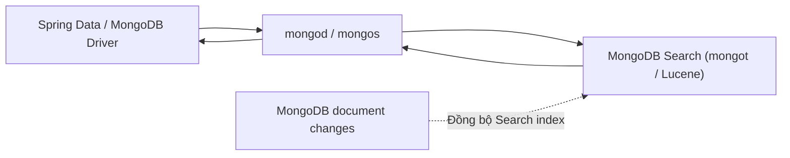
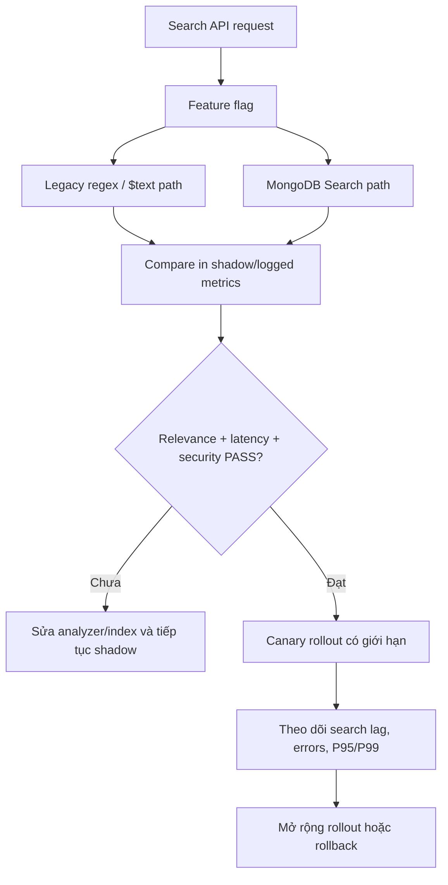
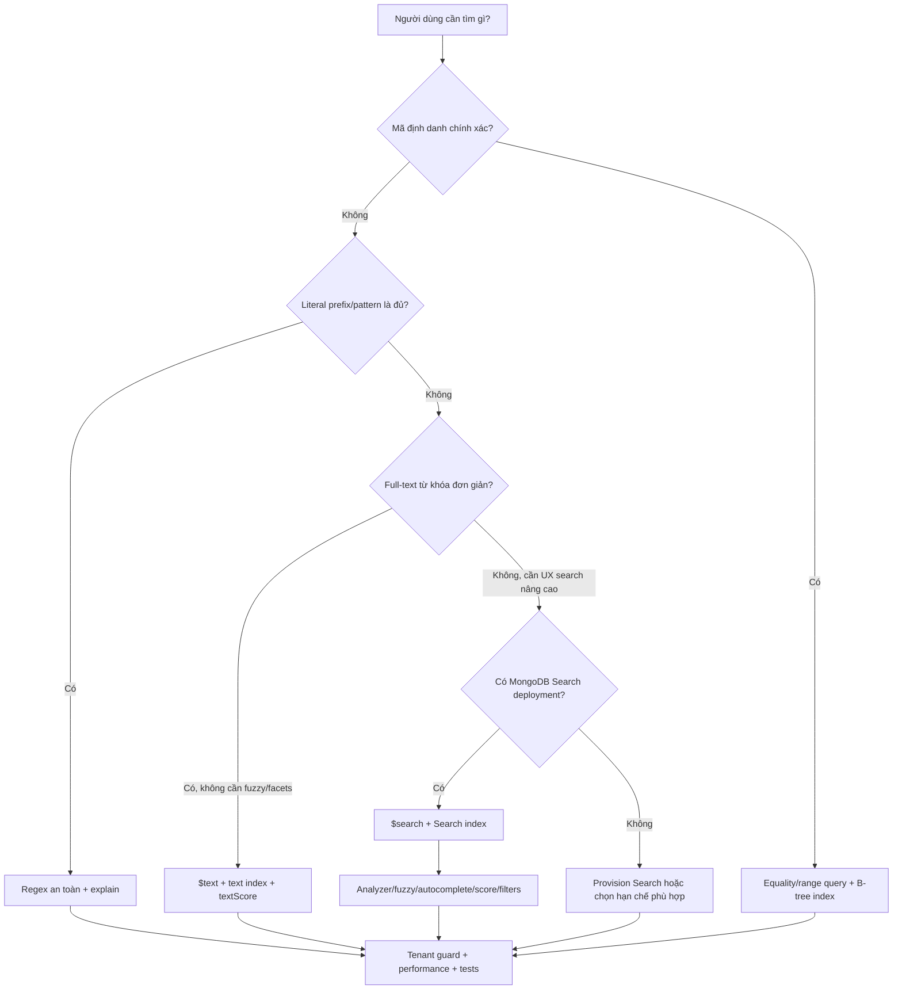

# Phân biệt regex, $text và MongoDB Search trong Spring Data MongoDB

## 1. Một ô tìm kiếm, ba cơ chế rất khác nhau

Ứng dụng Java dùng **Spring Data MongoDB** thường bắt đầu từ một form đơn giản: người dùng nhập `"bàn phím"` và muốn tìm sản phẩm phù hợp. Khi triển khai bằng `MongoTemplate` hoặc repository, đội phát triển có thể cân nhắc:

1. **Regex** – so khớp mẫu ký tự trên giá trị một trường BSON, ví dụ tên bắt đầu bằng `"Bàn"`.
2. **`$text`** – full-text search tích hợp vào MongoDB query, dựa trên **text index** và xử lý từ khóa theo quy tắc ngôn ngữ.
3. **MongoDB Search** – công cụ tìm kiếm Lucene, dùng **Search index** và aggregation stages `$search`/`$searchMeta`, hỗ trợ relevance tuning, autocomplete, fuzzy, facets và các toán tử phức hợp.

Chúng khác nhau ở cả **định nghĩa “match”**, loại chỉ mục, cách chuẩn hóa text, điểm relevance, khả năng mở rộng, vận hành và nhất quán sau write. Không thể chuyển một query regex thành `$text` hoặc `$search` chỉ bằng đổi tên operator rồi kỳ vọng kết quả giống nhau.

Nội dung thuộc chương **Tìm kiếm nâng cao**, trong module **SPRING_DATA_MONGODB**: kết nối và ánh xạ document, truy vấn bằng `MongoTemplate`/repository, aggregation, chỉ mục, reactive access, testing và performance diagnosis. Bài tập trung vào **lựa chọn search mechanism** dựa trên yêu cầu sản phẩm, không lẫn với vector similarity search hay MongoDB Atlas SQL.

### 1.1. Mục tiêu

Sau bài, người học có thể:

- Giải thích sự khác biệt giữa **substring/prefix matching** và **token-based full-text search**.
- Viết và kiểm thử `$regex`, `$text` và `$search` bằng `mongosh`.
- Tạo đúng **B-tree index**, **text index** và **MongoDB Search index** theo từng use case.
- Sử dụng `Criteria.regex(...)`, `TextCriteria`/`TextQuery` và raw `AggregationOperation` trong Spring Data MongoDB.
- Hiểu stemming, stop words, diacritic handling, fuzzy matching, autocomplete và relevance score.
- Tránh regex injection/ReDoS, search index misconfiguration và rò dữ liệu cross-tenant.
- So sánh `explain`, độ trễ P95/P99, index size, freshness và chi phí vận hành.
- Lập kế hoạch migration từ regex hoặc `$text` sang MongoDB Search, có test regression và rollback path.

### 1.2. Bảng so sánh nhanh

| Tiêu chí | MongoDB `$regex` | MongoDB `$text` | MongoDB Search |
|---|---|---|---|
| Ngữ nghĩa chính | So khớp **mẫu ký tự** | So khớp **từ/term** sau text analysis | Truy vấn search index với nhiều operators/analyzers |
| Chạy trong | `find`/`$match`, Criteria | `find` có `$text`, TextQuery | Aggregation `$search`/`$searchMeta` |
| Chỉ mục | B-tree index thường, hữu ích cho một số **anchored prefix** queries | MongoDB **text index** | **Search index** riêng, Lucene-backed |
| Tìm substring | Có thể dùng `.*term.*`; thường tốn chi phí | Không phải substring matching | Dùng analyzer/operator phù hợp, không mặc định là substring |
| Prefix search | Regex `^prefix` | Không phải search-as-you-type | `autocomplete`, `wildcard` hoặc analyzer phù hợp |
| Stemming/stop words | Không tự có | Có theo language của text index/query | Theo analyzer được chọn |
| Fuzzy typo | Không tự có | Không có edit-distance fuzzy | `fuzzy` trên operators hỗ trợ |
| Relevance ranking | Không tự có search score | `textScore` | `searchScore`, boosts, score details |
| Phrase search | Regex literal/biểu thức | Quoted phrase, theo text analyzer | `phrase` operator, analyzer/slop |
| Facets/highlights | Phải tự làm nhiều bước | Hạn chế, không có Search-style facets | Có search facets, highlights |
| Index vận hành | B-tree và query planner | Tối đa **một text index trên mỗi collection** | Có thể nhiều Search indexes, lifecycle riêng |
| Freshness sau write | Theo MongoDB read path/read concern | Theo MongoDB read path/read concern | Search index **được đồng bộ bất đồng bộ**; có lag |
| Điều kiện triển khai | MongoDB cơ bản | MongoDB text index | Deployment có MongoDB Search capability/`mongot` |
| Dùng tốt cho | Pattern/prefix/định danh chuẩn | Full-text cơ bản, hạ tầng đơn giản | Search UX phong phú, ranking/autocomplete |

**Cảnh báo:** Bảng không có nghĩa regex luôn nhanh nhất khi prefix hoặc MongoDB Search luôn nhanh hơn ở mọi query. Performance phụ thuộc selectivity, index, analyzer, cardinality, data volume, pipeline và topology.

## 2. Bộ dữ liệu thực hành thống nhất

### 2.1. Collection products

Ví dụ một trang thương mại điện tử lưu:

```javascript
use shop_search;

db.products.insertMany([
  {
    _id: "P-101",
    tenantId: "T-A",
    name: "Bàn phím Bluetooth cơ học",
    description: "Bàn phím không dây, kết nối Bluetooth",
    category: "accessories",
    price: 1500000,
    active: true
  },
  {
    _id: "P-102",
    tenantId: "T-A",
    name: "Chuột Bluetooth mini",
    description: "Chuột không dây cho laptop",
    category: "accessories",
    price: 450000,
    active: true
  },
  {
    _id: "P-103",
    tenantId: "T-A",
    name: "Cáp USB-C 2 mét",
    description: "Cáp sạc và truyền dữ liệu USB-C",
    category: "cables",
    price: 180000,
    active: true
  },
  {
    _id: "P-104",
    tenantId: "T-A",
    name: "Tai nghe chống ồn",
    description: "Tai nghe Bluetooth có chống ồn chủ động",
    category: "audio",
    price: 2200000,
    active: false
  },
  {
    _id: "P-201",
    tenantId: "T-B",
    name: "Bàn phím Bluetooth cho doanh nghiệp",
    description: "Phụ kiện dành cho một khách hàng khác",
    category: "accessories",
    price: 1100000,
    active: true
  }
]);
```

Toàn bộ bài dùng **tenant T-A** làm phạm vi query hợp lệ. Document `P-201` cố tình thuộc `T-B` để kiểm thử cô lập dữ liệu. Không chạy `insertMany` lặp trên collection đã có các `_id` này; dùng database test cô lập hoặc cleanup có kiểm soát theo ID.

### 2.2. Năm kiểu yêu cầu người dùng khác nhau

| Người dùng nhập/yêu cầu | Ngữ nghĩa cần | Hướng chọn |
|---|---|---|
| Nhập mã bắt đầu bằng `P-10` | Prefix literal trên ID | Regex có anchor hoặc range/index phù hợp |
| Tìm tên chứa chuỗi `Bluetooth` | Literal substring | Regex hoặc cơ chế substring-search được thiết kế |
| Tìm sản phẩm liên quan `bàn phím` | Word-based retrieval | `$text` hoặc MongoDB Search `text` |
| Gõ `blueto` và muốn gợi ý ngay | Autocomplete khi chưa gõ hết từ | MongoDB Search `autocomplete` |
| Gõ sai `bluetoth` và vẫn muốn kết quả | Typo tolerance | MongoDB Search fuzzy operator |

Một ô search trên UI có thể kết hợp nhiều chế độ, nhưng cần **hợp đồng rõ ràng**: exact/prefix match có thể được ưu tiên trước full-text relevance. Không mong một `find` duy nhất tự đáp ứng toàn bộ các đặc tính.

### 2.3. Chú ý dữ liệu tiếng Việt

Tiếng Việt có dấu, nhiều từ ghép bằng khoảng trắng và cách viết không dấu phổ biến. `"bàn phím"`, `"ban phim"` và `"bàn-phím"` **không mặc định tương đương** dưới mọi cơ chế. Một regex với option `i` không tự loại bỏ dấu; text index với `default_language: "none"` không có stemming/stop-word rules cho tiếng Việt; MongoDB Search cần analyzer phù hợp nếu muốn accent folding, synonyms hay custom tokenization.

Phải xây **tập query thực tế** cho tiếng Việt thay vì chỉ demo các từ tiếng Anh như `"running"`/`"runner"`.

## 3. Regex: khớp mẫu ký tự trên BSON string

### 3.1. Cú pháp cơ bản

```javascript
// Tên có chứa "Bluetooth" ở bất kỳ vị trí nào:
db.products.find({
  tenantId: "T-A",
  active: true,
  name: { $regex: "Bluetooth" }
});

// Tên bắt đầu chính xác bằng "Bàn phím":
db.products.find({
  tenantId: "T-A",
  name: { $regex: "^Bàn phím" }
});

// Case-insensitive:
db.products.find({
  tenantId: "T-A",
  name: { $regex: "bluetooth", $options: "i" }
});
```

`$regex` mô tả **pattern**, không phải full-text query. Nếu muốn literal `"USB-C"`, dấu gạch nối có thể an toàn ở ngoài character class, nhưng nhiều ký tự khác như `.`, `+`, `?`, `[`, `(` hoặc `*` có ý nghĩa đặc biệt. Với input từ người dùng, hãy **escape literal**, đừng lấy trực tiếp chuỗi nhập làm một regex program.

### 3.2. Anchors và ý nghĩa khác nhau

| Pattern | Ý nghĩa | Ví dụ có thể match |
|---|---|---|
| `^Bàn` | Bắt đầu string bằng `Bàn` | `Bàn phím Bluetooth` |
| `Bluetooth$` | Kết thúc string bằng `Bluetooth` | `Chuột Bluetooth` |
| `Bluetooth` | Có substring `Bluetooth` ở vị trí nào đó | `Bàn phím Bluetooth cơ học` |
| `^Bluetooth$` | Khớp toàn string `Bluetooth` | Chỉ document có tên đúng như vậy |
| `^Bàn.*Bluetooth` | Bắt đầu `Bàn`, sau đó có `Bluetooth` | `Bàn phím Bluetooth cơ học` |

Regex có thể kiểm tra các pattern nghiệp vụ như prefix code, định dạng hoặc ký tự kết thúc, nhưng không **hiểu nghĩa từ**. `^Blu` không đồng nghĩa với autocomplete search token ở giữa tên.

### 3.3. Index cho anchored prefix

Tạo index:

```javascript
db.products.createIndex(
  { tenantId: 1, name: 1 },
  { name: "ix_tenant_name" }
);

db.products.find({
  tenantId: "T-A",
  name: { $regex: "^Bàn" }
}).explain("executionStats");
```

Một regex **case-sensitive bắt đầu bằng prefix đơn giản** như `^Bàn` có thể tạo index range scan trên `name`; kết hợp equality `tenantId` giúp narrowing. Kiểm tra thực tế bằng `winningPlan`, `totalKeysExamined` và `totalDocsExamined`.

Ngược lại:

```javascript
db.products.find({
  tenantId: "T-A",
  name: { $regex: ".*Bàn.*" }
});
```

không có prefix range hữu ích cho B-tree index trên `name`. MongoDB có thể vẫn dùng phần `tenantId` của compound index rồi scan/filter nhiều keys/docs, nhưng không nên coi đây là một index-accelerated substring search.

### 3.4. Vì sao regex không phải full-text engine?

Regex không cung cấp:

- Full-text tokenization mặc định trên nhiều fields.
- Phân tích stop words/stemming theo ngôn ngữ.
- Relevance ranking kiểu `textScore`/`searchScore`.
- Tự động fuzzy matching khi sai chính tả.
- Facet search và highlights theo search engine.
- Truy vấn semantic similarity.

Có thể kết hợp regex với aggregation và thêm business score thủ công, nhưng khi cần search trải nghiệm phong phú trên tập dữ liệu lớn, độ phức tạp và chi phí thường tăng nhanh.

### 3.5. Case, dấu tiếng Việt và collation

`$options: "i"` là **case-insensitive**, không phải phép “bỏ dấu”:

```text
Bluetooth ≈ bluetooth về chữ hoa/thường
bàn phím ≠ ban phim chỉ vì bật i
```

Regex `i` trong MongoDB cũng **không phải collation-aware** theo cách có thể tận dụng case-insensitive index một cách hiệu quả cho mọi regex. MongoDB docs nêu regex case-insensitive thường không hưởng lợi như equality với collation-aware index. Nếu mục tiêu là **so khớp equality không phân biệt hoa/thường**, cân nhắc equality + collation/index tương ứng thay vì ép qua regex.

Nếu sản phẩm cần tìm `"ban phim"` ra `"bàn phím"`, phải có **normalization policy** hoặc analyzer chuyên dụng được kiểm thử. Đừng chỉ thêm option `i` và tuyên bố accent-insensitive.

## 4. Regex an toàn: không biến user input thành regex program

### 4.1. Regex injection

Một người dùng nhập:

```text
.*
```

nếu đưa thẳng vào:

```java
Criteria.where("name").regex(userInput);
```

thì đây là **pattern** khớp gần như mọi tên, không phải tìm sản phẩm có hai ký tự literal `.*`. Input `^`, `(a+)+`, backreference hoặc lookaround cũng có thể thay đổi semantics và chi phí thực thi.

Hãy quyết định API cho phép **ngôn ngữ regex** hay chỉ cho phép **literal text search**. Phần lớn search box công khai cần literal user input, không phải một regex playground.

### 4.2. Escape literal với Pattern.quote

```java
import java.util.regex.Pattern;
import org.springframework.data.mongodb.core.query.Criteria;
import org.springframework.data.mongodb.core.query.Query;

public Query findLiteralNameSubstring(
        String authenticatedTenantId,
        String rawInput) {
    if (rawInput == null || rawInput.isBlank()
            || rawInput.length() > 80) {
        throw new IllegalArgumentException(
            "Search term must contain 1..80 characters");
    }

    String literal = Pattern.quote(rawInput.trim());

    return Query.query(
        Criteria.where("tenantId").is(authenticatedTenantId)
            .and("active").is(true)
            .and("name").regex(Pattern.compile(literal)));
}
```

`Pattern.quote(...)` tạo pattern để các ký tự đặc biệt được hiểu là **literal**. Với Java Driver dùng PCRE2 bên MongoDB, Java Pattern syntax được chuyển thành regex pattern; hầu hết patterns thông thường hoạt động, nhưng **không** được giả định mọi Java regex feature đều tương đương 100% với server PCRE2.

Đoạn trên **không** biến substring regex thành query nhanh: nó chỉ làm đúng **semantics và tránh regex injection**. Index/performance vẫn phải kiểm tra.

### 4.3. Prefix literal có giới hạn

```java
public Query findNamePrefix(
        String authenticatedTenantId,
        String prefix) {
    if (prefix == null || prefix.isBlank()
            || prefix.length() > 64) {
        throw new IllegalArgumentException("Invalid prefix");
    }

    String regex = "^" + Pattern.quote(prefix.trim());
    return Query.query(
        Criteria.where("tenantId").is(authenticatedTenantId)
            .and("name").regex(Pattern.compile(regex)));
}
```

Lưu ý: `Pattern.quote` có thể biểu diễn literal bằng `\\Q...\\E`. Một pattern có anchor nhưng phần literal được bọc trong quoting construct có thể **không được MongoDB optimizer nhận diện như simple prefix expression để tạo index bound tối ưu**. Do đó sau khi escape đúng, **bắt buộc kiểm tra `explain`**; nếu cần prefix index chắc chắn và input được giới hạn theo một tập ký tự an toàn, có thể dùng normalized shadow field + range strategy hoặc thiết kế index riêng.

### 4.4. Regular expression denial of service

Các pattern có backtracking phức tạp có thể tiêu tốn CPU bất thường trên dữ liệu lớn. Nếu API thật sự cho phép user-provided regex:

- Giới hạn kích thước pattern và đối tượng được tìm.
- Giới hạn phạm vi tenant và field được phép search.
- Đặt query `maxTimeMS` hoặc timeout ở tầng Spring Data.
- Không cho query scan toàn collection chỉ vì user nhập pattern tùy ý.
- Giám sát P95/P99, scanned keys/docs và số timeout.
- Xem xét **không hỗ trợ regex tùy ý** trên endpoint public.

Query timeout không thể thay thế index design. Một regex rất đắt có thể làm tài nguyên database cạn trước khi request bị timeout, nhất là khi nhiều requests cùng chạy.

## 5. Spring Data MongoDB: regex bằng Criteria và Query

### 5.1. Query mẫu

```java
import java.util.regex.Pattern;
import org.springframework.data.mongodb.core.MongoTemplate;
import org.springframework.data.mongodb.core.query.Criteria;
import org.springframework.data.mongodb.core.query.Query;

public class RegexProductSearch {
    private final MongoTemplate mongoTemplate;

    public RegexProductSearch(MongoTemplate mongoTemplate) {
        this.mongoTemplate = mongoTemplate;
    }

    public java.util.List<ProductDocument> byExactPrefix(
            String trustedTenantId, String prefix) {
        String safe = Pattern.quote(prefix);
        Query query = Query.query(
            Criteria.where("tenantId").is(trustedTenantId)
                .and("active").is(true)
                .and("name").regex(
                    Pattern.compile("^" + safe)));

        query.limit(20);
        query.maxTime(java.time.Duration.ofSeconds(2));
        return mongoTemplate.find(
            query, ProductDocument.class);
    }
}
```

`ProductDocument` được định nghĩa ở mục 13. Đoạn này tập trung vào API Spring Data; production cần thêm validation độ dài, xác thực tenant, sort ổn định và structured error handling. `Query.maxTime(Duration)` dùng tùy chọn timeout server hỗ trợ trong phiên bản Spring Data tương ứng.

### 5.2. Query case-insensitive

```java
Query query = Query.query(
    Criteria.where("tenantId").is(trustedTenantId)
        .and("name").regex(
            Pattern.compile(
                Pattern.quote(userTerm),
                Pattern.CASE_INSENSITIVE)));
```

**Không** kỳ vọng regex case-insensitive này dùng compound index hiệu quả giống exact case-sensitive prefix. Nếu mục tiêu là search UX accent-insensitive, hãy đánh giá MongoDB Search analyzer hoặc một shadow field đã normalize và được index.

### 5.3. Reactive API

```java
import reactor.core.publisher.Flux;

public Flux<ProductDocument> prefixReactive(
        String trustedTenantId, String prefix) {
    Query q = Query.query(
        Criteria.where("tenantId").is(trustedTenantId)
            .and("name").regex(
                Pattern.compile("^" + Pattern.quote(prefix))));
    q.limit(20);
    return reactiveMongoTemplate.find(
        q, ProductDocument.class);
}
```

`reactiveMongoTemplate` là dependency của service (kiểu `ReactiveMongoTemplate`). Reactive không đổi semantics hay indexability của `$regex`; chỉ đổi model I/O. Đừng gọi `block()` trong WebFlux request để biến Flux thành List, hoặc `subscribe()` bên trong service rồi trả response trước khi query hoàn tất.

### 5.4. Pagination cần sort rõ ràng

Nếu search trả nhiều kết quả, không dùng:

```java
query.skip(100000).limit(20);
```

mà không đo cost. Skip sâu buộc engine bỏ qua lượng lớn kết quả; regex scan/Sort sẽ càng tốn. Dùng sort ổn định và keyset pagination khi phù hợp. Với search relevance, MongoDB Search hỗ trợ cơ chế sequence tokens/searchAfter trong những tình huống tương ứng; không thay bằng `skip` vô hạn mà không benchmark.

### 5.5. Không lấy regex để dò dữ liệu nhạy cảm toàn collection

Search query phải có tenant/authorization predicate được tính từ **security context**, không phải string `tenantId` do client tự truyền mà không kiểm tra. Khi cần bảo vệ dữ liệu quan trọng, chỉ giới hạn query ở repository/service là chưa đủ; còn phải kiểm tra quyền database/field và các writer/read paths khác.

## 6. $text: full-text search tích hợp trên MongoDB text index

### 6.1. Vì sao $text khác regex?

`$text` không tìm một substring ký tự tùy ý. MongoDB **tokenize** nội dung được index thành các từ, loại stop words và áp dụng stemming theo ngôn ngữ được cấu hình. Query so khớp những **term** đó, không phải regex pattern.

Ví dụ với index dùng rules tiếng Anh, một số dạng số ít/số nhiều hoặc dạng từ có thể được stem về cùng gốc. Nhưng `"blue"` **không mặc định khớp** `"blueberry"` chỉ vì là prefix ký tự. Tương tự một người gõ `"Bluet"` chưa thể coi `$text` là autocomplete.

### 6.2. Tạo text index trên nhiều fields

Trong database thực hành:

```javascript
db.products.createIndex(
  {
    name: "text",
    description: "text"
  },
  {
    name: "ix_product_text",
    default_language: "none",
    weights: {
      name: 10,
      description: 2
    }
  }
);
```

Ý nghĩa:

- Index lấy term từ `name` và `description`.
- `weights` tăng ảnh hưởng của match ở tên sản phẩm so với mô tả khi tính `textScore`.
- `default_language: "none"` tắt stemming và stop-word removal theo ngôn ngữ; phù hợp làm **baseline giản lược** cho tập từ tiếng Việt, nhưng không tạo một Vietnamese analyzer đầy đủ.
- `name: "ix_product_text"` là tên index giúp kiểm tra `getIndexes()` và quản trị migration.

Một collection chỉ có **tối đa một MongoDB text index**. Nếu cần thêm trường text, có thể điều chỉnh/rebuild cấu hình text index hoặc dùng MongoDB Search để quản lý nhiều Search indexes; không thể chỉ tạo vô hạn text indexes khác nhau trên cùng collection.

### 6.3. Query $text

```javascript
db.products.find({
  tenantId: "T-A",
  active: true,
  $text: { $search: "Bluetooth" }
});
```

Không cần viết regex vào `$text`. Đối với `$search: "Bluetooth"`, MongoDB tìm term qua text index; không phải duyệt toàn string và tìm chữ `B` bắt đầu ở vị trí nào.

Nếu muốn chỉ tìm trong `name` mà bỏ qua `description`, index text tổng hợp của `$text` **không hỗ trợ chọn một path khác nhau trong mỗi query giống MongoDB Search `text.path`**. Điều này là khác biệt lớn khi thiết kế search product features.

### 6.4. Text query phải có text index

```javascript
// Kiểm tra index:
db.products.getIndexes();

// Nếu không có text index được hỗ trợ, $text không tự
// chuyển thành regex scan và có thể báo lỗi index required.
db.products.find({
  $text: { $search: "Bluetooth" }
});
```

MongoDB không sử dụng một index B-tree thường trên `name` thay cho text index khi xử lý `$text`. Hai loại index có cấu trúc và query semantics khác nhau.

### 6.5. Default language là một quyết định dữ liệu

Nếu không chỉ định gì, text index thường mặc định `english` với stop words/stemming tiếng Anh. Khi index văn bản tiếng Việt mà không để ý:

- Những từ trùng stop words tiếng Anh có thể bị loại theo rules index.
- Stemming không phản ánh cấu trúc tiếng Việt.
- Kết quả khi người dùng nhập có dấu/không dấu có thể khác mong đợi.

`default_language: "none"` loại bỏ stemming/stop words, **không** tự giải quyết tách từ tiếng Việt hoặc khả năng tìm không dấu. Nếu cần phân tích tiếng Việt chuyên sâu, kiểm tra support của MongoDB Search custom analyzers/token filters, hoặc một search pipeline ngoài MongoDB nếu đặc thù NLP quá cao.

## 7. $text: OR, phrase, negation, score và các giới hạn

### 7.1. Nhiều từ mặc định là OR

```javascript
db.products.find({
  tenantId: "T-A",
  $text: { $search: "Bluetooth cáp" }
});
```

Trong ngữ nghĩa mặc định của `$text`, các term thường được kết hợp **logical OR**: có term tương ứng là có thể match. **Đừng hiểu nhiều từ cách nhau bằng dấu cách là AND mặc định.**

Nếu sản phẩm yêu cầu **phải có tất cả từ**, dùng một search mechanism/query được thiết kế cho AND semantics, hoặc các điều kiện bổ sung có ràng buộc chính xác. MongoDB Search `compound.must` hỗ trợ điều đó rõ ràng hơn.

### 7.2. Phrase dùng dấu nháy kép trong search expression

```javascript
db.products.find({
  $text: { $search: '"bàn phím"' }
});
```

Ở đây string input `'"bàn phím"'` chứa dấu nháy kép **bên trong** để yêu cầu matching theo phrase semantics của text query. Nó khác với:

```javascript
db.products.find({
  $text: { $search: "bàn phím" }
});
```

trong đó các terms có thể match theo OR. Phrase matching vẫn phụ thuộc text tokenization, language rules và normalization; không nên coi nó tuyệt đối tương đương một regex substring trên raw BSON.

### 7.3. Negation với dấu trừ

```javascript
db.products.find({
  $text: { $search: "Bluetooth -chuột" }
});
```

Query tìm các documents match term `Bluetooth` nhưng loại tài liệu chứa term bị phủ định `chuột` theo text search semantics. Dấu trừ là một phần syntax `$text`, không phải Java string escaping.

Chú ý:

- Một query chỉ chứa negated terms không tự trả mọi document trừ term đó; MongoDB `$text` không dùng như wildcard negative scan.
- Các chuỗi có gạch nối trong nội dung có thể được tokenizer xử lý khác với một dấu trừ làm query negation.
- Input đến từ UI phải được xác định rõ: người dùng có chủ ý gõ ngôn ngữ tìm kiếm nâng cao hay chỉ là văn bản literal?

### 7.4. Score bằng $meta: "textScore"

```javascript
db.products.find(
  {
    tenantId: "T-A",
    active: true,
    $text: { $search: "Bluetooth" }
  },
  {
    name: 1,
    category: 1,
    score: { $meta: "textScore" }
  }
).sort({
  score: { $meta: "textScore" },
  _id: 1
});
```

`textScore` là điểm đánh giá liên quan theo MongoDB text-index scoring. Nếu không sort theo score, không mặc định kết quả `$text` được xếp hạng từ phù hợp nhất xuống thấp nhất.

**Score không phải xác suất.** `score=3.5` không có nghĩa có 35% hoặc 3,5 lần khả năng “đúng” của search query khác. Mức điểm phụ thuộc query, corpus/index weights và cách tính; thường chỉ dùng để sắp xếp **các documents trong cùng một truy vấn**.

### 7.5. Case và diacritic sensitivity

```javascript
db.products.find({
  $text: {
    $search: "Bluetooth",
    $caseSensitive: false,
    $diacriticSensitive: false
  }
});
```

Các flag điều chỉnh matching theo hành vi của text index version/language. Chúng **không biến MongoDB $text thành một Vietnamese semantic analyzer** và không sửa được mọi vấn đề tách từ/normalization. Với tiếng Việt, hãy test `"bàn"` vs `"ban"`, ký tự Unicode NFC/NFD, dấu nối, danh từ ghép và từ viết tắt.

### 7.6. Những giới hạn phải nhớ

| Giới hạn | Hệ quả thiết kế |
|---|---|
| Một text index trên collection | Khó có nhiều bộ analyzer/weights khác nhau |
| `$text` yêu cầu text index | B-tree index đơn thuần không thay thế |
| `$text` không phải prefix/substring search | Search-as-you-type kém phù hợp |
| `hint()` không áp được tùy ý với `$text` | Không “ép index” kiểu query thường |
| Text index thêm chi phí write/index storage | Không tạo mọi field thành text vô điều kiện |
| Scoring giới hạn so với MongoDB Search | Không có nhiều boosts/fuzzy/highlights/facets linh hoạt |
| Stemming/stop words theo language | Text index `none` không tự giải quyết tiếng Việt |
| Text index không tự tối ưu sort kết quả theo trường bất kỳ | Cần kiểm tra sort cost và query plan |
| Một số kết hợp special indexes/operators bị hạn chế | Cần kiểm tra `$near`, geospatial, sort và compound index rules |

### 7.7. Compound text index và tenant filtering

MongoDB hỗ trợ compound text indexes có phần key bình thường:

```javascript
// Ví dụ thay thế index text hiện tại, KHÔNG tạo đồng thời
// nếu collection đã có ix_product_text.
db.products.createIndex(
  { tenantId: 1, name: "text", description: "text" },
  { default_language: "none" }
);
```

Với một compound text index có **prefix key** `tenantId`, query muốn tận dụng text index cần có equality predicate phù hợp trên prefix key; đây vừa là cơ hội tối ưu khi tenant-scoped, vừa là ràng buộc khiến những query global search khác phải được thiết kế riêng.

**Không chạy hai `createIndex` text examples liên tiếp** trên cùng collection rồi kỳ vọng cả hai tồn tại: cần chọn một definition hoặc drop/rebuild index theo migration plan. Tạo index production cần kiểm tra kích thước, build window và hoạt động của ứng dụng khi index đang thay đổi.

## 8. Spring Data MongoDB: TextCriteria, TextQuery và textScore

### 8.1. TextCriteria biểu diễn $text, không phải MongoDB Search

```java
import java.util.List;
import org.bson.Document;
import org.springframework.data.mongodb.core.MongoTemplate;
import org.springframework.data.mongodb.core.query.Criteria;
import org.springframework.data.mongodb.core.query.TextCriteria;
import org.springframework.data.mongodb.core.query.TextQuery;

public class TextProductSearch {
    private final MongoTemplate template;

    public TextProductSearch(MongoTemplate template) {
        this.template = template;
    }

    public List<Document> search(
            String trustedTenantId, String term) {
        TextCriteria terms =
            new TextCriteria().matching(term);

        TextQuery query = TextQuery.queryText(terms)
            .sortByScore()
            .includeScore();

        query.addCriteria(
            Criteria.where("tenantId").is(trustedTenantId)
                .and("active").is(true));
        query.limit(20);

        return template.find(
            query, Document.class, "products");
    }
}
```

`TextCriteria`/`TextQuery` sinh truy vấn **`$text`** và textScore của **MongoDB text index**, **không** sinh một `$search` stage. Cần đã tạo index text tương ứng trong collection.

Ở ví dụ này dùng `Document.class` để dễ quan sát field `score`. Khi dùng typed DTO/domain, cần mapping score/meta rõ ràng; đừng mặc định một field `score` tự có mặt trong entity nếu chưa khai báo hoặc query chưa include score.

### 8.2. Phrase và excluded terms

```java
TextCriteria phrase = new TextCriteria()
    .phrase("bàn phím");

TextCriteria includeExclude = new TextCriteria()
    .matching("Bluetooth")
    .notMatching("chuột");

TextQuery q1 = TextQuery.queryText(phrase);
TextQuery q2 = TextQuery.queryText(includeExclude)
    .sortByScore();
```

`TextCriteria.phrase(...)` và `notMatching(...)` giúp thể hiện intent thay vì tự ghép dấu nháy/trừ trong một string. Hãy kiểm tra serialized query khi debug, nhất là khi dùng nhiều dấu/cụm tiếng Việt.

### 8.3. matchingAny và ngữ nghĩa OR

```java
TextCriteria any = new TextCriteria()
    .matchingAny("Bluetooth", "cáp");

TextQuery query = TextQuery.queryText(any);
```

Ở đây `matchingAny` phù hợp với OR semantics. Không dùng nó khi yêu cầu UI nói “phải có tất cả từ”. MongoDB Search `compound.must` có ngữ nghĩa dễ kiểm soát hơn cho AND/multi-constraint full-text.

### 8.4. ReactiveMongoTemplate với TextQuery

```java
import reactor.core.publisher.Flux;

public Flux<Document> searchReactive(
        String trustedTenantId, String text) {
    TextQuery q = TextQuery.queryText(
            new TextCriteria().matching(text))
        .sortByScore()
        .includeScore();
    q.addCriteria(
        Criteria.where("tenantId").is(trustedTenantId));
    q.limit(20);

    return reactiveMongoTemplate.find(
        q, Document.class, "products");
}
```

`reactiveMongoTemplate` là bean của service. Reactive query trả Flux và vẫn dùng **MongoDB text index**, không tự kết nối đến `mongot` hoặc tạo Search index.

### 8.5. Repository @TextScore / derived methods cần test đường query

Spring Data MongoDB có các cơ chế hỗ trợ full-text queries ở repository và ánh xạ text score (tùy version/API). Nhưng không nên tự giả định một derived repository method dạng `findByNameContains(...)` sẽ biến thành `$text` hoặc `$search`:

- `Containing`/`Regex` derived queries thường dùng regex/matching semantics của repository query derivation.
- `TextCriteria`/`TextQuery` dùng text-index semantics.
- `$search` dùng aggregation stage với Search index.

Khi codebase dùng nhiều loại search, nên đặt tên service methods rõ ràng như `findByNamePrefix`, `searchByTextTerms`, `searchByRelevance` thay vì chung chung `search` để team không vô tình thay đổi hợp đồng mà không biết.

## 9. MongoDB Search là gì và triển khai ở đâu?

### 9.1. Search index khác text index

MongoDB Search dùng **Apache Lucene** trong thành phần Search `mongot`. Nó duy trì **Search index** tách với B-tree/text indexes thường của `mongod`, đồng bộ document changes để phục vụ các truy vấn như:

- Text relevance scoring có thể điều chỉnh.
- Fuzzy matching khi người dùng gõ sai.
- Autocomplete và wildcard/regex search qua **Search-specific operators**.
- Phrase queries, highlights/snippets.
- Compound conditions: `must`, `should`, `filter`, `mustNot`.
- Numeric/date/range, facets và metadata counts theo index mappings.



**Hệ quả kiến trúc:** Search index được đồng bộ **bất đồng bộ** và có thể stale một khoảng thời gian sau khi một document thay đổi. Không dùng một kết quả tìm kiếm chưa thấy document mới để khẳng định write thất bại, cũng không coi Search index là source of truth thay cho MongoDB document trong các quyết định tài chính/bảo mật.

### 9.2. Không còn chỉ có Atlas

Tên cũ **Atlas Search** vẫn gặp trong tài liệu/SDK. Tài liệu MongoDB hiện hành gọi chung là **MongoDB Search**. Về deployment:

- **MongoDB Atlas**: Atlas quản lý Search service/`mongot` và index lifecycle.
- **MongoDB Community 8.2 trở lên**: có thể triển khai Search bằng `mongot` theo điều kiện của sản phẩm, cần tự quản lý.
- **MongoDB Enterprise 8.2 trở lên với Kubernetes Operator**: có lựa chọn self-managed Search theo điều kiện được tài liệu chính thức liệt kê.
- **Atlas local** có thể phục vụ thử nghiệm/dev; không mặc định thay cho production HA cluster.

Các khả năng, điều kiện hỗ trợ và vận hành self-managed còn phụ thuộc phiên bản/edition/topology. **Không** suy rằng mọi MongoDB standalone cũ chỉ cần thêm một `$search` stage là chạy được.

Tham chiếu: [MongoDB Search deployment options](https://www.mongodb.com/docs/search/deployment/deployment-options/) và [Self-managed MongoDB Search](https://www.mongodb.com/docs/search/self-managed/current/).

### 9.3. $search là aggregation stage, không phải $text alias

```javascript
db.products.aggregate([
  {
    $search: {
      index: "products_search",
      text: {
        query: "Bluetooth",
        path: ["name", "description"]
      }
    }
  },
  { $limit: 10 }
]);
```

`$search` phải là **stage đầu tiên** của aggregation pipeline nơi nó xuất hiện theo quy định tương ứng; không đặt `$match` trước nó rồi kỳ vọng query vẫn chạy:

```javascript
// SAI: $search không ở stage đầu tiên.
db.products.aggregate([
  { $match: { tenantId: "T-A" } },
  { $search: { text: { query: "Bluetooth", path: "name" } } }
]);
```

Để lọc tenant và business constraints hiệu quả, dùng `compound.filter` trong `$search` nếu field được Search index mapping phù hợp. `$searchMeta` cũng phải là stage đầu của pipeline tương ứng.

### 9.4. Không nhầm $search với $vectorSearch

`$search` có thể hỗ trợ lexical/text search, fuzzy, autocomplete, filters và Search score. `$vectorSearch` là pipeline stage cho vector similarity theo index/cơ chế liên quan. Dù có thể xây **hybrid search**, đó là một thiết kế riêng với fusion/ranking và test. Không gọi `$text`, `$search` và `$vectorSearch` là các chế độ giống nhau.

## 10. Tạo Search index với mappings tường minh

### 10.1. Search index thử nghiệm trên products

Trên deployment đã có MongoDB Search capability và collection `products`:

```javascript
db.products.createSearchIndex(
  "products_search",
  {
    mappings: {
      dynamic: false,
      fields: {
        name: {
          type: "string",
          analyzer: "lucene.standard"
        },
        description: {
          type: "string",
          analyzer: "lucene.standard"
        },
        tenantId: {
          type: "token"
        },
        category: {
          type: "token"
        },
        active: {
          type: "boolean"
        },
        price: {
          type: "number"
        }
      }
    }
  }
);
```

Giải thích:

- `dynamic: false` chỉ index các fields khai báo; giảm chi phí và tránh vô tình index nhạy cảm fields được thêm sau này.
- `string` mapping trên `name` và `description` phục vụ text operator/analyzer.
- `token` mapping trên `tenantId` và `category` dùng cho exact string `equals`/facets/sorting; không tokenizing thành các từ.
- `boolean` cho `active` và `number` cho `price` phục vụ filter/range.
- `index: "products_search"` trong query **phải đúng tên Search index**, không phải tên B-tree/text index của `createIndex`.

Search index definition **không giống**:

```javascript
db.products.createIndex({ name: "text" });
```

`createSearchIndex` tạo chỉ mục chuyên biệt cho MongoDB Search; `createIndex` với `"text"` tạo text index thường phục vụ `$text`.

### 10.2. Vì sao dùng token cho tenantId?

Trường `tenantId = "T-A"` cần so sánh **exact**, không cần tokenization kiểu full text. `type: "token"` cho phép Search `equals` trên string. Nếu chỉ map `tenantId` thành `string` được phân tích thành terms, các truy vấn exact có thể không có semantics mong muốn hoặc bị operator từ chối.

`token` có thể áp `normalizer` như `lowercase` khi cần, nhưng với ID/tenant identifiers tốt nhất chọn **canonical value** bất biến và exact comparison; đừng vô tình biến tenant ID case-sensitive thành case-insensitive nếu thiết kế quyền không cho phép.

### 10.3. Kiểm tra trạng thái index trước khi query

```javascript
db.products.getSearchIndexes("products_search");
```

Tạo Search index có thể mất thời gian vì cần build dữ liệu. Không chạy test query rồi kết luận Search “không có kết quả” khi index đang building/syncing. Kiểm tra trạng thái `queryable`/trạng thái index theo API/server version; xây readiness check trong CI nếu test thực sự cần Search.

Khi thay Search index definition, hệ thống có thể rebuild ở background. Cần theo dõi tiến độ, query latency, index version, tài nguyên `mongot` và các tính năng thay đổi khi rollout.

### 10.4. Mapping tĩnh hỗ trợ kiểm soát chi phí

`dynamic: true` giúp thử nghiệm nhanh, nhưng có thể index fields không cần cho search khi schema phát triển và làm phình storage/search overhead. Với production:

1. Chỉ định những fields UI cần.
2. Chọn đúng kiểu `string`, `autocomplete`, `token`, `number`, `date`, `boolean`.
3. Không index token, password hash, access key, raw PII.
4. Xác định analyzer cho từng field.
5. Review index definition như một artifact được version-control/triển khai có migration.

### 10.5. Có thể dùng nhiều Search indexes

Khác với giới hạn **một text index mỗi collection** của `$text`, MongoDB Search cho phép nhiều Search indexes cùng collection. Ví dụ một index cho product search, một index tách cho autocomplete hoặc thử nghiệm analyzer mới.

Đổi lại là **tài nguyên/chi phí**: nhiều indexes sẽ dùng thêm storage, thời gian xây index, đồng bộ và năng lực Search nodes. Không tạo một index cho mỗi request/tenant tùy ý.

## 11. $search text + compound.filter: relevance đi cùng an toàn tenant

### 11.1. Query có filter tenant và active

```javascript
db.products.aggregate([
  {
    $search: {
      index: "products_search",
      compound: {
        must: [
          {
            text: {
              query: "Bluetooth",
              path: ["name", "description"]
            }
          }
        ],
        filter: [
          { equals: { path: "tenantId", value: "T-A" } },
          { equals: { path: "active", value: true } }
        ]
      }
    }
  },
  {
    $project: {
      _id: 1,
      name: 1,
      category: 1,
      price: 1,
      score: { $meta: "searchScore" }
    }
  },
  { $limit: 20 }
]);
```

Điểm cần nhớ:

- `compound.must`: điều kiện phải match và đóng góp vào relevance score.
- `compound.filter`: điều kiện **bắt buộc**, nhưng **không góp score**, thích hợp cho tenant, active, numeric ranges.
- `searchScore`: metadata cho Search relevance, **khác** `textScore` của `$text`.
- `$project`: giới hạn fields trả về, tránh expose mô tả nhạy cảm.
- `$limit`: bảo vệ endpoint khỏi trả kết quả không giới hạn.

Lọc `tenantId` từ trusted/authenticated context **không tự động giải quyết authorization toàn hệ thống**, nhưng là một lớp không thể bỏ qua trong query design. Không tin tenant ID do client gửi lên mà không có validation/authorization.

### 11.2. must, should, filter và mustNot

| Clause | Ý nghĩa |
|---|---|
| `must` | Mọi điều kiện trong mảng phải match; các score thường cộng vào relevance |
| `should` | Tùy chọn/ưu tiên match; có thể yêu cầu số lượng tối thiểu qua `minimumShouldMatch` |
| `filter` | Mọi điều kiện trong mảng phải match; không góp relevance score |
| `mustNot` | Loại documents match điều kiện phủ định |

Ví dụ tăng ưu tiên các tên sản phẩm có `Bluetooth`:

```javascript
db.products.aggregate([
  {
    $search: {
      index: "products_search",
      compound: {
        must: [
          {
            text: {
              query: "Bluetooth",
              path: ["name", "description"]
            }
          }
        ],
        should: [
          {
            text: {
              query: "Bluetooth",
              path: "name",
              score: { boost: { value: 3 } }
            }
          }
        ],
        filter: [
          { equals: { path: "tenantId", value: "T-A" } },
          { equals: { path: "active", value: true } }
        ]
      }
    }
  },
  { $limit: 10 }
]);
```

`should` ở đây là **boosting signal**, không phải một quyền cho phép bypass `must` hoặc `filter`. Khi một `compound` chỉ có `should` mà không có `must`/`filter`, ngữ nghĩa số lượng matches tối thiểu phải được cấu hình/thẩm định theo MongoDB Search `compound` rules.

### 11.3. Text query có nhiều path

```javascript
text: {
  query: ["Bluetooth", "bàn phím"],
  path: ["name", "description"]
}
```

`text.query` có thể nhận string hoặc mảng strings theo operator contract, nhưng semantics “bắt buộc đủ hai từ”, “cụm nguyên văn” và “mỗi từ ở một path khác nhau” cần **biểu diễn rõ** bằng `compound.must`, `phrase` hoặc các operators khác. Không lấy array input làm lời đảm bảo AND tất cả điều kiện.

### 11.4. Lọc bằng Search index trước khi fetch documents

Một số code đặt:

```javascript
[
  { $search: { index: "products_search", text: {
      query: "Bluetooth", path: "name" } } },
  { $limit: 20 },
  { $match: { tenantId: "T-A" } }
]
```

Đây là một **anti-pattern** nếu kỳ vọng có 20 results của tenant T-A: `$limit` có thể lấy top 20 toàn cluster rồi `$match` chỉ còn vài kết quả. Nếu pagination đếm/score cũng dựa vào search result toàn tenant, semantics sai và có nguy cơ side-channel leakage theo ranking.

Đưa filter tenant **vào trong `$search.compound.filter`** với Search index mapping chính xác. Có thể bổ sung `$match` sau `$search` để defense in depth, nhưng không thay thế query authorization/filter khi tạo candidate set.

### 11.5. Filter theo giá và category

```javascript
db.products.aggregate([
  {
    $search: {
      index: "products_search",
      compound: {
        must: [
          { text: { query: "Bluetooth", path: "name" } }
        ],
        filter: [
          { equals: { path: "tenantId", value: "T-A" } },
          { equals: { path: "active", value: true } },
          { equals: { path: "category", value: "accessories" } },
          {
            range: {
              path: "price",
              gte: 300000,
              lte: 2000000
            }
          }
        ]
      }
    }
  },
  { $limit: 20 }
]);
```

Các fields `tenantId`/`category` cần `token` mapping và `price` cần `number` mapping. Một `text` path hoặc `range` field không có mapping thích hợp có thể báo lỗi hoặc không match như mong đợi.

## 12. Score trong MongoDB Search: không giống textScore

### 12.1. Mặc định kết quả thường được xếp theo relevance

MongoDB Search xác định `searchScore` cho các documents match và mặc định trả kết quả theo relevance. Bạn vẫn nên có **quy tắc sort và tie-breaking rõ** khi phân trang, và nên kiểm tra tác động của score boosts/thay đổi analyzer.

```javascript
db.products.aggregate([
  {
    $search: {
      index: "products_search",
      text: {
        query: "Bluetooth",
        path: ["name", "description"]
      }
    }
  },
  {
    $project: {
      name: 1,
      score: { $meta: "searchScore" }
    }
  },
  { $limit: 10 }
]);
```

Không dùng:

```javascript
score: { $meta: "textScore" }
```

trong một pipeline `$search` rồi khẳng định đó là MongoDB Search relevance. `textScore` của `$text` và `searchScore` của `$search` là **hai metadata khác nhau**.

### 12.2. Score boosts và quality signals

Business có thể muốn:

- Tên match quan trọng hơn mô tả.
- Sản phẩm còn hàng xếp trước nếu relevance tương đương.
- SKU match exact hơn keyword fuzzy.
- Sản phẩm bị ẩn/không active phải bị loại hoàn toàn.

Thiết kế thường kết hợp **search relevance** với **business ranking**. Dùng `score.boost`, `compound.should` hoặc search score functions tùy operator/index. Tránh hardcode score như một xác suất hay phân tích một score từ nhiều queries khác nhau.

### 12.3. Debug scoreDetails

```javascript
db.products.aggregate([
  {
    $search: {
      index: "products_search",
      text: { query: "Bluetooth", path: "name" },
      scoreDetails: true
    }
  },
  {
    $project: {
      name: 1,
      score: { $meta: "searchScore" },
      details: { $meta: "searchScoreDetails" }
    }
  },
  { $limit: 5 }
]);
```

`scoreDetails` hữu ích để điều tra lý do một document rank cao/thấp, nhưng có thể tăng response size/chi phí và không nên bật vô điều kiện trong API public. Search scoring algorithm có thể thay đổi theo operator/index/version; dùng regression search fixtures, không đóng đinh điểm số tuyệt đối.

### 12.4. Score không phải authorization

Một document có score rất cao nhưng thuộc tenant khác **không được trả**. Cấm lấy top-ranked results trước, rồi chỉ che field nhạy cảm ở serialization; entity existence, counts và relevance vẫn có thể tiết lộ thông tin.

Thực hiện quyền lọc/tenancy trong candidate selection và verify authorization tại lớp service/security. Search result chỉ hỗ trợ tìm **ứng viên**, không tự chứng minh người dùng được thực hiện mutation trên document đó.

## 13. Autocomplete, fuzzy và search-as-you-type

### 13.1. Autocomplete không phải một regex có dấu *

Người dùng gõ `"blue"` và kỳ vọng gợi ý `"Bluetooth"` khi chưa nhập hết từ. Có thể viết regex `"^Blue"` cho field bắt đầu bằng từ đó, nhưng nếu tên là `"Bàn phím Bluetooth"` thì prefix của **field** không phải prefix của **token Bluetooth**. Search autocomplete dựa trên analysis/indexing tokens, không đơn giản dùng anchor đầu string.

Một Search index dùng `autocomplete` field type được thiết kế để phục vụ hành vi này. Để dùng text search và autocomplete trên cùng field `name`, có thể định nghĩa nhiều mappings types cho field đó trong **một Search index**.

### 13.2. Index autocomplete

Ví dụ tạo **Search index riêng** để không thay đổi `products_search` ở mục 10:

```javascript
db.products.createSearchIndex(
  "products_autocomplete",
  {
    mappings: {
      dynamic: false,
      fields: {
        name: [
          { type: "string" },
          {
            type: "autocomplete",
            tokenization: "edgeGram",
            minGrams: 2,
            maxGrams: 15,
            foldDiacritics: true
          }
        ],
        tenantId: { type: "token" },
        active: { type: "boolean" }
      }
    }
  }
);
```

`edgeGram` tạo những chuỗi ngắn bắt đầu từ cạnh trái của tokens (theo analyzer). `minGrams`/`maxGrams` giới hạn độ dài; quá nhỏ có thể tăng kích thước Search index và số false candidates. `foldDiacritics` có thể giúp chuẩn hóa dấu theo khả năng operator, nhưng vẫn phải test các tổ hợp tiếng Việt thực tế.

Đây là index riêng; phải chờ index `queryable` trước khi chạy ví dụ tiếp theo.

### 13.3. Query autocomplete

```javascript
db.products.aggregate([
  {
    $search: {
      index: "products_autocomplete",
      compound: {
        must: [
          {
            autocomplete: {
              query: "blueto",
              path: "name"
            }
          }
        ],
        filter: [
          { equals: { path: "tenantId", value: "T-A" } },
          { equals: { path: "active", value: true } }
        ]
      }
    }
  },
  {
    $project: {
      name: 1,
      score: { $meta: "searchScore" }
    }
  },
  { $limit: 10 }
]);
```

Autocomplete trả về những documents phù hợp với **query prefix tokens theo mapping**. Kết quả không mặc định là một danh sách gợi ý **từ** tách rời; nếu UI cần các suggestion strings chuẩn hóa (category names, popular queries), có thể cần projection/analytics hoặc một suggestion index riêng.

### 13.4. edgeGram, rightEdgeGram và nGram

| Tokenization | Tư duy | Chi phí/ứng dụng |
|---|---|---|
| `edgeGram` | Prefix ở bên trái token | Search-as-you-type phổ biến |
| `rightEdgeGram` | Suffix bên phải token | Phục vụ trường hợp nhập cuối từ |
| `nGram` | Các đoạn ký tự bên trong token | Substring-like search; index thường lớn hơn |

Không chọn `nGram` chỉ để “được mọi substring” mà không tính index size, precision, query latency và noise. Một tên tiếng Việt dài có thể sinh nhiều grams; với hàng triệu documents, chi phí storage/index updates đáng kể.

### 13.5. Fuzzy typo tolerance

MongoDB Search `text` operator có tùy chọn `fuzzy`:

```javascript
db.products.aggregate([
  {
    $search: {
      index: "products_search",
      compound: {
        must: [
          {
            text: {
              query: "Bluetoth",
              path: "name",
              fuzzy: {
                maxEdits: 1,
                prefixLength: 2,
                maxExpansions: 50
              }
            }
          }
        ],
        filter: [
          { equals: { path: "tenantId", value: "T-A" } },
          { equals: { path: "active", value: true } }
        ]
      }
    }
  },
  { $limit: 10 }
]);
```

`maxEdits` giới hạn edit distance (theo operator contract), `prefixLength` yêu cầu một phần tiền tố giống nhau, `maxExpansions` giới hạn số biến thể mở rộng. Không mặc định fuzzy luôn sửa đúng mọi typo; nó có thể trả kết quả sai nghĩa, nhất là từ ngắn và domain chứa SKU/ký hiệu.

**Nguyên tắc:** fuzzy cho **text tự nhiên**, exact match cho **order IDs, payment IDs, tenant IDs, sku chuẩn** trừ khi UI chủ động yêu cầu suggestion. Đừng áp fuzzy để chọn document cần sửa hoặc thanh toán.

### 13.6. Autocomplete + fuzzy

MongoDB Search `autocomplete` có thể hỗ trợ fuzzy options theo contract tương ứng, chẳng hạn:

```javascript
{
  autocomplete: {
    query: "blueto",
    path: "name",
    fuzzy: {
      maxEdits: 1,
      prefixLength: 2
    }
  }
}
```

Nhưng không nên bật fuzzy vô hạn trên từng ký tự người dùng gõ: ở 1–2 ký tự đầu, số kết quả noise rất lớn. UI thường có debounce, minimum query length, rate limits và caching theo tenant để bảo vệ cả Search service.

## 14. Tìm kiếm tiếng Việt: analyzer và normalization

### 14.1. Phân biệt ba vấn đề

Với ví dụ `"Bàn phím cơ học"`:

1. **Case folding:** `"bàn"` và `"BÀN"`.
2. **Accent folding:** `"ban"` và `"bàn"`.
3. **Tách từ/hiểu cụm tiếng Việt:** `"bàn phím"` là một cụm danh từ, không đơn giản hai token độc lập trong mọi tình huống.

Giải quyết (1) không tự giải quyết (2), và cả hai không tự giải quyết (3). Regex `i` chủ yếu hỗ trợ (1); `$text` phụ thuộc language rules; MongoDB Search cho phép cấu hình **custom analyzer** có khả năng folding, nhưng NLP tiếng Việt chuyên sâu vẫn cần kiểm thử/tùy biến.

### 14.2. Custom analyzer với Unicode folding

Ví dụ Search index mới tên `products_folded`, chỉ phục vụ tìm trên `name` và `description`:

```javascript
db.products.createSearchIndex(
  "products_folded",
  {
    analyzers: [
      {
        name: "folded_text",
        charFilters: [],
        tokenizer: { type: "standard" },
        tokenFilters: [
          { type: "icuFolding" }
        ]
      }
    ],
    mappings: {
      dynamic: false,
      fields: {
        name: {
          type: "string",
          analyzer: "folded_text",
          searchAnalyzer: "folded_text"
        },
        description: {
          type: "string",
          analyzer: "folded_text",
          searchAnalyzer: "folded_text"
        },
        tenantId: { type: "token" },
        active: { type: "boolean" }
      }
    }
  }
);
```

`icuFolding` thực hiện Unicode folding, bao gồm case và accent normalization theo quy tắc ICU. Ví dụ này **không phải** một Vietnamese word segmentation model; nó là lựa chọn thử nghiệm để tìm kiếm không dấu được thuận tiện hơn.

### 14.3. Query với folded analyzer

```javascript
db.products.aggregate([
  {
    $search: {
      index: "products_folded",
      compound: {
        must: [
          {
            text: {
              query: "ban phim",
              path: ["name", "description"]
            }
          }
        ],
        filter: [
          { equals: { path: "tenantId", value: "T-A" } },
          { equals: { path: "active", value: true } }
        ]
      }
    }
  },
  {
    $project: {
      name: 1,
      score: { $meta: "searchScore" }
    }
  },
  { $limit: 10 }
]);
```

Trên dữ liệu mẫu, `"ban phim"` là case cần test với `"Bàn phím Bluetooth cơ học"`. Tuy nhiên nếu UI yêu cầu **phải có đủ cả hai từ**, `text` operator mặc định có thể mở rộng matching; hãy dùng `compound.must` riêng cho từng term hoặc `phrase` tùy hợp đồng mong muốn, và test thứ tự/tách từ. Đừng tuyên bố mọi câu không dấu đều map chính xác sang câu có dấu.

### 14.4. Unicode composition và dữ liệu nhập

Hai chuỗi có thể hiển thị giống nhau nhưng được encode bằng các Unicode code points khác nhau (NFC/NFD). Một custom analyzer có thể xử lý một phần normalization, song user input, ingestion pipeline, database data quality và frontend cũng cần policy thống nhất.

Tập test tiếng Việt nên gồm:

| Văn bản có dấu | Input | Điều cần xác nhận |
|---|---|---|
| `Bàn phím Bluetooth` | `ban phim` | Accent folding + token matching |
| `Chuột không dây` | `chuot khong day` | Folding nhiều từ |
| `Cáp USB-C` | `usb c` | Dấu nối và tokenizer |
| `Tai nghe chống ồn` | `tai nghe` | OR/AND semantics |
| `Bàn phím cơ học` | `bàn-phím` | Delimiter normalization |
| `Cáp USB-C 2 mét` | `2m` | Synonym/units, không tự suy ra |
| `Bluetooth` | `Bluetoth` | Fuzzy edit distance |

Nếu có yêu cầu synonyms như `"tai nghe"` và `"headphone"`, thiết kế synonyms bằng cơ chế được MongoDB Search hỗ trợ hoặc dữ liệu synonym map có quản trị, không dựa vào `icuFolding` vì folding không hiểu nghĩa.

### 14.5. Analyzer thay đổi = search behavior thay đổi

Sửa analyzer/index có thể làm:

- Đổi term boundaries.
- Đổi số hits.
- Đổi score/ranking.
- Tăng kích thước index.
- Kích hoạt index rebuild.

Vì vậy migration analyzer cần **golden query set**, relevance acceptance criteria, traffic shadowing nếu có thể và rollback plan; không xem nó là một thay đổi cosmetic.

## 15. Highlights, $searchMeta, count và facets

### 15.1. Highlight khớp từ trong văn bản

```javascript
db.products.aggregate([
  {
    $search: {
      index: "products_search",
      text: {
        query: "Bluetooth",
        path: ["name", "description"]
      },
      highlight: {
        path: ["name", "description"]
      }
    }
  },
  {
    $project: {
      name: 1,
      description: 1,
      score: { $meta: "searchScore" },
      highlights: { $meta: "searchHighlights" }
    }
  },
  { $limit: 10 }
]);
```

Highlights là metadata giúp UI trình bày đoạn text match. Nó **không** được phép trả raw HTML rồi render `innerHTML` thiếu sanitization. Frontend nên tạo các DOM nodes/text spans an toàn; không cho dữ liệu độc hại trong tên/mô tả biến thành script.

### 15.2. $searchMeta trả metadata, không trả danh sách sản phẩm

```javascript
db.products.aggregate([
  {
    $searchMeta: {
      index: "products_search",
      compound: {
        must: [
          { text: { query: "Bluetooth", path: "name" } }
        ],
        filter: [
          { equals: { path: "tenantId", value: "T-A" } },
          { equals: { path: "active", value: true } }
        ]
      },
      count: {
        type: "total"
      }
    }
  }
]);
```

`$searchMeta` phục vụ counts/facets/metadata, không trả cùng dạng danh sách product documents như `$search`. `count.type="total"` yêu cầu total count chính xác theo Search matching view, có thể tốn chi phí hơn `lowerBound` trên tập rất lớn.

### 15.3. lowerBound khác total

```javascript
count: { type: "lowerBound" }
```

Khi dùng lowerBound, metadata có thể là `count.lowerBound`, không được đổi nhãn thành “tổng kết quả chính xác” trên UI. Với type `total`, đọc `count.total`. Nếu index đang đồng bộ trễ, cả total và lowerBound đều phản ánh **Search index state**, không tự bằng một count trên authoritative MongoDB collection tại đúng thời điểm.

### 15.4. Facet theo category

Với mapping `category: {type:"token"}`:

```javascript
db.products.aggregate([
  {
    $searchMeta: {
      index: "products_search",
      facet: {
        operator: {
          compound: {
            must: [
              {
                text: {
                  query: "Bluetooth",
                  path: ["name", "description"]
                }
              }
            ],
            filter: [
              { equals: { path: "tenantId", value: "T-A" } },
              { equals: { path: "active", value: true } }
            ]
          }
        },
        facets: {
          categoryBuckets: {
            type: "string",
            path: "category"
          }
        }
      },
      count: {
        type: "total"
      }
    }
  }
]);
```

Facet giúp UI hiển thị các nhóm category và số lượng hits theo Search query. Không tính facet trên toàn collection rồi hiển thị cạnh một query tenant-scoped; đó vừa là số liệu sai vừa có thể lộ phân phối dữ liệu của tenant khác.

### 15.5. Facet theo khoảng giá

MongoDB Search cũng hỗ trợ number/date facets trong các điều kiện/index mapping phù hợp. Khi thiết kế khoảng giá:

- Giữ cùng currency và integer-minor-unit representation.
- Tránh trộn giá cents với đơn vị đồng khi lập bucket.
- Tính toán dựa trên giá thực được index, có thể chậm đồng bộ hơn primary document.
- Nếu business logic cần final transactional price, xác minh lại dữ liệu authoritative trước checkout.

### 15.6. Nếu cần vừa results vừa metadata

`$search` có thể tạo biến metadata `$$SEARCH_META` dùng ở các stages sau theo giới hạn MongoDB Search. Với UX cần đồng thời documents và total count/facets:

- Dùng `$search` và khai thác `$$SEARCH_META` theo pipeline được hỗ trợ.
- Hoặc chạy `$search` và `$searchMeta` queries riêng, chấp nhận khả năng index thay đổi giữa hai requests nếu cần.

Đừng trộn `$facet` của aggregation thường, Search `facet` collector và `$searchMeta` thành cùng một khái niệm; chúng có **vị trí pipeline và kết quả** khác nhau.

## 16. Spring Data MongoDB: tích hợp MongoDB Search bằng AggregationOperation

### 16.1. Entity cho những ví dụ Spring

```java
import org.springframework.data.annotation.Id;
import org.springframework.data.mongodb.core.mapping.Document;

@Document(collection = "products")
public class ProductDocument {
    @Id
    private String id;

    private String tenantId;
    private String name;
    private String description;
    private String category;
    private long price;
    private boolean active;

    protected ProductDocument() {}

    public String getId() { return id; }
    public String getTenantId() { return tenantId; }
    public String getName() { return name; }
    public String getDescription() { return description; }
    public String getCategory() { return category; }
    public long getPrice() { return price; }
    public boolean isActive() { return active; }
}
```

Spring Data có thể map `@Id String id` với BSON field `_id`. Các fields khác dùng tên Java giống BSON trong dữ liệu mẫu, nên ví dụ raw Search JSON không cần translate tên. Nếu sau này dùng `@Field("product_name")`, Search index definition và raw `$search.path` phải tham chiếu **tên field BSON vật lý**, không phải tự động dùng `getName()`.

### 16.2. Vì sao không dùng TextQuery cho $search?

`TextCriteria`/`TextQuery` được thiết kế cho `$text` và `textScore`. MongoDB Search chạy trong **aggregation pipeline**:

```javascript
{ $search: { index: "products_search", ... } }
```

Spring Data MongoDB hỗ trợ đưa **raw aggregation stages** vào `Aggregation` thông qua `AggregationOperation` khi một Search-specific stage chưa có builder hỗ trợ đầy đủ trong version đang dùng.

### 16.3. DTO trả về search score

```java
public record ProductSearchHit(
    String id,
    String name,
    String category,
    long price,
    double score
) {}
```

Code ví dụ map từ `org.bson.Document` thay vì giả định `@TextScore` của `$text` sẽ tự map thành `searchScore` của MongoDB Search.

### 16.4. Tạo $search stage an toàn với Document objects

```java
import java.util.List;
import org.bson.Document;
import org.springframework.data.mongodb.core.aggregation.Aggregation;
import org.springframework.data.mongodb.core.aggregation.AggregationOperation;

public final class ProductSearchAggregation {
    private static final String INDEX = "products_search";

    private ProductSearchAggregation() {}

    public static Aggregation build(
            String trustedTenantId,
            String text,
            int limit) {

        if (trustedTenantId == null || trustedTenantId.isBlank()) {
            throw new IllegalArgumentException("Tenant required");
        }
        if (text == null || text.isBlank() || text.length() > 120) {
            throw new IllegalArgumentException("Invalid search term");
        }
        if (limit < 1 || limit > 50) {
            throw new IllegalArgumentException("Invalid limit");
        }

        Document textClause = new Document("text",
            new Document("query", text.trim())
                .append("path", List.of("name", "description")));

        Document tenantFilter = new Document("equals",
            new Document("path", "tenantId")
                .append("value", trustedTenantId));
        Document activeFilter = new Document("equals",
            new Document("path", "active")
                .append("value", true));

        Document compound = new Document("must",
                List.of(textClause))
            .append("filter",
                List.of(tenantFilter, activeFilter));

        Document searchSpec = new Document("index", INDEX)
            .append("compound", compound);

        AggregationOperation searchStage =
            context -> new Document("$search", searchSpec);

        Document projection = new Document("_id", 1)
            .append("name", 1)
            .append("category", 1)
            .append("price", 1)
            .append("score",
                new Document("$meta", "searchScore"));

        AggregationOperation projectionStage =
            context -> new Document("$project", projection);

        // $search PHẢI đứng trước những stages khác.
        return Aggregation.newAggregation(
            searchStage,
            projectionStage,
            Aggregation.limit(limit));
    }
}
```

Ưu điểm:

- `$search` là stage đầu tiên.
- User text chỉ được đưa vào **giá trị của query**, không được parse thành raw JSON code.
- `path`, `index` và filter keys là constants do server-side code kiểm soát.
- Tenant scope lấy từ authentication context; client không thể chọn tenant khác bằng một query string.
- `limit` được giới hạn.

**Quan trọng:** `Document` chứa raw BSON field paths. `AggregationOperationContext` của Spring Data có thể map field paths cho những DSL operations được hỗ trợ, nhưng custom stage ở ví dụ **không tự chuyển** `tenantId` hay `name` theo `@Field` mapping. Khi đổi domain mapping, cần cập nhật Search index/query và test raw pipeline.

### 16.5. MongoTemplate.aggregate thực thi pipeline

```java
import java.util.List;
import org.bson.Document;
import org.springframework.data.mongodb.core.MongoTemplate;
import org.springframework.stereotype.Service;

@Service
public class ProductMongoSearchService {
    private final MongoTemplate template;

    public ProductMongoSearchService(MongoTemplate template) {
        this.template = template;
    }

    public List<ProductSearchHit> find(
            String trustedTenantId,
            String text,
            int limit) {
        var aggregation = ProductSearchAggregation.build(
            trustedTenantId, text, limit);

        return template.aggregate(
                aggregation, "products", Document.class)
            .getMappedResults()
            .stream()
            .map(ProductMongoSearchService::toHit)
            .toList();
    }

    static ProductSearchHit toHit(Document doc) {
        return new ProductSearchHit(
            doc.getString("_id"),
            doc.getString("name"),
            doc.getString("category"),
            ((Number) doc.get("price")).longValue(),
            ((Number) doc.get("score")).doubleValue());
    }
}
```

Mapper giả định index và documents có các trường `price`/`score` đúng kiểu. Trong production, cần kiểm tra null/missing fields hoặc dùng DTO mapping có validation; nếu collection có BSON decimal, không ép qua `long` mà cần `Decimal128/BigDecimal` và tiền tệ rõ ràng.

### 16.6. Không dùng Document.parse với input chưa kiểm soát

Mẫu dễ lỗi:

```java
// ANTI-PATTERN: rawInput có thể chứa dấu nháy/JSON operators
// và làm thay đổi cấu trúc stage hoặc gây JSON parse error.
Document stage = Document.parse(
    "{ '$search': { 'text': { 'query': '" + rawInput
    + "', 'path': 'name' } } }");
```

Dùng `new Document("query", rawInput)` hoặc builder API đã xác thực input. Điều này **tránh JSON string concatenation injection**, nhưng vẫn phải giới hạn độ dài, ký tự không hợp lệ, query rate và index cost.

### 16.7. Search pipeline errors không có nghĩa không có sản phẩm

Nếu deployment chưa hỗ trợ `$search`, Search index chưa `queryable`, index name sai hoặc Search service unavailable, `aggregate(...)` có thể trả lỗi. Đừng catch mọi exception rồi trả danh sách rỗng:

```java
// ANTI-PATTERN:
try {
    return searchService.find(tenant, text, 20);
} catch (Exception ex) {
    return List.of();  // Che lỗi hạ tầng thành "không có sản phẩm".
}
```

Quy định fallback có kiểm soát: trả `503 Search temporarily unavailable` hoặc dùng một search path khác **với thông báo rõ rằng semantics có thể thay đổi**, không coi sự cố Search index là kết quả search zero hits.

## 17. ReactiveMongoTemplate và MongoDB Search

### 17.1. Dùng cùng aggregation definition

```java
import org.bson.Document;
import org.springframework.data.mongodb.core.ReactiveMongoTemplate;
import org.springframework.stereotype.Service;
import reactor.core.publisher.Flux;

@Service
public class ReactiveProductMongoSearchService {
    private final ReactiveMongoTemplate template;

    public ReactiveProductMongoSearchService(
            ReactiveMongoTemplate template) {
        this.template = template;
    }

    public Flux<ProductSearchHit> search(
            String trustedTenantId,
            String text,
            int limit) {
        var aggregation = ProductSearchAggregation.build(
            trustedTenantId, text, limit);

        return template.aggregate(
                aggregation,
                "products",
                Document.class)
            .map(ProductMongoSearchService::toHit);
    }
}
```

Điểm cần nhớ:

- `ReactiveMongoTemplate.aggregate(...)` vẫn cần Search index và Search-enabled deployment.
- `Flux` là reactive stream, không bảo đảm query nhẹ hơn: Search stage thực thi phía database/Search service.
- Không gọi `block()` trong WebFlux controller để đợi danh sách nếu hệ thống đang theo reactive end-to-end.
- Không gọi `subscribe()` trực tiếp trong service để “fire and forget”; để WebFlux/runtime subscribe ở đúng boundary.

### 17.2. Controller không cho chọn tenantId từ query param

```java
// Phác thảo: trustedTenantId lấy từ authenticated principal.
public Flux<ProductSearchHit> searchProducts(
        String trustedTenantId,
        String userText) {
    return reactiveSearchService.search(
        trustedTenantId, userText, 20);
}
```

Trong WebFlux controller thực tế, `trustedTenantId` phải được suy ra từ authentication/authorization context, không dùng:

```java
@RequestParam("tenantId") String tenantId
```

mà không kiểm tra quyền. API cũng phải xác minh authorized field exposure ở DTO, rate-limit queries và xử lý SearchUnavailable/timeouts như một trạng thái riêng.

### 17.3. MongoDB Search không nên dùng để kiểm tra invariants trong transaction

Search index có thể đồng bộ trễ so với document write. Nếu nghiệp vụ nói “đã thanh toán, phải hiện ngay trong order status” hoặc “document đang sở hữu quyền chi tiền”, dùng authoritative MongoDB read và transaction/conditional update phù hợp. Không sử dụng Search ranking hoặc absence làm bằng chứng một write chưa tồn tại.

Tách:

```text
Search UX → tìm candidate IDs bằng $search
               |
               v
Domain operation → đọc lại/kiểm tra document authoritative
               |
               v
Authorization + invariant + update/transaction
```

Điều này đặc biệt quan trọng khi Search index bị lag, update đồng thời hoặc document vừa bị disable/deleted.

### 17.4. Search score và DTO mapping

`searchScore` là metadata của `$search`. Với DTO typed:

- Dùng `$project` đưa score thành một BSON field như `score`.
- Map chính xác numeric type; tránh null-unboxing.
- Không dùng `@TextScore` dành cho `$text` để giả định nó map `searchScore` tự động.
- Nếu cần highlights, tạo DTO tương ứng cấu trúc metadata, không parse raw HTML.

### 17.5. Kết hợp reactive backpressure và query giới hạn

Một `Flux` có backpressure semantics trong Java, nhưng không có nghĩa gửi một search query không giới hạn rồi downstream `take(10)` luôn bảo vệ được server. **Giới hạn query/pipeline ở server side** bằng `$limit` hoặc Search-specific result limits, kết hợp pagination/cursor strategy.

Đối với autocomplete, debounce/`switchMap` ở client-side có thể bỏ những truy vấn cũ về UI; ở backend vẫn cần rate limiting, max search term length, timeout và per-tenant usage quotas để bảo vệ Search nodes.

## 18. Hiệu năng: không có “nhanh nhất” trong mọi tình huống

### 18.1. So sánh cùng workload, không chỉ cùng từ khóa

Ba cách search có logic khác nhau, nên benchmark phải bắt đầu bằng **hợp đồng kết quả**:

- Prefix ký tự `^Bàn` so với autocomplete `"Bàn"` có thể khác tập hits.
- Regex `Bluetooth` có thể match substring trong tên, `$text` match token, `$search.text` match token được analyzer tạo.
- Regex không có relevance score mặc định; `$text`/`$search` có.
- Search index có thể chậm đồng bộ so với primary document.

Vì vậy không nên nói “regex trả 5 hits, Search trả 4 hits, vậy Search chậm hơn/sai” nếu hai queries không cùng search semantics.

### 18.2. Benchmark regex

```javascript
db.products.find({
  tenantId: "T-A",
  name: { $regex: "^Bàn" }
}).explain("executionStats");
```

Theo dõi:

- `winningPlan`: `IXSCAN` hay `COLLSCAN`, có sử dụng compound index không.
- `totalKeysExamined` và `totalDocsExamined` so với `nReturned`.
- Latency của query sau warmup/cold cache.
- `$regex` có anchor/prefix đủ chọn lọc hay không.
- Chỉ mục có filter tenant ở vị trí hợp lý không.

Một query sử dụng index nhưng examine hàng trăm nghìn keys để trả 10 hits vẫn có thể không đáp ứng latency SLA.

### 18.3. Benchmark $text

```javascript
db.products.find({
  tenantId: "T-A",
  active: true,
  $text: { $search: "Bluetooth" }
}).explain("executionStats");
```

Kiểm tra text index đang được chọn, số documents examined và chi phí fetch/sort. Đo cả:

- Query một term phổ biến (Bluetooth) và term hiếm.
- Phrase/negation.
- Kết hợp tenant/category.
- Text index size, tốc độ insert/update.
- Sorting theo `textScore` và pagination.

Không giả định `$text` luôn chậm hơn Search hay regex chỉ vì MongoDB khuyến nghị MongoDB Search cho full-text nâng cao. Một query text đơn giản trên corpus nhỏ có thể đáp ứng SLA rất tốt với chi phí vận hành thấp.

### 18.4. Benchmark MongoDB Search

```javascript
db.products.explain("executionStats").aggregate([
  {
    $search: {
      index: "products_search",
      compound: {
        must: [
          { text: { query: "Bluetooth", path: "name" } }
        ],
        filter: [
          { equals: { path: "tenantId", value: "T-A" } }
        ]
      }
    }
  },
  { $limit: 20 }
]);
```

Tùy MongoDB Server/Search version, `explain` cung cấp thông tin Search execution và pipeline theo các mức khác nhau; không trông chờ các trường `IXSCAN`/`totalKeysExamined` **giống hệt** B-tree query. Xem Search explain metrics/logs cùng Search node CPU, memory, index size và index build status.

Đo:

- P50/P95/P99 latency, error/timeout rate.
- Search nodes/mongot utilization, query concurrency, queueing.
- Chi phí index xây/cập nhật, đặc biệt `autocomplete nGram` và fuzzy expansions.
- Tốc độ đồng bộ Search index sau MongoDB writes.
- Throughput khi query có tenant/category filters và metadata count/facet.
- Độ ổn định của ranking sau thay đổi index/analyzer.

### 18.5. Search lag là một đặc tính cần có SLA

`mongot` cập nhật Search index từ các thay đổi MongoDB qua cơ chế đồng bộ (ví dụ change streams). Không có hợp đồng mặc định rằng một write được majority-acknowledged lúc T1 phải xuất hiện trong mọi `$search` query tại T1+1ms.

Nếu UI cần tìm ngay sản phẩm vừa tạo:

- Có thể trả object trực tiếp từ write response.
- Cân nhắc exact lookup authoritative bằng `_id` sau create.
- Hiển thị trạng thái `INDEXING`/search pending nếu sản phẩm yêu cầu.
- Giám sát **write-to-search visibility lag** bằng synthetic test.
- Không coi `$search` zero hits là bằng chứng entity không có trong database.

Nếu business cần đọc theo transaction snapshot hoặc linearizable semantics, không lấy Search index bất đồng bộ làm nguồn quyết định. Điều này không có nghĩa MongoDB Search “sai”; nó có **hợp đồng nhất quán khác**.

### 18.6. Index costs và write amplification

| Index | Gánh nặng thường gặp |
|---|---|
| B-tree `{tenantId:1,name:1}` | Storage và cập nhật key khi field thay đổi |
| MongoDB text index | Tokenize/stem, lưu postings, ảnh hưởng write/index build |
| MongoDB Search string | Lucene inverted index/sync/update overhead |
| Search autocomplete `edgeGram` | Nhiều grams hơn string search thông thường |
| Search `nGram` | Có thể phình to hơn đáng kể với long fields |
| Nhiều Search indexes | Tăng storage/compute/operational maintenance |

Mỗi yêu cầu search mới nên trả lời: “Có cần index thêm không? Chi phí update/replication/search node và rollback path là gì?”

### 18.7. Query giới hạn, deadline và pagination

Áp dụng:

- Max search term length và minimum term length cho autocomplete.
- Server-side `limit` và timeout.
- Cân nhắc keyset/`searchAfter` token khi dùng relevance pagination theo tính năng/version được hỗ trợ.
- Rate limit theo user/tenant/API key.
- Caching có tenant key và Search index freshness policy.
- Error handling phân biệt **zero results** và **SearchUnavailable**.

Khi sử dụng deep `skip`, có thể tốn chi phí lớn và dễ thấy kết quả thay đổi vì relevance/corpus updates. Một cursor/sequence token cũng không tự làm index snapshot bất biến vĩnh viễn; cần thiết kế UX và consistency expectation phù hợp.

## 19. Chọn công cụ bằng yêu cầu sản phẩm

### 19.1. Ma trận lựa chọn

| Yêu cầu | Ưu tiên thử | Vì sao |
|---|---|---|
| Tra SKU/order ID chính xác | Equality + index thường | Không cần text analysis |
| Prefix mã chuẩn, phân biệt hoa/thường | Regex `^prefix` + B-tree index/range | Đơn giản, dễ đo |
| Một literal substring trên tập nhỏ | Regex đã escape | Không cần Search infrastructure |
| Text keywords cơ bản trên vài fields | `$text` và text index | Có token search + textScore, hạ tầng đơn giản |
| Full-text ranking theo nhiều paths | MongoDB Search `text/compound` | Điều chỉnh analyzer/score/filter |
| Search-as-you-type | MongoDB Search `autocomplete` | Token prefix indexing |
| Typo tolerance | MongoDB Search fuzzy | Edit-distance matching |
| Vietnamese accent-insensitive text | Search custom analyzer/field normalization | Có khả năng Unicode folding, cần test |
| Search facets + counts | MongoDB Search `facet/$searchMeta` | Search metadata tích hợp |
| Highlighted snippets | MongoDB Search highlights | Trả match context cho UI |
| Query cần strict transaction/current state | Authoritative MongoDB find/atomic query | Search index có thể stale |
| Vector semantic similarity | MongoDB Vector Search hoặc giải pháp tương ứng | Không phải regex/`$text` |
| Không có Search deployment | Regex/`$text` hoặc provisioning plan | Tránh phụ thuộc stage không khả dụng |

### 19.2. “Chỉ muốn tìm Bluetooth” là yêu cầu chưa đủ

Trước khi implement, cần xác định:

1. Tìm ở **tên**, **mô tả** hay cả hai?
2. Có cần khớp **từ nguyên**, **prefix**, **substring** hay **phrase**?
3. Có chấp nhận **sai chính tả** không?
4. Có cần **gõ không dấu** và vẫn match tiếng Việt có dấu?
5. Có cần relevance ranking và business boosts?
6. Có **filter tenant/authorization**, category, price, availability không?
7. Search index lag tối đa bao lâu thì người dùng chấp nhận?
8. SLA P95/P99, throughput và giới hạn chi phí là gì?
9. Deployment đang là MongoDB Atlas, self-managed hỗ trợ Search hay server chưa có Search?
10. Có cần audit/debug vì sao một kết quả được xếp đầu không?

Đáp án có thể dẫn tới lựa chọn hybrid: **exact ID lookup** trước; nếu không có, dùng **Search relevance**; khi submit/checkout vẫn phải đọc lại authoritative document.

### 19.3. Đừng giải quyết ranking bằng một regex OR vô hạn

Một anti-pattern:

```javascript
db.products.find({
  tenantId: "T-A",
  $or: [
    { name: /bluetooth/i },
    { description: /bluetooth/i },
    { category: /bluetooth/i }
  ]
});
```

Nó có thể đáp ứng demo trên 5 documents, nhưng không tự có ranking, typo tolerance, synonyms, filters/facets/search index optimized access. Khi corpus tăng, những regex không anchor có thể gây scan cost lớn. Hãy xác định liệu UX cần `$text` hoặc MongoDB Search và chứng minh bằng performance tests.

### 19.4. Không nâng cấp cơ chế search chỉ vì tên mới hơn

MongoDB Search cung cấp nhiều chức năng hơn nhưng cũng:

- Cần Search-enabled infrastructure.
- Có index sync lag.
- Có additional Search node/storage/operations overhead.
- Yêu cầu index/analyzer lifecycle và relevance quality testing.
- Cần kiểm soát security/filtering trong query.

Một code lookup `{_id: "O-101"}` không trở nên tốt hơn nếu đổi sang fuzzy `$search`. Lựa chọn theo **hợp đồng** thay vì dùng công nghệ phức tạp nhất.

## 20. Migration từ regex/$text sang MongoDB Search

### 20.1. Kiểm kê search behavior hiện có

Lập bảng những endpoints:

```text
GET /products?prefix=...
GET /products?q=...
GET /products?category=...&priceMax=...
GET /products/suggest?q=...
```

Với mỗi endpoint, ghi:

- Query MongoDB hiện tại.
- Fields và index dùng.
- Semantics match và sort.
- Tenant/data access policy.
- Expected user-visible results.
- SLA/query volume/latency.
- Dữ liệu tiếng Việt/Unicode/typos và những trường hợp đã được support.

Không làm migration mà không biết đang thay đổi matching từ **substring** sang **token** hoặc đổi OR thành AND.

### 20.2. Tạo Search index song song, không phá đường cũ

1. Chuẩn bị Search-enabled deployment.
2. Định nghĩa `products_search_v1` có explicit mappings.
3. Triển khai Search index theo script/infra migration, không tạo index trên mỗi HTTP request.
4. Chờ `queryable`/synced theo tài liệu trước khi test.
5. Giữ nguyên regex/`$text` endpoint đang phục vụ production.
6. Tạo shadow query/feature flag để so sánh kết quả.

MongoDB Search có thể cho tạo nhiều indexes nên có thể thử analyzer mới trên index tên `products_search_v2`, rồi chuyển code bằng feature flag khi chất lượng và hiệu năng đã đạt.

### 20.3. Golden query set

Tạo tập truy vấn đại diện:

```text
Bluetooth
bàn phím
ban phim
Chuột không dây
blueto
Bluetoth
USB-C
P-101
cáp sạc
tai nghe chống ồn
```

Với mỗi query, lưu **expected relevant IDs/ordering bands** và những kết quả cấm (khác tenant, inactive, deleted). Không nên kiểm thử một relevance system bằng “mọi query phải trả đúng một thứ tự score bất biến” vì score có thể thay đổi theo analyzer/corpus. Đặt acceptance criteria như recall@10, precision@10, zero cross-tenant leaks và max false positives cho mã định danh.

### 20.4. Shadowing và rollout



Shadow query cần tránh ghi payload chứa thông tin nhạy cảm ra log; chỉ lưu controlled query IDs, hashed terms hoặc masked metrics khi phù hợp. Đừng chạy gấp đôi truy vấn trên production mà không xét chi phí Search nodes.

### 20.5. Dual indexes và rollback

Khi chuyển từ legacy text index sang Search:

- Có thể giữ text index legacy trong giai đoạn chuyển đổi nếu chi phí cho phép.
- Đừng drop index cũ ngay lúc Search mới tạo xong; cần readiness và regression tests.
- Khi dùng feature flag, rollback code path phải biết legacy semantics khác Search.
- Index migration nên có owner/monitoring/rollback plan theo cluster.
- Có kế hoạch cleanup indexes không dùng sau khi traffic ổn định và SLA được xác minh.

### 20.6. Search lag và kết quả khác nhau trong rollout

Trong shadowing, legacy `find`/`$text` có thể thấy document vừa commit trước Search. Phải phân biệt **difference do eventual consistency** với **difference do analyzer/query**. Thu thập thời điểm write, trạng thái index, search sync lag và query correlation để điều tra.

Không tự coi mọi difference là Search bug, và cũng không bỏ qua mọi difference như index lag: một analyzer mapping sai có thể gây mất hits vĩnh viễn.

## 21. Kiểm thử ba cơ chế và ranh giới của kết quả

### 21.1. Ba cấp kiểm thử

| Cấp | Kiểm được | Không chứng minh |
|---|---|---|
| Unit test | Validation, regex escaping, query/Document builder, tenant guard | Index thật, ranking, Search analyzer |
| MongoDB integration test | `$regex`/`$text`, B-tree/text index, BSON mapping, query planner | MongoDB Search nếu deployment thiếu `mongot` |
| Search integration test | `$search`/`$searchMeta` trên Search-enabled deployment với index đã build | Business authorization nếu service không kiểm tra |
| Load/relevance/fault test | P95/P99, typo coverage, lag, failover/error handling | Không thể thay bằng một lần demo trên 5 documents |

Không dùng đơn vị test chỉ mock `MongoTemplate.aggregate` rồi tuyên bố Search index tương thích với analyzer hiện tại. Test mock chỉ kiểm tra chương trình **có gọi đúng method**, không chứng minh Search query được MongoDB server chấp nhận.

### 21.2. Regex literal: kiểm tra user không điều khiển pattern

Ví dụ JUnit 5:

```java
import java.util.regex.Pattern;
import org.junit.jupiter.api.Test;

import static org.assertj.core.api.Assertions.assertThat;

class RegexEscapingTest {

    @Test
    void treatsMetaCharactersAsLiteral() {
        Pattern safe = Pattern.compile(Pattern.quote(".*"));

        assertThat(safe.matcher(".*").find()).isTrue();
        assertThat(safe.matcher("Bàn phím Bluetooth").find())
            .isFalse();
    }

    @Test
    void prefixDoesNotMatchMiddleOfString() {
        Pattern prefix = Pattern.compile(
            "^" + Pattern.quote("Bàn"));

        assertThat(prefix.matcher("Bàn phím Bluetooth").find())
            .isTrue();
        assertThat(prefix.matcher("Chuột Bàn phím").find())
            .isFalse();
    }
}
```

Đây là **Java regex unit test**, không phải bằng chứng rằng MongoDB sẽ dùng B-tree index cho regex đã quote. Muốn kiểm tra index, chạy `explain("executionStats")` trên server thật. Với PCRE2/Java Pattern khác nhau, cần test thêm những cases có Unicode/pattern feature đặc biệt mà ứng dụng cho phép.

### 21.3. $text integration test

Đối với test database có dữ liệu mẫu và text index:

```java
import org.bson.Document;
import org.junit.jupiter.api.Test;
import org.springframework.beans.factory.annotation.Autowired;
import org.springframework.boot.test.context.SpringBootTest;
import org.springframework.data.mongodb.core.MongoTemplate;
import org.springframework.data.mongodb.core.query.TextCriteria;
import org.springframework.data.mongodb.core.query.TextQuery;

import static org.assertj.core.api.Assertions.assertThat;

@SpringBootTest
class MongoTextIndexIntegrationTest {

    @Autowired MongoTemplate template;

    @Test
    void textSearchReturnsScoreInDocuments() {
        TextQuery query = TextQuery.queryText(
                new TextCriteria().matching("Bluetooth"))
            .sortByScore()
            .includeScore();

        var docs = template.find(
            query, Document.class, "products");

        assertThat(docs).isNotEmpty();
        assertThat(docs)
            .allSatisfy(doc ->
                assertThat(doc.get("score"))
                    .isInstanceOf(Number.class));
    }
}
```

Test này cố ý **chỉ kiểm tra semantics `$text` trên fixture**; nếu collection chưa có text index, test phải fail thay vì tự bỏ qua. Để test multi-tenant API, thêm `Criteria.where("tenantId").is("T-A")` rồi assert documents không thuộc T-B. Fixture phải chuẩn bị **trước test**, không chạy `createIndex` ở mỗi request.

### 21.4. Spring MongoDB Search integration test

Khi Search index `products_search` đã `queryable` và products fixture tồn tại:

```java
import org.junit.jupiter.api.Test;
import org.springframework.beans.factory.annotation.Autowired;
import org.springframework.boot.test.context.SpringBootTest;
import static org.assertj.core.api.Assertions.assertThat;

@SpringBootTest
class MongoSearchIntegrationTest {

    @Autowired
    ProductMongoSearchService searchService;

    @Test
    void searchFiltersInactiveAndOtherTenant() {
        var hits = searchService.find(
            "T-A", "Bluetooth", 20);

        assertThat(hits)
            .extracting(ProductSearchHit::id)
            .contains("P-101", "P-102")
            .doesNotContain("P-104", "P-201");

        assertThat(hits).allSatisfy(hit ->
            assertThat(hit.score()).isGreaterThan(0.0));
    }
}
```

Lưu ý test này cần **Search-enabled integration environment** (Atlas test cluster hoặc self-managed phù hợp). Không dùng MongoDB standalone thường thiếu `mongot` và cho test `$search` pass giả bằng mock. Search index được đồng bộ bất đồng bộ; test fixture phải đợi index visibility theo **bounded readiness condition**, không dùng `Thread.sleep` tùy tiện rồi cho là ổn.

### 21.5. Reactive search bằng StepVerifier

```java
import org.junit.jupiter.api.Test;
import org.springframework.beans.factory.annotation.Autowired;
import org.springframework.boot.test.context.SpringBootTest;
import reactor.test.StepVerifier;

import static org.assertj.core.api.Assertions.assertThat;

@SpringBootTest
class ReactiveMongoSearchIntegrationTest {

    @Autowired
    ReactiveProductMongoSearchService searchService;

    @Test
    void reactiveSearchReturnsTenantScopedHits() {
        StepVerifier.create(
                searchService.search(
                    "T-A", "Bluetooth", 20)
                    .collectList())
            .assertNext(hits -> {
                assertThat(hits).isNotEmpty();
                assertThat(hits)
                    .extracting(ProductSearchHit::id)
                    .doesNotContain("P-201", "P-104");
            })
            .verifyComplete();
    }
}
```

`StepVerifier` chỉ subscribe và kiểm tra reactive signals. Nó không làm Search index “synchronous” và không tự chờ index build; fixture/setup phải kiểm tra deployment readiness trước.

### 21.6. Tests cho tiếng Việt và ngữ nghĩa query

| Query test | Cơ chế | Điều cần kiểm chứng |
|---|---|---|
| `^Bàn` | Regex | Prefix tên, không substring ở giữa |
| `.*` như user literal | Escaped regex | Không match mọi document |
| `Bluetooth` | `$text` | Match term, có textScore |
| `"bàn phím"` | `$text` phrase | Phrase semantics đúng |
| `Bluetooth -chuột` | `$text` | Exclusion theo text-index terms |
| `ban phim` | Search `products_folded` | Accent folding, test recall/precision |
| `blueto` | Search autocomplete index | Search-as-you-type theo gram mappings |
| `Bluetoth` | Search fuzzy | Typo tolerance trong edit threshold |
| `category=accessories` | Search `filter` | Exact token filter |
| `price <= 500000` | Search `range` | Numeric range đúng units |
| `tenantId=T-A` | Cả ba paths | Không trả P-201 của T-B |
| `active=true` | Search `filter` | Không trả P-104 |
| Search index xây dở | `$search` | Trả lỗi/readiness phù hợp, không zero hits giả |
| Search vừa có write mới | `$search` | Đo lag, bounded eventual visibility |

### 21.7. Không assert score tuyệt đối dễ vỡ

Tránh:

```java
assertThat(hit.score()).isEqualTo(3.1415926);
```

nếu score phụ thuộc analyzer/index/corpus và có thể đổi sau index rebuild. Thay bằng quality requirements như:

- P-101 thuộc top 3 khi query `"bàn phím"`.
- Không có cross-tenant results.
- Các exact matches được ưu tiên trước fuzzy theo business ranking.
- Tập query golden regression đạt recall@10/precision@10.
- P95 query latency trong giới hạn.

Nếu cần kiểm tra score tuning, dùng một **fixed test corpus/index definition** và so sánh relative bands thay vì một con số thập phân cố định từ production.

### 21.8. Fault-injection và availability

Ở test deployment cô lập:

1. Cho Search service unavailable, đảm bảo API không trả `[]` giả.
2. Tạo/đổi Search index, chờ readiness, xác minh rollout path.
3. Tạo product mới, đo write-to-search visibility lag.
4. Tạo update `active=false` rồi xác minh Search filter cập nhật sau lag trong SLA.
5. Kiểm tra read path authoritative khi người dùng click/chọn sản phẩm.
6. Thử limit, timeout, rate limiting và query quá dài.

Không tự ngắt `mongot` hoặc index trong production chỉ để chứng minh một bài học.

## 22. Troubleshooting: query trả sai kết quả hoặc chậm

### 22.1. Bảng sự cố

| Triệu chứng | Nguyên nhân thường gặp | Cách xử lý |
|---|---|---|
| Regex `.*term.*` cực chậm | Không có index bounds trên substring | Đo explain; chuyển Search/normalization/index chuyên dụng |
| `^prefix` vẫn COLLSCAN | Pattern không simple prefix, regex case-insensitive, index field order không phù hợp | Inspect serialized regex và explain; chọn index/range policy |
| Regex `i` không tìm `ban` ra `bàn` | Case-insensitive không có nghĩa accent folding | Custom analyzer hoặc normalized field |
| User nhập `.*` làm match toàn bộ | Input được hiểu là regex program | Escape literal bằng `Pattern.quote`, giới hạn terms |
| `$text` báo thiếu index | Chưa có MongoDB text index | Tạo text index đúng collection hoặc migration |
| Không tạo được text index thứ hai | Tối đa một text index/collection | Gộp/rebuild hoặc dùng nhiều Search indexes |
| `$text` query nhiều từ match quá rộng | Mặc định OR semantics | Phrase hoặc MongoDB Search compound.must |
| `$text` không match prefix giữa từ | Text token matching, không phải substring | Regex/prefix hoặc Search autocomplete |
| `$text` rank không như ý | Không sort `textScore`, weights/ngôn ngữ chưa phù hợp | TextQuery.sortByScore và kiểm tra index weights |
| Text search tiếng Việt kết quả lạ | default_language english/none, tokenizer/stemming | Golden test, analyzers/normalization |
| `$search` báo unknown stage/index | Deployment chưa có Search hoặc index name sai | Kiểm tra version/topology/`getSearchIndexes` |
| `$search` báo phải ở stage đầu | Có `$match`/`$project` trước Search | Đưa filter vào compound.filter |
| `$search` không có hit dù Mongo find thấy | Index chưa queryable, mapping sai, sync lag | Search index readiness/field mapping/lag |
| Search `equals` trên tenantId lỗi hoặc không match | `tenantId` không được map kiểu `token` | Sửa Search index definition |
| Fuzzy trả quá nhiều noise | maxEdits/expansions lớn hoặc term quá ngắn | Hạ fuzzy, yêu cầu min query length |
| Autocomplete index quá lớn | minGrams nhỏ, nGram nhiều fields | Dùng edgeGram, fields cụ thể và đo size |
| Score vô nghĩa khi so giữa hai queries | `searchScore` không phải xác suất toàn cục | Dùng score để rank trong query, regression relative |
| UI facet counts không khớp hits | Count/filter không cùng Search query, index lag | Cùng tenant filter, cùng definitions, đo sync lag |
| Raw Spring aggregation không tìm đúng path | `@Field` physical name khác raw `$search.path` | Dùng BSON field path, test pipeline |
| Search trở nên chậm khi filter tenant ở `$match` | Search lấy nhiều candidates trước filter | Đưa tenant vào `compound.filter` |
| Kết quả khác tenant xuất hiện | Thiếu trusted tenant filter/authorization | Chặn tại service/index query, security regression tests |
| Search vừa cập nhật chưa xuất hiện | Search index eventually consistent | As-of/readiness UX, không dùng cho transactional state |
| Search unavailable bị thể hiện “không có sản phẩm” | Catch-all `Exception → []` | Error classification/fallback có thông báo |
| Reactive endpoint timeout dù code Flux | Search index/query expensive hoặc pool pressure | Profiling mongot/server, limit, rate limit, index tuning |

### 22.2. Quy trình điều tra theo sáu bước

1. **Ngữ nghĩa người dùng:** họ cần prefix, substring, token, phrase, fuzzy hay autocomplete?
2. **Serialized query:** thực tế đã gửi `$regex`, `$text` hay `$search`? Có escape literal, đúng path/index không?
3. **Chỉ mục:** B-tree/text/Search index có tồn tại, đúng cấu hình/fields/language/mapping và ready không?
4. **Security filters:** có tenant, active, ownership/authorization đúng source of truth không?
5. **Performance:** explain, examined keys/docs, Search node metrics, index sync lag, P95/P99.
6. **Quality:** compare golden queries, acceptance criteria, scores, ranking và false positives/negatives.

Không sửa query không match bằng cách bỏ `tenantId` filter rồi tự xem kết quả; đó có thể khiến dữ liệu khách hàng khác bị lộ ngay trong production.

### 22.3. Ghi log an toàn cho search

Nên ghi:

```text
requestId / traceId
searchMode: REGEX_PREFIX | TEXT_INDEX | MONGODB_SEARCH
queryLength
indexName (non-secret)
tenantScopeToken (nếu chính sách cho phép)
limit / duration / resultCount
errorCode / timeoutCategory
searchIndexReady / lagMetric (nếu có)
```

Không log toàn bộ query text nếu có thể chứa tên riêng, thông tin cá nhân hoặc nội dung bí mật. Nếu cần log quality samples để phân tích, áp sampling, redaction, retention và access controls.

### 22.4. Fallback phải ghi rõ thay đổi semantics

Khi MongoDB Search unavailable, fallback sang regex hoặc `$text` có thể:

- Không hỗ trợ fuzzy/autocomplete.
- Trả tập hits khác.
- Sort khác relevance.
- Không có facets/highlights.
- Có hiệu năng kém hơn khi traffic đổ sang DB chính.

Nếu có fallback, hãy giới hạn rate/traffic và trả metadata cho UI theo contract; không âm thầm áp lực vào B-tree/text index khi mongot gặp sự cố và làm cả primary database quá tải.

### 22.5. Không dùng Search để bỏ qua authorization

Ngay cả khi `$search.compound.filter` lọc tenant, endpoint nhận kết quả rồi thực hiện một hành động như mua hàng, sửa giá hoặc gửi tiền vẫn cần **đọc lại authoritative document và kiểm tra authorization + current status**. Search result có thể stale và chỉ có vai trò discovery.

## 23. Bài thực hành: thiết kế search cho sản phẩm đa tenant

### 23.1. Đề bài

Xây ứng dụng Spring Data MongoDB hỗ trợ ba API:

```text
GET /api/products/prefix?term=...
GET /api/products/text?q=...
GET /api/products/search?q=...&category=...
```

Yêu cầu:

- Tenant được lấy từ authenticated principal, không lấy trực tiếp từ query param.
- `prefix` là **literal prefix** trên `name`.
- `text` dùng MongoDB `$text` với text index trên `name`/`description`.
- `search` dùng MongoDB Search relevance, filter tenant, active, category/price.
- Search hỗ trợ autocomplete, fuzzy và một case tiếng Việt gõ không dấu.
- Không trả document thuộc tenant khác hoặc inactive.
- Có tests cho không tìm thấy, index unavailable và Search sync lag.

### 23.2. Phần A — Regex và B-tree index

1. Dùng `insertMany` tạo sample products có hai tenants.
2. Tạo index `{tenantId: 1, name: 1}`.
3. Viết `Criteria.where("name").regex(...)` với anchored prefix và `Pattern.quote`.
4. Chạy `explain("executionStats")` để kiểm tra index bounds.
5. Thử pattern `".*"` từ UI input và chứng minh nó được hiểu **literal**.
6. So sánh `^Bàn` với `Bàn` không anchor và `.*Bàn.*`.
7. Thử case-insensitive `"bluetooth"`, ghi nhận `explain` và output.
8. Thử `"ban phim"`, giải thích vì sao option `i` không bảo đảm match `"bàn phím"`.

### 23.3. Phần B — $text và textScore

1. Tạo một text index `{name:"text", description:"text"}` với weights phù hợp.
2. Cân nhắc `default_language:"none"` cho sample tiếng Việt và ghi rõ đánh đổi.
3. Viết `$text` query cho `"Bluetooth"`.
4. Viết `$text` query cho `"Bluetooth cáp"`, quan sát OR matching.
5. Viết quoted phrase `'"bàn phím"'` và negation `"Bluetooth -chuột"`.
6. Project/sort theo `textScore`, so sánh thứ tự với query không sort.
7. Viết `TextCriteria`/`TextQuery` trong Spring Data.
8. Thử tạo text index thứ hai, giải thích giới hạn một text index/collection.
9. Benchmark index size, latency, query plan trên dữ liệu đủ lớn.

### 23.4. Phần C — MongoDB Search

1. Chuẩn bị Atlas test cluster hoặc self-managed deployment có MongoDB Search capability.
2. Tạo `products_search` index với `string` cho name/description, `token` cho tenantId/category, `boolean` cho active và `number` cho price.
3. Chờ Search index queryable/synced.
4. Viết `$search` stage đầu tiên, filter tenant và active trong `compound.filter`.
5. Project `searchScore`, chọn giới hạn 20 results.
6. Thêm `should` boost cho name.
7. Thêm category/price filter.
8. Thêm `$searchMeta` count và category facet.
9. Thêm highlights, kiểm tra frontend render an toàn.
10. Tạo `products_autocomplete` và thử `"blueto"`.
11. Tạo `products_folded` và thử `"ban phim"`.
12. Thử fuzzy `"Bluetoth"` và đo false positives/latency.

### 23.5. Phần D — Spring Data integration

1. Khai báo `ProductDocument` đúng BSON types.
2. Viết `ProductSearchAggregation.build(...)` trả `Aggregation` với raw `$search` stage **đầu tiên**.
3. Dùng `MongoTemplate.aggregate(...)` và map score sang DTO.
4. Viết `ReactiveMongoTemplate.aggregate(...)` tương đương, trả `Flux<ProductSearchHit>`.
5. Không dùng `TextQuery` để gọi `$search`.
6. Giới hạn input length và result limit, validate tenant.
7. Test `@Field` mapping khác với raw Search path trong một branch/fixture cô lập.
8. Kiểm thử error classification khi Search index chưa ready hoặc service unavailable.

### 23.6. Phần E — Chất lượng và vận hành

1. Định nghĩa ít nhất 30–50 golden queries có tiếng Việt có dấu/không dấu, tiếng Anh, mã SKU, typo và từ ngắn.
2. Đo precision@10/recall@10 và top results theo nhóm.
3. Chạy load test P50/P95/P99 trên regex, `$text` và `$search` theo **semantics đã ghi rõ**.
4. Đo index storage/build time và write-to-Search lag.
5. Thử rollout bằng feature flag/shadow query.
6. Thử Search unavailable và ghi nhận fallback có làm DB chính quá tải không.
7. Chạy security regression: tenant T-A không thấy P-201, inactive không hiển thị.
8. Viết runbook cho index rebuild, lag tăng, Search node lỗi và rollback.

### 23.7. Tiêu chí hoàn thành

Một bài làm đạt yêu cầu khi:

- Phân biệt rõ prefix/substring, token, phrase, fuzzy và autocomplete semantics.
- Dùng đúng index tương ứng với từng cơ chế.
- Không bị regex injection khi user nhập metacharacters.
- Hiểu `$text` OR semantics, language/weights và `textScore`.
- Có Search index mappings tường minh và `$search` stage đứng đầu.
- Có `compound.filter` được lấy từ trusted tenant/authorization context.
- Có autocomplete/fuzzy hoặc giải thích vì sao không cần.
- Có test tiếng Việt accent folding, không mặc định coi `i` là bỏ dấu.
- Có MongoDB Search integration test trên deployment thực sự có `mongot`.
- Có relevance/latency/freshness acceptance criteria và migration rollback path.
- Không dùng kết quả Search có thể stale làm nguồn quyết định transactional.

## 24. Checklist và tổng kết quyết định kỹ thuật

### 24.1. Checklist trước khi chọn regex

- [ ] Bài toán thực sự là pattern/substring/prefix, không phải full-text semantics.
- [ ] User input được escape literal nếu không cho phép regex grammar.
- [ ] Giới hạn query length, timeout và result limit.
- [ ] Index B-tree và anchored-prefix plan được `explain` xác nhận.
- [ ] Case-insensitive/diacritic requirements đã được test.
- [ ] Query có tenant/authorization predicate đúng.
- [ ] Không dùng unanchored regex trên toàn collection với traffic lớn mà không benchmark.

### 24.2. Checklist trước khi chọn $text

- [ ] Collection có text index đúng fields và weights.
- [ ] Không định tạo text index thứ hai trên cùng collection.
- [ ] Hiểu OR term matching, quoted phrase và negation.
- [ ] `default_language`/stemming/stop words đã được review.
- [ ] `textScore` được project/sort theo yêu cầu.
- [ ] Không dùng text index để kỳ vọng prefix/substring/autocomplete/fuzzy.
- [ ] Có regression test tiếng Việt, tenant filters và query performance.

### 24.3. Checklist trước khi chọn MongoDB Search

- [ ] MongoDB deployment/edition/version thực sự hỗ trợ MongoDB Search.
- [ ] Search indexes đã được deploy và queryable.
- [ ] Mapping đúng field types/analyzer, không index dữ liệu nhạy cảm thừa.
- [ ] `$search` hoặc `$searchMeta` là stage đầu tiên.
- [ ] `tenantId`/`active`/business filters được xử lý trong `compound.filter` khi phù hợp.
- [ ] `searchScore` và `textScore` không bị nhầm.
- [ ] Autocomplete/fuzzy/analyzer settings dựa trên golden query tests.
- [ ] Search index eventual consistency có SLA và UI behavior rõ ràng.
- [ ] Có bounded pagination, timeout, rate limiting và search node monitoring.
- [ ] Có load/relevance/security/fault tests và fallback/rollback plan.
- [ ] Domain operations đọc lại authoritative MongoDB document trước khi mutate.

### 24.4. Sơ đồ chọn cơ chế



### 24.5. Năm điểm không được nhầm

1. **`$regex` là pattern matching**, không mặc định là search engine xếp hạng theo nghĩa.
2. **`$text` dùng MongoDB text index**, có token/language rules và `textScore`; không phải prefix/autocomplete.
3. **`$search` dùng MongoDB Search index**, Lucene/analyzers và `searchScore`; cần deployment Search-enabled, không phải mọi MongoDB server đều có.
4. **Index types không thay thế nhau**: B-tree, text index và Search index có structures/operations khác nhau.
5. **Search relevance không thay tính đúng đắn nghiệp vụ**: dữ liệu Search có thể stale, còn tenant authorization/transactional mutations phải dựa vào authoritative state.

**Kết luận:** Với Spring Data MongoDB, hãy chọn công cụ theo **ngữ nghĩa người dùng thật sự cần**. Regex hợp lý cho pattern/prefix literal được giới hạn; `$text` phù hợp full-text cơ bản với một text index; MongoDB Search dành cho search UX có analyzer, ranking, autocomplete, fuzzy, filters và metadata. Dùng đúng `Criteria`, `TextQuery` hoặc `AggregationOperation`, xác minh index và quyền truy cập, đo hiệu năng/freshness bằng test thực tế, rồi rollout theo tiêu chí chất lượng thay vì chỉ đổi operator cho nhanh.

### 24.6. Tài liệu tham khảo chính thức

- [MongoDB — `$regex` operator](https://www.mongodb.com/docs/manual/reference/operator/query/regex/): regex syntax, prefix expressions và index performance.
- [MongoDB — `$text` operator](https://www.mongodb.com/docs/manual/reference/operator/query/text/): term matching, phrase, negation, language và textScore.
- [MongoDB — Text Index Restrictions](https://www.mongodb.com/docs/manual/core/indexes/index-types/index-text/text-index-restrictions/): một text index/collection và query limitations.
- [MongoDB — Specify Text Index Language](https://www.mongodb.com/docs/manual/core/indexes/index-types/index-text/specify-text-index-language/): default language, stop words và stemming.
- [MongoDB — MongoDB Search](https://www.mongodb.com/docs/search/): Search indexes, stages/operators, availability.
- [MongoDB — `$search` stage](https://www.mongodb.com/docs/search/query/aggregation-stages/search/): first-stage requirement, searchScore, compound và query metadata.
- [MongoDB — `$searchMeta` stage](https://www.mongodb.com/docs/search/query/aggregation-stages/searchmeta/): Search counts/facets.
- [MongoDB — Search Indexes](https://www.mongodb.com/docs/search/indexes/): mappings, analyzers và index lifecycle.
- [MongoDB — Token Field Type](https://www.mongodb.com/docs/search/indexes/field-types/token-type/): exact equals/facet trên string.
- [MongoDB — Autocomplete Field Type](https://www.mongodb.com/docs/search/indexes/field-types/autocomplete-type/): edgeGram, nGram và foldDiacritics.
- [MongoDB — Custom Analyzers](https://www.mongodb.com/docs/search/indexes/analyzers/custom/): tokenizer, char filters và token filters.
- [MongoDB — Search Token Filters](https://www.mongodb.com/docs/search/indexes/analyzers/token-filters/): icuFolding, lowercase và normalization.
- [MongoDB — MongoDB Search Self-managed](https://www.mongodb.com/docs/search/self-managed/current/): `mongot`, deployment và version-specific limitations.
- [Spring Data MongoDB — Querying Documents](https://docs.spring.io/spring-data/mongodb/reference/mongodb/template-query-operations.html): `Criteria.regex`, `TextCriteria`, `TextQuery`, text score.
- [Spring Data MongoDB — Aggregation Framework](https://docs.spring.io/spring-data/mongodb/reference/mongodb/aggregation-framework.html): custom `AggregationOperation` và mapping stages.
- [Spring Data MongoDB — Reactive MongoDB](https://docs.spring.io/spring-data/mongodb/reference/mongodb/reactive-mongodb.html): reactive queries/aggregations.

**Lưu ý phiên bản:** Ví dụ phản ánh khả năng MongoDB Search được tài liệu MongoDB công bố ở thời điểm biên soạn, bao gồm Atlas và một số self-managed deployments phù hợp từ MongoDB 8.2. Cú pháp index field types, Search operators, score/pagination features, Spring Data APIs và hỗ trợ topology có thể thay đổi giữa versions. Các snippets là tài liệu học tập, không phải bằng chứng đã compile/run trên một cụm MongoDB cụ thể; trước production phải kiểm tra tài liệu theo version và chạy integration/relevance/performance tests thực tế.
