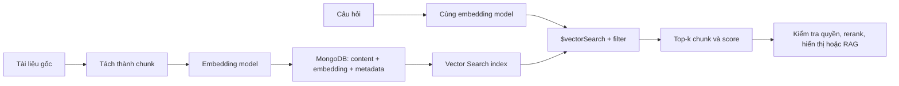

# Vector index, embedding và thước đo tương đồng

> **Chương:** Tìm kiếm nâng cao  
> **Phạm vi:** Spring Data MongoDB — kết nối, ánh xạ document và truy vấn MongoDB bằng `MongoTemplate` hoặc repository. Bài này tập trung vào vector index, biểu diễn embedding, đo độ tương đồng, thực thi `$vectorSearch` và tối ưu kết quả truy hồi.

## Mục tiêu học tập

Sau bài học, bạn có thể:

1. Giải thích vì sao tìm kiếm ngữ nghĩa cần embedding và vì sao MongoDB cần vector index riêng.
2. Thiết kế document lưu văn bản, vector và metadata; bảo đảm truy vấn dùng đúng phiên bản mô hình embedding.
3. So sánh cosine similarity, dot product và Euclidean distance; diễn giải score trả về.
4. Tạo index kiểu `vectorSearch`, chạy truy vấn ANN/ENN, dùng pre-filter và đọc `vectorSearchScore`.
5. Tích hợp tìm kiếm vector vào Spring Data MongoDB bằng `MongoTemplate` hoặc repository và biết cách đo recall, latency, chi phí.

## 1. Từ tìm kiếm từ khóa đến tìm kiếm ngữ nghĩa

Giả sử hệ thống tài liệu kỹ thuật chứa đoạn: “Khôi phục kết nối MongoDB sau lỗi mạng bằng cơ chế retry”. Người dùng hỏi: “Ứng dụng bị mất mạng thì có tự kết nối lại không?”. Truy vấn so khớp chuỗi có thể bỏ sót đoạn này vì từ ngữ khác nhau, trong khi embedding có thể đặt hai câu gần nhau về mặt ý nghĩa.

**Embedding** là một vector số thực do một mô hình tạo ra từ nội dung, ví dụ `[0.12, -0.37, 0.81, ...]`. Mỗi phần tử là một chiều của không gian biểu diễn; không nên gán ý nghĩa cố định kiểu “chiều 1 = MongoDB”. Văn bản liên quan có xu hướng nằm gần nhau **theo metric và mô hình đã chọn**, nhưng đó là kết quả thống kê, không bảo đảm hai câu gần nhau luôn trả lời cùng một câu hỏi.

Một luồng phổ biến:



MongoDB lưu và đánh chỉ mục các vector; với cách **tự cung cấp embedding (bring your own embeddings)** trong bài này, MongoDB không tự chuyển đoạn văn thành vector. Ứng dụng tạo embedding ở bước ghi dữ liệu và ở bước truy vấn. Các tính năng tự động sinh embedding có thể có ở một số cấu hình triển khai khác, nhưng không thuộc quy trình minh họa này.

| Thành phần | Trách nhiệm | Lỗi thường gặp |
|---|---|---|
| Embedding model | Biến văn bản thành vector có số chiều nhất quán | Đổi model cho truy vấn nhưng chưa tạo lại vector tài liệu |
| Document MongoDB | Lưu nội dung, vector, ID nguồn, metadata | Vector có kiểu dữ liệu sai, thiếu tenant hoặc version |
| Vector index | Phục vụ tìm hàng xóm gần nhất theo metric đã chọn | Khai báo nhầm `path`, `numDimensions`, `similarity` |
| `$vectorSearch` | Chọn ứng viên, lọc metadata và lấy top-k | Thiếu `numCandidates` khi chạy ANN; lọc sau truy vấn |
| Lớp ứng dụng | Cấp quyền, kết hợp tín hiệu, đo chất lượng | Xem score như xác suất đúng; để lộ nội dung tenant khác |

**Phân biệt:** `$text`, regular expression và MongoDB Search phục vụ các cách tìm kiếm từ vựng khác nhau; `$vectorSearch` đo độ gần của vector. Một ứng dụng thường kết hợp semantic search với keyword search khi mã lỗi, ID, tên lớp Java hoặc giá trị chính xác có ý nghĩa.

## 2. Thiết kế embedding và dữ liệu đầu vào

### 2.1. Chọn đơn vị lưu trữ

Với tài liệu dài, không nhất thiết tạo một vector cho cả cuốn hướng dẫn. Nên tách thành các **chunk** đủ ngữ cảnh (đoạn, mục, phần), giữ liên kết tới document gốc và có thể chồng lấn một phần giữa các chunk. Chunk quá nhỏ dễ làm mất ngữ cảnh; chunk quá lớn có thể pha nhiều chủ đề và tốn token.

Một cấu trúc thực tế cho collection `knowledge_chunks`:

```json
{
  "_id": "mongo-retry#03",
  "tenantId": "acme",
  "docId": "mongo-retry",
  "chunkNo": 3,
  "title": "Khôi phục kết nối MongoDB",
  "content": "Cấu hình retry và timeout khi mạng gián đoạn...",
  "language": "vi",
  "published": true,
  "embedding": [0.12, -0.37, 0.81],
  "embeddingModel": "model-v1",
  "embeddingVersion": 1,
  "sourceUpdatedAt": "2026-01-15T10:00:00Z"
}
```

Ba số ở đây **chỉ để dễ đọc**. Vector thực tế có thể dài hàng trăm đến hàng nghìn chiều theo cấu hình mô hình. Với MongoDB, trường vector phải có dạng và kiểu số được index hỗ trợ; đảm bảo mọi vector trong cùng một đường dẫn index và query có số chiều tương thích.

Các nguyên tắc vận hành:

- Dùng **cùng mô hình, phiên bản, tiền xử lý và cách chuẩn hóa** để tạo vector cho tài liệu và câu hỏi. Hai model cùng 768 chiều chưa chắc có không gian embedding tương thích.
- Lưu `embeddingModel` và `embeddingVersion` để có thể tạo index mới rồi chuyển lưu lượng khi nâng cấp model, tránh trộn hai không gian biểu diễn.
- Giữ `docId`, `chunkNo`, nguồn và quyền truy cập để hiển thị trích dẫn, cập nhật/xóa chunk tương ứng với tài liệu gốc.
- Khi nội dung hoặc quyền thay đổi, cập nhật record và vector liên quan; phải có cơ chế đồng bộ hoặc đồng bộ lại khi pipeline lỗi.
- Đưa `tenantId`, `language`, `published` và các thuộc tính cần pre-filter vào thiết kế index ngay từ đầu.
- Không đưa dữ liệu nhạy cảm không cần thiết lên dịch vụ tạo embedding; quản lý log, chính sách lưu trữ và quyền truy cập nhất quán.

### 2.2. Quy trình ingest và query phải đối xứng

**Ghi:** nhận tài liệu → làm sạch có kiểm soát → chia chunk → gọi embedding model → kiểm tra số chiều và giá trị số hữu hạn → lưu document → index cập nhật.

**Đọc:** xác thực người dùng → tạo embedding câu hỏi bằng đúng model → áp dụng filter theo tenant/quyền/ngôn ngữ → ANN hoặc ENN → lấy top-k → có thể rerank hoặc kiểm tra nguồn → trả kết quả.

Ví dụ, nếu index có 1536 chiều, `queryVector` dài 768 phần tử là không hợp lệ. Không tự cắt bớt hoặc chèn số 0 để “sửa” sự không tương thích: phải phát sinh embedding theo model/index tương ứng.

## 3. Thước đo tương đồng: hiểu đúng số điểm

Cho hai vector khác vector không là `u=(u_1,\ldots,u_d)` và `v=(v_1,\ldots,v_d)`.

| Thước đo | Công thức | Cách diễn giải | Khi cân nhắc |
|---|---|---|---|
| **Cosine similarity** | `\displaystyle \cos(u,v)=\frac{\sum_i u_iv_i}{\sqrt{\sum_i u_i^2}\sqrt{\sum_i v_i^2}}` | Giá trị càng lớn, hướng vector càng giống; bỏ qua độ lớn | Mô hình embedding văn bản thường đánh giá tốt bằng hướng vector |
| **Dot product** | `\displaystyle u\cdot v=\sum_i u_iv_i` | Phụ thuộc cả hướng lẫn độ lớn | Model được huấn luyện/khuyến nghị dùng inner product; đặc biệt với vector chuẩn hóa |
| **Euclidean distance (L2)** | `\displaystyle \lVert u-v\rVert_2=\sqrt{\sum_i(u_i-v_i)^2}` | Khoảng cách càng nhỏ thì càng gần | Dữ liệu có ý nghĩa hình học và khoảng cách trực tiếp |

Ví dụ: `u=[1,0,0]` và `v=[0.8,0.6,0]` đều có độ dài 1, nên cosine similarity = dot product = `0.8`; khoảng cách Euclidean là `\sqrt{0.4}\approx0.632`. Nếu nhân mọi phần tử của `v` với 10, cosine không đổi nhưng dot product tăng 10 lần. Vì vậy không chọn metric chỉ theo thói quen: hãy kiểm tra hướng dẫn của embedding model và cách model xử lý norm.

Khi **cả hai vector được chuẩn hóa về độ dài 1**, ta có:

```text
cosine(u, v) = u · v
||u - v||² = 2 - 2 × cosine(u, v)
```

Do đó ba thước đo có thể dẫn tới cùng thứ tự top-k trên các vector đơn vị; điều này không còn đúng một cách tổng quát nếu độ dài khác nhau.

### 3.1. Score của MongoDB không phải phần trăm đúng

MongoDB Vector Search chuyển độ tương đồng/khoảng cách thành **`vectorSearchScore` trong khoảng [0, 1]**, điểm cao hơn được xếp gần hơn. Với các hàm tương đồng tương ứng, công thức chuẩn hóa được tài liệu MongoDB mô tả:

```text
cosine:     score = (1 + cosine(u, v)) / 2
dotProduct: score = (1 + dotProduct(u, v)) / 2  [trong miền đầu vào hợp lệ]
euclidean:  score = 1 / (1 + EuclideanDistance(u, v))
```

Ví dụ cosine = 0.8 tương ứng score = 0.9; score 0.9 **không có nghĩa “90% câu trả lời đúng”**. Điểm phụ thuộc embedding model, metric và dữ liệu. Ngưỡng như `score >= 0.75` chỉ nên dùng sau khi đo trên tập câu hỏi có nhãn; không so sánh trực tiếp score giữa hai model/index khác nhau.

**Lưu ý:** không tính cosine cho vector toàn số 0; kiểm tra input và tuân theo yêu cầu chuẩn hóa của model. Với dot product, độ lớn vector có thể đổi thứ hạng, nên cần hiểu quy ước chuẩn hóa của mô hình và MongoDB.

## 4. Vector index trong MongoDB

Vector Search dùng index loại `vectorSearch`, khác index B-tree thông thường (`createIndex({field:1})`). Trong định nghĩa index:

- `type: "vector"` chỉ trường chứa embedding.
- `path` là đường dẫn tới trường embedding thực trong BSON.
- `numDimensions` phải khớp số chiều embedding.
- `similarity` chọn `cosine`, `dotProduct` hoặc `euclidean`.
- `type: "filter"` khai báo trường metadata được phép dùng để **lọc trước** khi tìm kiếm.

Với ANN, MongoDB sử dụng cấu trúc tìm kiếm hàng xóm xấp xỉ dựa trên HNSW để giảm lượng vector cần khảo sát; đổi lại, kết quả có thể bỏ sót một vài hàng xóm thật sự gần nhất. ENN kiểm tra đầy đủ theo phạm vi lọc, phù hợp làm chuẩn so sánh recall hoặc với tập ứng viên nhỏ.

Tính năng và điều kiện triển khai thay đổi theo phiên bản. `$vectorSearch` được hỗ trợ trên các phiên bản Atlas đáp ứng yêu cầu và trên một số cấu hình MongoDB tự quản mới hơn. Trước khi chạy, xác nhận cluster hỗ trợ Vector Search, quyền tạo search index, phiên bản driver và Spring Data đang dùng. **Tạo index là thao tác bất đồng bộ:** lệnh tạo trả về thành công chưa có nghĩa trạng thái đã `READY`.

## 5. Thực hành đầy đủ với mongosh

Ví dụ sau chạy trên môi trường MongoDB **có hỗ trợ Vector Search**. Vector ba chiều là dữ liệu giả để kiểm tra đường đi kỹ thuật; chúng **không** phải embedding ngữ nghĩa học từ tiếng Việt. Trong hệ thống thật, thay toàn bộ vector mẫu bằng đầu ra của một embedding model và thay `numDimensions` cho khớp.

### Bước 1 — Ghi dữ liệu mẫu

```javascript
use demo_vector;

db.knowledge_chunks.insertMany([
  {
    _id: "c1",
    tenantId: "team-a",
    docId: "mongo-connect",
    language: "vi",
    published: true,
    title: "Kết nối MongoDB",
    content: "MongoClient và cấu hình kết nối.",
    embedding: [1.0, 0.0, 0.0]
  },
  {
    _id: "c2",
    tenantId: "team-a",
    docId: "mongo-retry",
    language: "vi",
    published: true,
    title: "Retry khi mất mạng",
    content: "Thiết lập retry cho lỗi kết nối tạm thời.",
    embedding: [0.8, 0.6, 0.0]
  },
  {
    _id: "c3",
    tenantId: "team-b",
    docId: "mongo-security",
    language: "vi",
    published: true,
    title: "Quản lý tài khoản",
    content: "Cấp quyền người dùng.",
    embedding: [1.0, 0.0, 0.0]
  }
]);
```

`c3` cố ý có cùng vector với `c1` nhưng thuộc tenant khác để thấy vì sao phải pre-filter theo tenant. Dữ liệu mẫu này phải chạy trong database thử nghiệm; nếu chạy lại, `insertMany` có thể báo trùng `_id`.

### Bước 2 — Tạo vector search index

```javascript
db.knowledge_chunks.createSearchIndex(
  "chunk_vec_v1",
  "vectorSearch",
  {
    fields: [
      {
        type: "vector",
        path: "embedding",
        numDimensions: 3,
        similarity: "cosine"
      },
      { type: "filter", path: "tenantId" },
      { type: "filter", path: "language" },
      { type: "filter", path: "published" }
    ]
  }
);
```

Đợi index sẵn sàng rồi mới chạy truy vấn:

```javascript
db.knowledge_chunks.aggregate([
  { $listSearchIndexes: { name: "chunk_vec_v1" } }
]);
```

Quan sát trường trạng thái, chờ `READY` (tên và hình thức trạng thái có thể khác theo giao diện/phiên bản). Không nhầm với index thông thường xem qua `getIndexes()`. Khi nâng cấp model, hãy tạo index riêng và chuyển lưu lượng có kiểm soát, tránh sửa đổi index đang được ứng dụng dùng ngay trong thời gian phục vụ.

### Bước 3 — Truy vấn ANN, pre-filter và lấy điểm

```javascript
db.knowledge_chunks.aggregate([
  {
    $vectorSearch: {
      index: "chunk_vec_v1",
      path: "embedding",
      queryVector: [1.0, 0.0, 0.0],
      numCandidates: 40,
      limit: 2,
      filter: {
        tenantId: "team-a",
        language: "vi",
        published: true
      }
    }
  },
  {
    $project: {
      _id: 1,
      docId: 1,
      title: 1,
      content: 1,
      score: { $meta: "vectorSearchScore" }
    }
  }
]);
```

Ý nghĩa tham số:

| Thuộc tính | Chức năng | Quy tắc |
|---|---|---|
| `index` | Tên **search index** đã tạo | Phải đúng tên, đúng collection |
| `path` | Trường embedding cần truy vấn | Phải có trong định nghĩa index |
| `queryVector` | Vector câu hỏi | Cùng không gian embedding và kích thước index |
| `numCandidates` | Số ứng viên ANN được xem xét | Phải ≥ `limit`; tăng thường cải thiện recall nhưng tăng độ trễ |
| `limit` | Số kết quả tối đa | Chọn theo top-k cần dùng |
| `filter` | Lọc metadata **trước** khi chọn ứng viên | Các trường cần khai báo kiểu `filter` trong index |
| `$meta: "vectorSearchScore"` | Xuất điểm của vector search | Chỉ dùng sau `$vectorSearch` |

Vì index giả dùng cosine, `c1` lý tưởng có điểm 1 và `c2` có điểm 0.9; `c3` không được xuất hiện vì tenant khác. Với ANN, kết quả trên tập dữ liệu nhỏ có thể bị ảnh hưởng bởi cấu hình và index chưa sẵn sàng; khi cần kiểm tra chính xác hãy so với ENN ở bước kế tiếp.

**Không chuyển bộ lọc tenant thành `$match` chỉ đặt sau `$vectorSearch`:** làm vậy có thể khiến top-k ban đầu chứa nhiều tài liệu không hợp lệ rồi bị loại bỏ, dẫn đến ít kết quả và thu hồi kém. Trong hệ thống nhiều tenant, lớp cấp quyền ứng dụng vẫn phải kiểm soát quyền truy cập, ngoài bộ lọc ở truy vấn.

### Bước 4 — Dùng ENN để đối chiếu

```javascript
db.knowledge_chunks.aggregate([
  {
    $vectorSearch: {
      index: "chunk_vec_v1",
      path: "embedding",
      queryVector: [1.0, 0.0, 0.0],
      exact: true,
      limit: 2,
      filter: { tenantId: "team-a", language: "vi", published: true }
    }
  },
  { $project: { title: 1, score: { $meta: "vectorSearchScore" } } }
]);
```

`exact: true` dùng tìm kiếm hàng xóm chính xác (ENN), không cần `numCandidates`. ANN dùng `exact: false` hoặc bỏ qua `exact` và chỉ định `numCandidates`. ENN tốn CPU/tài nguyên hơn với tập lớn; dùng làm baseline đánh giá và khi phạm vi lọc tương đối nhỏ.

`$vectorSearch` phải là stage đầu tiên của pipeline chứa nó. Nó không chạy bên trong `$facet` hoặc sub-pipeline `$lookup`; từ MongoDB 8.0 có thể đặt trong `$unionWith` theo điều kiện phiên bản tương ứng.

## 6. Tích hợp Spring Data MongoDB

Spring Data MongoDB 4.5+ cung cấp `VectorIndex`, `SearchIndexOperations` và `VectorSearchOperation`. Các repository vector search bổ sung có API tùy phiên bản; kiểm tra BOM/version của dự án trước khi sử dụng. Với ứng dụng Spring Boot, cấu hình `spring.data.mongodb.uri` và database tương ứng như các thao tác `MongoTemplate` thông thường.

### 6.1. Ánh xạ document

```java
import java.util.List;
import org.springframework.data.annotation.Id;
import org.springframework.data.mongodb.core.mapping.Document;

@Document("knowledge_chunks")
public class KnowledgeChunk {
    @Id
    private String id;
    private String tenantId;
    private String docId;
    private String language;
    private boolean published;
    private String title;
    private String content;
    private List<Double> embedding;

    // Constructors, getters và setters như các entity Spring Data khác.
}
```

Trường `embedding` tương ứng trường BSON đã index. Khi đọc nhiều kết quả lớn, nên chỉ chiếu các trường cần hiển thị (ví dụ `title`, `content`, `docId`, `score`) để không phải tải toàn bộ vector về ứng dụng.

### 6.2. Tạo index bằng Java (thay cho bước tạo index trong mongosh)

```java
import org.springframework.data.mongodb.core.MongoTemplate;
import org.springframework.data.mongodb.core.index.VectorIndex;

VectorIndex index = new VectorIndex("chunk_vec_v1")
    .addVector("embedding", v -> v.dimensions(3).cosine())
    .addFilter("tenantId")
    .addFilter("language")
    .addFilter("published");

mongoTemplate.searchIndexOps(KnowledgeChunk.class).createIndex(index);
```

Chỉ dùng **một** trong hai cách tạo index: mongosh hoặc `searchIndexOps`. Đợi index `READY` trước khi truy vấn. Đoạn Java minh họa dùng kích thước 3 theo dữ liệu mẫu; đổi sang kích thước thực của embedding model khi triển khai.

### 6.3. Tìm kiếm bằng MongoTemplate

```java
import java.util.Arrays;
import java.util.List;
import org.bson.Document;
import org.springframework.data.mongodb.core.MongoTemplate;
import org.springframework.data.mongodb.core.aggregation.Aggregation;
import org.springframework.data.mongodb.core.aggregation.VectorSearchOperation;
import org.springframework.data.mongodb.core.query.Criteria;

public class ChunkVectorSearchService {
    private final MongoTemplate mongoTemplate;

    public ChunkVectorSearchService(MongoTemplate mongoTemplate) {
        this.mongoTemplate = mongoTemplate;
    }

    public List<Document> findSimilar(String tenantId, double[] queryVector) {
        if (tenantId == null || tenantId.isBlank()
                || queryVector == null || queryVector.length != 3
                || Arrays.stream(queryVector).anyMatch(x -> !Double.isFinite(x))) {
            throw new IllegalArgumentException("Tenant hoặc vector truy vấn không hợp lệ");
        }

        VectorSearchOperation search = VectorSearchOperation.search("chunk_vec_v1")
            .path("embedding")
            .vector(queryVector)
            .numCandidates(40)
            .limit(2)
            .filter(Criteria.where("tenantId").is(tenantId)
                .and("language").is("vi")
                .and("published").is(true))
            .withSearchScore("score");

        Aggregation aggregation = Aggregation.newAggregation(
            KnowledgeChunk.class,
            search,
            Aggregation.project("docId", "title", "content", "score")
        );
        return mongoTemplate.aggregate(aggregation, Document.class)
            .getMappedResults();
    }
}
```

Ví dụ gọi: `service.findSimilar("team-a", new double[]{1.0, 0.0, 0.0})`. Hàm nhận **vector đã được tạo sẵn**; trong sản phẩm thực, tầng service embedding biến câu hỏi của người dùng thành `double[]` trước khi gọi service này. Không nhận trực tiếp một mảng số tùy ý do client gửi nếu điều đó phá vỡ ràng buộc model/version của hệ thống.

API `withSearchScore("score")` tự thêm stage lấy `vectorSearchScore`. `Aggregation.newAggregation(KnowledgeChunk.class, ...)` cho phép Spring Data ánh xạ tên thuộc tính theo `@Field` nếu có; không cần tự viết một chuỗi JSON lớn cho stage. Nếu version dự án chưa có `VectorSearchOperation`, có thể dùng aggregation stage thô theo driver, hoặc nâng cấp Spring Data có kiểm thử tương thích.

### 6.4. Repository vector search (khi phiên bản hỗ trợ)

Với phiên bản Spring Data MongoDB hỗ trợ `@VectorSearch` và Spring Data Commons `Vector`, `Score`, `SearchResults`, một repository có thể định nghĩa truy vấn rõ ràng:

```java
import org.springframework.data.domain.Score;
import org.springframework.data.domain.SearchResults;
import org.springframework.data.domain.Vector;
import org.springframework.data.mongodb.repository.VectorSearch;
import org.springframework.data.repository.Repository;

interface KnowledgeChunkRepository extends Repository<KnowledgeChunk, String> {
    @VectorSearch(
        indexName = "chunk_vec_v1",
        filter = "{ tenantId: ?0, language: 'vi', published: true }",
        limit = "2",
        numCandidates = "40"
    )
    SearchResults<KnowledgeChunk> searchByEmbeddingNear(
        String tenantId, Vector embedding, Score minimumScore
    );
}
```

Ví dụ gọi `repository.searchByEmbeddingNear("team-a", Vector.of(1.0, 0.0, 0.0), Score.of(0.0))`. Cách này gọn khi truy vấn cố định, còn `MongoTemplate` linh hoạt hơn khi xây dựng pipeline, projection và filter động. Cần kiểm tra API annotation theo version cụ thể; `@VectorSearch` là annotation riêng của Spring Data MongoDB, không phải `@Query` thông thường.

### 6.5. Khi dùng Spring AI

Spring AI có `MongoDBAtlasVectorStore`, nhận `EmbeddingModel` và tự cung cấp abstraction để thêm tài liệu, tạo embedding và `similaritySearch`. Đây là một lớp tích hợp tùy chọn **bên trên** MongoDB/Spring Data, không phải điều kiện bắt buộc của `$vectorSearch`. Nếu dùng Spring AI, nhất quán `collection-name`, `index-name`, `path-name`, model dimensions và các trường metadata được phép filter; cấu hình tạo schema tự động cần được bật rõ ràng khi muốn dùng.

## 7. Chọn ANN, ENN và tinh chỉnh chất lượng

### 7.1. ANN so với ENN

| Tiêu chí | ANN | ENN |
|---|---|---|
| Cách tìm | Ước lượng hàng xóm gần qua index | So sánh đầy đủ trong phạm vi tìm kiếm |
| Độ chính xác top-k | Có thể bỏ sót kết quả gần nhất | Dùng làm ground truth tương đối cho vector/metric đã chọn |
| Độ trễ tập lớn | Thường thấp hơn | Thường cao hơn |
| Tham số quan trọng | `numCandidates`, `limit`, filter | `exact: true`, `limit`, filter |
| Mục đích | Truy hồi phục vụ người dùng | Kiểm chứng, tập dữ liệu nhỏ hoặc yêu cầu exact |

MongoDB gợi ý khởi đầu `numCandidates` khoảng **20 lần `limit`** cho ANN rồi tinh chỉnh bằng đo đạc. Đây là điểm bắt đầu, không phải công thức đảm bảo recall. Ví dụ `limit=5` thử `numCandidates=100`, sau đó so sánh với 50, 200, 400 để tìm điểm cân bằng.

### 7.2. Đánh giá bằng bộ câu hỏi có nhãn

Ví dụ với 100 câu hỏi và tập chunk liên quan do người đánh giá xác nhận:

- **Recall@k:** số chunk liên quan được tìm thấy trong top-k chia cho tổng chunk liên quan của từng câu hỏi, rồi lấy trung bình. Có thể dùng ENN top-k làm baseline về độ trùng kết quả ANN với ENN, nhưng đó là **ANN recall so với exact search**, không đồng nghĩa chất lượng ngữ nghĩa theo nhãn con người.
- **Precision@k:** tỷ lệ chunk liên quan trong k kết quả; tập trung vào độ sạch của danh sách hiển thị.
- **MRR/nDCG:** coi trọng vị trí xếp hạng và mức độ liên quan; hữu ích khi kết quả đầu ảnh hưởng lớn tới RAG.
- **Latency p50/p95/p99:** thời gian thực tế từ lúc gửi truy vấn tới khi ứng dụng nhận kết quả; tách latency tạo embedding khỏi latency database.
- **Cost/storage:** tổng kích thước vector, index, RAM/CPU search node, số lần gọi embedding API và lượng dữ liệu trả về.

Ví dụ đo ANN recall@5 so với ENN: tập id ENN là `{a,b,c,d,e}`, ANN là `{a,c,d,x,y}` thì overlap = 3/5 = 0.6. Với hệ thống thực, đo trên nhiều câu hỏi và các bộ lọc tenant/ngôn ngữ khác nhau. Đừng chỉ dựa trên 3 vector mẫu.

### 7.3. Tối ưu theo thứ tự có kiểm soát

1. Xác minh input đúng model và index, số chiều đúng, văn bản phân mảnh hợp lý.
2. Dùng pre-filter càng sát miền dữ liệu cần tìm càng tốt, đặc biệt quyền truy cập, tenant và trạng thái xuất bản.
3. Tăng dần `numCandidates`, cố định `limit` và dataset rồi đo recall/latency; giảm `numCandidates` nếu độ trễ lớn mà recall vẫn đạt mục tiêu.
4. Trả về ít trường dữ liệu; loại vector khỏi response, chỉ lấy nội dung cần hiển thị.
5. Nếu kết quả chứa nhiều từ khóa định danh (mã lỗi, API, tên class), kết hợp tìm kiếm từ khóa và vector rồi rerank hoặc áp dụng chiến lược hợp nhất thứ hạng. Cần phân biệt score hai hệ tìm kiếm trước khi hợp nhất.
6. Cân nhắc batch embedding, caching theo nội dung và version, cập nhật index theo sự kiện; kiểm soát tốc độ nạp để không làm nghẽn hệ thống tìm kiếm.

## 8. Các lỗi thực tế và hướng xử lý

| Triệu chứng | Nguyên nhân khả dĩ | Cách kiểm tra và xử lý |
|---|---|---|
| Trả về rỗng dù có document | Index chưa READY; sai tên `index` hoặc `path`; filter loại hết | Kiểm tra `$listSearchIndexes`, tên field BSON, số document thỏa filter |
| Báo lỗi số chiều / vector | Vector query không khớp `numDimensions` hoặc có giá trị không hợp lệ | Log chiều vector, version model; reject input lỗi trước khi query |
| Kết quả “lạ” dù score cao | Chunk sai ngữ cảnh; model không phù hợp tiếng Việt; trộn model versions | Đối chiếu nội dung gốc, kiểm tra version, đánh giá tập câu hỏi có nhãn |
| ANN bỏ sót kết quả ENN có | `numCandidates` thấp hoặc filter/config chưa tối ưu | Tăng `numCandidates`, đo overlap và độ trễ trên cùng truy vấn |
| Ít hơn `limit` sau lọc | Lọc ở `$match` sau top-k hoặc phạm vi hợp lệ quá nhỏ | Dùng pre-filter; xác minh số vector thỏa filter |
| Truy vấn chậm / search node quá tải | Số ứng viên lớn, ENN trên tập lớn, embedding quá dài, tải tăng | Profile/query metrics, giảm candidate, tăng năng lực index/search node nếu cần |
| Kết quả có dữ liệu tenant khác | Thiếu filter tenant hoặc lỗi phân quyền tầng ứng dụng | Bắt buộc xác thực/ủy quyền và filter theo tenant từ server |
| Không áp dụng được API Spring Data | Phiên bản chưa hỗ trợ `VectorSearchOperation`/repository annotations | Kiểm tra tài liệu theo version/BOM, dùng `MongoTemplate`/driver phù hợp |

Một số nguyên tắc phòng lỗi quan trọng:

- Không tự xem score đã chuẩn hóa thành một chỉ số độ tin cậy tuyệt đối của câu trả lời do mô hình ngôn ngữ sinh ra.
- Khi thay đổi embedding model hoặc metric, tạo đường nâng cấp có kiểm thử: ingest lại vector, index mới, so sánh chất lượng, chuyển truy vấn và chỉ xóa index cũ sau khi xác nhận ổn định.
- Trong RAG, đưa `docId`, `chunkNo`, nguồn và quyền hiển thị vào kết quả; tránh sinh câu trả lời không có chứng cứ kiểm chứng được.
- Nhớ rằng vector index không thay thế toàn bộ index truyền thống. Truy vấn giao dịch, phân trang theo thời gian, unique key và text matching vẫn cần cơ chế thích hợp riêng.

## 9. Bài luyện tập

**Bài 1 — Tính toán metric.** Với `u=[1,0]` và `v=[0.6,0.8]`, tính cosine, dot product, L2 distance và MongoDB cosine score. Tự kiểm tra: `0.6`, `0.6`, `\sqrt{0.8}\approx0.8944` và `0.8`.

**Bài 2 — Index và pre-filter.** Đổi ví dụ sang embedding 4 chiều; cập nhật cả vector document, `queryVector` và `numDimensions`. Thêm filter `published` và thử so sánh kết quả khi có/không có filter. Giải thích vì sao `$match` sau stage tìm kiếm có thể không đủ kết quả.

**Bài 3 — ANN/ENN.** Tạo tập vài nghìn vector từ **cùng một model**, viết truy vấn top-10 với `numCandidates` lần lượt 50, 200, 500. Đo p95 latency và overlap với ENN trên cùng tập truy vấn. Chọn cấu hình theo tiêu chí được công bố trước, thay vì chỉ chọn cấu hình nhanh nhất.

**Bài 4 — Tích hợp Java.** Viết endpoint nhận câu hỏi và tenant đã xác thực; service tạo embedding, gọi `ChunkVectorSearchService`, chỉ trả `docId`, `title`, `content`, `score`. Thêm kiểm tra model version và test dữ liệu tenant khác không bị lộ.

**Câu hỏi tự kiểm tra:**

- Tại sao hai embedding cùng số chiều nhưng sinh từ hai mô hình khác nhau chưa chắc tìm kiếm chéo được?
- Khi nào cosine và dot product cho cùng thứ tự top-k?
- `vectorSearchScore = 0.9` diễn giải được và không diễn giải được điều gì?
- Vì sao `numCandidates` ảnh hưởng đồng thời đến recall và latency?
- Khi nào dùng `MongoTemplate` thuận tiện hơn repository `@VectorSearch`?

## Tài liệu tham khảo

- [Spring Data MongoDB — MongoDB Search: Vector Index, VectorSearchOperation](https://docs.spring.io/spring-data/mongodb/reference/mongodb/mongo-search-indexes.html)
- [Spring Data MongoDB — Vector Search repository methods](https://docs.spring.io/spring-data/mongodb/reference/mongodb/repositories/vector-search.html)
- [Spring Data MongoDB — VectorSearchOperation API](https://docs.spring.io/spring-data/mongodb/reference/api/java/org/springframework/data/mongodb/core/aggregation/VectorSearchOperation.html)
- [MongoDB — Create Search Index](https://www.mongodb.com/docs/manual/reference/method/db.collection.createsearchindex/)
- [MongoDB — Vector Search index field types and similarity functions](https://www.mongodb.com/docs/vector-search/indexes/vector-search-type/)
- [MongoDB — Run ANN and ENN queries](https://www.mongodb.com/docs/vector-search/query/aggregation-stages/vector-search-stage/)
- [Spring AI — MongoDB Atlas Vector Store (mở rộng tùy chọn)](https://docs.spring.io/spring-ai/reference/api/vectordbs/mongodb.html)
