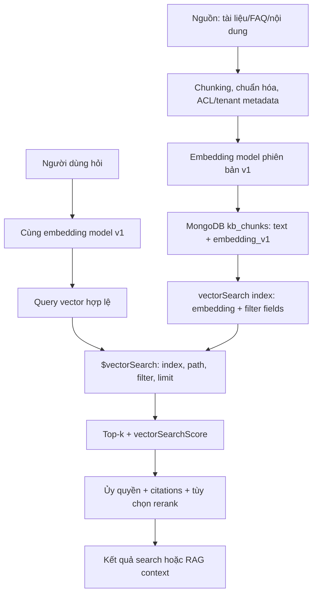

# Vector search qua pipeline hoặc API khai báo trong phiên bản hỗ trợ

Trong **Spring Data MongoDB**, *vector search* tìm các document có nội dung **gần nhau về ngữ nghĩa** nhờ so sánh các **embedding vectors**, thay vì chỉ tìm văn bản trùng từ khóa. Một câu hỏi như “Làm sao xử lý kết nối MongoDB bị ngắt khi đang cập nhật?” có thể tìm được tài liệu “Retryable writes và idempotency” dù hai chuỗi ký tự không hoàn toàn giống nhau.

Bài thuộc chương **Tìm kiếm nâng cao** của module **SPRING_DATA_MONGODB**. Trong module này, chúng ta kết nối và ánh xạ document, thao tác qua `MongoTemplate` hoặc repository, thực hành truy vấn, aggregation, index, transaction, reactive access, kiểm thử và chẩn đoán hiệu năng dữ liệu. Phạm vi trực tiếp ở đây là **thực hiện vector search thông qua aggregation pipeline hoặc API Spring Data mang tính khai báo khi phiên bản hỗ trợ**.

Có ba con đường chính:

1. **MongoDB aggregation `$vectorSearch`**: hoạt động ở mức database, dùng được qua `mongosh` và Java Driver của deployment có tính năng Vector Search.
2. **Spring Data MongoDB `Aggregation.stage(...)` hoặc `VectorSearchOperation`**: phù hợp khi code dùng `MongoTemplate` hoặc `ReactiveMongoTemplate`. `VectorSearchOperation` được giới thiệu từ **Spring Data MongoDB 4.5**.
3. **Spring Data MongoDB repository `@VectorSearch`** cùng `Vector`, `Score` và `SearchResults<T>`: truy vấn khai báo/derived query từ **Spring Data MongoDB 5.0**.

**Quan trọng:** phiên bản Spring Data, MongoDB Server, kiểu deployment, index status và embedding model **đều phải tương thích**. Không thể chỉ thêm annotation vào một `MongoRepository` rồi mong MongoDB standalone cũ tự có vector search.

## 1. Vector search giải quyết vấn đề gì?

Với tìm kiếm từ khóa, hệ thống thường so sánh tokens, cụm từ và phép toán text. Với vector search, mỗi văn bản hoặc hình ảnh được biểu diễn thành một vector số thực, ví dụ:

```text
"Transaction bị rollback"         → [0.12, -0.31, 0.68, 0.05]
"Giao dịch hủy thay đổi dữ liệu"   → [0.10, -0.29, 0.70, 0.03]
"Cách nấu món ăn"                 → [-0.44, 0.19, 0.02, 0.51]
```

Các vectors trên chỉ là **số liệu minh họa bốn chiều**, không phải output của một embedding model cụ thể. Trong hệ thống thật, độ dài vector có thể là **hàng trăm hoặc hàng nghìn chiều**, phụ thuộc model.

Khi người dùng nhập truy vấn, ứng dụng thường:

1. Chuyển truy vấn thành **query embedding** bằng model tương thích.
2. Gửi vector vào `$vectorSearch`.
3. MongoDB so sánh vector truy vấn với vectors đã được index.
4. Trả các tài liệu có điểm tương đồng cao.
5. Ứng dụng lọc quyền, dựng snippet, có thể rerank hoặc đưa vào luồng RAG.

Vector search phù hợp với semantic retrieval, recommendation và similarity lookup. Nó **không thay thế hoàn toàn** text search: mã đơn hàng, tên API, lỗi chính xác và các từ khóa hiếm vẫn thường tìm tốt hơn bằng lexical search.

## 2. Kiến trúc từ tài liệu gốc tới kết quả tìm kiếm



Bốn hợp đồng quan trọng:

- **Model**: vector tài liệu và vector truy vấn phải được tạo bằng **cùng model hoặc một họ model được nhà cung cấp xác nhận tương thích**.
- **Dimension**: độ dài của vector phải đúng với `numDimensions` khai báo trong index.
- **Index**: chỉ mục chuyên dụng **`vectorSearch`**, không phải B-tree `createIndex` hoặc `2dsphere`.
- **Security**: `tenant_id`, visibility và các điều kiện quyền truy cập phải được đưa vào truy vấn một cách tin cậy.

Không lưu một query embedding từ model 768 chiều rồi so sánh với index 1536 chiều; không thay model trong production mà bỏ qua chiến lược re-embedding/index migration.

## 3. Ma trận hỗ trợ theo phiên bản: đừng áp một ví dụ cho mọi môi trường

Theo tài liệu hiện hành, các mốc đáng lưu ý:

| Thành phần | Điều kiện hỗ trợ | Ý nghĩa |
| --- | --- | --- |
| MongoDB Atlas | Các phiên bản Atlas được MongoDB liệt kê cho `$vectorSearch`, bắt đầu từ MongoDB **6.0.11** cho khả năng ANN đã công bố | Cần tính năng Vector Search và search index khả dụng |
| MongoDB Community tự quản lý | **8.2+** với cấu hình/tính năng MongoDB Vector Search phù hợp | Không còn đúng khi khẳng định Vector Search chỉ chạy trên Atlas |
| MongoDB Enterprise tự quản lý | **8.2+** trong cấu hình được MongoDB tài liệu hóa với Kubernetes Operator | Xác minh hạ tầng Search tương ứng |
| Spring Data MongoDB 4.0+ | `Aggregation.stage(...)` để đưa stage raw vào pipeline | Không có API type-safe chuyên VectorSearch ở mọi 4.x |
| Spring Data MongoDB **4.5+** | `VectorSearchOperation`, `VectorIndex` và `searchIndexOps(...)` | Query/index DSL chuyên dụng |
| Spring Data MongoDB **5.0+** | Repository `@VectorSearch`, Spring Data `Vector`, `SearchResults` | Query khai báo và derived vector methods |

**Đọc phiên bản theo thứ tự:** database có hỗ trợ không → index đã được tạo/READY chưa → Java Driver được Spring Data dùng có tương thích không → API Spring Data có sẵn không. Một application dùng Spring Data 4.2 vẫn có thể gọi raw `$vectorSearch` bằng pipeline/driver nếu database hỗ trợ, nhưng **không copy ví dụ `@VectorSearch` của 5.0 vào 4.2**.

Tài liệu Spring Data MongoDB 4.5/5.x có thể còn ghi giới hạn chỉ Atlas hoặc kích thước vector cũ; MongoDB Server hiện hành đã mở rộng ma trận. Khi có khác biệt, kiểm tra tài liệu **đúng phiên bản deployment thực tế**, không lấy một dòng Javadoc cũ làm quy tắc chung cho mọi server.

## 4. Một số giới hạn của `$vectorSearch` cần ghi nhớ

`$vectorSearch` không phải toán tử query thông thường như `$eq`:

- Trong pipeline tổng quát, `$vectorSearch` là **stage đầu tiên**.
- Không đặt `$match` trước nó để lọc theo tenant; đặt điều kiện vào trường **`filter`** của chính stage.
- Không dùng nó bên trong `$facet` hoặc `$lookup` pipeline.
- MongoDB **8.0+** hỗ trợ sử dụng `$vectorSearch` trong nhánh `$unionWith` theo tài liệu server; không giả định khả năng đó ở bản cũ.
- Phải có **MongoDB Vector Search index** với tên, vector path và filter fields tương ứng.
- `limit` là bắt buộc, `numCandidates` cần cho chế độ ANN nếu không đặt `exact:true`.
- `$vectorSearch` có metadata `vectorSearchScore`; score không phải xác suất “tài liệu chắc chắn đúng”.

Điều này ảnh hưởng trực tiếp đến cách dùng `Aggregation.newAggregation(...)`: nếu bạn thêm một `match(...)` trước stage vector, đó không phải “lọc sớm cho nhanh” mà có thể làm pipeline **không hợp lệ**.

## 5. Dữ liệu ví dụ: kho kiến thức nhiều tenant

Ta thiết kế collection `kb_chunks`. Mỗi document là một đoạn tài liệu ngắn để tìm kiếm:

```javascript
{
  _id: ObjectId("67400000000000000000a001"),
  tenant_id: "T1",
  doc_id: "mongo-retry-101",
  chunk_id: "mongo-retry-101#1",
  title: "Retryable writes trong Spring Data MongoDB",
  text: "Driver có thể retry một số lệnh ghi khi gặp lỗi mạng...",
  lang: "vi",
  visibility: "published",
  model_version: "embedding-v1",
  embedding_v1: [0.12, -0.31, 0.68, 0.05],
  updated_at: ISODate("2026-11-20T02:00:00Z")
}
```

Với bài thực hành, `embedding_v1` chỉ có **4 chiều** để dễ thấy cơ chế; production phải dùng vector đúng số chiều theo model thực và dựng index tương ứng.

Các field quan trọng:

| Field | Công dụng | Có đưa vào vectorSearch index? |
| --- | --- | --- |
| `embedding_v1` | Vector dùng để xếp hạng semantic | **`type:"vector"`**, `numDimensions` tương ứng |
| `tenant_id` | Ranh giới tenant | **`type:"filter"`** nếu pre-filter |
| `visibility` | Chặn bản nháp | **`type:"filter"`** nếu pre-filter |
| `lang` | Giới hạn ngôn ngữ | **`type:"filter"`** nếu pre-filter |
| `doc_id` / `chunk_id` | Provenance và citation | Có thể chỉ là dữ liệu trả về |
| `text`, `title` | Nội dung retrieval | Không bắt buộc trong vectorSearch index |
| `model_version` | Quản lý chiến lược embedding migration | Có thể là filter field nếu cần |
| `updated_at` | Tài liệu được cập nhật khi nào | Tùy điều kiện truy vấn |

**Không dùng embedding như một khóa business duy nhất.** Hai chunks giống nhau có thể có vector giống nhau; deduplication và permissions là các quy tắc riêng.

## 6. Embedding lấy từ đâu? MongoDB không tự đoán vector

Trong **bring-your-own-embeddings (BYO)**, ứng dụng dùng một embedding model bên ngoài để tính vector:

```java
public interface EmbeddingService {
    // Trả đúng chiều và model version theo contract.
    java.util.List<Double> embed(String text);
}
```

Ví dụ validation tại boundary:

```java
import java.util.List;

public final class EmbeddingValidator {

    public static List<Double> requireValid(
            List<Double> vector, int dimensions) {

        if (vector == null || vector.size() != dimensions) {
            throw new IllegalArgumentException(
                "Vector có dimension không đúng"
            );
        }

        for (Double element : vector) {
            if (element == null || !Double.isFinite(element)) {
                throw new IllegalArgumentException(
                    "Vector chứa NaN/Infinity/null"
                );
            }
        }

        return List.copyOf(vector);
    }
}
```

MongoDB Vector Search cũng có các tính năng **automated embeddings** trên những loại index/deployment được hỗ trợ, chẳng hạn vector index field có `autoEmbed` và query text phù hợp. **Không đánh đồng** chúng với BYO:

- **BYO**: index field `type:"vector"`, truy vấn dùng `queryVector` là mảng số.
- **Automated embeddings**: index cấu hình `autoEmbed`, query có thể dùng `query:{text:...}` và model được triển khai hỗ trợ.

Phần thực hành chính trong bài chọn **BYO** để ví dụ hoạt động độc lập với khả năng tự tạo embedding của từng deployment/version.

## 7. Tạo Vector Search index bằng mongosh

Đây là **search index**, không phải lệnh `db.collection.createIndex({embedding_v1:1})`.

Trên deployment có hỗ trợ Vector Search, từ `mongosh`:

```javascript
db.kb_chunks.createSearchIndex(
  "kb_vector_v1",
  "vectorSearch",
  {
    fields: [
      {
        type: "vector",
        path: "embedding_v1",
        numDimensions: 4, // Chỉ minh họa!
        similarity: "cosine"
      },
      { type: "filter", path: "tenant_id" },
      { type: "filter", path: "visibility" },
      { type: "filter", path: "lang" },
      { type: "filter", path: "model_version" }
    ]
  }
);
```

Ý nghĩa:

- `"kb_vector_v1"` là **tên index**; truy vấn phải dùng đúng chuỗi này.
- `"vectorSearch"` là **index type**, không phải classic index.
- `embedding_v1` là BSON path chứa vector.
- `numDimensions` phải trùng chiều embedding thật.
- `similarity:"cosine"` chọn phép tính tương đồng cosine.
- Các field filter được khai báo `type:"filter"` để có thể **pre-filter** trong `$vectorSearch`.

Một index trên `embedding_v1` không tự áp cho `embedding_v2`. Khi thay model/chiều, thường phải ghi vector mới, xây index mới và chuyển traffic có kiểm soát.

## 8. Index tồn tại chưa chắc đã sẵn sàng

Sau khi gọi `createSearchIndex(...)`, MongoDB có thể cần thời gian build index. Không nên tạo index rồi lập tức coi mọi truy vấn sẽ trả đầy đủ dữ liệu.

Kiểm tra:

```javascript
db.kb_chunks.getSearchIndexes("kb_vector_v1");
```

Tùy deployment/version, metadata có thể cho biết trạng thái như **`READY`** và thông tin queryable. Trong Spring Data 4.5+, có thể dùng `SearchIndexOperations#status(...)` theo API phiên bản đang sử dụng.

Quy trình triển khai:

1. Tạo collection và ghi dữ liệu embedding hợp lệ.
2. Gửi yêu cầu tạo search index.
3. **Đợi index đạt trạng thái sẵn sàng** qua migration/deployment controller.
4. Chạy một vector query với dữ liệu đối chứng.
5. Chỉ sau đó đánh dấu readiness cho endpoint phụ thuộc vector search.

Không tạo index trong mỗi request. Đừng dùng mỗi `index exists=true` làm readiness; search index có thể đang xây, cập nhật hoặc lỗi.

## 9. Truy vấn ANN cơ bản bằng aggregation pipeline

Giả sử query embedding tương thích với `embedding_v1`:

```javascript
const queryVector = [0.10, -0.30, 0.70, 0.04];

db.kb_chunks.aggregate([
  {
    $vectorSearch: {
      index: "kb_vector_v1",
      path: "embedding_v1",
      queryVector: queryVector,
      numCandidates: 80,
      limit: 4,
      filter: {
        tenant_id: "T1",
        visibility: "published",
        lang: "vi",
        model_version: "embedding-v1"
      }
    }
  },
  {
    $project: {
      _id: 1,
      doc_id: 1,
      chunk_id: 1,
      title: 1,
      text: 1,
      tenant_id: 1,
      score: { $meta: "vectorSearchScore" }
    }
  }
]);
```

Ở đây:

- `$vectorSearch` là stage **đầu tiên**.
- `queryVector` đúng chiều của index.
- `numCandidates=80` cho phép xét số ứng viên lớn hơn `limit=4`.
- `filter` giới hạn tập dữ liệu **trước search**, không phải `$match` ở cuối.
- `score` xuất từ metadata `vectorSearchScore`.
- `embedding_v1` **không được project trả về**, giảm dung lượng response và rủi ro lộ vectors.

**Với tenant-sensitive data, query của production phải dùng tenant từ authentication/authorization backend**, không lấy tenant từ một tham số mà client được toàn quyền chọn.

## 10. Kết quả vectorSearchScore: có thể so sánh như thế nào?

MongoDB Vector Search trả metadata `vectorSearchScore`, thường được chuẩn hóa trong **khoảng 0 đến 1**, với giá trị cao hơn biểu thị gần hơn theo similarity/index.

Ví dụ:

```json
[
  {
    "doc_id": "mongo-retry-101",
    "chunk_id": "mongo-retry-101#1",
    "score": 0.94
  },
  {
    "doc_id": "mongodb-idempotency-202",
    "chunk_id": "mongodb-idempotency-202#2",
    "score": 0.86
  }
]
```

Các score ở đây là **ví dụ minh họa**, không phải kết quả đo thật của model/vectors 4 chiều.

**Không diễn giải `score=0.94` thành “94% câu trả lời chính xác”.** Score:

- Phụ thuộc cách embedding model biểu diễn văn bản.
- Phụ thuộc kiểu similarity của index (cosine, dotProduct, euclidean).
- Có thể thay đổi khi model/index/dataset thay đổi.
- Không phải xác suất thực nghiệm được calibrated.
- Không nên được so trực tiếp giữa các models/indexes khác nhau nếu chưa đánh giá.

Nếu cần ngưỡng lọc, đo bằng bộ dữ liệu đã gắn nhãn relevance và thiết lập policy. Trong một pipeline, có thể thêm `$match:{score:{$gte:0.75}}` **sau khi tạo score** bằng `$project` hoặc `$addFields`, nhưng ngưỡng đó phải được kiểm chứng theo model và use case.

## 11. ANN và ENN: trade-off recall–latency

Hai chiến lược tìm kiếm:

| Thuộc tính | ANN | ENN |
| --- | --- | --- |
| Tên | Approximate Nearest Neighbors | Exact Nearest Neighbors |
| Cờ MongoDB | `exact:false` (thường mặc định) | `exact:true` |
| Ứng viên | `numCandidates` được điều chỉnh | Không cần cùng cơ chế ứng viên ANN |
| Thế mạnh | Tốc độ/chi phí tốt cho tập dữ liệu lớn | Baseline recall, kiểm tra kết quả top-k |
| Hạn chế | Có thể bỏ lỡ một số lân cận thật | Có thể tốn tài nguyên/độ trễ hơn |
| Dùng khi | Retrieval production có latency SLO | Benchmark, kiểm chứng relevance, tập dữ liệu nhỏ hoặc cần exact |

ANN:

```javascript
{
  $vectorSearch: {
    index: "kb_vector_v1",
    path: "embedding_v1",
    queryVector: [0.10, -0.30, 0.70, 0.04],
    exact: false,
    numCandidates: 80,
    limit: 4
  }
}
```

ENN, **khi deployment/version hỗ trợ**:

```javascript
{
  $vectorSearch: {
    index: "kb_vector_v1",
    path: "embedding_v1",
    queryVector: [0.10, -0.30, 0.70, 0.04],
    exact: true,
    limit: 4
  }
}
```

Chỉ định ENN có thể hữu ích làm baseline để ước lượng chất lượng ANN. Đừng coi ANN luôn trả **đúng** top-k của ENN, và đừng chọn ENN vô điều kiện khi corpus rất lớn.

## 12. numCandidates, limit và cách tinh chỉnh

Trong ANN, `limit` là số kết quả tối đa, còn `numCandidates` là số lân cận ứng viên thuật toán xét trong tìm kiếm.

Ví dụ:

```text
limit = 10
numCandidates = 200
```

Tài liệu MongoDB khuyến nghị **điểm bắt đầu khoảng 20 lần limit** để cân bằng recall và latency, sau đó **tuning theo corpus thật**. Các ràng buộc được tài liệu hóa cho `numCandidates`:

- Không thấp hơn `limit`.
- Không cao hơn **10.000** trong cú pháp hiện hành.
- Phải đặt khi chạy ANN theo `$vectorSearch` thông thường.
- Chọn lớn hơn thường cải thiện recall nhưng **có thể** tăng latency/CPU.

Một policy minh họa trong service:

```java
public record SearchBudget(
        int limit, int numCandidates) {

    public SearchBudget {
        if (limit < 1 || limit > 20) {
            throw new IllegalArgumentException(
                "limit phải trong [1,20]"
            );
        }

        if (numCandidates < limit
                || numCandidates > 10_000) {
            throw new IllegalArgumentException(
                "numCandidates không hợp lệ"
            );
        }
    }

    public static SearchBudget forLimit(int limit) {
        int candidates = Math.min(10_000, limit * 20);
        return new SearchBudget(limit, candidates);
    }
}
```

Giới hạn `limit<=20` ở đây là **policy ứng dụng**, không phải hằng số MongoDB. Không cho client tùy ý yêu cầu `numCandidates=10000` để tạo truy vấn chi phí lớn.

## 13. Pre-filter: điều kiện phải được index theo type filter

Muốn tìm tài liệu của tenant T1, chỉ lấy những chunks đã publish:

```javascript
filter: {
  $and: [
    { tenant_id: "T1" },
    { visibility: "published" },
    { lang: "vi" }
  ]
}
```

`$vectorSearch.filter` có tập toán tử MongoDB Query Language được MongoDB Vector Search hỗ trợ, ví dụ:

- Equality: `$eq`/`$ne`.
- Phạm vi: `$gt`, `$gte`, `$lt`, `$lte`.
- Tập hợp: `$in`/`$nin`.
- Tồn tại: `$exists`.
- Logic: `$and`, `$or`, `$not`, `$nor`.

**Không phải mọi MQL/aggregation operator đều được hỗ trợ trong pre-filter.** Đặc biệt, không thể copy tùy tiện `$regex` hoặc full-text operator vào `filter`. Các field pre-filter phải xuất hiện trong Vector Search index definition với `type:"filter"`, đúng BSON path và kiểu dữ liệu.

Nếu query thường xuyên lọc theo `tenant_id` nhưng index chỉ chứa vector field, cần **migrate search index** bổ sung filter field chứ không chỉ thêm `filter` trong code.

## 14. Vì sao $match sau vectorSearch không tương đương pre-filter?

Mẫu không tối ưu và tiềm ẩn lệch top-k:

```javascript
db.kb_chunks.aggregate([
  {
    $vectorSearch: {
      index: "kb_vector_v1",
      path: "embedding_v1",
      queryVector: [0.10, -0.30, 0.70, 0.04],
      numCandidates: 80,
      limit: 4
    }
  },
  { $match: { tenant_id: "T1" } }
]);
```

Hệ thống tìm top 4 trên **toàn corpus**, rồi mới bỏ những results không thuộc T1. Nếu cả bốn đều ở T2, kết quả còn **0**, dù T1 có nhiều tài liệu phù hợp.

Mẫu đúng cho multi-tenant retrieval:

```javascript
{
  $vectorSearch: {
    index: "kb_vector_v1",
    path: "embedding_v1",
    queryVector: [0.10, -0.30, 0.70, 0.04],
    numCandidates: 80,
    limit: 4,
    filter: { tenant_id: "T1" }
  }
}
```

**Pre-filter không tự thay authorization kiểm tra tại API**, nhưng giúp bảo đảm ranking diễn ra trong tập dữ liệu được phép. Vẫn cần kiểm soát quyền truy cập, project trường nhạy cảm có chọn lọc và ngăn client can thiệp index/tenant filter.

## 15. Có phải pre-filter luôn nhanh hơn?

Không. MongoDB nêu rõ query có filter có thể **chậm hơn query không filter tương ứng**, vì hệ thống phải kết hợp vector search và điều kiện metadata. Filter còn có thể quá chặt khiến không đủ kết quả.

Thiết kế đúng là:

- Filter **bắt buộc** cho quyền tenant/visibility, kể cả khi tăng latency.
- Filter **khuyến nghị** cho locale, trạng thái hay khoảng ngày khi giúp giảm nhiễu.
- Tránh tạo hàng chục filters tùy chọn không được index hoặc không đo lường.
- Benchmark với cả tenants nhỏ và lớn, tránh chỉ dùng dữ liệu test vài document.
- Đo quality **recall@k** theo ENN baseline và latency p50/p95/p99.

Không bỏ pre-filter bảo vệ tenant chỉ để cải thiện performance. Nếu filter quá đắt, xem lại phân vùng dữ liệu, index strategy, search workload và capacity thay vì nới lỏng phân quyền.

## 16. Spring Data MongoDB 4.0+: raw Aggregation.stage(...)

Khi project chưa có `VectorSearchOperation`, có thể đưa stage BSON/JSON vào pipeline bằng `Aggregation.stage(...)` (API có từ **Spring Data MongoDB 4.0**):

```java
import java.util.List;

import org.bson.Document;
import org.springframework.data.mongodb.core.MongoTemplate;
import org.springframework.data.mongodb.core.aggregation.Aggregation;
import org.springframework.data.mongodb.core.aggregation.AggregationResults;

public List<Document> searchRaw(
        MongoTemplate template,
        List<Double> queryVector,
        String tenantId) {

    EmbeddingValidator.requireValid(queryVector, 4);

    Document stage = new Document("$vectorSearch",
        new Document("index", "kb_vector_v1")
            .append("path", "embedding_v1")
            .append("queryVector", queryVector)
            .append("numCandidates", 80)
            .append("limit", 4)
            .append("filter", new Document("tenant_id", tenantId)
                .append("visibility", "published"))
    );

    Document project = new Document("$project",
        new Document("doc_id", 1)
            .append("chunk_id", 1)
            .append("title", 1)
            .append("text", 1)
            .append("score",
                new Document("$meta", "vectorSearchScore"))
    );

    Aggregation pipeline = Aggregation.newAggregation(
        Aggregation.stage(stage),
        Aggregation.stage(project)
    );

    AggregationResults<Document> results =
        template.aggregate(pipeline, "kb_chunks", Document.class);

    return results.getMappedResults();
}
```

**Điểm cần nhớ:** `Aggregation.stage(Bson)` đưa BSON **nguyên văn**, **không tự map tên property Java** sang tên MongoDB. Do đó trong stage raw phải viết `tenant_id`, `embedding_v1` và những BSON keys thật.

Không cho người dùng nhập tùy ý field path/index name hoặc raw pipeline JSON. Dùng index/path constants do backend quản lý và queryVector đã được kiểm tra.

## 17. Java Driver trực tiếp cũng có thể phát $vectorSearch

Khi ứng dụng không dùng Spring Data DSL phù hợp, MongoDB Java Sync Driver có `MongoCollection.aggregate(...)`:

```java
import java.util.List;
import org.bson.Document;
import com.mongodb.client.MongoCollection;

public List<Document> runWithDriver(
        MongoCollection<Document> chunks,
        List<Double> vector,
        String tenantId) {

    Document stage = new Document("$vectorSearch",
        new Document("index", "kb_vector_v1")
            .append("path", "embedding_v1")
            .append("queryVector", vector)
            .append("numCandidates", 80)
            .append("limit", 4)
            .append("filter",
                new Document("tenant_id", tenantId))
    );

    Document project = new Document("$project",
        new Document("title", 1)
            .append("chunk_id", 1)
            .append("score",
                new Document("$meta", "vectorSearchScore"))
    );

    return chunks.aggregate(List.of(stage, project))
        .into(new java.util.ArrayList<>());
}
```

Ở đây `chunks` phải được lấy từ **MongoClient được ứng dụng quản lý**, không tạo client mới cho mỗi truy vấn. Driver gửi BSON stage tới server; **server/index mới quyết định** nó có được thực thi hay không.

Lưu ý phương thức ví dụ phải được gọi sau khi xác minh vector dimension và authorization ở service boundary. Không coi ví dụ rút gọn này là endpoint production đầy đủ.

## 18. Spring Data 4.5+: VectorSearchOperation type-safe

Từ Spring Data MongoDB **4.5**, có `VectorSearchOperation` để xây stage thay vì tự viết BSON:

```java
import java.util.List;

import org.springframework.data.mongodb.core.MongoTemplate;
import org.springframework.data.mongodb.core.aggregation.Aggregation;
import org.springframework.data.mongodb.core.aggregation.VectorSearchOperation;

public List<ChunkHit> searchTyped(
        MongoTemplate template,
        List<Double> vector,
        String tenantId) {

    EmbeddingValidator.requireValid(vector, 4);

    VectorSearchOperation vectorSearch =
        VectorSearchOperation.search("kb_vector_v1")
            .path("embedding")
            .vector(vector)
            .numCandidates(80)
            .limit(4)
            .filter(
                new org.bson.Document("tenant_id", tenantId)
                    .append("visibility", "published")
            )
            .withSearchScore("score");

    Aggregation aggregation =
        Aggregation.newAggregation(KbChunk.class, vectorSearch);

    return template.aggregate(
        aggregation, ChunkHit.class
    ).getMappedResults();
}
```

Ý tưởng:

- `search("kb_vector_v1")`: chỉ ra index.
- `path("embedding")`: property Java của entity `KbChunk`.
- `vector(...)`: query embedding.
- `numCandidates(...)` và `limit(...)`: cấu hình ANN.
- `filter(...)`: điều kiện metadata.
- `withSearchScore("score")`: thêm stage để lấy metadata score trong kết quả.

**Lưu ý phiên bản:** các overload và builder contracts có thể khác qua minor versions; kiểm tra JavaDoc Spring Data 4.5/5.x đang dùng. Ví dụ chọn BSON `Document` cho filter để người đọc thấy rõ tên trường server. Khi dùng typed criteria, cần xác minh cách field mapping của từng overload.

## 19. Domain mapping cho VectorSearchOperation

Định nghĩa model dùng tên Java khác tên BSON:

```java
import java.util.List;

import org.bson.types.ObjectId;
import org.springframework.data.annotation.Id;
import org.springframework.data.mongodb.core.mapping.Document;
import org.springframework.data.mongodb.core.mapping.Field;

@Document("kb_chunks")
public class KbChunk {
    @Id
    private ObjectId id;

    @Field("tenant_id")
    private String tenantId;

    @Field("doc_id")
    private String docId;

    @Field("chunk_id")
    private String chunkId;

    private String title;
    private String text;
    private String visibility;

    @Field("embedding_v1")
    private List<Double> embedding;

    public KbChunk() {}

    public ObjectId getId() { return id; }
    public String getTenantId() { return tenantId; }
    public String getDocId() { return docId; }
    public String getChunkId() { return chunkId; }
    public String getTitle() { return title; }
    public String getText() { return text; }
    public String getVisibility() { return visibility; }
    public List<Double> getEmbedding() { return embedding; }
}
```

Projection DTO:

```java
import org.springframework.data.mongodb.core.mapping.Field;

public class ChunkHit {
    @Field("doc_id")
    public String docId;
    @Field("chunk_id")
    public String chunkId;
    public String title;
    public String text;
    public Double score;
}
```

Ở `VectorSearchOperation.path("embedding")`, Spring Data có thể map **Java property `embedding`** sang BSON `embedding_v1` vì typed aggregation biết `KbChunk.class`. Ngược lại, `Aggregation.stage(new Document(...))` ở mục trước **không** áp mapping cho raw BSON stage.

Đây là lý do cần test pipeline thực tế: một lỗi nhỏ giữa `embedding` và `embedding_v1` có thể dẫn đến không có hits dù vector index đã READY.

## 20. Spring Data 4.5+: quản lý index bằng VectorIndex

Thay vì lệnh mongosh, có thể dùng `SearchIndexOperations`:

```java
import org.springframework.data.mongodb.core.MongoTemplate;
import org.springframework.data.mongodb.core.index.VectorIndex;
import static org.springframework.data.mongodb.core.index
    .VectorIndex.SimilarityFunction.COSINE;

public class KbVectorIndexMigration {
    private final MongoTemplate template;

    public KbVectorIndexMigration(MongoTemplate template) {
        this.template = template;
    }

    public void createVectorIndex() {
        VectorIndex index = new VectorIndex("kb_vector_v1")
            .addVector("embedding", vector ->
                vector.dimensions(4).similarity(COSINE)
            )
            .addFilter("tenantId")
            .addFilter("visibility");

        template.searchIndexOps(KbChunk.class)
            .createIndex(index);
    }
}
```

`searchIndexOps(KbChunk.class)` biết entity mapping nên có thể đổi `embedding` thành `embedding_v1`, `tenantId` thành `tenant_id`. Ở migration thật nên thêm `lang`/`modelVersion` filter nếu endpoint cần dùng; ví dụ trên chỉ khai báo hai filter fields.

**Index provisioning là deployment operation**, không phải code chạy mỗi request. Chạy dưới migration identity/role phù hợp, xác minh trạng thái `READY`, smoke-test một vector query rồi mới open traffic.

`VectorIndex` và `VectorSearchOperation` đều xuất hiện từ Spring Data MongoDB 4.5; đừng dùng chúng trong 4.4 hoặc 4.3 khi chưa nâng dependency.

## 21. SearchIndexOperations khác IndexOperations thường

Dễ nhầm:

```java
// B-tree/general index:
template.indexOps(KbChunk.class);

// MongoDB Search / Vector Search index:
template.searchIndexOps(KbChunk.class);
```

| API | Mục đích |
| --- | --- |
| `IndexOperations.createIndex(...)` | B-tree, TTL, 2dsphere và các classic MongoDB indexes |
| `SearchIndexOperations.createIndex(...)` | MongoDB Search / Vector Search indexes chuyên dụng |
| `VectorIndex` | Khai báo vector fields, dimensions, similarity, filter paths |
| `VectorSearchOperation` | Gửi truy vấn `$vectorSearch` |
| `@VectorSearch` | Khai báo query repository, **không** thay việc tạo index |

Không kỳ vọng `@Indexed` trên `embedding` tạo HNSW/vectorSearch index. Cũng không coi `createSearchIndex` là synchronous index build hoàn chỉnh: phải kiểm tra READY.

## 22. Spring Data MongoDB 5.0+: Vector type và repository API

Spring Data MongoDB **5.0+** cho phép định nghĩa vector search methods với các abstractions:

- `org.springframework.data.domain.Vector`.
- `SearchResults<T>` / `SearchResult<T>` và `Score` của Spring Data Commons.
- `@VectorSearch` của `org.springframework.data.mongodb.repository`.
- Keyword `Near` và `Within` trong derived search methods.

Domain có thể lưu embedding bằng `Vector` thay vì `List<Double>`:

```java
import org.springframework.data.annotation.Id;
import org.springframework.data.domain.Vector;
import org.springframework.data.mongodb.core.mapping.Document;
import org.springframework.data.mongodb.core.mapping.Field;

@Document("kb_chunks")
public class KbSnippet {
    @Id
    private String id;

    @Field("tenant_id")
    private String tenantId;

    @Field("embedding_v1")
    private Vector embedding;

    private String title;
    private String visibility;

    public String getId() { return id; }
    public String getTenantId() { return tenantId; }
    public Vector getEmbedding() { return embedding; }
    public String getTitle() { return title; }
    public String getVisibility() { return visibility; }
}
```

`Vector` đại diện một embedding n chiều, ví dụ:

```java
import org.springframework.data.domain.Vector;

Vector query = Vector.of(0.10f, -0.30f, 0.70f, 0.04f);
```

**Thực hành:** chọn representation embedding nhất quán khi ghi/query (float32/double/BSON binary vector). Đừng tự trộn các kiểu lưu và query khác định dạng/quantization rồi mong kết quả luôn xuất hiện.

## 23. Repository query khai báo với @VectorSearch

Ví dụ Spring Data 5.0+:

```java
import org.springframework.data.domain.Score;
import org.springframework.data.domain.SearchResults;
import org.springframework.data.domain.Vector;
import org.springframework.data.mongodb.repository.VectorSearch;
import org.springframework.data.repository.Repository;

public interface KbSnippetRepository
        extends Repository<KbSnippet, String> {

    @VectorSearch(
        indexName = "kb_vector_v1",
        path = "embedding",
        filter = "{ 'tenant_id': ?0, 'visibility': 'published' }",
        limit = "4",
        numCandidates = "80"
    )
    SearchResults<KbSnippet>
    searchAnnotatedByTenantIdAndEmbeddingWithin(
        String tenantId, Vector embedding, Score threshold
    );
}
```

Và lời gọi minh họa:

```java
Vector query = Vector.of(
    0.10f, -0.30f, 0.70f, 0.04f
);

SearchResults<KbSnippet> hits =
    repository.searchAnnotatedByTenantIdAndEmbeddingWithin(
        authorizedTenantId,
        query,
        Score.of(0.0)
    );
```

Lưu ý:

- `@VectorSearch` khai báo **indexName**, `path`, `filter`, `limit` và `numCandidates`.
- `?0` được Spring Data bind từ tham số phương thức thứ nhất; **không nối chuỗi raw JSON bằng input người dùng**.
- `Score` là tham số ngưỡng/miền điểm theo repository search conventions; không phải output vector.
- `SearchResults<T>` trả entity và điểm xếp hạng qua `SearchResult<T>`.
- Phải dùng đúng **Spring Data MongoDB 5.0+** và đúng search index trên database.
- Tài liệu Spring Data quy định một số kết hợp method name/Score/Limit/annotation; hãy ưu tiên một chữ ký rõ và test query của chính ứng dụng.

Giá trị `Score.of(0.0)` chỉ nhằm không cắt kết quả hợp lệ có score trong khoảng chuẩn hóa; **không phải threshold relevance đã được đánh giá**.

## 24. Derived query: Near/Within theo tên method

Thay vì ghi filter JSON, Spring Data 5.0+ hỗ trợ một số derived search methods:

```java
public interface KbDerivedRepository
        extends Repository<KbSnippet, String> {

    @VectorSearch(
        indexName = "kb_vector_v1",
        numCandidates = "200"
    )
    SearchResults<KbSnippet>
    searchTop10ByTenantIdAndEmbeddingNear(
        String tenantId,
        Vector embedding,
        Score threshold
    );
}
```

Ý nghĩa:

- `searchTop10...` biểu thị top results theo convention của Spring Data repositories.
- `TenantId` là property dùng làm pre-filter; field phải được khai báo `type:"filter"` trong vector index.
- `EmbeddingNear` là predicate vector search, không phải geospatial `$near`.
- `@VectorSearch(indexName=...)` vẫn cần vì stage `$vectorSearch` phải biết tên index.

Nếu một method derived không biểu diễn được filter đặc thù, dùng `@VectorSearch(filter="...")` hoặc custom repository implementation với `VectorSearchOperation`.

**Không dùng `@Query("{...}")` của Mongo repository thông thường để giả định nó tự biến thành vector search.** Query derivation cho vector search có cơ chế và loại tham số riêng trong Spring Data 5.x.

## 25. Limit và numCandidates là hai tham số khác nhau

Ở `@VectorSearch`:

```java
@VectorSearch(
    indexName = "kb_vector_v1",
    limit = "10",
    numCandidates = "200"
)
```

Bạn cũng có thể dùng `Limit` parameter theo Spring Data APIs:

```java
@VectorSearch(
    indexName = "kb_vector_v1",
    numCandidates = "200"
)
SearchResults<KbSnippet>
searchByEmbeddingNear(
    Vector embedding,
    Score threshold,
    org.springframework.data.domain.Limit limit
);
```

**Không khai báo đồng thời `@VectorSearch(limit="10")` và tham số `Limit`** trong một method, vì chúng là hai nguồn cấu hình limit cạnh tranh và JavaDoc không cho phép kết hợp đó.

Tài liệu còn cho phép Value Expressions trong một số annotation attributes (ví dụ `numCandidates`) để bind từ method arguments. Nhưng nên giữ giới hạn ở **service layer** để client không điều khiển query cost vô hạn.

## 26. Score và SearchResults của repository khác @Meta field trong aggregation

Hai cách tiêu thụ:

| Cách query | Điểm relevance nằm ở đâu? |
| --- | --- |
| Raw `$vectorSearch` + `$project` | Field `score` từ `{$meta:"vectorSearchScore"}` |
| `VectorSearchOperation.withSearchScore("score")` | Kết quả mapping có thêm field `score` |
| Repository `SearchResults<T>` | Điểm nằm ngoài entity qua `SearchResult<T>`/`Score` |
| Repository trả `List<T>` | Thường không có metadata score nếu không thiết kế riêng |

**Không nhầm** score với một field cố định trong collection. Score được tính theo **truy vấn cụ thể**; không nên persist `score` chung vào `kb_chunks` vì mọi truy vấn có query vector khác nhau.

Khi viết API response, một DTO rõ ràng có thể là:

```java
public record SearchHitDto(
    String chunkId,
    String title,
    String snippet,
    double score
) {}
```

Đừng trả cả embedding vector hoặc full document bao gồm private metadata nếu endpoint chỉ cần snippet và citation ID.

## 27. Một API phổ thông có thể chạy trên nhiều phiên bản Spring Data

Nếu team đang ở Spring Data 4.2/4.4, không cần nâng major chỉ để phát một stage BSON. Có thể thiết kế một abstraction:

```java
public interface SemanticChunkSearch {
    java.util.List<SearchHitDto> search(
        String tenantId,
        java.util.List<Double> queryEmbedding,
        int limit
    );
}
```

Các implementation:

- `RawAggregationSemanticChunkSearch`: dùng `Aggregation.stage(Bson)`.
- `TypedSemanticChunkSearch`: dùng `VectorSearchOperation` khi đã lên 4.5.
- `RepositorySemanticChunkSearch`: dùng `@VectorSearch`/`SearchResults` khi đã lên 5.0.

Tầng controller/service không cần biết code đang tạo raw `Document` hay annotation. Dùng integration test chung để xác minh:

1. Cùng query embedding và tenant.
2. Index name/path chuẩn.
3. Kết quả không vượt limit.
4. Không trả chunk của tenant khác.
5. Score và thứ tự tương ứng (cho phép sai khác ANN trong phạm vi test).
6. Khi index không sẵn sàng, service xử lý lỗi rõ ràng.

Việc chuyển sang API khai báo nên là **thay implementation**, không phải thay hợp đồng tìm kiếm ngoài.

## 28. Cách chọn giữa raw pipeline, typed operation và annotation

| Tiêu chí | Raw `$vectorSearch` / `Aggregation.stage` | `VectorSearchOperation` 4.5+ | `@VectorSearch` 5.0+ |
| --- | --- | --- | --- |
| Yêu cầu Spring Data | Driver/4.0+ cho stage raw | 4.5+ | 5.0+ |
| Kiểm soát pipeline | Rất linh hoạt | Linh hoạt, DSL chuyên dụng | Gọn trong repository conventions |
| Tên BSON field | **Tự quản lý** | Có type mapping khi dùng typed aggregation | Mapping/repository metadata |
| Điểm relevance | `$meta` tự thêm | `withSearchScore` | `SearchResults` |
| Filters | Raw BSON | `filter(...)` | Annotation hoặc derived predicates |
| Dễ test raw query | Cao | Cao | Cần integration test query derivation |
| Khi dùng | Framework cũ/custom stages | Service phức tạp, cần nhiều stages | Truy vấn ổn định, khai báo gọn |

Không có lựa chọn “tốt nhất cho mọi bài toán”. Chọn theo phiên bản framework, độ phức tạp filter, nhu cầu projection/re-ranking và khả năng bảo trì.

## 29. Giới hạn của $search và $vectorSearch là hai khái niệm khác

MongoDB Search và MongoDB Vector Search có liên hệ, nhưng cú pháp và loại index không hoán đổi tùy ý:

```javascript
// Vector Search stage:
{ $vectorSearch: {
    index: "kb_vector_v1",
    path: "embedding_v1",
    queryVector: [0.1, -0.3, 0.7, 0.04],
    numCandidates: 80,
    limit: 4
} }
```

Trong những phiên bản/tính năng hỗ trợ, có thêm **MongoDB Search `vectorSearch` operator nằm trong `$search`** nhằm kết hợp semantic search với lexical operators. Đó là **một API khác**, thường có index/cấu hình khác; không sao chép nguyên JSON của một stage vào chỗ kia.

Các hệ thống cũ có thể còn nhắc đến `knnBeta` từ Atlas Search thời trước. Khi xây tính năng mới, ưu tiên API MongoDB Vector Search hiện hành và review version-specific migration thay vì giả định `knnBeta`, `$vectorSearch` và `$search.vectorSearch` có cùng behavior.

## 30. Chọn similarity: cosine, dotProduct hay euclidean?

MongoDB Vector Search index cho phép các similarity functions phù hợp với loại index/version:

| Similarity | Ý tưởng | Phù hợp khi |
| --- | --- | --- |
| `cosine` | So góc giữa hai vectors | Nhiều semantic embeddings; cần giảm ảnh hưởng độ dài vector |
| `dotProduct` | Tích vô hướng của vectors | Model được huấn luyện/chuẩn hóa cho dot product |
| `euclidean` | Khoảng cách Euclidean | Model/task chọn khoảng cách hình học |

Không được chọn similarity theo cảm tính. Embedding model có thể khuyến nghị normalization và metric cụ thể.

Nếu model đòi **L2 normalization**, pipeline ingestion và query phải thực hiện cùng chuẩn. Nếu không có yêu cầu, đừng chuẩn hóa vectors chỉ vì thấy thuật toán cosine trong ví dụ.

Khi thay similarity hoặc vector dimensions, cần **tạo index mới và đo lại relevance**, không chỉ đổi một hằng trong Java class.

## 31. Vấn đề float32, double, BSON BinData và quantization

Vectors có thể được lưu dưới nhiều representation tùy MongoDB/driver/index version:

- Mảng BSON numbers, ví dụ `[0.12,-0.31,0.68,0.05]`.
- `Vector` abstraction của Spring Data mới.
- Binary vector BSON subtype dùng driver phiên bản hỗ trợ.
- Quantized vector trong một số configuration để giảm bộ nhớ và tăng hiệu suất.

Tuy nhiên:

- **Index field data type và query vector format phải tương thích**.
- Khi chọn binary/scalar quantization, phải kiểm tra cú pháp/trang tài liệu đúng phiên bản.
- Không tự encode arbitrary byte array thành vector rồi nghĩ đó là float32.
- Không mix embeddings từ model khác dimensions/dtype.
- Không làm tròn số quá mạnh khiến retrieval bị suy giảm.

**Thực hành học đầu tiên:** dùng mảng `List<Double>` dễ kiểm tra. Khi cần tối ưu production, đo footprint, recall, latency và xem xét `Vector`/BSON vector support theo MongoDB Java Driver đang chạy.

## 32. Chunking: chất lượng retrieval bắt đầu trước vectorSearch

Nếu một tài liệu dài 40 trang chỉ được lưu dưới một vector duy nhất, kết quả semantic search có thể bỏ qua các đoạn chuyên biệt.

Một chiến lược phổ biến:

1. Chuẩn hóa text, loại phần boilerplate không có giá trị.
2. Chia theo **heading/paragraph/semantic boundaries**.
3. Giới hạn chunk theo số token của embedding model.
4. Có thể overlap một ít để tránh mất ngữ cảnh ở ranh giới.
5. Ghi `doc_id`, `chunk_id`, section/page, version, tenant và visibility.
6. Sinh embedding trên **text chunk**.
7. Lưu text + vector + metadata; tạo index filter fields.
8. Khi tìm thấy chunk, dựng citation trỏ về tài liệu gốc.

Không có kích thước chunk cố định đúng cho mọi model. **Chunk quá nhỏ** thiếu ngữ cảnh; **chunk quá lớn** làm retrieval kém sắc nét và tăng chi phí embedding.

Một document gốc có thể có nhiều chunks. Đừng coi top 5 chunks là 5 tài liệu khác nhau; có thể cần group/dedup theo `doc_id` sau vector search để UX không bị lặp.

## 33. Tính mới của index: update document không đồng nghĩa search thấy ngay

MongoDB Vector Search index có vòng đời đồng bộ riêng với document data. Khi ứng dụng cập nhật text/embedding:

```text
T0: save chunk có embedding_v1 mới
T1: MongoDB ack write
T2: search index tiến hành cập nhật
T3: vector search thấy nội dung mới
```

**Không mặc định T1 và T3 trùng nhau.** Search index có thể có độ trễ cập nhật (*eventual consistency*) tùy hệ thống.

Hệ quả:

- `repository.save(...)` thành công **không bảo đảm** một truy vấn `$vectorSearch` ngay lập tức sẽ tìm thấy chunk mới.
- Multi-document transaction commit không đồng nghĩa search index được cập nhật atomically cùng transaction.
- Không xây read-your-write strict semantics chỉ dựa vào Vector Search.
- Nếu UI cần xác nhận record vừa tạo, dùng `findById`/business key query trên dữ liệu gốc, thay vì chỉ tin semantic retrieval.
- Trong tests, có thể cần **bounded polling** index readiness/search visibility, không dùng `Thread.sleep(1000)` rồi giả định mọi môi trường đều đúng.

Search index readiness và **freshness** là hai metrics khác nhau: READY cho biết index có thể query; nó không hứa mọi update mới đã xuất hiện ngay.

## 34. Ingestion và model migration: không ghi đè embedding cũ mù quáng

Khi đổi embedding model từ v1 sang v2:

```text
embedding_v1: dimension=4 (demo)
embedding_v2: dimension=8 (demo)
```

Một quy trình zero-/low-downtime:

1. Ghi metadata model/version rõ ràng.
2. Chạy re-embedding job tạo `embedding_v2` cạnh `embedding_v1`.
3. Xây `kb_vector_v2` cho field mới và dimensions mới.
4. Chờ index **READY**, test corpus đối chứng.
5. So sánh recall@k, precision, latency, cost và fairness/coverage theo tenant.
6. Chuyển dần queries sang embedding model v2 **và** index v2 đồng thời.
7. Theo dõi lỗi, giữ rollback về v1 trong cửa sổ phù hợp.
8. Chỉ dọn vector/index cũ sau khi đã xác minh migration thành công.

Không bao giờ gửi vector v2 vào index v1 nếu hai model không tương thích, kể cả khi tình cờ có cùng dimensions.

## 35. Vector search trong RAG: retrieval không phải chứng cứ đúng

Một luồng RAG cơ bản:

```text
User question
   ↓
Authentication + tenant/ACL context
   ↓
Embedding provider
   ↓
MongoDB $vectorSearch (top-k)
   ↓
Đọc chunk text, provenance và score
   ↓
Tùy chọn rerank hoặc truy vấn tài liệu gốc
   ↓
LLM sinh câu trả lời có citations
   ↓
Kiểm tra dữ kiện và hiển thị nguồn
```

Các điểm phải kiểm soát:

- Vector index không phát sinh **nguồn sự thật**; nó xếp hạng dữ liệu có sẵn.
- LLM có thể suy diễn sai nếu retrieval context không đầy đủ.
- Cần hiển thị `doc_id`, `chunk_id`, section/page để trích dẫn.
- Prompt injection trong text của document là **dữ liệu không tin cậy**, không phải instruction cho service/assistant.
- Chỉ gửi vào model những chunks người dùng có quyền đọc.
- Nếu không có hits đủ tin cậy, hệ thống nên trả “không đủ căn cứ” thay vì tạo câu trả lời bịa.

`vectorSearchScore` giúp ranking, nhưng **không là bằng chứng nội dung trả lời đúng**.

## 36. Hybrid retrieval: semantic và lexical bổ sung nhau

Ví dụ câu hỏi:

```text
"Mongorepository save lỗi E11000"
```

`E11000` là error code chính xác; lexical search có thể tìm tốt hơn semantic embedding. Vì vậy có thể kết hợp:

- MongoDB Search lexical/text search cho keyword/tên lỗi.
- MongoDB Vector Search cho semantic intent.
- Hợp nhất danh sách ứng viên và rerank có kiểm soát.

Tùy server version, MongoDB có các stage như `$rankFusion`, `$scoreFusion` hoặc khả năng kết hợp `$search` và `$vectorSearch` theo quy tắc riêng. Không giả định mọi operator có sẵn trên Atlas deployment cũ hoặc self-managed server.

Khi cần hybrid, hãy xây **hai truy vấn đơn độc** chạy đúng trước, đo điểm/recall, rồi mới triển khai fusion. Không cộng trực tiếp raw BM25 score và vectorSearchScore nếu chưa normalization/ranking strategy.

## 37. Endpoint WebFlux và ReactiveMongoTemplate

Nếu application dùng reactive, không gọi `MongoTemplate` đồng bộ trên event loop. Có thể dùng `ReactiveMongoTemplate.aggregate(...)` với một aggregation xây từ `VectorSearchOperation` hoặc `Aggregation.stage(...)`, theo version hỗ trợ:

```java
import reactor.core.publisher.Flux;
import org.springframework.data.mongodb.core.ReactiveMongoTemplate;
import org.springframework.data.mongodb.core.aggregation.Aggregation;

public Flux<ChunkHit> searchReactive(
        ReactiveMongoTemplate template,
        Aggregation pipeline) {

    return template.aggregate(
        pipeline, "kb_chunks", ChunkHit.class
    );
}
```

Caller cần compose Publisher:

```java
return embeddingClient.embedReactive(question)
    .flatMapMany(queryVector ->
        searchReactive(
            reactiveTemplate,
            buildVectorPipeline(queryVector, tenantId)
        )
    );
```

`embeddingClient` và `buildVectorPipeline` là abstractions do ứng dụng triển khai. `buildVectorPipeline` phải tạo stage `$vectorSearch` đầu tiên, giới hạn candidate/limit và filter tenant.

**Không làm:** `searchReactive(...).collectList().block()` trong WebFlux controller, hoặc `subscribe()` rồi trả HTTP 200 trước khi query kết thúc. Nếu cần vector request timeout, dùng Reactor timeout/driver settings kèm policy lỗi, không trộn sync MongoClient vào reactive pipeline.

## 38. HTTP API contract: không nhận raw vector/index name thiếu kiểm soát

Một endpoint an toàn hơn:

```java
public record SemanticSearchRequest(
    String question,
    int limit
) {}

public record SemanticSearchResponse(
    java.util.List<SearchHitDto> hits
) {}
```

Service xử lý:

```text
1. Xác thực user và xác định tenant, ACL backend.
2. Validate question không rỗng và giới hạn độ dài.
3. Giới hạn limit [1..20] và request rate/quota.
4. Tạo embedding bằng model được quản lý nội bộ.
5. Validate dimension, finite values và model version.
6. Xây $vectorSearch với index/path constants cố định.
7. Đưa tenant/visibility vào pre-filter.
8. Project snippet, citation, score; không trả toàn vector.
9. Kiểm tra quyền response nếu có additional ACL rules.
10. Áp timeout/circuit breaker và trả lỗi được phân loại.
```

Tránh cho client gửi:

```json
{
  "indexName": "arbitrary-index",
  "pipeline": [{ "$vectorSearch": "..." }],
  "numCandidates": 10000,
  "tenant_id": "other-tenant"
}
```

Đây là công thức cho query abuse hoặc vượt ranh giới quyền. Nếu API thật sự cho phép power users truy cập nhiều index, dùng **server-side allowlist và authorization policy**.

## 39. MongoDB Vector Search vs transaction và cập nhật dữ liệu

Vector search chủ yếu là **read/retrieval**. Khi hệ thống ghi nhiều chunks và metadata:

- Spring Data transaction có thể bảo vệ những ghi MongoDB thuộc transaction đúng deployment.
- Embedding computation thường diễn ra **ngoài** transaction để không giữ transaction lâu.
- Search index có **indexing lifecycle** không đồng nghĩa với MongoDB transactional read visibility.
- Nếu write thành công mà indexing bị trễ, service cần trạng thái `INDEXING` hoặc “pending searchable”.
- Không cố tự thêm `$vectorSearch` vào transaction rồi suy chắc có cùng snapshot như `find`; kiểm tra hạn chế server/version và dùng search index theo semantics tài liệu hóa.
- Đối với re-embedding jobs, có thể lưu `model_version`, `embedding_status` và khóa idempotency để retry.

Cần phân biệt **strong consistency cho dữ liệu nghiệp vụ** và **near-real-time retrieval**. Một document vừa commit không nhất thiết được tìm thấy bằng vector query trong chính request đó.

## 40. Chẩn đoán kết quả trống hoặc sai

| Triệu chứng | Nguyên nhân có thể | Kiểm tra |
| --- | --- | --- |
| `$vectorSearch` không được nhận | Server/deployment chưa hỗ trợ | MongoDB version, deployment & feature enablement |
| Truy vấn không trả hits | Index chưa READY hoặc tên sai | `getSearchIndexes` / `searchIndexOps.status` |
| Không có hits dù văn bản tồn tại | Path `embedding_v1` sai | Raw BSON mapping và index definition |
| Dimension mismatch | Model/index khác chiều | `numDimensions` vs `queryVector.size()` |
| Kết quả không hợp ngữ nghĩa | Model sai, chunking kém | Golden relevance set, embedding version |
| Top-k bị trống khi lọc tenant | Dùng post-filter sau limit | Chuyển filter vào `$vectorSearch.filter` |
| Pre-filter lỗi | Chưa index field `type:"filter"` | Index schema, allowed filter operators |
| ANN recall thấp | `numCandidates` quá thấp | So ANN với ENN baseline |
| Response lớn | Trả toàn embedding và full text | Project fields cần thiết |
| Kết quả vừa ghi chưa hiện | Search index update lag | Index freshness/polling bounded |
| `@VectorSearch` không compile | Spring Data < 5.0 | Kiểm tra dependency/API version |
| `VectorSearchOperation` không compile | Spring Data < 4.5 | Dùng `Aggregation.stage(...)` |
| Sai BSON field sau typed-to-raw refactor | `@Field` không được áp trong raw stage | Ghi đúng BSON paths |
| Index build error | Invalid vectors/nulls/mixed format | Batch validate/index status |
| Score threshold loại hết | Threshold không được calibrate | Relevance labels/distribution |
| Một tenant thấy dữ liệu tenant khác | Filter thiếu hoặc client kiểm soát tenant | Security test và code review |
| Atlas chạy, local test không chạy | Local mongod không có Vector Search | Dùng deployment test có feature |

**Lỗi “không có kết quả” không có nghĩa chắc chắn database không có document.** Nó có thể do index name/path/dimensions/model/filter hoặc index freshness.

## 41. Observability và hiệu năng

Các chỉ số nên theo dõi:

- Latency tổng end-to-end: authentication → embedding provider → database vector search → rerank.
- Latency riêng của embedding provider và MongoDB.
- Query volume, tỉ lệ error/timeouts.
- `numCandidates`, `limit` và số hits trả thực tế (không log raw PII/vector).
- Index READY/status/freshness.
- Số document đã có embedding so với tổng documents cần index.
- Tỉ lệ vectors sai dimension, null, NaN, missing.
- Recall@k/precision@k/MRR/nDCG trên golden set có nhãn.
- Phân bố relevance theo tenant/ngôn ngữ.
- Cost embedding/index/search và resource utilization.
- Tỉ lệ no-result, duplicate doc_id trong top-k.

MongoDB có các hình thức `explain`/query diagnostics cho Vector Search tùy deployment/version. Không giả định classic `COLLSCAN`/B-tree `explain` giải thích đầy đủ ranking của search service; kiểm tra công cụ/vector-specific metrics được tài liệu hóa.

**Không ghi toàn bộ embedding hoặc nội dung tài liệu riêng tư vào log** để debug. Dùng correlation ID, hash model/index version và dữ liệu test tổng hợp khi cần tái hiện lỗi.

## 42. Unit test cho dimension và query budget

Hai phần có thể kiểm thử mà không cần MongoDB:

```java
import static org.assertj.core.api.Assertions.assertThat;
import static org.assertj.core.api.Assertions.assertThatThrownBy;
import java.util.List;
import org.junit.jupiter.api.Test;

class VectorInputContractTest {

    @Test
    void acceptsVectorMatchingIndexDimension() {
        List<Double> vector = EmbeddingValidator.requireValid(
            List.of(0.10, -0.30, 0.70, 0.04), 4
        );
        assertThat(vector).hasSize(4);
    }

    @Test
    void rejectsDimensionMismatch() {
        assertThatThrownBy(() ->
            EmbeddingValidator.requireValid(
                List.of(0.10, 0.20), 4
            )
        ).isInstanceOf(IllegalArgumentException.class);
    }

    @Test
    void rejectsNonFiniteValues() {
        assertThatThrownBy(() ->
            EmbeddingValidator.requireValid(
                List.of(0.1, Double.NaN, 0.3, 0.4), 4
            )
        ).isInstanceOf(IllegalArgumentException.class);
    }

    @Test
    void candidateBudgetIsBounded() {
        SearchBudget budget = SearchBudget.forLimit(4);
        assertThat(budget.numCandidates()).isEqualTo(80);
        assertThat(budget.limit()).isEqualTo(4);
    }
}
```

Các tests trên bảo vệ input contract và resource policy, **không chứng minh** MongoDB Vector Search index đang chạy đúng.

## 43. Unit test raw aggregation: kiểm tra stage và filter

Có thể tách một builder thuần để kiểm tra trực tiếp BSON:

```java
import java.util.List;
import org.bson.Document;

public final class VectorStageFactory {

    public static Document create(
            List<Double> embedding, String tenantId,
            int limit) {

        EmbeddingValidator.requireValid(embedding, 4);
        SearchBudget budget =
            SearchBudget.forLimit(limit);

        if (tenantId == null || tenantId.isBlank()) {
            throw new IllegalArgumentException(
                "Thiếu tenantId từ authentication"
            );
        }

        return new Document("$vectorSearch",
            new Document("index", "kb_vector_v1")
                .append("path", "embedding_v1")
                .append("queryVector", embedding)
                .append("numCandidates", budget.numCandidates())
                .append("limit", budget.limit())
                .append("filter",
                    new Document("tenant_id", tenantId)
                        .append("visibility", "published"))
        );
    }
}
```

JUnit 5:

```java
import static org.assertj.core.api.Assertions.assertThat;

import java.util.List;
import org.bson.Document;
import org.junit.jupiter.api.Test;

class VectorStageFactoryTest {
    @Test
    void tenantIsInsideVectorSearchPrefilter() {
        Document stage = VectorStageFactory.create(
            List.of(0.1, -0.3, 0.7, 0.04),
            "tenant-T1", 4
        );

        Document body = stage.get("$vectorSearch", Document.class);
        assertThat(body.getString("index"))
            .isEqualTo("kb_vector_v1");

        Document filter = body.get("filter", Document.class);
        assertThat(filter.getString("tenant_id"))
            .isEqualTo("tenant-T1");
        assertThat(filter.getString("visibility"))
            .isEqualTo("published");

        assertThat(body.getInteger("numCandidates"))
            .isGreaterThanOrEqualTo(body.getInteger("limit"));
    }
}
```

Unit test giúp phát hiện filter nằm **sai vị trí** ngoài `$vectorSearch` và index/path sai. Nhưng để chứng minh relevance/score, cần **integration test trên deployment có Vector Search**.

## 44. Integration test: cần MongoDB có tính năng search, không chỉ mongod bất kỳ

Một lỗi phổ biến là dùng một `@DataMongoTest` với standalone MongoDB không có Vector Search, rồi kỳ vọng `$vectorSearch` chạy.

Test environment phải đáp ứng **đúng matrix tương thích**:

- Atlas test cluster hoặc local Atlas deployment hỗ trợ.
- MongoDB Community 8.2+ hoặc Enterprise 8.2+ trong cấu hình search được MongoDB hỗ trợ.
- Vector Search index `kb_vector_v1` được tạo và đạt READY.
- Test account có quyền tạo/đọc index hoặc migration account riêng.
- Đã seed chunks và query embedding tương thích.
- Network, search service readiness và index freshness được điều phối.

Không chạy test tạo/drop vector indexes trên **production**. Không biến kiểm thử search thành phụ thuộc vào model provider Internet nếu có thể inject **deterministic embedding vectors**.

Một ví dụ **khung integration test**:

```java
import static org.assertj.core.api.Assertions.assertThat;

import java.util.List;
import org.bson.Document;
import org.junit.jupiter.api.Test;
import org.springframework.beans.factory.annotation.Autowired;
import org.springframework.boot.test.context.SpringBootTest;
import org.springframework.data.mongodb.core.MongoTemplate;

@SpringBootTest
class VectorSearchIntegrationTest {
    @Autowired MongoTemplate template;

    @Test
    void returnsTenantScopedHitsWithScores() {
        // Fixture precondition:
        // - search index kb_vector_v1 READY
        // - seeded same-model 4-dim embeddings
        // - expected tenant-T1 document exists
        // - another tenant has potentially closer vectors

        List<Document> hits = new VectorQueryFixture(template)
            .searchForTenant(
                "tenant-T1",
                List.of(0.10, -0.30, 0.70, 0.04)
            );

        assertThat(hits).isNotEmpty();
        assertThat(hits)
            .allSatisfy(hit ->
                assertThat(hit.getString("tenant_id"))
                    .isEqualTo("tenant-T1")
            );
        assertThat(hits)
            .allSatisfy(hit ->
                assertThat(hit.get("score", Number.class)
                    .doubleValue()).isBetween(0.0, 1.0)
            );
    }
}
```

`VectorQueryFixture` ở đây là **test helper minh họa**, không phải lớp có sẵn trong Spring Data; cần triển khai nó bằng `Aggregation.stage` hoặc `VectorSearchOperation` tương ứng. Mục đích của test là yêu cầu preconditions rõ và assert output/tenant, không giả vờ một standalone Testcontainers image mặc định có toàn bộ tính năng Search.

## 45. Integration test đối chiếu ANN với ENN

Một chiến lược kiểm chứng relevance:

1. Seed một tập vectors có nhãn expected nearest neighbor.
2. Query cùng vector và **cùng pre-filter** bằng ENN khi được hỗ trợ.
3. Lấy top-k IDs từ ENN làm baseline.
4. Query ANN với các mức `numCandidates`, ví dụ `5k`, `10k`, `20k` (giới hạn server).
5. Tính **recall@k**:

\[
\operatorname{recall@k}
=\frac{|\operatorname{ANN}_{k}\cap\operatorname{ENN}_{k}|}
       {|\operatorname{ENN}_{k}|}
\]

6. Đo latency p50/p95 qua nhiều lần chạy đủ ổn định.
7. Chọn cấu hình phù hợp SLO và recall mong muốn.

Test không nên đòi **ANN IDs luôn bằng ENN IDs** trên mọi lần và mọi cluster size. Thay vào đó, đặt ngưỡng recall kiểm chứng được từ corpus của bạn.

Với dữ liệu rất nhỏ và vectors quá giống nhau, tie-breaking có thể ảnh hưởng thứ tự. Khi so output, xác định cách xử lý ties và so **set top-k** thay vì cứng nhắc `equals(list1,list2)`.

## 46. Kiểm thử index freshness và re-embedding

Một integration test khác:

```text
1. Tạo index + READY.
2. Seed một chunk với embedding v1.
3. Poll có deadline cho tới khi truy vấn thấy chunk.
4. Cập nhật embedding của chunk.
5. Poll có deadline cho tới khi search thấy semantics mới.
6. Xác nhận query với wrong model version bị lọc.
7. Verify không lộ chunks của tenant khác.
8. Cleanup data/index test theo lifecycle test runner.
```

**Không chờ vô hạn.** Đặt thời hạn phù hợp môi trường test và xuất diagnostics nếu index không update trong budget. Không dùng `Thread.sleep` cố định như điều kiện đúng sai duy nhất.

Đặc biệt, readback bằng `findById` ngay sau save có thể **thấy document mới** trước khi vector search index thấy nó. Test phải chấp nhận khác biệt eventual consistency này, không ghi false failure.

## 47. Khi nào nên dùng query declarative?

Chọn repository `@VectorSearch` nếu:

- Spring Data MongoDB **5.0+** thật sự được dùng.
- Entity có property `Vector` được mapping đúng.
- Filter tương đối ổn định, ví dụ `tenantId`, `lang`, `visibility`.
- Chỉ cần top-k, score và một số điều kiện đơn giản.
- Team đã quen repository derivation conventions và test query semantics.

Chọn custom template/pipeline nếu:

- Cần các aggregation stages theo sau search: project, match trên score, group, dedup hoặc bổ sung metadata.
- Filter được xây động qua domain policy (vẫn theo allowlist).
- Cần hybrid retrieval/score fusion khi server hỗ trợ.
- Cần debug BSON đầu ra chi tiết hoặc hỗ trợ nhiều framework versions.

Không để annotation lấp mất các điều kiện security. Một method `searchByEmbeddingNear(...)` **không tự biết tenant nào đang đăng nhập** trừ khi bạn thiết kế policy/query filter rõ ràng.

## 48. Checklist trước khi đưa vector search vào production

- [ ] Xác nhận MongoDB Server/deployment và Spring Data version thực sự hỗ trợ API chọn.
- [ ] Đảm bảo embedding model, model version, dimension, normalization và similarity thống nhất.
- [ ] Index `type:"vectorSearch"` có đúng `path`, dimensions, similarity.
- [ ] Mọi pre-filter field bắt buộc được khai báo `type:"filter"`.
- [ ] Search index đạt `READY` và đã smoke-test queries.
- [ ] `$vectorSearch` nằm đầu pipeline, không có `$match` trước.
- [ ] ANN cấu hình `numCandidates >= limit`, có upper bound từ service.
- [ ] So với ENN baseline để đo recall@k trước khi chọn candidates.
- [ ] Không cho client điều khiển arbitrary index/path/tenant hoặc raw pipeline.
- [ ] Tenant và ACL lấy từ authentication; có test không lộ cross-tenant hits.
- [ ] Query embeddings không rỗng, dimension đúng, không NaN/Infinity.
- [ ] Không log raw embeddings, secrets hay tài liệu riêng tư.
- [ ] Có timeout, rate limit, budget embedding provider và MongoDB.
- [ ] Projection không trả `embedding_v1` nếu client không cần.
- [ ] Có chiến lược score threshold, reranking và citations được đánh giá.
- [ ] Chấp nhận/quan sát index freshness, không giả định immediate search visibility.
- [ ] Có kế hoạch model/index migration v1 → v2 có rollback.
- [ ] CI có unit tests vector contract; integration tests chạy trên deployment search-capable.
- [ ] Có dashboards latency, recall/no-result rate, index status/freshness và cost.
- [ ] Document nguồn có provenance, phiên bản và quyền truy cập rõ ràng.

## 49. Câu hỏi tự đánh giá

**1.** `$vectorSearch` dùng loại index nào?  
**Đáp án:** **MongoDB Vector Search index** (thường type `vectorSearch`), không phải B-tree `createIndex`.

**2.** Có thể đặt `$match` trước `$vectorSearch` để lọc tenant không?  
**Đáp án:** không trong pipeline thông thường; `$vectorSearch` phải là stage đầu tiên, và tenant nên nằm trong `filter` của stage.

**3.** ANN khác ENN ở điểm gì?  
**Đáp án:** ANN xấp xỉ nearest neighbors để giảm chi phí/latency; ENN tìm exact nearest neighbors và hữu ích làm baseline.

**4.** `numCandidates` có phải số tài liệu trả về không?  
**Đáp án:** không; `limit` mới giới hạn số kết quả, `numCandidates` điều chỉnh ứng viên ANN.

**5.** Cần làm gì nếu query embedding 768 chiều nhưng index 1536 chiều?  
**Đáp án:** không gửi query sai chiều; dùng đúng embedding model/index hoặc re-embedding và migration.

**6.** `vectorSearchScore=0.9` có nghĩa câu trả lời đúng 90% không?  
**Đáp án:** không. Đây là score tương đồng do index/model tính, không phải xác suất đã calibrate.

**7.** Tại sao `$match` sau `$vectorSearch(limit:5)` có thể trả 0 dù tenant có hàng nghìn chunks?  
**Đáp án:** vector search đã chọn top 5 toàn corpus trước khi post-filter; cả năm có thể không thuộc tenant.

**8.** `@VectorSearch` có trong mọi Spring Data MongoDB 4.x không?  
**Đáp án:** không; repository annotation này có từ **5.0**.

**9.** `VectorSearchOperation` có từ phiên bản nào?  
**Đáp án:** **4.5**.

**10.** Khi dùng `Aggregation.stage(Bson)` raw, Spring Data có tự đổi `embedding` thành `embedding_v1` không?  
**Đáp án:** không; raw stage cần BSON field name thật.

**11.** Có thể dùng vector search trên MongoDB Community 7.x standalone không?  
**Đáp án:** không theo matrix hiện hành; Community self-managed Vector Search được tài liệu hóa từ **8.2+** với cấu hình phù hợp.

**12.** Search index `READY` có chứng minh document vừa save một mili giây trước đã search được chưa?  
**Đáp án:** không; indexing có thể trễ.

**13.** Có phải một vector mới luôn cho output top-k giống ENN khi chạy ANN không?  
**Đáp án:** không; ANN có thể bỏ lỡ một số nearest neighbors, cần benchmark recall.

**14.** Có cần index filter fields trong vectorSearch index không?  
**Đáp án:** có, nếu dùng chúng trong pre-filter `$vectorSearch.filter`.

**15.** Nếu query trả score cao nhưng snippet khác nội dung cần trả lời, có nên để LLM tự bổ sung?  
**Đáp án:** không; cần kiểm tra retrieval, provenance và trả lời có căn cứ.

**16.** Có thể xem `@VectorSearch` thay thế việc tạo search index không?  
**Đáp án:** không; index phải được provision và sẵn sàng trước truy vấn.

## 50. Bài thực hành theo từng mức hỗ trợ

**Phần A — MongoDB pipeline:** trên một Atlas/local/self-managed deployment **có Vector Search**, tạo `kb_chunks` với 4D vectors giả lập và các field tenant/visibility. Tạo index `kb_vector_v1` bằng `createSearchIndex`, chờ `READY`. Thực hiện `$vectorSearch` ANN top-4, pre-filter tenant T1 và project `vectorSearchScore`.

**Phần B — So sánh ANN/ENN:** chạy cùng query bằng `exact:true` (nếu môi trường hỗ trợ), thử `numCandidates` bằng 10, 40, 80; đo thời gian và recall@4. Không dùng dữ liệu 4D giả để kết luận quality của model 768/1536D thật.

**Phần C — Spring Data template:** dùng `Aggregation.stage(...)` để phát raw BSON, verify tên `embedding_v1` trong pipeline. Nếu Spring Data 4.5+, thay bằng `VectorSearchOperation`; thêm `withSearchScore` và typed entity mapping.

**Phần D — Spring Data repository:** nếu dự án đã dùng 5.0+, định nghĩa `Vector embedding`, `@VectorSearch(indexName="kb_vector_v1")`, `SearchResults<T>`. Viết tests cho method filter tenant, limit, Score threshold. Không copy annotation vào phiên bản 4.x rồi coi lỗi compile là lỗi MongoDB Server.

**Phần E — Security:** tạo embedding T1 và T2 rất giống nhau. Query dưới user T1 phải không trả T2, dù vector của T2 có score cao hơn. Dùng pre-filter và kiểm tra HTTP response không lộ private text.

**Phần F — Index lifecycle:** update một chunk, đo độ trễ cho đến khi search thấy nội dung mới; phân biệt `findById` với vector index freshness. Sau đó tạo index v2 riêng cho model khác chiều, không xóa v1 trước khi migration hoàn tất.

## 51. Tài liệu chính thức và tổng kết

Đối chiếu **theo phiên bản thực tế** của MongoDB Server, Spring Data và Java Driver:

- [MongoDB Manual — `$vectorSearch` aggregation stage](https://www.mongodb.com/docs/manual/reference/operator/aggregation/vectorsearch/).
- [MongoDB Vector Search — ANN/ENN query syntax và filtering](https://www.mongodb.com/docs/vector-search/query/aggregation-stages/vector-search-stage/).
- [MongoDB Manual — `createSearchIndex`](https://www.mongodb.com/docs/manual/reference/method/db.collection.createsearchindex/).
- [MongoDB Vector Search — Index Vector Embeddings](https://www.mongodb.com/docs/vector-search/indexing/).
- [Spring Data MongoDB — MongoDB Search / Vector Indexes / VectorSearchOperation](https://docs.spring.io/spring-data/mongodb/reference/mongodb/mongo-search-indexes.html).
- [Spring Data MongoDB — Repository Vector Search](https://docs.spring.io/spring-data/mongodb/reference/mongodb/repositories/vector-search.html).
- [Spring Data MongoDB — `VectorSearchOperation` JavaDoc](https://docs.spring.io/spring-data/mongodb/reference/api/java/org/springframework/data/mongodb/core/aggregation/VectorSearchOperation.html).
- [Spring Data MongoDB — `VectorIndex` JavaDoc](https://docs.spring.io/spring-data/mongodb/reference/api/java/org/springframework/data/mongodb/core/index/VectorIndex.html).
- [Spring Data MongoDB — `@VectorSearch` JavaDoc](https://docs.spring.io/spring-data/mongodb/reference/api/java/org/springframework/data/mongodb/repository/VectorSearch.html).
- [Spring Data MongoDB — Aggregation Framework Support](https://docs.spring.io/spring-data/mongodb/reference/mongodb/aggregation-framework.html).
- [Spring Data Commons — Vector API](https://docs.spring.io/spring-data/commons/reference/api/java/org/springframework/data/domain/Vector.html).

**Kết luận:** MongoDB Vector Search chạy thông qua **`$vectorSearch` aggregation stage** trên deployment có tính năng và **vectorSearch index** đúng cấu hình. Với Spring Data MongoDB **4.0+**, có thể gửi raw stage qua `Aggregation.stage(...)`; từ **4.5+**, `VectorSearchOperation`/`VectorIndex` cung cấp DSL dành riêng; từ **5.0+**, repository `@VectorSearch` và `Vector`/`SearchResults` cho phép truy vấn mang tính khai báo. Muốn retrieval đáng tin cậy, phải đồng bộ embedding model/dimensions, chờ search index READY, đặt **tenant/visibility trong pre-filter**, tuning ANN bằng ENN baseline, không coi score là xác suất, và chấp nhận khả năng trễ của search index sau write. Khi dùng kết quả cho RAG, luôn giữ **provenance/citations**, kiểm tra quyền truy cập và đánh giá relevance bằng dữ liệu thực.

