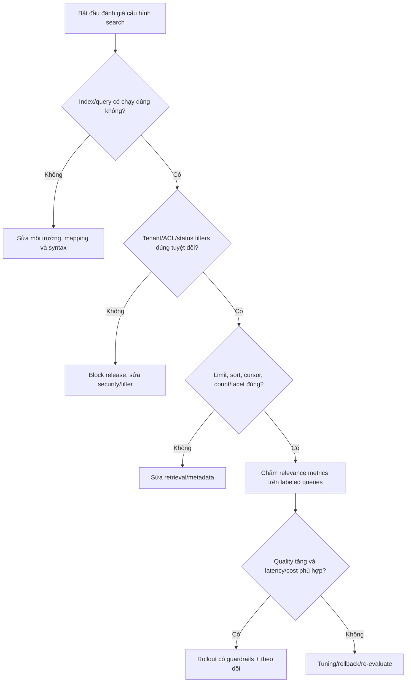

# Bộ lọc, giới hạn kết quả và tiêu chí đánh giá chất lượng tìm kiếm

Một API tìm kiếm sản phẩm có thể trả về đúng các từ khóa nhưng vẫn **không đạt chất lượng**: trả sản phẩm của tenant khác, hiển thị hàng chưa xuất bản, bỏ qua khoảng giá người dùng đã chọn, trả hàng trăm nghìn kết quả cho một request hoặc xếp sản phẩm ít liên quan lên đầu. Ngược lại, một truy vấn rất nhanh nhưng luôn trả danh sách rỗng do dùng sai loại index cũng không phải tìm kiếm tốt.

Để xây chức năng tìm kiếm đáng tin cậy với **Spring Data MongoDB**, cần thiết kế đồng thời ba lớp:

1. **Bộ lọc (eligibility):** xác định tài liệu *được phép* xuất hiện, như tenant, trạng thái, quyền truy cập, khoảng giá, thời gian và danh mục.
2. **Giới hạn, sắp xếp và phân trang (retrieval):** trả tập kết quả có kích thước hợp lý, ổn định, không tải cả collection vào bộ nhớ.
3. **Đánh giá chất lượng (evaluation):** đo mức phù hợp của kết quả với nhu cầu tìm kiếm, độ bao phủ, an toàn dữ liệu, độ trễ và sự ổn định qua thời gian.

Ví dụ:

```text
Người dùng T1 tìm "bàn làm việc"
            │
            ▼
Từ khóa: "bàn làm việc"     → relevance matching/scoring
Tenant: T1                 → hard filter, không được vượt qua
Trạng thái: PUBLISHED      → hard filter
Giá: 1–5 triệu đồng       → hard filter
Danh mục: furniture        → hard filter tùy bộ lọc UI
            │
            ▼
Top 20 kết quả hợp lệ, xếp hạng theo relevance
            │
            ▼
Đánh giá: P@10 / Recall@20 / NDCG@10 / p95 latency
```

Bài học thuộc chương **Tìm kiếm nâng cao** của module **SPRING_DATA_MONGODB**: sử dụng Spring Data MongoDB để kết nối, ánh xạ document và thao tác MongoDB qua `MongoTemplate` hoặc repository; thực hành thiết kế truy vấn, aggregation, index, transaction, reactive access, kiểm thử và chẩn đoán hiệu năng dữ liệu. Trọng tâm ở đây là **bộ lọc, giới hạn kết quả và tiêu chí đánh giá chất lượng tìm kiếm**. Các ví dụ tập trung vào MongoDB Search (thường được biết đến qua Atlas Search) kết hợp truy vấn MongoDB thông thường; tính khả dụng của `$search` và từng tính năng phụ thuộc phiên bản, topology và dịch vụ Search của deployment.

Sau bài này, bạn sẽ có thể:

- Phân biệt query `$match`/`Criteria`, `$text` truyền thống và MongoDB Search `$search`.
- Thiết kế `compound.must`, `compound.filter`, `compound.should`, `compound.mustNot` để tách điều kiện bắt buộc và điểm relevance.
- Chọn kiểu index cho trường văn bản, chuỗi lọc chính xác, số, ngày; kiểm tra sự khác biệt giữa **Search index** và **B-tree index**.
- Cố định tenant và quyền truy cập trong truy vấn, kể cả count, facet, suggestions và các trang tiếp theo.
- Giới hạn page size, sắp xếp ổn định và dùng `searchAfter`/`searchSequenceToken` khi phù hợp.
- Lấy count/facet qua `$searchMeta`; không diễn giải `lowerBound` như tổng chính xác.
- Xây pipeline từ Java bằng `MongoTemplate` và `AggregationOperation` mà không nối JSON từ input tùy ý.
- Đo chất lượng bằng `Precision@k`, `Recall@k`, `MRR`, `NDCG@k`, tỷ lệ zero results, latency và tiêu chí an toàn.
- Thiết kế tập nhãn truy vấn (relevance judgments), baseline, regression tests và thực nghiệm cải thiện thứ hạng.

## 1. Phân rã một yêu cầu tìm kiếm

### 1.1. Một yêu cầu gồm điều kiện tìm và điều kiện được phép thấy

Giả sử API nhận:

```json
{
  "query": "bàn làm việc",
  "category": "furniture",
  "priceMinCents": 100000000,
  "priceMaxCents": 500000000,
  "onlyAvailable": true,
  "pageSize": 20
}
```

Ví dụ dùng `priceCents` (số nguyên theo đơn vị nhỏ nhất) để tránh sai số số thực trong minh họa. Nếu miền tiền tệ có quy định khác, chọn mô hình lưu tiền phù hợp (ví dụ Decimal128) và kiểm tra cú pháp/kiểu index tương ứng. **`tenantId` không có trong JSON yêu cầu**: server lấy nó từ authentication/authorization, không cho client tự chọn tenant để tìm tài liệu của người khác.

Hợp đồng thực tế có thể phân loại:

| Thành phần | Ví dụ | Tính chất |
| --- | --- | --- |
| Search text | `bàn làm việc` | Tạo candidate và điểm relevance |
| Tenant | `T1` | **Bắt buộc**, thuộc security boundary |
| Visibility | `PUBLISHED` | **Bắt buộc** theo quyền hiển thị |
| Category | `furniture` | Bộ lọc faceted do UI chọn |
| Giá | từ 1 đến 5 triệu | Bộ lọc khoảng |
| Có hàng | `available=true` | Bộ lọc tồn kho theo mô hình của app |
| Sort | relevance giảm dần | Thứ tự mặc định |
| Limit | tối đa 20 | Tài nguyên/UX |
| Cursor | token trang sau | Gắn với cùng search/filter/sort |

Không nên cho bộ lọc security biến thành **điểm ưu tiên**: tài liệu của tenant khác không được “xuống cuối danh sách”, mà phải **bị loại hoàn toàn**.

### 1.2. Chất lượng có nhiều chiều

Một chức năng tìm kiếm tốt đồng thời phải:

- **Đúng quyền:** không rò rỉ dữ liệu ngoài tenant/ACL.
- **Đúng bộ lọc:** mọi kết quả thỏa filter bắt buộc.
- **Đủ kết quả liên quan:** không loại nhầm sản phẩm hợp lệ.
- **Xếp hạng hữu ích:** kết quả phù hợp xuất hiện sớm.
- **Dễ điều hướng:** sort/page/facet rõ ràng, không lặp trang do tie.
- **Nhanh và ổn định:** latency p50/p95/p99, throughput và memory có thể chấp nhận.
- **Quan sát được:** có benchmark, test, telemetry và ngưỡng cảnh báo.

**Số kết quả nhiều không đồng nghĩa chất lượng cao.** Một query trả 10.000 item nhưng top 10 toàn item sai mục đích có thể kém hơn một query trả 20 item đúng.

## 2. Chọn công cụ truy vấn đúng loại

### 2.1. `Criteria`/`$match` cho điều kiện chính xác

Nếu chỉ lọc tenant, category, giá và trạng thái, MongoDB query thông thường rất phù hợp:

```javascript
db.catalog_search_lab.find({
  tenantId: "T1",
  status: "PUBLISHED",
  category: "furniture",
  available: true,
  priceCents: { $gte: 100000000, $lte: 500000000 }
})
.sort({ updatedAt: -1, _id: -1 })
.limit(20);
```

Với index phù hợp, query `find`/`Criteria` có thể xử lý rất tốt những bộ lọc cấu trúc này. Nó **không tự có điểm relevance full-text** hay các khả năng analyzer/synonyms/facets đặc thù của MongoDB Search.

### 2.2. `$text` và `$regex` không tương đương MongoDB Search

MongoDB có `$text` trên **text index** truyền thống, và `$regex` để tìm mẫu chuỗi:

```javascript
db.catalog_search_lab.find({
  $text: { $search: "desk" },
  tenantId: "T1"
}, {
  score: { $meta: "textScore" }
})
.sort({ score: { $meta: "textScore" } })
.limit(20);
```

`textScore` là metadata của `$text` truyền thống, **khác** `searchScore` của MongoDB Search. `$regex` có những use case cụ thể nhưng không mặc định hỗ trợ stemming, synonyms, ranking full-text như MongoDB Search; biểu thức regex tự do từ client còn có thể gây truy vấn tốn CPU hoặc rủi ro injection nếu xây query sai.

### 2.3. MongoDB Search `$search`

MongoDB Search dùng **Search index riêng** và `$search` làm một aggregation stage:

```javascript
db.catalog_search_lab.aggregate([
  {
    $search: {
      index: "catalog_search_v1",
      text: {
        query: "desk",
        path: ["title", "description"]
      }
    }
  },
  { $limit: 20 },
  {
    $project: {
      title: 1,
      category: 1,
      score: { $meta: "searchScore" }
    }
  }
]);
```

Khác với query thông thường, `$search` dựa trên dữ liệu đã được lập **MongoDB Search index**. Nó không nhất thiết chạy được trên một MongoDB standalone bất kỳ; phải xác nhận deployment hỗ trợ MongoDB Search (ví dụ MongoDB Atlas hoặc phiên bản self-managed có Search đúng cấu hình). Search index có trạng thái build/synchronization riêng. Độ trễ đồng bộ index có thể ảnh hưởng khả năng nhìn thấy document mới.

### 2.4. `$search` và `$searchMeta` là các stage đầu pipeline

`$search`/`$searchMeta` phải đứng **đầu pipeline** mà chúng được dùng, với các ràng buộc cú pháp của phiên bản triển khai. Không đặt một `$match` trước `$search` để “lọc bớt tenant rồi mới search”.

Nếu muốn tận dụng Search index để lọc trước khi scoring, đặt các bộ lọc trong `$search.compound.filter`. Một `$match` **sau** `$search` có thể dùng cho xử lý bổ sung nhưng không thay thế thiết kế filter sớm, đặc biệt khi kết quả đã được giới hạn hoặc count/facet cần phản ánh cùng điều kiện quyền.

## 3. Thiết kế dữ liệu và Search index

### 3.1. Mô hình document tìm kiếm

```javascript
{
  _id: ObjectId("..."),
  tenantId: "T1",
  externalId: "SKU-100",
  title: "Bàn làm việc điều chỉnh độ cao",
  description: "Bàn làm việc cho không gian nhỏ",
  category: "furniture",
  tags: ["desk", "office"],
  status: "PUBLISHED",
  available: true,
  priceCents: NumberLong("290000000"),
  updatedAt: ISODate("2026-11-20T09:00:00Z")
}
```

Chọn field đúng công dụng:

- `title/description`: trường cần phân tích ngôn ngữ và scoring.
- `tenantId/externalId/category/status/tags`: chuỗi lọc/sort/facet **chính xác**.
- `available`: boolean filter.
- `priceCents`: number range.
- `updatedAt`: date range và sort theo thời gian.

Trong production, nếu document chứa bí mật/field không được hiển thị, phải whitelist field trả về và bảo vệ quyền ngay cả ở các tính năng facet/count/suggestion.

### 3.2. Search index khác MongoDB B-tree index

| Index | Dùng với | Phục vụ |
| --- | --- | --- |
| Search index `catalog_search_v1` | `$search`, `$searchMeta` | Text analyzed, filter trong Search, relevance, facets |
| MongoDB index `{tenantId:1,externalId:1}` | `find/update`, unique constraint | ID nghiệp vụ và dữ liệu chuẩn |
| MongoDB index `{tenantId:1,status:1,updatedAt:-1,_id:-1}` | `find` có sort | Bộ lọc thường, fallback hoặc luồng không dùng Search |

Một MongoDB `createIndex(...)` thông thường **không tự tạo Search index**. Ngược lại, Search index không thay thế unique index hoặc transaction constraint.

### 3.3. Định nghĩa Search index có kiểm soát

Ví dụ index `catalog_search_v1`:

```javascript
{
  mappings: {
    dynamic: false,
    fields: {
      title:       { type: "string" },
      description: { type: "string" },
      tenantId:    { type: "token" },
      externalId:  { type: "token" },
      category:    { type: "token" },
      tags:        { type: "token" },
      status:      { type: "token" },
      available:   { type: "boolean" },
      priceCents:  { type: "number" },
      updatedAt:   { type: "date" }
    }
  }
}
```

**`token`** cho phép match/sort/facet trên giá trị chuỗi chính xác (theo semantics analyzer/normalizer của field). Nếu dùng `equals` hoặc `in` với chuỗi, việc chỉ index field dưới dạng `string` full-text có thể không đáp ứng. `string` dành cho text analysis; cùng một field có thể cần cấu hình đa kiểu/multi-field phù hợp nếu nó được vừa search vừa sort/filter chính xác.

Với tiếng Việt, phân đoạn từ, dấu, normalization và synonyms có thể ảnh hưởng rất mạnh đến recall. Không mặc định analyzer chuẩn tiếng Anh sẽ xử lý mọi truy vấn tiếng Việt đúng như người dùng mong đợi; cần thử nghiệm trên một tập query có dấu/không dấu, viết tắt và từ ghép. Khi thay index/analyzer, đo chất lượng lại thay vì chỉ kiểm tra pipeline chạy được.

### 3.4. Search index được đồng bộ riêng

Tạo/sửa document không có nghĩa Search index đã cập nhật **đồng thời** ngay khi MongoDB write ACK. Khi benchmark sau import, phải chờ index báo trạng thái phù hợp và kiểm tra tài liệu đã tìm thấy; nếu không, bài test đánh giá recall có thể sai do index chưa đồng bộ chứ không phải lỗi relevance.

Đồng thời, không dùng Search index để thay một **authorization check bắt buộc trên source of truth** nếu yêu cầu hệ thống cần phân quyền lập tức sau revoke/visibility update. Cần chiến lược consistency rõ (ví dụ kiểm tra lại permission có độ tin cậy cao trước khi trả dữ liệu), và test các khoảng trễ index.

## 4. Xây bộ lọc với `compound`: match bắt buộc khác score

MongoDB Search hỗ trợ `compound` gồm bốn loại clause: `must`, `filter`, `should` và `mustNot`. Mỗi clause nhận **mảng các operator con**, kể cả khi chỉ có một phần tử.

| Clause | Tài liệu có bắt buộc thỏa? | Có góp điểm relevance? | Trường hợp phù hợp |
| --- | --- | --- | --- |
| `must` | Có | Có | Phải phù hợp từ khóa, title/description |
| `filter` | Có | **Không** | Tenant, trạng thái, khoảng giá, thời gian, quyền |
| `should` | Mặc định thường là ưu tiên, trừ trường hợp chỉ có should hoặc có `minimumShouldMatch` | Có | Boost title match, tag ưu tiên, phrase khớp |
| `mustNot` | Tài liệu khớp bị loại | **Không** | Loại trạng thái bị cấm, blacklist |

`filter` là lựa chọn tự nhiên cho điều kiện chỉ quyết định **được thấy hay không**. Nếu đặt tenant trong `must` với toán tử scoring, có thể vừa tăng công việc scoring vô ích vừa làm thứ hạng thay đổi theo yếu tố không liên quan đến mục đích tìm kiếm. Xem tài liệu MongoDB Search `compound` trong mục Tài liệu tham khảo ở cuối bài.

### 4.1. Bộ lọc tenant, trạng thái, availability, khoảng giá

```javascript
db.catalog_search_lab.aggregate([
  {
    $search: {
      index: "catalog_search_v1",
      compound: {
        must: [
          {
            text: {
              query: "desk",
              path: ["title", "description"]
            }
          }
        ],
        filter: [
          { equals: { path: "tenantId", value: "T1" } },
          { equals: { path: "status", value: "PUBLISHED" } },
          { equals: { path: "available", value: true } },
          { equals: { path: "category", value: "furniture" } },
          {
            range: {
              path: "priceCents",
              gte: NumberLong("100000000"),
              lte: NumberLong("500000000")
            }
          }
        ]
      }
    }
  },
  { $limit: 20 },
  {
    $project: {
      _id: 1,
      externalId: 1,
      title: 1,
      priceCents: 1,
      score: { $meta: "searchScore" }
    }
  }
]);
```

Đoạn dùng giá trị `"T1"` cố định để minh họa; **API production phải inject tenant từ security context đã xác thực**. Các field lọc chuỗi phải được lập Search index kiểu `token` tương ứng, `available` là boolean và `priceCents` là number. Nếu indexing/mapping khác, query có thể không trả kết quả đúng.

### 4.2. Nếu người dùng không chọn category thì sao?

Đừng tự tạo:

```javascript
{ equals: { path: "category", value: null } }
```

để biểu diễn “không lọc category”. **Không có bộ lọc** nghĩa là **không thêm clause category**. Query builder nên xây danh sách `filter` từ **những trường hợp lệ và thực sự được chọn**, trong khi tenant/status/ACL luôn được thêm từ policy.

Nếu API cần lọc “category chưa được gán”, đó là một nghiệp vụ khác, cần query missing/null phù hợp và Search index semantics rõ ràng.

### 4.3. Nhiều category: `in` thay vì phân rã sai `AND`

Người dùng chọn `furniture` **hoặc** `accessories`:

```javascript
{
  in: {
    path: "category",
    value: ["furniture", "accessories"]
  }
}
```

Đặt hai `equals` category trong cùng mảng `filter` thường biểu diễn **AND**: tài liệu phải đồng thời thỏa cả hai giá trị, không đúng nếu category là một chuỗi đơn. `in` biểu diễn phù hợp với nhu cầu OR trên các giá trị.

Một lựa chọn khác là lồng `compound.should` vào trong `filter`. Khi muốn OR qua nhiều field khác nhau, phương án compound lồng có thể linh hoạt hơn.

### 4.4. OR bên trong filter

Ví dụ cần tài liệu thuộc một trong hai category:

```javascript
{
  compound: {
    should: [
      { equals: { path: "category", value: "furniture" } },
      { equals: { path: "category", value: "accessories" } }
    ],
    minimumShouldMatch: 1
  }
}
```

Đưa đối tượng này vào mảng `compound.filter` ngoài cùng. Khi nó là filter của compound cha, việc match OR chỉ quyết định eligibility, không tự cộng điểm relevance vào score chung của parent.

### 4.5. `mustNot` để loại kết quả

Nếu catalog có field `status` gồm `PUBLISHED`, `HIDDEN`, `DELETED`, điều kiện:

```javascript
mustNot: [
  { equals: { path: "status", value: "DELETED" } }
]
```

chỉ loại DELETED; **nó không đảm bảo tài liệu còn lại là PUBLISHED**. Nếu policy yêu cầu chỉ hiển thị PUBLISHED, hãy dùng **positive filter**:

```javascript
filter: [
  { equals: { path: "status", value: "PUBLISHED" } }
]
```

Positive allowlist thường an toàn hơn blacklist khi sau này xuất hiện một trạng thái mới như `DRAFT` hay `EMBARGOED`.

### 4.6. `must` và `should`: khớp bắt buộc so với ưu tiên

```javascript
compound: {
  must: [{
    text: {
      query: "desk",
      path: ["title", "description"]
    }
  }],
  should: [{
    phrase: {
      query: "office desk",
      path: "title",
      score: { boost: { value: 3 } }
    }
  }],
  filter: [
    { equals: { path: "tenantId", value: "T1" } },
    { equals: { path: "status", value: "PUBLISHED" } }
  ]
}
```

Trong ví dụ, mọi kết quả **phải** khớp text và các bộ lọc; tài liệu có phrase trong title còn nhận thêm ưu tiên. `should` không phải lúc nào cũng chỉ là optional: nếu một compound **chỉ có should** và không có must/filter, MongoDB Search yêu cầu tối thiểu một should match; `minimumShouldMatch` còn có thể yêu cầu số clause tối thiểu.

### 4.7. Các giới hạn phải được validate

Một bộ lọc hợp lệ về cú pháp chưa chắc hợp lệ về nghiệp vụ:

- `priceMinCents > priceMaxCents`: trả 400, đừng chạy query vô nghĩa.
- `pageSize <= 0` hoặc vượt ngưỡng: từ chối/giới hạn rõ ràng.
- Danh mục không được phép hoặc string quá dài: validation/allowlist.
- Khoảng ngày vô hạn với query quá rộng: giới hạn tài nguyên hoặc xử lý như một chế độ khác.
- Tags/list quá dài: giới hạn số phần tử và độ dài.
- Query text rỗng: quyết định rõ “browse catalog” hay lỗi 400, không tự biến thành toàn bộ collection.
- Regex/query DSL do client gửi: không đưa thẳng vào cấu trúc `$search` mà không có parser/allowlist.

**Bộ lọc được áp dụng trên server**; UI filter là thuận tiện, không thể là hàng rào an toàn dữ liệu.

## 5. Quyền truy cập và filter consistency là điều kiện chất lượng số một

### 5.1. Tenant filter phải gắn vào mọi đường tìm kiếm

Giả sử client gửi:

```json
{
  "tenantId": "T2",
  "query": "desk"
}
```

trong khi authentication xác nhận user chỉ thuộc T1. Server **không dùng `tenantId=T2`** để tạo Search filter. Nó phải dùng T1 theo security/authorization policy, hoặc từ chối request nếu scope không hợp lệ.

```text
Trusted tenant resolver
       │
       ▼
tenantId = "T1"
       │
       ▼
$search.compound.filter contains
  equals(path="tenantId", value="T1")
       │
       ▼
Result docs, count, facets, pagination
  đều phải áp dụng cùng quyền
```

### 5.2. ACL đa nhóm

Ví dụ document chỉ được xem khi nằm trong tenant T1, status PUBLISHED và `allowedGroups` giao với nhóm của người dùng:

```javascript
filter: [
  { equals: { path: "tenantId", value: "T1" } },
  { equals: { path: "status", value: "PUBLISHED" } },
  {
    in: {
      path: "allowedGroups",
      value: ["team:design", "team:buyer"]
    }
  }
]
```

Nếu cần lọc ACL kiểu này, field `allowedGroups` cũng phải được Search index dưới loại phù hợp (ví dụ `token`). Danh sách nhóm **phải đến từ hệ thống quyền tin cậy**, không lấy từ một tham số JSON user tự gửi.

Những trường hợp tài liệu public **hoặc** thuộc nhóm được phép nên biểu diễn bằng OR lồng trong filter, đồng thời vẫn giữ tenant/status bên ngoài OR. Không để một nhánh OR vô tình thiếu tenant.

### 5.3. Rủi ro stale permission trong Search index

Search index có thể đồng bộ bất đồng bộ với collection. Nếu document vừa bị revoke quyền, một Search query có thể còn thấy trạng thái cũ trong khoảng thời gian tùy hệ thống. Với yêu cầu bảo mật **không cho phép trễ revoke**, cần kiểm tra lại quyền dựa trên source of truth/điều kiện nhất quán trước khi trả document; filter Search là cần thiết nhưng có thể chưa đủ.

Hãy phân biệt:

- **Search prefilter:** giảm candidate và hạn chế rò rỉ thông thường.
- **Final authorization gate:** ngăn trả dữ liệu nếu quyền đã bị thu hồi hoặc Search index chậm.
- **Facet/count policy:** metadata cũng có thể rò rỉ sự tồn tại/số lượng tài liệu. Không lấy tổng count/facet của toàn tenant rồi chỉ post-filter danh sách hiển thị.

Nếu cần quyền tuyệt đối tại thời điểm trả response, thiết kế query/authorization strategy phù hợp với consistency của từng deployment, kể cả việc giới hạn/ẩn metadata không có thể kiểm chứng an toàn.

### 5.4. Test quyền là một phần của search quality

Test bắt buộc:

1. Document T2 trùng từ khóa với T1 nhưng **không bao giờ** xuất hiện ở API của T1.
2. Document HIDDEN/DELETED không xuất hiện khi policy chỉ cho PUBLISHED.
3. Count/facet của T1 không cộng tài liệu T2.
4. Cursor không cho phép đổi filter sang tenant T2.
5. Thêm/revoke quyền rồi search trong cửa sổ Search index lag; kiểm tra final authorization.
6. Query lỗi/timeout không được fallback sang một query thiếu điều kiện quyền.

**Tỷ lệ rò rỉ tài liệu không được phép phải bằng 0 trong bộ test security**. Một Search engine có NDCG cao nhưng lộ dữ liệu tenant khác vẫn là không đạt.

## 6. Scoring và độ liên quan: boost không thay hard filter

### 6.1. MongoDB Search trả điểm `searchScore`

MongoDB Search xếp hạng tài liệu theo relevance score (theo operator và scoring configuration). Có thể chiếu điểm ra response để quan sát:

```javascript
{
  $project: {
    _id: 1,
    title: 1,
    category: 1,
    score: { $meta: "searchScore" }
  }
}
```

Điểm này **không phải xác suất** tài liệu đúng, không phải phần trăm 0–100 và không nên so trực tiếp giữa các query/index versions mà không có baseline. Score bị ảnh hưởng bởi analyzer, operator, corpus, index/scoring configuration và boost.

### 6.2. Trọng số các trường

Ví dụ coi title quan trọng hơn description:

```javascript
compound: {
  should: [
    {
      text: {
        query: "desk",
        path: "title",
        score: { boost: { value: 4 } }
      }
    },
    {
      text: {
        query: "desk",
        path: "description",
        score: { boost: { value: 1 } }
      }
    }
  ],
  minimumShouldMatch: 1,
  filter: [
    { equals: { path: "tenantId", value: "T1" } },
    { equals: { path: "status", value: "PUBLISHED" } }
  ]
}
```

Nếu query chỉ có `should` mà không có `must`, `minimumShouldMatch:1` yêu cầu ít nhất một matching clause. Trọng số `4` và `1` chỉ là điểm khởi đầu **để thử nghiệm**, không được xem là cấu hình tối ưu tuyệt đối.

### 6.3. Boost không được dùng để diễn đạt quyền

Sai về bảo mật:

```javascript
should: [
  { equals: {
      path: "tenantId",
      value: "T1",
      score: { boost: { value: 1000 } }
  }}
]
```

Tài liệu T2 **vẫn có thể được trả về** nếu các điều kiện khác match, chỉ với score thấp hơn. Quyền truy cập phải nằm trong `filter` hoặc một điều kiện bắt buộc tương đương.

### 6.4. `minimumShouldMatch` là một đòn bẩy recall–precision

Giả sử query được tách thành ba tín hiệu:

- Khớp title.
- Khớp description.
- Khớp tags.

Yêu cầu **ít nhất hai tín hiệu** bằng `minimumShouldMatch:2` có thể nâng precision nhưng loại những tài liệu tốt chỉ khớp title. Đặt bằng 1 có thể tăng recall nhưng trả nhiều tài liệu nhiễu.

**Không chọn tham số này chỉ bằng trực giác**. Đo `Precision@10`, `Recall@20`, `NDCG@10` và zero-result rate trên tập truy vấn có nhãn, đồng thời kiểm tra các query hiếm.

### 6.5. Score threshold cần được hiệu chỉnh

Một ý tưởng thường gặp là “lọc mọi kết quả có `score < 2.0`”. Threshold số tuyệt đối có thể không ổn định khi thay analyzer, boosted fields, corpus hoặc index version.

Nếu muốn tránh kết quả quá yếu:

- Hiểu score distribution theo từng loại query.
- Test threshold trên labeled dataset và đo trade-off precision/recall.
- Theo dõi tỷ lệ zero results sau threshold.
- Không coi score của MongoDB Search là thước đo đã được calibration sẵn.
- Cân nhắc business rules hard filter riêng thay vì dùng score để thay thế tính hợp lệ.

## 7. Giới hạn kết quả, sort và phân trang

### 7.1. Luôn đặt page size ceiling

API không nên cho client gửi `size=1000000` rồi trả một triệu document:

```java
if (pageSize < 1 || pageSize > 50) {
    throw new IllegalArgumentException("pageSize phải từ 1 đến 50");
}
```

Giá trị **50 chỉ là ví dụ policy**, không phải giới hạn cố định của MongoDB. Chọn tối đa dựa trên tài nguyên, kích thước document, SLA, thiết bị client, cách serialize và số lượng request đồng thời. Ngoài `$limit`, cần `$project` chỉ field được phép và thực sự cần.

### 7.2. Vì sao đặt `$limit` ngay sau `$search`?

```javascript
db.catalog_search_lab.aggregate([
  { $search: { /* cùng điều kiện search + filter */ } },
  { $limit: 20 },
  { $project: { title: 1, externalId: 1 } }
]);
```

Ý tưởng này tránh phát hàng nghìn result vào các stage xử lý downstream không cần thiết. Tuy nhiên `$search` vẫn có thể phải xét nhiều candidate trong index để tạo top results; **`$limit:20` không bảo đảm search execution chỉ kiểm tra 20 document**.

Thứ tự các stage làm thay đổi ý nghĩa:

```text
$search → $limit:20 → $match:{category:"furniture"}
```

không giống:

```text
$search compound.filter(category) → $limit:20
```

Trường hợp đầu có thể lọc mất phần lớn top 20 rồi trả chỉ 3 item, dù phía sau còn nhiều furniture phù hợp. Với điều kiện có thể đưa vào Search index, ưu tiên **lọc bên trong `compound.filter` trước khi lấy top k**.

### 7.3. Thứ tự theo relevance, rồi tie-breaker ổn định

Khi nhiều tài liệu có cùng score, thứ tự có thể không xác định nếu thiếu tie-breaker. Trong Search index đã khai báo `externalId` là `token`, và hệ thống bảo đảm `(tenantId,externalId)` unique, có thể sắp theo:

```javascript
db.catalog_search_lab.aggregate([
  {
    $search: {
      index: "catalog_search_v1",
      compound: {
        must: [{
          text: {
            path: ["title", "description"],
            query: "desk"
          }
        }],
        filter: [
          { equals: { path: "tenantId", value: "T1" } },
          { equals: { path: "status", value: "PUBLISHED" } }
        ]
      },
      sort: {
        score: { $meta: "searchScore" },
        externalId: 1
      }
    }
  },
  { $limit: 20 },
  {
    $project: {
      title: 1,
      externalId: 1,
      score: { $meta: "searchScore" }
    }
  }
]);
```

MongoDB Search hỗ trợ sort trên các field được index với type phù hợp. Nếu `externalId` không thực sự duy nhất trong tập kết quả được phép, nó **không phải tie-breaker đủ mạnh**: chọn một khóa unique/immutable thích hợp.

### 7.4. Sort theo mới nhất khác sort theo relevance

Người dùng có thể chọn:

| Sort mode | Tiêu chí | Trade-off |
| --- | --- | --- |
| `relevance` | `searchScore DESC, externalId ASC` | Đưa tài liệu phù hợp lên trước |
| `newest` | `updatedAt DESC, externalId ASC` | Tài liệu mới lên đầu, có thể ít phù hợp hơn |
| `price_asc` | `priceCents ASC, externalId ASC` | Giá thấp lên trước; relevance không còn ưu tiên chính |
| `price_desc` | `priceCents DESC, externalId ASC` | Giá cao lên trước; cần xác nhận UX |

Chỉ cho phép **sort modes từ allowlist của server**. Không nhận object sort tùy ý từ client rồi đưa thẳng vào pipeline. Nếu UX muốn kết hợp relevance và freshness, thiết kế scoring/reranking có kiểm chứng, không giả định một MongoDB `$sort` sau `$limit` sẽ xếp lại toàn bộ tập kết quả.

### 7.5. Offset pagination với `$skip`

```javascript
db.catalog_search_lab.aggregate([
  { $search: { /* query + filters + stable sort */ } },
  { $skip: 40 },
  { $limit: 20 }
]);
```

Đây là trang thứ ba với page size 20 nếu đánh số trang từ 0. Cần dùng công thức:

\[
\text{offset}=\text{pageNumber}\times\text{pageSize}.
\]

`$skip` trang sâu có thể tốn tài nguyên và khi dữ liệu/index thay đổi giữa các lần gọi có thể dẫn đến trùng/bỏ sót kết quả. MongoDB khuyên dùng `searchAfter`/`searchBefore` khi duyệt tuần tự nhiều trang trên deployment hỗ trợ.

### 7.6. `searchAfter` và `searchSequenceToken`

Trên deployment/phiên bản hỗ trợ (tài liệu MongoDB Search nêu pagination token trên cluster MongoDB **7.0.5+**, với các ràng buộc deployment hiện hành), có thể lấy một token từ mỗi kết quả:

```javascript
const pageOne = db.catalog_search_lab.aggregate([
  {
    $search: {
      index: "catalog_search_v1",
      compound: {
        must: [{
          text: { query: "desk", path: ["title", "description"] }
        }],
        filter: [
          { equals: { path: "tenantId", value: "T1" } },
          { equals: { path: "status", value: "PUBLISHED" } }
        ]
      },
      sort: {
        score: { $meta: "searchScore" },
        externalId: 1
      }
    }
  },
  { $limit: 10 },
  {
    $project: {
      title: 1,
      externalId: 1,
      score: { $meta: "searchScore" },
      paginationToken: { $meta: "searchSequenceToken" }
    }
  }
]).toArray();

const nextCursor = pageOne.length === 0
  ? null
  : pageOne[pageOne.length - 1].paginationToken;

printjson({ nextCursor });
```

Trang hai dùng **cùng operator, filter và sort** với thêm `searchAfter`:

```javascript
const pageTwo = nextCursor === null
  ? []
  : db.catalog_search_lab.aggregate([
      {
        $search: {
          index: "catalog_search_v1",
          compound: {
            must: [{
              text: {
                query: "desk",
                path: ["title", "description"]
              }
            }],
            filter: [
              { equals: { path: "tenantId", value: "T1" } },
              { equals: { path: "status", value: "PUBLISHED" } }
            ]
          },
          sort: {
            score: { $meta: "searchScore" },
            externalId: 1
          },
          searchAfter: nextCursor
        }
      },
      { $limit: 10 },
      {
        $project: {
          title: 1,
          externalId: 1,
          paginationToken: { $meta: "searchSequenceToken" }
        }
      }
    ]).toArray();

printjson(pageTwo);
```

**Token không phải snapshot cố định.** Nếu document được thêm/xóa/sửa giữa hai lần query, hoặc scoring thay đổi theo index/search nodes, kết quả có thể thay đổi. Với pagination nhạy cảm, cần hợp đồng dữ liệu và test phù hợp.

### 7.7. Cursor phải gắn với query/filter/sort/tenant

Trong API, cursor nên được xử lý như một **giá trị opaque**. Ngoài token của Search, có thể gắn version và fingerprint của:

```text
tenantId từ authentication
query text đã normalize
category/price/date/status/ACL filters
sort mode
index/query version
pageSize
expiry
```

Ví dụ lưu chúng trong state của server hoặc ký một envelope cursor chống sửa đổi. Trên request trang sau, **tái xác thực actor và quyền hiện tại**; không cho một client đem token từ T1 sang T2 hoặc đổi filter để truy cập dữ liệu ngoài scope. Token `searchSequenceToken` chỉ được dùng với **cùng search query semantics/sort** tương ứng; nó không nên bị giải mã/chỉnh nội dung bằng tay.

### 7.8. `size+1` để biết còn trang tiếp theo

Muốn trả 20 item và `hasNext` mà không cần exact count, yêu cầu tối đa **21** item:

```text
requested pageSize = 20
database limit = 21
if items.size() > 20: hasNext = true
return only first 20 items
nextCursor = token của item thứ 20
```

**Không lấy token của item thứ 21**, vì trang sau sẽ bỏ qua item này. `size+1` hỗ trợ UX nhưng không thay count chính xác; khi concurrent writes/index lag, `hasNext` chỉ là observation tại thời điểm truy vấn.

## 8. Count và facet: metadata phải dùng cùng phạm vi lọc

### 8.1. `$searchMeta` dành cho count/facets

Nếu chỉ muốn số lượng kết quả phù hợp:

```javascript
db.catalog_search_lab.aggregate([
  {
    $searchMeta: {
      index: "catalog_search_v1",
      compound: {
        must: [{
          text: { query: "desk", path: ["title", "description"] }
        }],
        filter: [
          { equals: { path: "tenantId", value: "T1" } },
          { equals: { path: "status", value: "PUBLISHED" } }
        ]
      },
      count: { type: "total" }
    }
  }
]);
```

`$searchMeta` trả **metadata**, không trả danh sách sản phẩm. `count.type:"total"` yêu cầu total count; `type:"lowerBound"` trả lower-bound count, thường rẻ hơn khi tập kết quả lớn, với `threshold` tùy cấu hình. Không đổi nhãn `lowerBound` thành “chính xác N sản phẩm” nếu N chỉ là giới hạn dưới.

### 8.2. Lower-bound count và thông điệp UX

```javascript
count: {
  type: "lowerBound",
  threshold: 1000
}
```

Nếu metadata:

```javascript
{ count: { lowerBound: NumberLong("1000") } }
```

thì có thể diễn đạt theo UX **“ít nhất 1.000 kết quả”**, không khẳng định chính xác tổng bằng 1.000. Exact total có thể tăng latency hoặc tải, nên chỉ dùng khi UI/business thật sự cần.

### 8.3. Facet theo category

Facet trả số lượng theo bucket để UI hiển thị:

```text
Furniture       12
Accessories      7
Lighting         3
```

Ví dụ truy vấn:

```javascript
db.catalog_search_lab.aggregate([
  {
    $searchMeta: {
      index: "catalog_search_v1",
      facet: {
        operator: {
          compound: {
            must: [{
              text: {
                query: "desk",
                path: ["title", "description"]
              }
            }],
            filter: [
              { equals: { path: "tenantId", value: "T1" } },
              { equals: { path: "status", value: "PUBLISHED" } }
            ]
          }
        },
        facets: {
          categoryFacet: {
            type: "string",
            path: "category",
            numBuckets: 10
          }
        }
      }
    }
  }
]);
```

Ở Search index, `category` phải được lập kiểu `token` để hỗ trợ **string facets**. Count của mỗi bucket gắn với phạm vi query/operator, không phải count của toàn collection.

### 8.4. Facet tự lọc và UX đa lựa chọn

Giả sử user đã chọn category `furniture`. Nếu bạn **đặt filter category trước khi tính category facet**, facet có thể chỉ còn furniture và không cho biết có bao nhiêu kết quả accessories.

Có hai thiết kế:

- **Facets trên kết quả sau mọi filter:** phản ánh đúng tập hiện tại nhưng ít thông tin về lựa chọn khác.
- **Facets ngoại trừ chính chiều filter đang hiển thị:** giữ các category candidates để UI cho phép chuyển/đa chọn, nhưng vẫn áp dụng tenant/status/ACL và các filter bắt buộc khác.

Nếu dùng tính năng facet đa lựa chọn mới như `doesNotAffect`, cần xác minh hỗ trợ theo phiên bản cụ thể. Một lựa chọn dễ kiểm chứng hơn là chạy **query facet riêng**, bỏ chỉ filter category khi tính categoryFacet, nhưng tuyệt đối **không bỏ tenant/ACL**.

### 8.5. `$searchMeta` khác `$facet` sau pipeline

MongoDB aggregation cũng có `$facet` để rẽ nhiều nhánh xử lý. Tuy nhiên:

- `$searchMeta` là Search stage metadata chuyên biệt.
- `$search` có thể lưu metadata trong `$$SEARCH_META` để dùng ở các stage sau được hỗ trợ.
- `$facet` của aggregation có các giới hạn về vị trí stage và bộ nhớ riêng.
- Không đưa `$search` vào trong một nhánh `$facet` thông thường rồi mong nó hoạt động như Search first stage.

Trong API chỉ cần count/facets, `$searchMeta` là lựa chọn trực tiếp. Nếu vừa cần result docs vừa cần metadata trong một response, cân nhắc hai truy vấn hoặc cơ chế `$$SEARCH_META` theo semantics phiên bản và tính nhất quán yêu cầu.

### 8.6. Count và content có thể không cùng snapshot

Một API có thể gọi `$search` lấy 20 document rồi gọi `$searchMeta` lấy count. Nếu catalog thay đổi hoặc Search index cập nhật giữa hai truy vấn, kết quả count có thể không bằng một snapshot chính xác của content đã lấy.

Giao diện cần phân biệt:

- Tổng **tham khảo** phục vụ điều hướng.
- Tổng **chính xác tại một snapshot** (nếu nghiệp vụ bắt buộc, cần kiến trúc/consistency riêng).
- Giới hạn dưới (lower bound).

Không hứa “100% đồng bộ” chỉ vì cả hai pipeline đã dùng cùng filter expression.

## 9. Tích hợp Spring Data MongoDB bằng `MongoTemplate`

### 9.1. Chọn API tích hợp hợp lý

Spring Data MongoDB có `Query`/`Criteria` rất phù hợp cho `find`/`$match` chuẩn. Với một số MongoDB Search stages chưa có builder chuyên dụng trong phiên bản Spring Data đang dùng, có thể:

1. Dùng `AggregationOperation` tự tạo BSON `Document` cho `$search`/`$searchMeta`.
2. Trên phiên bản hỗ trợ, dùng `Aggregation.stage(...)` với JSON hoặc BSON representation.
3. Dùng MongoDB Java Driver thông qua `MongoTemplate.getCollection(...)` cho use case đặc biệt.

**Không nối JSON từ dữ liệu người dùng**:

```java
// SAI: input thay đổi cấu trúc JSON và có nguy cơ injection.
String stage = "{ $search: { text: { query: '" +
    userInput + "' } } }";
```

Để tránh vấn đề escaping/query injection, xây `org.bson.Document` bằng những field/operator **được server định nghĩa trước**, chỉ bind giá trị từ input đã validate.

### 9.2. Request DTO và response DTO

```java
package com.example.search;

import java.util.List;

public record CatalogSearchRequest(
    String text,
    String category,
    Long minPriceCents,
    Long maxPriceCents,
    boolean onlyAvailable,
    int pageSize
) {}

public record CatalogSearchHit(
    String id,
    String externalId,
    String title,
    double score
) {}

public record CatalogSearchPage(
    List<CatalogSearchHit> items,
    boolean hasNext,
    String nextCursor
) {}
```

Trong Java, ba `public record` này thuộc **ba file riêng** nếu khai báo top-level. Ở đây ghép cùng một code block để xem hợp đồng. `nextCursor` là opaque token; không nên hiển thị score/cursor từ nguồn khác cho client nếu có chính sách bảo mật về metadata.

### 9.3. Service chỉ dùng tenant được xác thực

Ví dụ sau minh họa **một trang đầu** theo relevance, dùng `MongoTemplate` và typed `Document`:

```java
package com.example.search;

import java.util.ArrayList;
import java.util.List;
import java.util.Set;
import org.bson.Document;
import org.springframework.beans.factory.annotation.Value;
import org.springframework.data.mongodb.core.MongoTemplate;
import org.springframework.data.mongodb.core.aggregation.Aggregation;
import org.springframework.data.mongodb.core.aggregation.AggregationOperation;
import org.springframework.stereotype.Service;

@Service
public class CatalogSearchService {

    private static final Set<String> CATEGORIES = Set.of(
        "furniture", "accessories", "lighting"
    );

    private final MongoTemplate mongoTemplate;
    private final String collectionName;

    public CatalogSearchService(
            MongoTemplate mongoTemplate,
            @Value("${app.search.collection:catalog_search_lab}")
            String collectionName) {
        this.mongoTemplate = mongoTemplate;
        this.collectionName = collectionName;
    }

    public CatalogSearchPage firstPage(
            String trustedTenantId,
            CatalogSearchRequest request) {

        validate(trustedTenantId, request);
        int size = request.pageSize();

        Document searchStage = buildSearch(
            trustedTenantId, request
        );
        Document projection = new Document("_id", 1)
            .append("externalId", 1)
            .append("title", 1)
            .append("score", new Document("$meta", "searchScore"))
            .append("paginationToken",
                new Document("$meta", "searchSequenceToken"));

        AggregationOperation first = context -> searchStage;
        AggregationOperation project =
            context -> new Document("$project", projection);

        Aggregation aggregation = Aggregation.newAggregation(
            first,
            Aggregation.limit(size + 1L),
            project
        );

        List<Document> raw = mongoTemplate.aggregate(
            aggregation,
            collectionName,
            Document.class
        ).getMappedResults();

        boolean hasNext = raw.size() > size;
        int visibleCount = Math.min(size, raw.size());
        List<CatalogSearchHit> hits =
            new ArrayList<>(visibleCount);

        for (int i = 0; i < visibleCount; i++) {
            Document row = raw.get(i);
            Number score = (Number) row.get("score");
            hits.add(new CatalogSearchHit(
                row.getObjectId("_id").toHexString(),
                row.getString("externalId"),
                row.getString("title"),
                score == null ? 0.0 : score.doubleValue()
            ));
        }

        String cursor = visibleCount == 0
            ? null
            : raw.get(visibleCount - 1)
                .getString("paginationToken");

        return new CatalogSearchPage(hits, hasNext, cursor);
    }

    private Document buildSearch(
            String tenantId, CatalogSearchRequest request) {

        List<Document> filters = new ArrayList<>();
        filters.add(new Document("equals",
            new Document("path", "tenantId")
                .append("value", tenantId)));
        filters.add(new Document("equals",
            new Document("path", "status")
                .append("value", "PUBLISHED")));

        if (request.category() != null) {
            filters.add(new Document("equals",
                new Document("path", "category")
                    .append("value", request.category())));
        }

        if (request.onlyAvailable()) {
            filters.add(new Document("equals",
                new Document("path", "available")
                    .append("value", true)));
        }

        if (request.minPriceCents() != null
                || request.maxPriceCents() != null) {
            Document range = new Document("path", "priceCents");
            if (request.minPriceCents() != null) {
                range.append("gte", request.minPriceCents());
            }
            if (request.maxPriceCents() != null) {
                range.append("lte", request.maxPriceCents());
            }
            filters.add(new Document("range", range));
        }

        Document text = new Document("text",
            new Document("query", request.text().trim())
                .append("path",
                    List.of("title", "description")));

        Document compound = new Document("must", List.of(text))
            .append("filter", filters);

        Document sort = new Document("score",
            new Document("$meta", "searchScore"))
            .append("externalId", 1);

        return new Document("$search",
            new Document("index", "catalog_search_v1")
                .append("compound", compound)
                .append("sort", sort));
    }

    private void validate(
            String tenantId, CatalogSearchRequest request) {

        if (tenantId == null || tenantId.isBlank()
                || request == null
                || request.text() == null
                || request.text().trim().isEmpty()
                || request.text().length() > 128
                || request.pageSize() < 1
                || request.pageSize() > 50) {
            throw new IllegalArgumentException(
                "Search request không hợp lệ");
        }

        if (request.category() != null
                && !CATEGORIES.contains(request.category())) {
            throw new IllegalArgumentException(
                "Category không được hỗ trợ");
        }

        Long min = request.minPriceCents();
        Long max = request.maxPriceCents();

        if ((min != null && min < 0)
                || (max != null && max < 0)
                || (min != null && max != null && min > max)) {
            throw new IllegalArgumentException(
                "Khoảng giá không hợp lệ");
        }
    }
}
```

Giới hạn của ví dụ:

- `app.search.collection` là cấu hình tên collection, mặc định `catalog_search_lab`. Lab `mongosh` ở mục 13 dùng collection ngẫu nhiên; khi chạy Java test cần truyền đúng tên collection và tạo Search index tương ứng. Không lấy tên collection từ input của người dùng.
- `trustedTenantId` phải đến từ một **trusted security/tenant resolver**, không phải client-supplied string không kiểm chứng.
- DTO không cho client chỉ định tên index, field path, operator, ACL hay tenant.
- `AggregationOperation` thô ở đây tạo `Document` trực tiếp; vì không đi qua field-name mapping Java cho các field này, tên field trong stage phải khớp **BSON thực tế**.
- Search index `catalog_search_v1` phải tồn tại và sẵn sàng; MongoDB Search unavailable nên được báo là lỗi phù hợp, **không** thay bằng danh sách rỗng.
- Service chỉ minh họa `firstPage`; một API có cursor cần kiểm tra chữ ký/query fingerprint và cùng sort khi thêm `searchAfter`.
- `score` ở response được đọc dạng `Number` vì `searchScore` trả giá trị numeric; nếu API ẩn score thì bỏ field khỏi DTO công khai nhưng vẫn có thể log metrics an toàn.

### 9.4. Thêm `searchAfter` không phá filter

Để lấy trang tiếp theo, **không** rebuild một query khác:

```java
Document searchStage = buildSearch(trustedTenantId, request);
Document searchBody = searchStage.get(
    "$search", Document.class
);

if (verifiedCursor != null) {
    searchBody.append("searchAfter", verifiedCursor);
}
```

`verifiedCursor` chỉ được nhận sau khi server xác minh cursor gắn đúng tenant/query/filter/sort/index version của request hiện tại. Ví dụ không đưa code decode/signature cụ thể để tránh giả định một format token thuộc về MongoDB; token Search là opaque. Khi lấy `size+1` item, nextCursor phải dùng **token của item cuối trả về**, không phải item overfetch.

### 9.5. Một giải pháp khác cho query thuần cấu trúc

Nếu không có nhu cầu full-text relevance, `MongoTemplate` và `Criteria` gọn hơn:

```java
import org.springframework.data.domain.Sort;
import org.springframework.data.mongodb.core.query.Criteria;
import org.springframework.data.mongodb.core.query.Query;

Query q = Query.query(
    Criteria.where("tenantId").is(trustedTenantId)
        .and("status").is("PUBLISHED")
        .and("category").is("furniture")
        .and("priceCents").gte(100000000L).lte(500000000L)
);
q.with(Sort.by(
    Sort.Order.desc("updatedAt"),
    Sort.Order.desc("_id")
));
q.limit(20);

List<ProductDocument> products =
    mongoTemplate.find(q, ProductDocument.class);
```

`ProductDocument` là entity đã được ứng dụng khai báo; đoạn này minh họa query builder chứ không định nghĩa lại entity ở đây. Dùng MongoDB B-tree indexes đúng filter/sort. Không cần `$search` nếu nghiệp vụ chỉ là lọc chính xác và thứ tự ngày.

### 9.6. ReactiveMongoTemplate giữ nguyên semantics, chỉ khác publisher

```java
import org.springframework.data.mongodb.core.ReactiveMongoTemplate;
import org.springframework.data.mongodb.core.aggregation.Aggregation;
import reactor.core.publisher.Mono;

public Mono<List<Document>> searchReactive(
        ReactiveMongoTemplate template,
        Aggregation aggregation) {
    return template.aggregate(
        aggregation,
        "catalog_search_lab",
        Document.class
    ).collectList();
}
```

Đoạn này dùng aggregation đã được tạo và validate như ở trên. `collectList` phù hợp **khi query đã `$limit` 21 document**, không phù hợp sau một Search không giới hạn có hàng triệu kết quả. Không gọi `block()` hoặc `subscribe()` trong WebFlux service.

### 9.7. Lỗi tìm kiếm là lỗi, không phải kết quả rỗng

Nếu Search index bị thiếu/chưa sẵn sàng hoặc query operator/field type không hợp lệ, pipeline có thể báo lỗi. Không viết:

```java
// NGUY HIỂM: che outage bằng "không có kết quả".
return searchReactive(template, aggregation)
    .onErrorReturn(List.of());
```

Nên phân loại lỗi 4xx do request validation, lỗi 5xx/503 do Search infrastructure, timeout không biết kết quả, và record hợp lệ không match (danh sách rỗng). Một hệ thống search tốt phải cho phép người dùng phân biệt **không tìm thấy** với **hệ thống tìm kiếm không hoạt động**.

## 10. Đánh giá chất lượng offline: xây tập nhãn trước khi tinh chỉnh score

### 10.1. Relevance judgment là gì?

Để tính metric, trước tiên cần câu trả lời “tài liệu nào được xem là liên quan với query này?”. Một bảng nhãn có thể gồm:

| Query | Filter/tenant | Document | Mức liên quan |
| --- | --- | --- | --- |
| `desk` | T1, PUBLISHED | SKU-100 — bàn làm việc | 3 — rất liên quan |
| `desk` | T1, PUBLISHED | SKU-101 — đèn bàn | 0 — không liên quan cho nhu cầu chính |
| `desk` | T1, PUBLISHED | SKU-102 — phụ kiện bàn | 2 — khá liên quan |
| `desk` | T1, PUBLISHED | SKU-103 — bàn học | 1 — liên quan một phần |
| `desk` | T2, PUBLISHED | SKU-900 — bàn làm việc | **Không đủ điều kiện do tenant**, không đưa vào tập relevant của T1 |

Đánh giá chất lượng tìm kiếm phải tính **tập relevant nằm trong phạm vi các hard filters**. SKU-900 có thể rất giống về từ khóa, nhưng với user T1 nó vẫn là một **security violation**, không phải một true positive.

### 10.2. Phân biệt binary relevance và graded relevance

Với **binary relevance**, tài liệu được gán `relevant = 1` hoặc `0`. Các metric Precision@k/Recall@k/MRR thường dùng binary relevance.

Với **graded relevance**, nhãn có thể là 0–3:

```text
0 = không liên quan
1 = có liên quan yếu
2 = liên quan tốt
3 = rất đúng ý định tìm kiếm
```

Một chính sách có thể coi nhãn `>=2` là relevant khi tính Precision/Recall, trong khi NDCG vẫn dùng cả bốn mức. Ngưỡng phải được ghi rõ trong benchmark và giữ nhất quán giữa các phiên bản.

### 10.3. Tập query đại diện, không chỉ query “đẹp”

Một benchmark tốt nên có:

- Query phổ biến, dài/short, truy vấn một từ và nhiều từ.
- Cụm từ có dấu/không dấu, viết sai chính tả, viết tắt, từ đồng nghĩa.
- Query danh mục, mã SKU chính xác, brand, giá, địa điểm nếu có.
- Query hiếm, query không có kết quả, query không rõ ý định.
- Tenant ít/nhiều tài liệu; quyền/visibility khác nhau.
- Query với nhiều filter đồng thời, khoảng giá rất hẹp hoặc thiếu dữ liệu.
- Query trên mobile và các truy vấn người dùng thật đã được ẩn danh phù hợp.

Không điều chỉnh boosts chỉ theo 5 query do người phát triển tự nghĩ; như vậy dễ overfit. Chia tập **tuning/development** và **holdout evaluation** để nhìn hiệu quả ngoài những query dùng khi tinh chỉnh.

### 10.4. Quy trình gán nhãn

1. Chuẩn hóa và phân nhóm query theo intent.
2. Tạo candidate pool từ baseline và các cấu hình thử nghiệm, tránh chỉ gán nhãn document mà một hệ thống duy nhất trả về.
3. Loại trước document sai tenant/ACL hoặc xem chúng là violation riêng.
4. Gán nhãn theo rubric, độc lập với score hệ thống.
5. Với query mơ hồ, ghi nhiều intent và độ liên quan có điều kiện.
6. Có đánh giá chéo và giải quyết bất đồng nhãn đối với case quan trọng.
7. Version hóa query, filter, index, corpus snapshot và rubric.

Nếu tập nhãn không biết phần lớn tài liệu liên quan trong collection, Recall tính từ nhãn sẽ là **ước lượng không đầy đủ**. Khi dùng pooled judgments, phải ghi rõ giới hạn đó.

## 11. Các metric đánh giá relevance và cách tính

### 11.1. Precision@k: trong top k có bao nhiêu kết quả đúng?

Với một query:

\[
\operatorname{Precision@k}
=\frac{\#\{\text{tài liệu liên quan nằm trong top }k\}}{k}.
\]

Ví dụ top 5:

```text
Rank:      1  2  3  4  5
Relevant:  1  0  1  1  0
```

Nếu k=3, top 3 có hai tài liệu liên quan:

\[
P@3=\frac{2}{3}\approx 0.667.
\]

**Định nghĩa cần rõ:** nếu hệ thống trả ít hơn k item, một số báo cáo dùng mẫu số k, một số dùng số item thực trả; phải chọn chính sách nhất quán khi so sánh các phiên bản. Trong bài dùng mẫu số **k cố định** để không thưởng cho hệ thống trả quá ít.

### 11.2. Recall@k: thu hồi được bao nhiêu tài liệu liên quan?

\[
\operatorname{Recall@k}
=\frac{\#\{\text{tài liệu liên quan nằm trong top }k\}}
{\#\{\text{tài liệu liên quan hợp lệ trong tập đánh giá}\}}.
\]

Giả sử có ba tài liệu hợp lệ liên quan tới query và top 3 trả hai:

\[
R@3=\frac{2}{3}\approx 0.667.
\]

Nếu trong toàn bộ tập đánh giá có 100 tài liệu relevant mà top 3 chỉ chứa 2, Recall@3 là 2/100, không phải 2/3. **Mẫu số recall phụ thuộc số relevant đã được biết/đánh nhãn**, do đó việc đánh nhãn thiếu có thể làm metric sai lệch.

Với một query **không có bất kỳ tài liệu relevant hợp lệ**, Recall không có mẫu số bình thường; hãy ghi riêng loại “no-answer queries” và cách hệ thống xử lý, không tự chia 0 rồi gán một điểm có vẻ có nghĩa.

### 11.3. MRR: tài liệu đúng đầu tiên ở vị trí nào?

Mean Reciprocal Rank (MRR) trên Q query:

\[
\operatorname{MRR}=
\frac{1}{|Q|}
\sum_{q\in Q}\frac{1}{\operatorname{rank}_q},
\]

với giá trị của một query bằng **0** nếu không có document relevant trong phạm vi đánh giá.

Ví dụ:

| Query | Vị trí relevant đầu tiên | Reciprocal rank |
| --- | ---: | ---: |
| Q1 | 1 | 1.0 |
| Q2 | 2 | 0.5 |
| Q3 | Không có trong top k | 0 |

MRR = (1 + 0.5 + 0) / 3 = **0.5**.

MRR hữu ích với use case **người dùng tìm một đáp án đúng đầu tiên**, ví dụ tìm sản phẩm bằng mã SKU hoặc tra một tài liệu. Nó ít phản ánh chất lượng của **cả danh sách** khi có nhiều tài liệu relevant; lúc đó NDCG/Precision@k có thể phù hợp hơn.

### 11.4. NDCG@k: thưởng cho kết quả rất liên quan nằm sớm

Với nhãn relevance có mức `rel_i`, một định nghĩa phổ biến:

\[
\operatorname{DCG@k}=
\sum_{i=1}^{k}\frac{2^{rel_i}-1}{\log_2(i+1)}.
\]

`IDCG@k` là điểm DCG lớn nhất của **thứ tự lý tưởng** cho cùng một tập nhãn. Khi `IDCG@k > 0`:

\[
\operatorname{NDCG@k}
=\frac{\operatorname{DCG@k}}{\operatorname{IDCG@k}}.
\]

Ví dụ top 5 có graded relevance:

```text
Rank:       1   2   3   4   5
Relevance:  3   0   2   1   0
```

Với k=3:

\[
\operatorname{DCG@3}
=\frac{2^3-1}{\log_2 2}
+\frac{2^0-1}{\log_2 3}
+\frac{2^2-1}{\log_2 4}
=7+0+1.5=8.5.
\]

Thứ tự lý tưởng top 3 là `[3,2,1]`:

\[
\operatorname{IDCG@3}
=7+\frac{3}{\log_2 3}
+\frac{1}{\log_2 4}
\approx 9.393.
\]

Vậy:

\[
\operatorname{NDCG@3}\approx \frac{8.5}{9.393}
\approx 0.905.
\]

NDCG giúp đánh giá toàn bộ thứ hạng, không chỉ “có bao nhiêu kết quả đúng”. Khi một query không có relevant document (`IDCG=0`), ghi rõ policy xử lý, ví dụ tách khỏi trung bình NDCG và đo riêng zero-result quality; không tự chia cho 0.

### 11.5. Các metric khác cần theo dõi

| Metric | Đo gì | Thích hợp khi |
| --- | --- | --- |
| `Hit@k` | Có ít nhất một relevant ở top k | Lookup/navigation |
| `MAP@k` | Average Precision tích lũy nhiều relevant | Tập có nhiều đáp án |
| `NDCG@10` | Chất lượng graded ranking ở top 10 | Search catalog/blog |
| `Precision@10` | Độ sạch của top 10 | UX trang đầu |
| `Recall@20` | Độ bao phủ relevant ở top 20 | Không bỏ sót ứng viên |
| `MRR@10` | Relevant đầu tiên xuất hiện sớm không | Tìm mã hoặc câu trả lời |
| `Zero-result rate` | Tỷ lệ query trả rỗng | Analyzer/coverage/filters |
| `Invalid-filter rate` | Tỷ lệ request bị reject vì filter sai | API/UX |
| `Forbidden-hit count` | Số document trả ngoài quyền | Security gate, phải bằng 0 trong test |
| `Duplicate-across-pages rate` | Item bị lặp khi phân trang | Cursor/sort stability |
| `Facet consistency` | Buckets phù hợp quyền/filter | Guided search |

Không đo tất cả chỉ để có dashboard. Chọn metric theo **user intent** và quality gates có thể hành động.

### 11.6. Metrics tính trên cùng phạm vi dữ liệu

Nếu baseline có filter `tenant=T1, status=PUBLISHED, category=furniture` mà candidate mới bỏ category, hai kết quả không thể so sánh NDCG công bằng. Benchmark phải cố định:

```text
query text
tenant / permission policy
filter set
sort mode
corpus snapshot / index version
page size
judgment rubric
metric definition
```

Một tăng NDCG do vô tình **bỏ qua hard filter** không được xem là cải thiện: query đó thất bại ngay ở security/filter quality gate.

## 12. Đánh giá online, hiệu năng và quy trình cải tiến

### 12.1. Offline relevance tốt chưa bảo đảm UX tốt

Một cấu hình có NDCG@10 cao hơn có thể:

- Chậm hơn đáng kể ở p95/p99.
- Tăng tỷ lệ query timeout.
- Làm facets quá chậm hoặc không ổn định.
- Tạo nhiều kết quả trùng giữa các trang.
- Đòi Search index lớn và chi phí vận hành cao.
- Làm query hiếm hoặc query có dấu tiếng Việt tệ đi.

Do đó cần kết hợp **offline metric + system metric + online experiment**.

### 12.2. Độ trễ: p50, p95, p99

Một search request gồm nhiều bước:

```text
Auth + request validation
   → MongoDB Search index execution
   → MongoDB document fetch
   → Count/facet query (nếu có)
   → DTO mapping / serialization
   → Network/client
```

Theo dõi:

- `latency_p50`: thời gian trung vị.
- `latency_p95`: 95% request hoàn thành ở hoặc dưới ngưỡng tương ứng.
- `latency_p99`: tail latency hiếm nhưng có thể rất đau.
- Tỷ lệ timeout, Search error, retry/circuit breaker.
- QPS, CPU/Search node utilization, memory và connection pool.
- Kích thước response, số result, số facet buckets.

**Không coi p95 là 95% request nhanh bằng giá trị trung bình**. Percentile là phân vị của **phân bố request** trong thời gian quan sát, cần phân đoạn theo query/filter/page.

### 12.3. Search execution stats và explain

MongoDB Search có các cách kiểm tra execution/profiling riêng theo deployment và version. Cần xem:

- Query có Search index đúng tên, đúng field type hay không.
- Thời gian dành cho search stage và fetch/mapping.
- Loại toán tử (text/phrase/range/equals), số clause và độ phức tạp.
- Có sort/index phù hợp hay phải thực hiện các bước downstream tốn kém.
- `$skip` sâu hoặc thiếu `$limit`.
- Có sử dụng Search metadata/count exact gây chi phí không.

Với MongoDB `find` thông thường, `explain("executionStats")` giúp quan sát `IXSCAN/COLLSCAN` và số document examined. **Không đánh đồng explain của `$search` với query planner/`IXSCAN` của B-tree index**, vì Search sử dụng hạ tầng index khác.

### 12.4. Online click và conversion cần cảnh giác bias

Các chỉ số có thể theo dõi:

```text
search impression
click-through rate (CTR)
long-click / product detail engagement
add-to-cart / conversion (nếu phù hợp)
query reformulation rate
search abandonment
zero-result session rate
time-to-first-useful-result
```

Tuy nhiên, CTR bị **position bias**: item ở vị trí 1 được bấm nhiều hơn một phần vì nó được hiển thị đầu tiên, không nhất thiết vì nó liên quan hơn. Conversion còn chịu ảnh hưởng giá, tồn kho, UI và campaign. Tránh dùng CTR một mình để tuyên bố relevance tốt.

### 12.5. A/B test có quality gates

Một thử nghiệm hợp lý:

1. Giữ nguyên security/tenant filter và dữ liệu nền được phép.
2. Chia traffic hợp lệ theo randomization unit phù hợp (user/session).
3. So baseline với candidate thay đổi analyzer/boost/threshold.
4. Theo dõi `NDCG@k` offline và engagement online.
5. Theo dõi latency p95/p99, error rate, zero results và resource cost.
6. Nếu phát hiện forbidden-hit hoặc policy bypass, dừng thử nghiệm bất kể CTR tăng.
7. Không “đánh cắp” dữ liệu người dùng từ tenant khác để chạy benchmark.

Nên đặt ngưỡng chấp nhận **trước** khi xem kết quả thử nghiệm, có sample size/confidence interval hợp lý. Không diễn giải khác biệt nhỏ của vài chục query như một chứng minh thống kê.

### 12.6. Lưu lại phiên bản index/query và tập đánh giá

Một báo cáo hữu ích có dạng:

```text
Evaluation run: search-eval-2026-11
Corpus snapshot: catalog-T1-snapshot-2026-11
Index: catalog_search_v1
Analyzer: standard (đã ghi version/config)
Query configuration: boost-title-4-desc-1
Judgments: dataset-v3
Metrics: P@10, R@20, MRR@10, NDCG@10
System: p50/p95/p99, zero-results, errors
Security: forbidden-hit-count, facet scope
Decision: keep / reject / rerun
```

Không viết “NDCG tăng 10%” nếu không cho biết baseline, tập truy vấn, cách gán nhãn và số lượng query. Kết quả trên sample nhỏ có thể rất nhiễu và không đại diện production.

### 12.7. Tác động của index synchronization đến chất lượng

Một document đã ghi thành công nhưng chưa được Search index đồng bộ có thể chưa được truy xuất bằng `$search`. Khi đánh giá recall trên dữ liệu mới:

- Chỉ chấm điểm sau khi index đã đạt trạng thái sẵn sàng/đồng bộ theo test setup.
- Ghi lại mốc thời gian index được quan sát.
- Nếu yêu cầu “search ngay sau create”, đo **freshness lag** như một metric độc lập.
- Phân biệt unavailable Search index, index lag và thực sự zero relevant.

**Relevance ranking và data freshness đều ảnh hưởng chất lượng**, nhưng là hai lỗi khác nhau và cần cơ chế khắc phục khác nhau.

## 13. Thực hành `mongosh`: bộ lọc, giới hạn và Search index

Bài thực hành dùng **MongoDB deployment có MongoDB Search khả dụng**. Với MongoDB Atlas, hãy dùng cluster được cấp quyền tạo Search index; với self-managed, xác nhận phiên bản/hạ tầng hỗ trợ. Một MongoDB standalone thông thường **không có Search service** sẽ không thực thi được `$search` dù vẫn chạy `find` bình thường.

**Chỉ làm trên database thử nghiệm.** Bộ lệnh tạo một collection **có tên ngẫu nhiên** riêng của phiên, không xóa/sửa collection production. Tính sẵn sàng của Search index có thể cần thời gian đồng bộ; không khẳng định index READY ngay sau lệnh create.

### 13.1. Tạo dữ liệu có chủ đích để kiểm tra filter

```javascript
use spring_data_training

const runId = new ObjectId().toHexString();
const collectionName = "catalog_search_lab_" + runId;
const tenant1 = "T1-" + runId;
const tenant2 = "T2-" + runId;

db.createCollection(collectionName);
const lab = db.getCollection(collectionName);

function product(
    externalId, tenantId, title, description,
    category, status, available, priceCents, updatedAt) {
  return {
    _id: new ObjectId(),
    externalId,
    tenantId,
    title,
    description,
    category,
    status,
    available,
    priceCents: NumberLong(String(priceCents)),
    updatedAt: ISODate(updatedAt)
  };
}

const date = "2026-11-20T09:00:00Z";

lab.insertMany([
  product("SKU-100", tenant1, "Standing desk",
    "Adjustable office desk", "furniture", "PUBLISHED",
    true, 290000000, date),
  product("SKU-101", tenant1, "Home office desk",
    "Compact wooden desk", "furniture", "PUBLISHED",
    true, 190000000, date),
  product("SKU-102", tenant1, "Desk lamp",
    "LED lamp for desk", "lighting", "PUBLISHED",
    true, 59000000, date),
  product("SKU-103", tenant1, "Desk accessories",
    "Cable organizer for desk", "accessories", "PUBLISHED",
    true, 49000000, date),
  product("SKU-104", tenant1, "Sit stand desk",
    "Electric height adjustable desk", "furniture", "PUBLISHED",
    true, 480000000, date),
  product("SKU-105", tenant1, "Office chair",
    "Ergonomic chair for offices", "furniture", "PUBLISHED",
    true, 210000000, date),
  product("SKU-106", tenant1, "Desk mat",
    "Protective mat for desk", "accessories", "PUBLISHED",
    true, 39000000, date),
  product("SKU-107", tenant1, "Study desk",
    "Small study desk", "furniture", "PUBLISHED",
    true, 160000000, date),
  product("SKU-108", tenant1, "Designer desk",
    "Premium desk for architects", "furniture", "PUBLISHED",
    true, 600000000, date),
  product("SKU-109", tenant1, "Hidden office desk",
    "Private desk draft", "furniture", "HIDDEN",
    true, 150000000, date),
  product("SKU-110", tenant1, "Old desk",
    "Archived desk", "furniture", "ARCHIVED",
    true, 120000000, date),
  product("SKU-111", tenant1, "Folding desk",
    "Portable desk", "furniture", "PUBLISHED",
    false, 100000000, date),
  product("SKU-900", tenant2, "Premium desk",
    "Desk only for another tenant", "furniture",
    "PUBLISHED", true, 250000000, date)
]);

lab.createIndex(
  { tenantId: 1, externalId: 1 },
  { unique: true, name: "uniq_tenant_external" }
);

printjson({
  collectionName,
  tenant1,
  tenant2,
  records: lab.countDocuments({})
});
// Dự kiến: 13 records.
```

Giữ `lab`, `collectionName`, `tenant1` và `tenant2` trong **cùng phiên mongosh**. Tất cả dữ liệu và tên tenant đều thuộc phiên lab.

### 13.2. Tạo Search index cho chính collection lab

```javascript
const indexDefinition = {
  mappings: {
    dynamic: false,
    fields: {
      title:       { type: "string" },
      description: { type: "string" },
      tenantId:    { type: "token" },
      externalId:  { type: "token" },
      status:      { type: "token" },
      category:    { type: "token" },
      available:   { type: "boolean" },
      priceCents:  { type: "number" },
      updatedAt:   { type: "date" }
    }
  }
};

lab.createSearchIndex(
  "catalog_search_v1",
  indexDefinition
);

printjson(lab.getSearchIndexes());
```

Lệnh `createSearchIndex` chỉ có trên deployment/mongosh hỗ trợ; nó khác `createIndex` B-tree ở mục trước. **Kiểm tra trạng thái của index** qua `getSearchIndexes()`/Atlas console cho đến khi index queryable/ready, đồng thời thử một query smoke test. Không chạy một vòng lặp vô hạn hoặc đặt thời gian chờ cứng rồi giả định index đã đồng bộ.

### 13.3. Baseline text search chỉ theo tenant và status

```javascript
const baseFilter = [
  { equals: { path: "tenantId", value: tenant1 } },
  { equals: { path: "status", value: "PUBLISHED" } }
];

const baseSearch = {
  index: "catalog_search_v1",
  compound: {
    must: [{
      text: {
        query: "desk",
        path: ["title", "description"]
      }
    }],
    filter: baseFilter
  },
  sort: {
    score: { $meta: "searchScore" },
    externalId: 1
  }
};

const baseResults = lab.aggregate([
  { $search: baseSearch },
  { $limit: 30 },
  {
    $project: {
      externalId: 1,
      title: 1,
      category: 1,
      status: 1,
      tenantId: 1,
      score: { $meta: "searchScore" }
    }
  }
]).toArray();

printjson(baseResults.map(x => ({
  id: x.externalId,
  score: x.score
})));
```

Trên dataset hiện tại, các document có title/description chứa “desk” và `tenant1/status=PUBLISHED` có thể match. **Không hard-code thứ tự score** làm expected output vì ranking phụ thuộc analyzer/scoring/index. Điều bất biến:

```javascript
print(
  baseResults.every(
    x => x.tenantId === tenant1 &&
         x.status === "PUBLISHED"
  )
);
// Dự kiến: true.

print(
  baseResults.some(x => x.externalId === "SKU-900")
);
// Dự kiến: false (tenant khác).
```

### 13.4. Thêm category, giá và tồn kho

```javascript
const restrictedSearch = {
  index: "catalog_search_v1",
  compound: {
    must: [{
      text: {
        query: "desk",
        path: ["title", "description"]
      }
    }],
    filter: [
      { equals: { path: "tenantId", value: tenant1 } },
      { equals: { path: "status", value: "PUBLISHED" } },
      { equals: { path: "available", value: true } },
      { equals: { path: "category", value: "furniture" } },
      {
        range: {
          path: "priceCents",
          gte: NumberLong("100000000"),
          lte: NumberLong("500000000")
        }
      }
    ]
  },
  sort: {
    score: { $meta: "searchScore" },
    externalId: 1
  }
};

const restricted = lab.aggregate([
  { $search: restrictedSearch },
  { $limit: 50 },
  {
    $project: {
      externalId: 1, category: 1,
      status: 1, available: 1, priceCents: 1,
      tenantId: 1, score: { $meta: "searchScore" }
    }
  }
]).toArray();

printjson(restricted.map(x => x.externalId));
```

Với dữ liệu và analyzer Search tương ứng, tập SKU dự kiến (không khẳng định thứ tự) là:

```text
SKU-100
SKU-101
SKU-104
SKU-107
```

Kiểm tra không có SKU-900 (tenant2), SKU-109/110 (không PUBLISHED), SKU-108 (vượt giá), SKU-111 (available=false), SKU-102/103/106 (category khác).

`SKU-105` là furniture available có giá phù hợp, nhưng title/description không chứa “desk” trong dataset, nên không match điều kiện text. Với analyzer hoặc synonyms tùy chỉnh có thể có kết quả khác; nếu thay index, cập nhật test theo semantics thật và không giả định phép đếm chỉ dựa vào chuỗi con.

### 13.5. Kiểm tra limit

```javascript
const topTwo = lab.aggregate([
  { $search: restrictedSearch },
  { $limit: 2 },
  {
    $project: {
      externalId: 1,
      score: { $meta: "searchScore" }
    }
  }
]).toArray();

printjson({
  size: topTwo.length,
  ids: topTwo.map(x => x.externalId)
});
// Dự kiến size <= 2, không nhất thiết là hai SKU cố định.
```

Đây là **top k** của tập đáp ứng filter, không phải “lấy hai item bất kỳ rồi xếp theo score”. Không chuyển `$limit` lên trước `$search`.

### 13.6. Count từ `$searchMeta`

```javascript
const countMeta = lab.aggregate([
  {
    $searchMeta: {
      index: "catalog_search_v1",
      compound: restrictedSearch.compound,
      count: { type: "total" }
    }
  }
]).toArray();

printjson(countMeta);
```

Với index đã đồng bộ và dữ liệu mẫu, count của query hạn chế tương ứng với tập match. Kiểm tra giá trị count dưới `count.total`. Nếu đổi thành `lowerBound`, đọc đúng metadata field và semantics; không biến lower bound thành exact number.

### 13.7. Facet trước và sau category filter

Tính category facet trên baseSearch, **giữ tenant và status** nhưng chưa lọc category:

```javascript
const facets = lab.aggregate([
  {
    $searchMeta: {
      index: "catalog_search_v1",
      facet: {
        operator: baseSearch.compound,
        facets: {
          categoryFacet: {
            type: "string",
            path: "category",
            numBuckets: 10
          }
        }
      }
    }
  }
]).toArray();

printjson(facets);
```

Nếu chuyển `operator` sang `restrictedSearch.compound`, số bucket có thể ít đi vì query đã lọc category=furniture/available/price. Chọn cách hiển thị facets theo hợp đồng UI, nhưng **không bao giờ bỏ điều kiện tenant/ACL** chỉ để có nhiều bucket đẹp.

### 13.8. Tạo token trang sau

```javascript
const limit = 2;

const results = lab.aggregate([
  { $search: baseSearch },
  { $limit: limit + 1 },
  {
    $project: {
      externalId: 1,
      score: { $meta: "searchScore" },
      paginationToken: { $meta: "searchSequenceToken" }
    }
  }
]).toArray();

const visible = results.slice(0, limit);
const hasNext = results.length > limit;
const nextCursor = visible.length === 0
  ? null
  : visible[visible.length - 1].paginationToken;

printjson({
  ids: visible.map(x => x.externalId),
  hasNext,
  nextCursor
});
```

Để trang sau, thêm `searchAfter:nextCursor` vào **cùng** `baseSearch` và giữ cùng sort/filter, như mục 7.6. Token là opaque và không đại diện snapshot; không giữ token quá hạn hoặc dùng lại sau khi đổi nội dung query/index một cách tùy tiện.

### 13.9. So sánh query thông thường

```javascript
const normalQuery = lab.find({
  tenantId: tenant1,
  status: "PUBLISHED",
  category: "furniture",
  available: true,
  priceCents: {
    $gte: NumberLong("100000000"),
    $lte: NumberLong("500000000")
  }
})
.sort({ updatedAt: -1, _id: -1 })
.limit(20)
.toArray();

printjson(normalQuery.map(x => x.externalId));
```

Query này không yêu cầu text “desk”, nên có thể trả SKU-105 (chair) dù không liên quan đến từ khóa. Nó chứng minh **bộ lọc cấu trúc không thay thế text relevance matching**.

### 13.10. Cleanup đúng collection phiên này

```javascript
printjson({
  collectionName,
  count: lab.countDocuments({})
});

// CHỈ khi đã xác nhận collectionName có tên
// ngẫu nhiên do chính phiên thực hành vừa tạo.
lab.drop();
```

`drop()` xóa collection và các index của nó. Không dùng `lab.drop()` nếu đã thay `lab` sang collection production/chia sẻ; không tạo Search index trên collection của người khác khi chưa được phép.

## 14. Kiểm thử metric và tích hợp tìm kiếm

### 14.1. Hai lớp test độc lập

**Lớp 1 — Unit test tính metric:** không cần MongoDB, dùng các ranking có nhãn để xác nhận hàm tính Precision/Recall/MRR/NDCG.

**Lớp 2 — Integration test truy vấn:** cần MongoDB Search index thực sự sẵn sàng, dữ liệu test đã được seed, kiểm tra filter, tenant, limit, sort, metadata và nguồn dữ liệu.

Không gộp hai loại thành một bài test giả: một unit test `Document` có trường `"tenantId"` không chứng minh Search service đã apply filter đó, và một integration test “query trả ít nhất một record” không chứng minh relevance tốt.

### 14.2. Hàm tính metric trong Java

```java
package com.example.search.quality;

import java.util.ArrayList;
import java.util.Comparator;
import java.util.List;

public final class SearchMetrics {

    private SearchMetrics() {}

    public static double precisionAtK(
            List<Integer> labels,
            int k,
            int relevanceThreshold) {

        checkK(k);
        long hits = labels.stream()
            .limit(k)
            .filter(label -> label >= relevanceThreshold)
            .count();
        return hits / (double) k;
    }

    public static double recallAtK(
            List<Integer> labels,
            int k,
            int relevanceThreshold,
            int knownRelevantCount) {

        checkK(k);
        if (knownRelevantCount <= 0) {
            throw new IllegalArgumentException(
                "Recall không xác định khi không có relevant");
        }

        long hits = labels.stream()
            .limit(k)
            .filter(label -> label >= relevanceThreshold)
            .count();
        return hits / (double) knownRelevantCount;
    }

    public static double reciprocalRankAtK(
            List<Integer> labels,
            int k,
            int relevanceThreshold) {

        checkK(k);
        for (int i = 0; i < Math.min(k, labels.size()); i++) {
            if (labels.get(i) >= relevanceThreshold) {
                return 1.0 / (i + 1);
            }
        }
        return 0.0;
    }

    public static double dcgAtK(
            List<Integer> gradedLabels, int k) {

        checkK(k);
        double result = 0.0;
        for (int i = 0;
                i < Math.min(k, gradedLabels.size()); i++) {
            int rel = gradedLabels.get(i);
            if (rel < 0) {
                throw new IllegalArgumentException(
                    "Graded relevance phải không âm");
            }
            double gain = Math.pow(2, rel) - 1;
            double discount = Math.log(i + 2)
                / Math.log(2);
            result += gain / discount;
        }
        return result;
    }

    public static double ndcgAtK(
            List<Integer> gradedLabels, int k) {

        checkK(k);
        double actual = dcgAtK(gradedLabels, k);
        List<Integer> ideal = new ArrayList<>(gradedLabels);
        ideal.sort(Comparator.reverseOrder());
        double maximum = dcgAtK(ideal, k);

        // Policy của utility này: không có gain -> NDCG=0.
        // Báo cáo chính thức nên đánh dấu query không có relevant
        // và có thể loại khỏi NDCG mean theo rubric.
        return maximum == 0 ? 0.0 : actual / maximum;
    }

    private static void checkK(int k) {
        if (k <= 0) {
            throw new IllegalArgumentException(
                "k phải dương");
        }
    }
}
```

**Ý nghĩa input:** `labels` được sắp theo **thứ tự hệ thống search trả về**; đối với Recall, `knownRelevantCount` là số relevant trong **toàn tập tài liệu hợp lệ đã gán nhãn** cho query, không phải số kết quả trang đầu.

### 14.3. JUnit 5 cho metric

```java
package com.example.search.quality;

import static org.junit.jupiter.api.Assertions.*;
import java.util.List;
import org.junit.jupiter.api.Test;

class SearchMetricsTest {

    @Test
    void precisionRecallAndRankHaveDistinctMeanings() {
        // 1 = relevant, 0 = non-relevant.
        List<Integer> binary = List.of(1, 0, 1, 1, 0);

        assertEquals(
            2.0 / 3.0,
            SearchMetrics.precisionAtK(binary, 3, 1),
            1e-9
        );

        assertEquals(
            2.0 / 3.0,
            SearchMetrics.recallAtK(binary, 3, 1, 3),
            1e-9
        );

        assertEquals(
            1.0,
            SearchMetrics.reciprocalRankAtK(binary, 3, 1),
            1e-9
        );
    }

    @Test
    void ndcgRewardsRelevantItemsNearTheTop() {
        List<Integer> graded = List.of(3, 0, 2, 1, 0);
        double ndcg = SearchMetrics.ndcgAtK(graded, 3);

        assertTrue(ndcg > 0.90);
        assertTrue(ndcg < 0.91);
    }

    @Test
    void noRelevantResultHasZeroReciprocalRank() {
        assertEquals(0.0,
            SearchMetrics.reciprocalRankAtK(
                List.of(0, 0, 0), 3, 1));
    }

    @Test
    void badKAndUnknownRecallAreRejected() {
        assertThrows(
            IllegalArgumentException.class,
            () -> SearchMetrics.precisionAtK(
                List.of(1), 0, 1)
        );

        assertThrows(
            IllegalArgumentException.class,
            () -> SearchMetrics.recallAtK(
                List.of(1), 3, 1, 0)
        );
    }
}
```

Các assertion là bài kiểm tra **công thức metric**. Nó không truy vấn MongoDB, không bảo đảm một thuật toán xếp hạng cụ thể của MongoDB Search đúng.

### 14.4. Điều kiện tiên quyết cho integration test

Để test `$search` thật, phải có:

1. MongoDB Search được hỗ trợ trên test deployment.
2. Collection test chứa fixture tương đương `mongosh` mục 13.
3. Search index `catalog_search_v1` được tạo trên **đúng collection** và đã queryable.
4. Search service nhận collection name từ test configuration, không lấy từ client.
5. Hai tenant và các trạng thái/giá được seed rõ để kiểm tra rò rỉ.
6. Không dùng shared production collection hoặc drop data của người khác.

Một `@DataMongoTest` trên MongoDB test standalone **không tự cung cấp MongoDB Search index**. Nếu không có search-capable environment, test không được giả vờ PASS bằng cách thay `$search` thành `find`; đánh dấu là **integration test chưa chạy/không có hạ tầng**.

### 14.5. JUnit integration contract

Ví dụ dùng tên collection và tenant fixture được đưa từ môi trường CI riêng:

```java
package com.example.search;

import static org.junit.jupiter.api.Assertions.*;
import java.util.HashSet;
import java.util.List;
import java.util.Set;
import org.bson.Document;
import org.bson.types.ObjectId;
import org.junit.jupiter.api.BeforeEach;
import org.junit.jupiter.api.Test;
import org.springframework.beans.factory.annotation.Autowired;
import org.springframework.boot.test.autoconfigure.data.mongo.DataMongoTest;
import org.springframework.data.mongodb.core.MongoTemplate;

@DataMongoTest
class CatalogSearchIntegrationTest {

    @Autowired
    MongoTemplate mongoTemplate;

    private CatalogSearchService service;
    private String collection;
    private String tenant1;

    @BeforeEach
    void setup() {
        collection = System.getProperty(
            "search.test.collection"
        );
        tenant1 = System.getProperty(
            "search.test.tenant1"
        );

        assertNotNull(collection,
            "Phải chuẩn bị collection Search test");
        assertNotNull(tenant1,
            "Phải chuẩn bị tenant của fixture");

        service = new CatalogSearchService(
            mongoTemplate, collection
        );
    }

    private CatalogSearchRequest request(int size) {
        return new CatalogSearchRequest(
            "desk",
            "furniture",
            100000000L,
            500000000L,
            true,
            size
        );
    }

    @Test
    void firstPageHonorsLimitAndStableTieBreak() {
        CatalogSearchPage page =
            service.firstPage(tenant1, request(2));

        assertTrue(page.items().size() <= 2);
        assertEquals(2, page.items().size());
        assertTrue(page.hasNext());
        assertNotNull(page.nextCursor());

        Set<String> ids = new HashSet<>();
        for (CatalogSearchHit hit : page.items()) {
            assertTrue(ids.add(hit.externalId()));
        }
    }

    @Test
    void returnedDocumentsSatisfyMandatoryFilters() {
        CatalogSearchPage page =
            service.firstPage(tenant1, request(20));

        Set<String> expected = Set.of(
            "SKU-100", "SKU-101", "SKU-104", "SKU-107"
        );

        Set<String> actual = new HashSet<>();
        for (CatalogSearchHit hit : page.items()) {
            actual.add(hit.externalId());

            Document raw = mongoTemplate
                .getCollection(collection)
                .find(new Document(
                    "_id", new ObjectId(hit.id())
                ))
                .first();

            assertNotNull(raw);
            assertEquals(tenant1, raw.getString("tenantId"));
            assertEquals(
                "PUBLISHED", raw.getString("status"));
            assertEquals(
                "furniture", raw.getString("category"));
            assertEquals(true, raw.getBoolean("available"));

            long price = raw.getLong("priceCents");
            assertTrue(price >= 100000000L);
            assertTrue(price <= 500000000L);
        }
        assertEquals(expected, actual);
    }

    @Test
    void invalidPageAndCategoryAreRejected() {
        assertThrows(
            IllegalArgumentException.class,
            () -> service.firstPage(tenant1, request(1000))
        );

        CatalogSearchRequest bad =
            new CatalogSearchRequest(
                "desk", "unknown-category",
                null, null, false, 20
            );
        assertThrows(
            IllegalArgumentException.class,
            () -> service.firstPage(tenant1, bad)
        );
    }
}
```

**Test yêu cầu fixture mục 13** được tạo trên môi trường Search test; phải truyền `-Dsearch.test.collection=<labName>` và `-Dsearch.test.tenant1=<tenant1>` theo giá trị phiên test, sau khi index READY. Đoạn code dùng `getCollection(...).find(...)` để xác minh BSON trực tiếp cho **integration test**, không khuyến nghị N+1 lookup như vậy ở production search service.

Kết quả exact SKU trong test phản ánh **dataset và analyzer của bài**; nếu CI dùng synonyms/analyzer khác, điều chỉnh fixture/test hoặc chốt index settings trước khi so sánh. Với hệ thống production, nên assert thêm điều kiện security tuyệt đối ngay cả khi thứ hạng thay đổi.

### 14.6. Test cần viết thêm cho count/facet và cursor

Không dừng ở ba case trên. Ma trận mở rộng:

| Nhóm test | Kỳ vọng |
| --- | --- |
| Security tenant | Không có SKU-900 trong results/count/facet của tenant1 |
| Visibility | Không có SKU-109 HIDDEN và SKU-110 ARCHIVED |
| Availability | SKU-111 bị loại khi onlyAvailable=true |
| Price range | SKU-108 bị loại khi max=500000000 |
| Empty query | Từ chối hoặc browse theo hợp đồng, không chạy query nguy hiểm |
| Empty result | Trả page rỗng hợp lệ, **không** nuốt lỗi Search service |
| Search index missing | Error rõ, không giả lập count=0 |
| Facet scope | Bucket tổng chỉ tính tài liệu eligible |
| Cursor page 2 | Không lặp lại item page1 trong fixture không thay đổi |
| Cursor tamper | Token gắn tenant/filter khác bị từ chối |
| Concurrent updates | Mô tả rõ best-effort pagination, không cam kết snapshot |
| Relevance regression | NDCG/Precision của labeled queries không suy giảm quá threshold đã chọn |
| Latency | p95/p99 và timeout trong budget đã định |
| Freshness | Độ trễ Search index phản ánh write phù hợp với SLA |

### 14.7. Đừng dùng `Thread.sleep` để chờ Search index

Ví dụ:

```java
Thread.sleep(1000);
assertEquals(4, search().size());
```

là test dễ flaky vì Search index build/replication có thể nhanh hơn hoặc chậm hơn một giây. Hạ tầng test cần:

- Tạo index và quan sát trạng thái queryable/ready.
- Có deadline hữu hạn và retry/backoff **chỉ cho việc chờ index** trong môi trường test.
- Seed dữ liệu rồi xác nhận visibility theo cơ chế hỗ trợ của deployment.
- Khi hết deadline, báo test setup failed chứ không chấm recall=0.
- Dọn đúng tài nguyên do test tạo và ghi lại phiên bản MongoDB/Search.

**Không** chạy failover, thay đổi index production hoặc xóa collection dùng chung chỉ để thử một lesson.

## 15. Chẩn đoán lỗi: phân biệt bộ lọc, ranking và hạ tầng

### 15.1. Một ma trận lỗi thường gặp

| Triệu chứng | Nguyên nhân khả dĩ | Cách kiểm tra |
| --- | --- | --- |
| `$search` báo không hỗ trợ | Deployment chưa có Search hoặc sai phiên bản/topology | Kiểm tra Search capability của cluster và index status |
| Query trả rỗng dù `find` thấy document | Search index chưa READY hoặc chưa đồng bộ | `getSearchIndexes`, smoke query, index lag |
| `equals` trên string không match | Field không index dạng `token` hoặc value không khớp | Kiểm tra Search mapping và BSON thực |
| Text tiếng Việt không có dấu không match từ có dấu | Analyzer/normalization chưa phù hợp | Test query có dấu/không dấu, index analyzer |
| Truy vấn tên SKU bị chia nhỏ | Dùng full-text analyzer thay exact token | Thiết kế lookup key riêng, dùng `equals`/`in` |
| Hàng tenant khác xuất hiện | Không gắn tenant filter hoặc OR thiếu tenant | Xem constructed `compound.filter`, security regression |
| Hàng HIDDEN lọt vào | Dùng blacklist `mustNot(DELETED)` thay allowlist PUBLISHED | Dùng `equals(status,PUBLISHED)` |
| Giá thấp/cao sai | Sai đơn vị tiền, BSON type, inclusive/exclusive bound | Kiểm tra `priceCents`, `$type`, `gte/lte` |
| Chọn nhiều category nhưng trả rỗng | Đặt hai equals category trong filter AND | Dùng `in` hoặc OR lồng |
| Thứ hạng khác mỗi lần | Tied score, score/index thay đổi | Sort có unique tie-breaker, quan sát index/corpus |
| Item lặp qua các trang | `$skip` khi dữ liệu thay đổi, sort không ổn định | `searchAfter`, immutable tie-breaker, test cursor |
| Item trang sau bị mất | Dùng token của item overfetch thứ `size+1` | Dùng token của item cuối **đã trả** |
| Trang sau nhảy sang filter khác | Cursor không gắn query/filter/tenant | Fingerprint/signed envelope, revalidate auth |
| `$limit:20` rồi mới filter category trả quá ít | Filtering sau top-k | Đưa category vào `compound.filter` |
| Count lớn hơn số hiển thị | Count có scope khác content, hoặc chỉ lấy top-k | Cùng filters và giải thích count vs page size |
| Count ghi “1000” nhưng thực tế nhiều hơn | Diễn giải `lowerBound` như total | Đọc đúng `count.lowerBound` |
| Facet có category tenant khác | Facet query thiếu tenant/ACL | Áp lại mọi mandatory filter |
| Facet không còn category khác sau khi chọn một category | Self-filtering facet | Tính facet query phù hợp UX, không bỏ security filter |
| `searchScore` tăng nhưng NDCG giảm | Boost/score không tương ứng nhu cầu thật | Labeled judgments, kiểm tra top-k |
| CTR tăng nhưng doanh thu/quality giảm | Position bias hoặc thay đổi UI | A/B experiment, guardrails |
| Query có latency p95 rất cao | Filter rộng, count exact, sort/skip sâu | Truy vấn cụ thể, profiling, resource metrics |
| `collectList` gây memory spike | Truy vấn không giới hạn rồi gom List | Giới hạn ở database trước khi collect |
| Java Search error được trả như 0 kết quả | `onErrorResume` quá rộng | Giữ lỗi hạ tầng, error mapping phù hợp |
| Lỗi Java vì JSON query malformed | Nối chuỗi JSON với user input | Typed `Document`/parameter binding |
| Fields từ Java khác MongoDB tên thật | Raw stage không qua mapping fields | Đối chiếu BSON path và converter |
| Index Search “đã tạo” nhưng không có dữ liệu | Chưa queryable hoặc field chưa được mapping | Kiểm tra index status, mapping, ingest |
| Query tìm đúng nhưng field nhạy cảm bị trả | Projection/DTO whitelist thiếu | Giới hạn trường trả và final authorization |
| Zero results tăng sau deploy | Analyzer/index/query change, filter bug | So baseline, query logs và regression set |
| NDCG offline cao, production user than phiền | Labeled queries không đại diện hoặc UX/latency kém | Mở rộng dataset và online metrics |

### 15.2. Khi query trả rỗng

Đi theo thứ tự:

1. **Tài liệu có trên collection không?** Thử `find` theo ID trên môi trường test.
2. **Tenant/status có khớp không?** Đừng xóa điều kiện quyền để “sửa” production query.
3. **Search index đã queryable và đồng bộ chưa?** So `getSearchIndexes`, index mapping.
4. **Field type đúng không?** `token` cho exact string, `string` cho text, `number` cho giá, `date` cho ngày.
5. **Analyzer có xử lý input như dự kiến không?** Test có dấu/không dấu, phrase/term.
6. **Bộ lọc đang là AND hay OR?** Multi-select category cần OR/`in`.
7. **Khoảng giá và thời gian có đúng đơn vị và bound không?**
8. **Có skip/cursor/threshold làm loại toàn bộ không?**
9. **MongoDB có trả lỗi nhưng service nuốt lỗi thành empty không?**

Nếu sau khi kiểm tra vẫn không có document hợp lệ, trả “không có kết quả” theo UX; nếu Search service bị lỗi, trả trạng thái lỗi rõ ràng. **Không nhập nhằng hai trường hợp**.

### 15.3. Khi kết quả không liên quan

Phân tích theo tầng:

```text
Candidate generation:
  text fields, analyzer, synonyms, phrase, must/minShouldMatch
       │
       ▼
Eligibility:
  tenant, status, category, price, availability, ACL
       │
       ▼
Ranking:
  boost title/description, scoring behavior, sort mode
       │
       ▼
Presentation:
  top-k, snippets, facets, cursor, dedup
```

Một thay đổi ở bộ lọc có thể làm mất relevant candidates; một thay đổi ở scoring có thể giữ đủ candidates nhưng đưa chúng xuống trang sau. Đo cả **recall** và **ranking metrics** để biết đang sửa đúng lớp nào.

### 15.4. Khi phân trang thiếu ổn định

Kiểm tra:

- Search sort có **unique immutable secondary key** chưa?
- Token có được tạo và dùng với **chính query semantics** ban đầu không?
- Cursor có bị reuse sau khi đổi filter/tenant không?
- Có write/update thay đổi score hoặc sort field giữa các trang không?
- Search index có đang đồng bộ và scoring corpus thay đổi không?
- Có dùng `searchAfter` của item đã trả cuối cùng hay lỡ bỏ item overfetch?

Nếu sản phẩm yêu cầu danh sách bất biến cho một giao dịch pháp lý, pagination theo relevance trên Search index động có thể **không đáp ứng snapshot semantics**. Cần cơ chế chốt tập ID/snapshot riêng và audit kết quả nếu business bắt buộc.

### 15.5. Khi kết quả bị chậm

Đo từng thành phần:

- Search stage execution time.
- Count/facet time (đặc biệt exact count).
- Fetch full document time.
- Projection/serialization time.
- Network latency và downstream client.
- Số clause, filter cardinality, query length, page size.
- Số Search nodes/threads/resources trên deployment.

Thử từng tối ưu có kiểm soát: filter sớm, giảm field, giới hạn k, sử dụng Search index type phù hợp, giảm exact count khi không cần, dùng cursor thay skip sâu. **Không thay index/boost cùng một lúc rồi đo một con số tổng**, vì sẽ khó biết thay đổi nào tạo khác biệt.

## 16. Thiết kế một tiêu chí chấp nhận có thể kiểm chứng

### 16.1. Chất lượng không chỉ là một con số

Một bộ tiêu chí cho feature search có thể gồm:

| Lớp | Ví dụ điều kiện chấp nhận | Loại |
| --- | --- | --- |
| Security | Không có forbidden result trong các test và kiểm tra production thích hợp | Gate bắt buộc |
| Filter correctness | Mọi item trong tập trả đều thỏa filter | Gate bắt buộc |
| Schema/index | Search index tồn tại, queryable và mappings đúng | Gate triển khai |
| Limit | Mỗi request trả tối đa pageSize đã được validate | Gate tài nguyên |
| Pagination | Không lặp ID trong fixture ổn định, token đúng query | Regression |
| Relevance | `NDCG@10` không giảm dưới baseline đã chọn | Offline metric |
| Coverage | `Recall@20` đạt mục tiêu trên tập có nhãn | Offline metric |
| UX | Zero-results/abandonment không tăng vượt guardrail | Online |
| Latency | p95/p99 nằm trong budget của API | Performance |
| Freshness | Index lag nằm trong SLA được định nghĩa | Consistency |
| Cost | Search node/CPU/storage nằm trong ngân sách | Operations |

Các ngưỡng bằng số (như p95 dưới một mức millisecond, NDCG trên một mức cụ thể) phải do **SLO và dữ liệu thực** của sản phẩm quyết định; bài không bịa các ngưỡng chung cho mọi ứng dụng.

### 16.2. Ưu tiên điều kiện cứng trước relevance optimization



Relevance tuyệt đối không được dùng để “đổi lấy” quyền truy cập. Một query xếp đúng mọi sản phẩm nhưng cho phép xem sản phẩm bị ẩn là lỗi nghiêm trọng và phải bị chặn.

### 16.3. Checklist trước khi triển khai

1. **Cấu hình:** deployment có hỗ trợ MongoDB Search không?
2. **Index:** Search index đã READY/queryable và mappings đúng `token/string/number/date`?
3. **Tenant:** tenant lấy từ authentication, không từ body/client?
4. **ACL:** các nhóm được phép được lấy từ policy tin cậy?
5. **Status:** áp positive allowlist, không chỉ mustNot một trạng thái?
6. **Filters:** optional filters chỉ được thêm khi hợp lệ; AND/OR đúng?
7. **Price/time:** kiểu BSON và đơn vị/biên inclusive/exclusive đã xác nhận?
8. **Query:** giới hạn độ dài, whitelist fields/operators, không JSON string injection?
9. **Relevance:** boosts/threshold đã được đo trên labeled judgments?
10. **Sort:** có unique immutable tie-breaker phù hợp?
11. **Limit:** pageSize được cap ở server, projection chỉ field cần?
12. **Cursor:** token gắn cùng query/filter/sort/index/tenant và có expiry?
13. **Count:** total/lowerBound được diễn giải đúng, không làm UI hiểu sai?
14. **Facet:** cùng security scope, policy self-filter được xác nhận?
15. **Metadata:** có thông tin nhạy cảm nào rò rỉ qua count/suggestion không?
16. **Consistency:** có yêu cầu quyền revoke ngay dù Search index lag không?
17. **Validation:** test query rỗng, danh mục sai, khoảng giá đảo ngược?
18. **Error:** index missing/outage là error, không bị chuyển thành no results?
19. **Test:** có unit metric, integration filter, tenant/visibility/cursor/facet?
20. **Performance:** đo p50/p95/p99, query distribution, resource cost?
21. **Offline dataset:** có rubric, version, holdout và nhiều intent/query khó?
22. **Online:** có A/B và guardrails về privacy/security/latency?
23. **Rollout:** có khả năng rollback index/query config và theo dõi regression?
24. **Observability:** log query IDs/fingerprints được sanitize, không log token hoặc PII?
25. **Ownership:** ai chịu trách nhiệm cập nhật index, benchmark và metric thresholds?

## 17. Bài tập tự luyện

**Bài 1 — Tách eligibility và relevance.** User T1 tìm “bàn làm việc” trong category furniture, giá 1–5 triệu, chỉ PUBLISHED. Chia điều kiện thành `must`, `filter` và `should`. Vì sao tenant không được để ở should?

**Bài 2 — AND vs OR.** Hai `equals(category="furniture")` và `equals(category="lighting")` cùng nằm trong filter. Với field category đơn trị, kết quả sẽ thế nào? Viết lại bằng `in` hoặc compound OR lồng.

**Bài 3 — Positive status filter.** Vì sao `mustNot(status="DELETED")` chưa đủ nếu collection còn DRAFT và HIDDEN? Viết policy chỉ trả PUBLISHED.

**Bài 4 — BSON Search index.** Thiết kế mapping cho title, description, tenantId, category, priceCents, available và updatedAt. Field nào cần `string`, `token`, `number`, `boolean`, `date`?

**Bài 5 — Hai loại index.** Phân biệt `db.collection.createIndex({tenantId:1,externalId:1},{unique:true})` và `createSearchIndex`. Search index có tự thay unique constraint không?

**Bài 6 — Query rỗng.** API nhận text `""`, priceMin > priceMax và pageSize = 100000. Thiết kế validation/error codes. Trường hợp nào cần 400, trường hợp nào có thể browse theo hợp đồng?

**Bài 7 — `$match` sau limit.** So sánh `$search → $limit:20 → $match(category)` với category nằm trong `compound.filter`. Tạo ví dụ có 50 kết quả để giải thích vì sao pipeline đầu trả ít item hơn mong đợi.

**Bài 8 — Scoring.** Query “desk” được boost title x4 và description x1. Nêu rủi ro của việc tăng boost quá mạnh với query có nhiều ý định. Thiết kế tập nhãn đo hiệu quả.

**Bài 9 — `minimumShouldMatch`.** Với three should clauses title/description/tags, so `minimumShouldMatch` = 1 và 2. Cách nào tăng/giảm recall? Hãy giải thích vì sao phải đo trên dữ liệu thật.

**Bài 10 — Stable sort.** Hai document có cùng `searchScore`. Nếu sort chỉ theo score, điều gì có thể xảy ra khi phân trang? Chọn secondary field unique phù hợp trong tenant.

**Bài 11 — Offset.** Tính offset của trang 4 với pageSize=25 khi đánh số trang từ 0. Hãy so sánh với `searchAfter` khi tập kết quả có hàng trăm nghìn item.

**Bài 12 — Overfetch.** Page size 10, query trả 11 item. Tính `hasNext`, số item hiển thị và token phải dùng làm `nextCursor`. Vì sao không lấy token item thứ 11?

**Bài 13 — Cursor integrity.** Client dùng token từ query T1/“desk” rồi gửi lại với tenant T2/“lamp”. Service cần kiểm tra và phản hồi thế nào? Thiết kế cursor envelope có version/fingerprint/expiry.

**Bài 14 — Count lower bound.** `$searchMeta` trả `{count:{lowerBound:1000}}`. UX nên hiển thị thông điệp nào? Nếu business cần total chính xác, thay count option ra sao và trade-off gì?

**Bài 15 — Facet self-filter.** Người dùng chọn furniture; category facet chỉ còn furniture. Đề xuất query facets để vẫn cho thấy accessories/lighting, nhưng không làm rò rỉ tenant khác.

**Bài 16 — Precision/Recall.** Top 5 có binary labels `[1,0,1,1,0]`, tổng có 3 relevant trong corpus hợp lệ. Tính P@3, R@3 và so với P@5, R@5.

**Bài 17 — MRR.** Có ba query, relevant đầu tiên lần lượt ở rank 1, rank 2 và không xuất hiện trong top 10. Tính MRR@10 và giải thích use case phù hợp.

**Bài 18 — NDCG.** Với graded labels `[3,0,2,1,0]`, tính DCG@3 và IDCG@3, từ đó tính NDCG@3. Một hệ thống đổi thứ tự thành `[3,2,1,...]` có cải thiện metric không?

**Bài 19 — Threshold.** Một đề xuất chỉ lấy kết quả có score lớn hơn 2.0. Tại sao threshold này không tự mang ý nghĩa “80% phù hợp”? Cần kiểm chứng/hiệu chỉnh gì?

**Bài 20 — Unit test metric.** Viết Java utility và JUnit tests cho Precision@k, Recall@k, MRR@k, NDCG@k. Xử lý `k<=0`, query không có relevant và labels chưa đầy đủ.

**Bài 21 — Typed query builder.** Viết `MongoTemplate` aggregation tạo `$search` bằng `Document` thay vì nối JSON. Tenant lấy từ trusted resolver, category dùng allowlist, limit tối đa 50.

**Bài 22 — Reactive.** Chuyển pipeline MongoTemplate trả page tối đa 20 item sang `ReactiveMongoTemplate.aggregate(...).collectList()`. Vì sao `collectList` an toàn hơn khi query đã limit?

**Bài 23 — Tìm sản phẩm mới xuất bản.** User muốn sort `updatedAt DESC` thay vì relevance. Chọn Search sort và index type tương ứng. Nêu ảnh hưởng đến NDCG và pagination khi updatedAt biến đổi.

**Bài 24 — Security leak qua facet.** Results đã filter T1 nhưng category facets tính trên toàn collection. Đây là lỗi loại gì? Viết test khẳng định số bucket không chứa T2.

**Bài 25 — Search index lag.** Insert một product mới thành công nhưng Search chưa trả nó. Chỉ ra vì sao không nên chấm recall=0 ngay. Đề xuất test freshness và index-ready policy.

**Bài 26 — Latency.** Sau khi thêm total count và facets, p95 tăng mạnh. Thiết kế experiment tách chi phí search results, count exact/lowerBound và facets. Những thay đổi nào có thể cải thiện?

**Bài 27 — Online bias.** CTR tăng 20% nhưng NDCG giảm. Nêu ít nhất ba cách giải thích, gồm position bias/UX/campaign. Tại sao không kết luận thuật toán ranking tốt hơn?

**Bài 28 — Relevance benchmark.** Xây query set gồm exact SKU, synonyms, tiếng Việt có/không dấu, query hiếm và filters. Thiết kế rubric 0–3, pool candidates và tập holdout.

**Bài 29 — Regression test.** Một lần deploy đổi `title` từ `string` sang `token` mà không cập nhật query. Những loại lỗi nào xảy ra? Chạy smoke, count, relevance và security tests nào?

**Bài 30 — Thiết kế end-to-end.** Với catalog nhiều tenant, kết hợp authentication, Search index, compound filters, score boosts, size+1 cursor, facets, labels, NDCG@10, p95 và online A/B. Nêu các **hard quality gates** phải đạt trước khi rollout và tình huống cần rollback ngay.

### Gợi ý kiểm tra nhanh

- **Bài 1:** tenant/status/category/price nằm trong điều kiện bắt buộc; từ khóa trong `must` và ưu tiên title trong `should`.
- **Bài 2:** AND của hai category đơn trị thường không match; `in` hoặc OR mới đúng.
- **Bài 7:** lọc sau limit có thể làm trang thiếu item dù còn candidate hợp lệ bên ngoài top k.
- **Bài 12:** trả 10 item; `hasNext=true`; lấy token của **item thứ 10**, không phải thứ 11.
- **Bài 14:** lower bound không phải total exact; dùng `count.type="total"` nếu thực sự cần và chấp nhận chi phí.
- **Bài 16:** P@3=2/3, R@3=2/3; P@5=3/5, R@5=1.
- **Bài 17:** MRR=(1 + 1/2 + 0)/3 = 0.5.
- **Bài 18:** DCG@3=8.5, IDCG@3≈9.393, NDCG@3≈0.905.
- **Bài 24:** count/facets cũng là bề mặt có thể rò rỉ dữ liệu; tenant/ACL scope phải nằm trong metadata query.
- **Bài 25:** index lag và relevance failure là hai nguyên nhân khác nhau cần đo riêng.

## 18. Tổng kết

Một chức năng tìm kiếm nâng cao tốt phải thiết kế và kiểm chứng **ba lớp độc lập nhưng liên quan**:

1. **Bộ lọc điều kiện bắt buộc:** đặt tenant, ACL, status, price và category đúng nghĩa trong `compound.filter` (hoặc query filter tương đương). `must`/`should` phục vụ matching/scoring; không dùng boost để thay quyền truy cập.
2. **Giới hạn và điều hướng kết quả:** `$limit` tại database, projection chỉ field được phép, sort có tie-breaker duy nhất và `searchAfter` khi cần duyệt nhiều trang. `count.total` khác `count.lowerBound`; facets phải dùng cùng security scope. Cursor không biến kết quả thành snapshot bất biến.
3. **Đánh giá chất lượng:** có labeled judgments và baseline, đo Precision@k, Recall@k, MRR, NDCG@k, zero results, độ trễ p95/p99 và Search index freshness. Thử nghiệm online phải có guardrails về security, latency và tính đúng đắn filter.

Đối với **Spring Data MongoDB**, có thể dùng `Criteria`/`MongoTemplate` cho các filter cấu trúc và `AggregationOperation` tạo BSON `$search`/`$searchMeta` khi cần full-text relevance. Luôn validate query, cố định tên index và field paths từ server, không ghép JSON input tùy ý, và không biến lỗi Search infrastructure thành “không có kết quả”.

**Quy tắc quan trọng nhất:** *Đầu tiên bảo đảm chỉ những tài liệu **được phép và thỏa điều kiện** mới có cơ hội xuất hiện; tiếp theo mới tối ưu vị trí của chúng trong top k và đo liệu người dùng có tìm đúng thứ họ cần hay không.* Search score cao không thể bù cho một bộ lọc sai hoặc rò rỉ dữ liệu.

### Tài liệu tham khảo API

- [MongoDB Search — `compound` operator](https://www.mongodb.com/docs/search/query/operators-collectors/compound/): `must`, `filter`, `should`, `mustNot`, scoring và `minimumShouldMatch`.
- [MongoDB Search — paginate results](https://www.mongodb.com/docs/search/query/paginate-results/): `searchAfter`, `searchBefore`, `searchSequenceToken` và caveats về sort/tie.
- [MongoDB Search — count results](https://www.mongodb.com/docs/search/query/counting/): `total`, `lowerBound`, `threshold` và `$$SEARCH_META`.
- [MongoDB Search — facets](https://www.mongodb.com/docs/search/query/operators-collectors/facet/): facet operator, bucket types và index requirements.
- [MongoDB Search — token field type](https://www.mongodb.com/docs/search/indexes/field-types/token-type/): lọc chính xác, sort, facets.
- [MongoDB mongosh — createSearchIndex](https://www.mongodb.com/docs/manual/reference/method/db.collection.createsearchindex/): syntax, khả dụng và index definition.
- [Spring Data MongoDB — Aggregation Framework](https://docs.spring.io/spring-data/mongodb/reference/mongodb/aggregation-framework.html): `AggregationOperation` và `Aggregation.stage`.

API và sự hỗ trợ Search thay đổi theo MongoDB/Atlas/Spring Data version. Khi mang ví dụ vào dự án, kiểm tra **phiên bản được triển khai** và thử trên test deployment cùng Search index settings thực tế trước khi đưa vào production.


