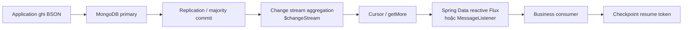
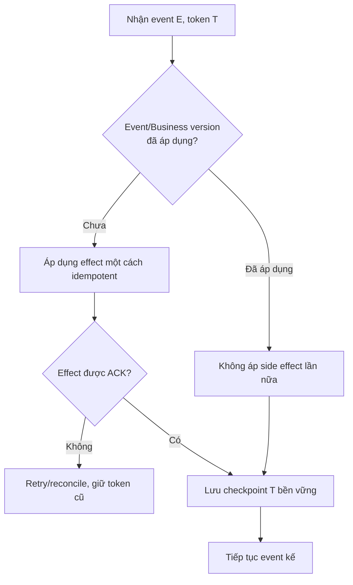
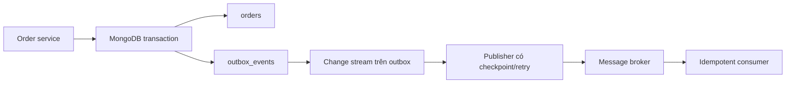

# Change stream và bài toán theo dõi thay đổi dữ liệu

## 1. Vấn đề: dữ liệu đã thay đổi, làm sao các thành phần khác biết?

Trong ứng dụng sử dụng **Spring Data MongoDB**, một API có thể ghi đơn hàng bằng `MongoTemplate` hoặc `MongoRepository`. Ngay sau đó, nhiều thành phần khác cần phản ứng:

- Giao diện quản trị cần biết trạng thái đơn hàng vừa chuyển sang `PAID`.
- Cache cần làm mới khi thông tin sản phẩm được cập nhật.
- Search index cần đồng bộ khi document bị insert, replace hoặc delete.
- Hệ thống giám sát cần ghi nhận biến động trạng thái hay tiến độ một workflow.
- Một worker cần biết một reservation đã bị hủy để cập nhật read model.

Nếu mỗi worker cứ gọi `find` theo chu kỳ 5 giây, chúng vừa gây tải lặp trên MongoDB, vừa có độ trễ và dễ bỏ sót những thay đổi nhanh giữa hai lần quét. **Change stream** cho phép ứng dụng mở một luồng thông báo những thay đổi đã được MongoDB ghi nhận, thay vì tự theo dõi `oplog` bằng API mức thấp hoặc liên tục polling toàn bộ collection.

Ví dụ:

```text
HTTP API
  |
  +-- MongoTemplate.save(order) / repository.save(order)
              |
        MongoDB replica set / sharded cluster
              |
     Majority-committed change recorded
              |
        Change stream cursor
              |
   +----------+------------+
   |          |            |
   v          v            v
Cache sync   UI events   Search index worker
```

**Change stream là cơ chế theo dõi thay đổi dữ liệu của database.** Nó không phải một message broker bền vững vô thời hạn, không thay thế các ràng buộc nghiệp vụ trong transaction, và không mặc định bảo đảm mỗi tác dụng phụ được áp dụng đúng một lần.

### Mục tiêu học tập

Sau bài này, bạn có thể:

1. Giải thích change stream là gì, dựa trên `oplog` như thế nào, khác polling/triggers/domain events ra sao.
2. Xác định điều kiện triển khai: **replica set/sharded cluster**, quyền truy cập, oplog và vòng đời cursor.
3. Đọc các field `operationType`, `documentKey`, `fullDocument`, `updateDescription`, `ns`, `clusterTime` và **resume token ở `_id`**.
4. Theo dõi bằng `mongosh`, `ReactiveMongoTemplate.changeStream(...)` hoặc `MessageListenerContainer` ở imperative Spring Data.
5. Phân biệt `resumeAfter`, `startAfter`, `startAtOperationTime`, `fullDocument: "updateLookup"` và pre/post-images.
6. Thiết kế consumer có **checkpoint, idempotency, phục hồi lỗi**, theo dõi hiệu năng và kiểm thử MongoDB thật.

## 2. Change stream hoạt động như thế nào?

MongoDB Change Streams (có từ nhánh **3.6**) sử dụng lịch sử hoạt động trong replication oplog để công bố một cursor liên tục chứa các thông báo thay đổi của **collection, database hoặc deployment**. Người tiêu thụ không cần tự giải mã từng oplog entry.



### 2.1. Tính chất quan trọng

| Đặc tính | Ý nghĩa | Điều **không** suy ra được |
| --- | --- | --- |
| Change notifications | Nhận sự kiện insert/update/replace/delete và các loại khác | Không phải callback chạy trong cùng Java method ghi |
| Majority-committed | Thông báo data changes đã bền vững theo majority của deployment | Không bảo đảm side effect của consumer đã thành công |
| Ordered event stream | MongoDB cung cấp thứ tự change notifications theo semantics stream/deployment | Không có nghĩa worker xử lý song song vẫn giữ thứ tự side effect |
| Resume token | Cho biết vị trí có thể tiếp tục đọc | Không phải ID nghiệp vụ, cũng không giữ oplog mãi mãi |
| Long-lived cursor | Có thể chờ và nhận nhiều event theo thời gian | Không thể xem như một query ngắn giải phóng connection ngay |
| Aggregation pipeline | Có thể lọc/chiếu bớt event tại server | Không được làm biến mất/sửa `_id` resume token |

MongoDB chỉ phát thông báo cho những thay đổi có ngữ nghĩa phù hợp với change stream và đã được majority-committed. Một transaction bị **rollback/abort** không trở thành chuỗi event thành công cho consumer. Một thay đổi xảy ra **trước thời điểm stream được mở** cũng không tự xuất hiện trong stream mới nếu không chủ động khởi động từ một mốc lịch sử còn được hỗ trợ.

### 2.2. Oplog là dữ liệu nền, không phải queue vô hạn

Change stream dựa vào lịch sử replication. Khi oplog quay vòng, các entry cũ có thể không còn để khôi phục một cursor từ token cách quá xa. Vì vậy:

- Nếu worker ngừng nhiều giờ/ngày, cần kiểm tra **oplog window** thực tế.
- Nếu token cũ không còn có thể định vị, `resumeAfter` có thể thất bại.
- Không tự giải quyết bằng cách **xóa checkpoint rồi bắt đầu từ hiện tại** nếu điều đó làm mất event chưa xử lý.
- Với nghiệp vụ không được bỏ sót, cần thiết kế **resnapshot/reconciliation** hoặc một nguồn sự kiện bền vững khác.

### 2.3. Change stream khác polling

| Tiêu chí | Polling theo `updatedAt` | MongoDB change stream |
| --- | --- | --- |
| Nguồn tín hiệu | Ứng dụng chủ động query định kỳ | MongoDB phát thông báo qua cursor |
| Độ trễ | Bị giới hạn bởi polling interval | Gần thời gian thực, phụ thuộc replication/cluster |
| Chi phí khi không có thay đổi | Vẫn query | Cursor chờ sự kiện; vẫn giữ resource |
| Phát hiện delete | Khó nếu đã mất document; cần tombstone/soft-delete | Có event `delete` và `documentKey` |
| Phát hiện mọi thao tác | Phụ thuộc ứng dụng có cập nhật timestamp | Theo changes mà change stream hỗ trợ |
| Phục hồi | Watermark/timestamp do ứng dụng xây | Resume token, giới hạn bởi oplog |
| Exactly-once business effect | Không tự có | **Không tự có** |

Polling không phải luôn sai: với dữ liệu nhỏ, tải thấp hoặc hệ thống không có topology hỗ trợ change streams, polling + watermark có thể đơn giản và phù hợp. Nhưng nếu cần thông báo nhanh về update/delete, change stream thường là công cụ tự nhiên hơn.

## 3. Điều kiện triển khai trước khi viết Java

### 3.1. Topology

Change stream **không hoạt động trên một `mongod` standalone bình thường**. Cần:

- MongoDB **replica set** với storage engine/topology được hỗ trợ; hoặc
- **sharded cluster** kết nối qua `mongos`.

Ví dụ URI cho một replica set local **đã được cấu hình**:

```properties
spring.data.mongodb.uri=mongodb://localhost:27017/change_stream_demo?replicaSet=rs0
```

`replicaSet=rs0` chỉ là tên ví dụ; thêm tham số URI **không biến standalone thành replica set**. Ở MongoDB Atlas, cần kết nối tới cluster có khả năng dùng change streams; cấu hình tài khoản và quyền vẫn phải đúng.

**Đừng mở change stream để test rồi thấy im lặng mà kết luận “không có change”** nếu chưa kiểm tra topology và subscription/cursor. Chưa subscribe reactive stream cũng đồng nghĩa chưa bắt đầu đọc.

### 3.2. Quyền truy cập

Một user cần các privilege action phù hợp, thông thường **`find` và `changeStream`** trên collection được theo dõi. Với database-level/deployment-level watch, phạm vi privilege cần rộng hơn tương ứng. Cấp quyền theo **least privilege**:

```javascript
// Dạng minh họa privilege scope; không chạy trực tiếp
// thành lệnh tạo user trong môi trường production.
{
  resource: { db: "change_stream_demo", collection: "orders" },
  actions: ["find", "changeStream"]
}
```

Đây là **phần cấu hình authorization**, không phải một query. Khi tạo role thực, người quản trị dùng đúng MongoDB command và chính sách bảo mật của hệ thống. Không dùng tài khoản admin chỉ để một worker lắng nghe một collection.

### 3.3. Database và collection đặc biệt

Không thể watch tùy ý các **system collections** hoặc các database hệ thống `admin`, `local`, `config` theo quy tắc của MongoDB. Một số loại collection chuyên biệt có hạn chế; ví dụ time-series collection có restriction về change streams trong tài liệu server hiện hành. Luôn đối chiếu **MongoDB release và collection type** thực tế.

### 3.4. Cursor sống lâu, cần resource

Mỗi change stream tiêu thụ một cursor lâu dài và có thể giữ connection trong khi `getMore` chờ dữ liệu. Với rất nhiều stream đang mở:

- Connection pool quá nhỏ có thể làm tăng notification latency.
- Mỗi instance ứng dụng tự mở stream có thể khiến cùng event được xử lý **nhiều lần bởi nhiều consumer**.
- Sharded cluster có chi phí merge sự kiện giữa shard và network.
- Không mở một stream mới cho **mỗi HTTP request**.

Hãy phân biệt một **long-running worker/subscriber** với một endpoint WebFlux chỉ cần query một lần.

## 4. Phạm vi watch: collection, database hay toàn deployment?

MongoDB hỗ trợ ba phạm vi chính:

| Phạm vi | `mongosh` | Ví dụ use case | Lưu ý |
| --- | --- | --- | --- |
| Collection | `db.orders.watch(...)` | Đồng bộ một bảng đơn hàng | Ít nhiễu, quyền hẹp |
| Database | `db.watch(...)` | Giám sát các collection thuộc một DB | Event khác entity type cần chuyển đổi an toàn |
| Deployment | `db.getMongo().watch(...)` | CDC/giám sát đa database | Quyền/tải cao, lọc namespace cẩn thận |

Ví dụ:

```javascript
// Theo dõi collection orders trong database hiện tại:
const stream1 = db.orders.watch();

// Theo dõi mọi collection được phép trong database:
const stream2 = db.watch();

// Theo dõi cả deployment qua kết nối mongosh:
const stream3 = db.getMongo().watch();

// Sau khi thử nghiệm, giải phóng cursor:
stream1.close();
stream2.close();
stream3.close();
```

Nếu watch database/deployment, field `ns` (namespace) có `db`/`coll`; một consumer mapping tất cả event vào một entity `OrderDocument` sẽ sai khi các collection khác có schema khác. Với stream đa collection, dùng `org.bson.Document`/raw event và dispatch theo `ns`, sau đó kiểm tra event type và quyền theo namespace.

### Chọn phạm vi nào?

Đối với bài toán “khi order thay đổi, cập nhật read model”, bắt đầu bằng **collection-level watch `orders`**. Chỉ mở rộng phạm vi khi có nhu cầu thực như đồng bộ nhiều collection và đã có kiến trúc điều phối schema/permission rõ.

## 5. Anatomy: một change event chứa những gì?

Khi insert một đơn hàng, một change event có thể trông như:

```javascript
{
  _id: { _data: "8263...resume-token..." },
  operationType: "insert",
  clusterTime: Timestamp({ t: 1795123200, i: 1 }),
  ns: {
    db: "change_stream_demo",
    coll: "orders"
  },
  documentKey: { _id: "ORD-001" },
  fullDocument: {
    _id: "ORD-001",
    tenant_id: "SHOP-A",
    status: "CREATED",
    amount_minor: NumberLong("250000")
  }
}
```

Đây là **sơ đồ dữ liệu minh họa**, không phải token/`clusterTime` thật để dùng `resumeAfter`. Token `_id` phải lấy **nguyên BSON value của sự kiện thực**, tuyệt đối không tự dựng bằng string placeholder.

### 5.1. Các field cần biết

| Field | Ý nghĩa | Cách sử dụng |
| --- | --- | --- |
| `_id` | **Resume token** cho change event | Lưu nguyên vẹn để resume; không nhầm `documentKey._id` |
| `operationType` | `insert`, `update`, `replace`, `delete`, `invalidate`, ... | Phân nhánh consumer |
| `clusterTime` | MongoDB logical timestamp | Quan sát thứ tự/thời điểm server; không thay resume token chính xác |
| `ns.db`/`ns.coll` | Database và collection nguồn | Routing và multi-collection validation |
| `documentKey` | Định danh document bị thay đổi; sharding có thể thêm shard key | Xác định resource thay đổi |
| `fullDocument` | Toàn document cho insert/replace; update tùy option | Đồng bộ read model khi có dữ liệu cần thiết |
| `updateDescription` | Những field thay đổi bởi update | Patch/read model cập nhật có chọn lọc |
| `fullDocumentBeforeChange` | Pre-image nếu được bật/có sẵn | Audit/so sánh giá trị trước, tùy quyền và retention |
| `lsid`/`txnNumber` | Thông tin giao dịch nếu event liên quan transaction | Quan sát, không thay business request ID |

### 5.2. Phân biệt resume token và document ID

`_id` **ở cấp change event** thường là một object token như `{_data:"..."}`. Còn `documentKey._id` là ID của order, ví dụ `"ORD-001"`. Nếu lưu `"ORD-001"` vào checkpoint rồi truyền nó cho `resumeAfter`, MongoDB không thể dùng nó làm resume token.

Đồng thời, khi dùng aggregation filter/`$project` trên change events, **không được xóa hoặc sửa `_id` của change event**. Từ MongoDB 4.2, pipeline sửa field này có thể bị server từ chối; ngay cả khi không bị từ chối, nó sẽ phá khả năng resume.

## 6. Những operation types thường gặp

| `operationType` | Khi nào thấy | Thông tin đi kèm cần chú ý |
| --- | --- | --- |
| `insert` | Document mới được tạo | `fullDocument` thường chứa document mới |
| `update` | Update làm thay đổi field của document | `updateDescription`; `fullDocument` mặc định có thể không có |
| `replace` | Thay toàn document | `fullDocument` mới |
| `delete` | Document bị xóa | `documentKey`; không còn `fullDocument` hiện tại |
| `invalidate` | Stream bị vô hiệu như drop/rename collection | Stream đóng; xử lý `startAfter` khi phù hợp |
| `drop`, `rename`, `dropDatabase` | Thay đổi metadata namespace có hỗ trợ | Tùy scope/version |
| DDL/index expanded events | Thay đổi collection/index | Chỉ khi option/phiên bản hỗ trợ |

### 6.1. `update` khác `replace`

Giả sử:

```javascript
db.orders.updateOne(
  { _id: "ORD-001" },
  { $set: { status: "PAID" } }
)
```

Một update event có thể chứa:

```javascript
{
  operationType: "update",
  documentKey: { _id: "ORD-001" },
  updateDescription: {
    updatedFields: { status: "PAID" },
    removedFields: []
  }
}
```

Trong khi đó, `replaceOne` thường dẫn đến `replace` event với toàn document thay thế. Nhưng **không giả định mọi thao tác trong client đều tạo operation type có tên giống API**: MongoDB có các tình huống internal rewrite, array truncation, pipeline update và version-specific behavior; luôn kiểm event thực tế.

### 6.2. Delete chỉ có document key?

Với delete bình thường, document đã bị xóa nên không thể tự đọc `fullDocument` mới. Nếu consumer cần nội dung **trước khi xóa**, MongoDB 6.0+ có cơ chế **pre-images** trên collection đã cấu hình, hoặc ứng dụng có thể dùng soft-delete/outbox tùy bài toán. Không tự suy ra `delete` luôn mang body cũ.

### 6.3. `invalidate` ảnh hưởng vòng đời stream

Drop hoặc rename collection có thể phát `invalidate` và đóng cursor. `resumeAfter` không thể tiếp tục sau token invalidate; trường hợp cần mở lại một stream sau invalidate phải dùng `startAfter` và phải hiểu namespace mới/collection mới có tồn tại hay không. **Không coi invalidate là một lỗi tạm thời để retry vô hạn cùng một cursor.**

## 7. Thực hành `mongosh`: mở stream, ghi dữ liệu và xem event

Hãy dùng **MongoDB replica set dành cho học tập**. Các bước này yêu cầu hai phiên `mongosh` (terminal A và B) kết nối cùng database `change_stream_demo`. Không thao tác trên production và không xóa dữ liệu của người khác.

### 7.1. Chuẩn bị collection

Trong **terminal B**, tạo collection nếu chưa có, trước khi mở stream:

```javascript
use change_stream_demo
db.createCollection("orders")

// Hai lệnh này chỉ để quan sát trạng thái:
db.getCollectionNames()
db.orders.getIndexes()
```

Nếu collection đã tồn tại, `createCollection` có thể báo `NamespaceExists`; khi đó bỏ bước create. Trong một môi trường kiểm thử mới, thao tác này không cần transaction. Với môi trường thật, collection/index nên được tạo bằng migration.

### 7.2. Mở stream trong terminal A

```javascript
use change_stream_demo

const stream = db.orders.watch([
  {
    $match: {
      operationType: {
        $in: ["insert", "update", "replace", "delete"]
      }
    }
  }
], {
  fullDocument: "updateLookup",
  maxAwaitTimeMS: 1000
});

while (stream.hasNext()) {
  const event = stream.next();
  printjson(event);
}
```

`hasNext()` là vòng chờ blocking trong terminal A. **Nó có thể chờ lâu khi chưa có event**; đó là hành vi bình thường của một stream đang hoạt động. Khi dừng thử nghiệm, ngắt vòng lặp và gọi `stream.close()` trong phiên đó để giải phóng cursor.

Trong production, không đặt vòng lặp blocking này trên thread xử lý HTTP request hoặc WebFlux event-loop.

### 7.3. Ghi trong terminal B

```javascript
db.orders.insertOne({
  _id: "ORD-001",
  tenant_id: "SHOP-A",
  status: "CREATED",
  amount_minor: NumberLong("250000"),
  updated_at: new Date()
})

db.orders.updateOne(
  { _id: "ORD-001" },
  { $set: { status: "PAID", updated_at: new Date() } }
)

db.orders.replaceOne(
  { _id: "ORD-001" },
  {
    _id: "ORD-001",
    tenant_id: "SHOP-A",
    status: "FULFILLED",
    amount_minor: NumberLong("250000"),
    updated_at: new Date()
  }
)

db.orders.deleteOne({ _id: "ORD-001" })
```

Terminal A sẽ nhận event khi chúng đủ điều kiện majority-committed. Có thể thấy `insert`, `update`, `replace` và `delete` (phụ thuộc tính thực tế của thao tác và server version). Không dựa vào thời gian chính xác giữa write và event để tính SLA mà chưa đo.

### 7.4. Chỉ lấy một event để kiểm thử

Khi chỉ cần một event, hãy quản lý việc mở/đóng cursor:

```javascript
const stream = db.orders.watch();
try {
  const first = stream.next(); // Chờ thay đổi mới.
  printjson({
    operationType: first.operationType,
    token: first._id,
    documentKey: first.documentKey
  });
} finally {
  stream.close();
}
```

Để đoạn này hoàn tất, tạo một write tương ứng **sau khi stream đã mở** từ terminal B. Không chạy test mà chỉ insert **trước** khi mở stream rồi đợi event cũ tự hiện.

## 8. Filter change events: theo operation, namespace, tenant

MongoDB cho phép thêm một số stage aggregation vào pipeline của `watch(...)` để **lọc sự kiện**. Vì change stream có cấu trúc event, filter khác filter vào document gốc trong `find(...)`.

### 8.1. Chỉ nhận sự kiện insert/update

```javascript
db.orders.watch([
  {
    $match: {
      operationType: {
        $in: ["insert", "update"]
      }
    }
  }
])
```

Đây là cách thường dùng để giảm bớt dữ liệu và tránh listener phải xử lý các loại event không hỗ trợ. Nhưng hãy đánh giá **nếu bỏ delete** thì cache/search index sẽ stale như thế nào.

### 8.2. Namespace ở database watch

```javascript
db.watch([
  {
    $match: {
      "ns.coll": {
        $in: ["orders", "reservations"]
      },
      operationType: {
        $in: ["insert", "update", "replace", "delete"]
      }
    }
  }
])
```

`ns.coll` là **tên collection từ event metadata**, không phải field của domain `OrderDocument`. Khi watch nhiều collection, hãy kiểm `ns.db`/`ns.coll` trước khi mapping vào một Java class cụ thể.

### 8.3. Tenant filter và delete event

Đối với insert, có thể lọc tenant qua:

```javascript
{
  $match: {
    operationType: "insert",
    "fullDocument.tenant_id": "SHOP-A"
  }
}
```

Nhưng với `delete`, `fullDocument` **thường không còn**, nên filter theo `fullDocument.tenant_id` sẽ **làm mất delete event**. Đối với update, nếu không bật `updateLookup`/post-image, `fullDocument` cũng có thể không sẵn.

Một thiết kế ổn định hơn:

- Đảm bảo consumer có quyền nhận và xử lý event từ collection đó.
- Mã hóa `tenant_id` trong một **business key** hoặc trong dữ liệu tương ứng được truy cập an toàn khi cần.
- Có thể dùng `documentKey` (với sharded collection thường có shard key nếu hiện diện) để định tuyến, nhưng **không giả định** một unsharded collection luôn có tenant trong `documentKey`.
- Nếu phải filter theo tenant trong stream, phân tích đầy đủ hành vi với cả insert/update/replace/delete và dữ liệu trước khi xóa.
- Dùng quyền truy cập/kiến trúc tenant isolation để ngăn event nhạy cảm bị phân phối sai; một filter của application **không thay MongoDB authorization**.

**Lưu ý theo MongoDB docs:** Kết hợp `fullDocument: "updateLookup"` với `$match` dựa trên field `fullDocument` có thể gặp một số trường hợp **“Resume Token Not Found”**, đặc biệt khi document bị xóa giữa thời điểm update và lookup, khiến `fullDocument` null rồi bị filter loại bỏ. Nếu cần snapshot có ngữ nghĩa lịch sử ổn định, cân nhắc pre/post-images khi được hỗ trợ và thiết kế filter không làm mất khả năng resume; phải thử nghiệm trên đúng server version/workload.

### 8.4. Không sửa/xóa `_id` của event

Sai:

```javascript
// SAI: mất/sửa change event resume token.
db.orders.watch([
  { $project: { operationType: 1, fullDocument: 1, _id: 0 } }
])
```

Đúng hơn, chỉ project các field **cần thiết nhưng giữ nguyên `_id`**:

```javascript
db.orders.watch([
  {
    $project: {
      _id: 1,
      operationType: 1,
      documentKey: 1,
      ns: 1,
      clusterTime: 1,
      fullDocument: 1,
      updateDescription: 1
    }
  }
])
```

MongoDB chỉ chấp nhận một tập stage/filter có thể đặt **sau `$changeStream`**. Không tự chèn các stage như `$out`/`$merge` vào stream để coi đó là một ETL pipeline thông thường. Cần kiểm danh sách stage được phép theo MongoDB server version.

### 8.5. Thay pipeline khi resume có thể nguy hiểm

Resume token không phải bookmark có thể tự do chuyển qua bất kỳ pipeline mới nào. MongoDB khuyến nghị khi tiếp tục từ token hãy giữ **cùng pipeline và options** đã tạo token. Thay filter, collation, full-document options hoặc scope watch mà không có phương án migration checkpoint có thể bỏ sót, lặp hoặc khiến server không resume được.

Nếu cần đổi kiến trúc consumer, hãy version hóa `consumer_id`, checkpoint và pipeline configuration; xem xét tạo một consumer mới với initial snapshot/rebuild, thay vì âm thầm dùng token cũ trên luồng mới.

## 9. `fullDocument`: delta của update không phải snapshot sau update

### 9.1. Mặc định update event thường có `updateDescription`

Lệnh:

```javascript
db.orders.updateOne(
  { _id: "ORD-001" },
  {
    $set: { status: "PAID" },
    $unset: { note: "" }
  }
)
```

Event update có thể có:

```javascript
{
  operationType: "update",
  documentKey: { _id: "ORD-001" },
  updateDescription: {
    updatedFields: { status: "PAID" },
    removedFields: ["note"]
  }
}
```

Nó biểu diễn **những field thay đổi**, không phải bản copy đầy đủ của order. Khi patch read model, cần xử lý cả `updatedFields`, `removedFields` và các cấu trúc array/field path theo version; không chỉ áp `updatedFields` rồi bỏ `removedFields`.

### 9.2. `fullDocument: "updateLookup"` làm gì?

Khi mở:

```javascript
db.orders.watch([], {
  fullDocument: "updateLookup"
})
```

MongoDB tra cứu document tương ứng ở trạng thái majority-committed **khi lookup được thực hiện**. Nó **không bảo đảm** là ảnh chụp chính xác ngay sau update gây event.

Ví dụ:

```text
T1: status CREATED -> PAID       (update event E1)
T2: status PAID -> FULFILLED     (update event E2)
T3: Consumer đọc E1 và updateLookup

E1.updateDescription.updatedFields.status = "PAID"
E1.fullDocument.status có thể đã là "FULFILLED"
```

Vì thế:

- `updateDescription` là mô tả delta của **sự kiện update**.
- `updateLookup` có thể thấy một phiên bản **mới hơn** của document.
- `fullDocument` có thể **null/vắng mặt** khi document bị xóa/rename giữa event và lookup.
- Khi đồng bộ read model theo từng trạng thái, phải quyết định dùng delta, full document hay pre/post-image **với ngữ nghĩa nhất quán**.

### 9.3. Pre-image và post-image từ MongoDB 6.0+

MongoDB 6.0+ hỗ trợ cấu hình **change stream pre/post-images** cho collection:

```javascript
// Dành cho môi trường test hoặc migration có kiểm soát:
db.runCommand({
  collMod: "orders",
  changeStreamPreAndPostImages: {
    enabled: true
  }
})
```

Sau đó, với `watch`:

```javascript
db.orders.watch([], {
  fullDocument: "whenAvailable",
  fullDocumentBeforeChange: "whenAvailable"
})
```

Nếu cần ứng dụng **báo lỗi khi hình ảnh bắt buộc không có**, có thể chọn `"required"` thay `"whenAvailable"`, nhưng phải chấp nhận stream dừng/báo lỗi nếu image thiếu hoặc đã hết retention.

| Kiểu event | Pre-image | Post-image |
| --- | --- | --- |
| Insert | Không có document trước | Có document sau |
| Update | Có trước nếu đã bật và còn retention | Có sau nếu đã bật và còn retention |
| Replace | Có trước nếu đã bật và còn retention | Có sau nếu đã bật và còn retention |
| Delete | Có trước nếu đã bật và còn retention | Không có document sau |

Pre/post-images cần storage và tăng chi phí ghi; dữ liệu cũ đã xảy ra **trước khi bật cấu hình** không tự được backfill. Image có thể hết hạn bởi chính sách lưu trữ và khi oplog entry tương ứng mất; không được giả định bật pre-image là có bản cũ **vô thời hạn**.

### 9.4. Chọn phương án nào?

| Nhu cầu | Phương án đáng cân nhắc |
| --- | --- |
| UI hiển thị thông báo đơn vừa tạo | Insert event + `fullDocument` |
| Cache biết ID nào cần invalidate | `documentKey`; không nhất thiết dùng fullDocument |
| Search index muốn đồng bộ nội dung mới nhất | `updateLookup` hoặc đọc lại current state theo ID, có version policy |
| Audit old → new có ngữ nghĩa chính xác | Pre/post-images (khi available) hoặc audit/outbox được thiết kế nghiệp vụ |
| Delete đồng bộ search index | `delete` + `documentKey` |
| Bảo đảm notification bền vững qua sự cố dài | Outbox/event log riêng và checkpoint |

**Không có một lựa chọn phù hợp cho mọi consumer.** Dùng updateLookup để cache invalidate chỉ làm tăng chi phí, trong khi dùng mỗi documentKey cho bài toán audit chi tiết thường thiếu dữ liệu.

## 10. Spring Data MongoDB: model hóa order và change event

Để dùng `ReactiveMongoTemplate` hoặc `MongoTemplate` trong ví dụ, ta có entity:

```java
package com.example.changestream;

import org.springframework.data.annotation.Id;
import org.springframework.data.mongodb.core.mapping.Document;
import org.springframework.data.mongodb.core.mapping.Field;

@Document(collection = "orders")
public record OrderDocument(
    @Id String id,
    @Field("tenant_id") String tenantId,
    String status,
    @Field("amount_minor") long amountMinor
) {}
```

Đối với mã có mapping entity, `@Field("tenant_id")` ánh xạ tên Java `tenantId` sang BSON `tenant_id`. Nếu watch cả database, đừng ép sự kiện collection khác vào `OrderDocument`; dùng `Document` và định tuyến theo namespace.

### 10.1. Spring Data `ChangeStreamEvent<T>`

Spring Data có wrapper `org.springframework.data.mongodb.core.ChangeStreamEvent<T>`:

| API | Kiểu trả về/ý nghĩa |
| --- | --- |
| `getOperationType()` | `OperationType` enum của MongoDB Java Driver |
| `getBody()` | `T` đã convert từ `fullDocument`, **có thể null** |
| `getBodyBeforeChange()` | `T` đã convert từ pre-image, **có thể null** |
| `getRaw()` | `ChangeStreamDocument<org.bson.Document>`, có thể null |
| `getResumeToken()` | `org.bson.BsonValue`, có thể null |
| `getTimestamp()` | `Instant` dựa trên server cluster time, độ chính xác khác token |
| `getBsonTimestamp()` | `BsonTimestamp`, thích hợp khi cần server operation time |
| `getDatabaseName()`/`getCollectionName()` | Namespace nguồn |

**Không dùng `event.getBody().getId()` vô điều kiện**: với delete, update không có fullDocument, invalidate hay image hết hạn, `getBody()` có thể null. Để lấy ID của tài liệu đã xóa, xem `event.getRaw().getDocumentKey()` rồi kiểm loại BSON value phù hợp.

## 11. Reactive change stream với `ReactiveMongoTemplate`

Spring Data MongoDB có API fluent `changeStream(...)` trả `Flux<ChangeStreamEvent<T>>`. Đối với stream dài hạn, reactive thường phù hợp hơn vòng lặp blocking vì tương tác với MongoDB Java Reactive Streams Driver, nhưng **không tự giải quyết checkpoint/idempotency**.

### 11.1. Định nghĩa một `Flux` theo dõi `orders`

```java
package com.example.changestream;

import org.springframework.data.mongodb.core.ChangeStreamEvent;
import org.springframework.data.mongodb.core.ReactiveMongoTemplate;
import org.springframework.data.mongodb.core.query.Criteria;
import org.springframework.stereotype.Service;
import reactor.core.publisher.Flux;

@Service
public class OrderChangeFeed {

    private final ReactiveMongoTemplate template;

    public OrderChangeFeed(ReactiveMongoTemplate template) {
        this.template = template;
    }

    public Flux<ChangeStreamEvent<OrderDocument>> events() {
        return template.changeStream(OrderDocument.class)
            .watchCollection("orders")
            .filter(Criteria.where("operationType")
                .in("insert", "update", "replace", "delete"))
            .listen();
    }
}
```

Lời gọi `events()` **chỉ tạo một publisher**; khi có subscription, MongoDB cursor mới thực sự được mở. Nếu gọi `events()` từ mỗi HTTP request rồi subscribe, ứng dụng có thể tạo **nhiều cursor** và mỗi cursor nhận cùng event.

`filter(...)` ở đây lọc **event metadata `operationType`**, không filter entity theo field `status`. Với bài toán chỉ nhận order `status=PAID`, filter theo `fullDocument.status` có thể bỏ mất delete/update events; hãy thiết kế ngữ nghĩa và options riêng.

### 11.2. Nhận full document khi update

```java
import org.springframework.data.mongodb.core.ChangeStreamEvent;
import org.springframework.data.mongodb.core.ChangeStreamOptions;
import reactor.core.publisher.Flux;

ChangeStreamOptions options = ChangeStreamOptions.builder()
    .returnFullDocumentOnUpdate()
    .build();

Flux<ChangeStreamEvent<OrderDocument>> feed =
    reactiveMongoTemplate.changeStream(
        "orders", options, OrderDocument.class);
```

`reactiveMongoTemplate` là bean `ReactiveMongoTemplate` được inject trong service. `returnFullDocumentOnUpdate()` tương ứng `fullDocument: "updateLookup"`; xem mục 9 về **current-state lookup khác snapshot của update event**. Với delete, `getBody()` vẫn có thể null.

### 11.3. Đọc operation type, body, document key

```java
import com.mongodb.client.model.changestream.OperationType;
import org.bson.BsonDocument;
import org.springframework.data.mongodb.core.ChangeStreamEvent;
import reactor.core.publisher.Mono;

Mono<Void> observe(
        ChangeStreamEvent<OrderDocument> event) {

    OperationType type = event.getOperationType();
    BsonDocument key = event.getRaw() == null
        ? null
        : event.getRaw().getDocumentKey();

    if (type == OperationType.DELETE) {
        // Body thông thường null; cần dựa vào documentKey.
        System.out.println("Deleted key = " + key);
    } else {
        OrderDocument body = event.getBody();
        System.out.println(
            "Type=" + type +
            ", key=" + key +
            ", bodyPresent=" + (body != null));
    }

    // Chỉ minh họa quan sát; chưa có side effect/checkpoint.
    return Mono.empty();
}
```

Trong ứng dụng thực, không in toàn bộ `body` chứa dữ liệu cá nhân. Nên dùng logging đã kiểm soát, correlation ID, operation type và namespace. **`Mono.empty()` ở đây là tín hiệu handler quan sát hoàn tất**, không phải cơ chế đảm bảo event được lưu hoặc xử lý đúng một lần.

### 11.4. Giữ thứ tự khi có side effect

Một consumer muốn xử lý lần lượt từng event:

```java
Flux<ChangeStreamEvent<OrderDocument>> events =
    orderChangeFeed.events();

Mono<Void> runUntilStopped = events
    .concatMap(event -> downstreamHandler.handle(event))
    .then();
```

`downstreamHandler.handle(event)` được định nghĩa trả `Mono<Void>`, chỉ complete sau khi effect tương ứng đã được xác nhận. `concatMap` tuần tự hóa các handler; `Flux.flatMap(handler)` có thể chạy đồng thời và làm side effects **không theo thứ tự**. `.then()` ở đây không tự hoàn thành đối với stream dài hạn — nó chờ tới khi source kết thúc hoặc bị hủy.

**Lưu ý:** ngay cả khi xử lý tuần tự, consumer có thể nhận lại event khi restart từ checkpoint cũ. `concatMap` bảo vệ thứ tự **trong một subscription**, không thay idempotency cross-restart hoặc cross-instance.

### 11.5. Vòng đời subscription

Không gọi `subscribe()` ẩn trong service xử lý HTTP. Một long-running subscriber nên được quản lý ở **application lifecycle** (ví dụ một bean `SmartLifecycle` chuyên dụng, scheduler/worker được giám sát hoặc orchestrator). Đóng subscription bằng `Disposable.dispose()` khi ứng dụng shutdown, giải phóng MongoDB cursor và connection.

Một ví dụ ngắn cho một **worker độc lập**:

```java
import org.springframework.data.mongodb.core.ChangeStreamEvent;
import reactor.core.Disposable;
import reactor.core.publisher.Flux;

// Chỉ đặt trong thành phần quản lý lifecycle của worker:
Disposable subscription = orderChangeFeed.events()
    .concatMap(downstreamHandler::handle)
    .subscribe(
        ignored -> {},
        error -> logger.error("Change stream stopped", error)
    );

// Khi shutdown / explicit stop:
subscription.dispose();
```

Đây là **mẫu vòng đời tối thiểu**, không phải consumer production hoàn chỉnh. Cần một supervisor để phát hiện `onError`, đọc checkpoint, backoff và mở stream mới. Nếu không, listener chết sau một lỗi mà không ai biết, dù tiến trình Spring Boot vẫn đang chạy.

## 12. Imperative Spring Data: `MessageListenerContainer`

Khi ứng dụng chỉ có `MongoTemplate` và MongoDB Sync Driver, `watch` là vòng chờ dài/blocking. Spring Data cung cấp `DefaultMessageListenerContainer` để quản lý các task chạy `ChangeStreamRequest` ở nền, tránh chặn HTTP handling thread.

### 12.1. Một request lắng nghe collection

```java
package com.example.changestream;

import org.bson.Document;
import com.mongodb.client.model.changestream.ChangeStreamDocument;
import org.springframework.data.mongodb.core.MongoTemplate;
import org.springframework.data.mongodb.core.ChangeStreamOptions;
import org.springframework.data.mongodb.core.messaging.ChangeStreamRequest;
import org.springframework.data.mongodb.core.messaging.DefaultMessageListenerContainer;
import org.springframework.data.mongodb.core.messaging.MessageListener;
import org.springframework.data.mongodb.core.messaging.MessageListenerContainer;
import org.springframework.data.mongodb.core.messaging.Subscription;

public class ImperativeChangeStreamExample {

    public void startListening(MongoTemplate template) {
        MessageListenerContainer container =
            new DefaultMessageListenerContainer(template);

        container.start();

        MessageListener<ChangeStreamDocument<Document>, Document>
            listener = message -> {
                System.out.println(message.getRaw());
            };

        ChangeStreamRequest.ChangeStreamRequestOptions options =
            new ChangeStreamRequest.ChangeStreamRequestOptions(
                "change_stream_demo",
                "orders",
                ChangeStreamOptions.empty()
            );

        Subscription subscription = container.register(
            new ChangeStreamRequest<>(listener, options),
            Document.class
        );

        // Chỉ minh họa: trong ứng dụng thật giữ container/subscription
        // như bean có lifecycle và quản lý chúng khi shutdown.
        // subscription.cancel();
        // container.stop();
    }
}
```

**Mục đích ví dụ:** cho thấy các thành phần `MessageListener`, `ChangeStreamRequest` và `MessageListenerContainer`. `container.start()` bắt đầu các task; `register(...)` đăng ký một subscription. Phải giữ reference và **stop/cancel** khi ứng dụng kết thúc. Khi đăng ký `DefaultMessageListenerContainer` thành Spring bean, nó có `SmartLifecycle` và có thể tự start theo lifecycle.

### 12.2. Lỗi trong listener synchronous

Các lỗi có thể được chuyển tới `ErrorHandler` của container; cấu hình mặc định có thể chỉ ghi log, **không nhất thiết tạo retry business logic**. Cần đăng ký error handler/supervisor theo API và Spring Data version phù hợp, giám sát trạng thái `Subscription`, và lưu checkpoint khi xử lý thành công. Không bắt mọi lỗi rồi bỏ qua nếu mất event là không chấp nhận được.

### 12.3. Chọn reactive hay imperative?

| Tình huống | Nên cân nhắc |
| --- | --- |
| Dự án dùng WebFlux, xử lý event liên tục | `ReactiveMongoTemplate.changeStream(...)` và `Flux` |
| Dự án dùng Spring MVC/Sync driver | `MessageListenerContainer` hoặc worker riêng |
| Stream lâu, throughput cao, nhiều subscriber | Reactive có thể tiết kiệm thread hơn |
| Xử lý cần nhiều tác vụ blocking | Container task/worker phù hợp, tách khỏi event-loop |
| Yêu cầu không bỏ mất effect qua restart | **Cả hai** cần checkpoint + idempotency + recovery |

Không chuyển sang WebFlux chỉ vì MongoDB có change streams nếu toàn bộ nghiệp vụ và client là blocking; thứ cần là **một worker có lifecycle và phục hồi tốt**, không phải tên framework.

## 13. Resume token: tiếp tục đọc sau lỗi, restart và failover

### 13.1. Lấy token từ event

Mỗi change event có trường `_id` đóng vai trò **resume token**. Trong Spring Data:

```java
import org.bson.BsonValue;
import org.springframework.data.mongodb.core.ChangeStreamEvent;

public static BsonValue requireResumeToken(
        ChangeStreamEvent<?> event) {

    BsonValue token = event.getResumeToken();
    if (token == null) {
        throw new IllegalStateException(
            "Change event không có resume token");
    }
    return token;
}
```

Đây là **BSON value do server cung cấp**, không phải một string ID của document. Khi ghi vào checkpoint store cần bảo toàn **BSON structure/type**, không tự mã hóa rồi cắt `_data` hay sửa token. Nếu lưu dưới JSON, cần một **Extended JSON codec có khả năng round-trip BSON types**; giải mã lại đúng kiểu trước khi truyền vào driver.

### 13.2. `resumeAfter`: bắt đầu **sau** token đã xử lý

Ví dụ Java reactive từ token đã được kiểm chứng:

```java
import org.bson.BsonValue;
import org.bson.Document;
import org.springframework.data.mongodb.core.ChangeStreamEvent;
import org.springframework.data.mongodb.core.ChangeStreamOptions;
import org.springframework.data.mongodb.core.ReactiveMongoTemplate;
import reactor.core.publisher.Flux;

public Flux<ChangeStreamEvent<Document>> resumeOrders(
        ReactiveMongoTemplate template, BsonValue processedToken) {

    ChangeStreamOptions options = ChangeStreamOptions.builder()
        .resumeAfter(processedToken)
        .returnFullDocumentOnUpdate()
        .build();

    return template.changeStream(
        "orders", options, Document.class);
}
```

`resumeAfter` yêu cầu token **đã tồn tại trong lịch sử có thể truy cập**. Nó bắt đầu **sau event được đánh dấu**, phù hợp nếu checkpoint đã lưu khi effect của event đó được xử lý thành công.

Nếu token bị lùi so với tiến độ thực, consumer có thể nhận lại event cũ. Nếu token bị đẩy lên trước khi xử lý effect, consumer có thể **bỏ mất event**. Vì thế **thời điểm lưu checkpoint quan trọng không kém cách mở cursor**.

### 13.3. `startAfter` khác gì?

`resumeAfter` **không** dùng để tiếp tục sau `invalidate` event (ví dụ collection bị drop/rename). Nếu nghiệp vụ thực sự muốn tạo stream mới sau invalidate và namespace phù hợp, MongoDB có `startAfter`:

```javascript
// Vận hành đặc biệt: invalidateToken phải lấy từ event thật.
const reopened = db.orders.watch([], {
  startAfter: invalidateToken
});
```

Phải làm rõ collection cũ bị drop/rename, dữ liệu mới, index/namespace có cần bootstrap lại hay không. `startAfter` không tự khôi phục các document đã bị drop, và **không biến một thay đổi schema thành an toàn**.

### 13.4. `startAtOperationTime` và `resumeAt`

Khi không có token nhưng có một mốc **MongoDB server operation time** còn trong oplog, có thể dùng `startAtOperationTime` (MongoDB) hoặc `resumeAt(...)` trong Spring Data:

```java
import java.time.Instant;
import org.springframework.data.mongodb.core.ChangeStreamEvent;
import reactor.core.publisher.Flux;

Instant start = Instant.parse("2026-11-20T08:00:00Z");

Flux<ChangeStreamEvent<OrderDocument>> events =
    reactiveMongoTemplate.changeStream(OrderDocument.class)
        .watchCollection("orders")
        .resumeAt(start)
        .listen();
```

Ví dụ `start` là mốc minh họa, không phải “đảm bảo có đủ event từ ngày đó”. Chỉ có thể đọc từ thời điểm **còn trong oplog**. `Instant` có độ chính xác khác `BsonTimestamp` (logical time có increment), vì vậy với checkpoint production **resume token chính xác hơn** timestamp thô.

**Một lần mở stream chỉ được chọn một** trong các mốc `resumeAfter`, `startAfter`, `startAtOperationTime`. Đừng trộn các option này trong cùng request.

### 13.5. Driver tự resume có thay checkpoint không?

MongoDB Java Driver có cơ chế tự resume ở một số lỗi kết nối/resumable stream errors. Điều đó giúp giảm gián đoạn ngắn, nhưng **không giải quyết process crash, deployment restart hoặc consumer side effect đã chạy mà chưa checkpoint**. App vẫn cần durable checkpoint và supervisor.

Khi MongoDB oplog đã mất event tương ứng token, retry thêm một trăm lần với **cùng token cũ** không phục hồi được lịch sử đã bị xóa. Phải kích hoạt chính sách **rebuild/reconciliation** và ghi nhận khoảng dữ liệu có nguy cơ bị bỏ sót.

### 13.6. Highwatermark/postBatch tokens

Ngoài token gắn với event, MongoDB có **highwatermark/post-batch resume tokens** phản ánh tiến độ stream khi không có event mới. Đây là khái niệm hữu ích để định vị mốc đọc/catch-up trong hệ thống CDC chuyên sâu.

Nhưng không coi một highwatermark token “đã đọc đến thời điểm T” là bằng chứng **mọi side effect trước T đã xử lý xong** nếu pipeline/consumer có handler song song hoặc lỗi. Hệ thống checkpoint cần ghi tiến độ **đã xử lý bền vững**, không chỉ tiến độ cursor đọc từ server.

## 14. Checkpoint và at-least-once: chọn thứ tự đúng để không bỏ event

Giả sử consumer cần cập nhật search index khi order thay đổi. Nó xử lý event `E1` rồi lưu resume token `T1` vào collection `consumer_checkpoints`.

### 14.1. Thứ tự **không an toàn**

```text
1. Nhận E1
2. Lưu checkpoint T1
3. Crash
4. Chưa cập nhật search index
5. Restart bằng resumeAfter(T1)
6. E1 KHÔNG được đọc lại => mất effect
```

Không lưu checkpoint trước khi tác dụng nghiệp vụ được xác nhận hoàn tất, trừ khi có một **hàng đợi bền vững khác** đã nhận quyền xử lý event đó theo thiết kế rõ.

### 14.2. Thứ tự tối thiểu chấp nhận được

```text
1. Nhận E1 với token T1
2. Cập nhật read model/search index có idempotency
3. Nhận ACK từ nơi lưu read model
4. Lưu checkpoint T1 bền vững
5. Đọc E2
```

Nếu crash giữa bước 2 và 4, E1 có thể được giao **lại** khi restart. Vì vậy:

**Change stream + checkpoint theo thứ tự này thường dẫn tới ngữ nghĩa at-least-once cho consumer effect**, với điều kiện lịch sử chưa mất và recovery được triển khai đúng. Không hứa exactly-once chỉ vì MongoDB phát token duy nhất.

### 14.3. Sơ đồ trạng thái



### 14.4. Pseudocode reactive đúng thứ tự

```java
import org.bson.BsonValue;
import org.springframework.data.mongodb.core.ChangeStreamEvent;
import reactor.core.publisher.Mono;

// Phác thảo hợp đồng của các thành phần nghiệp vụ.
public interface ChangeEffectHandler {
    // Bắt buộc idempotent/replay-safe đối với cùng event.
    Mono<Void> apply(ChangeStreamEvent<OrderDocument> event);
}

public interface DurableCheckpointStore {
    // Lưu NGUYÊN BSON value sau khi effect đã thành công.
    Mono<Void> save(String consumerId, BsonValue resumeToken);
}

public final class OrderChangeProcessor {

    private final ChangeEffectHandler handler;
    private final DurableCheckpointStore checkpoints;

    public OrderChangeProcessor(
            ChangeEffectHandler handler,
            DurableCheckpointStore checkpoints) {
        this.handler = handler;
        this.checkpoints = checkpoints;
    }

    public Mono<Void> process(ChangeStreamEvent<OrderDocument> event) {
        BsonValue token = event.getResumeToken();
        if (token == null) {
            return Mono.error(
                new IllegalStateException("Thiếu resume token"));
        }

        return handler.apply(event)
            .then(checkpoints.save("orders-search-v1", token));
    }
}
```

Đây là **hợp đồng ví dụ**, không phải một package chạy độc lập chưa có implementation. `ChangeEffectHandler.apply` phải được thiết kế idempotent; `DurableCheckpointStore.save` phải ghi bền vững và lưu token nguyên BSON. Khi handler trả `Mono.error`, `then(...)` không lưu checkpoint, cho phép replay sau khi khắc phục.

Kết hợp với:

```java
Flux<ChangeStreamEvent<OrderDocument>> feed =
    orderChangeFeed.events();

Mono<Void> consumer = feed
    .concatMap(processor::process)
    .then();
```

`concatMap` duy trì thứ tự **xử lý rồi checkpoint** trong cùng subscription. Nếu chạy `flatMap` concurrent, token của E2 có thể được lưu **trước khi effect E1 hoàn thành**, tạo lỗ hổng bỏ sót E1 khi restart.

### 14.5. Có thể atomic effect và checkpoint trong cùng MongoDB transaction?

Nếu read model và checkpoint cùng MongoDB deployment và đáp ứng transaction conditions, có thể thực hiện **hai write** (áp effect + lưu token) trong **một transaction ngắn**. Nhưng:

- **Không mở `$changeStream` cursor bên trong transaction đó.** Cursor theo dõi hoạt động ngoài transaction; chỉ **handler write/checkpoint** có thể dùng transaction riêng.
- Khi effect ở Kafka, Redis, Elasticsearch, email hoặc HTTP, MongoDB transaction **không bao trùm** những hệ thống đó.
- Vẫn phải giải quyết multi-worker fencing, consumer ownership, retries và unknown commit outcome.
- Một transaction không thay cơ chế phát hiện event duplicate khi token/offset có thể được phát lại.

Đối với hệ thống có nhiều đích ngoài MongoDB, **transactional outbox, idempotent upsert/version check và reconciliation** thường là những thành phần cần thiết.

### 14.6. Mỗi consumer cần checkpoint riêng

Ví dụ dữ liệu:

```javascript
{
  _id: "orders-search-index-v1",
  // token là BSON document THỰC của change event:
  resume_token: { _data: "8263...real-token..." },
  updated_at: ISODate("2026-11-20T08:00:00Z"),
  owner_id: "search-worker-1",
  generation: NumberLong("7")
}
```

Đây chỉ là **schema minh họa**, không được gửi chuỗi placeholder làm token thực. Consumer dùng cho cache, search và analytics có **tiến độ khác nhau**, nên không cùng ghi lên một checkpoint record. Nếu nhiều instance thực hiện **cùng consumer group**, cần leader election/lease và **fencing** để worker cũ không đẩy token lên trước worker mới. Change stream không tự cung cấp Kafka-style consumer group coordination.

## 15. Làm lần đầu: initial snapshot và race giữa snapshot–watch

Một change stream mới mặc định nhận thay đổi **từ thời điểm mở**. Nó không gửi tất cả document đã tồn tại như một lần `findAll` ban đầu. Nếu xây một search index từ dữ liệu hiện hữu, cần **bootstrap**.

### 15.1. Cách làm dễ mất thay đổi

```text
T1: findAll orders để xây search index
T2: Order A đổi CREATED -> PAID
T3: Mở change stream

Change tại T2 không nằm trong snapshot cũ và cũng
không được stream mới nhận => search index stale.
```

### 15.2. Các cách tiếp cận an toàn hơn

**Phương án A — gắn mốc server và replay:**

1. Xác định điểm bắt đầu change stream hoặc server operation time hợp lệ.
2. Đọc snapshot/backfill dữ liệu.
3. Replay các change events từ mốc đó với **idempotent, version-aware application**.
4. Chuyển sang chế độ streaming khi đã bắt kịp.

**Phương án B — mở stream trước, buffer thay đổi:**

1. Mở stream và bắt đầu nhận/buffer event ở một nguồn an toàn.
2. Quét dữ liệu hiện có để xây projection.
3. Áp các event đã buffer theo thứ tự với version/idempotency control.
4. Sau khi không còn khoảng hở, chuyển sang tiêu thụ realtime.

**Phương án C — rebuild từ current state và reconciliation:**

1. Tạo projection mới qua snapshot idempotent.
2. Theo dõi thay đổi đồng thời từ một checkpoint/cursor được quản lý.
3. Reconcile chênh lệch đến khi projection đáp ứng invariant.
4. Chuyển traffic qua projection mới bằng quy trình blue/green có kiểm soát.

Mỗi phương án cần xác định **tính nhất quán của snapshot** và thứ tự xử lý update/delete, đặc biệt khi cluster có nhiều shard. Chỉ “đọc trước rồi mở stream” là chưa đủ. Nếu toàn bộ oplog history của thời gian backfill bị quay vòng, **phải xử lý lại từ snapshot/đối soát**, không thể tuyên bố chỉ cần resume token.

### 15.3. Đừng áp snapshot cũ đè event mới

Giả sử snapshot đọc `status=CREATED`, nhưng E1 đổi `PAID` đã được consumer áp trước. Nếu backfill ghi đè `CREATED` sau E1, projection bị quay lùi. Cần một **version/cluster-time/watermark policy** hoặc chiến lược sắp lịch rõ, không chỉ chạy `findAll` song song với event consumer.

Đối với entity quan trọng, một business version (ví dụ `revision` tăng theo conditional update) thường dễ điều khiển projection hơn một so sánh timestamp wall-clock.

## 16. Thứ tự sự kiện, transaction và sharded cluster

### 16.1. Transaction được quan sát **sau commit**

Giả sử một transaction ghi vào `orders` và `inventory` rồi cuối cùng abort:

```text
Transaction T:
  - update orders ORD-001      [chưa commit]
  - update inventory BOOK-101  [chưa commit]
  - throw exception -> abort

Change stream chỉ báo data changes đã majority-committed.
Không coi hai bước trên là event nghiệp vụ thành công.
```

Nếu transaction **commit**, các thay đổi được phản ánh dưới dạng change events theo MongoDB semantics. Event từ transaction có thể mang thông tin `lsid`/`txnNumber` và các metadata khác. Tuy nhiên, **không được tự gọi một event change stream là “đơn vị nguyên tử giao dịch”**:

- Một transaction có thể tạo **nhiều events** trên nhiều document.
- Consumer có thể xử lý một phần events rồi crash.
- Side effects ngoài MongoDB không tham gia transaction gốc.
- Nếu muốn áp dụng **một đơn vị nghiệp vụ trọn vẹn**, cần correlation/business event và thiết kế gom nhóm/commit riêng, không chỉ phát từng document delta rồi mặc định mọi service đã đồng bộ.

### 16.2. Thứ tự event trên sharded cluster

Với sharded cluster, `mongos` mở các stream trên các shard và **merge/sắp xếp** kết quả để cung cấp một stream thống nhất theo semantics MongoDB. Điều này có thể làm latency cao hơn một replica set đơn giản.

Những điều cần nhớ:

1. Watch sharded cluster phải qua **`mongos`**, không mở độc lập từng shard rồi tự suy ra thứ tự toàn cục.
2. Không ghép các stream collection/database khác nhau thành một hàng đợi có thứ tự toàn cluster bằng cách so `Instant.now()` của worker.
3. Nếu consumer xử lý song song, thứ tự commit side effects có thể **khác** thứ tự nhận events.
4. Một số thông tin `documentKey` trên sharded collection có thể bao gồm shard key; cần xử lý đúng BSON type.
5. Failover, shard migration hoặc shard removal có các giới hạn resume khác; kiểm tra version và event/error cụ thể.

### 16.3. Chỉ số thời gian không thay token

`clusterTime` là logical server timestamp, thường là `BsonTimestamp` với phần seconds/increment. `wallTime` nếu xuất hiện biểu diễn thời gian đồng hồ, thích hợp quan sát latency hơn là định vị resume.

**Không lưu `LocalDateTime.now()` để thay resume token** hoặc so sánh wall clock của hai node để phán quyết thứ tự nhất quán. Với resume chính xác, ưu tiên token; với business ordering, có thể cần document version và tính nguyên tử của write.

### 16.4. Exactly-once vs at-least-once

MongoDB change stream giúp thông báo về những thay đổi database đã được commit, **không bảo đảm consumer side effects exactly-once**:

```text
MongoDB emits E1 -> Consumer nhận E1
Consumer cập nhật search index thành công
Crash trước khi lưu checkpoint T1
Restart resume từ T0
MongoDB emits E1 một lần nữa cho consumer
```

Đây là một lý do **idempotent update** là bắt buộc khi xây production projections. Ví dụ:

- Search index có thể **upsert theo order ID**, áp revision mới hơn.
- Cache invalidation thường có thể thực hiện nhiều lần.
- Gửi email, thu tiền hoặc tăng counter bằng `$inc` cần **event dedupe/ledger**; không thể gọi lại vô điều kiện.
- Nếu hai loại effect phải nguyên tử với nhau, cân nhắc transaction/outbox ở ranh giới phù hợp.

## 17. Change stream, Spring lifecycle event, domain event và transactional outbox

Các cơ chế sau rất dễ bị gọi chung là “event” nhưng phục vụ mục đích khác nhau:

| Cơ chế | Phát sinh từ đâu | Phù hợp với | Điểm yếu nếu dùng sai |
| --- | --- | --- | --- |
| Spring Data `EntityCallback` | Entity đi qua mapping save/read | Chuẩn hóa, auditing, validation | Không chạy với mọi native/bulk update |
| `ApplicationEvent`/MongoMappingEvent | Java application lifecycle | Quan sát best-effort | Không bền qua crash; `AfterSave` không có nghĩa after-commit |
| **MongoDB Change Stream** | Thay đổi đã được database ghi nhận | CDC, cache invalidate, search/read-model sync | Bị giới hạn bởi oplog, cần consumer checkpoint/idempotency |
| **Domain Event** | Ứng dụng công bố ý nghĩa nghiệp vụ | `OrderPaid`, `InventoryReserved` | Không tự bền vững chỉ vì là Java event |
| Transactional outbox | Document event được ghi cùng business transaction | Publish business event bền vững sang queue/broker | Cần worker publish + dedupe ở consumer |
| Message broker (Kafka/RabbitMQ…) | Một log/queue sự kiện được quản lý riêng | Fan-out, retention, consumer groups | Không tự đồng bộ nguyên tử với MongoDB write |

### 17.1. Change stream phát hiện update, không biết mọi ý nghĩa nghiệp vụ

Một update:

```javascript
db.orders.updateOne(
  { _id: "ORD-001" },
  { $set: { status: "PAID" } }
)
```

có thể cho thấy field `status` đổi thành `PAID`. Nhưng điều này **không tự chứng minh**:

- Payment provider đã xác nhận khoản tiền thật.
- Đơn đã vượt qua fraud checks.
- Sự kiện `OrderPaid` có version hay payload nào cần gửi khách hàng.
- Có bao nhiêu tác vụ phụ cần chạy, ai chịu trách nhiệm retry và deadline.

Vì vậy, dùng change stream để **quan sát trạng thái dữ liệu**; dùng **domain event/outbox** nếu cần một hợp đồng nghiệp vụ mạnh, có event ID ổn định, schema version và khả năng giao lại sau crash.

### 17.2. Dùng change stream để phát outbox

Một kiến trúc có thể kết hợp hai công cụ:



Ở đây event business được **lưu bền vững trong outbox collection** như một document cùng transaction với order, còn change stream là **tín hiệu kích hoạt publisher nhanh chóng**. Nếu cursor mất lịch sử/oplog hết hạn, hệ thống vẫn có thể **quét outbox còn chưa publish** để hồi phục.

Không xóa outbox record ngay khi change stream “đã thấy event”; chỉ chuyển trạng thái theo **ACK publish bền vững** và chính sách retention/cleanup.

### 17.3. Khi nào không nên dùng change stream?

Không nên dùng change stream làm công cụ duy nhất nếu:

- Bài toán chỉ cần **một query hiện trạng**, không cần theo dõi liên tục.
- Môi trường chỉ có standalone MongoDB và không định nâng topology.
- Cần lưu lịch sử event nghiệp vụ nhiều tháng/năm mà oplog window không đáp ứng.
- Cần xử lý lại mọi event từ đầu vô thời hạn mà không có snapshot/archive.
- Muốn đảm bảo thu tiền/gửi email chính xác một lần nhưng chưa có idempotency.
- Mỗi user kết nối một stream riêng với hàng chục nghìn cursor; ở quy mô lớn cần một tầng fan-out/worker.

## 18. Vận hành: backpressure, resource và monitoring

### 18.1. Backpressure không thay capacity planning

`Flux` hỗ trợ Reactive Streams backpressure, nhưng database vẫn tiếp tục nhận write và oplog vẫn quay vòng. Một consumer chậm có thể:

- Tích tụ event cần xử lý sau một điểm checkpoint.
- Tăng khoảng cách giữa thời gian sự kiện và thời gian xử lý.
- Giữ cursor/connection và dùng memory buffer.
- Khi ngừng quá lâu, **không còn token trong oplog** để resume.

Đừng lạm dụng `onBackpressureDrop`/`sample` cho event nghiệp vụ **không được bỏ sót**. Nếu các event chỉ để cập nhật bản đồ UI best-effort, coalescing có thể phù hợp; nếu là payment/order projection có yêu cầu đầy đủ, drop là mất dữ liệu.

### 18.2. Connection pool và số stream

MongoDB lưu ý: khi số active change streams trên database vượt kích thước connection pool, notification latency có thể tăng vì mỗi stream giữ connection trong lúc `getMore` chờ.

Quan sát:

| Chỉ số | Ý nghĩa |
| --- | --- |
| `change_stream_active_subscriptions` | Số stream/cursor đang mở |
| `change_stream_event_lag_seconds` | Thời gian từ event cluster time đến xử lý, chỉ là chỉ số quan sát |
| `change_stream_checkpoint_age_seconds` | Checkpoint đã lâu không tiến; phân biệt idle vs lỗi |
| `change_stream_processed_total` | Số event xử lý thành công |
| `change_stream_replayed_total` | Số event được nhận lại/deduplicated |
| `change_stream_resume_failures_total` | Không resume được token/operation time |
| `change_stream_handler_errors_total` | Lỗi effect nghiệp vụ |
| `change_stream_open_cursors` | Rò rỉ cursor/subscription |
| `oplog_window_hours` | Khoảng lịch sử có thể phục hồi ước tính |
| `change_stream_full_document_lookups_total` | Chi phí tra cứu current document nếu instrument được |

Không đặt nguyên `resume token`, order ID, tenant ID hay email vào **metric labels cardinality cao**. Trong log, dùng correlation ID/consumer ID phù hợp và tránh in toàn bộ `fullDocument` nếu chứa dữ liệu cá nhân.

### 18.3. Khi stream im lặng có phải chết?

Chưa chắc. Có thể collection không có write hoặc filter đã loại toàn bộ event. Cần phân biệt:

- **Cursor đang sống nhưng không có events:** bình thường với workload ít.
- **Không có subscription:** `Flux` chưa subscribe nên chưa tạo cursor.
- **Listener đã kết thúc bằng error:** không còn xử lý gì dù app vẫn sống.
- **Quyền/URI sai:** không mở được change stream.
- **Hết connection trong pool:** event đến chậm hoặc timeout.

Trong production, health check nên xác nhận trạng thái subscriber/driver và tiến độ cursor/checkpoint có ngữ cảnh workload, không alert “không có event trong 10 giây” cho collection ít thay đổi.

### 18.4. Watch nhiều instance

Nếu ba replica ứng dụng đều subscribe `db.orders.watch()`, **cả ba có thể nhận cùng event**. Không có “một consumer trong group nhận một event” mặc định như Kafka.

Chiến lược:

1. Mỗi instance độc lập cập nhật local cache: nhận cùng event có thể **là chủ đích**.
2. Chỉ một worker cập nhật shared search index: dùng leader election/lease và **fencing**, hoặc một consumer service độc lập.
3. Scale processing: chia theo namespace/tenant/key có kiểm soát; mỗi partition cần checkpoint và giữ thứ tự nghiệp vụ tương ứng.
4. Không dùng **cùng checkpoint** cho mọi instance đang cùng xử lý mà không có ownership/fencing; một worker chậm có thể làm lùi hoặc nhảy offset.

### 18.5. Bảo mật và quyền riêng tư

Change streams có thể chứa bản sao document, pre/post-image và field nhạy cảm. Hãy:

- Cấp quyền `find`/`changeStream` tối thiểu trên collection cần theo dõi.
- Chỉ yêu cầu `fullDocument`/pre-images khi consumer thực sự cần.
- Kiểm soát log, tracing, retention và encryption khi lưu checkpoint/outbox.
- Không coi việc filter `tenant_id` ở application thay thế database/collection-level security.
- Đặt quyền riêng cho worker publish event chứa thông tin thanh toán/người dùng, tránh gửi toàn bộ raw BSON lên message broker công cộng.

## 19. Kiểm thử change stream: cần MongoDB thật, không chỉ mock

Một unit test trả `Flux.just(fakeEvent)` chỉ kiểm code handler; nó **không chứng minh**:

- MongoDB đã mở change stream cursor trên đúng collection.
- Topology thực tế hỗ trợ watch.
- Driver trả đúng `operationType`, `documentKey` và `resume token`.
- `fullDocument` trên update/replace/delete được mapping đúng.
- Resume từ token cũ sau restart có hoạt động hay không.
- Các event của một transaction chỉ xuất hiện sau commit.

Để kiểm những đặc tính đó, dùng **MongoDB replica set dành riêng cho test** (ví dụ Testcontainers MongoDB có replica set được khởi tạo), không phải standalone hoặc mock repository.

### 19.1. Testcontainers replica set với Spring Boot

Ví dụ cấu hình một test Spring Boot sử dụng container MongoDB dành riêng:

```java
package com.example.changestream;

import org.junit.jupiter.api.Test;
import org.springframework.beans.factory.annotation.Autowired;
import org.springframework.boot.test.context.SpringBootTest;
import org.springframework.test.context.DynamicPropertyRegistry;
import org.springframework.test.context.DynamicPropertySource;
import org.testcontainers.containers.MongoDBContainer;
import org.testcontainers.junit.jupiter.Container;
import org.testcontainers.junit.jupiter.Testcontainers;
import org.springframework.data.mongodb.core.ReactiveMongoTemplate;

import static org.assertj.core.api.Assertions.assertThat;

@SpringBootTest
@Testcontainers
class MongoChangeStreamEnvironmentTest {

    @Container
    static final MongoDBContainer mongo =
        new MongoDBContainer("mongo:7.0");

    @DynamicPropertySource
    static void configure(DynamicPropertyRegistry registry) {
        registry.add(
            "spring.data.mongodb.uri",
            mongo::getReplicaSetUrl
        );
    }

    @Autowired
    ReactiveMongoTemplate template;

    @Test
    void connectsToMongoReplicaSet() {
        assertThat(mongo.isRunning()).isTrue();
        assertThat(template).isNotNull();
    }
}
```

Ví dụ này **chỉ kiểm được môi trường, chưa kiểm event**. Nó giả định dự án đã khai báo các Testcontainers dependencies, Docker environment và Spring Boot reactive MongoDB starter tương ứng. Trên một số nhánh Testcontainers, tên container class/API thay đổi; đọc Javadoc của version đang dùng.

### 19.2. Kịch bản kiểm thử tích hợp hai terminal

Một test cơ bản nhưng hiệu quả:

1. Tạo MongoDB replica set test và collection `orders`.
2. Mở change stream subscription thật; **chờ server xác nhận cursor được mở** (dùng synchronization barrier/command monitoring hoặc một marker chính xác).
3. Insert document `ORD-TEST-1` với một tenant test, xem `insert`/`fullDocument`/`documentKey`.
4. Update status `CREATED -> PAID`, xem `updateDescription`/`fullDocument` theo option.
5. Delete document, xem `delete` có `documentKey` nhưng không đòi `fullDocument` mới.
6. Lưu **resume token thật**, đóng stream, mở lại với `resumeAfter`, tạo event thứ hai và xác minh chỉ đọc event sau token.
7. Dọn subscription/cursor và test database cô lập.

**Không dùng duy nhất `Thread.sleep(500)` rồi cho rằng cursor chắc chắn đã mở.** Với một stream lazy, việc test tạo insert quá sớm có thể khiến insert xảy ra trước lúc watch được subscribe. Để test không flaky, dùng một **barrier chứng minh cursor đã được mở**, hoặc dùng mốc server operation time/resume token được lấy đúng cách trước khi phát sinh write.

### 19.3. Unit test handler bằng stream hữu hạn

Các xử lý nghiệp vụ thuần có thể test không cần MongoDB. Ví dụ xác minh thứ tự các side effects với một stream giả:

```java
import java.util.List;
import java.util.concurrent.CopyOnWriteArrayList;
import org.junit.jupiter.api.Test;
import reactor.core.publisher.Flux;
import reactor.core.publisher.Mono;
import reactor.test.StepVerifier;

import static org.assertj.core.api.Assertions.assertThat;

class SequentialHandlerTest {

    @Test
    void concatMapPreservesHandlerCompletionOrder() {
        List<String> applied = new CopyOnWriteArrayList<>();

        Mono<Void> run = Flux.just("E1", "E2", "E3")
            .concatMap(eventId ->
                Mono.fromRunnable(() -> applied.add(eventId)))
            .then();

        StepVerifier.create(run).verifyComplete();
        assertThat(applied)
            .containsExactly("E1", "E2", "E3");
    }
}
```

Test này **chỉ** chứng minh handler được nối tuần tự, không chứng minh exactly-once từ MongoDB hoặc đúng semantics resume token. Trong một ứng dụng thật, phải thêm test crash/replay và checkpoint:

| Tình huống | Điều cần chứng minh |
| --- | --- |
| Effect thành công, checkpoint chưa lưu rồi crash | Event được replay, effect **không áp lần hai** |
| Lưu checkpoint thành công, restart | Chỉ tiếp tục sau token đó |
| Event bị filter ra | Progress/offset vận hành không bỏ sót effect cần thiết |
| Update sau insert rất nhanh | `updateLookup` có thể khác delta |
| Delete | Body có thể null, vẫn lấy `documentKey` |
| Không có event | Subscriber/cursor vẫn khỏe, không false alert |
| Cursor bị đóng/network reset | Consumer có supervisor/reconnect/replay |
| Token quá cũ hết oplog | Hệ thống báo cần resnapshot, không âm thầm skip |
| Collection drop/rename | Nhận `invalidate` và quyết định `startAfter`/rebuild |
| Hai worker cùng consumer ID | Checkpoint không bị worker cũ ghi đè khi mất lease |

### 19.4. Transaction integration test

Nếu bài toán có MongoDB multi-document transactions:

```text
1. Mở stream ngoài transaction.
2. Transaction T1 insert document rồi abort.
3. Không nhận insert event đã commit từ T1.
4. Transaction T2 insert/update rồi commit.
5. Nhận events tương ứng sau majority commit.
6. Consumer áp effect và checkpoint như một workflow riêng.
```

Test yêu cầu topology có transaction support. Không mở `$changeStream` cursor trong transaction T1/T2. Với sharded cluster, cần test/monitor thêm merge order, failover và lag giữa shard.

## 20. Troubleshooting: triệu chứng và cách xử lý

| Triệu chứng | Nguyên nhân thường gặp | Hướng xử lý |
| --- | --- | --- |
| `The $changeStream stage is only supported on replica sets` | Kết nối tới standalone | Dùng replica set/sharded cluster đúng topology |
| `not authorized` khi watch | Thiếu `find` hoặc `changeStream` | Cấp role đúng scope, không cấp admin vô điều kiện |
| `Flux` không phát event | Chưa subscribe | Đưa subscriber vào worker lifecycle, xác nhận subscription |
| Không thấy insert đã xảy ra trước khi subscribe | Stream mới bắt đầu từ hiện tại | Bootstrap hoặc `resumeAt`/`resumeAfter` có mốc hợp lệ |
| Stream “im lặng” quá lâu | Không có writes, filter quá chặt, subscription lỗi | Phân biệt idle với onError/cursor closed |
| Update event thiếu fullDocument | Mặc định chỉ có delta | Dùng `updateLookup` hoặc post-image khi phù hợp |
| updateLookup trả status mới hơn updateDescription | Lookup sau update đã thấy write khác | Không dùng updateLookup như snapshot lịch sử |
| Delete event có body null | Document đã bị xóa | Dùng `documentKey` hoặc pre-image khi đã cấu hình |
| resumeAfter báo token không tồn tại | Token hết oplog, sai pipeline/options/scope | Reconciliation/resnapshot; giữ pipeline/option tương thích |
| resumeAfter sau invalidate không chạy | Invalidate đóng stream | Cân nhắc `startAfter`, xác minh namespace/rebuild |
| Consumer xử lý một event hai lần | Crash sau effect trước checkpoint | Idempotent handler + checkpoint đúng thứ tự |
| Effect mất sau crash | Đã checkpoint trước khi effect thành công | Đổi thứ tự, bổ sung durability và test |
| Event bị mất khi `onBackpressureDrop` | Downstream cố tình drop | Không dùng drop với event bắt buộc đầy đủ |
| Một event bị xử lý ở ba instance | Ba instance đều watch cùng collection | Leader/fencing hoặc thiết kế fan-out có chủ đích |
| Stream bị stop nhưng process vẫn sống | `onError` kết thúc subscription | Supervisor/restart từ durable checkpoint và alert |
| Log chứa toàn bộ tài liệu nhạy cảm | In `fullDocument`/raw event | Giảm log, kiểm quyền/retention |
| DDL/drop ảnh hưởng stream | Collection bị drop/rename | Xử lý `invalidate`, schema lifecycle và checkpoint |
| Full document image báo missing | Pre/post chưa bật hoặc hết retention | Bật đúng version, cân nhắc `whenAvailable`/`required` |
| Kết quả watch database convert sai entity | Nhiều collection khác schema | Dùng raw `Document` rồi dispatch theo `ns` |
| Latency tăng khi nhiều streams | Pool connection nhỏ, mongos merge nhiều shard | Giảm số cursor, tăng pool phù hợp, đo lag |
| App crash sau Kafka publish trước checkpoint | External side effect không atomic với MongoDB token | Outbox + stable event ID + dedupe/reconciliation |

### Phương pháp chẩn đoán theo lớp

1. **MongoDB topology:** version/server, replica set/shard, mongos, permissions.
2. **Subscription:** cursor đã được mở chưa, có event nào bị filter, listener đã `onError` chưa?
3. **Event payload:** operation type, document key, body null, BSON field mapping.
4. **Resume:** token nào, lưu khi nào, pipeline/options/scope còn tương thích, oplog history còn không?
5. **Consumer effect:** đã ACK chưa, idempotency ledger có bảo vệ duplicate không?
6. **Resource:** connection pool, số cursor, reactive buffer, handler latency, sharded merge.
7. **Security:** chỉ log dữ liệu tối thiểu, không in payload/token nhạy cảm vào nơi không được phân quyền.

## 21. Bài tập thực hành kèm đáp án

### Bài tập 1. Polling hay change stream?

**Câu hỏi:** Worker phải biết ngay khi order bị delete, kể cả delete bằng công cụ admin. Polling `find({updatedAt: {$gt: lastTimestamp}})` có đủ không?

**Đáp án:** Không đủ nếu document đã bị xóa và không có tombstone. Change stream có `delete` event với `documentKey`; vẫn cần checkpoint, giới hạn oplog và quyền watch. Nếu yêu cầu lịch sử tồn tại rất lâu, kết hợp outbox/audit log riêng.

### Bài tập 2. Standalone MongoDB

**Câu hỏi:** MongoDB local chỉ chạy một `mongod` standalone; gọi `db.orders.watch()` báo lỗi. Có thể chỉ thêm `?replicaSet=rs0` vào URI để sửa không?

**Đáp án:** Không. Cần **khởi tạo/cấu hình replica set thực** (hoặc dùng sharded cluster/Atlas phù hợp). Chỉ đổi URI không tạo replication oplog/topology cho server standalone.

### Bài tập 3. Khi nào stream bắt đầu?

**Câu hỏi:** Java service trả `Flux<ChangeStreamEvent<OrderDocument>>` rồi không ai subscribe. Liệu MongoDB đã gửi các event vào service chưa?

**Đáp án:** Chưa. Reactive publisher chỉ mô tả đường nhận dữ liệu. Khi subscription/lifecycle worker mở, change stream cursor mới được thiết lập. Phải quản lý lifecycle, lỗi và shutdown rõ.

### Bài tập 4. Token nào mới dùng resume?

**Câu hỏi:** Event có `_id={_data:"..."}` và `documentKey._id="ORD-001"`. Giá trị nào truyền cho `resumeAfter`?

**Đáp án:** **`_id` của change event** (nguyên BSON resume token), không phải document ID. Không tự dựng token string từ `"ORD-001"`.

### Bài tập 5. Update event body null

**Câu hỏi:** Consumer gọi `event.getBody().status()` ở mọi event, rồi NPE khi update/delete. Vì sao?

**Đáp án:** Update có thể chỉ chứa delta `updateDescription` khi chưa bật full-document lookup; delete không có document mới. Kiểm `operationType` và body null; dùng `getRaw().getDocumentKey()`/`updateDescription` hoặc bật `updateLookup` đúng yêu cầu.

### Bài tập 6. updateLookup và delta

**Câu hỏi:** E1 mô tả `status="PAID"` nhưng `fullDocument.status="FULFILLED"`. Có nhất thiết MongoDB trả sai không?

**Đáp án:** Không. `updateLookup` có thể tra cứu **trạng thái mới nhất khi lookup**, sau một update khác E2. `updateDescription` gắn với delta E1, còn fullDocument không luôn là post-image chính xác thời điểm E1.

### Bài tập 7. Delete event của tenant

**Câu hỏi:** Pipeline chỉ nhận event có `"fullDocument.tenant_id"="SHOP-A"`. Nó có chắc nhận delete event của SHOP-A không?

**Đáp án:** Không. Delete thường không có fullDocument. Cần cơ chế định danh/routing tenant và authorization an toàn dựa trên key/pre-image/business schema, hoặc xử lý delete ở đường phù hợp.

### Bài tập 8. Xóa `_id` bằng projection

**Câu hỏi:** Có nên dùng `{$project: {_id:0, operationType:1}}` để giảm payload change stream?

**Đáp án:** Không. `_id` là resume token; MongoDB từ phiên bản 4.2 có thể từ chối pipeline sửa field này. Hãy giữ nguyên token và chỉ bỏ những field khác được phép.

### Bài tập 9. Checkpoint trước effect

**Câu hỏi:** Worker lưu token T1 rồi mới publish event E1. Process crash sau save T1, trước publish. Chuyện gì xảy ra khi restart `resumeAfter(T1)`?

**Đáp án:** E1 có thể **bị bỏ sót vĩnh viễn** đối với consumer đó. Phải xử lý/publish effect có ACK bền vững trước khi checkpoint hoặc chuyển trách nhiệm sang một queue/outbox bền vững cùng transaction.

### Bài tập 10. Effect trước checkpoint

**Câu hỏi:** Worker publish E1 thành công rồi crash trước khi lưu T1. Restart từ T0 làm E1 xuất hiện lại. Có lỗi thiết kế không?

**Đáp án:** Đây là khả năng tự nhiên của **at-least-once**. Effect phải idempotent hoặc có stable event ID/inbox dedupe; replay không được thu tiền, gửi email hay tăng counter sai lần hai.

### Bài tập 11. Resume token cũ

**Câu hỏi:** Worker tắt nhiều ngày; token cũ đã nằm ngoài oplog. Có nên xóa token rồi `watch()` từ hiện tại cho nhanh?

**Đáp án:** Không nếu nghiệp vụ không được bỏ event. Hệ thống phải phát cảnh báo và **resnapshot/reconcile** theo quy trình, hoặc dùng nguồn event log/outbox còn đủ lịch sử. Không âm thầm nhảy qua khoảng dữ liệu chưa xử lý.

### Bài tập 12. Invalidate

**Câu hỏi:** Stream nhận `invalidate` sau khi collection bị drop/rename. `resumeAfter(invalidateToken)` có hợp lệ không?

**Đáp án:** Không. Cần dùng `startAfter` khi phù hợp và đánh giá lại collection/namespace/schema, hoặc xây lại projection. Không blind retry cùng `resumeAfter`.

### Bài tập 13. Snapshot race

**Câu hỏi:** Consumer đọc tất cả order xong mới mở stream. Một order đổi status ở giữa hai bước. Có thể bỏ mất thay đổi không?

**Đáp án:** Có. Cần **mốc server/replay, buffer stream trước khi snapshot hoặc reconciliation** với business version/watermark. Một luồng scan rồi watch trần không bảo đảm đồng bộ đầy đủ.

### Bài tập 14. Ba replicas cùng watch

**Câu hỏi:** Ba instance Spring Boot cùng subscribe `orders`. Chỉ một instance tự nhận một event theo cơ chế consumer group phải không?

**Đáp án:** Không. Mỗi stream là một subscriber riêng, có thể nhận **cùng event**. Nếu chỉ một shared consumer được phép áp effect, cần leader/lease/fencing hoặc kiến trúc worker/queue khác.

### Bài tập 15. Xử lý song song

**Câu hỏi:** Consumer dùng `Flux.flatMap(handle, 10)` rồi lưu checkpoint token mỗi khi từng handler hoàn thành. Rủi ro gì?

**Đáp án:** E2 có thể xong trước E1 và checkpoint tiến tới T2 dù E1 chưa áp effect; khi crash, E1 bị bỏ sót. Dùng `concatMap`/ordered checkpoint tracking, hoặc thiết kế partitioned ordering chặt chẽ.

### Bài tập 16. Spring lifecycle event vs CDC

**Câu hỏi:** Khi MongoDB được cập nhật bởi một ứng dụng Node.js khác, `BeforeSaveEvent` trong ứng dụng Spring hiện tại có chạy không? Change stream thì sao?

**Đáp án:** Spring mapping event chỉ chạy trên đường persistence của ApplicationContext tương ứng; Node.js write không kích hoạt listener Java đó. Change stream theo dõi thay đổi ở **database**, nên có thể nhận event nếu namespace/permissions/options phù hợp.

### Bài tập 17. Gửi Kafka chính xác một lần

**Câu hỏi:** Chỉ có change stream + `resumeAfter` có đủ để phát `OrderPaid` sang Kafka **exactly-once** không?

**Đáp án:** Không. Có khả năng crash giữa Kafka ACK và checkpoint MongoDB. Cần stable event ID, idempotency/transactional outbox/reconciliation và hiểu guarantees của broker/consumer theo thiết kế.

### Bài tập 18. Pre-image trên MongoDB 6.0+

**Câu hỏi:** Consumer cần thông tin document **trước khi delete**. Chỉ bật `fullDocument:"updateLookup"` có đủ không?

**Đáp án:** Không. Delete không có current document. Cần bật **pre-image trên collection** và dùng `fullDocumentBeforeChange:"whenAvailable"`/`"required"` theo nhu cầu, hoặc lưu audit/outbox riêng; chú ý retention.

### Bài tập 19. Reactive consumer

**Câu hỏi:** Method `events()` trả `Flux` được gọi bên trong controller; controller `subscribe()` rồi trả HTTP 200. Cách này có vấn đề gì?

**Đáp án:** Mỗi HTTP request có thể tạo cursor mới, lifecycle không rõ, error không phản ánh vào response, rò rỉ resource và xử lý trùng. Đặt consumer dài hạn trong **worker/lifecycle**; HTTP endpoint chỉ lấy dữ liệu hiện trạng hoặc nhận fan-out từ service được quản lý.

### Bài tập 20. Khi nào nên chọn outbox?

**Câu hỏi:** API cần đảm bảo mọi đơn `PAID` sinh đúng một business event, và phải phục hồi cả khi worker ngừng quá oplog window. Chỉ watch collection `orders` đã đủ chưa?

**Đáp án:** Chưa. Change stream hữu ích để phát hiện thay đổi nhanh, nhưng nên **ghi business event vào outbox cùng MongoDB transaction**, giữ record cho đến khi được ACK và có thể quét outbox để hồi phục; consumer vẫn phải xử lý duplicate.

## 22. Checklist triển khai change streams cho Spring Data MongoDB

1. **Xác định yêu cầu:** quan sát current state, invalidate cache, CDC projection hay domain event bền vững?
2. **Kiểm topology:** replica set/sharded, MongoDB version, oplog, permissions và loại collection.
3. **Chọn scope nhỏ nhất:** collection trước, database/deployment khi thật cần.
4. **Kiểm `find` và `changeStream` privileges**, không dùng admin cho worker nghiệp vụ.
5. **Phân biệt event `_id` với `documentKey._id`**; lưu nguyên BSON resume token.
6. **Định nghĩa operation types hỗ trợ** và chính sách insert/update/replace/delete/invalidate.
7. **Chọn cách lấy body:** delta, `updateLookup`, pre/post-image hoặc documentKey; hiểu null và timing.
8. **Không sửa/xóa event `_id` trong filter pipeline**.
9. **Giữ pipeline/options tương thích khi resume**, version hóa thay đổi.
10. **Mở subscriber ở lifecycle worker**, không trong mỗi HTTP request.
11. **Đóng cursor/subscription khi shutdown**, giám sát stream đã onError/chết.
12. **Xử lý effect rồi mới checkpoint** hoặc dùng durable handoff đã được chứng minh.
13. **Áp side effect idempotent**, hỗ trợ replay sau crash.
14. **Dùng `concatMap` hoặc ordered checkpoint protocol** khi event ordering quan trọng.
15. **Mỗi logical consumer có checkpoint riêng**, dùng lease/fencing nếu nhiều instance.
16. **Có chiến lược initial snapshot/replay** để không có khoảng hở trước thời điểm watch.
17. **Theo dõi oplog window** và kế hoạch khi token quá cũ/không resume được.
18. **Không dùng updateLookup như lịch sử chính xác**; cần pre/post hoặc audit nếu yêu cầu.
19. **Không dùng change stream thay message broker vô hạn** khi retention/replay yêu cầu lớn.
20. **Phân biệt transaction commit và consumer effect ACK**, nhất là với Kafka/Redis/email.
21. **Đo stream lag, handler failures, checkpoint age, cursor count và connection pool**.
22. **Không drop sự kiện cần đầy đủ bằng backpressure operators**.
23. **Hạn chế payload/log nhạy cảm**; kiểm tra quyền theo tenant khi route event.
24. **Test trên MongoDB replica set thật:** cursor, CRUD event, token, resume, invalidate, delete, transaction.
25. **Đối chiếu MongoDB/Spring Data version** khi thay API, expanded events hoặc pre/post-images.

## 23. Tài liệu tham khảo chính thức

Các nguồn sau là cơ sở để đối chiếu theo đúng MongoDB server và Spring Data MongoDB release của dự án:

1. **MongoDB Manual — Change Streams:** https://www.mongodb.com/docs/manual/changestreams/
2. **MongoDB Manual — `db.collection.watch()`:** https://www.mongodb.com/docs/manual/reference/method/db.collection.watch/
3. **MongoDB Manual — `db.watch()`:** https://www.mongodb.com/docs/manual/reference/method/db.watch/
4. **MongoDB Manual — `$changeStream` aggregation stage:** https://www.mongodb.com/docs/manual/reference/operator/aggregation/changestream/
5. **MongoDB Manual — Change Stream Events:** https://www.mongodb.com/docs/manual/reference/change-events/
6. **MongoDB Manual — Change Stream Pre- and Post-Images:** https://www.mongodb.com/docs/manual/changestreams/#change-streams-with-document-pre--and-post-images
7. **MongoDB Manual — Change Streams Production Considerations:** https://www.mongodb.com/docs/manual/changestreams/#change-stream-performance-considerations
8. **Spring Data MongoDB — Change Streams:** https://docs.spring.io/spring-data/mongodb/reference/mongodb/change-streams.html
9. **Spring Data MongoDB — `ReactiveMongoOperations` API:** https://docs.spring.io/spring-data/mongodb/docs/current/api/org/springframework/data/mongodb/core/ReactiveMongoOperations.html
10. **Spring Data MongoDB — `ChangeStreamEvent` API:** https://docs.spring.io/spring-data/mongodb/docs/current/api/org/springframework/data/mongodb/core/ChangeStreamEvent.html
11. **Spring Data MongoDB — `ChangeStreamOptions` Builder API:** https://docs.spring.io/spring-data/mongodb/docs/current/api/org/springframework/data/mongodb/core/ChangeStreamOptions.ChangeStreamOptionsBuilder.html
12. **Spring Data MongoDB — `ChangeStreamRequest` / Messaging:** https://docs.spring.io/spring-data/mongodb/docs/current/api/org/springframework/data/mongodb/core/messaging/ChangeStreamRequest.html
13. **MongoDB Java Driver — Change Streams:** https://www.mongodb.com/docs/drivers/java/sync/current/logging-monitoring/change-streams/

Các đường dẫn `current` có thể mô tả API mới hơn nhánh dependency mà dự án thực sự dùng; luôn kiểm tra chữ ký class/method trong release đang triển khai, nhất là `ChangeStreamOptions`/`ReactiveMongoOperations` và các tùy chọn pre/post-images. Mã ở đây nhằm minh họa cách thiết kế và kiểm thử, **không phải bằng chứng đã chạy build hoặc integration test cho repository hiện tại**.

## 24. Kết luận

**MongoDB Change Streams cho phép Spring Data MongoDB theo dõi những thay đổi đã majority-committed mà không phải polling hoặc tự tail oplog.** Một cursor ở collection, database hoặc deployment phát các event như `insert`, `update`, `replace` và `delete`; `ChangeStreamEvent<T>`/`MessageListener` giúp nhận chúng trong ứng dụng Java. Điều cốt lõi là **`operationType` quyết định cách đọc payload**, còn **`_id` của change event là resume token**, không phải ID của document.

Với hệ thống thực, chỉ nhận được event là chưa đủ. Cần **subscriber có lifecycle**, có quyền phù hợp, một **checkpoint bền vững được lưu sau effect**, xử lý replay idempotent, chính sách khi token rơi khỏi oplog, và quy trình initial snapshot/reconciliation không tạo khoảng hở. `fullDocument:"updateLookup"` không phải ảnh chụp lịch sử chính xác, `AfterSaveEvent` không phải after-commit, và change stream không tự tạo exactly-once business effects. Khi sự kiện nghiệp vụ phải được giao bền vững qua nhiều hệ thống, hãy kết hợp **transactional outbox và consumer dedupe** thay vì coi change stream là một hàng đợi vô hạn.

Cuối cùng, kiểm thử trên **MongoDB replica set thật**, đo lag/cursor/connection pool, bảo vệ dữ liệu nhạy cảm và chủ động giám sát phục hồi sẽ giúp change stream phục vụ hiệu quả các bài toán **cache synchronization, search indexing, read-model projection và quan sát dữ liệu gần thời gian thực**.
