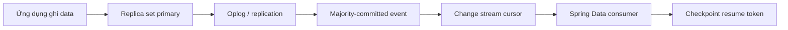
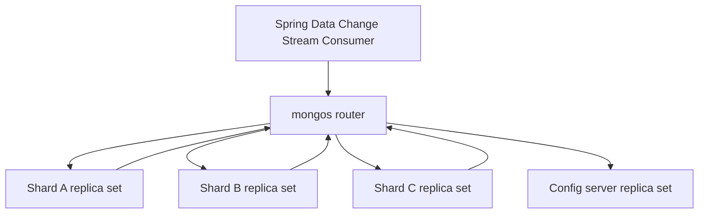
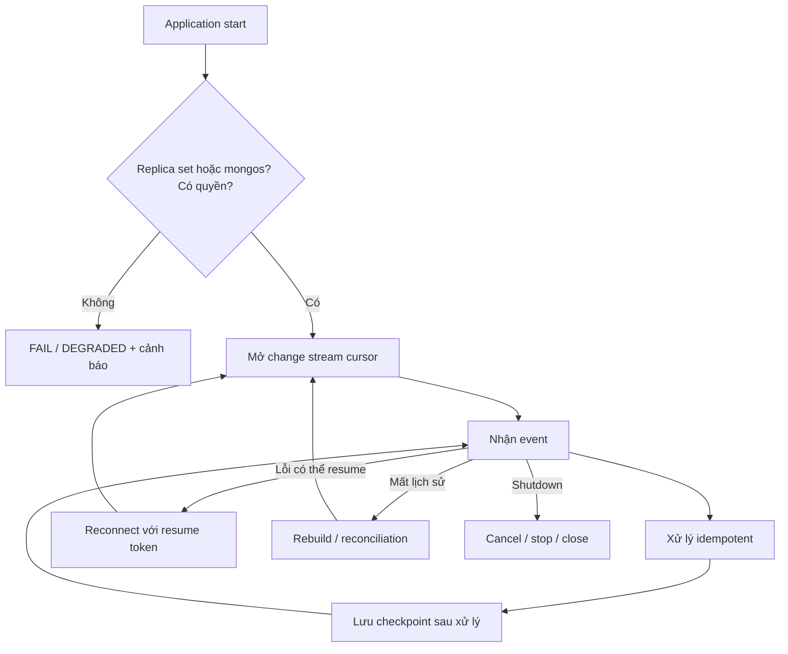

# Điều kiện replica set hoặc sharded cluster

MongoDB **change streams** cho phép một ứng dụng nhận sự kiện khi document được thêm, sửa, thay thế, xóa hoặc khi có những thay đổi liên quan đến collection. Thay vì liên tục `find` để dò thay đổi, service có thể mở một **change stream cursor** và xử lý các event phát sinh từ MongoDB. Trong **Spring Data MongoDB**, luồng này có thể được tiêu thụ bằng `ReactiveMongoTemplate` (trả `Flux<ChangeStreamEvent<T>>`) hoặc bằng `MongoTemplate` thông qua `MessageListenerContainer`.

Điều kiện đầu tiên không nằm ở Java code mà nằm ở **topology MongoDB**: change streams **chỉ được hỗ trợ trên replica set hoặc sharded cluster**. Một `mongod` khởi động theo chế độ **standalone**, kể cả đã có dữ liệu và tạo index, không đáp ứng điều kiện đó. Trên replica set, mở stream từ một **data-bearing member** phù hợp với read preference; trên sharded cluster, kết nối ứng dụng qua **`mongos`** để có một stream thống nhất across shards.

Bài thuộc chương **Change stream** của module `SPRING_DATA_MONGODB`. Module hướng dẫn kết nối, ánh xạ document và thao tác MongoDB qua `MongoTemplate` hoặc repository; thực hành truy vấn, aggregation, index, transaction, reactive access, kiểm thử và chẩn đoán hiệu năng. Bài này tập trung vào điều kiện **replica set hoặc sharded cluster**, cách nhận biết topology, cấu hình local/test/production và hệ quả lên bảo mật, oplog, resume, Spring Data và kiểm thử.

> **Ghi nhớ:** `mongodb://localhost:27017` chỉ là địa chỉ kết nối; nó **không chứng minh server là replica set**. Cần kiểm tra `hello`/`rs.status()` và thực sự mở stream. Một **replica set một node** đủ để luyện tập change streams trong môi trường test, nhưng **không đem lại dự phòng hoặc khả năng chịu lỗi giống replica set nhiều nodes**.

## 1. Mục tiêu học tập

Sau bài này, bạn có thể:

1. Phân biệt `standalone mongod`, `replica set` và `sharded cluster`.
2. Giải thích tại sao change streams cần replication infrastructure và không hoạt động trên standalone.
3. Phân biệt MongoDB Server version hỗ trợ change streams và phiên bản Spring Data MongoDB Driver cần tương thích.
4. Kiểm tra topology bằng `db.hello()`, `rs.status()`, `rs.conf()` và `listShards` theo quyền.
5. Khởi tạo **replica set một node** cho môi trường phát triển và biết giới hạn của nó.
6. Biết khi nào phải kết nối qua `mongos` thay vì trực tiếp vào shard replica set.
7. Viết connection string có `replicaSet=...` và danh sách hosts/seedlist phù hợp.
8. Hiểu majority-committed change events, oplog và change stream cursor.
9. Kiểm tra authorization `find` + `changeStream` theo scope collection/database/deployment.
10. Mở `db.collection.watch()` và phân biệt nó với `find()`/tailable cursor.
11. Hiểu scope của collection, database và toàn deployment, cùng rủi ro quyền truy cập.
12. Đọc các trường `operationType`, `ns`, `documentKey`, `clusterTime` và resume token `_id`.
13. Hiểu giới hạn `resumeAfter`, `startAfter` và thời gian lưu oplog.
14. Phân biệt `fullDocument: "updateLookup"` với snapshot nguyên tử tại đúng thời điểm update.
15. Hiểu khác biệt giữa event streaming và một message queue có retention/ack độc lập.
16. Mở change stream bằng `ReactiveMongoTemplate.changeStream(...).listen()`.
17. Dùng `MessageListenerContainer` cho đường imperative và quản lý task lifecycle.
18. Kiểm thử topology trên MongoDB test replica set thay vì standalone giả lập.
19. Phân biệt test một-node replica set với kiểm thử bầu primary/failover nhiều nodes.
20. Xác định các vấn đề về shard ordering, cold shards, resume token và timeout.
21. Thiết kế cách xử lý event có thể lặp và duy trì checkpoint an toàn.
22. Chẩn đoán lỗi `$changeStream` chỉ hỗ trợ replica set, thiếu quyền hoặc oplog quá ngắn.
23. Nhận diện tác động của số lượng watch cursors, long-running connections và backpressure.
24. Lập checklist triển khai production có xác thực, TLS, monitoring, HA và recovery plan.

## 2. Ba mô hình triển khai và điều kiện change stream

| Topology | Mô tả | Có hỗ trợ change streams? | Kết nối ứng dụng |
| --- | --- | --- | --- |
| **Standalone `mongod`** | Một server, không chạy replication protocol | **Không** | URI tới node standalone, nhưng không watch được |
| **Replica set 1 member** | Một `mongod` khởi động `--replSet`, đã `rs.initiate` | **Có** cho dev/test | URI có replica set name, host reachable |
| **Replica set nhiều members** | Primary và secondary data-bearing nodes | **Có** | URI seedlist + `replicaSet` |
| **Sharded cluster** | `mongos`, config server replica set, shards | **Có** | URI tới **`mongos`** |
| MongoDB Atlas cluster | Deployment được quản lý, topology tùy tier/offer | Có khi deployment hỗ trợ change streams | SRV/URI theo Atlas và quyền phù hợp |
| `mongod --replSet` nhưng chưa initiate | Mới bật chế độ replSet, chưa có primary ổn định | **Chưa đủ điều kiện vận hành** | Initiate, đợi PRIMARY rồi kiểm tra |

**Điểm quyết định là server topology**, không phải tên dependency Maven hay việc có `@EnableMongoRepositories`. Một ứng dụng có thể thực hiện CRUD thành công trên standalone nhưng thất bại ngay khi mở `watch()`.

### 2.1. Vì sao replica set một node vẫn hợp lệ?

Change streams dựa trên cơ chế replication oplog và logical time. Replica set một node có replication configuration và oplog nên có thể phục vụ stream. Tuy nhiên majority của một voting member chỉ là chính node đó; nếu host bị mất, **không có secondary thay thế**.

Bởi vậy:
- Một node replica set phù hợp **tập luyện, CI và một số môi trường local**.
- Với production cần availability, backup, elections và durability theo SLO, dùng **topology nhiều members được thiết kế và vận hành đúng**.
- Test pass trên một-node replica set không chứng minh consumer tự phục hồi đúng khi có election/network partition.

### 2.2. Một sharded cluster không đồng nghĩa một replica set lớn

Trong sharded cluster, các shards và config servers có cơ chế replica sets và routing; `mongos` là tầng trung gian để gửi commands đến shards và phối hợp kết quả. Một client chỉ kết nối một shard sẽ **không nhìn thấy đầy đủ các thay đổi của toàn collection sharded**. Để mở stream cấp sharded cluster, kết nối qua `mongos`.

## 3. Cơ chế phía MongoDB: oplog, majority và $changeStream

MongoDB change streams là API của server được triển khai qua aggregation stage **`$changeStream`**, lấy dữ liệu thay đổi dựa trên replication oplog và cung cấp **resume token** để tiếp tục.



Quy trình ý niệm:

1. Client gửi `insertOne`, `updateOne` hoặc transaction commit.
2. MongoDB ghi và replicate theo cơ chế replica set.
3. **Change notification được phát khi thay đổi đã được majority-committed** theo guarantee của change streams.
4. Consumer nhận event document với `_id` resume token, `operationType` và các trường metadata.
5. Consumer xử lý nghiệp vụ, lưu checkpoint phù hợp và tiếp tục đọc.
6. Khi mất kết nối, consumer có thể khôi phục stream nếu **resume token còn nằm trong lịch sử cần thiết của oplog**.

**Không** kết luận event đến ngay sau response của một write `w:1`. Change stream notification dựa trên **majority commit**, có thể có độ trễ replication.

### 3.1. Oplog là gì?

Oplog (operation log) là capped collection nội bộ dùng cho replication; nó có tính chất **cửa sổ lịch sử hữu hạn**. Khi dữ liệu mới ghi vào liên tục, lịch sử quá cũ có thể bị loại. Change streams không bảo đảm replay vô hạn.

Với MongoDB, xem tình trạng oplog bằng quyền quản trị phù hợp:

```javascript
// Trên replica set mongod, theo quyền được cấp:
rs.printReplicationInfo()
rs.printSecondaryReplicationInfo()
```

Các lệnh trên mang tính quan sát; cú pháp/trường trả về có thể thay đổi theo phiên bản và topology. Thông tin quan trọng nhất cho consumer là **oplog window còn đủ dài so với thời gian downtime và backlog**.

### 3.2. Change stream khác tailable cursor

Tailable cursor đọc một capped collection một cách trực tiếp, còn `watch()` là API Change Streams với metadata events, resume tokens và các guarantee chính thức. Đừng mở tailable cursor trên `local.oplog.rs` bằng ứng dụng nghiệp vụ chỉ để bắt chước change streams: cách đó cần quyền cao, có nguy cơ phụ thuộc định dạng nội bộ và xử lý failover phức tạp.

## 4. Các điều kiện trước khi bật ứng dụng

Kiểm tra độc lập từng nhóm:

| Nhóm | Điều kiện |
| --- | --- |
| **Topology** | Replica set đã initiate và có data-bearing member khả dụng, hoặc sharded cluster với `mongos` |
| **Version** | MongoDB Server hỗ trợ change streams (từ 3.6 cho replica sets, sharded cluster từ 4.0); chọn phiên bản server/driver còn được hỗ trợ và tương thích |
| **Replication** | Oplog tồn tại, replication ổn định; lưu đủ lịch sử cho SLA resume |
| **Connection** | Driver có thể khám phá hosts advertised trong `rs.conf()`, có URI đúng topology |
| **Authorization** | Role có `changeStream` và `find` trên scope cần watch |
| **Network/TLS** | Hosts, ports, certificates, DNS, firewall và mongos reachable |
| **Collection** | Đúng namespace, permissions và pipeline filter |
| **Consumer** | Xử lý stream vô hạn, cancellation, error, checkpoint/resume và shutdown |
| **Resources** | Connection/cursor budget, memory, throughput, monitoring |
| **Testing** | Test environment thật sự là replica set/sharded, không chỉ mock repository |

Tùy chọn nâng cao như **pre/post images** cần thêm cấu hình ở collection/version, không tự phát sinh chỉ vì topology hỗ trợ change streams.

## 5. Dấu hiệu bạn đang kết nối vào standalone

Một `mongod` khởi động kiểu:

```bash
mongod --dbpath /path/to/local-data --port 27017
```

mà không có `--replSet` hay `replication.replSetName` thường chạy **standalone**. CRUD vẫn hoạt động:

```javascript
db.orders.insertOne({ _id: "O-1", status: "NEW" })
db.orders.findOne({ _id: "O-1" })
```

Nhưng:

```javascript
const cursor = db.orders.watch()
cursor.hasNext()
```

có thể thất bại với lỗi server mang ý nghĩa tương đương **`$changeStream stage is only supported on replica sets`**. Không nên bắt cứng nguyên văn thông báo hoặc error code: cách biểu diễn lỗi khác theo server version/driver và bối cảnh.

**Cách khắc phục không phải** thêm `@EnableReactiveMongoAuditing`, index, thay `Flux` thành `Mono` hay retry query. Bạn phải **chuyển deployment sang replica set hoặc dùng sharded cluster**.

### 5.1. Kiểm tra bằng db.hello()

Trong `mongosh`:

```javascript
const topology = db.hello();
printjson({
  setName: topology.setName,
  isWritablePrimary: topology.isWritablePrimary,
  secondary: topology.secondary,
  msg: topology.msg
});
```

Diễn giải:

- `setName` có giá trị như `rs0`: đang kết nối một member của replica set.
- `isWritablePrimary:true`: member hiện là primary.
- `secondary:true`: member hiện là secondary.
- `msg:"isdbgrid"`: endpoint là `mongos` của sharded cluster.
- Không có `setName` và không có `msg:"isdbgrid"`: thường là standalone `mongod`.

`hello` chỉ là kiểm tra nhanh, không thay thế việc kiểm chứng URI, quyền và thử mở stream thật.

## 6. Cấu hình replica set một node cho dev

Ví dụ chạy **MongoDB Server local trong mạng nội bộ**; không dùng các lệnh này để sửa một database production đang có dữ liệu.

### 6.1. Khởi động mongod ở chế độ replica set

Trong terminal có sẵn `mongod`, tạo một thư mục dữ liệu **dev riêng** rồi chạy:

```bash
# Ví dụ trên máy Linux/macOS, chỉ cho môi trường dev.
mkdir -p /tmp/mongo-change-rs

mongod \
  --replSet rs0 \
  --bind_ip 127.0.0.1 \
  --port 27017 \
  --dbpath /tmp/mongo-change-rs
```

**Không** chạy song song với một process MongoDB khác đang chiếm cổng `27017`. Trên Windows, dùng đường dẫn dữ liệu cục bộ và cú pháp shell phù hợp. Trong ví dụ chỉ bind loopback để không phơi database không xác thực ra mạng.

### 6.2. Initiate đúng một lần

Ở terminal `mongosh` thứ hai:

```bash
mongosh "mongodb://localhost:27017/?directConnection=true"
```

Sau đó:

```javascript
rs.initiate({
  _id: "rs0",
  members: [{ _id: 0, host: "localhost:27017" }]
});
```

Đợi member trở thành `PRIMARY`:

```javascript
rs.status()
db.hello()
```

Chỉ initiate **một lần**. Nếu replica set đã được cấu hình, không gọi lại `rs.initiate` mỗi lần ứng dụng khởi động. Không tự áp `rs.reconfig`/`rs.add` lên production để phục vụ một test.

### 6.3. URI kết nối ứng dụng dev

```text
mongodb://localhost:27017/change_training?replicaSet=rs0
```

Với một-node dev, `directConnection=true` có thể hữu ích khi Docker/network port mapping gây hạn chế khám phá advertised hosts, nhưng không dùng nó để **ẩn lỗi hostname replica set** trên production nhiều nodes. Một URI có đúng `replicaSet` nhưng member quảng bá hostname không thể resolve vẫn có thể gây `server selection timeout`.

### 6.4. Tại sao một-node replica set không đồng nghĩa production HA?

Nó có oplog và phục vụ change streams, nhưng không có secondary dự phòng. Khi host mất, cả database lẫn stream dừng. Trong test, topology này chỉ xác minh **API/change stream semantics**, không kiểm tra election, replication lag và failover giữa các nodes.

## 7. Replica set nhiều node trong production

Một replica set có thể gồm primary và các secondary data-bearing members. Kết nối thường dùng **seedlist** cùng replica set name:

```text
mongodb://db1.example.net:27017,db2.example.net:27017,db3.example.net:27017/change_training?replicaSet=rs0
```

Driver sẽ khám phá thành viên/role theo topology. Những host trong `rs.conf()` cần resolve được và reachable **từ chính môi trường chạy ứng dụng**, không chỉ từ máy DBA.

### 7.1. Mở watch ở member nào?

MongoDB cho phép mở change stream trên **data-bearing member** của replica set theo read preference hợp lệ. Không bắt buộc chỉ trên primary trong mọi trường hợp. Chọn primary/secondary dựa trên consistency, latency, khả năng phục hồi và read preference policy; driver có thể tiếp tục stream sau election theo những lỗi resumable nhất định.

**Không** dùng một hidden/arbiter-only member như nguồn có thể đọc change stream nếu nó không phải data-bearing readable node.

### 7.2. Một primary có nghĩa là luôn liên tục phát events?

Không. Khi election hoặc network failover diễn ra, cursor có thể tạm đóng/lỗi và client phải **resume**. Resume token và oplog window là yếu tố quyết định có thể tiếp tục từ đâu; có replica set nhiều nodes không mặc nhiên bảo đảm “không mất event trong mọi outage vô hạn”.

### 7.3. Majority commit cần có mặt trong thiết kế SLA

Events chỉ được phát sau khi thay đổi majority committed. Nếu replication bị chậm, consumer có thể thấy độ trễ. Theo dõi replication lag cùng change stream lag thay vì kết luận `watch()` “bị treo” ngay khi chưa thấy event sau một write mới.

## 8. Sharded cluster: kết nối qua mongos

Một sharded cluster có:



Với sharded deployment, **mở change stream qua `mongos`**, không cắm trực tiếp vào primary của một shard. `mongos` phối hợp events từ các shards và cung cấp một luồng có thứ tự logic trên phạm vi stream.

### 8.1. URI ví dụ cho mongos

```text
mongodb://router1.example.net:27017,router2.example.net:27017/change_training
```

Đây là URI **minh họa**, không có credentials. Với sharded cluster, không gắn `replicaSet=rs0` của một shard lên URI tới `mongos`: route cluster và replica set member discovery là hai mô hình khác nhau.

### 8.2. Vì sao không watch trực tiếp một shard?

Một collection sharded có documents nằm trên nhiều shards. Watch một shard riêng chỉ quan sát subset của activity và không có sự phối hợp thứ tự các events ở các shards khác. Cluster-wide change stream phải được mở qua `mongos`.

### 8.3. Cold shards và độ trễ

`mongos` cần phối hợp trạng thái giữa các shards để đảm bảo **total order** của events. Những shards ít hoặc không có write (cold shards) có thể làm tăng thời gian chờ event vì router cần xác nhận chúng đã tiến tới logical time đủ xa. Không coi latency của change stream là chỉ số độc lập với cấu trúc shards và độ phân bố writes.

## 9. Nhận biết endpoint của ứng dụng trước khi watch

Ví dụ kiểm tra trong `mongosh`:

```javascript
const hello = db.hello();

if (hello.msg === "isdbgrid") {
  print("Endpoint: mongos / sharded cluster");
} else if (hello.setName) {
  print("Endpoint: replica set " + hello.setName);
} else {
  print("Endpoint: standalone hoặc topology chưa sẵn sàng");
}
```

Với replica set, chạy thêm `rs.status()` trên một member có quyền để xác minh primary/secondaries. Với sharded cluster, DBA có thể dùng `db.adminCommand({ listShards: 1 })` nếu role có quyền phù hợp. `rs.status()` trực tiếp trên `mongos` không phải cách kiểm tra topology shards.

### 9.1. Cùng host:port nhưng sai MongoDB process

Đôi khi dev chạy một container MongoDB standalone ở `localhost:27017` trong khi một replica set đã có ở cổng khác. Spring Boot URI trỏ sai process sẽ dẫn tới “CRUD được, watch lỗi”. In `db.hello()` trên **đúng URI ứng dụng**, không chỉ trên một console MongoDB ngẫu nhiên.

### 9.2. MongoDB Atlas

Khi dùng MongoDB Atlas, lấy URI/SRV từ deployment đang dùng và kiểm tra tier/capability/permission. Không tự đưa `rs.initiate()` hay `rs.reconfig()` vào một managed deployment. Tính khả dụng của change streams còn phụ thuộc loại dịch vụ/đặc tính cụ thể và chính sách tổ chức, không đoán chỉ từ hostname `mongodb+srv://`.

## 10. Phân quyền changeStream và find

Với MongoDB bật authorization, consumer cần các action:

- `changeStream`
- `find`

Scope quyền phụ thuộc loại stream:

| Scope watch | Scope privilege `find` + `changeStream` |
| --- | --- |
| Một collection | Collection tương ứng |
| Một database | Các collections không thuộc `system` trong database |
| Toàn deployment | Các collections không thuộc `system` trong các databases theo quy tắc role |

Ví dụ custom role cho một collection trong database `change_training`, chạy bởi DBA được ủy quyền:

```javascript
use change_training

db.createRole({
  role: "ordersChangeReader",
  privileges: [
    {
      resource: { db: "change_training", collection: "orders" },
      actions: ["find", "changeStream"]
    }
  ],
  roles: []
});
```

Gán role cho service user qua quy trình IAM/provisioning được tổ chức phê duyệt; không tạo admin user hoặc dùng root credentials chỉ để mở stream.

### 10.1. Watch phạm vi rộng hơn cần quyền rộng hơn

Một role chỉ có `find`/`changeStream` trên collection `orders` không mặc định đủ để gọi `db.watch()` trên cả database. Chọn scope nhỏ nhất đáp ứng nghiệp vụ để giảm blast radius và tránh rò rỉ dữ liệu.

### 10.2. Quyền cần được kiểm tra tại thời điểm mở stream

Dù MongoDB kết nối thành công và `findOne` chạy được, mở `watch()` vẫn có thể thất bại `Unauthorized` nếu thiếu `changeStream`. Đây là **lỗi authorization**, không phải lỗi thiếu replica set. Phân biệt bằng `hello`/log driver/server và quyền thực được gán.

## 11. Collection, database và deployment-wide streams

MongoDB hỗ trợ các mức scope khác nhau:

```javascript
// Một collection:
const collectionStream =
    db.getSiblingDB("change_training").orders.watch();

// Tất cả collections phù hợp trong một database:
const databaseStream =
    db.getSiblingDB("change_training").watch();

// Toàn deployment (phải có quyền tương ứng):
const deploymentStream =
    db.getMongo().watch();
```

Thao tác watch cấp database/deployment tạo ra nhiều loại event từ nhiều namespace. Lúc ấy, `fullDocument` có thể là những entity shapes khác nhau nên Spring Data documentation khuyến nghị **`Document`** khi cần nhận event không đồng nhất, thay vì cố map tất cả về một domain class.

### 11.1. Lựa chọn phạm vi theo nghiệp vụ

| Yêu cầu | Scope nên cân nhắc | Tác động |
| --- | --- | --- |
| Phát sự kiện thay đổi đơn hàng | `orders` collection | Ít quyền và ít event hơn |
| Cache invalidation cho nhiều collections cùng DB | Database | Phân loại event theo `ns.coll` |
| CDC/ETL của toàn cluster | Deployment-wide | Quyền rộng, cần kiểm soát dữ liệu nhạy cảm |
| Một collection sharded | Watch collection qua `mongos` | Stream được merge từ shards |

Đừng chọn deployment-wide chỉ vì muốn “tránh bỏ lỡ event” rồi đặt mọi sự kiện vào cùng một consumer không có quotas. Phạm vi càng rộng thì quyền và lượng dữ liệu phát sinh càng lớn.

### 11.2. Ràng buộc của `$changeStream` stage

Trong raw aggregation, `$changeStream` phải là **stage đầu tiên** trong pipeline. `db.collection.watch(pipeline, options)` tự dựng stage phù hợp; các pipeline stages do bạn truyền dùng để lọc/biến đổi **change events**, không phải trực tiếp các documents gốc như với `find()`.

Ví dụ filter theo `operationType` cần dùng `$match` sau `$changeStream`, không đưa `$match` lên trước.

## 12. Chạy thử watch() bằng mongosh trên replica set

Giả sử đã chạy `rs.initiate` và kiểm tra `PRIMARY` thành công, dùng **hai terminal** trỏ cùng database dev.

**Terminal 1: mở stream trước.**

```javascript
use change_training

const cursor = db.orders.watch([
  {
    $match: {
      operationType: { $in: ["insert", "update", "replace", "delete"] }
    }
  }
], {
  fullDocument: "updateLookup"
});

while (cursor.hasNext()) {
  const event = cursor.next();
  printjson({
    token: event._id,
    operationType: event.operationType,
    namespace: event.ns,
    key: event.documentKey,
    fullDocument: event.fullDocument
  });
}
```

`hasNext()` chờ sự kiện nên **không kết thúc như một query thường**. Dùng Ctrl+C/đóng cursor theo khả năng shell để kết thúc thử nghiệm; đừng đặt vòng chờ này trong HTTP handler xử lý request thông thường.

**Terminal 2: tạo thay đổi sau khi stream đã sẵn sàng.**

```javascript
use change_training

db.orders.insertOne({
  _id: "ORDER-CS-1",
  tenantId: "tenant-demo",
  status: "NEW"
});

db.orders.updateOne(
  { _id: "ORDER-CS-1" },
  { $set: { status: "PAID" } }
);

db.orders.deleteOne({ _id: "ORDER-CS-1" });
```

Consumer ở Terminal 1 sẽ lần lượt nhận change events mà stream có quyền thấy theo majority-commit semantics. Các event không chứa luôn full document cho mọi operation type (đặc biệt **delete**), và `updateLookup` có thể trả document ở thời điểm lookup thay vì chính xác snapshot lúc update.

### 12.1. Tại sao phải mở stream trước khi insert?

Mặc định stream bắt đầu theo vị trí server khi được mở. Nếu insert xảy ra **trước khi cursor đã sẵn sàng**, bạn có thể không thấy sự kiện đó nếu không cấu hình `startAtOperationTime` hoặc resume token. Đây là lỗi thường gặp trong integration test dùng sleep/subscribe và insert ngay mà không đồng bộ thời điểm.

### 12.2. Không dùng collection production làm fixture

Các `insertOne/updateOne/deleteOne` trong ví dụ chỉ được chạy trên database test rõ ràng. Không thử nghiệm bằng việc sửa đơn hàng thật để “xem change stream có hoạt động không”.

## 13. Cấu trúc một change event

Một insert event tiêu biểu (đã giản lược):

```json
{
  "_id": { "_data": "<opaque-resume-token>" },
  "operationType": "insert",
  "clusterTime": { "$timestamp": { "t": 1732100000, "i": 1 } },
  "ns": {
    "db": "change_training",
    "coll": "orders"
  },
  "documentKey": { "_id": "ORDER-CS-1" },
  "fullDocument": {
    "_id": "ORDER-CS-1",
    "tenantId": "tenant-demo",
    "status": "NEW"
  }
}
```

Các field chính:

| Field | Ý nghĩa | Cần làm gì |
| --- | --- | --- |
| `_id` | Resume token của event | **Lưu nguyên trạng**, không sửa/ghi đè |
| `operationType` | Loại thay đổi `insert/update/replace/delete` và các loại khác | Phân nhánh xử lý |
| `ns` | Database/collection nguồn | Authorization và dispatch |
| `documentKey` | Định danh document | Dùng để upsert/delete trong read model |
| `clusterTime` | Logical cluster time | Hữu ích cho thứ tự và metrics |
| `fullDocument` | Nội dung document nếu có và được yêu cầu | Có thể `null`/không có tùy operation |
| `updateDescription` | Các field đã đổi trong update event | Không phải full snapshot |
| `lsid`/`txnNumber` | Metadata session/transaction khi có | Hỗ trợ correlation, không phải business ID |

`_id` là một **opaque resume token**, không nên parse và tự diễn giải thành timestamp/offset numeric. MongoDB có thể thay đổi encoding token giữa các server versions. Cần bảo toàn BSON value/structure để phục hồi.

### 13.1. Không project bỏ hoặc sửa `_id` của event

Từ MongoDB 4.2, change stream pipeline sửa `_id` của event có thể bị server từ chối. Không dùng `$project:{_id:0}` hoặc `$replaceRoot` làm mất token rồi kỳ vọng driver resume ổn định. Nên giữ token tới checkpoint boundary, kể cả khi DTO gửi ra client không chứa token.

### 13.2. Delete event không có fullDocument thông thường

Khi một document đã bị xóa, event mang `documentKey` để consumer biết record nào bị xóa. Nếu nghiệp vụ cần **trạng thái trước khi xóa**, xem pre-images support và cấu hình riêng ở mục 17; không nghĩ `fullDocument:"updateLookup"` sẽ truy vấn lại được bản ghi đã biến mất.

## 14. Change streams và transaction commit

Nếu ứng dụng sử dụng transaction nhiều documents trên replica set/sharded cluster:

1. Các writes trong transaction chưa commit **không** được change stream phát ra như đã tồn tại bền vững.
2. Khi transaction được commit và majority committed, consumer có thể nhận các event tương ứng.
3. Nếu transaction abort, không có các event thành công tương ứng với những write đã bị rollback.
4. Event có thể chứa `lsid`/`txnNumber` hoặc metadata khác phục vụ correlation.
5. Nhiều events từ một transaction **không đồng nghĩa consumer tự có transaction boundary ở downstream**.

Nếu consumer cần cập nhật một hệ thống thứ hai theo cách nhất quán, nó phải tự xây logic idempotency/checkpoint hoặc transactional outbox, không coi việc các event cùng transaction xuất hiện gần nhau là một distributed transaction.

### 14.1. Không nhầm majority notification với write concern của caller

Change streams phản ánh thay đổi đã majority committed. Một lệnh write `w:1` có thể trả về trước khi consumer nhận event; cũng có thể rollback trong những kịch bản failover trước majority commit. Không khẳng định cứ client thấy ACK thì event chắc chắn đã có.

### 14.2. Thứ tự trên sharded cluster

MongoDB cung cấp total ordering cho change events across shards bằng logical clock và phối hợp `mongos`. Đây là bảo đảm theo phạm vi stream của server, **không** có nghĩa downstream consumer chạy nhiều worker song song sẽ tự xử lý đúng thứ tự. Nếu handler dùng `flatMap(..., concurrency)`, thứ tự hoàn tất side effects có thể khác thứ tự event đầu vào.

## 15. Resume tokens: điều kiện cần để hồi phục

Một change stream cursor là tài nguyên dài hạn. Network disconnect, elections, deployment rolling restart hoặc consumer restart đều có thể khiến nó phải **resume**.

MongoDB hỗ trợ:

- `resumeAfter`: tiếp tục **sau event/token** đã biết, khi stream bị ngắt theo trường hợp được phép.
- `startAfter`: khởi tạo stream mới **sau một token**, đặc biệt hữu ích sau `invalidate` event.
- `startAtOperationTime`: mở từ một timestamp nằm **trong cửa sổ oplog còn tồn tại**.

```javascript
// Ví dụ giữ token đã lưu từ event trước.
const lastToken = lastSeenEvent._id;

// Mở lại stream từ sau token:
const resumed = db.orders.watch([], {
  resumeAfter: lastToken
});
```

`lastSeenEvent` là event mà ứng dụng đã lưu an toàn trước đó. Trong production, checkpoint nên được lưu dưới dạng BSON/serialized value preserving token, không chuyển thành số nguyên tự nghĩ ra.

### 15.1. Resume token phụ thuộc oplog window

Nếu consumer offline lâu hơn cửa sổ lịch sử cần thiết và token liên quan đã rơi khỏi oplog, **resume không thể khôi phục chính xác từ token cũ**. Bạn phải có **rebuild/reconciliation** strategy, ví dụ chụp snapshot hiện tại rồi tiếp tục từ một vị trí stream thích hợp, tránh tuyên bố “resume mãi mãi”.

### 15.2. Resume sau invalidate

Khi collection bị drop/rename, stream có thể nhận `invalidate` rồi đóng. `resumeAfter` **không** thể tiếp tục qua invalidate theo semantics MongoDB; `startAfter` được cung cấp để khởi tạo stream sau invalidate trong điều kiện hỗ trợ. Điều này không có nghĩa các dữ liệu của collection cũ tự hồi phục.

### 15.3. Pipeline và options khi resume

MongoDB khuyến cáo dùng **cùng pipeline và options** khi resume bằng token được tạo trước đó. Thay đổi filter, fullDocument options hoặc scope có thể làm resume thất bại hoặc tạo hành vi không dự đoán được. Khi triển khai phiên bản consumer mới, cân nhắc quản lý checkpoint schema/version và rollout strategy.

### 15.4. Đừng checkpoint trước business side effect

Sai:

```text
receive event
  -> save resume token
  -> write to search index
  -> process crashes before search index update
```

Nếu restart từ token mới, event có thể **bị mất đối với search index**. An toàn hơn: xử lý idempotent ở downstream, xác nhận side effect, sau đó lưu checkpoint theo bảo đảm mong muốn. Nếu checkpoint và side effect nằm ở hai systems khác nhau, không có atomic transaction chung một cách mặc định; dùng deduplication/reconciliation.

## 16. Oplog capacity, downtime và retention

**Cửa sổ oplog** phụ thuộc dung lượng oplog, tốc độ writes và các cơ chế retention của phiên bản MongoDB. Một replica set có `oplog` nhưng bị quá tải ghi có thể chỉ lưu lịch sử trong khoảng thời gian ngắn.

Ví dụ tình huống:

| Tình huống | Oplog window giả định | Downtime consumer | Khả năng resume |
| --- | --- | --- | --- |
| Test nhỏ, ít writes | 12 giờ | 5 phút | Thường còn token nếu không có invalidation |
| Production ghi nhiều | 30 phút | 2 giờ | **Không bảo đảm** vì lịch sử có thể hết |
| Sharded cluster có shard bận | Thay đổi theo shards | 45 phút | Phải xem cửa sổ khả dụng liên quan toàn stream |
| Mở stream lúc hiện tại | Không cần replay quá khứ | 0 | Có thể theo dõi các thay đổi về sau |

Các con số trong bảng là **giả định minh họa**, không phải thông số mặc định của MongoDB.

### 16.1. Không dùng change streams thay hệ thống message retention dài hạn

MongoDB change streams không phải một message queue có retention độc lập, acknowledgment per-consumer group và replay vô hạn. Nếu cần replay nhiều ngày/tháng, nhiều consumers riêng với SLA cao, cân nhắc CDC pipeline sang Kafka/event bus hoặc event store/outbox phù hợp.

### 16.2. Theo dõi lag theo cách có ý nghĩa

Theo dõi thời gian từ `clusterTime`/event time tới lúc xử lý xong, checkpoint age, oplog window và số lần resume thất bại. Một người tiêu dùng chạy chậm có thể “trông vẫn đang kết nối” nhưng sẽ mất khả năng resume nếu lag vượt lịch sử còn lại.

### 16.3. High-watermark tokens

MongoDB có thể tạo **post-batch resume tokens** ngay cả khi không có một change event mới, để biểu thị vị trí logical time đã tiến. Khi dùng raw driver/cursor cấp thấp, cần phân biệt token ở event và token sau batch; đừng chỉ giả định mọi checkpoint luôn đến từ một document event.

## 17. fullDocument, pre-images và post-images

`fullDocument:"updateLookup"` yêu cầu MongoDB truy vấn **bản mới nhất đã majority-committed** của document tương ứng khi xử lý update event. Nó **không chắc là snapshot chính xác tại khoảnh khắc của update** nếu đã có các thay đổi khác xen vào trước lookup.

```javascript
const cursor = db.orders.watch([], {
  fullDocument: "updateLookup"
});
```

Một update event có thể chứa:

```javascript
{
  operationType: "update",
  documentKey: { _id: "ORDER-CS-1" },
  updateDescription: {
    updatedFields: { status: "PAID" },
    removedFields: []
  },
  fullDocument: {
    _id: "ORDER-CS-1",
    status: "PAID"
  }
}
```

`fullDocument` có thể không có/null nếu document đã bị xóa hoặc không còn khả dụng tại thời điểm lookup. Đối với delete, vẫn cần `documentKey` hoặc pre-image nếu cần trạng thái cũ.

### 17.1. Pre/post images là tính năng riêng

MongoDB 6.0+ hỗ trợ change stream **pre- và post-images** theo những cấu hình collection/retention cụ thể. Ví dụ enable trên collection:

```javascript
db.runCommand({
  collMod: "orders",
  changeStreamPreAndPostImages: { enabled: true }
});
```

Việc này đòi hỏi role/Server version phù hợp và chỉ có tác dụng đối với events từ **sau khi đã bật**; không tạo lại ảnh lịch sử của thay đổi trước đó. Chi phí lưu trữ/retention cần được quản lý.

### 17.2. Không nhầm images với điều kiện topology

Dù không bật pre/post images, change streams cơ bản **vẫn cần replica set hoặc sharded cluster**. Ngược lại, bật image configuration không biến standalone mongod thành topology hỗ trợ `$changeStream`.

## 18. Những lưu ý riêng của sharded cluster

`mongos` gom events từ shards và đảm bảo thứ tự logic theo MongoDB change stream semantics, nhưng sharded deployments có nhiều điều kiện vận hành riêng.

### 18.1. Cold shards có thể làm tăng độ trễ

Để đảm bảo total order, `mongos` cần xác định các shard đã tiến tới thời điểm logic nào. Một shard ít hoạt động có thể khiến stream có latency cao hơn dù shard chính liên tục có writes. Theo dõi activity của từng shard và change stream lag thay vì chỉ đo latency ở application node.

### 18.2. Shard removal không phải reconnect đơn giản trong mọi trường hợp

MongoDB documentation lưu ý khi remove shard, một open change stream cursor có thể bị đóng và **không hoàn toàn resumable**. Phải có kế hoạch reconciliation khi thay đổi topology, đừng khẳng định mọi `resumeAfter` đều thành công sau shard removal.

### 18.3. $lookup/fullDocument lookup có thể tốn tài nguyên

Change stream trong sharded cluster có thể phải phối hợp lookup across shards. `fullDocument:"updateLookup"` và `$lookup` trong pipeline làm tăng chi phí. Giảm volume event, filter sớm theo `operationType/ns`, tránh enrich quá nhiều ngay trong stream khi không cần.

### 18.4. Không coi một shard là toàn cluster

Nếu môi trường staging sharded nhưng service dùng URI tới shard primary, các tests có thể “thấy event” trong một subset nhưng bỏ qua events ở shard khác. URI tới `mongos` là một **điều kiện correctness**, không chỉ tối ưu kết nối.

## 19. Spring Data ReactiveMongoTemplate: subscribe change stream

Tài liệu Spring Data MongoDB cho ví dụ fluent API:

```java
import org.bson.Document;
import org.springframework.data.mongodb.core.ReactiveMongoTemplate;
import org.springframework.data.mongodb.core.ChangeStreamEvent;
import reactor.core.publisher.Flux;

Flux<ChangeStreamEvent<Document>> changes =
    reactiveMongoTemplate.changeStream(Document.class)
        .watchCollection("orders")
        .listen();
```

`reactiveMongoTemplate` là Spring bean được inject. `Document.class` được chọn khi muốn xem raw event body; với entity chỉ có một collection, có thể chọn class domain tương ứng.

**Điều kiện:** reactive driver phải kết nối đúng **replica set hoặc mongos**, có quyền và oplog. Một `Flux` được tạo trên standalone không làm `$changeStream` trở nên hợp lệ.

### 19.1. Cold Publisher và subscription

`Flux<ChangeStreamEvent<T>>` là một Publisher. Tạo nó không đảm bảo stream đã được mở; sẽ cần **subscriber**. Khi có subscription, Spring Data/driver tạo cursor/aggregation tương ứng. Hai subscribers có thể mở **hai change stream cursors** riêng và tăng tải lên database.

Không viết service:

```java
// Anti-pattern: hidden subscription và mất kiểm soát lifecycle.
public Flux<ChangeStreamEvent<Document>> wrong() {
    reactiveMongoTemplate.changeStream(Document.class)
        .watchCollection("orders")
        .listen()
        .subscribe(event -> System.out.println(event));
    return Flux.empty();
}
```

Thay bằng service **trả Publisher** và để ứng dụng quản lý vòng đời subscription rõ ràng:

```java
public Flux<ChangeStreamEvent<Document>> watchOrders() {
    return reactiveMongoTemplate.changeStream(Document.class)
        .watchCollection("orders")
        .listen();
}
```

### 19.2. Không map mọi event thành entity bất kể operation type

Đối với delete/invalidate, `ChangeStreamEvent#getBody()` có thể `null` hoặc không mang domain data. Consumer phải kiểm tra loại event, `getResumeToken()`/metadata và `documentKey` theo nhu cầu. Đừng viết `event.getBody().getId()` trước khi biết body tồn tại.

### 19.3. Reactor Context không thay MongoDB topology

Spring WebFlux và `ReactiveMongoTemplate` giúp không giữ thread chờ cursor. Nhưng chúng không thay được các yêu cầu về replication, authorization, resume token và oplog retention. Nếu topology sai, lỗi vẫn phát qua `onError` khi subscribe.

## 20. Imperative MongoTemplate: MessageListenerContainer

Với sync driver, đọc change stream là tác vụ **dài hạn và blocking**. Spring Data cung cấp `DefaultMessageListenerContainer` để điều phối task thay vì để một HTTP request thread đợi vĩnh viễn.

Ví dụ theo Spring Data documentation:

```java
import org.bson.Document;

import com.mongodb.client.model.changestream.ChangeStreamDocument;
import org.springframework.data.mongodb.core.MongoTemplate;
import org.springframework.data.mongodb.core.messaging.ChangeStreamRequest;
import org.springframework.data.mongodb.core.messaging.ChangeStreamRequest.ChangeStreamRequestOptions;
import org.springframework.data.mongodb.core.messaging.DefaultMessageListenerContainer;
import org.springframework.data.mongodb.core.messaging.MessageListener;
import org.springframework.data.mongodb.core.messaging.MessageListenerContainer;
import org.springframework.data.mongodb.core.messaging.Subscription;
import org.springframework.data.mongodb.core.ChangeStreamOptions;

MessageListenerContainer container =
    new DefaultMessageListenerContainer(mongoTemplate);

container.start();

MessageListener<ChangeStreamDocument<Document>, Document> listener =
    message -> System.out.println(message);

ChangeStreamRequestOptions options =
    new ChangeStreamRequestOptions(
        "change_training", "orders", ChangeStreamOptions.empty());

Subscription subscription = container.register(
    new ChangeStreamRequest<>(listener, options),
    Document.class);

// Lúc ứng dụng shutdown hoặc ngừng nhu cầu watch:
container.stop();
```

`mongoTemplate` là bean được inject. `container.stop()` phải nằm trong **lifecycle shutdown**, không gọi ngay sau `register(...)` trong một production setup thật, nếu không stream sẽ dừng trước khi xử lý events. Khi cấu hình container thành Spring bean, Spring Data `DefaultMessageListenerContainer` tích hợp `SmartLifecycle`.

### 20.1. ErrorHandler và quản lý tasks

Spring Data cho phép gắn `ErrorHandler` với `register(request, bodyType, errorHandler)` trong các phiên bản tương ứng. Cần ghi nhận lỗi, monitoring, backoff/restart policy và tránh vòng retry quá nhanh trên lỗi topology/permission không thể tự khỏi.

### 20.2. Không để mỗi request HTTP tạo một listener vô hạn

Nếu endpoint được gọi 100 lần rồi mỗi lần tạo `DefaultMessageListenerContainer` mới, application có thể mở hàng trăm cursors/threads, tốn connection pool. Change stream consumer thường là **application-scoped background component** hoặc service được quản lý riêng, không phải công việc vô hạn của từng GET request.

### 20.3. Reactive và imperative có cùng yêu cầu cluster

Cả `MessageListenerContainer` lẫn `ReactiveMongoTemplate.changeStream` đều gửi change stream command đến MongoDB; cùng cần replica set/sharded cluster, authorization, oplog và khả năng resume. Đổi Java API không sửa được cấu hình server sai.

## 21. Readiness check trong ứng dụng Spring Boot

Một ứng dụng Spring Boot có thể khởi động bình thường và thực hiện CRUD trên MongoDB standalone nhưng chỉ phát hiện lỗi khi code thực sự mở change stream. Vì vậy, nếu tính năng này bắt buộc, nên kiểm tra topology lúc startup.

Ví dụ với `MongoTemplate` imperative:

```java
package dev.learning.changestreams;

import org.bson.Document;
import org.springframework.boot.ApplicationArguments;
import org.springframework.boot.ApplicationRunner;
import org.springframework.data.mongodb.core.MongoTemplate;
import org.springframework.stereotype.Component;

@Component
public class ChangeStreamTopologyCheck
        implements ApplicationRunner {

    private final MongoTemplate template;

    public ChangeStreamTopologyCheck(MongoTemplate template) {
        this.template = template;
    }

    @Override
    public void run(ApplicationArguments args) {
        Document hello = template.executeCommand(
            new Document("hello", 1));

        boolean replicaSet =
            hello.getString("setName") != null;
        boolean mongos =
            "isdbgrid".equals(hello.getString("msg"));

        if (!replicaSet && !mongos) {
            throw new IllegalStateException(
                "MongoDB change streams require replica set or "
                    + "sharded cluster, not standalone mongod");
        }
    }
}
```

Kiểm tra trên chỉ xác minh `hello` cho thấy replica set member hoặc `mongos`. Nó **chưa xác minh** user có `changeStream` privilege, cursor đã mở, oplog đủ dài hoặc toàn bộ advertised hosts đều reachable.

### 21.1. Chọn fail-fast hay degraded mode

- Nếu change stream là thành phần không thể thiếu để ứng dụng đáp ứng business invariant, fail-fast kèm thông báo rõ có thể hợp lý.
- Nếu change stream chỉ phục vụ cache/search index với khả năng eventual consistency, có thể báo trạng thái **DEGRADED**, không mở consumer, nhưng phải có cơ chế phục hồi.
- Nếu ứng dụng chỉ dùng reactive stack, dùng reactive client/template để kiểm tra tương đương; không buộc tạo `MongoTemplate` synchronous chỉ để chạy kiểm tra.

### 21.2. Ping không chứng minh hỗ trợ change stream

`db.adminCommand({ping:1})` hoạt động trên standalone. Healthcheck đúng cần phân biệt network, topology, authorization, actual stream, lag và resume ability.

## 22. Vòng đời consumer: subscribe đến shutdown



Một consumer cần biết ai sở hữu subscription, cách restart, cách log lỗi và cách đóng resources. Không gọi `subscribe()` lén trong service rồi để event stream chạy mãi mà không có lifecycle owner.

### 22.1. Retry không sửa lỗi topology

Thêm `retryWhen` và chạy lại mỗi 100 ms trên standalone không tạo ra replica set. Nó chỉ tăng log/CPU và che nguyên nhân. Phân loại riêng lỗi thiếu topology, thiếu permission, network transient và oplog history lost; chỉ tự retry những lỗi có thể tự hồi phục.

### 22.2. Cancellation không đồng nghĩa acknowledgement

Hủy một subscription giải phóng cursor hoặc đề nghị dừng stream. Nó **không** tự lưu resume token và không báo rằng downstream đã xử lý event. Checkpoint là trách nhiệm riêng của ứng dụng.

### 22.3. Shutdown có thứ tự

Trong graceful shutdown, ưu tiên ngừng nhận việc mới, chờ handlers đang chạy hoàn thành trong giới hạn cho phép, persist checkpoint sau side effect thành công rồi cancel/close cursor. Crash có thể xảy ra trước bất kỳ bước nào, nên handler phải chịu được replay.

## 23. Nhiều pods cùng watch: không phải Kafka consumer group

Nếu có 5 Spring Boot pods cùng gọi `orders.watch()`, thường **mỗi pod nhận một bản của change events** từ scope nó theo dõi. MongoDB không tự chia tải theo consumer group và không tự bảo đảm một event chỉ xử lý bởi một pod.

| Mô hình | Đặc điểm | Khi chọn |
| --- | --- | --- |
| Dedicated single consumer | Một instance sở hữu stream/checkpoint | Hệ thống vừa và nhỏ |
| Leader lease/election | Một leader active, follower takeover | Cần HA consumer |
| CDC → event bus | Một ít stream readers, fan-out qua Kafka/queue | Nhiều downstream subscriptions |
| Mỗi pod một stream | Mọi pod có thể thấy cùng event | Chỉ khi chủ đích broadcast, có dedup |

### 23.1. Leader election cần fencing

Nếu leader A mất kết nối lease store nhưng vẫn đang xử lý, leader B có thể giành lease và cũng xử lý event. Dùng fencing token, lease expiry và idempotent writes để bảo vệ. Chỉ thêm một Redis lock không biến delivery thành exactly-once.

### 23.2. Đừng tạo một stream mỗi kết nối SSE

Nếu 1.000 web clients cùng mở SSE và server mỗi lần mở một MongoDB change stream cursor, số connections/cursors có thể tăng rất lớn. Có thể chia sẻ một consumer ở tầng service rồi fan-out những sự kiện đã **lọc và phân quyền**, cùng backpressure và client disconnect cleanup.

### 23.3. Không đồng nhất stream scope với tenant authorization

Một database-level stream có thể chứa events của nhiều tenant. Dù mỗi HTTP client chỉ được xem một tenant, một backend stream rộng vẫn cần lọc đúng namespace/tenant trước khi phát dữ liệu ra các clients.

## 24. Docker/Kubernetes: hostname replica set advertised

Một lỗi đặc biệt phổ biến:

- Docker host publish `localhost:27018` vào container `27017`.
- Replica set member trong `rs.conf()` quảng bá `mongo-rs:27017`.
- Java app chạy bên ngoài Docker không thể resolve `mongo-rs`.
- Driver truy cập seedlist thành công ban đầu, sau đó discovery dẫn tới `server selection timeout`.

**Giải pháp đúng:** các hostname trong `rs.conf()` phải resolve và reachable từ các ứng dụng/driver cần kết nối; với Kubernetes, dùng DNS ổn định và TLS certificates/SAN hợp lệ.

### 24.1. directConnection chỉ là workaround có giới hạn

`directConnection=true` có thể hữu ích cho **single-node dev/test với port mapping** trong những tình huống cụ thể, nhưng tránh áp vào production replica set nhiều nodes, vì nó có thể vô hiệu hóa topology discovery/failover cần thiết.

### 24.2. Sharded cluster không dùng URI tới một shard

Trong sharded cluster, client phải vào `mongos`, không lấy connection string của một shard primary rồi cho rằng sẽ nhận được events toàn cluster. Kiểm tra `db.hello().msg==="isdbgrid"` bằng chính URI của app.

### 24.3. Managed services

Khi dùng Atlas hoặc dịch vụ MongoDB được quản lý, kiểm tra deployment capability, URI, auth/TLS và quyền. Không gọi `rs.initiate` hoặc `rs.reconfig` trên cluster được provider quản lý.

## 25. Integration test với MongoDB replica set thực

Trong CI, không nên dùng một MongoDB standalone container rồi giả định tests xác minh change streams. **Testcontainers MongoDB module** có khả năng thiết lập replica set cho test, tránh tự viết script `rs.initiate` thiếu chuẩn.

Ví dụ **Testcontainers Java 1.x** và Spring Boot 3.x:

```java
package dev.learning.changestreams;

import static org.assertj.core.api.Assertions.assertThat;

import org.bson.Document;
import org.junit.jupiter.api.Test;
import org.springframework.beans.factory.annotation.Autowired;
import org.springframework.boot.test.context.SpringBootTest;
import org.springframework.data.mongodb.core.MongoTemplate;
import org.springframework.test.context.DynamicPropertyRegistry;
import org.springframework.test.context.DynamicPropertySource;
import org.testcontainers.containers.MongoDBContainer;
import org.testcontainers.junit.jupiter.Container;
import org.testcontainers.junit.jupiter.Testcontainers;
import org.testcontainers.utility.DockerImageName;

@Testcontainers
@SpringBootTest
class ChangeStreamTopologyIntegrationTest {

    @Container
    static final MongoDBContainer mongo = new MongoDBContainer(
        DockerImageName.parse("mongo:7.0")
    );

    @DynamicPropertySource
    static void mongoProperties(DynamicPropertyRegistry registry) {
        // Spring Boot 3.x; kiểm tra property namespace ở Boot 4+.
        registry.add("spring.data.mongodb.uri",
            mongo::getReplicaSetUrl);
    }

    @Autowired
    MongoTemplate template;

    @Test
    void reportsReplicaSetTopology() {
        Document hello = template.executeCommand(
            new Document("hello", 1));

        assertThat(hello.getString("setName")).isNotBlank();
        assertThat(hello.getString("msg"))
            .isNotEqualTo("isdbgrid");
    }
}
```

Ví dụ trên kiểm tra **topology**, chưa phải test sự kiện. Testcontainers 2.x có thay đổi tên module/package; hãy theo BOM và tài liệu của phiên bản được pin, không trộn imports giữa 1.x và 2.x.

### 25.1. Dependencies cho Testcontainers 1.x

```groovy
dependencies {
    testImplementation "org.springframework.boot:spring-boot-starter-test"
    testImplementation "org.testcontainers:junit-jupiter"
    testImplementation "org.testcontainers:mongodb"
}
```

Tùy phiên bản Spring Boot, `spring-boot-starter-data-mongodb` hoặc starter reactive cũng phải có trong dependencies. Không gọi Docker bằng code test nếu môi trường CI không hỗ trợ; khi đó dùng MongoDB replica set test service đã được cấp.

### 25.2. Bài test nhận một insert event

Một integration test đúng cần:

1. Khởi động MongoDB replica set, đợi primary sẵn sàng.
2. Mở `watch()` trên test collection bằng một cursor/subscription.
3. **Xác nhận cursor thực sự được thiết lập** hoặc cấu hình `startAtOperationTime` phù hợp trước khi ghi.
4. Insert document có `_id` và tenant UUID riêng.
5. Đợi insert event bằng `StepVerifier` hoặc `BlockingQueue` với timeout hữu hạn.
6. Assert `operationType="insert"`, `documentKey` và resume token.
7. Cancel/close stream trong `finally` hoặc lifecycle cleanup.

Chỉ subscribe một `Flux` rồi chèn `Thread.sleep(100)` trước insert có thể chạy ngẫu nhiên và flaky trên CI. Không dựa vào một khoảng chờ cố định để chứng minh cursor đã được mở.

### 25.3. Test standalone như một ca âm tính

Một container standalone riêng có thể minh họa rằng `findOne` thành công nhưng `watch()` thất bại vì topology. Không assert một error message/error code cố định nếu project chạy nhiều server versions. Test phải kiểm tra **đúng mongod instance** đang kết nối, không phải một URI khác tình cờ trỏ đến replica set.

### 25.4. Test dừng stream

Với imperative `MessageListenerContainer`, dừng container sau test để không treo CI. Với reactive `Flux`, `thenCancel` hoặc `Disposable.dispose()` theo test boundary giúp giải phóng stream. Đừng mở cursor vô thời hạn trong một test chỉ chờ `verifyComplete()` vì change streams không tự hoàn tất như `find()` thông thường.

## 26. Testing sharded cluster và failover

Một replica set một node xác minh API cơ sở nhưng **không mô phỏng đủ production sharding**.

| Kịch bản cần kiểm thử | RS một node có đủ? | Môi trường phù hợp |
| --- | --- | --- |
| Mở collection watch | Có | Testcontainers MongoDB RS |
| Đọc insert/update event | Có | Replica set test |
| Resume trong oplog window | Có thể | Replica set test với checkpoint |
| Primary election/reconnect | **Không** | Replica set nhiều members |
| Merge events từ nhiều shards | **Không** | Sharded cluster staging |
| mongos routing | **Không** | Sharded cluster |
| Cold-shard event latency | **Không** | Sharded cluster với workload đại diện |
| Shard removal | **Không** | Môi trường topology thử nghiệm có kiểm soát |
| Cluster-wide privileges | Chỉ mô phỏng một phần | Role + cluster staging |

### 26.1. Failover test cần dữ liệu và checkpoint

Ghi event A, lưu resume token A, thay đổi primary trong test HA, ghi event B, mở lại stream theo token và xác minh không mất business outcome. Cần phân biệt resume của Driver tự động với **replay từ checkpoint đã được ứng dụng persist**. Mỗi đường có điều kiện và error handling khác nhau.

### 26.2. Không làm shard removal ở production để thử chức năng ứng dụng

Thay đổi topology cần quyền quản trị và kế hoạch vận hành riêng. Dùng môi trường staging/sharded test. Nếu hệ thống không có sharded deployment, đừng tạo độ phức tạp đó chỉ để test một consumer ứng dụng tập trung vào replica set.

## 27. Quan sát hiệu năng change streams

Change stream cursor là truy vấn lâu dài, không như `find()` trả một trang rồi kết thúc. Số lượng subscriptions, cách downstream xử lý events và oplog retention đều tác động vận hành.

| Nhóm chỉ số | Ý nghĩa |
| --- | --- |
| Number of open streams | Resource use của consumers |
| Consumer lag | Thời gian từ event đến xử lý business xong |
| Checkpoint age | Vị trí cuối cùng được xác nhận |
| Oplog history window | Khoảng thời gian còn có thể resume |
| Replica set health | Elections, majority availability, replication lag |
| Resume attempts/errors | Network failure, history lost, pipeline mismatch |
| mongos/shard event delay | Độ trễ merge giữa shards |
| Driver connection pool | Pool saturation, timeouts |
| Handler retry/duplicate count | Hiệu quả idempotency |
| Full document lookup latency | Extra read chi phí |
| Listener task restarts | Lifecycle/health of imperative watcher |
| Event payload size | Memory/network pressure |

### 27.1. Backpressure không làm oplog giữ event mãi mãi

`Flux` có backpressure, nhưng MongoDB vẫn ghi các thay đổi mới vào oplog. Nếu downstream ngừng tiêu thụ quá lâu, những token cũ vẫn có thể rơi khỏi oplog window. Backpressure hữu ích với process memory/demand, **không phải replay retention policy**.

### 27.2. Không collectList trên stream vô hạn

`reactiveTemplate.changeStream(...).listen().collectList()` sẽ chờ nguồn hoàn tất; change stream có thể hoạt động liên tục, gây tích lũy bộ nhớ không giới hạn. Thay bằng handlers có bounded concurrency, idempotent effects và checkpoint; tránh dùng `flatMap` concurrency cao nếu cần giữ thứ tự xử lý.

### 27.3. Hạn chế full-document enrichment

Với nhiều event update, `fullDocument:"updateLookup"` có thể tạo thêm lookup và latency, đặc biệt trong sharded cluster. Nếu chỉ cần invalidation dựa trên `documentKey` hoặc `updateDescription`, đừng truy vấn full document nếu không cần.

### 27.4. Theo dõi cold shards

Trong sharded cluster, shards ít activity vẫn có thể ảnh hưởng total-order merge latency qua `mongos`. Đừng chỉ nhìn CPU primary shard bận mà bỏ qua routing và logical time tiến triển ở các shards khác.

## 28. Bảo mật và độ tin cậy trong production

Các kiểm soát tối thiểu:

- **Least privilege:** gán `find` và `changeStream` đúng scope.
- **Authentication/TLS:** xác thực server/driver và bảo vệ credentials.
- **Tenant isolation:** không fan-out event chứa raw `fullDocument` của tenant khác.
- **Resume token protection:** lưu token nguyên trạng và quản lý quyền sửa checkpoint.
- **Pipeline versioning:** khi thay filter/options, có migration policy cho checkpoint.
- **Idempotency:** handler có thể chạy lại cùng event sau crash/reconnect.
- **Retention:** giám sát oplog window và chuẩn bị rebuild khi token expired.
- **HA:** replica set nhiều members và consumer failover phù hợp SLO.
- **Logging:** không in nguyên BSON event có PII, secrets hoặc location nhạy cảm.
- **Backups:** dữ liệu chính và downstream projections cần recovery plan.
- **Quotas:** giới hạn số open cursors/subscriptions/concurrency.
- **Audit:** chỉ cấp quyền quản trị như `rs.reconfig` cho người được phép.

### 28.1. Change stream không tạo exactly-once processing bên ngoài MongoDB

Nếu consumer cập nhật search index xong rồi crash **trước khi lưu token**, event có thể replay. Nếu lưu token trước update search index và crash, downstream có thể mất event. Cần idempotent upsert, transactional outbox hoặc kiến trúc phù hợp để cân bằng giữa duplicate và data loss.

### 28.2. Collection watch không thay authorization bên ứng dụng

Role đọc collection không có nghĩa mọi user HTTP được phép thấy mọi event. Tầng service phải lọc quyền theo tenant/actor và chỉ xuất dữ liệu an toàn. Khi dùng SSE/websocket, nên có một consumer ứng dụng chia sẻ có kiểm soát thay vì mỗi client mở watch riêng.

## 29. Lỗi thường gặp và hướng khắc phục

| Triệu chứng | Nguyên nhân có thể | Hướng xử lý |
| --- | --- | --- |
| `$changeStream only supported on replica sets` | Standalone `mongod` | Chuyển sang replica set/sharded |
| `--replSet` có nhưng watch vẫn lỗi | Chưa `rs.initiate` hoặc chưa có member ready | `rs.status()`, đợi PRIMARY |
| CRUD được, watch Unauthorized | Thiếu `changeStream` | Cấp privilege trên đúng scope |
| Server selection timeout sau initiate | Advertised hostname sai DNS/network | Sửa member hostname/URI |
| Sharded watch thiếu events | App nối trực tiếp một shard | Nối qua `mongos` |
| Event tới chậm hơn write ACK | Majority replication lag | Đo replication/change stream lag |
| Không nhận event trong test | Insert xảy ra trước cursor ready | Đồng bộ startup/start position |
| Mất sự kiện sau downtime dài | Oplog không còn token | Reconciliation/rebuild |
| resumeAfter không hoạt động sau drop | Invalidate event | `startAfter` theo contract |
| FullDocument của update khác mong đợi | updateLookup đọc bản latest committed | Pre/post images nếu cần exact image |
| Delete không có fullDocument | Document đã bị xóa | Dùng documentKey/pre-image |
| Nhiều pods cùng xử lý event | Mỗi pod một watch | Leader lease/dedup/event bus |
| Cursors/threads tăng vô hạn | Tạo watch trên mỗi request | Application-scoped consumer |
| Memory tăng mãi | `collectList()` trên stream vô hạn | Xử lý stream từng event |
| Watch bị ngắt ở election | Cursor role/network changed | Resumable handling/checkpoint |
| Chỉ ping nhưng health xanh giả | Chưa kiểm tra topology/consumer | Readiness theo stream |
| Pipeline bị từ chối | Sửa mất `_id` của event | Giữ resume token |
| Resume từ token nhưng filter đổi | Pipeline/options mismatch | Versioned checkpoint migration |
| Sharded latency cao dù writes nhiều | Cold shards/mongos ordering | Quan sát shards và routing |
| Snapshot downstream sai | Handler không idempotent | Idempotent upsert/checkpoint |
| Testcontainers vẫn standalone | Sai module/config | MongoDBContainer replica set |
| dev directConnection true chạy nhưng HA fail | Topology discovery bị khóa | Sửa URI cho production |

### 29.1. Chuỗi debug thực dụng

1. Chạy `db.hello()` trên đúng URI của ứng dụng: có `setName` hoặc `msg:"isdbgrid"`?
2. Với RS, `rs.status()` có member PRIMARY không?
3. Với sharded cluster, ứng dụng có đi qua `mongos`?
4. Advertised DNS names trong `rs.conf()` reachable từ container/pod?
5. User có đủ `find` + `changeStream`?
6. Stream có thực sự subscribe/mở cursor trước khi ghi?
7. Operation đã majority committed chưa?
8. Pipeline có giữ event `_id` và filter đúng namespace?
9. Resume token có còn trong oplog history?
10. Có invalidate, shard removal hoặc thay options/pipeline không?
11. Có bao nhiêu pods cùng tiêu thụ event?
12. Downstream đã xử lý và lưu checkpoint theo đúng thứ tự chưa?
13. Oplog lag, replica lag, mongos merge lag đang ở mức nào?
14. Test có dùng topology đại diện production không?

## 30. Bài tập, checklist và tài liệu chính thức

### 30.1. Bài tập thực hành

**Bài 1.** So sánh standalone, replica set một node, replica set ba nodes và sharded cluster: khả năng mở `watch()`, khả năng failover và URI ứng dụng.

**Bài 2.** Viết `mongosh` script dựa trên `db.hello()` để phát hiện RS member, mongos và standalone.

**Bài 3.** Tạo replica set một node ở môi trường dev; chạy `rs.initiate` một lần và xác nhận `rs.status()` đã có PRIMARY.

**Bài 4.** Mở `db.orders.watch()` ở một terminal, insert/update/delete một ID test ở terminal khác và giải thích mỗi `operationType`.

**Bài 5.** Vì sao một write trả ACK `w:1` không bảo đảm change event đã được phát?

**Bài 6.** Viết custom role chỉ có `find` và `changeStream` trên một collection.

**Bài 7.** Phân biệt `db.orders.watch()`, `db.watch()` và `db.getMongo().watch()` theo scope và privilege.

**Bài 8.** Lưu một resume token, đóng stream rồi tiếp tục bằng `resumeAfter`; nêu giới hạn khi token rơi khỏi oplog.

**Bài 9.** Collection drop tạo invalidate: vì sao `startAfter` khác `resumeAfter`?

**Bài 10.** So sánh `updateDescription` và `fullDocument:"updateLookup"` trong update event.

**Bài 11.** Tạo `ReactiveMongoTemplate.changeStream(Document.class).watchCollection("orders").listen()` trả `Flux`.

**Bài 12.** Cấu hình `DefaultMessageListenerContainer` và giải phóng subscriptions khi shutdown.

**Bài 13.** Giải thích lỗi Docker advertised host `mongo-rs:27017` với app chạy ngoài container.

**Bài 14.** Dùng Testcontainers MongoDB replica set và kiểm tra `hello.setName` khác null.

**Bài 15.** Thiết kế single leader + checkpoint khi có ba ứng dụng replicas.

**Bài 16.** Vì sao trong sharded cluster phải kết nối `mongos` và cold shards có thể làm stream chậm?

**Bài 17.** Consumer offline hai giờ nhưng oplog window chỉ 30 phút: lập kế hoạch rebuild/reconciliation.

**Bài 18.** Lập dashboard theo dõi change stream lag, resumability, oplog, elections và open cursors.

### 30.2. Checklist trước production

- [ ] MongoDB là **replica set hoặc sharded cluster**, không phải standalone.
- [ ] Replica set đã initiate và có data-bearing members sẵn sàng.
- [ ] Replica set một node chỉ dùng khi phù hợp dev/test, không coi là HA.
- [ ] Sharded cluster được truy cập qua `mongos`.
- [ ] URI/seedlist/replicaSet name/DNS đúng từ nơi chạy ứng dụng.
- [ ] Có authentication/TLS và role `find` + `changeStream` trên đúng scope.
- [ ] Biết change streams chỉ thông báo majority-committed changes.
- [ ] Đã kiểm tra subscription thực mở, không chỉ ping MongoDB.
- [ ] Giữ nguyên event `_id` resume token.
- [ ] Resume với pipeline/options tương thích.
- [ ] Có `resumeAfter`/`startAfter`/oplog retention strategy phù hợp.
- [ ] Có rebuild/reconciliation nếu token không còn.
- [ ] Không coi `fullDocument:updateLookup` luôn là snapshot tại thời điểm update.
- [ ] Nếu cần pre/post images, kiểm tra version/config/retention.
- [ ] Imperative listener có lifecycle/error handling riêng.
- [ ] Reactive stream có subscriber và cancel logic rõ ràng.
- [ ] Không tạo stream cho mỗi HTTP request/SSE client không kiểm soát.
- [ ] Nhiều app instances có dedup/leader ownership hoặc event bus.
- [ ] Handler idempotent, checkpoint sau side effect thành công.
- [ ] Quan sát consumer lag, oplog history, replica/mongos health và driver pool.
- [ ] Test trên MongoDB replica set thật; sharded features test ở staging phù hợp.
- [ ] Không log secrets/raw fullDocument và không phát dữ liệu tenant khác.
- [ ] Có kế hoạch failover, recovery và upgrade checkpoint.
- [ ] `WRITTEN` chỉ xác nhận viết bài, không đồng nghĩa Content QA/publish.

### 30.3. Tài liệu tham khảo chính thức

1. [MongoDB Manual — Change Streams](https://www.mongodb.com/docs/manual/changestreams/): topology, watch, majority, resume và privileges.
2. [MongoDB Manual — Production Recommendations for Change Streams](https://www.mongodb.com/docs/manual/administration/change-streams-production-recommendations/): sharded cluster ordering/cold shards.
3. [MongoDB Manual — Convert Standalone to Replica Set](https://www.mongodb.com/docs/manual/tutorial/convert-standalone-to-replica-set/): replication config, initiate và verify.
4. [MongoDB Manual — Deploy Replica Set](https://www.mongodb.com/docs/manual/tutorial/deploy-replica-set/): topology/hostnames/authentication.
5. [MongoDB Manual — rs.initiate](https://www.mongodb.com/docs/manual/reference/method/rs.initiate/): cách khởi tạo replica set.
6. [MongoDB Manual — db.hello](https://www.mongodb.com/docs/manual/reference/method/db.hello/): nhận biết replica set member và mongos.
7. [MongoDB Manual — db.collection.watch](https://www.mongodb.com/docs/manual/reference/method/db.collection.watch/): change stream trên collection.
8. [MongoDB Manual — db.watch](https://www.mongodb.com/docs/manual/reference/method/db.watch/): database scope.
9. [MongoDB Manual — Mongo.watch](https://www.mongodb.com/docs/manual/reference/method/mongo.watch/): deployment scope.
10. [MongoDB Manual — Privilege Actions](https://www.mongodb.com/docs/manual/reference/privilege-actions/): `find`/`changeStream` actions.
11. [Spring Data MongoDB — Change Streams](https://docs.spring.io/spring-data/mongodb/reference/mongodb/change-streams.html): reactive và imperative consumption.
12. [Spring Data MongoDB — ChangeStreamEvent API](https://docs.spring.io/spring-data/mongodb/docs/current/api/org/springframework/data/mongodb/core/ChangeStreamEvent.html): token, body, operation type.
13. [Spring Data MongoDB — ChangeStreamRequest API](https://docs.spring.io/spring-data/mongodb/docs/current/api/org/springframework/data/mongodb/core/messaging/ChangeStreamRequest.html): listener request/options.
14. [Spring Data MongoDB — MessageListenerContainer API](https://docs.spring.io/spring-data/mongodb/docs/current/api/org/springframework/data/mongodb/core/messaging/MessageListenerContainer.html): lifecycle và subscriptions.
15. [Testcontainers — MongoDB Module](https://java.testcontainers.org/modules/databases/mongodb/): replica set Testcontainers.
16. [MongoDB Manual — Change Events](https://www.mongodb.com/docs/manual/reference/change-events/): event structure.
17. [MongoDB Manual — Pre/Post Images](https://www.mongodb.com/docs/manual/changestreams/#change-streams-with-document-pre--and-post-images): tính năng ảnh trước/sau update.
18. [MongoDB Manual — Oplog](https://www.mongodb.com/docs/manual/core/replica-set-oplog/): replication history hữu hạn.
19. [MongoDB Manual — Sharded Cluster Components](https://www.mongodb.com/docs/manual/core/sharded-cluster-components/): shard/mongos/config servers.
20. [Project Reactor — Hot Versus Cold](https://projectreactor.io/docs/core/release/reference/advancedFeatures/reactor-hotCold.html): publisher subscriptions.

**Kết luận:** MongoDB change streams chỉ hoạt động với **replica set hoặc sharded cluster**; `mongod` standalone vẫn có thể CRUD nhưng không hỗ trợ `$changeStream`. Một replica set một node được initiate là đủ cho dev/CI, song không thay thế production HA. Với sharded cluster, ứng dụng cần kết nối **qua `mongos`**. Để stream dùng được lâu dài, ngoài topology phải có **quyền `find` + `changeStream`, connection URI đúng, oplog window đủ dài, resume token/checkpoint và lifecycle management**. `ReactiveMongoTemplate` hay `MessageListenerContainer` là công cụ tiêu thụ sự kiện, không thay điều kiện replication. Hãy kiểm chứng trên MongoDB test thật, theo dõi majority commit/lag, và xây idempotency cùng reconciliation khi replay hoặc mất lịch sử.
