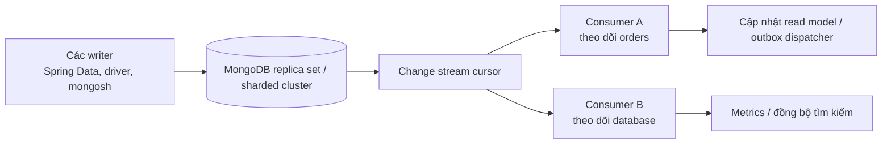
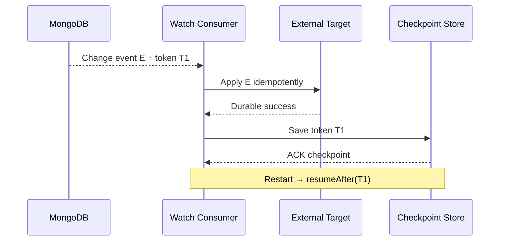

# Theo dõi collection hoặc database bằng MongoDB Change Streams

Một ứng dụng đặt hàng cần cập nhật bảng điều khiển khi có đơn mới, đồng bộ chỉ mục tìm kiếm khi sản phẩm thay đổi, hoặc đẩy sự kiện sang hệ thống phân tích khi trạng thái thanh toán được ghi nhận. Nếu liên tục gọi `find()` mỗi vài giây, ứng dụng phải quét dữ liệu lặp lại, dễ bỏ sót thay đổi nằm giữa hai lượt đọc và khó kiểm soát tải. **MongoDB Change Streams** cung cấp một luồng sự kiện thay đổi từ server, cho phép ứng dụng theo dõi **một collection**, **tất cả collection của một database** hoặc ở mức triển khai khi có quyền phù hợp.

Bài trong chương **Change stream** của module `SPRING_DATA_MONGODB` tập trung đúng câu hỏi **“Theo dõi collection hoặc database”**. Module sử dụng Spring Data MongoDB để kết nối, ánh xạ document, thao tác qua `MongoTemplate` hoặc repository; đồng thời thực hành truy vấn, aggregation, index, transaction, reactive access, kiểm thử và chẩn đoán hiệu năng. Ở đây, ta phân biệt phạm vi `MongoCollection.watch()` và `MongoDatabase.watch()`; thực hành Java Driver, Spring Data reactive, lọc sự kiện theo namespace, khởi động lại bằng resume token và vận hành consumer an toàn.

**Change stream không tự bảo đảm exactly-once delivery.** Một consumer có thể nhận lại sự kiện sau restart/retry, rơi khỏi cửa sổ oplog, hoặc thấy `update` mà không có full document. Vì thế thiết kế phải có **checkpoint, xử lý idempotent, phân quyền và quan sát lỗi**; không chỉ gọi `watch()` rồi in log.

Sau bài, bạn có thể:

1. Giải thích điều kiện MongoDB hỗ trợ Change Streams và vì sao chúng khác polling, Spring mapping events và change data capture toàn hệ thống.
2. Chọn đúng giữa `MongoCollection.watch()` và `MongoDatabase.watch()` dựa trên số collection, quyền truy cập và nhu cầu lọc `ns.coll`.
3. Phân tích một change event với `_id` (resume token), `operationType`, `ns`, `documentKey`, `fullDocument` và `updateDescription`.
4. Viết listener Java Driver sync/reactive và dùng `ReactiveMongoTemplate.changeStream(...)` cho một collection.
5. Lọc event ở server bằng aggregation pipeline an toàn, nhận biết các event `invalidate`, `drop`, `rename` và giới hạn của `resumeAfter`/`startAfter`.
6. Thiết kế checkpoint sau khi xử lý thành công, đối phó duplicate/retry, lưu token đúng kiểu BSON và xử lý token đã hết hạn trong oplog.
7. Kiểm thử trên MongoDB replica set thật, quan sát namespace, scope, event content, recovery và quyền hạn.

## 1. Change stream là gì và khác polling ở đâu?

Change stream là một **cursor dạng luồng** được MongoDB Server hỗ trợ, trả các sự kiện thể hiện thay đổi dữ liệu theo những loại thao tác được hỗ trợ. Ứng dụng mở cursor bằng `watch()` rồi liên tục tiêu thụ sự kiện khi chúng xuất hiện.

Change streams quan sát **những thay đổi đã được majority-committed** theo cơ chế của MongoDB; một phép ghi chỉ được primary xác nhận ở mức thấp rồi bị rollback trước majority commit không nên được coi là một business event đã được stream công bố. Điều đó không biến consumer thành một hệ thống exactly-once hoặc làm mất nhu cầu idempotency.



Thay vì hỏi “dữ liệu hiện tại là gì?” lặp đi lặp lại, consumer hỏi “**những thay đổi nào xảy ra sau vị trí luồng đã xử lý?**”.

| Khía cạnh | Polling định kỳ | Change stream |
| --- | --- | --- |
| Nguồn dữ liệu | Query trạng thái hiện tại | Cursor change events do server phát |
| Dấu vết thao tác trung gian | Có thể bỏ sót trạng thái đã qua | Có cơ hội thấy các thay đổi trong cửa sổ lịch sử có thể resume |
| Độ trễ | Phụ thuộc chu kỳ polling | Near-real-time, còn phụ thuộc server/network/consumer |
| Chi phí | Query lặp, có thể quét dữ liệu | Cursor dài hạn và tài nguyên theo dõi |
| Khởi động lại | Cần mốc thời gian/đối soát riêng | Có **resume token** nếu lịch sử còn sẵn |
| Exactly-once | Không tự có | **Không tự có** |
| Điều kiện server | MongoDB query thông thường | Replica set/sharded cluster + oplog và quyền phù hợp |

### 1.1. Điều kiện triển khai

Change streams cần MongoDB triển khai dạng **replica set hoặc sharded cluster** có hỗ trợ tính năng, chứ **không hoạt động trên standalone `mongod`** chưa được cấu hình replica set. Trên local/test có thể dùng **single-node replica set** với URI và replica-set host hợp lệ.

Tính năng `watch()` ở các scope có lịch sử hỗ trợ theo phiên bản server/driver: collection-level đã có từ MongoDB 3.6; database- và deployment-level được giới thiệu sau đó. **Không sao chép snippet hiện đại vào cluster đời cũ mà không kiểm tra phiên bản đang chạy.**

### 1.2. Change stream không phải Spring mapping event

`AbstractMongoEventListener` được Spring Data phát khi một **ứng dụng Spring** đi qua các bước entity mapping. Change stream được cung cấp từ **MongoDB Server**, nên có thể thấy thay đổi do các client khác như `mongosh`, Java Driver hoặc một service không dùng Spring Data thực hiện.

Tuy nhiên, change stream **không có nghĩa mọi thay đổi trong hệ sinh thái đều được ghi nhận mãi mãi**. Khả năng resume phụ thuộc lịch sử còn trong oplog/change stream retention; cần thiết kế xử lý dữ liệu đã hết hạn hoặc downtime quá lâu.

### 1.3. Use case phù hợp và không phù hợp

Phù hợp: đồng bộ search index, cập nhật dashboard, phát hiện thay đổi đơn hàng, cập nhật cache hoặc bảng tổng hợp ở hệ thống khác, kích hoạt consumer theo sự kiện nghiệp vụ đã được lưu.

Không nên dùng change stream để thay thế **transaction** khi hai MongoDB documents phải commit nguyên tử; cũng không nên xem một `update` ở collection đơn hàng như một “business event” chuẩn nếu cập nhật kỹ thuật/maintenance có thể sửa cùng field. Với tích hợp liên hệ thống cần đảm bảo nghiệp vụ, cân nhắc **transactional outbox**: writer lưu business event vào outbox trong transaction, consumer watch outbox collection rồi dispatch idempotently.

## 2. Chọn đúng phạm vi: collection, database hay deployment

Ba cách mở stream trong Java Driver có mục tiêu khác nhau:

```java
MongoCollection<Document> orders =
        client.getDatabase("commerce").getCollection("orders");
orders.watch();                       // Chỉ collection orders.

MongoDatabase commerce =
        client.getDatabase("commerce");
commerce.watch();                     // Các collection trong commerce.

client.watch();                       // Mức deployment (khi được hỗ trợ).
```

Đây là những lời gọi **tạo ChangeStreamIterable**, chưa phải vòng xử lý. Cursor thực sự được sử dụng khi subscribe/iterate, tùy API sync hay reactive.

| Phạm vi | Gọi qua Driver | Sự kiện từ đâu? | Khi nào chọn? |
| --- | --- | --- | --- |
| Một collection | `MongoCollection.watch()` | Thay đổi của collection chỉ định | Đơn hàng, outbox, lịch sử trạng thái một loại entity |
| Một database | `MongoDatabase.watch()` | Những collection thuộc database đó | Đồng bộ nhiều loại entity trong cùng một database |
| Cụm/triển khai | `MongoClient.watch()` | Nhiều database theo quy tắc hỗ trợ | Hạ tầng CDC/observability có quyền rộng |

### 2.1. Collection-level watch

```javascript
// MongoDB shell:
const cursor = db.orders.watch();
```

Stream chỉ theo dõi collection `orders` trong database hiện tại; insert vào `products` sẽ **không** được trả về ở cursor này. Phạm vi hẹp giúp dễ áp dụng business handler, ít sự kiện không liên quan và có thể cấp quyền hẹp hơn.

Nếu mục tiêu chỉ là “đơn hàng mới được tạo”, hãy chọn collection-level và filter `operationType: "insert"` thay vì watch toàn database rồi lọc thủ công mọi thay đổi.

### 2.2. Database-level watch

```javascript
// Mở luồng trên database commerce:
const commerceDb = db.getSiblingDB("commerce");
const cursor = commerceDb.watch();
```

Một database stream có thể nhận thay đổi từ `commerce.orders`, `commerce.products`, `commerce.customers` và những collection khác thuộc cùng database, theo event support/privilege của server.

Nó **không** đồng nghĩa “theo dõi tất cả database”. Nếu order ở `commerce.orders` còn event payment ở `billing.payments`, `commerceDb.watch()` **không bắt được** payment event ở database khác.

### 2.3. Stream có biết sự kiện đến từ collection nào không?

Có. Thông thường change event có trường `ns` (namespace):

```json
{
  "operationType": "insert",
  "ns": {
    "db": "commerce",
    "coll": "orders"
  },
  "documentKey": { "_id": "ORDER-101" }
}
```

Với database-level watch, `ns.db`/`ns.coll` đặc biệt quan trọng để dispatch đúng handler. **Không quyết định namespace từ trường `fullDocument._class` hoặc chỉ từ tên entity Java**: dữ liệu có thể được ghi bằng driver khác, dùng schema/version khác hoặc không có Spring Data `_class`.

Một số loại event như invalidation/DDL có cấu trúc không giống insert/update; đừng ném exception NullPointer khi `ns` hoặc `fullDocument` không có.

### 2.4. Chọn scope dựa trên quyền hạn, không chỉ tiện code

Một consumer chỉ xử lý outbox đơn hàng không nên được cấp quyền watch mọi collection của database nếu không cần. Database watch mở rộng lượng metadata/sự kiện quan sát được, khiến rủi ro lộ dữ liệu tăng nếu log hoặc lọc sai.

Nguyên tắc thực tế: **cấp quyền tối thiểu**, dùng scope hẹp nhất phù hợp nhiệm vụ, và xác minh quyền `changeStream`/`find` theo resource được watch trong MongoDB Server đang dùng.

### 2.5. Watch nhiều collection bằng một stream hay nhiều stream?

| Thiết kế | Lợi ích | Đánh đổi |
| --- | --- | --- |
| Mỗi collection một stream | Xử lý rõ, quyền hẹp, checkpoint riêng | Nhiều cursor/connection hơn |
| Một database stream lọc `ns.coll` | Một luồng có thể điều phối nhiều collection, checkpoint chung | Routing phức tạp, quyền rộng, một điểm nghẽn chung |
| Watch outbox collection chung | Business event có schema thống nhất | Writer phải tạo outbox đúng transaction và vận hành dispatcher |

Một database stream không tự đảm bảo một thứ tự business tuyệt đối giữa các domain services; vẫn phải xét concurrency, ordering per key, transaction events và idempotency.

## 3. Anatomy của một change event

Ví dụ một sự kiện `update` (hình dạng minh họa, token thật là BSON không nên tự chế):

```javascript
{
  _id: { _data: "RESUME_TOKEN_DO_SERVER_CAP" },
  operationType: "update",
  clusterTime: Timestamp(1732000000, 1),
  ns: { db: "commerce", coll: "orders" },
  documentKey: { _id: "ORDER-101" },
  updateDescription: {
    updatedFields: { status: "PAID" },
    removedFields: []
  }
}
```

Các trường phổ biến:

| Field | Nghĩa | Chú ý |
| --- | --- | --- |
| `_id` | **Resume token** duy nhất của sự kiện | Không coi là document ID của entity |
| `operationType` | `insert`, `update`, `replace`, `delete`... | Handler nên switch theo type |
| `ns` | Database + collection phát sự kiện | Dùng để route database-level stream |
| `documentKey` | Định danh document liên quan | Có thể gồm shard key theo trường hợp |
| `fullDocument` | Bản document đầy đủ nếu event/cấu hình cung cấp | Không luôn có, đặc biệt delete |
| `updateDescription` | Các trường được cập nhật/xóa trong update | Không đồng nghĩa full snapshot |
| `clusterTime` | Logical time của server | Không dùng thay resume token |
| `wallTime` | Wall-clock time nếu server/event có hỗ trợ | Không nên dựa để đảm bảo thứ tự tuyệt đối |

### 3.1. `insert`

Event insert thường có `fullDocument` chứa document được insert. Ví dụ:

```javascript
{
  operationType: "insert",
  ns: { db: "commerce", coll: "orders" },
  documentKey: { _id: "ORDER-101" },
  fullDocument: {
    _id: "ORDER-101",
    tenantId: "T-A",
    status: "CREATED",
    amount: NumberDecimal("120.00")
  }
}
```

### 3.2. `update`

Với update kiểu `$set`, event thường có `updateDescription.updatedFields` và `removedFields`. `fullDocument` mặc định **có thể không chứa bản đầy đủ** cho event update. Nếu cần snapshot đầy đủ, xem `FullDocument.UPDATE_LOOKUP` ở mục sau và hiểu giới hạn “lookup giá trị mới nhất”.

### 3.3. `replace` và `delete`

`replace` thay toàn document thường có `fullDocument` theo semantics của operation. `delete` thông thường **không có fullDocument sau xóa**. Muốn biết dữ liệu trước khi xóa, cần thiết kế audit/outbox hoặc dùng **pre-images** khi deployment/version/config hỗ trợ; không coi mọi `delete` event tự kèm nội dung đã xóa.

### 3.4. Đừng dựa vào thứ tự JSON field

Change event là BSON document; thứ tự hiển thị field trong log không phải hợp đồng nghiệp vụ. Logic xử lý nên dựa vào `operationType`, `ns`, `documentKey` và các field có thể vắng mặt, không dựa vị trí một field trong chuỗi JSON.

## 4. Thực hành `mongosh`: collection watch so với database watch

Trước khi viết Java, hãy quan sát sự khác biệt scope trong một **replica set test**. Dùng database `change_stream_lab` để tránh ảnh hưởng dữ liệu thật.

### 4.1. Chuẩn bị dữ liệu

```javascript
const lab = db.getSiblingDB("change_stream_lab");

lab.orders.insertOne({
  _id: "ORDER-BASE",
  tenantId: "T-A",
  status: "CREATED"
});

lab.products.insertOne({
  _id: "PRODUCT-BASE",
  tenantId: "T-A",
  name: "Bút"
});
```

Chỉ chạy một lần hoặc thay đổi ID trên database test đã xác định rõ. Không dùng lệnh `dropDatabase()` như một cách reset mặc định khi đang có stream cần kiểm tra event `invalidate`.

### 4.2. Terminal A: theo dõi một collection

```javascript
const lab = db.getSiblingDB("change_stream_lab");
const orderCursor = lab.orders.watch([
  { $match: { operationType: { $in: ["insert", "update", "replace"] } } }
]);

while (orderCursor.hasNext()) {
  const event = orderCursor.next();
  printjson({
    operationType: event.operationType,
    namespace: event.ns,
    documentKey: event.documentKey,
    resumeToken: event._id
  });
}
```

Chạy trong một phiên shell riêng, giữ cursor mở. Lệnh `hasNext()` có thể đợi sự kiện; đây là hành vi bình thường của luồng dài hạn.

### 4.3. Terminal B: tạo thay đổi

```javascript
const lab = db.getSiblingDB("change_stream_lab");

lab.orders.insertOne({
  _id: "ORDER-102",
  tenantId: "T-A",
  status: "CREATED"
});

lab.orders.updateOne(
  { _id: "ORDER-102" },
  { $set: { status: "PAID" } }
);

lab.products.updateOne(
  { _id: "PRODUCT-BASE" },
  { $set: { name: "Bút xanh" } }
);
```

Collection stream ở terminal A nhận những thay đổi `orders` được filter, **không nhận** `products`.

### 4.4. Terminal C: database watch

```javascript
const lab = db.getSiblingDB("change_stream_lab");
const dbCursor = lab.watch([
  {
    $match: {
      "ns.coll": { $in: ["orders", "products"] },
      operationType: { $in: ["insert", "update", "replace", "delete"] }
    }
  }
]);

while (dbCursor.hasNext()) {
  const event = dbCursor.next();
  printjson({
    collection: event.ns && event.ns.coll,
    type: event.operationType,
    key: event.documentKey,
    token: event._id
  });
}
```

**Lưu ý thời điểm mở stream:** terminal C không tự phát lại ba thay đổi đã xảy ra **trước khi nó bắt đầu watch**. Sau khi cursor sẵn sàng, thực hiện thêm một lần `orders.updateOne(...)` và một lần `products.updateOne(...)` để thấy hai namespace được nhận trong cùng database stream.

### 4.5. So sánh trực tiếp

| Thay đổi thực tế | `lab.orders.watch()` | `lab.watch()` |
| --- | --- | --- |
| Insert vào `lab.orders` | Nhận nếu lọc cho phép | Nhận nếu lọc cho phép |
| Update `lab.orders` | Nhận nếu lọc cho phép | Nhận nếu lọc cho phép |
| Update `lab.products` | **Không** | Có, nếu filter `ns.coll` chứa products |
| Thay đổi `billing.payments` | **Không** | **Không** |
| Một `orders` bị rename/drop | Stream có thể bị invalidate theo quy tắc | Database stream có thể quan sát DDL event, tùy loại event/filter/version |

Mọi stream bắt đầu ở **mốc thời gian theo lựa chọn resume/start options**. Không so sánh một stream mở trước với stream mở sau rồi kết luận scope khác nhau chỉ vì một stream không có event đã qua.

## 5. Java Driver đồng bộ: `MongoCollection.watch()`

Với ứng dụng dùng Java Driver sync, `watch()` tạo `ChangeStreamIterable`; cursor được tiêu thụ tuần tự. Đây là ví dụ nền tảng cho **collection-level**:

```java
import com.mongodb.client.MongoChangeStreamCursor;
import com.mongodb.client.MongoClient;
import com.mongodb.client.MongoCollection;
import com.mongodb.client.model.changestream.ChangeStreamDocument;
import com.mongodb.client.model.changestream.FullDocument;
import org.bson.Document;
import org.bson.BsonDocument;
import java.util.concurrent.TimeUnit;

public final class OrdersCollectionWatcher {

    private final MongoClient client;

    public OrdersCollectionWatcher(MongoClient client) {
        this.client = client;
    }

    public void watchOrdersUntilInterrupted() {
        MongoCollection<Document> orders = client
                .getDatabase("commerce")
                .getCollection("orders");

        try (MongoChangeStreamCursor<ChangeStreamDocument<Document>> cursor =
                orders.watch()
                        .fullDocument(FullDocument.UPDATE_LOOKUP)
                        .maxAwaitTime(1, TimeUnit.SECONDS)
                        .cursor()) {

            while (!Thread.currentThread().isInterrupted()) {
                ChangeStreamDocument<Document> event = cursor.tryNext();
                if (event == null) {
                    // Chưa có sự kiện trong lần await này.
                    continue;
                }

                String type = event.getOperationType().getValue();
                BsonDocument token = event.getResumeToken();
                Document key = event.getDocumentKey() == null
                        ? null : Document.parse(
                                event.getDocumentKey().toJson());

                processOrderEvent(type, key, event.getFullDocument());
                // Chỉ checkpoint token khi processOrderEvent
                // hoàn tất bền vững, xem mục 9.
                saveCheckpointAfterSuccess(token);
            }
        }
    }

    private void processOrderEvent(
            String type, Document key, Document fullDocument
    ) {
        // Ứng dụng thật: routing theo operationType,
        // xử lý idempotent và không log dữ liệu nhạy cảm.
    }

    private void saveCheckpointAfterSuccess(BsonDocument token) {
        // Ứng dụng thật: lưu token BSON bền vững.
    }
}
```

Đây là **khung minh họa**, chưa có checkpoint store và cách phân loại exception hoàn chỉnh. Hai method trống là điểm mở rộng cần triển khai trước production. Dòng `processOrderEvent(...)` cũng phải xử lý `delete`/`invalidate` đúng contract; một consumer dùng `FullDocument.UPDATE_LOOKUP` vẫn **không thể** giả định mọi `fullDocument` khác null.

### 5.1. `tryNext()`, `hasNext()` và stop signal

`MongoChangeStreamCursor.tryNext()` trả event hoặc `null` khi không có event sẵn trong thời gian await tương ứng. Nó thích hợp cho vòng lặp có kiểm tra interrupt/shutdown. Ngược lại, `hasNext()` có thể block chờ server trả event.

Không triển khai một vòng `while(true)` không có cơ chế dừng/đóng cursor rồi coi nó là worker production. Khi ứng dụng shutdown, cần ngừng thread/đóng cursor và ghi nhận checkpoint đã hoàn tất.

### 5.2. Tránh giữ cursor trên request thread

Một HTTP handler không nên chạy `while(cursor.hasNext())` để phục vụ một REST request thông thường. Change stream là **tài nguyên lâu dài**, phù hợp với background service có lifecycle được quản lý hoặc reactive subscription độc lập, không phải một method controller blocking rồi giữ connection vô hạn.

### 5.3. Lọc thao tác ngay từ server

```java
import com.mongodb.client.model.Aggregates;
import com.mongodb.client.model.Filters;
import java.util.List;

var pipeline = List.of(
        Aggregates.match(
                Filters.in(
                        "operationType",
                        "insert", "update", "replace", "delete"))
);

var stream = orders.watch(pipeline)
        .fullDocument(FullDocument.UPDATE_LOOKUP);
```

Đoạn này được đặt trong method đã khai báo biến `orders`. Filter là **change-stream aggregation pipeline**, không phải query lên document `orders` hiện tại. Field `operationType` và `ns.coll` thuộc **event envelope**, không phải `fullDocument`.

## 6. Java Driver đồng bộ: `MongoDatabase.watch()`

Trong Java, dùng `MongoDatabase.watch()` để theo dõi **nhiều collection thuộc một database** và dispatch dựa trên namespace:

```java
import com.mongodb.client.MongoChangeStreamCursor;
import com.mongodb.client.MongoClient;
import com.mongodb.client.MongoDatabase;
import com.mongodb.client.model.Aggregates;
import com.mongodb.client.model.Filters;
import com.mongodb.client.model.changestream.ChangeStreamDocument;
import org.bson.Document;
import java.util.List;
import java.util.concurrent.TimeUnit;

public final class CommerceDatabaseWatcher {
    private final MongoClient client;

    public CommerceDatabaseWatcher(MongoClient client) {
        this.client = client;
    }

    public void consume() {
        MongoDatabase commerce = client.getDatabase("commerce");

        var pipeline = List.of(
                Aggregates.match(
                        Filters.and(
                                Filters.in("ns.coll", "orders", "products"),
                                Filters.in("operationType",
                                        "insert", "update",
                                        "replace", "delete")))
        );

        try (MongoChangeStreamCursor<ChangeStreamDocument<Document>> cursor =
                commerce.watch(pipeline)
                        .maxAwaitTime(1, TimeUnit.SECONDS)
                        .cursor()) {
            while (!Thread.currentThread().isInterrupted()) {
                ChangeStreamDocument<Document> event = cursor.tryNext();
                if (event == null) {
                    continue;
                }

                String coll = event.getNamespace() == null
                        ? null
                        : event.getNamespace().getCollectionName();
                if ("orders".equals(coll)) {
                    handleOrders(event);
                } else if ("products".equals(coll)) {
                    handleProducts(event);
                } else {
                    // Không coi namespace không biết là products.
                    handleUnknownNamespace(event);
                }
                checkpointOnlyAfterSuccess(event.getResumeToken());
            }
        }
    }

    private void handleOrders(ChangeStreamDocument<Document> event) {}
    private void handleProducts(ChangeStreamDocument<Document> event) {}
    private void handleUnknownNamespace(ChangeStreamDocument<Document> event) {}
    private void checkpointOnlyAfterSuccess(org.bson.BsonDocument token) {}
}
```

Đây là một **skeleton** cố ý tách handler theo collection, chưa hiện thực hóa side effects hoặc checkpoint. `OperationType` được import nhưng không cần cho routing trong snippet; production nên dùng `event.getOperationType()` để phân loại `insert/update/delete` thay vì gán mọi event `orders` cho cùng một nghiệp vụ.

### 6.1. Khi collection được thêm về sau

Một database stream có thể quan sát các collection mới được tạo trong database, theo quyền và event/filter tương ứng. Nhưng nếu pipeline `$match` giới hạn `"ns.coll": { "$in": ["orders","products"] }`, thì collection mới `coupons` **vẫn bị lọc** cho đến khi config được cập nhật.

Nếu yêu cầu là “theo dõi tất cả collection trừ internal”, cần một chính sách namespace rõ ràng, kiểm thử hành vi tạo/đổi tên collection, và quyền truy cập phù hợp.

### 6.2. Filter theo `fullDocument.tenantId` có đủ không?

Không cho mọi loại event. `delete` thường không có `fullDocument`, và `update` không có full document nếu không cấu hình lookup hoặc lookup thất bại. Nếu pipeline chỉ match `"fullDocument.tenantId": "T-A"`, những event không có full document sẽ bị loại.

Với hệ thống đa tenant, có thể dùng outbox record bao gồm tenant/operation info hoặc một mapping documentKey → tenant được thiết kế an toàn; **không tự suy quyền tenant từ một field tùy chọn có thể vắng mặt**. Filter namespace và filter tenant giải quyết hai vấn đề khác nhau.

### 6.3. Một cursor database-level không có nghĩa xử lý song song vô hạn

Nếu consumer đọc sự kiện và gọi handler chậm, tốc độ đọc từ cursor bị giới hạn. Đẩy mọi event vào executor không có backpressure/queue limit cũng có thể gây OOM và làm checkpoint sai thứ tự. Thiết kế **thứ tự xử lý/checkpoint** trước khi thêm concurrency; phần 10 sẽ trình bày cách phân vùng theo key và tránh mất event.

## 7. Spring Data MongoDB reactive: theo dõi một collection

Spring Data MongoDB cung cấp API `ReactiveMongoTemplate.changeStream(...)` để tạo `Flux<ChangeStreamEvent<T>>` từ một collection. Cách này tích hợp thuận tiện vào ứng dụng dùng WebFlux/Reactor, nhưng **không biến change stream thành một Publisher ngắn hạn**: nó vẫn là luồng lâu dài, cần lifecycle, retry, checkpoint và giới hạn tài nguyên.

### 7.1. Tạo stream từ collection

```java
import org.springframework.data.mongodb.core.ChangeStreamOptions;
import org.springframework.data.mongodb.core.ReactiveMongoTemplate;
import org.springframework.data.mongodb.core.ChangeStreamEvent;
import org.bson.Document;
import reactor.core.publisher.Flux;

public final class ReactiveOrdersWatcher {
    private final ReactiveMongoTemplate template;

    public ReactiveOrdersWatcher(ReactiveMongoTemplate template) {
        this.template = template;
    }

    public Flux<ChangeStreamEvent<Document>> events() {
        ChangeStreamOptions options =
                ChangeStreamOptions.builder().build();

        return template.changeStream(
                "orders", options, Document.class);
    }
}
```

Các kiểu package/chữ ký `ChangeStreamOptions`, `ChangeStreamEvent` có thể thay đổi hoặc có overload khác theo **Spring Data MongoDB version**, vì vậy cần đối chiếu dependency thực của dự án. Ý chính cần giữ: `template.changeStream("orders", ...)` xác định **collection name** và trả một Flux event, không phải danh sách các `Order` hiện tại.

### 7.2. Một `Flux` không bắt đầu xử lý nếu chưa subscribe

```java
Flux<ChangeStreamEvent<Document>> stream =
        watcher.events();

// Chỉ có biến stream: chưa mở vòng tiêu thụ.
```

Trong ứng dụng WebFlux, một Publisher được trả từ controller có thể được subscribe bởi framework; nhưng dùng change stream làm background consumer thường cần một component/service điều khiển **start/stop**. Không gọi `subscribe()` tùy tiện ở mọi HTTP request: có thể mở hàng nghìn cursor trùng nhau mà không ai quản lý.

### 7.3. Chỉ xử lý các event cần thiết

Có thể filter envelope trong Reactor:

```java
Flux<ChangeStreamEvent<Document>> orderChanges = watcher.events()
        .filter(event ->
                event.getOperationType() != null);
```

Filter client-side có ích để định tuyến, nhưng server vẫn phải gửi event tới client. Với workload lớn, ưu tiên **đẩy điều kiện lọc được hỗ trợ vào change-stream aggregation pipeline** để giảm lưu lượng và serialization; vẫn cần kiểm tra token/checkpoint khi event bị lọc.

### 7.4. Khi cần typed entity

```java
import org.springframework.data.mongodb.core.mapping.Document;
import org.springframework.data.mongodb.core.mapping.MongoId;

@Document(collection = "orders")
public record OrderView(
        @MongoId String id,
        String tenantId,
        String status
) {}
```

Trong một method khác đã có `ReactiveMongoTemplate template`:

```java
Flux<ChangeStreamEvent<OrderView>> changes =
        template.changeStream(
                "orders",
                ChangeStreamOptions.builder().build(),
                OrderView.class);
```

Đoạn trên minh họa cú pháp nằm trong một method đã có biến `template` và import `@Document`/`@MongoId`. Nó phù hợp khi `fullDocument` của event có dạng tương ứng entity, nhưng **không có nghĩa `ChangeStreamEvent.getBody()` luôn khác null**:

- `insert` và `replace` có thể có full document.
- `update` có thể chỉ có `updateDescription` nếu không dùng lookup.
- `delete` thường không có body.
- DDL/invalidate events không phải `OrderView`.

Do đó, một consumer xử lý mọi event nên giữ envelope metadata (operation type, namespace, document key, resume token) và **không chỉ gọi `event.getBody().status()`**.

### 7.5. Reactor backpressure không thể thay thế checkpoint

`Flux` hỗ trợ phối hợp demand; nhưng việc downstream tiêu thụ chậm vẫn tạo áp lực lên cursor, connection, buffer và cửa sổ oplog. Nếu app bị dừng giữa chừng, backpressure **không tự lưu mốc sự kiện đã xử lý**. Resume token/checkpoint là phần riêng của độ tin cậy.

### 7.6. Reactor và hành vi song song

Một pipeline:

```java
stream.flatMap(event -> handleEventAsync(event), 64)
```

có thể xử lý nhiều event đồng thời và **hoàn tất ngoài thứ tự nhận**. Nếu checkpoint token của event 20 trước khi event 19 xử lý xong, restart từ 20 có thể **bỏ sót 19**.

Với một luồng cần checkpoint tuần tự, lựa chọn khởi đầu an toàn là:

```java
stream.concatMap(event ->
        handleEventAsync(event)
                .then(saveTokenAsync(event)));
```

Đây là pseudo-code về composition; `handleEventAsync` và `saveTokenAsync` là những method phải hiện thực. `concatMap` giữ thứ tự trong một subscription, nhưng không giải quyết tự động idempotency, lỗi commit mơ hồ hoặc việc có nhiều process cùng đọc stream.

## 8. Database stream trong ứng dụng reactive

Ở mức **MongoDB Reactive Streams Java Driver**, có thể lấy publisher từ `com.mongodb.reactivestreams.client.MongoDatabase.watch()` rồi chuyển sang Reactor `Flux`:

```java
import com.mongodb.client.model.Aggregates;
import com.mongodb.client.model.Filters;
import com.mongodb.client.model.changestream.ChangeStreamDocument;
import com.mongodb.reactivestreams.client.MongoClient;
import com.mongodb.reactivestreams.client.MongoDatabase;
import org.bson.Document;
import reactor.core.publisher.Flux;
import java.util.List;

public final class ReactiveCommerceDatabaseWatcher {
    private final MongoClient mongoClient;

    public ReactiveCommerceDatabaseWatcher(MongoClient mongoClient) {
        this.mongoClient = mongoClient;
    }

    public Flux<ChangeStreamDocument<Document>> changes() {
        MongoDatabase database =
                mongoClient.getDatabase("commerce");

        var pipeline = List.of(
                Aggregates.match(
                        Filters.in(
                                "ns.coll", "orders", "products"))
        );

        return Flux.from(database.watch(pipeline));
    }
}
```

**Đây là Reactive Streams Driver, không phải Driver sync ở mục 5.** Cần chú ý hai kiểu `MongoClient` thuộc **hai package khác nhau**:

| Stack | Java type | Kết quả từ `watch()` |
| --- | --- | --- |
| Sync | `com.mongodb.client.MongoClient` | `ChangeStreamIterable`, lấy `MongoChangeStreamCursor` |
| Reactive Streams | `com.mongodb.reactivestreams.client.MongoClient` | Publisher, chuyển bằng `Flux.from(...)` |

Không gán một bean sync `com.mongodb.client.MongoClient` vào constructor cần reactive client rồi mong Reactor tự biến thao tác blocking thành non-blocking.

### 8.1. Có phải nên dùng Spring Data `ReactiveMongoTemplate` cho mọi database stream?

Spring Data cung cấp API đổi stream theo collection và nhiều overload tùy phiên bản. Nhưng khi cần **watch toàn database**, Java Driver `MongoDatabase.watch()` là cách diễn đạt rõ ràng scope; không nên tự chế overload `template.changeStream(null, ...)` mà không xác minh semantics từng version.

Khi dùng driver trực tiếp, bạn chịu trách nhiệm mapping BSON, resume options, lifecycle của subscription và context bảo mật. Với những stream cần typed entity cho một collection, Spring Data template thường thuận tiện hơn.

### 8.2. Dispatch event theo namespace, không theo Java class

```java
Flux<ChangeStreamDocument<Document>> events =
        databaseWatcher.changes();

Flux<Void> dispatched = events.concatMap(event -> {
    var namespace = event.getNamespace();
    if (namespace == null) {
        return handleControlEvent(event);
    }
    return switch (namespace.getCollectionName()) {
        case "orders" -> handleOrderEvent(event);
        case "products" -> handleProductEvent(event);
        default -> handleUnexpectedCollection(event);
    };
});
```

Đoạn trên dùng Java 17 switch expression và các hàm `Mono<Void>`/`Publisher<Void>` giả định đã khai báo. `concatMap` giữ thứ tự subscription nếu các handler trả publisher hoàn tất đúng; không lấy class `OrderView` làm dấu hiệu quyết định collection, bởi `fullDocument` có thể null.

### 8.3. Một consumer duy nhất hay nhiều consumer group?

Change stream **không phải Kafka consumer group**. Nếu hai ứng dụng cùng gọi `database.watch()`, mặc định **cả hai có thể nhận cùng sự kiện**, không tự chia tải cho nhau. Nếu muốn một logic chỉ được thực hiện một lần toàn hệ thống, cần:

- Phân quyền leader/lease cho một active consumer trên mỗi shard/partition logic; hoặc
- Xử lý idempotent và có checkpoint/claim logic bền vững; hoặc
- Thiết kế pipeline đưa change stream vào message broker có consumer-group semantics.

Không dựa vào `watch()` để tự phân chia namespace hoặc tài liệu giữa nhiều instance theo cách MongoDB không hứa hẹn.

## 9. Resume token: lưu tiến độ theo luồng đã **xử lý thành công**

`_id` của change event là **resume token**, không phải `documentKey._id`. Nó đại diện cho vị trí trong change stream, cho phép yêu cầu server tiếp tục sau điểm đã biết khi lịch sử còn đủ.

Ví dụ envelope:

```javascript
{
  _id: { _data: "SERVER_GENERATED_OPAQUE_TOKEN" },
  operationType: "insert",
  ns: { db: "commerce", coll: "orders" },
  documentKey: { _id: "ORDER-102" }
}
```

**Token là opaque.** Không phân tích cấu trúc `_data`, không tự tạo token từ `clusterTime` và không dùng `documentKey._id` làm checkpoint. Token format có thể thay đổi theo server version/FCV/feature options.

### 9.1. Lưu token dạng BSON, không flatten thành chuỗi tùy ý

Trong Java Driver:

```java
import org.bson.BsonDocument;
import com.mongodb.client.model.changestream.ChangeStreamDocument;
import org.bson.Document;

ChangeStreamDocument<Document> event = /* event nhận từ cursor */;
BsonDocument token = event.getResumeToken();

// Ví dụ: lưu BsonDocument trong một checkpoint document
// bằng cơ chế BSON codec phù hợp của ứng dụng.
```

Không lưu duy nhất `event.getResumeToken().get("_data").asString()` mà bỏ các field/kiểu BSON khác; server có thể dùng một dạng token khác. Nếu cần truyền qua JSON, đảm bảo **Extended JSON round-trip** không làm mất kiểu BSON và không bị thay đổi khi serialize/deserialise.

### 9.2. Lúc nào checkpoint?



**Không checkpoint ngay lúc nhận event.** Nếu ghi token trước khi downstream hoàn tất rồi process crash, restart từ token mới có thể bỏ qua sự kiện chưa được xử lý. Thứ tự an toàn cơ bản là **xử lý thành công → checkpoint**.

Đổi lại, nếu downstream xử lý thành công rồi process chết **trước khi checkpoint**, sự kiện có thể được phát lại. Vì vậy downstream **phải idempotent** hoặc có cơ chế deduplication bền vững.

### 9.3. `resumeAfter`, `startAfter` và `startAtOperationTime`

| Lựa chọn | Khi nào dùng | Cảnh báo |
| --- | --- | --- |
| `resumeAfter(token)` | Tiếp tục sau token hợp lệ của sự kiện đã xử lý | Không dùng để resume **sau invalidate event** |
| `startAfter(token)` | Bắt đầu sau token, bao gồm tình huống cần tiếp tục sau invalidate theo quy tắc server | Không làm collection đã drop tự xuất hiện trở lại |
| `startAtOperationTime(timestamp)` | Bắt đầu từ một mốc logical server time phù hợp | Cần mốc server hợp lệ và oplog còn sự kiện; không phải thời gian đồng hồ client |

Các option trên có giới hạn **mutually exclusive** khi thiết lập một watch. Không đồng thời điền `resumeAfter` và `startAfter` hoặc suy mốc bằng một timestamp từ `System.currentTimeMillis()`.

### 9.4. Java Driver resume từ checkpoint

```java
import org.bson.BsonDocument;
import com.mongodb.client.MongoCollection;
import com.mongodb.client.model.changestream.ChangeStreamDocument;
import org.bson.Document;

BsonDocument checkpointToken = loadTokenFromStore();

var iterable = orders.watch();
if (checkpointToken != null) {
    iterable = iterable.resumeAfter(checkpointToken);
}

try (var cursor = iterable.cursor()) {
    // Consume, process idempotently, checkpoint sau success.
}
```

Đoạn này nằm trong method có biến `orders` và `loadTokenFromStore()` do ứng dụng định nghĩa. Token phải thuộc **luồng/scope/pipeline tương thích**. Không lấy token từ collection A rồi dùng tùy tiện cho một stream khác với quyền/filter/scope khác.

### 9.5. Token hết hạn do oplog bị cuốn

Nếu consumer dừng quá lâu, lịch sử cần thiết có thể đã bị loại khỏi oplog và `resumeAfter` sẽ thất bại. **Không sửa bằng cách xóa token và lặng lẽ watch từ “bây giờ”** nếu yêu cầu không được bỏ sót thay đổi.

Runbook an toàn hơn:

1. Phát hiện lỗi resume không thể phục hồi; phân biệt với network failure tạm thời.
2. Tạm dừng/đánh dấu consumer cần rebuild.
3. Tái dựng read model/index từ snapshot dữ liệu hoặc quy trình backfill được kiểm soát.
4. Xác lập một điểm bắt đầu stream mới không bỏ sót khoảng giữa backfill và catch-up.
5. Kiểm tra đối soát theo business keys, rồi mới chuyển consumer sang healthy.

Điểm bắt đầu an toàn phụ thuộc topology, snapshot/session/read concern và độ trễ của backfill. Một lần `findAll()` rồi `watch()` sau cùng **có thể bỏ sót** các write xảy ra giữa hai bước.

### 9.6. Token trong event và post-batch resume token

Một số API/server version cung cấp **post-batch resume token** ngay cả khi một batch không có change event, để tối ưu vị trí tiếp tục. Nó không đồng nghĩa “business event đã xử lý thành công”. Nếu ứng dụng dùng loại token này cho checkpoint, phải hiểu **những event trước đó đã được xử lý bền vững** và giữ đúng ordering semantics.

Không tự chế mốc “event gần nhất” bằng `clusterTime` hoặc index tự tăng trong application database.

## 10. Thiết kế consumer bền vững: idempotency, checkpoint và thứ tự

Một watch cursor chỉ trả **sự kiện**; business handler còn phải quyết định “event này đã xử lý chưa?”, “ghi xuống đích theo thứ tự nào?” và “nếu process chết giữa chừng thì tiếp tục ra sao?”.

### 10.1. Mô hình checkpoint tối thiểu

Một checkpoint record có thể trông như sau:

```javascript
{
  _id: "commerce-orders-search-indexer-v1",
  streamScope: "collection",
  database: "commerce",
  collection: "orders",
  pipelineVersion: 1,
  resumeToken: { _data: "OPAQUE_SERVER_TOKEN" },
  updatedAt: ISODate("2026-11-20T00:00:00Z")
}
```

Lưu ý:

- `_id` định danh **consumer workflow**, không phải ID của một Order.
- `streamScope` và phiên bản filter/pipeline giúp tránh resume sai từ một stream được cấu hình khác.
- `resumeToken` nên được lưu **BSON nguyên vẹn**.
- `updatedAt` dùng cho monitoring, **không thay token**.
- Token ví dụ chỉ minh họa shape, không phải token có thể sử dụng với `resumeAfter` thật.

### 10.2. Ba crash windows cần thử nghiệm

| Khi process chết | Business effect ở đích | Token đã checkpoint? | Lúc restart |
| --- | --- | --- | --- |
| Trước khi xử lý event | Chưa | Chưa | Nhận lại event |
| Sau khi xử lý, trước checkpoint | **Có** | Chưa | Nhận lại → cần dedup/idempotency |
| Sau khi checkpoint | Có | Có | Resume sau event |

**Không thể loại bỏ hoàn toàn khoảng “apply thành công nhưng checkpoint thất bại” nếu sink và checkpoint ở hai hệ thống độc lập mà không có cơ chế giao dịch/đối soát phù hợp.** Hãy thiết kế consumer at-least-once + idempotent sink; không quảng cáo exactly-once chỉ vì có resume token.

### 10.3. Idempotency key theo business operation

Nếu consumer cập nhật search document cho `orders`, một phép upsert idempotent theo `_id`/version nguồn an toàn hơn việc tăng bộ đếm “số event nhận được” mỗi lần.

```javascript
// Mô hình idempotent overwrite read-model theo khóa định danh.
db.orderSearchView.updateOne(
  { _id: "ORDER-102" },
  { $set: { status: "PAID", tenantId: "T-A" } },
  { upsert: true }
);
```

Ví dụ này **chưa giải quyết event out-of-order**: nếu sự kiện cũ tới sau sự kiện mới, overwrite có thể làm view quay về trạng thái cũ. Đối với worker song song, lưu **source version/sequence** hoặc bảo đảm ordering per document key; chỉ ghi nếu version đến không cũ hơn phiên bản đang có.

### 10.4. Khi sink và checkpoint cùng một MongoDB transaction

Nếu business side effect là ghi **một read model trong cùng MongoDB deployment** và checkpoint cũng nằm trong MongoDB, có thể thiết kế:

```text
Transaction:
  apply event E to readModel (idempotent)
  update checkpoint with resumeToken(E)
  commit
```

Mục đích là **đồng bộ sink state và checkpoint** khi các lệnh có thể tham gia một MongoDB transaction phù hợp. Nhưng stream cursor/watch operation **không phải** một thao tác nên giữ bên trong transaction dài; hãy đọc event rồi thực hiện transaction ngắn cho phần apply + checkpoint. Cần test trên replica set và xác minh điều kiện phù hợp của transaction manager/session.

### 10.5. Khi sink là Elasticsearch, Kafka hoặc HTTP API

MongoDB transaction **không bao trùm** hệ thống ngoài MongoDB. Nếu consumer đẩy event tới Elasticsearch rồi mới checkpoint, một crash có thể khiến event được đẩy hai lần. Đích cần hỗ trợ upsert/idempotency key/conditional version; hoặc consumer lưu operation ledger đủ để phát hiện duplicate.

Không gọi hệ thống ngoài trong transaction MongoDB rồi coi cả hai cùng commit/rollback.

### 10.6. Thứ tự xử lý và checkpoint với `flatMap`

Ví dụ:

```text
Đọc E10 → E11 → E12
Handler song song:
  E12 xong trước
  E10 xong sau
  E11 còn lỗi
```

Nếu checkpoint token E12 khi E11 chưa hoàn tất, restart có thể bỏ qua E11. Khi cần xử lý theo một luồng tuyến tính, bắt đầu bằng **sequential consumption**. Nếu muốn parallelize, phân vùng theo business key, có contiguous-ack tracking và checkpoint chỉ tại **token trước event chưa hoàn tất đầu tiên**; không chỉ lấy token lớn nhất.

### 10.7. Nếu nhiều process cùng watch một collection

Mỗi process có thể nhận cùng event; `watch()` không tự cấp lease hoặc chia partition. Nếu muốn duy nhất một active consumer áp dụng side effect, dùng lease/leader election có fencing token, hoặc bảo đảm tất cả handlers idempotent và checkpoint ownership rõ. Việc hai process cùng ghi checkpoint một key mà không khóa có thể làm token **đi lùi hoặc nhảy qua khoảng chưa hoàn tất**.

### 10.8. Lưu ý event filtering và checkpoint

Nếu pipeline chỉ giữ một số `operationType`, token của sự kiện bị lọc **không được đưa tới ứng dụng**. Đó là bình thường, nhưng khi thay filter/pipeline về sau, checkpoint cũ không tự biến thành dấu mốc đã xử lý cho mọi loại event vừa được thêm vào.

**Đổi pipeline là đổi contract consumer.** Hãy version filter và xác định có cần backfill những event trước đây bị bỏ qua hay không.

## 11. `fullDocument`, `updateDescription` và những tình huống dữ liệu thay đổi tiếp

Change event không phải luôn là bản snapshot đầy đủ tại đúng thời điểm phát.

### 11.1. `UPDATE_LOOKUP` là lookup, không phải lịch sử bất biến

Java Driver:

```java
import com.mongodb.client.model.changestream.FullDocument;

var stream = orders.watch()
        .fullDocument(FullDocument.UPDATE_LOOKUP);
```

Với một `update` event, `UPDATE_LOOKUP` có thể tra lại **bản document majority-committed mới nhất** sau update. Nếu document bị cập nhật tiếp trước khi lookup, `fullDocument` có thể phản ánh một trạng thái **mới hơn** event đang xử lý, hoặc có thể vắng mặt nếu document không còn phù hợp.

Timeline:

```text
E1: status CREATED → PAID
E2: status PAID → SHIPPED
Consumer xử lý E1, dùng UPDATE_LOOKUP
fullDocument có thể cho status SHIPPED.
```

Không lấy `event.updateDescription.updatedFields.status = "PAID"` nhưng đồng thời khẳng định `fullDocument.status = "PAID"` luôn đúng.

### 11.2. Khi nào dùng `updateDescription`?

Nếu nhu cầu chỉ là “order status đã thay thành gì trong update này?”, đọc `updateDescription` theo schema. Ví dụ:

```javascript
{
  operationType: "update",
  updateDescription: {
    updatedFields: { status: "PAID" },
    removedFields: []
  }
}
```

Nhưng không phải mọi write đều phát `update` với `updatedFields`: thao tác thay toàn document có thể phát `replace` và full document. Consumer phải hỗ trợ **cả replace** nếu muốn duy trì read model đầy đủ.

### 11.3. `delete` không có full document mặc định

```javascript
{
  operationType: "delete",
  documentKey: { _id: "ORDER-102" },
  ns: { db: "commerce", coll: "orders" }
}
```

Nếu cần loại Order khỏi search index, `documentKey` có thể đủ để xóa bằng ID. Nếu cần **tenantId** để định tuyến xóa qua một tenant-specific index, phải thiết kế nguồn metadata đáng tin hoặc lưu mapping/ledger. Không giả định full document cũ xuất hiện trong `delete` event.

### 11.4. Pre-images và post-images

Các phiên bản MongoDB hiện đại hỗ trợ **change stream pre- and post-images** trong điều kiện feature/collection config phù hợp. Chúng có thể giúp audit giá trị trước/sau thay đổi, nhưng cần:

- Bật tính năng và cấu hình collection đúng.
- Xem sự khác nhau giữa `whenAvailable` và `required` nếu dùng API tương ứng.
- Hiểu retention/dung lượng của pre/post images.
- Kiểm soát quyền truy cập và dữ liệu nhạy cảm.

Không coi pre-images là luôn sẵn có cho mọi deployment, không lưu chúng vô thời hạn nếu vi phạm chính sách dữ liệu.

### 11.5. Event của transaction nhiều document

MongoDB chỉ công bố change stream events của các thao tác thuộc transaction khi các thay đổi đã được commit theo semantics server. Điều đó phù hợp để consumer không thấy các write đã rollback như những sự kiện đã commit.

Tuy nhiên, consumer **không tự nhận một “business transaction message” duy nhất** cho mọi thay đổi. Một transaction cập nhật ba document có thể tạo nhiều change events; cần grouping/idempotency theo nghiệp vụ. Một database-level stream không bảo đảm consumer có thể tùy ý cắt ngang và checkpoint giữa ba event mà vẫn đạt nguyên tử ở read model nếu nghiệp vụ đòi cùng lúc cập nhật.

## 12. Drop, rename, invalidate và quy tắc resume

Thay đổi schema/collection có thể ảnh hưởng trực tiếp đến stream scope.

### 12.1. Collection watch và `invalidate`

Một collection-level stream có thể nhận event về `drop` hoặc `rename` rồi `invalidate`, làm cursor không còn theo dõi collection đó. **Đừng dùng vòng retry vô hạn với cùng collection/token** sau khi stream đã invalidate.

Nếu nghiệp vụ muốn tiếp tục theo dõi collection sau khi nó được tạo lại, phải xét `startAfter` và xác định đúng namespace/scope/permission, đồng thời hiểu tính liên tục dữ liệu có còn hợp lệ về nghiệp vụ không.

### 12.2. Database watch có hành vi khác

Database-level stream có thể nhận event liên quan collection drop/rename nhưng không nhất thiết bị invalidate **chỉ vì một collection con bị drop**. Khi **cả database bị drop**, database watch có thể bị invalidate. Hành vi chính xác phụ thuộc loại DDL event và server version.

Vì vậy “watch cả database chắc chắn không bao giờ phải mở lại” là sai; cũng sai nếu giả định drop một collection khiến mọi database watch lập tức chấm dứt.

### 12.3. `resumeAfter` khác `startAfter`

`resumeAfter` **không thể** dùng để tiếp tục luồng **sau invalidate event** theo MongoDB semantics. `startAfter` có thể được dùng khi cần mở stream mới sau một invalidate token theo hỗ trợ của server.

Ví dụ Java Driver:

```java
var iterable = orders.watch();

// Nếu token lưu là token của invalidate event và phù hợp
// quy tắc server hiện tại:
iterable = iterable.startAfter(invalidateToken);
```

Đây là snippet trong method có `orders` và `invalidateToken` là `BsonDocument` đúng kiểu. **Không dùng `startAfter` như cách chữa mọi lỗi resume token hết hạn**; khi oplog đã mất lịch sử, vẫn cần backfill/reconciliation.

### 12.4. Không lọc mất toàn bộ control events mà quên quản trị cursor

Một pipeline chỉ match `operationType: "insert"` là hợp lý cho consumer chỉ muốn insert; nhưng hệ thống vận hành vẫn phải biết cursor bị đóng, error hoặc invalidated. **Mất event DDL ở tầng business filter không có nghĩa collection chưa bị drop**.

Thiết kế metric/alert theo lifecycle cursor và exception riêng với business handler; không dựa duy nhất vào số insert events để kết luận stream còn khỏe.

### 12.5. Rename và tên collection trong namespace

Nếu collection đổi tên từ `orders` thành `orders_archive`:

- Collection-level watch cần được điều phối theo rename/invalidate semantics.
- Database-level stream có thể tiếp tục thấy events dưới tên mới, **nhưng pipeline `ns.coll = "orders"` sẽ không nhận các update vào `orders_archive`**.
- Checkpoint filter version và routing handler phải được cập nhật có kiểm soát.

Không gộp đổi tên collection với một lần deploy Java entity `@Document(collection = "...")` đơn thuần; schema, index, quyền và consumer cùng phải được migration.

## 13. Change-stream aggregation pipeline và an toàn lọc sự kiện

Server cho phép dùng một tập aggregation stages để filter/biến đổi event, nhưng có **giới hạn** đặc biệt.

### 13.1. Filter theo namespace và operation type

```javascript
const commerce = db.getSiblingDB("commerce");

const stream = commerce.watch([
  {
    $match: {
      "ns.coll": { $in: ["orders", "products"] },
      operationType: {
        $in: ["insert", "update", "replace", "delete"]
      }
    }
  }
]);
```

Đây là điều kiện server-side. Nếu chọn database stream vì muốn nhận **thêm collection trong tương lai**, việc hard-code `$in` khiến collection mới không được theo dõi cho đến khi đổi filter.

### 13.2. Không sửa hoặc xóa `_id` của change event

Server dùng `_id` change event làm resume token. Pipeline làm mất hoặc biến đổi `_id` có thể khiến stream không thể resume và bị từ chối bởi MongoDB phiên bản tương ứng.

```javascript
// SAI: làm mất resume token:
db.orders.watch([
  { $project: { _id: 0, operationType: 1 } }
]);
```

Hãy giữ nguyên `_id`; nếu cần chỉ lưu một phần event vào downstream, thực hiện projection **sau khi đã lấy/checkpoint token** và không làm thay đổi token trong server pipeline.

### 13.3. Filter theo business field có thể bỏ sót delete

```javascript
// Nguy hiểm nếu mục tiêu bao gồm delete của tenant:
db.orders.watch([
  { $match: { "fullDocument.tenantId": "T-A" } }
]);
```

Một `delete` không có `fullDocument` mặc định. Event delete cho document thuộc tenant T-A có thể bị filter loại bỏ. Cần dùng outbox có tenant field trong event hoặc giải pháp lookup/ledger phù hợp; không giảm quyền bằng cách chỉ đặt filter trên field có thể null.

### 13.4. Thay filter có thể thay lịch sử đã xử lý

Nếu consumer trước chỉ nhận insert/update của `orders`, sau đó mở rộng để nhận `products`, token cũ của stream `orders` không tự chứng minh `products` từ quá khứ đã được xử lý. Cần kế hoạch backfill cho collection mới, xác định mốc snapshot/watch và version cấu hình checkpoint.

### 13.5. Dùng pipeline tối thiểu

Mỗi stage thêm vào có thể tăng chi phí server/serialization, và một số stage bị hạn chế trong change-stream pipeline. Bắt đầu với `$match` trên `operationType`/`ns.coll` khi phù hợp; thêm logic chỉ khi thực sự giảm tải hoặc thỏa business. Không sao chép một aggregation pipeline dùng cho `db.collection.aggregate(...)` rồi chắc chắn mọi stage được hỗ trợ trong `watch()`.

## 14. Integration test: watch collection và database trên replica set

Mock một `ChangeStreamDocument` rồi gọi handler chỉ chứng minh branch Java được thực thi, **không chứng minh** MongoDB Server phát event có namespace/operation type/resume token đúng, hoặc một database stream nhận thay đổi từ hai collection. Với Change Streams, kiểm thử tích hợp trên replica set là bắt buộc cho các giả định quan trọng.

### 14.1. Chuẩn bị môi trường test

Yêu cầu:

- MongoDB Server chạy **replica set**; một node `rs0` là đủ cho test cơ bản.
- URI đi tới **database test riêng**, không tới production.
- Test có quyền tạo/insert/update dữ liệu và mở change stream ở scope tương ứng.
- Cursor được **mở trước khi tạo sự kiện test**, hoặc dùng start point/server token phù hợp để tránh race.
- Không chạy nhiều test cùng xóa/sửa chung collection nếu không có isolation.

Ví dụ URI khi replica set đã cấu hình và truy cập được:

```properties
spring.data.mongodb.uri=mongodb://localhost:27017/change_stream_test?replicaSet=rs0
```

Chỉ có `?replicaSet=rs0` không biến một `mongod` standalone thành replica set. Với Testcontainers/Docker, cần đảm bảo replica set host/port được driver resolve chính xác.

### 14.2. Test helper chờ event có giới hạn

Thay vì `Thread.sleep(100)` rồi đoán sự kiện đã xuất hiện, có thể dùng cursor `tryNext()` và deadline:

```java
import com.mongodb.client.MongoChangeStreamCursor;
import com.mongodb.client.model.changestream.ChangeStreamDocument;
import org.bson.Document;
import java.time.Duration;

static ChangeStreamDocument<Document> awaitChange(
        MongoChangeStreamCursor<ChangeStreamDocument<Document>> cursor,
        Duration timeout
) {
    long deadline = System.nanoTime() + timeout.toNanos();
    while (System.nanoTime() < deadline) {
        ChangeStreamDocument<Document> event = cursor.tryNext();
        if (event != null) {
            return event;
        }
    }
    throw new AssertionError("Không nhận được change event trước timeout");
}
```

Helper giả định cursor có `maxAwaitTime` hợp lý (ví dụ 100 ms) để không block quá lâu mỗi lượt. Test thật nên có giới hạn tổng thời gian ở JUnit/CI, đóng cursor bằng try-with-resources và phân biệt timeout với lỗi kết nối.

### 14.3. Test collection watch không nhận event của collection khác

```java
import static org.assertj.core.api.Assertions.assertThat;

import com.mongodb.client.MongoChangeStreamCursor;
import com.mongodb.client.MongoClient;
import com.mongodb.client.MongoCollection;
import com.mongodb.client.model.changestream.ChangeStreamDocument;
import java.time.Duration;
import java.util.concurrent.TimeUnit;
import org.bson.Document;
import org.junit.jupiter.api.Test;

class ChangeStreamScopeIntegrationTest {
    private final MongoClient client;

    ChangeStreamScopeIntegrationTest(MongoClient client) {
        this.client = client;
    }

    @Test
    void collectionWatchReceivesOrdersOnly() {
        var db = client.getDatabase("change_stream_test");
        MongoCollection<Document> orders =
                db.getCollection("orders");
        MongoCollection<Document> products =
                db.getCollection("products");

        try (MongoChangeStreamCursor<ChangeStreamDocument<Document>> cursor =
                orders.watch()
                        .maxAwaitTime(100, TimeUnit.MILLISECONDS)
                        .cursor()) {

            products.insertOne(new Document(
                    "_id", "PRODUCT-WATCH-1")
                    .append("name", "Bút"));
            orders.insertOne(new Document(
                    "_id", "ORDER-WATCH-1")
                    .append("status", "CREATED"));

            ChangeStreamDocument<Document> event =
                    awaitChange(cursor, Duration.ofSeconds(5));

            assertThat(event.getNamespace()
                    .getCollectionName()).isEqualTo("orders");
            assertThat(event.getDocumentKey()
                    .getString("_id").getValue())
                    .isEqualTo("ORDER-WATCH-1");
            assertThat(event.getResumeToken()).isNotNull();
        }
    }
}
```

**Lưu ý test fixture:** snippet trình bày logic chính, không phải toàn bộ test harness; constructor injection trong JUnit 5 cần extension/cấu hình Spring test tương ứng. Nếu dùng `@SpringBootTest`, inject `MongoClient` bằng `@Autowired`; nếu dùng JUnit thuần, tạo và đóng client trong fixture. Tên `ORDER-WATCH-1`/`PRODUCT-WATCH-1` phải đảm bảo không va chạm với test khác; collection đã tồn tại và không có event nền không liên quan.

Test này xác nhận **collection watch trả event order** sau khi insert cả product và order. Để chứng minh product không đến cùng stream, có thể kiểm tra thêm một khoảng đợi ngắn theo deadline và xác nhận không có `products` event; tránh biến một test không có event thành infinite wait.

### 14.4. Test database watch nhận hai namespace

```java
@Test
void databaseWatchReceivesOrdersAndProducts() {
    var db = client.getDatabase("change_stream_test");

    try (var cursor = db.watch()
            .maxAwaitTime(100, TimeUnit.MILLISECONDS)
            .cursor()) {

        db.getCollection("orders").insertOne(
                new Document("_id", "ORDER-DB-1"));
        db.getCollection("products").insertOne(
                new Document("_id", "PRODUCT-DB-1"));

        ChangeStreamDocument<Document> first =
                awaitChange(cursor, Duration.ofSeconds(5));
        ChangeStreamDocument<Document> second =
                awaitChange(cursor, Duration.ofSeconds(5));

        assertThat(first.getNamespace().getDatabaseName())
                .isEqualTo("change_stream_test");
        assertThat(second.getNamespace().getDatabaseName())
                .isEqualTo("change_stream_test");

        assertThat(
                java.util.Set.of(
                        first.getNamespace().getCollectionName(),
                        second.getNamespace().getCollectionName()))
                .containsExactlyInAnyOrder("orders", "products");
    }
}
```

Test này cũng là **method bổ sung trong class đã khai báo** ở mục 14.3. Nó giả định không có writer khác thay đổi database trong lúc chạy; nếu có background job/test song song, hãy filter event bằng ID/namespace test hoặc dùng database riêng cho mỗi test.

### 14.5. Test resume token từ một insert đã xử lý

```java
@Test
void resumeAfterReceivesEventWrittenWhileDisconnected() {
    var orders = client.getDatabase("change_stream_test")
            .getCollection("resume_orders");

    org.bson.BsonDocument token;
    try (var firstCursor = orders.watch()
            .maxAwaitTime(100, TimeUnit.MILLISECONDS)
            .cursor()) {

        orders.insertOne(new Document("_id", "RESUME-E1"));
        ChangeStreamDocument<Document> first =
                awaitChange(firstCursor, Duration.ofSeconds(5));
        token = first.getResumeToken();
        assertThat(token).isNotNull();
    }

    // Thay đổi xảy ra khi consumer không có cursor.
    orders.insertOne(new Document("_id", "RESUME-E2"));

    try (var resumed = orders.watch()
            .resumeAfter(token)
            .maxAwaitTime(100, TimeUnit.MILLISECONDS)
            .cursor()) {

        ChangeStreamDocument<Document> next =
                awaitChange(resumed, Duration.ofSeconds(5));

        assertThat(next.getDocumentKey()
                .getString("_id").getValue())
                .isEqualTo("RESUME-E2");
    }
}
```

Test phụ thuộc **oplog vẫn lưu sự kiện**, và không có writer khác trong `resume_orders` giữa hai sự kiện. Test này chứng minh `resumeAfter` hoạt động từ một token hợp lệ, **chưa chứng minh** consumer idempotent hoặc xử lý được token đã hết hạn.

### 14.6. Test `updateDescription` và `fullDocument`

Trong một test riêng:

1. Mở cursor watch `orders`, có thể bật `FullDocument.UPDATE_LOOKUP`.
2. Insert fixture order, dùng token hoặc filter ID để chuyển đến event cần test.
3. Thực hiện `updateOne({ _id: ... }, { $set: { status: "PAID" } })`.
4. Assert `operationType = "update"` và `updateDescription.updatedFields.status = "PAID"`.
5. Nếu dùng `UPDATE_LOOKUP`, assert full document theo **tình huống không có concurrent writer**; không viết test giả định lookup luôn bằng snapshot ở event time.

Đối với `delete`, assert `documentKey`, và đừng yêu cầu `fullDocument` tồn tại trừ khi dùng feature pre-images được cấu hình và test riêng.

### 14.7. Test collection invalidate và database watch

DDL test có thể gây lỗi hoặc phá dữ liệu dùng chung. Tạo namespace test riêng:

1. Watch collection mới `invalidate_test`.
2. Drop/rename collection theo một kịch bản có kiểm soát.
3. Ghi nhận `drop`/`rename` và `invalidate` theo quy tắc server/version.
4. Thử `resumeAfter(invalidateToken)` và `startAfter(invalidateToken)` để hiểu khác biệt.
5. Watch một database riêng và so sánh việc drop **một collection con** với drop **cả database**.

Không chạy `dropDatabase()` hoặc failover trên môi trường chia sẻ/production chỉ để tạo demo. Mọi test có thao tác destructive phải được giới hạn ở test deployment cô lập.

### 14.8. Unit test handler và integration test stream khác nhiệm vụ

Unit test nên cấp các change event giả lập để kiểm tra routing `orders/products`, xử lý missing `fullDocument`, dedup, exception mapping và token persistence logic.

Integration test mới chứng minh server phát events, namespace đúng, event token có thể resume, cursor shutdown hoạt động và filter pipeline đúng. Hai loại test bổ sung nhau, không thay thế cho nhau.

## 15. Bảo mật: quyền `changeStream`, namespace và dữ liệu nhạy cảm

Change stream có thể cho consumer biết **ai đã thay đổi collection nào, document key và thậm chí full document**. Một database-level stream có thể nhìn nhiều collection chứa dữ liệu nhạy cảm hơn consumer cần xử lý. Vì vậy scope/permission phải được thiết kế cùng lúc với business logic.

### 15.1. Phân quyền tối thiểu

MongoDB kiểm tra privilege khi mở change stream. Thông thường người dùng cần quyền **`changeStream`** và **`find`** phù hợp với resource được watch (collection/database/deployment), tùy phiên bản và loại stream.

Ví dụ định hướng:

| Consumer | Scope mong muốn | Quyền nên cân nhắc |
| --- | --- | --- |
| Order search indexer | `commerce.orders` | Chỉ collection orders |
| Commerce read model updater | Nhiều collection thuộc `commerce` | Database-level theo đúng phạm vi |
| Central CDC platform | Nhiều database | Deployment-level nếu được phê duyệt |

Đừng cấp role `root` cho consumer chỉ vì `watch()` bị `Unauthorized`. Hãy xem lại MongoDB role/privilege mapping và thiết kế tài khoản dịch vụ chuyên dụng. Những role mẫu có thể khác nhau theo phiên bản; không sao chép cấu hình role không kiểm chứng lên production.

### 15.2. `ns.coll` không thay thế authorization

Một database watch có thể filter:

```javascript
{
  $match: {
    "ns.coll": "orders"
  }
}
```

Nhưng `$match` là **điều kiện chọn event**, không phải ranh giới bảo mật thay cho server permissions. Cấp quyền ở resource scope phù hợp; nếu yêu cầu quyền hẹp nhất cho orders, **collection watch** thường phù hợp hơn.

### 15.3. Dữ liệu cá nhân trong `fullDocument`

Nếu bật `FullDocument.UPDATE_LOOKUP`, event có thể đưa vào memory/log những field mà handler không dùng, ví dụ địa chỉ, số điện thoại, email hoặc thông tin nhạy cảm khác.

Không làm:

```java
// Anti-pattern:
logger.info("Change event = {}", event);
```

Log nên ghi **operation type, namespace đã kiểm duyệt, trace ID, handler outcome, latency**, và chỉ log document key sau khi xác định phù hợp chính sách. Không đưa raw `fullDocument`, resume token, tenant ID đầy đủ hoặc dữ liệu cá nhân vào metric labels có cardinality cao.

### 15.4. Resume token có cần giữ bí mật không?

Token không phải mật khẩu, nhưng nó là **state của consumer và metadata về lịch sử luồng**. Nếu bị chỉnh sửa, checkpoint có thể nhảy tới một vị trí khác hoặc consumer lỗi. Vì vậy chỉ service được ủy quyền mới được đọc/ghi checkpoint; cần bảo vệ tính toàn vẹn, không cho client HTTP tùy ý gán token.

### 15.5. Kết hợp với phân tách tenant

Một event `delete` chỉ có `documentKey` có thể không mang `tenantId`; không thể an toàn lọc tenant chỉ bằng `fullDocument.tenantId` cho mọi operation.

Nếu phải dùng một database watch cho nhiều tenant, cân nhắc **schema có tenant trong key/envelope**, outbox ghi tenant ở event payload, hoặc một mapping để đối soát delete trước khi thực thi side effect. Không cho consumer gửi thông tin từ T-A sang sink của T-B vì handler đoán tenant mặc định khi field null.

### 15.6. Quyền xem event cũng là quyền biết metadata

Một `ns.coll` hiển thị tên collection có thể là thông tin nội bộ; một `documentKey` có thể tiết lộ business IDs. Việc đưa raw change events lên WebSocket cho người dùng cuối phải có **authorization và DTO projection** riêng; tốt hơn thường là server consumer chuyển events thành những thông báo nghiệp vụ đã được lọc quyền.

## 16. Quản lý lifecycle và hiệu năng của long-running watcher

Một stream được thiết kế để tồn tại lâu dài, nhưng mạng, rollout, failover, server restart hoặc quyền thay đổi có thể làm cursor bị đóng. Consumer production phải có lifecycle **start, healthy, degraded, retrying, stopped** rõ ràng.

### 16.1. Start sau khi application đã sẵn sàng

Không nên mở stream trong constructor của Spring bean; constructor không phải nơi để block `hasNext()` hoặc tạo subscription không quản lý. Có thể khởi chạy watcher sau khi context sẵn sàng, nhưng phải giữ handle đến task/subscription và implement shutdown cleanup.

Ví dụ skeleton reactive:

```java
import org.springframework.context.SmartLifecycle;
import reactor.core.Disposable;
import reactor.core.publisher.Flux;

public final class ChangeStreamLifecycle implements SmartLifecycle {
    private final ReactiveCommerceDatabaseWatcher watcher;
    private Disposable subscription;
    private volatile boolean running;

    public ChangeStreamLifecycle(
            ReactiveCommerceDatabaseWatcher watcher
    ) {
        this.watcher = watcher;
    }

    @Override
    public synchronized void start() {
        if (running) {
            return;
        }

        running = true;
        subscription = watcher.changes()
                .concatMap(this::processAndCheckpoint)
                .doOnError(this::reportFatalError)
                .subscribe();
    }

    @Override
    public synchronized void stop() {
        running = false;
        if (subscription != null) {
            subscription.dispose();
            subscription = null;
        }
    }

    @Override
    public boolean isRunning() {
        return running;
    }

    private reactor.core.publisher.Mono<Void> processAndCheckpoint(
            com.mongodb.client.model.changestream
                    .ChangeStreamDocument<org.bson.Document> event
    ) {
        // Khung ví dụ: implement handler và checkpoint.
        return reactor.core.publisher.Mono.empty();
    }

    private void reportFatalError(Throwable error) {
        running = false;
        // Ghi metric/alert và điều phối restart theo chính sách.
    }
}
```

**Đây là skeleton minh họa lifecycle, chưa phải worker production**: `processAndCheckpoint` đang rỗng, `running` cần được đồng bộ với terminal signals và logic restart, `stop` cần phối hợp graceful drain, không đơn giản hủy giữa một side effect quan trọng. `subscribe()` ở đây được dùng **cố ý cho background consumer có quản lý `Disposable`**, khác với việc gọi `subscribe()` tùy tiện trong HTTP service.

### 16.2. Shutdown: đóng cursor, không bỏ dở commit

Khi ứng dụng nhận SIGTERM hoặc Spring context shutdown:

1. Ngừng tiếp nhận work mới hoặc dừng subscription ở điểm phù hợp.
2. Cho phép xử lý event đang chạy hoàn tất trong giới hạn shutdown budget; nếu chưa hoàn tất thì **không checkpoint**.
3. Đóng cursor/cancel subscription, giải phóng driver/server resources.
4. Đảm bảo restart có thể nhận lại event chưa checkpoint và xử lý idempotently.

Đối với Spring reactive, `Disposable.dispose()` có thể cancel ngay. Nếu business handler cần graceful shutdown, phải quản lý riêng active work, lifecycle và timeout; không mặc định dispose đồng nghĩa mọi handler đã commit.

### 16.3. Retry với backoff có phân loại lỗi

Network error thoáng qua có thể phù hợp retry watch; lỗi `Unauthorized`, token quá cũ hoặc pipeline không hợp lệ **không nên retry vô hạn**.

```java
import java.time.Duration;
import reactor.util.retry.Retry;

Retry transientRetry = Retry.backoff(
        5, Duration.ofMillis(200))
        .maxBackoff(Duration.ofSeconds(10))
        .filter(this::isTransientWatchFailure);
```

Đây là một snippet trong service có `isTransientWatchFailure` đã được cài đặt theo **MongoDB driver exception labels/codes** phù hợp. Một policy retry đúng còn phải **mở lại từ checkpoint cuối cùng**, không dùng một Publisher với token cố định đã cũ mãi nếu checkpoint đã tiến lên.

### 16.4. Driver có thể resume tự động, ứng dụng vẫn phải checkpoint

MongoDB Driver có cơ chế tự resume trong một số lỗi resumable theo version/spec. Nhưng driver không thể đảm bảo trạng thái của **Elasticsearch, cache, HTTP webhook hoặc process restart**. Vì thế vẫn cần checkpoint do ứng dụng quản lý cho ranh giới đã xử lý.

Tránh tự viết một vòng retry lồng lên driver rồi phát lại side effect nhiều lần không idempotent. Kiểm tra chính sách retry của driver, timeout, server selection và consumer theo cùng một quy trình.

### 16.5. Cursor và kết nối là tài nguyên có hạn

Mở một change stream trên mỗi HTTP client hoặc mỗi user session có thể gây số lượng cursor rất lớn. Nếu cần gửi live updates tới hàng nghìn trình duyệt, thường nên có **một số backend watchers có kiểm soát** rồi fan-out thông báo đã được authorized qua WebSocket/SSE/message broker.

Đừng biến `database.watch()` thành một stream mới cho mỗi request hiển thị dashboard. Đo số open cursors/connection, sự kiện mỗi giây và lag của consumer.

### 16.6. Backpressure và buffer

Một luồng cập nhật 5.000 event/s nhưng consumer chỉ xử lý 300 event/s sẽ tích backlog hoặc tụt xa điểm phát, tăng nguy cơ token không còn trong oplog. Reactor `onBackpressureBuffer` không làm tài nguyên vô hạn; buffer không giới hạn có thể OOM.

Biện pháp:

- Lọc sớm những event không cần thiết bằng server-side `$match`.
- Giảm chi phí xử lý theo event, batch idempotent khi phù hợp.
- Chọn concurrency có thứ tự/checkpoint rõ, không `flatMap` vô hạn.
- Quan sát lag, mở rộng worker theo phân vùng an toàn.
- Xem lại nhu cầu lưu toàn bộ events nếu downstream không thể theo kịp.

### 16.7. Đo lag và sức khỏe một cách cẩn trọng

Event thường có `clusterTime`; có thể dùng để ước lượng độ trễ so với thời gian xử lý, nhưng đó là **logical timestamp** của MongoDB, không phải một clock ISO client đồng bộ tuyệt đối. So sánh trực tiếp với `System.currentTimeMillis()` phải hiểu sai lệch đồng hồ, đơn vị, topology và ý nghĩa đo.

Metric gợi ý (do ứng dụng **tự định nghĩa**, không phải metric Spring Data tự có):

```text
mongo.change_stream.events_total{scope="orders",type="insert"}
mongo.change_stream.handler_errors_total{scope="orders",category="transient"}
mongo.change_stream.resumes_total{scope="orders",cause="network"}
mongo.change_stream.invalidations_total{scope="orders"}
mongo.change_stream.checkpoint_age_seconds{scope="orders"}
mongo.change_stream.estimated_lag_seconds{scope="orders"}
mongo.change_stream.open_cursors{scope="orders"}
```

Không dùng full resume token, document ID hoặc raw tenant ID làm **metric label**. Quan sát **tuổi checkpoint, error rate, độ trễ xử lý, số event/s và trạng thái cursor**; một stream lâu không có events có thể là bình thường nếu collection ít thay đổi, nên health check cần phân biệt “idle nhưng kết nối khỏe” với “cursor đã chết”.

### 16.8. Sharded cluster và chi phí vận hành

Change stream trên sharded cluster có semantics/tài nguyên khác replica set đơn giản; luồng có thể cần điều phối sự kiện giữa các shard. Việc đặt watch trên database/deployment rộng có thể làm tăng chi phí. Cần benchmark trên topology thật, đặc biệt với nhiều shard và tần suất update cao.

Không suy luận rằng vì `orders.watch()` chạy nhanh trên single-node test nên `client.watch()` toàn cluster cũng có cùng độ trễ/chi phí.

## 17. Chẩn đoán lỗi thường gặp khi watch collection hoặc database

| Triệu chứng | Nguyên nhân có thể | Hướng xử lý |
| --- | --- | --- |
| `watch()` lỗi trên localhost | MongoDB standalone chưa có replica set | Khởi tạo replica set test, kiểm tra topology và URI |
| `Unauthorized` khi `database.watch()` | Role chỉ có quyền ở một collection hoặc thiếu privilege | Cấp đúng quyền `changeStream`/`find` theo scope; không dùng root bừa bãi |
| Collection stream không thấy update của `products` | Đang watch `orders` | Dùng `database.watch()` hoặc stream thứ hai |
| Database stream không thấy `billing.payments` | Đang watch database `commerce` | Chọn scope rộng hơn nếu được phép hoặc tách stream |
| Database stream không thấy collection mới | Pipeline hard-code `ns.coll` hoặc quyền chưa phù hợp | Kiểm tra filter và namespace routing |
| Đã insert nhưng consumer không nhận | Watch bắt đầu sau insert, chưa subscribe hoặc cursor chưa ready | Mở cursor trước, dùng token/start point và test có deadline |
| Flux không phát event | Publisher chưa được subscribe | Quản lý subscription ở background lifecycle |
| Nhiều event lặp trên nhiều instance | Mỗi watcher nhận cùng events; không có consumer group | Leader lease/fencing hoặc idempotent handlers |
| `fullDocument` null ở `update` | Chưa dùng lookup, lookup không có document, hoặc event không có body | Dùng `updateDescription`/lookup có kiểm soát |
| `fullDocument.status` khác `updatedFields.status` | `UPDATE_LOOKUP` nhìn document đã thay đổi tiếp | Không coi lookup là snapshot của update event |
| `delete` thiếu tenantId | Delete không có full document mặc định | Outbox/ledger hoặc pre-image được cấu hình |
| Không lấy được token từ event | Pipeline sửa/xóa `_id`, API mapping sai | Giữ raw resume token BSON, xem pipeline |
| `resumeAfter` thất bại sau downtime dài | Oplog không còn lịch sử cần resume | Backfill/reconciliation, không reset token âm thầm |
| `resumeAfter` lỗi sau invalidate | Không thể dùng resumeAfter sau invalidate | Xem `startAfter` theo đúng server version/use case |
| Collection watcher dừng sau rename | Rename/drop làm invalidate stream | Xử lý DDL/lifecycle và mở stream mới có chủ đích |
| Database watcher nhận event từ collection không mong muốn | Không filter `ns.coll` hoặc filter sai | Dispatch theo `ns` và điều chỉnh pipeline |
| Event handler commit nhưng checkpoint vẫn cũ | Crash giữa side effect và lưu token | Idempotent replay, lưu token sau xử lý |
| Checkpoint mới hơn event chưa xử lý | Dùng `flatMap` rồi lưu token theo event hoàn tất trước | `concatMap` hoặc contiguous ack/watermark |
| Consumer không theo kịp | Handler chậm, queue quá lớn, stream quá rộng | Filter server-side, tối ưu handler, đo lag |
| Memory tăng liên tục | Buffer không giới hạn, tạo nhiều watcher/request | Bounded queue, quản lý subscription/cursor |
| Raw event log chứa thông tin nhạy cảm | In toàn `fullDocument`, `documentKey`, token | Redact và áp access control/log retention |
| `$match` theo tenant không thấy delete | `fullDocument.tenantId` vắng trong delete | Thiết kế envelope/ledger, không filter trên field tùy chọn |
| Transaction update nhiều docs tạo nhiều events | Consumer kỳ vọng một business event duy nhất | Outbox hoặc grouping theo business operation |
| Duplicate index/search updates sau retry | Sink không idempotent | Upsert/conditional version hoặc ledger |
| Change events không tự vào WebSocket | Change stream là backend cursor, không phải push UI tự động | Có service fan-out/authorization riêng |

### 17.1. Debug “collection watch không thấy event”

1. Xác minh MongoDB là **replica set hoặc sharded cluster** và server/driver hỗ trợ scope muốn watch.
2. Xác minh connection tới **đúng database và collection** (kể cả chữ hoa/thường).
3. Xác minh listener/cursor **đã thực sự được mở/subscribed trước sự kiện**.
4. Bỏ filter `$match` tạm thời trong **test** để kiểm tra có event nào không.
5. Thử insert một document test bằng `mongosh` ở cùng namespace; không dùng production.
6. Quan sát `operationType`, `ns`, `documentKey` của event.
7. Kiểm tra quyền `changeStream`/`find` và error response.
8. Kiểm tra watcher có bị close/cancel, process shutdown hoặc mắc lỗi và không restart.
9. Kiểm tra token/start options có đang bỏ qua event cần thấy không.
10. Đóng lại test cursor và ghi regression test có deadline, tránh vòng chờ vô hạn.

### 17.2. Debug “database stream chỉ nhận một collection”

Nếu `commerce.watch()` chỉ trả event của `orders` mặc dù `products` cũng được ghi, hãy kiểm tra:

- Pipeline có lọc `"ns.coll": "orders"` hay không.
- Có đang gọi `commerce.getCollection("orders").watch()` thay vì `commerce.watch()`?
- Các product writes có thực sự vào **cùng database** `commerce` không?
- Tài khoản dịch vụ có quyền change stream trên phạm vi database không?
- Product event có bị loại vì `operationType`, `fullDocument` filter hoặc tenant predicate không?
- Stream có bắt đầu sau lần update `products` hay không?
- Handler có mặc định route mọi event vào orders rồi bỏ qua products không?

Đừng “chữa” bằng cách watch toàn deployment và cấp quyền rộng hơn nếu nguyên nhân chỉ là filter sai.

### 17.3. Debug “có sự kiện nhưng fullDocument trống”

Tùy operation:

```text
insert    → thường có fullDocument
replace   → thường có fullDocument
update    → có thể chỉ updateDescription
delete    → thường không có fullDocument
drop/...  → control event, không phải entity payload
```

Nếu handler dựa vào `fullDocument` cho mọi operation, thiết kế đã sai từ đầu. Phân nhánh theo `operationType` và kiểm tra null. Với `update` cần full document, xem `UPDATE_LOOKUP` hoặc pre/post images có hỗ trợ, đồng thời hiểu dữ liệu có thể đã mới hơn event đang xử lý.

### 17.4. Debug “resumeAfter token cũ không dùng được”

Hãy phân loại lỗi:

- **Token bị mất kiểu BSON** vì serialize thành string, sau đó parse sai.
- **Token không tương thích scope/pipeline/version** sau deploy config mới.
- **Oplog đã hết lịch sử** do consumer ngừng quá lâu hoặc write volume lớn.
- **Token thuộc invalidate event** nhưng ứng dụng dùng `resumeAfter` thay vì `startAfter`.
- **Cursor không còn quyền/namespace tồn tại** sau đổi collection hoặc role.

Hành động đúng có thể là sửa serializer, restore checkpoint đúng, mở lại với `startAfter` phù hợp, hoặc tiến hành backfill. **Không lặng lẽ bỏ token** chỉ để “dịch vụ xanh lại” khi việc bỏ sót event có thể làm sai dữ liệu.

### 17.5. Debug “đôi lúc side effect chạy hai lần”

Đây là behavior có thể xảy ra trong thiết kế at-least-once:

```text
Consumer nhận E (token T)
  → cập nhật search index thành công
  → process crash trước checkpoint(T)
  → restart từ token trước T
  → nhận lại E
```

Không sửa bằng cách checkpoint trước xử lý: như vậy chuyển từ duplicate sang **lost event** khi xử lý thất bại. Sửa bằng idempotent write theo business key/version, hoặc atomic sink+checkpoint khi hệ thống cho phép.

### 17.6. Debug stream đã dừng nhưng không có alert

Một `onError` trên Flux mà không được tiêu thụ/ghi metric có thể làm stream kết thúc. `doOnError` chỉ quan sát; nó không tự retry. `subscribe()` không có lifecycle owner làm lỗi bị che khuất khỏi health checks.

Thiết kế **trạng thái watcher** và alert cho fatal error/invalidated/retry-exhaustion; một lần `subscribe()` thành công ở startup không chứng minh stream còn khỏe sau một ngày.

## 18. Bài tập tình huống: cập nhật search index cho orders và products

Giả sử một commerce database có hai collection:

```javascript
db.orders.insertOne({
  _id: "ORDER-201",
  tenantId: "T-A",
  status: "CREATED",
  total: NumberDecimal("99.00")
});

db.products.insertOne({
  _id: "PRODUCT-201",
  tenantId: "T-A",
  title: "Bình nước",
  active: true
});
```

Yêu cầu:

- Indexer A chỉ đồng bộ `orders`.
- Indexer B đồng bộ `orders` và `products` vào hai read models khác nhau.
- Khi `order.status` đổi thành `PAID`, cập nhật order search view.
- Khi product bị xóa, xóa product khỏi search view.
- Dịch vụ có thể restart, nên không được mất thay đổi vì checkpoint sớm.

### 18.1. Chọn scope

| Consumer | Scope đúng | Vì sao |
| --- | --- | --- |
| A | `db.orders.watch()` | Chỉ cần orders; quyền tối thiểu |
| B | `db.watch()` và route `ns.coll` | Một database chứa cả orders, products |
| Theo dõi payments ở database `billing` | Không đủ nếu chỉ `commerce.watch()` | Cần thêm stream hoặc scope khác được cấp quyền |

### 18.2. Filter pipeline cho B

```javascript
const commerce = db.getSiblingDB("commerce");

const stream = commerce.watch([
  {
    $match: {
      "ns.coll": { $in: ["orders", "products"] },
      operationType: {
        $in: ["insert", "update", "replace", "delete"]
      }
    }
  }
]);
```

Khi nhận event, B dispatch:

```text
event.ns.coll == "orders"
   → orderSearchHandler(event)

event.ns.coll == "products"
   → productSearchHandler(event)

event khác
   → kiểm tra policy/metric, không tự đẩy vào orders
```

**Không filter dựa vào `fullDocument._class`:** raw driver insert có thể không có metadata Spring; delete event có thể không có fullDocument.

### 18.3. Tình huống A: order thay status rồi thay tiếp

```javascript
db.orders.updateOne(
  { _id: "ORDER-201" },
  { $set: { status: "PAID" } }
);

db.orders.updateOne(
  { _id: "ORDER-201" },
  { $set: { status: "SHIPPED" } }
);
```

Consumer đọc event `PAID`, nhưng `UPDATE_LOOKUP` có thể trả fullDocument ở trạng thái `SHIPPED`. **Câu hỏi:** đây có phải MongoDB đã phát event sai không?

**Trả lời:** không. `updateDescription` của event đầu mô tả field được thay bởi thao tác ấy; lookup full document có thể lấy trạng thái mới nhất sau những update khác. Chọn business semantics rõ:

- Muốn **mọi lần đổi status**: xử lý từng event/updateDescription, dedup và ordering.
- Muốn **read model luôn bằng trạng thái mới nhất**: fetch current state hoặc dùng update có conditional version, tránh trạng thái cũ ghi đè trạng thái mới.

### 18.4. Tình huống B: product bị xóa

```javascript
db.products.deleteOne({ _id: "PRODUCT-201" });
```

Consumer nhận `operationType="delete"` cùng `documentKey._id`, thường không có `fullDocument`. Nếu search index lưu product theo ID, nó có thể xóa bằng key. Nếu search index phân vùng theo tenant, phải có cách biết tenant từ ledger/envelope/pre-image hoặc key design — không tự lấy `fullDocument.tenantId` khi body null.

### 18.5. Tình huống C: worker chết giữa apply và checkpoint

```text
E17: ORDER-201 status PAID
→ Search service cập nhật PAID thành công
→ Worker chết trước save resumeToken(E17)
→ Worker restart và nhận lại E17
```

Giải pháp **không phải checkpoint trước khi apply**. Hãy làm search update idempotent, kiểm tra source version nếu cần và checkpoint sau khi write được xác nhận bền vững.

### 18.6. Tình huống D: đổi một stream thành database stream

Ban đầu Indexer B chỉ watch collection `orders`. Sau đó team đổi thành `commerce.watch()` để nhận thêm `products`. **Không tự reuse token collection watch cũ** và kết luận product events từ trước đã được xử lý; cần backfill products và mốc catch-up phù hợp, checkpoint có `streamScope`/`pipelineVersion` mới.

### 18.7. Tình huống E: consumer dừng hai ngày

Nếu sau hai ngày oplog vẫn còn token hợp lệ, consumer có thể resume. Nếu lịch sử đã bị loại, `resumeAfter` có thể thất bại. Cần backfill/reconciliation được giám sát, không tự bỏ token rồi bắt đầu “từ hiện tại” khi search index cần đồng bộ đầy đủ.

### 18.8. Câu hỏi tự kiểm tra

1. **`collection.watch()` có thấy event của collection khác không?** Không.
2. **`database.watch()` có thấy database khác không?** Không.
3. **Field nào xác định collection của event?** `ns.coll`.
4. **`documentKey._id` có phải resume token không?** Không; token là event `_id`.
5. **Một `update` có luôn full document không?** Không.
6. **`UPDATE_LOOKUP` có luôn trả snapshot đúng tại event time không?** Không.
7. **`delete` có toàn bộ document cũ mặc định không?** Không.
8. **Có nên xóa `_id` trong change-stream pipeline không?** Không.
9. **Có được checkpoint trước side effect để giảm duplicate không?** Không nếu yêu cầu không mất event.
10. **Sau crash giữa apply/checkpoint, event có thể xuất hiện lại không?** Có.
11. **Hai instance cùng gọi `watch()` có chia tải tự động như Kafka consumer group không?** Không.
12. **`flatMap` song song có thể làm checkpoint vượt event chưa xử lý không?** Có.
13. **`resumeAfter` có thể resume sau invalidate event không?** Không; xem `startAfter`.
14. **Token đã hết hạn có thể sửa bằng cách tùy tiện bỏ checkpoint không?** Không khi cần correctness.
15. **Collection watch có đòi replica set/sharded cluster không?** Có.
16. **Có nên mở watcher mới cho mỗi WebSocket client không?** Thường không; backend fan-out tốt hơn.
17. **Có cần lọc tenant và phân quyền cả ở application lẫn MongoDB role không?** Có.
18. **Change stream có phải bảo đảm exactly-once business processing không?** Không.
19. **Có thể dùng change stream thay transaction để atomic ghi hai collections không?** Không.
20. **Vì sao outbox thường tốt hơn watch một business collection tùy ý?** Event có schema/intent nghiệp vụ rõ, có thể ghi cùng transaction với thay đổi nguồn.

## 19. Checklist triển khai watch collection hoặc database trong production

### 19.1. Xác định phạm vi và hạ tầng

1. **Có thực sự cần Change Streams không?** Phân biệt near-real-time change events với việc đọc trạng thái mới nhất bằng một query thông thường.
2. **MongoDB đang chạy replica set/sharded cluster hỗ trợ watch không?** Không dùng standalone không cấu hình replica set.
3. **Đã chọn scope hẹp nhất chưa?** Một collection nếu chỉ xử lý `orders`; database nếu thực sự cần nhiều collections.
4. **Đã xác minh tất cả collection có thuộc cùng database chưa?** `commerce.watch()` không thấy `billing.payments`.
5. **Có dùng quyền `changeStream`/`find` đúng scope và least privilege không?** Không cấp root để sửa một lỗi permission.
6. **Đã phân biệt deployment watch với database watch chưa?** Không nhầm `MongoClient.watch()` với `MongoDatabase.watch()`.

### 19.2. Event schema và xử lý nghiệp vụ

7. **Consumer có đọc `ns.db`/`ns.coll` khi watch database không?** Dispatch theo namespace, không đoán từ Java class.
8. **Có switch theo `operationType` không?** Xử lý insert/update/replace/delete và control events đúng contract.
9. **Có kiểm tra null cho `fullDocument` không?** Delete/update có thể không có full body.
10. **Có dùng `updateDescription` khi cần thay đổi của update event không?** Không nhầm với latest document.
11. **Có hiểu `UPDATE_LOOKUP` có thể đọc dữ liệu mới hơn event không?** Không coi là historical snapshot tuyệt đối.
12. **Có giữ nguyên `_id` resume token trong pipeline không?** Không project/replace token.
13. **Pipeline `$match` có vô tình lọc mất delete hoặc namespace mới không?** Không lọc tenant chỉ dựa vào `fullDocument`.
14. **Có chuẩn hóa business event schema nếu domain logic phức tạp không?** Cân nhắc transactional outbox.

### 19.3. Checkpoint, retry và ordering

15. **Resume token có được lưu nguyên BSON không?** Không chỉ lưu document ID/`clusterTime`/chuỗi `_data` tự chế.
16. **Token có gắn với scope và phiên bản pipeline không?** Không reuse tùy tiện khi đổi từ collection sang database.
17. **Checkpoint chỉ được ghi sau khi side effect bền vững chưa?** Tránh lost event.
18. **Handler có idempotent không?** Sự kiện có thể phát lại khi crash sau apply nhưng trước checkpoint.
19. **Nếu xử lý song song, checkpoint có chờ mọi event trước đó hoàn tất chưa?** Không lấy token lớn nhất trong các handler xong sớm.
20. **Có phân loại transient, invalidation, permission và token-too-old errors không?** Không retry vô hạn mọi lỗi.
21. **Có backfill/reconciliation plan khi oplog không còn lịch sử không?** Không reset token im lặng.
22. **Đã phân biệt `resumeAfter` và `startAfter` chưa?** Đặc biệt với invalidate.
23. **Có biết driver auto-resume không thay thế application checkpoint không?** Process restart và side effects cần xử lý riêng.
24. **Có coordination cho nhiều instance không?** Watch không tự chia tải theo consumer group.

### 19.4. Lifecycle, bảo mật và vận hành

25. **Watcher có owner của start/stop và cursor cleanup không?** Không mở vô hạn trong controller/constructor.
26. **Có graceful shutdown và phân biệt cancel với commit thành công không?** Không checkpoint công việc chưa hoàn tất.
27. **Có giới hạn buffer, concurrency và tài nguyên không?** Đừng tạo cursor cho mỗi user.
28. **Có theo dõi resume count, error rate, checkpoint age, lag và throughput không?** Stream idle không đồng nghĩa stream chết.
29. **Có tránh log full event và dữ liệu nhạy cảm không?** Kiểm soát document ID, tenant, token, payload.
30. **Có quy trình đổi quyền, rename/drop collections và migration schema không?** Thay namespace ảnh hưởng routing và token.
31. **Có kiểm thử trên replica set thật không?** Mock không chứng minh server event semantics.
32. **Có test collection stream và database stream bằng sự kiện từ hai collection không?** Phải xác minh cả đúng scope và không rò scope.
33. **Có test resume qua khoảng consumer bị ngắt không?** Tạo E1, lưu token, ngắt, tạo E2, resume từ E1.
34. **Có test `delete`/`update` thiếu fullDocument và DDL/invalidate không?** Không chỉ test insert happy path.
35. **Có diễn tập recovery khi token hết hạn ở môi trường cô lập không?** Không thử destructive recovery trên production.

**Quy tắc ghi nhớ:** `collection.watch()` theo dõi **một collection**; `database.watch()` theo dõi **nhiều collection của cùng database** và phải route theo `ns.coll`. Mọi event có thể mang **resume token** ở `_id`, nhưng không tự đồng nghĩa đã xử lý thành công. Hãy **apply idempotently → checkpoint token → resume đúng scope**; xử lý riêng `update`/`delete`, sự kiện `invalidate`, quyền truy cập, oplog retention và việc có nhiều consumer instances. Một stream “đang nhận events” chưa đồng nghĩa dữ liệu downstream **đúng và có thể khôi phục**.

### Tài liệu tham khảo chính thức

- [MongoDB Manual — Change Streams](https://www.mongodb.com/docs/manual/changeStreams/): nền tảng, điều kiện topology và phạm vi watch.
- [MongoDB Manual — Change Events](https://www.mongodb.com/docs/manual/reference/change-events/): `operationType`, `ns`, `documentKey`, `fullDocument`, `updateDescription` và resume token.
- [MongoDB Manual — `db.collection.watch()`](https://www.mongodb.com/docs/manual/reference/method/db.collection.watch/): theo dõi một collection.
- [MongoDB Manual — `db.watch()`](https://www.mongodb.com/docs/manual/reference/method/db.watch/): theo dõi database và pipeline options.
- [MongoDB Manual — Change Stream Pre- and Post-Images](https://www.mongodb.com/docs/manual/changeStreams/#change-streams-with-document-pre--and-post-images): dữ liệu trước/sau khi thay đổi và các giới hạn.
- [MongoDB Manual — Oplog](https://www.mongodb.com/docs/manual/core/replica-set-oplog/): lịch sử replication và giới hạn resume khi sự kiện bị cuốn.
- [MongoDB Manual — Change Stream Access Control](https://www.mongodb.com/docs/manual/changeStreams/#access-control): quyền `changeStream`/`find` theo scope.
- [MongoDB Java Sync Driver — Watch Operations](https://www.mongodb.com/docs/drivers/java/sync/current/usage-examples/watch/): `MongoCollection.watch()`, `MongoDatabase.watch()`, cursor và options.
- [MongoDB Reactive Streams Driver — Change Streams](https://www.mongodb.com/docs/drivers/java/reactive-streams/current/usage-examples/watch/): publisher-based watch.
- [Spring Data MongoDB — Change Streams](https://docs.spring.io/spring-data/mongodb/reference/mongodb/change-streams.html): `ReactiveMongoTemplate`, `ChangeStreamOptions` và mapping event.
- [Spring Data MongoDB — `ReactiveMongoTemplate` API](https://docs.spring.io/spring-data/mongodb/docs/current/api/org/springframework/data/mongodb/core/ReactiveMongoTemplate.html): chữ ký của `changeStream(...)`.
- [Spring Data MongoDB — `ChangeStreamOptions` API](https://docs.spring.io/spring-data/mongodb/docs/current/api/org/springframework/data/mongodb/core/ChangeStreamOptions.html): pipeline, full document và resume options.
- [Project Reactor — Reference Guide](https://projectreactor.io/docs/core/release/reference/): `Flux`, `concatMap`, `flatMap`, backpressure, retry và cancellation.
