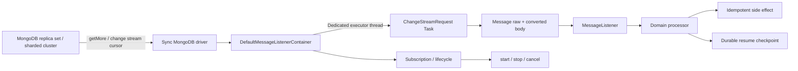
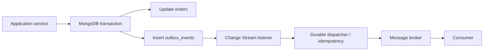

# DefaultMessageListenerContainer cho ứng dụng đồng bộ

## 1. Bài toán: nghe thay đổi MongoDB mà không chặn luồng xử lý nghiệp vụ

Một ứng dụng Spring Boot dùng `MongoTemplate` và `MongoRepository` cần cập nhật cache khi đơn hàng thay đổi. Thay vì mỗi vài giây thực hiện `find()` toàn bộ collection `orders`, ứng dụng muốn nhận thông báo khi MongoDB có `insert`, `update`, `replace` hoặc `delete`.

MongoDB **Change Streams** cho phép theo dõi những thay đổi đã được ghi vào dữ liệu. Nhưng với **MongoDB synchronous Java driver**, lệnh `watch()` tạo một cursor tồn tại lâu dài: thread gọi `iterator.hasNext()` có thể chờ server trả sự kiện. Nếu vòng lặp này nằm trong HTTP request, scheduler chung hoặc thread xử lý nghiệp vụ, ứng dụng dễ cạn thread và treo endpoint.

Spring Data MongoDB cung cấp `DefaultMessageListenerContainer`, một triển khai `MessageListenerContainer` chạy những tác vụ nghe Change Streams trên **executor riêng**, chuyển sự kiện vào `MessageListener` và quản lý vòng đời subscription.

Bài thuộc chương **Change stream** của module **SPRING_DATA_MONGODB**. Module bao quát kết nối, ánh xạ document, thao tác MongoDB qua `MongoTemplate`/repository, truy vấn, aggregation, index, transaction, reactive access, kiểm thử và chẩn đoán hiệu năng dữ liệu. Trong bài này, ta tập trung vào **đường đồng bộ/imperative**, không thay đổi toàn bộ ứng dụng thành WebFlux.

### 1.1. Mục tiêu sau bài học

Bạn có thể:

1. Giải thích vì sao Change Streams yêu cầu **replica set hoặc sharded cluster**, và vì sao synchronous listener giữ một thread lâu dài.
2. Tạo `DefaultMessageListenerContainer` từ `MongoTemplate`, đăng ký `ChangeStreamRequest` và nhận `Message`.
3. Hiểu `Message.getRaw()`, `getBody()`, `Subscription`, `ErrorHandler`, `start()`, `stop()` và `SmartLifecycle`.
4. Cấu hình `fullDocumentLookup`, pipeline filter, collection scope và database scope.
5. Thiết kế **resume token**, checkpoint sau xử lý, deduplication và xử lý sự cố khi process khởi động lại.
6. Quản lý executor, connection pool, shutdown, health, backpressure thủ công và nhiều replica ứng dụng.
7. Viết integration test MongoDB replica set có timeout, kiểm chứng insert/update/delete và không làm test treo.

> **Giới hạn:** Change Stream là nguồn thông báo thay đổi, không tự tạo hàng đợi durable có acknowledgment nghiệp vụ. Một listener đã **nhận** event không có nghĩa side effect đã thành công, token đã được lưu hoặc consumer khác đã xử lý đúng một lần.

## 2. Chọn cơ chế đọc phù hợp

| Nhu cầu | Cơ chế | Nhận xét |
| --- | --- | --- |
| Đọc document hiện có | `MongoTemplate.find(...)`/repository | Query theo yêu cầu |
| Polling những document mới | Scheduled query theo offset | Dễ triển khai nhưng có độ trễ/tốn truy vấn |
| Nhận thay đổi đã commit | MongoDB Change Streams | Có resume token, cần topology hỗ trợ |
| Nghe từ app imperative | `DefaultMessageListenerContainer` | Blocking cursor trên executor riêng |
| Nghe từ ứng dụng reactive | `ReactiveMongoTemplate.changeStream(...)` | `Flux`, thường tiết kiệm thread hơn |
| Giao event nghiệp vụ tin cậy cho bên ngoài | Transactional outbox + dispatcher | Có idempotency/retry/commit policy |
| Báo dữ liệu vừa thay đổi cho UI | Change Stream → gateway thông báo | Cần xử lý fan-out và quyền truy cập |

Spring Data MongoDB chính thức khuyến nghị cân nhắc reactive Change Streams vì thường ít tốn tài nguyên hơn. Nhưng nếu toàn ứng dụng đang dùng Spring MVC và synchronous `MongoTemplate`, **container đồng bộ** là một lựa chọn hợp lý, với điều kiện tính toán đúng **executor và shutdown**.

### 2.1. Thay đổi nào tạo change event?

Trong collection được theo dõi, các lệnh insert/update/replace/delete từ **bất kỳ client nào** được phép ghi có thể phát sự kiện, kể cả mongosh, raw MongoDB driver hay ứng dụng khác. Change Stream **không phụ thuộc Spring EntityCallback**.

Các lệnh đọc `find`/aggregation thông thường không phải thay đổi dữ liệu, nên không phát các event dạng ghi. Với transactions, change events liên quan dữ liệu được công bố theo semantics commit của MongoDB, không phải mỗi lần một write đang bị giữ trong transaction chưa commit.

### 2.2. Điều kiện nền tảng

Để chạy ví dụ, cần:

- MongoDB **replica set** (có thể single-node replica set cho integration test) hoặc **sharded cluster** hỗ trợ Change Streams.
- MongoDB server và driver phiên bản tương thích, tài khoản có quyền đọc Change Streams phù hợp.
- Spring Boot với `spring-boot-starter-data-mongodb` **imperative**; không bắt buộc thêm WebFlux.
- Có một collection `orders` và đã xác định scope cần theo dõi.
- Một executor có đủ thread cho số subscription dài hạn.

**Standalone MongoDB không đủ.** Nếu chạy local `mongod` không có replica set và gặp lỗi change stream, đừng chỉ đổi Java code; kiểm tra deployment topology.

## 3. Kiến trúc hoạt động



### 3.1. Các thành phần chính

| Thành phần | Vai trò |
| --- | --- |
| `MongoTemplate` | Cung cấp kết nối/driver và mapping infrastructure |
| `DefaultMessageListenerContainer` | Quản lý các task nghe sự kiện trên `Executor` |
| `MessageListenerContainer` | Interface để đăng ký subscription và điều khiển vòng đời |
| `ChangeStreamRequest<T>` | Mô tả collection/database, filter, fullDocument, resume |
| `MessageListener<ChangeStreamDocument<Document>,T>` | Nhận một `Message` mỗi khi có sự kiện |
| `Message.getRaw()` | Truy cập change event driver-level |
| `Message.getBody()` | Document/body đã convert nếu có |
| `Subscription` | Handle để kiểm tra active/await/cancel |
| `ErrorHandler` | Nhận các lỗi do container chuyển tới |
| `SmartLifecycle` | Tích hợp tự start/stop khi là Spring bean |

### 3.2. Sự kiện không phải một entity đầy đủ trong mọi trường hợp

Change event có envelope:

```javascript
{
  _id: { /* opaque resume token */ },
  operationType: "update",
  clusterTime: Timestamp({ t: 1795150000, i: 1 }),
  ns: { db: "appdb", coll: "orders" },
  documentKey: { _id: "ord-101" },
  updateDescription: {
    updatedFields: { status: "PAID" },
    removedFields: []
  },
  // fullDocument có thể không hiện diện theo option/operation.
}
```

Token là **BSON opaque value**, không được tự giải mã hay lấy substring để làm cursor; phải lưu và cung cấp lại nguyên giá trị đúng kiểu.

### 3.3. Blocking nằm ở đâu?

Thực thi MongoDB Change Stream qua sync driver phải chờ cursor có event mới, nên task chiếm một thread được executor cấp. `MessageListener` thường chạy trên đường thực thi của task; nếu callback mất 30 giây để gọi HTTP API, quá trình đọc cursor có thể bị trì hoãn tương ứng.

Đó là lý do cần tránh:

- `while(true)` với `watch()` trên request thread.
- `Thread.sleep()` chờ event bên trong controller.
- Network call không timeout trong listener.
- Executor chung với các nhiệm vụ latency-sensitive của web application.

## 4. Dependencies Maven và Gradle

### 4.1. Spring Boot Maven

```xml
<dependencies>
    <dependency>
        <groupId>org.springframework.boot</groupId>
        <artifactId>spring-boot-starter-data-mongodb</artifactId>
    </dependency>

    <!-- Tùy chọn nếu ứng dụng có HTTP endpoint đồng bộ -->
    <dependency>
        <groupId>org.springframework.boot</groupId>
        <artifactId>spring-boot-starter-web</artifactId>
    </dependency>
</dependencies>
```

### 4.2. Gradle Groovy DSL

```groovy
dependencies {
    implementation 'org.springframework.boot:spring-boot-starter-data-mongodb'
    implementation 'org.springframework.boot:spring-boot-starter-web'
}
```

Nếu ứng dụng là background worker không có HTTP, không cần starter web. Dùng Spring Boot BOM/parent/plugin để quản lý tương thích Spring Data MongoDB và MongoDB driver. Không ép version driver thủ công nếu chưa kiểm thử tính tương thích.

### 4.3. Cấu hình URI

Với Spring Boot 3.x, ví dụ:

```yaml
spring:
  data:
    mongodb:
      uri: "mongodb://localhost:27017/appdb?replicaSet=rs0"
```

Với Spring Boot 4.x, URI property chính chuyển sang `spring.mongodb.uri`:

```yaml
spring:
  mongodb:
    uri: "mongodb://localhost:27017/appdb?replicaSet=rs0"
```

Đây là URI **môi trường development** minh họa, không phải cấu hình cho production. Trong deployment thật, cung cấp URI qua secret manager/environment, cấu hình TLS/auth/read preference theo policy và không log URI chứa mật khẩu.

## 5. Ví dụ tối thiểu: tạo container và nghe collection

### 5.1. Mã Java cơ bản

```java
import com.mongodb.client.model.changestream.ChangeStreamDocument;
import org.bson.Document;
import org.springframework.data.mongodb.core.MongoTemplate;
import org.springframework.data.mongodb.core.messaging.ChangeStreamRequest;
import org.springframework.data.mongodb.core.messaging.DefaultMessageListenerContainer;
import org.springframework.data.mongodb.core.messaging.MessageListener;
import org.springframework.data.mongodb.core.messaging.Subscription;

// Giả định MongoTemplate 'template' được Spring inject.
DefaultMessageListenerContainer container =
    new DefaultMessageListenerContainer(template);

MessageListener<ChangeStreamDocument<Document>, Document> listener =
    message -> {
        ChangeStreamDocument<Document> raw = message.getRaw();
        if (raw == null) {
            return;
        }
        System.out.println("Operation: " + raw.getOperationType());
        System.out.println("Body: " + message.getBody());
    };

ChangeStreamRequest<Document> request =
    ChangeStreamRequest.builder(listener)
        .collection("orders")
        .build();

Subscription subscription =
    container.register(request, Document.class);
container.start();

// Khi không cần nghe nữa:
// subscription.cancel();
// container.stop();
```

**Ý nghĩa:** container chạy trên executor; request chọn collection `orders`; listener đọc raw operation type và body. Sự kiện update có thể có `body == null` nếu không bật full document lookup. Không dùng `System.out.println` cho production; logging cần redaction và structured fields.

### 5.2. Vì sao nên register trước start?

Nếu đăng ký trước, container có thể khởi động task ngay khi `start()` được gọi. Nếu container đã chạy, `register(...)` cũng có thể khởi động task ngay lập tức. Không tự suy rằng **gọi start đồng nghĩa cursor đã active**; việc task khởi tạo là bất đồng bộ.

### 5.3. Lấy tín hiệu task đã active

```java
import java.time.Duration;

boolean active =
    subscription.await(Duration.ofSeconds(10));
if (!active) {
    throw new IllegalStateException(
        "Change stream did not become active"
    );
}
```

`await(Duration)` là **blocking method**: phù hợp để xác minh trong command startup hoặc integration test với timeout, **không** gọi trong HTTP request path. Nó có thể ném `InterruptedException`; method chứa đoạn này cần `throws InterruptedException` hoặc xử lý interrupt policy.

`subscription.isActive()` là **snapshot trạng thái**, không bảo đảm task sẽ còn active ngay sau khi kiểm tra. Muốn phát hiện task chết, cần health/monitoring liên tục.

## 6. SmartLifecycle: để Spring quản lý vòng đời

Nếu tạo `DefaultMessageListenerContainer` như một Spring bean, nó triển khai `SmartLifecycle` và mặc định có thể **tự start khi context khởi động** (theo Spring Data version). Khi Spring context đóng, lifecycle infrastructure gọi stop.

### 6.1. Bean container

```java
package com.example.orders.config;

import org.springframework.context.annotation.Bean;
import org.springframework.context.annotation.Configuration;
import org.springframework.data.mongodb.core.MongoTemplate;
import org.springframework.data.mongodb.core.messaging.DefaultMessageListenerContainer;

@Configuration
public class MongoChangeStreamConfig {

    @Bean
    public DefaultMessageListenerContainer changeStreamContainer(
        MongoTemplate mongoTemplate
    ) {
        return new DefaultMessageListenerContainer(mongoTemplate);
    }
}
```

Không tạo container mới **cho mỗi request**. Mỗi container/subscription giữ tài nguyên chạy dài, nên vòng đời thường ở cấp ứng dụng/worker.

### 6.2. Đăng ký subscription sau khi context đã tạo bean

Một cách rõ ràng với Spring Boot:

```java
package com.example.orders.config;

import com.mongodb.client.model.changestream.ChangeStreamDocument;
import org.bson.Document;
import org.springframework.boot.ApplicationRunner;
import org.springframework.context.annotation.Bean;
import org.springframework.context.annotation.Configuration;
import org.springframework.data.mongodb.core.messaging.ChangeStreamRequest;
import org.springframework.data.mongodb.core.messaging.DefaultMessageListenerContainer;
import org.springframework.data.mongodb.core.messaging.MessageListener;

@Configuration
public class ChangeStreamRegistration {

    @Bean
    ApplicationRunner registerOrderWatcher(
        DefaultMessageListenerContainer changeStreamContainer
    ) {
        return args -> {
            MessageListener<ChangeStreamDocument<Document>, Document>
                listener = message -> {
                    if (message.getRaw() != null) {
                        System.out.println(
                            message.getRaw().getOperationType()
                        );
                    }
                };

            ChangeStreamRequest<Document> request =
                ChangeStreamRequest.builder(listener)
                    .collection("orders")
                    .build();

            changeStreamContainer.register(request, Document.class);
        };
    }
}
```

Khi chạy `ApplicationRunner`, container đã có thể auto-start; request mới được chạy ngay. **Có thể tồn tại khoảng thời gian ngắn trước khi watch active**, và write trong thời gian đó có thể bị bỏ lỡ nếu không có resume/start-at policy. Với nghiệp vụ cần bao phủ cả startup gap, xem phần checkpoint và startup coordination.

### 6.3. Khi muốn kiểm soát startup thủ công

```java
DefaultMessageListenerContainer container =
    new DefaultMessageListenerContainer(mongoTemplate);
container.setAutoStartup(false);
```

Đặt container này làm bean, đăng ký request trước, rồi gọi `container.start()` trong một cơ chế orchestration phù hợp. Không bật đồng thời nhiều cơ chế start dẫn tới đăng ký trùng. `setAutoStartup(boolean)` có từ các Spring Data version mới; cần kiểm tra API phiên bản đang dùng.

### 6.4. Shutdown

```java
container.stop();
```

`stop()` dừng các tasks/subscriptions thuộc container và giải phóng resources qua lifecycle của nó. Không chỉ hủy một Future rồi bỏ mặc cursor; không để tác vụ nghe tiếp tục sau khi application context và Mongo client đã bị đóng.

## 7. Message: body, raw event và metadata khác nhau

Một `Message<ChangeStreamDocument<Document>, T>` cung cấp:

| API | Kết quả | Sử dụng khi nào? |
| --- | --- | --- |
| `message.getRaw()` | `ChangeStreamDocument<Document>` hoặc null | Lấy operation type, resume token, document key, update description |
| `message.getBody()` | `T` được convert hoặc null | Dùng full document để xử lý domain khi có |
| `message.getProperties()` | Metadata wrapper | Đọc thông tin nguồn của message |
| `message.getBodyBeforeChange()` | Pre-image đã convert hoặc null nếu hỗ trợ | Chỉ khi server và options cung cấp pre-image |

### 7.1. Listener không giả định body luôn tồn tại

```java
MessageListener<ChangeStreamDocument<Document>, Document> listener =
    message -> {
        ChangeStreamDocument<Document> raw = message.getRaw();
        if (raw == null) {
            return;
        }

        // Event envelope:
        var operation = raw.getOperationType();
        var token = raw.getResumeToken();
        var documentKey = raw.getDocumentKey();

        // Body không phải lúc nào cũng có.
        Document body = message.getBody();
        if (body != null) {
            handleFullDocument(body);
        } else {
            handleByKey(operation, documentKey);
        }
    };
```

`handleFullDocument` và `handleByKey` là application methods minh họa, cần định nghĩa khi đưa vào dự án. Sự kiện delete thường không có post-image; với update, fullDocument có thể không có nếu không bật lookup.

### 7.2. Phân biệt operationType

```java
import com.mongodb.client.model.changestream.OperationType;

OperationType operation = raw.getOperationType();

if (operation == OperationType.INSERT) {
    // Document mới có thể hiện trong body.
} else if (operation == OperationType.UPDATE) {
    // Có updateDescription; post-image tùy options.
} else if (operation == OperationType.DELETE) {
    // Dựa documentKey; post-image thường null.
}
```

Không xây hệ thống bằng cách coi mọi event đều là insert. Các operation types có thể mở rộng theo MongoDB server version, nhất là khi bật expanded events.

### 7.3. UpdateDescription chứa delta, không phải bản ghi đầy đủ

```javascript
{
  operationType: "update",
  documentKey: { _id: "ord-101" },
  updateDescription: {
    updatedFields: { status: "PAID" },
    removedFields: []
  }
}
```

Để invalidate cache, biết `documentKey._id` thường đã đủ. Để xây search index cần body đầy đủ, có thể dùng `fullDocumentLookup` nhưng phải hiểu tính nhất quán ở phần sau.

## 8. fullDocumentLookup: khi nào cần và khi nào không

### 8.1. Yêu cầu post-image bằng UPDATE_LOOKUP

```java
import com.mongodb.client.model.changestream.FullDocument;

ChangeStreamRequest<Document> request =
    ChangeStreamRequest.builder(listener)
        .collection("orders")
        .fullDocumentLookup(FullDocument.UPDATE_LOOKUP)
        .build();
```

Với `FullDocument.UPDATE_LOOKUP`, MongoDB cố lấy **phiên bản majority-committed mới nhất tại thời điểm lookup** cho update event; nó **không bảo đảm ảnh chụp ngay tại thời điểm từng delta xảy ra**. Nếu document bị cập nhật liên tiếp rất nhanh, body của event trước có thể đã chứa trạng thái sau.

### 8.2. Những loại sự kiện thường có body

| Event | `fullDocument` thông thường |
| --- | --- |
| `insert` | Document vừa insert |
| `replace` | Document sau replace |
| `update` | Delta mặc định; body có thể null trừ khi chọn lookup/post-image |
| `delete` | Không có post-image; dùng `documentKey` |
| `invalidate` | Không phải một document nghiệp vụ đầy đủ |

Kể cả bật lookup, body không phải lúc nào cũng tồn tại: document có thể đã bị xóa trước lookup, quyền không đủ, hoặc feature/policy không cung cấp pre/post-images.

### 8.3. Khi nào nên dùng UPDATE_LOOKUP?

Phù hợp khi listener cần dữ liệu hiện tại để đồng bộ một read model, nhưng downstream phải chấp nhận rằng body là **current state**, không hẳn event-time snapshot. Nếu chỉ cần biết ID bị thay đổi để invalidate cache, hãy ưu tiên `documentKey` và giảm extra lookup load.

### 8.4. Pre-image khác UPDATE_LOOKUP

Từ các MongoDB server versions hỗ trợ document pre/post-images, bạn có thể yêu cầu pre-image, nhưng cần bật tính năng ở collection và cân nhắc retention/overhead. `message.getBodyBeforeChange()` không tự có dữ liệu khi chỉ đặt `FullDocument.UPDATE_LOOKUP`.

### 8.5. Tránh publish toàn bộ body vào log

Một event có thể chứa địa chỉ giao hàng, thông tin khách hàng hoặc dữ liệu nhạy cảm. Log nên giữ operation type, namespace, ID đã băm/giới hạn, token hash, latency và error category theo policy, không in nguyên JSON document và credentials.

## 9. Lọc change events ở server

### 9.1. Lọc chỉ insert và update

```java
import java.util.List;
import org.bson.Document;

Document match = new Document(
    "$match",
    new Document("operationType",
        new Document("$in", List.of("insert", "update")))
);

ChangeStreamRequest<Document> request =
    ChangeStreamRequest.builder(listener)
        .collection("orders")
        .filter(match)
        .build();
```

Đây là raw aggregation pipeline filter trên **event envelope**, không phải một `Query` đọc collection thông thường. Nó có thể làm giảm số sự kiện listener phải xử lý.

### 9.2. Lọc theo namespace khi theo dõi database

Với một database-level change stream, event có trường `ns.db` và `ns.coll`. Filter có thể kiểm tra:

```javascript
{
  $match: {
    "ns.coll": "orders",
    operationType: { $in: ["insert", "update", "replace"] }
  }
}
```

Tuy nhiên, nếu chỉ cần nghe một collection, dùng `.collection("orders")` sẽ đơn giản và rõ scope hơn một database-level watch + filter.

### 9.3. Database-level watcher

```java
ChangeStreamRequest<Document> databaseRequest =
    ChangeStreamRequest.builder(listener)
        .database("appdb")
        .build();
```

Database-level watch có thể nhận event từ **nhiều collection**, với các document schemas khác nhau. Dùng `Document.class` để tránh cố convert mọi `fullDocument` thành cùng một domain entity. Cần giới hạn quyền và filter phù hợp, đặc biệt ở database chứa nhiều tenant hoặc dữ liệu không cùng nhóm nghiệp vụ.

### 9.4. Filter theo tenant: cẩn thận với null body

```javascript
{
  $match: {
    "fullDocument.tenantId": "tenant-a"
  }
}
```

Filter này có thể bỏ qua `delete` (không có fullDocument) và `update` (không có post-image hoặc lookup không thành công). Nếu cần tenant isolation cho mọi event, hãy cân nhắc documentKey chứa tenant theo schema/shard key, collection-per-tenant, hoặc xác minh tenant qua một nguồn đáng tin cậy. **Không dùng fullDocument-only filter rồi mặc định đã bao phủ delete.**

### 9.5. Filter với Aggregation của Spring Data

Builder cũng hỗ trợ:

```java
import static org.springframework.data.mongodb.core.aggregation.Aggregation.*;
import static org.springframework.data.mongodb.core.query.Criteria.*;

ChangeStreamRequest<Document> request =
    ChangeStreamRequest.builder(listener)
        .collection("orders")
        .filter(newAggregation(
            match(where("operationType").in(
                "insert", "update", "replace"
            ))
        ))
        .build();
```

Khi dùng typed aggregation, Spring Data có thể map field names của domain type; các event envelope paths như `operationType`/`ns`/`documentKey` có quy tắc đặc biệt. Để tránh sai mapping, test pipeline BSON thực, nhất là khi filter `fullDocument.someAlias` với `@Field`.

### 9.6. Không sửa trường _id của event

Resume token nằm trong field `_id` của change event. MongoDB có restrictions với pipeline làm thay đổi _id event; **không dùng `$project`/`$replaceRoot` để ghi đè token rồi mong resuming còn đúng**. Khi tối ưu payload, giữ nguyên token theo contract server.

## 10. Subscription: active, cancel, remove và restart

### 10.1. Subscription không phải một HTTP subscription

`Subscription` ở đây là handle giữa `SubscriptionRequest` và task chạy trong `DefaultMessageListenerContainer`. Nó khác `org.reactivestreams.Subscription` trong Project Reactor.

```java
Subscription subscription =
    container.register(request, Document.class);

boolean runningNow = subscription.isActive();
boolean startedWithinDeadline =
    subscription.await(Duration.ofSeconds(5));
```

`isActive()` là trạng thái tức thời; `await(...)` đợi việc kích hoạt và có thể ném `InterruptedException`. Đừng dùng `await` làm health check lặp lại trên request thread.

### 10.2. Hủy một subscription

```java
subscription.cancel();
```

Hủy subscription nhằm dừng task/cursor tương ứng. **Không** suy rằng hủy cursor sẽ rollback side effects mà listener đã thực hiện trước đó; mỗi event đã xử lý có lifecycle riêng.

### 10.3. Loại subscription khỏi container

```java
container.remove(subscription);
```

API `remove(...)` **unregister** subscription khỏi container. Theo contract, request còn đăng ký có thể được khởi động lại khi container được start lại; nếu muốn bỏ hẳn watcher, cần remove, không chỉ stop container tạm thời.

### 10.4. Container stop rồi start

```java
container.stop();
container.start();
```

Những requests còn được đăng ký có thể được chạy lại khi container restart. **Không có cam kết tự động tìm lại mọi event trong thời gian stop** nếu không có resume token hoặc start position thích hợp. Đừng dùng stop/start như cơ chế durable recovery.

### 10.5. Tránh đăng ký trùng

Container có quy tắc xử lý việc đăng ký lại **cùng một instance request**, nhưng hai `ChangeStreamRequest` mới có cấu hình giống nhau vẫn có thể tạo các subscriptions khác nhau. Đảm bảo lifecycle registration idempotent và không gọi code đăng ký mỗi lần health check.

## 11. Executor: một nguồn cạn tài nguyên phổ biến

`DefaultMessageListenerContainer` là container **Executor-based**. Một listener thread có thể chờ `getMore` lâu dài, kể cả khi không có event nào tới.

### 11.1. Không dùng một executor chỉ có một thread cho nhiều watchers

Nếu có ba subscriptions độc lập nhưng executor chỉ có một worker thread, task đầu có thể chiếm thread lâu dài, khiến hai watchers còn lại không bao giờ thành active.

```text
Executor thread-1: watch orders    (long-running)
Executor thread-2: watch invoices  (long-running)
Executor thread-3: watch payments  (long-running)
```

Ví dụ mỗi subscription cần một thread thực thi đủ lâu. Số thread phải được dự trù theo **số active subscriptions**, không chỉ số lượng HTTP requests.

### 11.2. Dedicated ThreadPoolTaskExecutor

```java
package com.example.orders.config;

import org.springframework.beans.factory.annotation.Qualifier;
import org.springframework.context.annotation.Bean;
import org.springframework.context.annotation.Configuration;
import org.springframework.core.task.TaskExecutor;
import org.springframework.data.mongodb.core.MongoTemplate;
import org.springframework.data.mongodb.core.messaging.DefaultMessageListenerContainer;
import org.springframework.scheduling.concurrent.ThreadPoolTaskExecutor;

@Configuration
public class ChangeStreamExecutorConfig {

    @Bean(name = "changeStreamExecutor")
    public ThreadPoolTaskExecutor changeStreamExecutor() {
        ThreadPoolTaskExecutor executor =
            new ThreadPoolTaskExecutor();
        executor.setThreadNamePrefix("mongo-change-");
        executor.setCorePoolSize(3);
        executor.setMaxPoolSize(3);
        executor.setQueueCapacity(0);
        executor.setWaitForTasksToCompleteOnShutdown(false);
        executor.initialize();
        return executor;
    }

    @Bean
    public DefaultMessageListenerContainer changeStreamContainer(
        MongoTemplate template,
        @Qualifier("changeStreamExecutor") TaskExecutor executor
    ) {
        return new DefaultMessageListenerContainer(template, executor);
    }
}
```

**Không dùng đồng thời cấu hình này và bean container ở mục 6** trong cùng project nếu chúng tạo hai container không mong muốn. Đây là biến thể thay thế. Pool ba thread chỉ là ví dụ cho ba watchers; chọn số đúng theo throughput, số subscription, monitoring và tài nguyên của deployment. Nếu dùng Boot-managed bean, cân nhắc không gọi `initialize()` thủ công khi lifecycle của executor đã được Spring quản lý; kiểm tra cấu hình theo Spring version.

### 11.3. Queue capacity bằng 0 để lộ thiếu thread

`queueCapacity=0` thường khiến executor tạo thread tới `maxPoolSize` thay vì silently queue vô hạn; nếu quá số subscription, task có thể bị reject. Với long-running watchers, **queue chờ không giới hạn che lỗi cấu hình**, nên cần theo dõi rejected tasks và active subscriptions.

### 11.4. Connection pool khác thread pool

Một change stream cursor cần MongoDB client connection/resources. Thread pool có đủ thread nhưng connection pool bị cạn vẫn làm subscription không ổn định. Tách quan sát:

| Tài nguyên | Triệu chứng |
| --- | --- |
| Executor threads | Subscription không active do không được schedule |
| MongoDB connection pool | Checkout chờ lâu, timeout, operation thất bại |
| Server change stream cursors | Nhiều cursors mở, getMore, tài nguyên server |
| CPU listener | Callback xử lý nặng và chậm đọc |
| Downstream queue | Message tồn đọng hoặc mất khi quá tải |

## 12. ErrorHandler: thấy lỗi không đồng nghĩa stream tự phục hồi

Tài liệu Spring Data nói lỗi trong quá trình xử lý được chuyển đến `org.springframework.util.ErrorHandler`, với handler mặc định chủ yếu ghi log. Những lỗi khi **retrieval** có thể khiến task bị cancel. Không mặc định container tự tạo lại mọi subscription sau mọi lỗi.

### 12.1. ErrorHandler riêng theo subscription

```java
import org.springframework.util.ErrorHandler;

ErrorHandler handler = error -> {
    // Không log raw event chứa dữ liệu khách hàng.
    System.err.println(
        "Change stream failure: " +
        error.getClass().getSimpleName()
    );
    metrics.recordChangeStreamFailure(error);
};

Subscription subscription =
    container.register(request, Document.class, handler);
```

`metrics` là dependency minh họa cần định nghĩa trong ứng dụng. Handler nên ghi structured logs/metrics và thông báo cho một **supervisor** điều phối recovery, không tự đăng ký vô hạn ngay bên trong callback xử lý lỗi.

### 12.2. Hai nhóm lỗi khác nhau

| Lỗi | Ví dụ | Phản ứng |
| --- | --- | --- |
| Retrieval/cursor | MongoDB disconnect, đổi primary, token expired | Kiểm tra task state, resume/recreate theo policy |
| Business processing | Listener gọi API bị timeout, schema không hiểu, downstream lỗi | Không checkpoint token; retry/idempotency/DLQ |

Không chỉ nhìn `ErrorHandler` rồi kết luận mọi event đã được xử lý. Nếu callback bắt exception và tiếp tục mà vẫn lưu token, ứng dụng có thể **bỏ qua event lỗi không hồi phục**.

### 12.3. Không dùng ErrorHandler để che sự cố

```java
// Anti-pattern:
// ErrorHandler handler = error -> {};
```

Nuốt mọi lỗi khiến monitoring tưởng watcher còn khỏe. Một task có thể đã dừng; cần health dựa trên subscription state, trạng thái kết nối, sự tiến triển của checkpoint và số lần restart.

### 12.4. Hạn chế retry storm

Supervisor nên retry có giới hạn và backoff/jitter, phân loại lỗi:

- Network/transient topology: có thể thử recovery với token.
- Unauthorized/invalid option: sửa configuration/permissions; retry liên tục không có ích.
- Token không còn trong oplog: cần **rebootstrap/reconciliation** theo business policy.
- Invalidate do drop/rename: cân nhắc `startAfter` hoặc mở stream scope mới.
- Poison event (business failure cố định): cô lập, DLQ và quyết định replay.

Không reset checkpoint về «bây giờ» để làm dashboard xanh nếu điều đó khiến dữ liệu bị mất.

## 13. Resume token: vị trí trong dòng sự kiện

Mỗi change event có một resume token (trong event BSON `_id`), cho phép ứng dụng tạo stream tiếp tục sau vị trí được chỉ định. Spring Data exposes token qua raw `ChangeStreamDocument`.

### 13.1. Đọc token từ listener

```java
import org.bson.BsonDocument;

MessageListener<ChangeStreamDocument<Document>, Document> listener =
    message -> {
        ChangeStreamDocument<Document> raw = message.getRaw();
        if (raw == null) {
            return;
        }

        BsonDocument token = raw.getResumeToken();
        if (token == null) {
            throw new IllegalStateException(
                "Expected resume token"
            );
        }

        // Xử lý nghiệp vụ bền vững trước.
        processEvent(raw, message.getBody());

        // Chỉ sau success mới checkpoint.
        checkpointStore.save("orders-stream-v1", token);
    };
```

`processEvent` và `checkpointStore` là các abstractions minh họa sẽ được định nghĩa ở phần sau. Đoạn code này cho thấy **thứ tự đúng** về mặt ý tưởng, nhưng **chưa tự giải quyết atomicity** giữa side effect và checkpoint.

### 13.2. Resume từ token đã lưu

```java
ChangeStreamRequest.ChangeStreamRequestBuilder<Document> builder =
    ChangeStreamRequest.builder(listener)
        .collection("orders")
        .fullDocumentLookup(FullDocument.UPDATE_LOOKUP);

checkpointStore.load("orders-stream-v1")
    .ifPresent(builder::resumeAfter);

ChangeStreamRequest<Document> request = builder.build();

Subscription subscription =
    container.register(request, Document.class);
```

Nếu có token cũ hợp lệ, stream sẽ bắt đầu **sau event mang token** (với semantics của `resumeAfter`). Nếu chưa có token, stream chỉ bắt đầu theo start position mặc định khi đăng ký/khởi tạo; **không tự replay toàn bộ lịch sử**.

### 13.3. Giữ nguyên kiểu BSON

Resume token không phải một số thứ tự tự tăng và cũng không phải ISO timestamp. Có thể persist token như BSON subdocument hoặc dạng Extended JSON bảo toàn BSON types rồi parse lại; **không chỉ cất `token.toString()` hoặc riêng field `_data` do tự phân tích** nếu chưa bảo đảm round-trip.

### 13.4. Tại sao không lưu `Instant.now()` thay token?

Wall-clock của ứng dụng có thể lệch so với server; event cùng giây/millisecond có thể có thứ tự và độ phân giải khác. Server cung cấp `clusterTime`/resume token để thiết kế resumption có semantics MongoDB. Khi cần resumption chính xác, ưu tiên token; dùng `resumeAt(Instant)`/native timestamp khi biết rõ tradeoffs.

## 14. Resume options: resumeAfter, startAfter và resumeAt

| Option | Khi dùng | Lưu ý |
| --- | --- | --- |
| `resumeAfter(token)` | Tiếp tục sau một event bình thường | Không resume được *sau invalidate* bằng option này |
| `startAfter(token)` | Tạo stream mới sau token, kể cả invalidate event | Có giới hạn history/topology |
| `resumeAt(Instant)` | Bắt đầu từ thời điểm server tương ứng | Instant có thể không đủ chính xác |
| `resumeAt(BsonTimestamp)` | Cần timestamp BSON độ phân giải native | Tùy API/version dùng |
| Không truyền option | Nghe thay đổi từ lúc mở stream theo mặc định | Không backfill lịch sử trước đó |

### 14.1. Invalidate do drop/rename

Khi collection được drop/rename, stream có thể phát `invalidate` rồi đóng. MongoDB không cho dùng `resumeAfter` để tiếp tục **sau invalidate**; cân nhắc `startAfter` theo policy và đảm bảo collection mới đúng schema. Không tự động mở lại vào collection bị thay tên mà không xét migration.

### 14.2. Oplog retention là giới hạn cứng

Token chỉ dùng được khi server còn đủ oplog/history để xác định vị trí liên quan. Nếu consumer bị dừng nhiều ngày và token đã quá cũ, việc resuming có thể thất bại. Không có một cấu hình retry vô hạn nào tạo lại lịch sử đã mất. Cần:

1. Phát hiện token expired/invalid.
2. Chạy reconciliation/rebootstrap từ dữ liệu hiện tại và domain source of truth.
3. Thiết lập checkpoint mới theo chiến lược tránh race.
4. Báo gap/missing-history cho monitoring và vận hành.

### 14.3. Không tùy tiện thay pipeline khi resume

MongoDB khuyến nghị dùng **cùng pipeline và options** với token khi tạo ra nó. Đổi từ watch collection sang database, đổi fullDocument/filter hoặc đổi schema có thể gây resumption sai/không thành công. Version hóa stream definition cùng checkpoint, ví dụ `orders-stream-v1`, và thiết kế migration khi thay filter.

### 14.4. Resume token không phải transaction commit acknowledgment

Token xác định vị trí trong change stream. Nó không xác nhận HTTP request đã trả kết quả, consumer đã gửi Kafka thành công hoặc side effect đã được checkpoint trong một transaction riêng. Đừng trộn checkpoint stream với nghiệp vụ request/response.

## 15. Persist checkpoint dạng BSON đúng kiểu

Một implementation đơn giản có thể dùng collection riêng `change_stream_checkpoints` để lưu toàn bộ `BsonDocument`. Ví dụ sau sử dụng raw synchronous MongoDB driver từ `MongoTemplate.getDb()` để tránh mapping làm mất BSON types.

### 15.1. Interface

```java
package com.example.orders.change;

import java.util.Optional;
import org.bson.BsonDocument;

public interface ResumeCheckpointStore {
    Optional<BsonDocument> load(String streamId);
    void save(String streamId, BsonDocument token);
}
```

### 15.2. MongoDB implementation

```java
package com.example.orders.change;

import java.util.Optional;
import com.mongodb.WriteConcern;
import com.mongodb.client.MongoCollection;
import com.mongodb.client.model.UpdateOptions;
import org.bson.BsonDocument;
import org.bson.BsonString;
import org.springframework.data.mongodb.core.MongoTemplate;
import org.springframework.stereotype.Repository;

@Repository
public class MongoResumeCheckpointStore
        implements ResumeCheckpointStore {

    private final MongoCollection<BsonDocument> checkpoints;

    public MongoResumeCheckpointStore(MongoTemplate mongoTemplate) {
        this.checkpoints = mongoTemplate.getDb()
            .getCollection(
                "change_stream_checkpoints",
                BsonDocument.class
            )
            .withWriteConcern(WriteConcern.MAJORITY);
    }

    @Override
    public Optional<BsonDocument> load(String streamId) {
        BsonDocument filter = new BsonDocument(
            "_id", new BsonString(streamId)
        );
        BsonDocument found = checkpoints
            .find(filter)
            .first();
        if (found == null || !found.containsKey("token")) {
            return Optional.empty();
        }
        return Optional.of(found.getDocument("token"));
    }

    @Override
    public void save(String streamId, BsonDocument token) {
        BsonDocument filter = new BsonDocument(
            "_id", new BsonString(streamId)
        );
        BsonDocument update = new BsonDocument(
            "$set", new BsonDocument("token", token)
        );
        checkpoints.updateOne(
            filter,
            update,
            new UpdateOptions().upsert(true)
        );
    }
}
```

**Giới hạn của ví dụ:** Đây là checkpoint store tối thiểu cho **một consumer logic** và **không** có fencing, compare-and-set hay distributed lease. Nếu hai process dùng cùng `streamId`, một process chậm có thể ghi đè token mới bằng token cũ. Với production nhiều instances, cần single-writer leadership/lease + fencing hoặc checkpoint protocol có điều kiện và kiểm thử race.

### 15.3. Không thực hiện save trước process

```java
// SAI:
// checkpointStore.save(streamId, token);
// processor.process(event);
```

Nếu process chết sau save nhưng trước xử lý, restart dùng `resumeAfter(token)` và **bỏ qua event chưa được xử lý**. Thứ tự thực hành an toàn hơn:

```java
processor.process(event);        // Phải có idempotency.
checkpointStore.save(streamId, token);
```

Nhưng cũng cần nhìn thấy cửa sổ ngược: process chết **sau xử lý và trước checkpoint**, event sẽ phát lại. Vì vậy cần **idempotency**.

### 15.4. Majority acknowledgment không phải phép màu

`WriteConcern.MAJORITY` giúp tăng độ tin cậy của bản ghi checkpoint theo semantics MongoDB, nhưng không làm side effect bên ngoài MongoDB và checkpoint trở thành atomic. Nếu application gửi email rồi checkpoint, vẫn có cửa sổ gửi email thành công nhưng chưa lưu offset.

### 15.5. Đảm bảo dữ liệu checkpoint có namespace/schema rõ

Ngoài token, thực tế nên lưu:

- `streamId` và version định nghĩa stream.
- Database/collection scope.
- Thời điểm checkpoint thực.
- Metadata event (operation type, documentKey id đã rút gọn nếu hợp lệ).
- Consumer/lease owner và fencing epoch khi có nhiều instances.
- Last processing status và lỗi gần nhất (ở collection/telemetry riêng khi cần).

Không ghi log/toàn token chứa BSON dài không cần thiết; có thể log fingerprint.

## 16. At-least-once, replay và idempotency

### 16.1. Ma trận crash cần thuộc

| Thời điểm crash | Có side effect bền vững? | Token đã lưu? | Khi restart |
| --- | --- | --- | --- |
| Trước xử lý | Chưa | Chưa | Replay event |
| Giữa xử lý | Có thể một phần | Chưa | Replay; cần tự bảo vệ partial |
| Sau xử lý, trước checkpoint | Có | Chưa | Replay **duplicate** |
| Sau checkpoint đúng thứ tự | Có | Có | Resume sau token |
| Sau checkpoint nhưng side effect thất bại | Chưa đủ | Có | **Có nguy cơ mất event** |
| Commit side effect bên ngoài không rõ | Unknown | Có hoặc chưa | Reconcile theo business key |

### 16.2. Idempotent processor

Thay vì xử lý «nhận event nào cũng gửi một email», dùng event identity hoặc operation ID:

```text
Input: streamId + event resume token + documentKey
  |
  v
Validate schema / expected operation
  |
  v
Try record processing ID with unique constraint
  |
  +-- already processed → skip side effect safely
  |
  +-- new → apply business effect, commit result
  |
  v
Save checkpoint only after successful processing
```

**Đặt unique marker trước side effect không tự đủ** nếu marker commit nhưng side effect chưa chạy. Muốn bảo đảm atomic cho dữ liệu cùng MongoDB, có thể đặt marker + projection update + checkpoint trong **cùng transaction** trên replica set. Với external API/email/broker, dùng durable outbox và idempotent consumer.

### 16.3. Token không luôn là business event ID ổn định qua mọi pipeline

Resume token xác định vị trí trong change stream và là opaque; token có thể không thích hợp làm business-level ID khi cùng sự kiện được tái mô hình hóa qua một stream definition khác. Tốt nhất domain dữ liệu có `operationId`/`eventId` riêng, ổn định theo nghiệp vụ. Có thể thêm stream token vào dedupe key để ngăn replay trong cùng watcher definition.

### 16.4. Change stream không tự cân bằng tải qua replicas

Nếu bạn chạy ba instance Spring Boot, mỗi instance tạo container và watch cùng collection, **cả ba có thể nhận cùng sự kiện**. Đây là fan-out, không phải consumer group Kafka. Cần:

- Một active leader/singleton worker có lease/fencing, **hoặc**
- Mỗi instance xử lý idempotent theo thiết kế fan-out, **hoặc**
- Đưa event vào broker/queue có consumer group phù hợp.

Đừng giả định Kubernetes replicas tự chia đều change events cho ba pod.

## 17. Đưa Change Streams vào kiến trúc transactional outbox

### 17.1. Khi sự kiện nghiệp vụ cần delivery đáng tin

Giả sử `orders` được cập nhật và ứng dụng phải phát `ORDER_PAID` ra message broker. Nghe change stream trực tiếp trên orders có thể hữu ích, nhưng event envelope không luôn mang business intent đầy đủ. Một cấu trúc đáng tin hơn:



Outbox là bản ghi domain event có `eventId` và nội dung payload được định nghĩa bởi ứng dụng. Change Stream trên outbox là cách **đánh thức dispatcher nhanh**, không phải thay thế duy nhất cho việc quét các outbox chưa gửi và reconciliation.

### 17.2. Vì sao vẫn cần quét outbox?

Nếu watcher dừng lâu hơn cửa sổ oplog, resume token có thể hết hạn. Outbox documents chưa phát vẫn còn trong collection theo retention policy, nên dispatcher có thể scan trạng thái `PENDING` để phục hồi. Với một change stream thẳng trên `orders` mà không có event history/read model, những thay đổi trung gian có thể không thể dựng lại từ trạng thái hiện tại.

### 17.3. Không publish broker trực tiếp từ listener mà không có policy

```java
// Nguy hiểm nếu không có idempotency và checkpoint strategy:
// listener = message -> broker.send(message.getBody());
```

Network acknowledgement của broker và checkpoint MongoDB là hai hệ thống khác nhau. Cần idempotency key, retry budget, dead-letter policy và trạng thái bền vững của công việc đã gửi.

## 18. Xử lý đồng bộ và chuyển việc sang worker pool

Với sync driver, callback có thể xử lý nhanh hoặc enqueue một tác vụ khác. Hai cách có tradeoff khác nhau.

### 18.1. Process ngay trong listener

```java
MessageListener<ChangeStreamDocument<Document>, Document> listener =
    message -> {
        var raw = message.getRaw();
        if (raw == null) {
            return;
        }
        processor.handle(raw, message.getBody());
        checkpoints.save(
            "orders-stream-v1", raw.getResumeToken()
        );
    };
```

Code giả định `processor.handle` **đồng bộ, bền vững và idempotent**, token không null, và lỗi sẽ được supervisor phát hiện. Ưu điểm: thứ tự xử lý và checkpoint dễ suy luận. Nhược điểm: một listener chậm làm chậm việc đọc các change events tiếp theo trên subscription đó.

### 18.2. Bounded queue

```java
import java.util.concurrent.ArrayBlockingQueue;
import java.util.concurrent.BlockingQueue;

BlockingQueue<WorkItem> queue =
    new ArrayBlockingQueue<>(1000);

MessageListener<ChangeStreamDocument<Document>, Document> listener =
    message -> {
        WorkItem item = WorkItem.from(message);
        if (!queue.offer(item)) {
            throw new IllegalStateException(
                "Change stream queue full"
            );
        }
    };
```

`WorkItem` là DTO placeholder cần định nghĩa. **Quan trọng:** Đây chỉ là *in-memory queue*. Enqueue thành công **chưa phải xử lý bền vững**, nên **không được lưu resume token sau `offer`**. Nếu process chết khi queue còn message, các event đó phải được replay từ checkpoint cũ.

### 18.3. Nếu muốn checkpoint ngay sau enqueue?

Chỉ an toàn khi enqueue tới một **durable queue/inbox** có acknowledgment bền vững và idempotency, rồi checkpoint token sau khi durable write thành công. Khi đó consumer của queue có retry riêng; chú ý đảm bảo không ghi checkpoint trước durable enqueue.

### 18.4. Giữ thứ tự

Nếu dùng nhiều consumer threads, event cho cùng `orderId` có thể được xử lý ngược thứ tự dù Change Stream đưa chúng theo một thứ tự nhất định. Với projection theo version, áp update bằng CAS/version hoặc partition theo aggregate ID để giữ per-key order. Không phụ thuộc vào tốc độ network callback cho ordering guarantee.

### 18.5. Chính sách khi queue đầy

| Chính sách | Rủi ro |
| --- | --- |
| Drop item | Mất event nếu checkpoint/offset đã tiến |
| Block với `put` | Watcher ngừng đọc, tăng lag/pool pressure |
| Throw exception | Có thể khiến task lỗi; cần supervisor và replay |
| Stop intake, resume sau | Cần durable checkpoint/monitoring |
| Durable broker | Tăng thành phần nhưng tách processing và intake |

Không có đáp án chung; chọn theo yêu cầu không mất sự kiện, latency và khả năng phục hồi.

## 19. Quản lý nhiều instance: leader election và fencing

Nếu Change Stream phục vụ một tác vụ singleton (chỉ một process được phép cập nhật cùng projection), triển khai nhiều replicas cần coordination.

### 19.1. Leader lease

Một design có thể có document:

```javascript
{
  _id: "orders-stream-v1",
  ownerId: "worker-abc",
  leaseUntil: ISODate("2026-11-20T11:05:00Z"),
  fencingToken: NumberLong("42")
}
```

Một worker gia hạn lease theo đồng hồ/time source policy; worker khác chỉ được giành quyền khi lease hết hạn. Để tránh *split brain* do process bị treo rồi hoạt động lại, mỗi write vào projection/checkpoint phải kiểm **fencingToken**. Lease hết hạn mà không fencing vẫn có thể cho hai workers cùng ghi.

### 19.2. Watcher không tự khóa cluster

`DefaultMessageListenerContainer` không phải distributed lock manager. `Subscription.isActive()` chỉ nói task local đang chạy, không cho biết pod khác có đang đọc cùng collection hay không.

### 19.3. Single active watcher vs fan-out

| Chiến lược | Phù hợp khi | Cảnh báo |
| --- | --- | --- |
| Một watcher leader | Cập nhật shared read model, giao việc độc nhất | Cần failover/lease/fencing |
| Mọi pod đều watch | Cache invalidation local từng pod | Nhân số Change Stream cursors |
| Một watcher → broker | Nhiều consumers cần chia tải | Broker/outbox và idempotency |
| Mỗi pod xử lý toàn bộ | Fan-out được thiết kế | Side effects phải idempotent |

### 19.4. Checkpoint cần gắn với ownership

Một checkpoint store production thường không cho phép process bất kỳ làm `save(streamId, token)`. Phải kết hợp fencing/lease epoch, hoặc transaction điều kiện kiểm current owner, để một worker stale không ghi ngược offset.

### 19.5. Clock skew

Lease dùng client wall clock không đồng bộ có thể dẫn tới hai owners. Với nghiệp vụ quan trọng, lựa chọn time authority và atomic compare-and-set trên server; kiểm thử failover, network partition, GC pause, rolling deploy và ownership transfer.

## 20. Resuming khi process bị dừng hoặc rolling deploy

### 20.1. Trình tự startup đề xuất

```text
1. Xác nhận replica set, auth và collection/index đã sẵn sàng.
2. Xác nhận stream definition + options version.
3. Tải durable checkpoint token.
4. Giành lease/fencing nếu cần singleton consumer.
5. Tạo ChangeStreamRequest với resumeAfter/startAfter hợp lệ.
6. Register vào DefaultMessageListenerContainer.
7. Start container hoặc dùng SmartLifecycle.
8. Chờ Subscription.await(deadline) trên startup path.
9. Bật readiness nếu phù hợp SLA.
10. Giám sát lag/active/processing success và checkpoint progress.
```

### 20.2. Trình tự shutdown

```text
1. Ngừng nhận công việc mới từ bên ngoài.
2. Hoàn tất/đóng băng side effects đang xử lý theo deadline.
3. Lưu checkpoint cho những event đã xử lý bền vững.
4. Cancel/stop change stream container.
5. Đóng executor và MongoClient qua lifecycle Spring.
6. Bàn giao lease/fencing nếu có.
```

**Đừng lưu checkpoint của event còn đang chạy** chỉ để shutdown nhanh. Khi quá thời gian shutdown, chấp nhận replay an toàn nhờ idempotency thay vì cố đánh dấu event là thành công.

### 20.3. Readiness khác liveness

- **Liveness:** process còn sống, không deadlock rõ ràng.
- **Readiness:** worker đã sẵn sàng nhận/xử lý Change Stream theo contract.
- **Business health:** checkpoint không quá trễ, side effects/queue không tồn đọng vượt SLA.

Không dùng việc `container.isRunning() == true` làm bằng chứng duy nhất cho business health. Container có thể đang chạy nhưng một subscription cụ thể đã bị cancel do lỗi retrieval.

### 20.4. Stop/start không đồng nghĩa tự replay

Khi task dừng, cursor có thể bỏ lỡ những thay đổi mới nếu restart không lấy lại token. Việc listener container có thể khởi động lại subscription đã đăng ký **không thay thế một cơ chế checkpoint bền vững và explicit resume**.

## 21. Cấu hình lỗi và giám sát production

### 21.1. Metrics nên có

| Metric | Ý nghĩa | Dấu hiệu cảnh báo |
| --- | --- | --- |
| Active subscriptions | Có task nào chết hoặc không start? | Count thấp hơn mong đợi |
| Listener events/sec | Lưu lượng theo operation type | Bằng 0 kéo dài có thể bình thường nếu không có writes |
| Processing p50/p95/p99 | Callback/side effect latency | Tăng cao khi downstream nghẽn |
| Checkpoint age | Độ trễ từ lần lưu token cuối | Cao trong khi có sự kiện mới |
| Last event clusterTime | Vị trí event trong stream | Chênh lệch lớn khi input có traffic |
| ErrorHandler count | Lỗi cursor/conversion/process | Tăng bất thường |
| Retry/restart count | Mức mất ổn định | Retry storm |
| Queue depth/oldest age | Backpressure thủ công | Đụng capacity hoặc tăng liên tục |
| MongoDB pool wait | Cạn kết nối | Checkout timeout |
| Open cursors | Resource usage | Tăng không giảm sau stop |
| Duplicate processing | Hiệu quả idempotency | Đột biến sau failover/replay |
| Oplog window | Còn đủ thời gian resume? | Consumer lag gần retention |

**Lưu ý:** Một stream hoàn toàn không có writes có thể không phát event trong thời gian dài, nên không coi «không có event» là bằng chứng chắc chắn watch chết. Kết hợp trạng thái subscription, driver/server telemetry và, khi thích hợp, canary event riêng không chứa dữ liệu thật.

### 21.2. Structured logging

```text
streamId
ownerId / fencingEpoch (nếu có)
namespace
operationType
documentKey (đã xử lý PII)
eventClusterTime
processingDurationMs
checkpointLatencyMs
checkpointResult = WRITTEN | SKIPPED | FAILED
errorCategory
subscriptionState
```

Không log access token, MongoDB credentials, toàn bộ body chứa PII, hay raw resume token vô tội vạ. Khi cần correlation, dùng fingerprint/token hash phù hợp logging policy.

### 21.3. Command monitoring và tracing

MongoDB Java driver có command monitoring/metrics, Spring Boot Actuator/Micrometer tùy setup. Có thể đo `aggregate` mở change stream, `getMore`/cursor và connection checkout. Không gắn business success vào mỗi `getMore`; cursor không trả event là tình huống bình thường.

### 21.4. Giới hạn batch/await timeout

`ChangeStreamRequest.builder(...).maxAwaitTime(Duration.ofSeconds(2))` cấu hình server-side maximum await time của cursor getMore ở những API hỗ trợ; **không phải deadline cho xử lý callback hoặc timeout toàn subscription**.

```java
ChangeStreamRequest<Document> request =
    ChangeStreamRequest.builder(listener)
        .collection("orders")
        .maxAwaitTime(Duration.ofSeconds(2))
        .build();
```

Không nghĩ rằng cứ 2 giây container sẽ restart hoặc phát heartbeat event. Phải tách getMore polling wait, socket/read timeout, processing timeout và health SLA.

## 22. Quyền truy cập và bảo mật

### 22.1. MongoDB permissions

Tài khoản mở Change Stream cần quyền phù hợp với scope, thường gồm các actions **`find`** và **`changeStream`** trên resources tương ứng. Nếu sử dụng `fullDocument: updateLookup`, quyền/collection visibility phải đáp ứng query lookup. Quyền mở watch database-level thường rộng hơn một collection.

Không cấp role quản trị toàn cluster cho worker chỉ để sửa lỗi `Unauthorized`. Cấp least-privilege role theo database/collection cần theo dõi; kiểm tra permissions thực bằng integration smoke test.

### 22.2. Collection-level vs database-level scope

| Scope | Quyền truy cập | Nguy cơ |
| --- | --- | --- |
| Collection `orders` | Hẹp, phù hợp single bounded context | Ít schema khác nhau |
| Cả database | Nhiều collections | Dễ nhận nhầm schema/PII |
| Cả deployment (client.watch) | Rộng nhất | Cần policy/privilege rõ |

### 22.3. Tenant isolation

Một Change Stream theo collection dùng chung tenant có thể nhìn thấy nhiều tenants. Listener không tự hiểu authenticated HTTP user nào được phép nhận event. Nếu chuyển event ra WebSocket/SSE, phải kiểm tra subscriber auth/tenant trước khi fan-out và không để raw `Document` lọt tới client.

### 22.4. Change events có thể chứa sensitive fields

`fullDocumentLookup` có thể đưa cả document vào memory/log/queue. Nếu chỉ cần invalidate cache, tránh lookup đầy đủ. Data minimization giúp giảm rủi ro bảo mật và giảm overhead.

### 22.5. TLS và secrets

MongoDB connection string có thể chứa user/password và TLS parameters. Lưu secret ngoài source control, bật TLS theo deployment và redaction trong logs/traces. Change Stream là long-lived connection nên rotation credential/certificate cần test phản ứng reconnect/restart.

## 23. Những trường hợp đặc biệt của event stream

### 23.1. Drop, rename và invalidate

Collection-level stream có thể phát `invalidate` khi collection bị drop/rename. Cursor đóng; `resumeAfter` không phải phương án hợp lệ để tiếp tục sau invalidate. Nếu migration thay tên collection, cần đánh giá lại scope/schema, dùng `startAfter` khi phù hợp và chạy reconciliation.

### 23.2. Update nhanh liên tiếp

Khi có `UPDATE_LOOKUP`, `fullDocument` có thể phản ánh một trạng thái **mới hơn** delta của event. Nếu update 1 chuyển status NEW→PAID rồi update 2 PAID→SHIPPED rất nhanh, body của update 1 có thể đã là SHIPPED. Nếu cần lịch sử từng transition, lưu domain event/outbox từ application thay vì suy từ current post-image.

### 23.3. Transaction nhiều documents

Change Streams phản ánh những thay đổi đã commit theo MongoDB semantics. Nhưng không dùng `clusterTime` đơn độc để kết luận mọi event có cùng timestamp đều nằm trong một transaction. Trên các server versions có thể cần thêm `lsid` và `txnNumber` khi phân tích correlation, nếu thông tin đó có trong event.

### 23.4. Delete thường không có body

Một cache invalidation có thể xử lý delete bằng documentKey:

```java
if (raw.getOperationType() == OperationType.DELETE) {
    var key = raw.getDocumentKey();
    if (key == null || !key.containsKey("_id")) {
        throw new IllegalStateException("Missing delete key");
    }
    invalidateCacheForId(key.get("_id"));
}
```

`invalidateCacheForId` là application method. Trong sharded collection, `documentKey` có thể bao gồm shard key fields và format phụ thuộc schema; không mặc định chỉ có một trường `_id` trong mọi deployment.

### 23.5. Expanded events

Các MongoDB versions mới hỗ trợ thêm một số events liên quan DDL/index nếu bật option như `showExpandedEvents(true)`. Đừng bật chỉ để «thấy tất cả» nếu handler không biết xử lý loại event mới; cập nhật schema handling, metrics, permissions và test trước.

### 23.6. Pre/post-images và retention

Để lấy document trước thay đổi, MongoDB cần collection settings và retention tương ứng (trên server hỗ trợ). Nếu pre-image đã hết hạn hoặc không được bật, đừng dựng audit history bằng giả định nó luôn có. Retention của pre-image khác retention của resume token/oplog.

## 24. Khi nào nên chọn reactive thay vì container đồng bộ?

| Tiêu chí | DefaultMessageListenerContainer | Reactive changeStream |
| --- | --- | --- |
| Tầng dữ liệu | `MongoTemplate`/sync driver | `ReactiveMongoTemplate` |
| Kiểu callback | `MessageListener` đồng bộ | `Flux<ChangeStreamEvent<T>>` |
| Thread model | Long-running blocking tasks trên Executor | Reactive Streams/non-blocking driver |
| Với app Spring MVC hiện tại | Dễ tích hợp | Cần thiết kế boundary reactive |
| Resource khi nhiều watchers | Mỗi blocking task cần thread | Thường hiệu quả hơn về threads |
| Error handling | ErrorHandler + supervisor | Reactor operators/retry policy |
| Resume token | ChangeStreamRequest options | ChangeStreamOptions/reactive API |
| At-least-once/idempotency | Phải tự thiết kế | Vẫn phải tự thiết kế |
| Dừng/cleanup | Container/Subscription lifecycle | Dispose/cancel reactive subscription |

**Không trộn hai API chỉ vì thích cú pháp.** Một Spring MVC worker thuần sync có thể dùng `DefaultMessageListenerContainer` ổn định với số subscriptions nhỏ và worker threads được kiểm soát. Khi có hàng trăm watchers hoặc yêu cầu stream fan-out phức tạp, đánh giá reactive architecture là hợp lý; tuy nhiên reactive cũng không tự cấp đúng-once delivery.

### 24.1. Không gọi block() trên event-loop

Nếu app có WebFlux, việc gọi sync `MongoTemplate.watch(...)` trên event-loop sẽ chặn thread. Container được thiết kế để tách blocking tasks; nếu workload end-to-end reactive, ưu tiên API reactive để giảm bridging.

### 24.2. Polling vẫn có chỗ đứng

Nếu business chỉ cần đồng bộ hằng ngày hoặc xử lý backlog được lưu bền vững, scheduled polling một collection outbox indexed theo status có thể đơn giản và dễ recovery hơn Change Stream. Change Stream là công cụ tối ưu độ trễ phản ứng, không phải luôn luôn là lựa chọn đúng cho mọi tác vụ nền.

## 25. Kiểm thử với MongoDB replica set thật

Không nên chỉ mock `MessageListenerContainer` rồi kết luận MongoDB change stream hoạt động. Integration test cần xác minh:

1. Driver mở được change stream cursor trên replica set.
2. Container register/start task thành công.
3. Sự kiện insert hoặc update thực sự đến listener.
4. Raw operation type, resume token, body đúng theo options.
5. Hủy và dừng container không để thread/cursor tiếp tục giữ tài nguyên.

### 25.1. Dependencies test

Ví dụ với Spring Boot 3.x và dòng Testcontainers tương thích:

```xml
<dependency>
    <groupId>org.springframework.boot</groupId>
    <artifactId>spring-boot-starter-test</artifactId>
    <scope>test</scope>
</dependency>
<dependency>
    <groupId>org.testcontainers</groupId>
    <artifactId>mongodb</artifactId>
    <scope>test</scope>
</dependency>
<dependency>
    <groupId>org.testcontainers</groupId>
    <artifactId>junit-jupiter</artifactId>
    <scope>test</scope>
</dependency>
```

Testcontainers 2.x và Spring Boot 4.x có thay đổi ở một số artifact/test starters/API; dùng dependency được BOM/test platform quản lý và kiểm tra tài liệu của phiên bản đang chạy.

### 25.2. Khung integration test

```java
package com.example.orders.change;

import static org.junit.jupiter.api.Assertions.*;

import com.mongodb.client.model.changestream.ChangeStreamDocument;
import com.mongodb.client.model.changestream.OperationType;
import java.time.Duration;
import java.util.UUID;
import java.util.concurrent.BlockingQueue;
import java.util.concurrent.LinkedBlockingQueue;
import java.util.concurrent.TimeUnit;
import org.bson.Document;
import org.junit.jupiter.api.Test;
import org.springframework.beans.factory.annotation.Autowired;
import org.springframework.boot.test.context.SpringBootTest;
import org.springframework.data.mongodb.core.MongoTemplate;
import org.springframework.data.mongodb.core.messaging.ChangeStreamRequest;
import org.springframework.data.mongodb.core.messaging.DefaultMessageListenerContainer;
import org.springframework.data.mongodb.core.messaging.Message;
import org.springframework.data.mongodb.core.messaging.MessageListener;
import org.springframework.data.mongodb.core.messaging.Subscription;
import org.springframework.test.context.DynamicPropertyRegistry;
import org.springframework.test.context.DynamicPropertySource;
import org.testcontainers.containers.MongoDBContainer;
import org.testcontainers.junit.jupiter.Container;
import org.testcontainers.junit.jupiter.Testcontainers;

@SpringBootTest
@Testcontainers
class ChangeStreamListenerIntegrationTest {
    @Container
    static MongoDBContainer mongodb =
        new MongoDBContainer("mongo:7.0");

    @DynamicPropertySource
    static void mongoSettings(DynamicPropertyRegistry registry) {
        // Spring Boot 3.x:
        registry.add(
            "spring.data.mongodb.uri",
            mongodb::getReplicaSetUrl
        );
        // Với Boot 4.x: dùng "spring.mongodb.uri".
    }

    @Autowired MongoTemplate template;

    @Test
    void containerReceivesInsertEvent() throws Exception {
        String collection = "it_orders_" +
            UUID.randomUUID().toString().replace("-", "");
        template.createCollection(collection);

        BlockingQueue<Message<
            ChangeStreamDocument<Document>, Document>> events =
                new LinkedBlockingQueue<>();

        MessageListener<ChangeStreamDocument<Document>, Document>
            listener = message -> events.offer(message);

        DefaultMessageListenerContainer watcher =
            new DefaultMessageListenerContainer(template);

        ChangeStreamRequest<Document> request =
            ChangeStreamRequest.builder(listener)
                .collection(collection)
                .build();

        try {
            Subscription subscription =
                watcher.register(request, Document.class);
            watcher.start();
            assertTrue(
                subscription.await(Duration.ofSeconds(10)),
                "Listener task did not activate"
            );

            template.getCollection(collection).insertOne(
                new Document("_id", "order-it-1")
                    .append("status", "NEW")
            );

            Message<ChangeStreamDocument<Document>, Document> event =
                events.poll(15, TimeUnit.SECONDS);

            assertNotNull(event, "Change event not received");
            assertNotNull(event.getRaw());
            assertEquals(
                OperationType.INSERT,
                event.getRaw().getOperationType()
            );
            assertNotNull(event.getRaw().getResumeToken());
            assertNotNull(event.getBody());
            assertEquals(
                "order-it-1",
                event.getBody().getString("_id")
            );
        } finally {
            watcher.stop();
            template.dropCollection(collection); // TEST DATABASE ONLY
        }
    }
}
```

**Phạm vi ví dụ:** Phải có Spring Boot test application context và compatible Testcontainers MongoDB module. `MongoDBContainer` ở dòng phù hợp cấu hình replica set phục vụ Change Streams; xác nhận bằng test thực. `template.dropCollection` chỉ dùng cho collection tạm cô lập trong database test, **không áp dụng vào production**.

### 25.3. Tránh race của bước mở cursor

`Subscription.await(...)` chứng minh task đã active, nhưng ở một số timing, sự kiện tạo ngay sát thời điểm mở watch có thể nằm trước điểm bắt đầu quan sát. Test nghiêm ngặt nên có startup coordination (hoặc dùng một resume/start position đã biết), test fixture ghi **sau khi watch thực sự sẵn sàng**, và retry test đúng cách với bounded deadline thay vì thêm `Thread.sleep(5000)` tùy tiện. Khi test thất bại, phân biệt startup race với lỗi processing.

### 25.4. Test update body

Một test với `FullDocument.UPDATE_LOOKUP` cần:

1. Tạo document trước khi bắt đầu theo dõi.
2. Mở stream, đảm bảo readiness.
3. Update document, chẳng hạn `$set: {status:"PAID"}`.
4. Assert `raw.getOperationType() == OperationType.UPDATE`.
5. Assert `raw.getUpdateDescription()` có delta theo API driver.
6. Assert `message.getBody()` có thể được lookup (và có thể không có nếu document bị xóa/race).

Với fixture ổn định, không có writer cạnh tranh, body thường sẽ mang `status=PAID`; đừng biến điều này thành bảo đảm snapshot khi production có nhiều writes liên tiếp.

### 25.5. Test delete

Khi xóa document, assert `OperationType.DELETE`, `documentKey._id` đúng và **đừng assert body không-null**. Việc xóa document gốc không khiến callback phải tìm lại entity đã mất.

## 26. Test resume sau khi restart và idempotency

### 26.1. Kịch bản cần thử

```text
1. Mở watcher A.
2. Insert event E1; listener xử lý E1.
3. Lưu E1 resume token bền vững.
4. Stop watcher A.
5. Insert event E2 khi watcher không chạy.
6. Mở watcher B với resumeAfter(E1 token).
7. Assert nhận E2.
8. Assert không tạo side effect duplicate cho E1.
```

Chỉ `stop()/start()` mà không resume token không đáp ứng bước 6.

### 26.2. Builder từ token

```java
import org.bson.BsonDocument;

BsonDocument savedToken =
    checkpointStore.load("orders-stream-v1")
        .orElseThrow();

ChangeStreamRequest<Document> resumed =
    ChangeStreamRequest.builder(listener)
        .collection("orders")
        .resumeAfter(savedToken)
        .build();
```

Trong integration test, dùng cùng watcher definition và options với lần tạo token. `resumeAfter` không phù hợp sau `invalidate`; xem `startAfter`.

### 26.3. Test duplicate sau crash

Giả lập crash **sau khi side effect E1 đã được commit, trước khi checkpoint token E1**. Restart từ token E0; E1 có thể được delivery lại. Test phải chứng minh domain processor:

- Nhận biết E1 đã xử lý nhờ một durable deduplication record/operationId.
- Không tạo thêm side effect ngoài ý muốn.
- Cho phép checkpoint E1 sau khi xác nhận trạng thái đúng.

Mock-only tests phù hợp để kiểm business logic; **cần integration test** để xác minh transaction/unique indexes/atomic writes.

### 26.4. Test token quá hạn

Không nên chỉnh sửa production oplog để kiểm thử. Trong test environment kiểm soát được, cấu hình oplog window phù hợp, tạo workload khiến token không còn được server chấp nhận hoặc mô phỏng exception ở supervisor boundary. Kỳ vọng: **ngừng retry vô hạn**, phát cảnh báo «gap cần reconciliation», không tự bắt đầu từ thời điểm hiện tại và bỏ qua lịch sử.

### 26.5. Test invalidate

Trong một database test riêng, drop/rename collection đang được watch có thể tạo invalidate event và đóng cursor. Test rằng workflow không dùng `resumeAfter(invalidateToken)` để khôi phục; nếu logic có `startAfter`, xác minh behavior trên MongoDB version/topology test. Không chạy thao tác xóa/rename này trên dữ liệu production.

### 26.6. Test shutdown

Sau `watcher.stop()`, kiểm tra container `isRunning()` false và task không còn nhận event mới theo chính sách; kiểm tra các executor threads/cursors cuối cùng được giải phóng. Đừng chỉ dựa vào việc test thread không còn in log; lấy metrics/cursor counts khi cần.

## 27. Unit test cho listener và checkpoint ordering

Một đơn vị logic nên được test riêng, không cần MongoDB:

```java
package com.example.orders.change;

import java.util.function.Consumer;
import org.bson.BsonDocument;

public final class CheckpointingProcessor {
    private final Consumer<BsonDocument> businessEffect;
    private final ResumeCheckpointStore checkpoints;

    public CheckpointingProcessor(
        Consumer<BsonDocument> businessEffect,
        ResumeCheckpointStore checkpoints
    ) {
        this.businessEffect = businessEffect;
        this.checkpoints = checkpoints;
    }

    public void handle(String streamId, BsonDocument token) {
        businessEffect.accept(token);
        checkpoints.save(streamId, token);
    }
}
```

### 27.1. Khi businessEffect ném exception

Test bằng một `Consumer` ném `IllegalStateException`; xác nhận `checkpoints.save(...)` **không được gọi**. Đây là invariant cơ bản nhất để tránh chuyển checkpoint trước side effect.

### 27.2. Khi checkpoint save thất bại

Nếu effect đã thành công nhưng checkpoint ném lỗi, hệ thống sẽ replay khi restart. Test phải chứng minh effect **idempotent**, không giả định có thể rollback email hoặc HTTP call đã xảy ra.

### 27.3. Khi listener nhận body null

Test một delete event giả lập có `documentKey` nhưng không có body; bảo đảm listener xử lý theo ID thay vì ném `NullPointerException`.

### 27.4. Sự kiện trùng

Test gửi cùng event identity hai lần tới domain processor và xác nhận kết quả bền vững chỉ tạo một lần theo unique key/CAS. Không đồng nhất «lần gọi process method là 2» với «business side effect được commit hai lần».

## 28. Bảng so sánh cách khắc phục lỗi

| Triệu chứng | Nguyên nhân có thể | Cách khắc phục |
| --- | --- | --- |
| `ChangeStreamRequest` tạo được nhưng không có event | Chưa start container, sai collection, không có writes | Kiểm tra start/await, DB/collection, insert test |
| `The $changeStream stage is only supported on replica sets` | MongoDB standalone | Chạy replica set/sharded cluster |
| `Unauthorized` | Thiếu quyền `changeStream`/`find` | Cấp least privilege đúng resource |
| Listener block cả HTTP requests | Watch trên request thread/shared executor | Dedicated container executor |
| Một watcher chạy, watcher thứ hai không active | Executor chỉ có một thread | Đủ worker threads cho active subscriptions |
| Event update có `body == null` | Chưa có fullDocument lookup hoặc document bị xóa | Kiểm raw updateDescription/documentKey |
| Delete gây `NullPointerException` | Cố dùng `getBody()` | Xử lý `documentKey` |
| Listener chậm/tăng lag | DB/HTTP callback quá nặng | Bounded work, durable queue, processing budget |
| Tắt ứng dụng nhưng thread không dừng | Không stop container | SmartLifecycle/stop/cancel |
| Sau restart bị mất một số event | Không persist/resume token | Checkpoint sau process + resumeAfter |
| Sau restart xử lý trùng event | Crash giữa side effect và checkpoint | Idempotent consumer |
| Token không còn hợp lệ | Oplog đã rollover hoặc pipeline đổi | Reconciliation/rebootstrap |
| `resumeAfter` sau drop/rename lỗi | Invalidate event | Xem `startAfter`/new stream scope |
| Nhiều pods gửi cùng một email | Mỗi pod nhận mọi event | Leader lease/fencing hoặc dedupe |
| Token bị ghi lùi | Nhiều workers dùng một streamId | CAS checkpoint/lease owner |
| Queue đầy gây mất data | Drop item hoặc checkpoint lúc enqueue in-memory | Durable queue hoặc replay policy |
| Metrics cho container healthy nhưng task chết | Chỉ đo `container.isRunning()` | Theo dõi `Subscription.isActive()` và errors |
| Không có log error nhưng projection thiếu event | ErrorHandler nuốt lỗi, token advance sai | Fail/alert và checkpoint discipline |
| Filter tenant làm mất delete | Chỉ match `fullDocument.tenantId` | DocumentKey/scoping strategy |
| Body update không phản ánh đúng delta | `UPDATE_LOOKUP` trả current state mới hơn | Dựa updateDescription hoặc outbox history |
| Database-wide watch convert lỗi | Nhiều schemas cùng target type | Dùng `Document.class` |
| `getMore` quá lâu | maxAwaitTime/socket config/idle | Đo riêng await/processing; không coi idle là failure |
| Lỗi sau nâng cấp driver | Change Stream options/serialization thay đổi | Integration tests, dependency compatibility |
| Test lúc đạt lúc fail | Watch chưa active khi insert | Startup coordination + bounded polling |
| Memory tăng do event queue | Unbounded queue và callback chậm | Backpressure rõ, queue cap và alarms |
| ChangeStream dùng để tạo history đầy đủ | Token/oplog không đủ retention | Durable outbox/event store |

### 28.1. Trình tự chẩn đoán nhanh

```text
1. MongoDB đã là replica set/sharded cluster?
                ↓
2. Connection URI, auth, find/changeStream permissions đúng?
                ↓
3. Container bean đã start và request đã register?
                ↓
4. Subscription.await(...) true? Executor có đủ threads?
                ↓
5. Collection/database scope và pipeline filter đúng?
                ↓
6. Có write sau khi watcher đã active?
                ↓
7. Message.getRaw() có operationType/resume token?
                ↓
8. Message.getBody() null có phải do event type/options?
                ↓
9. Processor xử lý thành công và checkpoint sau success?
                ↓
10. ErrorHandler, subscription health, queue/pool metrics?
                ↓
11. Replay token còn trong oplog và options không đổi?
                ↓
12. Có nhiều instances và duplicate processing?
```

### 28.2. Không tự sửa lỗi bằng cách khởi động lại vô hạn

Một startup loop thất bại vì auth, expired token hoặc mismatch pipeline có thể khiến hệ thống không xử lý dữ liệu nhiều giờ. Thêm error classification, retry budget, alerts, operator runbook và reconciliation path.

## 29. Bài thực hành có lời giải

### Bài 1 — Vì sao Change Stream sync cần một thread riêng?

**Đề bài:** Một controller Spring MVC gọi `mongoTemplate.getCollection("orders").watch().iterator()` rồi lặp `hasNext()` vô hạn. Điều gì nguy hiểm?

**Lời giải:** Sync driver Change Stream có cursor lâu dài, `hasNext()` có thể block chờ event. Đặt loop trên request thread chiếm web worker và có thể làm cạn thread pool. Dùng `DefaultMessageListenerContainer` và executor chuyên dụng, hoặc chuyển sang reactive driver nếu phù hợp kiến trúc.

### Bài 2 — Tạo DefaultMessageListenerContainer

**Đề bài:** Cho `MongoTemplate template` và muốn nghe collection `orders`, viết cấu trúc tối thiểu.

**Lời giải:**

```java
DefaultMessageListenerContainer container =
    new DefaultMessageListenerContainer(template);

MessageListener<ChangeStreamDocument<Document>, Document> listener =
    message -> {
        if (message.getRaw() != null) {
            System.out.println(message.getRaw().getOperationType());
        }
    };

ChangeStreamRequest<Document> request =
    ChangeStreamRequest.builder(listener)
        .collection("orders")
        .build();

Subscription subscription =
    container.register(request, Document.class);
container.start();
```

Cần các imports trong mục 5 và gọi `container.stop()` lúc shutdown. Dùng replica set và Java driver tương thích; không tạo container cho từng HTTP request.

### Bài 3 — Kiểm tra subscription đã bắt đầu

**Đề bài:** `container.start()` vừa trả về. Có thể khẳng định listener đã sẵn sàng?

**Lời giải:** Không hoàn toàn. Startup task là bất đồng bộ. Trong startup/test với timeout dùng:

```java
boolean active = subscription.await(Duration.ofSeconds(10));
if (!active) {
    throw new IllegalStateException(
        "Listener not active before deadline"
    );
}
```

Method có thể ném `InterruptedException`; không gọi trên HTTP hot path. Kết hợp startup coordination khi cần tránh gap đầu stream.

### Bài 4 — Event update có getBody() null

**Đề bài:** Listener đọc `message.getBody().getString("status")` và ném NPE với `operationType=UPDATE`. Vì sao?

**Lời giải:** Change event update thường chỉ có `updateDescription`; fullDocument không mặc định có. Sửa bằng `raw.getUpdateDescription()` nếu chỉ cần delta, hoặc:

```java
ChangeStreamRequest<Document> request =
    ChangeStreamRequest.builder(listener)
        .collection("orders")
        .fullDocumentLookup(FullDocument.UPDATE_LOOKUP)
        .build();
```

Vẫn phải kiểm tra null vì lookup có thể không có body. UPDATE_LOOKUP không phải event-time snapshot chính xác dưới concurrent writes.

### Bài 5 — Delete event

**Đề bài:** Khi delete document, consumer cần invalidate cache theo ID. Lấy ID từ đâu?

**Lời giải:** Dùng `message.getRaw().getDocumentKey()` thay vì `message.getBody()`. Kiểm tra kiểu BSON của `_id` và shard key nếu collection sharded; validate trước khi gọi cache invalidation.

### Bài 6 — Lọc operationType server-side

**Đề bài:** Chỉ nhận insert/update events.

**Lời giải:**

```java
Document filter = new Document(
    "$match",
    new Document("operationType",
        new Document("$in", List.of("insert", "update")))
);

ChangeStreamRequest<Document> request =
    ChangeStreamRequest.builder(listener)
        .collection("orders")
        .filter(filter)
        .build();
```

Nhớ không sửa `_id` token của change event trong pipeline; nếu filter dựa trên `fullDocument`, cân nhắc delete/update body null.

### Bài 7 — Checkpoint phải được lưu lúc nào?

**Đề bài:** Processor đang đồng bộ read model. Nên lưu token trước hay sau khi update read model thành công?

**Lời giải:** **Sau khi effect đã hoàn thành bền vững**. Nếu checkpoint trước, crash có thể làm mất event. Nếu effect trước và checkpoint sau, crash ở giữa có thể làm event được xử lý lại; do đó phải idempotent hoặc dùng transaction khi effect và checkpoint cùng một MongoDB transaction.

### Bài 8 — Hai replicas cùng nhận event

**Đề bài:** Triển khai ứng dụng Spring Boot thành ba pods. Mỗi pod đăng ký watcher `orders`. Có tự chia event 1/3 không?

**Lời giải:** Không. Mỗi watcher độc lập có thể nhận **toàn bộ events** theo scope của nó. Với side effect singleton cần leader/lease/fencing hoặc queue consumer group/idempotency. Nếu mục tiêu là invalidate cache local của mỗi pod, fan-out có thể là chủ đích.

### Bài 9 — Lỗi invalidate

**Đề bài:** Collection bị drop rồi watcher dừng với invalidate token. Có dùng `resumeAfter(invalidateToken)` để nghe tiếp?

**Lời giải:** Không. MongoDB không cho resumeAfter **sau invalidate**; `startAfter` có thể dùng trong các trường hợp được hỗ trợ, nhưng migration/collection mới vẫn cần schema và reconciliation. Không tự resume mà bỏ qua nguy cơ missing events.

### Bài 10 — Cạn executor

**Đề bài:** Executor dùng một thread và ứng dụng đăng ký ba long-running change streams. Hai subscription không active dù container running. Giải pháp?

**Lời giải:** Mỗi long-running blocking task có thể chiếm một thread; cấp dedicated executor đủ threads cho số subscriptions hoạt động, không dùng queue vô hạn che thiếu năng lực. Kiểm tra `Subscription.isActive()`, active threads, rejected tasks và MongoDB connection pool.

### Bài 11 — ErrorHandler không tự recovery

**Đề bài:** Một error handler chỉ in exception vào log. Sau lỗi retrieval watcher ngừng nhận event. Vì sao log không đủ?

**Lời giải:** Retrieval error có thể làm task bị cancel; error handler không cam kết restart mọi trường hợp. Phải có supervisor quan sát subscription state, phân loại lỗi, backoff/recreate với saved token, metric/alert và recovery khi token hết hạn.

### Bài 12 — Thiết kế hệ thống production

**Đề bài:** Một ứng dụng đồng bộ cần gửi event `ORDER_PAID` từ MongoDB sang broker, chạy ba pod, có yêu cầu không mất event khi rolling deploy. Đưa ra kiến trúc và kế hoạch test.

**Lời giải:** Ghi domain event có `eventId` vào **outbox cùng transaction nghiệp vụ**; dùng `DefaultMessageListenerContainer` để đánh thức dispatcher hoặc phản ứng nhanh, nhưng cũng quét outbox `PENDING` để phục hồi khi oplog token hết hạn. Có single active leader/lease/fencing hoặc consumer xử lý idempotent; durable checkpoint sau processing, không sau enqueue in-memory; retry/backoff/DLQ. Test insert event, restart với token, crash giữa publish và checkpoint (dedupe), token expired/reconciliation, failover, multi-pod duplication, event processing latency, resource shutdown và authorization.

## 30. Checklist triển khai

| Kiểm tra | Điều kiện đạt |
| --- | --- |
| MongoDB topology | Replica set/sharded cluster hỗ trợ Change Streams |
| Server/driver | Versions tương thích, tính năng được bật đúng |
| URI | Database/replica set/TLS/auth đúng |
| Permission | `find`/`changeStream` theo least privilege |
| Spring dependency | Imperative `spring-boot-starter-data-mongodb` |
| Container | Một bean/watcher owner với lifecycle rõ |
| Task executor | Đủ threads dài hạn, queue bounded hoặc rõ policy |
| Mongo connection pool | Có capacity và metrics |
| Scope | Collection/database phù hợp, không watch quá rộng |
| Message target | `Document.class` cho mixed schema, mapping khi rõ domain |
| Operation handling | Insert/update/replace/delete/invalidate không bị nhầm |
| Body null | Không NPE khi update/delete |
| fullDocumentLookup | Bật đúng khi thật sự cần, hiểu latest lookup |
| Filter | Không làm mất event cần xử lý, giữ nguyên resume token |
| Subscription readiness | `await(Duration)` hoặc startup gating có giới hạn |
| SmartLifecycle | Tự start/stop đúng; không tạo container per request |
| ErrorHandler | Log category/metrics, không nuốt lỗi |
| Supervisor | Theo dõi task và recovery có backoff |
| Resume token | Persist nguyên BSON, cùng stream options |
| Checkpoint order | Sau durable processing |
| Idempotency | Replay/crash không tạo side effect trùng |
| Oplog window | Có SLA và kế hoạch token expiry |
| Invalidate | Phân biệt resumeAfter/startAfter |
| Multi-instance | Leader/fencing hoặc fan-out intentional |
| Queue | Bounded, overflow policy, không checkpoint in-memory enqueue |
| Shutdown | Stop task và cleanup resources |
| Security/PII | Redaction, tenant scopes, không expose full body bừa bãi |
| Integration test | Testcontainers replica set + insert/update/delete |
| Recovery test | Restart, duplicate replay, expired token, invalidate |
| Monitoring | Active tasks, lag, processing, errors, retries, pool, oplog |
| Business delivery | Outbox/idempotency khi cần gửi broker |
| QA học liệu | Review chuyên môn bước tiếp theo theo quy trình |

## 31. Tài liệu tham khảo chính thức

1. Spring Data MongoDB — [Change Streams](https://docs.spring.io/spring-data/mongodb/reference/mongodb/change-streams.html): so sánh synchronous `MessageListenerContainer` và reactive Change Streams; vòng đời, subscription, errors, resume.
2. Spring Data MongoDB — [DefaultMessageListenerContainer API](https://docs.spring.io/spring-data/mongodb/docs/current/api/org/springframework/data/mongodb/core/messaging/DefaultMessageListenerContainer.html): constructors, `SmartLifecycle`, `register`, `remove`, `start`, `stop`.
3. Spring Data MongoDB — [MessageListenerContainer API](https://docs.spring.io/spring-data/mongodb/docs/current/api/org/springframework/data/mongodb/core/messaging/MessageListenerContainer.html): registration, target types, ErrorHandler và lifecycle.
4. Spring Data MongoDB — [ChangeStreamRequest API](https://docs.spring.io/spring-data/mongodb/docs/current/api/org/springframework/data/mongodb/core/messaging/ChangeStreamRequest.html): request options, builder, raw/body semantics.
5. Spring Data MongoDB — [ChangeStreamRequestBuilder API](https://docs.spring.io/spring-data/mongodb/docs/current/api/org/springframework/data/mongodb/core/messaging/ChangeStreamRequest.ChangeStreamRequestBuilder.html): `collection`, `database`, `filter`, `fullDocumentLookup`, `resumeAfter`, `startAfter`, `maxAwaitTime`.
6. Spring Data MongoDB — [Message API](https://docs.spring.io/spring-data/mongodb/docs/current/api/org/springframework/data/mongodb/core/messaging/Message.html): `getRaw()`, `getBody()`, `getProperties()`.
7. Spring Data MongoDB — [Subscription API](https://docs.spring.io/spring-data/mongodb/docs/current/api/org/springframework/data/mongodb/core/messaging/Subscription.html): `isActive()`, `await(Duration)`, `cancel()`.
8. MongoDB — [Change Streams](https://www.mongodb.com/docs/manual/changestreams/): topology, event format, resume tokens, oplog/history và các giới hạn.
9. MongoDB — [db.collection.watch()](https://www.mongodb.com/docs/manual/reference/method/db.collection.watch/): fullDocument, resumeAfter/startAfter, driver-level options.
10. MongoDB — [Invalidate Event](https://www.mongodb.com/docs/manual/reference/change-events/invalidate/): drop/rename/invalidate semantics.
11. MongoDB — [Change Stream Aggregation Stage](https://www.mongodb.com/docs/manual/reference/operator/aggregation/changestream/): filter, pre/post-images, expanded events và các options theo server version.
12. Testcontainers — [MongoDB module](https://java.testcontainers.org/modules/databases/mongodb/): integration test với MongoDB container.

**Ghi chú phiên bản:** Trong Spring Data MongoDB 5.x, `DefaultMessageListenerContainer` vẫn là triển khai sử dụng sync driver, và `setAutoStartup(boolean)` thuộc API mới hơn (từ 5.0). Với Spring Data 4.x, rà Javadoc đúng branch trước khi sao chép cấu hình lifecycle hoặc test artifact. MongoDB server 6.0+ có các tùy chọn expanded events/pre-post-images tùy tính năng được bật; không giả định mọi deployment hỗ trợ như nhau.

## 32. Tổng kết

1. **`DefaultMessageListenerContainer` là giải pháp Change Streams cho ứng dụng đồng bộ**: nó đưa blocking cursor ra khỏi HTTP thread bằng executor chạy task dài hạn.
2. **`MongoTemplate`, `ChangeStreamRequest`, `MessageListener` và `Subscription`** là các thành phần cốt lõi để đăng ký, nhận, kiểm tra và dừng watcher.
3. **Container là `SmartLifecycle`** khi đăng ký thành Spring bean; start/stop đúng vòng đời nhưng không tự đảm bảo replay hay xử lý sự kiện.
4. **`Message.getRaw()` chứa event metadata và resume token**, trong khi `getBody()` có thể null đối với update/delete hoặc khi lookup không cung cấp post-image.
5. **`UPDATE_LOOKUP` trả một trạng thái majority-committed mới nhất tại lúc lookup**, không phải lúc nào cũng là snapshot ngay tại event time.
6. **Filter chạy trên change event envelope**, không giống query collection bình thường; filter thiếu hiểu biết về `fullDocument` có thể vô tình bỏ delete events.
7. **Checkpoint sau durable processing** và idempotency là nền tảng recovery. Crash sau effect nhưng trước checkpoint có thể khiến event xuất hiện lại.
8. **Resume token có oplog window và stream-definition constraints**; `resumeAfter` không dùng để đi tiếp sau invalidate, còn `startAfter` có semantics riêng.
9. **Nhiều replicas không tự tạo consumer group**; một event có thể đến mọi watchers. Dùng leader/fencing hoặc idempotent fan-out đúng mục tiêu.
10. **ErrorHandler không tự biến hệ thống thành self-healing**. Cần health theo subscription, supervised retries, backoff, alerts, reconciliation và graceful shutdown.
11. **Change Streams không thay thế transactional outbox hoặc durable queue** khi phải giao một business event cho hệ ngoài với bảo đảm khôi phục.
12. **Integration test trên replica set thật** là bắt buộc để xác minh các contract quan trọng: startup readiness, insert/update/delete, token, restart, replay và cleanup.

**Kết luận:** `DefaultMessageListenerContainer` giúp một ứng dụng Spring Data MongoDB đồng bộ nhận change events mà không phải tự viết vòng lặp `watch()` chiếm HTTP thread. Để sử dụng đáng tin cậy, cần thiết kế đầy đủ vòng đời container, executor, error handling, checkpoint/idempotency, phạm vi theo dõi và khả năng recovery. Việc bài viết đã được lưu đúng kỹ thuật chưa thay thế vòng QA chuyên môn riêng theo quy trình học liệu.


