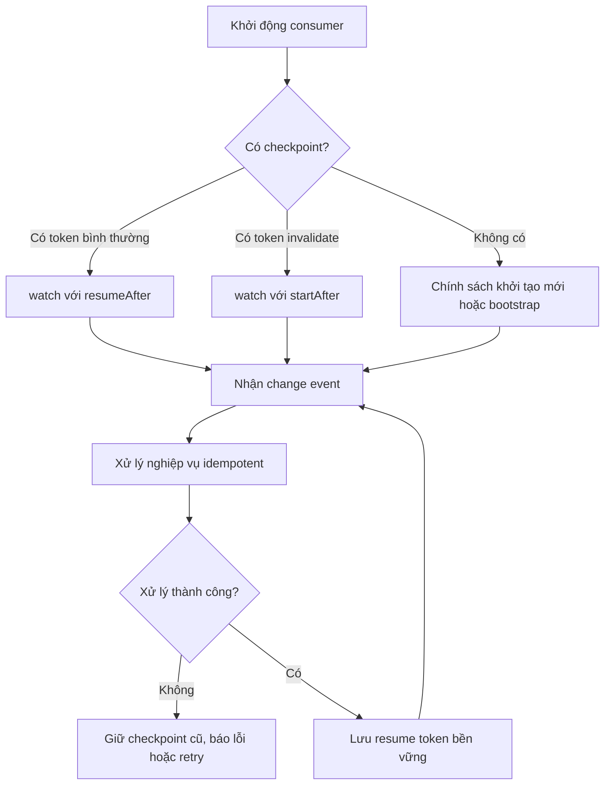

# Resume token, resumeAfter, startAfter và thời điểm bắt đầu

> **Phạm vi:** `SPRING_DATA_MONGODB` — Sử dụng Spring Data MongoDB để kết nối, ánh xạ document và thao tác MongoDB qua MongoTemplate hoặc repository. Thực hành thiết kế truy vấn, aggregation, index, transaction, reactive access, kiểm thử và chẩn đoán hiệu năng dữ liệu. Bài này tập trung vào cách chọn điểm bắt đầu và khôi phục **Change Stream** khi ứng dụng Spring Data MongoDB ngừng rồi chạy lại.

## 1. Vấn đề: khi consumer ngừng, đọc tiếp từ đâu?

Giả sử dịch vụ `order-projection` nghe thay đổi của collection `orders` để cập nhật bảng tổng hợp đơn hàng. Sau khi xử lý hai sự kiện, dịch vụ gặp lỗi mạng hoặc được triển khai lại. Nếu mở `watch()` bình thường, luồng mới sẽ bắt đầu từ thời điểm mở cursor; những thay đổi xảy ra trong lúc dịch vụ ngừng có thể không được gửi lại.

MongoDB cung cấp **resume token** để đánh dấu vị trí trong luồng và ba cách xác định điểm bắt đầu:

- `resumeAfter`: đọc tiếp **sau** một token đã biết.
- `startAfter`: mở luồng mới **sau** một token; đặc biệt hỗ trợ trường hợp sự kiện `invalidate` đã kết thúc luồng cũ.
- `startAtOperationTime`: bắt đầu tại một **thời điểm logic** trong lịch sử oplog, dùng khi không có token phù hợp.

Trong Spring Data MongoDB, cách khai báo tương ứng là `resumeAfter(token)`, `startAfter(token)` và `resumeAt(BsonTimestamp)` hoặc `resumeAt(Instant)`.

```text
Thời gian  ───────────────────────────────────────────────────────────>
            E1            E2            E3            E4
            tA            tB            tC            tD
                          ▲                 ▲
                 token lưu bền       dịch vụ chạy lại

resumeAfter(token E2):               nhận E3, E4, ...
watch() không có checkpoint:                      chỉ nhận thay đổi mới
startAtOperationTime(tB):           có thể nhận cả E2 nếu ở mốc tB
```

**Điều kiện:** Change Streams cần MongoDB **replica set** hoặc **sharded cluster**; standalone MongoDB không hỗ trợ. Dữ liệu lịch sử cần thiết phải còn trong **oplog**. Change Streams truyền thông báo về các thay đổi được majority-commit, không phải một hệ thống lưu trữ sự kiện vô hạn.

## 2. Resume token thực sự là gì?

Mỗi thông báo Change Stream có một trường `_id` chứa **resume token của sự kiện**. Đây là cấu trúc BSON do MongoDB tạo, có thể thay đổi cách mã hóa giữa các phiên bản. Không nhầm token này với `_id` của document nghiệp vụ trong `fullDocument` hoặc `documentKey`.

Ví dụ rút gọn từ `mongosh` (giá trị `_data` chỉ để minh họa):

```javascript
{
  _id: { _data: "8267...TOKEN..." },    // resume token của change event
  operationType: "update",
  clusterTime: Timestamp({ t: 1735689600, i: 2 }),
  ns: { db: "shop", coll: "orders" },
  documentKey: { _id: ObjectId("64b000000000000000000001") },
  updateDescription: {
    updatedFields: { status: "PAID" },
    removedFields: []
  }
}
```

Token mang ý nghĩa **điểm tiếp tục**, không phải mã định danh mà ứng dụng được phép tự ghép, tự tăng hoặc lấy `substring` để suy ra thứ tự. Hãy lưu **toàn bộ BSON token** ở dạng có thể phục hồi chính xác, ví dụ BSON hoặc Extended JSON giữ nguyên kiểu dữ liệu; tránh chỉ lưu một chuỗi thời gian hay `documentKey._id`.

Ngoài **event token**, MongoDB còn có **high-watermark token** (thường lộ ra qua `cursor.postBatchResumeToken` của lệnh `aggregate`/`getMore`), biểu thị một mốc đã tiến lên dù batch không chứa sự kiện nào. Driver có thể dùng token này để duy trì vị trí cursor khi luồng rảnh. Với checkpoint của **xử lý nghiệp vụ**, chỉ tiến checkpoint đến vị trí mà tất cả sự kiện liên quan phía trước đã được xử lý bền vững; không lấy một token ở phía sau các sự kiện chưa xử lý.

Spring Data cung cấp:

- `ChangeStreamEvent<T>.getResumeToken()`: trả về `BsonValue` của sự kiện, có thể `null` nên cần kiểm tra.
- `ChangeStreamEvent<T>.getBsonTimestamp()`: lấy `BsonTimestamp` từ `clusterTime`.
- `ChangeStreamEvent<T>.getTimestamp()`: lấy thời gian dưới dạng `Instant`.

## 3. So sánh ba cách chọn điểm bắt đầu

| Tùy chọn MongoDB | Đầu vào | Những thay đổi được nhận | Khi nên sử dụng |
|---|---|---|---|
| Không truyền tùy chọn | Không | Các thay đổi từ thời điểm mở luồng mới | Luồng mới, không cần đọc lịch sử |
| `resumeAfter` | Resume token `T` | Các thay đổi **sau** sự kiện/mốc `T` | Khởi động lại consumer thông thường sau checkpoint |
| `startAfter` | Resume token `T` | Các thay đổi **sau** `T`, tạo Change Stream mới | Khởi động lại sau `invalidate` hoặc khi chủ động cần luồng mới sau token |
| `startAtOperationTime` | BSON `Timestamp` | Các thay đổi **tại hoặc sau** thời điểm logic đó | Khôi phục theo mốc thời gian khi không có token |

Ba tùy chọn `resumeAfter`, `startAfter` và `startAtOperationTime` **loại trừ lẫn nhau**. Chỉ cấu hình một điểm bắt đầu cho mỗi lần mở Change Stream.

### 3.1. `resumeAfter`: tiếp tục từ checkpoint

Với chuỗi sự kiện `A → B → C → D`, nếu token của `B` đã được lưu sau khi xử lý `B` thành công, `resumeAfter(tokenB)` bắt đầu tại `C`. Nó không phát lại chính `B` theo ngữ nghĩa của tùy chọn.

Đây là lựa chọn mặc định hợp lý cho consumer có checkpoint. Điều kiện là token hợp lệ, oplog vẫn chứa đủ lịch sử và phạm vi, aggregation pipeline, các tùy chọn khi mở lại luồng vẫn tương thích với lúc tạo token.

**Giới hạn quan trọng:** nếu luồng bị kết thúc bởi sự kiện `invalidate` (ví dụ `drop` hoặc `rename` collection đang theo dõi), **không thể** dùng `resumeAfter` trên token của `invalidate`.

### 3.2. `startAfter`: bắt đầu lại sau `invalidate`

`invalidate` báo rằng phạm vi theo dõi không còn hợp lệ; cursor hiện tại bị đóng. Trường hợp này khác với việc tạm mất kết nối mạng.

`startAfter(invalidateToken)` cho phép khởi tạo một Change Stream mới từ phía sau sự kiện kết thúc đó. Ví dụ, khi theo dõi `shop.orders`, collection bị xóa rồi được tạo lại, ứng dụng có thể dùng token của `invalidate` cùng `startAfter` để tiếp tục lắng nghe các thay đổi trong phạm vi phù hợp. Cần xử lý riêng ý nghĩa nghiệp vụ của việc collection đã mất/được tạo lại; `startAfter` không phục hồi dữ liệu collection đã bị xóa.

`startAfter` cũng chấp nhận token thường, nhưng **lý do phân biệt chủ yếu** là hỗ trợ trường hợp `invalidate` mà `resumeAfter` không xử lý được. Một sự kiện `drop` của collection không nhất thiết `invalidate` mọi Change Stream ở cấp database hoặc cluster; phải xét phạm vi `watch`.

### 3.3. `startAtOperationTime`: khởi đầu bằng mốc logic

`startAtOperationTime` dùng `BsonTimestamp` gồm hai thành phần: số giây `t` và số thứ tự `i` bên trong giây đó. Khi chỉ định mốc này, MongoDB chọn các sự kiện có thời điểm logic **lớn hơn hoặc bằng** mốc. Vì vậy, so với `resumeAfter`, ứng dụng có thể gặp lại các sự kiện ngay tại thời điểm đã chọn và cần chống trùng.

Đây không phải mốc `wallTime`/đồng hồ của máy chạy ứng dụng. Trong Spring Data, `resumeAt(Instant)` là phương tiện thuận tiện khi chỉ có mốc thời gian UTC; với yêu cầu không đánh mất độ chính xác trong cùng một giây, ưu tiên `resumeAt(BsonTimestamp)` lấy từ `getBsonTimestamp()`.

Không nên lấy `Instant.now()` của ứng dụng làm checkpoint sau một khoảng ngừng rồi mặc định rằng không bỏ sót dữ liệu: đồng hồ client, độ phân giải thời gian và thời điểm sự kiện được majority-commit có thể khác nhau. Nếu đã có token, **ưu tiên token**.

## 4. Thực hành trên `mongosh`

Các ví dụ chạy trên replica set/sharded cluster, đã có database `shop` và collection `orders`.

### 4.1. Lấy token và tiếp tục sau sự kiện cuối đã xử lý

Mở một phiên `mongosh` để lắng nghe:

```javascript
use shop

const stream = db.orders.watch();
const event = stream.next();  // chờ cho đến khi có thay đổi
printjson({
  operationType: event.operationType,
  token: event._id,
  clusterTime: event.clusterTime
});

// Sau khi xử lý nghiệp vụ của event thành công:
db.streamCheckpoints.updateOne(
  { _id: "order-projection-v1" },
  { $set: { token: event._id, savedAt: new Date() } },
  { upsert: true }
);

stream.close();
```

Tạo một thay đổi trong phiên `mongosh` khác:

```javascript
use shop
db.orders.insertOne({ orderNo: "O-1001", status: "NEW" });
```

Khi dịch vụ chạy lại, đọc checkpoint rồi truyền **toàn bộ** token:

```javascript
use shop

const checkpoint = db.streamCheckpoints.findOne({
  _id: "order-projection-v1"
});

const resumed = db.orders.watch([], {
  resumeAfter: checkpoint.token
});

// Đọc các thay đổi xảy ra sau token đã lưu.
printjson(resumed.next());
```

Trong thực tế phải kiểm tra checkpoint có tồn tại trước khi truyền `resumeAfter`; nếu không có, quyết định theo quy trình khởi tạo lần đầu. Không đặt collection checkpoint nằm trong phạm vi `watch` toàn database nếu chưa lọc và kiểm soát vòng lặp sự kiện do chính thao tác ghi checkpoint tạo ra.

### 4.2. Khôi phục sau `invalidate` bằng `startAfter`

Giả sử consumer đã nhận và lưu token của sự kiện `invalidate`:

```javascript
const invalidateToken = { _data: "TOKEN_BSON_THUC_TE" }; // minh họa, không dùng chuỗi giả
const streamAfterDrop = db.orders.watch([], {
  startAfter: invalidateToken
});
```

Trong code thực tế, `invalidateToken` phải chính là **giá trị BSON** từ `event._id` của sự kiện `invalidate`, không phải đối tượng tự chế. Cần tạo lại collection hoặc xử lý vòng đời namespace tùy kịch bản. Nếu token đã quá cũ so với oplog, `startAfter` vẫn thất bại.

### 4.3. Khôi phục từ timestamp

```javascript
const operationTime = Timestamp({ t: 1735689600, i: 2 });

const streamFromTime = db.orders.watch([], {
  startAtOperationTime: operationTime
});
```

Ví dụ timestamp cố định chỉ mang tính minh họa; trong môi trường thật, lấy `clusterTime` từ sự kiện hoặc mốc logic đáng tin cậy của server. Không truyền đồng thời `resumeAfter`/`startAfter` với `startAtOperationTime`.

## 5. Spring Data MongoDB: dùng `ReactiveMongoTemplate`

Spring Data hỗ trợ Change Streams theo hai hướng: **reactive** với `ReactiveMongoTemplate` và **imperative** với `MongoTemplate` cùng `MessageListenerContainer`. Reactive phù hợp với luồng nhận thay đổi dài hạn vì tránh chiếm một thread chặn cho mỗi subscription.

### 5.1. Mở luồng mới, tiếp tục từ token hoặc thời gian

```java
import org.bson.BsonTimestamp;
import org.bson.BsonValue;
import org.bson.Document;
import org.springframework.data.mongodb.core.ChangeStreamEvent;
import org.springframework.data.mongodb.core.ReactiveMongoTemplate;
import reactor.core.publisher.Flux;

// reactiveTemplate là bean ReactiveMongoTemplate được cấu hình sẵn.

// Lần đầu: chỉ nhận thay đổi kể từ lúc luồng bắt đầu.
Flux<ChangeStreamEvent<Document>> fresh = reactiveTemplate
    .changeStream(Document.class)
    .watchCollection("orders")
    .listen();

// Sau khi khởi động lại: token BSON đã đọc từ kho checkpoint.
BsonValue savedToken = /* nạp checkpoint đã lưu */ null;
Flux<ChangeStreamEvent<Document>> resumed = reactiveTemplate
    .changeStream(Document.class)
    .watchCollection("orders")
    .resumeAfter(savedToken)
    .listen();

// Sau invalidate: dùng token của chính sự kiện invalidate.
BsonValue invalidateToken = /* token BSON thực */ null;
Flux<ChangeStreamEvent<Document>> afterInvalidate = reactiveTemplate
    .changeStream(Document.class)
    .watchCollection("orders")
    .startAfter(invalidateToken)
    .listen();

// Khi có mốc clusterTime đáng tin cậy nhưng không có resume token:
BsonTimestamp serverTime = /* clusterTime đã ghi nhận */ null;
Flux<ChangeStreamEvent<Document>> fromTime = reactiveTemplate
    .changeStream(Document.class)
    .watchCollection("orders")
    .resumeAt(serverTime)
    .listen();
```

Đoạn trên minh họa **các nhánh lựa chọn độc lập**; các biến `null` là chỗ cần thay bằng dữ liệu thật trước khi chạy. Không gọi `resumeAfter(null)` hay `startAfter(null)`. Với luồng reactive, việc lấy `Flux` chưa mở một subscription hoạt động; ứng dụng phải quản lý đăng ký, hủy đăng ký và cơ chế thử lại phù hợp vòng đời dịch vụ.

### 5.2. Mẫu consumer có checkpoint

Giả sử đã có hai hàm do ứng dụng triển khai:

- `projectIdempotently(event)`: trả về `Mono<Void>`, cập nhật projection theo cách chạy lại một sự kiện không làm sai dữ liệu.
- `checkpointStore.save(consumerId, token)`: trả về `Mono<Void>`, lưu bền token với đầy đủ kiểu BSON.

Có thể xây dựng pipeline xử lý **tuần tự**:

```java
Flux<ChangeStreamEvent<Document>> changes = reactiveTemplate
    .changeStream(Document.class)
    .watchCollection("orders")
    .resumeAfter(savedToken)
    .listen();

return changes.concatMap(event -> {
    BsonValue token = event.getResumeToken();
    if (token == null) {
        return reactor.core.publisher.Mono.error(
            new IllegalStateException("Change event không có resume token")
        );
    }

    return projectIdempotently(event)
        .then(checkpointStore.save("order-projection-v1", token));
}).then();
```

`concatMap` giúp giữ thứ tự hoàn thành của từng bước xử lý trong subscription này. Bản thân ví dụ **không** bảo đảm exactly-once: nếu cập nhật projection thành công nhưng dịch vụ chết trước khi lưu token, lần chạy sau sẽ nhận lại sự kiện đó. Vì vậy cần thao tác nghiệp vụ **idempotent**, ví dụ upsert theo khóa bền vững, hoặc sử dụng transaction thích hợp khi projection và checkpoint nằm trong cùng phạm vi MongoDB hỗ trợ transaction. Nếu có nhiều instance consumer, cần cơ chế phân quyền/lease hoặc phối hợp checkpoint; không mặc định rằng hai instance chia nhau các sự kiện.

Khi không có checkpoint, hãy tách đường khởi tạo ban đầu:

```java
Flux<ChangeStreamEvent<Document>> changes =
    savedToken == null
        ? reactiveTemplate.changeStream(Document.class)
            .watchCollection("orders").listen()
        : reactiveTemplate.changeStream(Document.class)
            .watchCollection("orders").resumeAfter(savedToken).listen();
```

**Lưu ý về delete:** `event.getBody()` có thể là `null` vì thao tác xóa không có full document sau thay đổi. Hãy dựa vào `event.getOperationType()` và `event.getRaw()`/`documentKey` theo yêu cầu nghiệp vụ, không coi body luôn tồn tại.

### 5.3. Cấu hình bằng `ChangeStreamOptions`

Khi dùng API dựa trên options, bao gồm hướng `MongoTemplate` + `MessageListenerContainer`, Spring Data cung cấp builder tương ứng:

```java
import org.springframework.data.mongodb.core.ChangeStreamOptions;

ChangeStreamOptions afterCheckpoint = ChangeStreamOptions.builder()
    .resumeAfter(savedToken)
    .build();

ChangeStreamOptions afterInvalidation = ChangeStreamOptions.builder()
    .startAfter(invalidateToken)
    .build();

ChangeStreamOptions fromClusterTime = ChangeStreamOptions.builder()
    .resumeAt(serverTime)
    .build();
```

Chọn **một** trong các cấu hình này cho mỗi request. Với imperative listener, cần đăng ký `ChangeStreamRequest` qua container và dừng container khi không còn dùng; không tạo tác vụ chặn Change Stream trực tiếp trên thread xử lý HTTP.

## 6. Chọn checkpoint đúng để tránh bỏ sót và trùng dữ liệu

Điểm cốt lõi là **checkpoint phản ánh sự kiện đã xử lý bền vững**, không chỉ sự kiện đã đọc từ socket.



| Thời điểm sự cố | Trạng thái checkpoint | Kết quả khi mở lại bằng `resumeAfter` |
|---|---|---|
| Trước khi xử lý `E5` | Token `E4` | Nhận lại `E5`, không bỏ sót |
| Sau khi xử lý `E5`, trước khi lưu token | Token `E4` | Nhận lại `E5`; cần idempotency |
| Sau khi đã lưu token `E5` | Token `E5` | Bắt đầu từ các sự kiện sau `E5` |
| Đã lưu token `E5` trước khi xử lý `E5` | Token `E5` | Có nguy cơ **mất `E5`**; đây là thứ tự sai |

Nếu nghiệp vụ cần ảnh chụp dữ liệu hiện tại rồi theo dõi thay đổi liên tục, thiết kế riêng bước **bootstrap/snapshot + handoff** với Change Stream: ghi nhận điểm nhất quán, bảo đảm không có khoảng trống giữa snapshot và thời điểm watch. Chỉ dùng `watch()` sau snapshot mà không có mốc bàn giao sẽ có nguy cơ bỏ sót thay đổi.

### Tự phục hồi của driver và phục hồi sau khởi động lại

MongoDB Java Driver có thể tự thử nối lại đối với **một số lỗi Change Stream có thể resume**, dùng token nó nắm trong phiên cursor. Tuy nhiên quá trình này không thay thế checkpoint trong kho lưu bền của ứng dụng: khi tiến trình bị giết hoặc triển khai lại, trạng thái trong RAM biến mất. Cũng không nên retry vô hạn mọi exception; lỗi token đã mất lịch sử cần quy trình xử lý riêng.

## 7. Các giới hạn và lỗi thường gặp

| Triệu chứng | Nguyên nhân thường gặp | Cách xử lý |
|---|---|---|
| `The $changeStream stage is only supported on replica sets` | Kết nối vào MongoDB standalone | Dùng replica set hoặc sharded cluster, kể cả môi trường thử nghiệm |
| `Resume Token Not Found` / `ChangeStreamHistoryLost` | Oplog không còn chứa điểm bắt đầu cần thiết, hoặc điều kiện resume không phù hợp | Đánh dấu checkpoint không thể tiếp tục; thực hiện lại bootstrap/backfill có kiểm soát, sau đó tạo checkpoint mới |
| `resumeAfter` thất bại sau `drop`/`rename` | Cursor đã nhận `invalidate` | Nếu có token invalidate hợp lệ, tạo luồng mới bằng `startAfter`; xử lý lại vòng đời dữ liệu |
| Sau restart không thấy những cập nhật khi app ngừng | Đã mở `watch()` không có token/mốc lịch sử | Lưu checkpoint bền và mở lại bằng `resumeAfter` |
| Nhận event trùng sau lỗi ứng dụng | Đã xử lý event nhưng chưa ghi checkpoint | Thiết kế handler idempotent hoặc transaction/checkpoint phối hợp |
| Không nhận sự kiện hoặc nhận ít hơn dự kiến | Sai collection/database, pipeline lọc quá chặt, không có quyền hoặc nguồn không phát sinh majority-committed changes | Kiểm tra phạm vi `watch`, quyền `changeStream`/`find`, pipeline và tình trạng replica set |
| Resume theo thời gian bị lặp/không đúng điểm | Nhầm `Instant`/`wallTime` với BSON `clusterTime`, hoặc mốc quá cũ | Ưu tiên token; khi bắt buộc dùng thời gian, giữ nguyên `BsonTimestamp` và kiểm tra phạm vi oplog |

Các nguyên tắc phòng tránh:

1. **Giữ nguyên token và pipeline.** Không `$project`, `$unset` hay thay đổi `_id` của change event; dùng lại pipeline và options tương thích khi resume. Từ MongoDB 4.2, việc sửa `_id` trong pipeline có thể gây lỗi.
2. **Theo dõi độ trễ so với oplog window.** Nếu consumer ngừng lâu hơn lịch sử oplog còn giữ, không có tùy chọn nào khôi phục được tất cả sự kiện cũ chỉ bằng token/timestamp.
3. **Tách lỗi tạm thời khỏi lỗi vĩnh viễn.** Lỗi mạng có thể retry; token không còn trong lịch sử cần quy trình backfill/rebuild và cảnh báo vận hành.
4. **Lưu checkpoint có định danh rõ ràng.** Gắn `consumerId` với phạm vi namespace, phiên bản pipeline và trạng thái checkpoint; không dùng chung một token cho các consumer có bộ lọc khác nhau.
5. **Giữ tài nguyên trong giới hạn.** Mỗi Change Stream cursor duy trì yêu cầu `getMore`; nhiều cursor so với connection pool có thể làm tăng độ trễ. Quản lý subscription/container khi ứng dụng dừng.

## 8. Bài thực hành kiểm chứng

Thử với một replica set dành cho phát triển và hai phiên `mongosh` hoặc một consumer Spring Data:

1. Mở Change Stream theo dõi `orders`; tạo ba thao tác `insert`/`update`, in `operationType`, `clusterTime` và `_id` mỗi event.
2. Xử lý và lưu token của event thứ hai; đóng consumer. Trong khi consumer đóng, thêm sự kiện thứ ba. Mở lại với `resumeAfter(token2)` và xác nhận event thứ ba được nhận.
3. Cố tình cho handler hoàn tất nghiệp vụ nhưng ngừng trước khi ghi checkpoint. Mở lại và xác nhận event được phát lại; kiểm chứng handler idempotent.
4. Với một collection thử riêng, quan sát `invalidate` khi `drop` hoặc `rename`, lưu token của event đó; thử `resumeAfter` (sẽ không hợp lệ) và `startAfter` trên cùng token, đồng thời kiểm tra hành vi khi namespace được tạo lại.
5. Thử `resumeAt(event.getBsonTimestamp())`; so sánh với `resumeAfter(event.getResumeToken())` để thấy khác biệt giữa *tại mốc thời gian* và *sau sự kiện*.
6. Quan sát `rs.printReplicationInfo()` trên replica set thử nghiệm để hiểu giới hạn oplog; không tùy tiện thu nhỏ oplog của môi trường đang phục vụ dữ liệu thật.

**Câu hỏi tự kiểm tra**

- Vì sao lưu token trước khi cập nhật projection có thể làm mất event?
- Token của event `invalidate` cần dùng `resumeAfter` hay `startAfter`?
- Vì sao `BsonTimestamp` chính xác hơn `Instant` khi chọn mốc trong cùng một giây?
- Khi oplog đã xóa lịch sử chứa token, thao tác khôi phục đúng về mặt dữ liệu là gì?

## 9. Ghi nhớ

- **`resumeAfter`:** điểm tiếp tục sau checkpoint thông thường.
- **`startAfter`:** bắt đầu Change Stream mới sau token, bao gồm token `invalidate`.
- **`startAtOperationTime` / `resumeAt`:** bắt đầu tại hoặc sau mốc thời gian logic; có thể lặp sự kiện ngay tại mốc.
- **Độ tin cậy:** lưu nguyên token BSON **sau** khi xử lý thành công, có idempotency, theo dõi oplog window và có phương án backfill nếu lịch sử đã mất.

### Tài liệu tham khảo

- [MongoDB Manual — Change Streams](https://www.mongodb.com/docs/manual/changestreams/)
- [MongoDB Manual — `$changeStream` aggregation stage](https://www.mongodb.com/docs/manual/reference/operator/aggregation/changestream/)
- [MongoDB Change Streams specification](https://github.com/mongodb/specifications/blob/master/source/change-streams/change-streams.md)
- [Spring Data MongoDB — Change Streams](https://docs.spring.io/spring-data/mongodb/reference/mongodb/change-streams.html)
- [Spring Data API — `ChangeStreamOptions.ChangeStreamOptionsBuilder`](https://docs.spring.io/spring-data/mongodb/docs/current/api/org/springframework/data/mongodb/core/ChangeStreamOptions.ChangeStreamOptionsBuilder.html)
