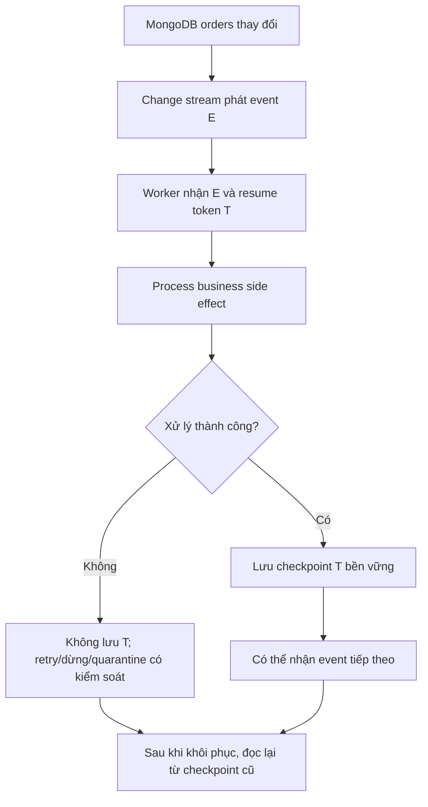

# Lưu checkpoint sau xử lý thành công và khôi phục sau gián đoạn

## 1. Bài toán Mini Commerce: không bỏ sót thay đổi khi worker khởi động lại

Một hệ thống **Mini Commerce** ghi `Order`, `Product` và `Customer` vào MongoDB qua Spring Data MongoDB. Để cập nhật một **bảng đọc đơn hàng** (`order_search`) hoặc gửi thông báo sau khi Order thay đổi, ứng dụng có worker theo dõi **MongoDB change stream** của collection `orders`.

Ví dụ người dùng thanh toán thành công:

```text
orders:
  {_id: "ord-001", status: "PAID", tenant_id: "shop-a"}

Change stream event:
  operationType = "update"
  documentKey._id = "ord-001"
  resumeToken = {"_data": "..."}  // token BSON mờ (opaque)

Consumer:
  1. Cập nhật order_search["ord-001"].
  2. Ghi checkpoint đã xử lý event.
```

Điều gì xảy ra nếu worker bị kill giữa hai bước? Nếu ghi checkpoint **trước** khi cập nhật `order_search`, lần khởi động sau có thể bỏ qua sự kiện và bảng đọc mãi sai. Nếu cập nhật `order_search` **trước**, rồi worker chết khi chưa ghi checkpoint, sự kiện sẽ được đọc lại: cần xử lý **idempotent** để không tạo tác dụng phụ hai lần.

Đây là bài **“Lưu checkpoint sau xử lý thành công và khôi phục sau gián đoạn”**, thuộc chương **“Change stream”** của `SPRING_DATA_MONGODB`. Chúng ta kết hợp kỹ năng kết nối/ánh xạ document, `MongoTemplate`/`ReactiveMongoTemplate` hoặc repository, lập chỉ mục, transaction, reactive access, kiểm thử và chẩn đoán hiệu năng dữ liệu MongoDB.

### Mục tiêu học tập

Sau bài này, bạn có thể:

1. Phân biệt **resume token**, **checkpoint**, **ACK nghiệp vụ**, **checkpoint bootstrap** và **replay**.
2. Giải thích vì sao phải **xử lý thành công rồi mới lưu checkpoint**.
3. Đọc `ChangeStreamEvent.getResumeToken()` và lưu nguyên vẹn token BSON theo một định dạng có khả năng round-trip.
4. Mở lại stream bằng `ChangeStreamOptions.builder().resumeAfter(token)`; phân biệt `startAfter`, `resumeAt(BsonTimestamp)`.
5. Tạo **điểm xuất phát bền vững** trước khi xử lý sự kiện đầu tiên, tránh mất dữ liệu nếu chưa có checkpoint mà worker chết.
6. Thiết kế consumer tuần tự bằng `Flux.defer` và `concatMap` để checkpoint không vượt quá sự kiện xử lý chưa xong.
7. Giải thích chính xác **at-least-once**, deduplication, idempotency và ranh giới **exactly-once**.
8. Cập nhật projection + checkpoint trong **một MongoDB transaction** khi cùng database/deployment đáp ứng yêu cầu.
9. Xử lý lỗi mạng, poison event, token hết hạn trong oplog, invalidate và thay đổi pipeline.
10. Kiểm soát nhiều worker bằng một logical consumer/lease/fencing hoặc chia phạm vi checkpoint rõ ràng.
11. Viết integration test với MongoDB replica set và `StepVerifier` để chứng minh replay sau crash không làm nhân đôi kết quả.
12. Thiết lập metrics, cảnh báo lag, backup/recovery và runbook vận hành.

**Điều kiện:** Java 17+, Spring Boot, `spring-boot-starter-data-mongodb-reactive` cho các ví dụ reactive, MongoDB replica set hoặc sharded cluster, Reactor, hiểu `@Document`, `@Id` và nguyên tắc idempotency. Ví dụ imperative sử dụng `MongoTemplate`/`MessageListenerContainer` ở phần riêng.

## 2. Change stream không phải hàng đợi có ACK tự động

MongoDB change stream là luồng thông báo các thay đổi đã commit, dựa trên lịch sử replication/oplog. Event có resume token để client xác định điểm tiếp tục đọc.



Điểm cần nhớ:

- Server biết cursor đã **phát** event; nó **không biết** ứng dụng đã cập nhật bảng đọc hay gọi API thành công.
- `ChangeStreamEvent.getResumeToken()` cung cấp token **cho event**, không phải một lời xác nhận đã xử lý.
- `resumeAfter(T)` yêu cầu server tiếp tục **sau** event có token `T`. Nếu chưa xử lý event `E`, ghi `T(E)` sẽ làm **mất cơ hội replay event E** khi mở lại stream.
- Driver có khả năng tự resume sau một số lỗi, nhưng **không thay thế durable application checkpoint** và không tạo ACK nghiệp vụ.

### 2.1. Khái niệm cốt lõi

| Khái niệm | Ý nghĩa | Ví dụ |
| --- | --- | --- |
| Change event | Mô tả thay đổi mà stream quan sát được | Order chuyển `PLACED → PAID` |
| Resume token | Dấu mốc BSON opaque chỉ vị trí trong stream | Event `_id: {"_data":"..."}` |
| Checkpoint | Token cuối cùng mà **ứng dụng đã xử lý xong** và lưu bền vững | `change_stream_checkpoints/orders-to-search-v1` |
| Resume | Mở stream sau checkpoint đã lưu | `resumeAfter(savedToken)` |
| Replay | Nhận lại event sau crash/timeout trước khi checkpoint | Update `order_search` một lần nữa |
| ACK nghiệp vụ | Tiêu chí tác vụ xử lý thành công | Projection được MongoDB acknowledged |
| Bootstrap anchor | Điểm xuất phát bền vững khi **chưa có token event** | `startAtOperationTime` được lưu trước chạy |
| Idempotency | Xử lý lại không tạo hiệu ứng sai | Upsert Order view theo stable ID |
| Poison event | Event luôn thất bại với cùng payload/schema | Payload thiếu khóa bắt buộc |

### 2.2. Vì sao không dùng một biến trong RAM?

```java
// SAI cho recovery sau process restart:
AtomicReference<BsonValue> lastSeen = new AtomicReference<>();

stream.doOnNext(event ->
    lastSeen.set(event.getResumeToken()));
```

RAM mất sau crash/deploy. Nguy hiểm hơn, `doOnNext` chạy **khi event vừa được nhận**, trước khi processing có thể hoàn thành.

Thay vào đó lưu checkpoint vào collection bền vững, ví dụ `change_stream_checkpoints`, **sau khi downstream processing đã xác nhận thành công**.

## 3. Giải thích bảo đảm at-least-once qua các cửa sổ lỗi

Giả sử checkpoint bền vững hiện tại là `T0`, worker nhận event `E1` với token `T1`.

### 3.1. Cách sai: checkpoint trước processing

```text
T0: checkpoint hiện tại = T0
T1: nhận E1
T2: LƯU CHECKPOINT = T1
T3: tiến trình bị kill
T4: xử lý E1 CHƯA CHẠY
Restart: resumeAfter(T1) -> server phát E2 trở đi
=> E1 BỊ BỎ SÓT
```

Ngay cả khi `T2` đã được MongoDB acknowledged, nó chỉ chứng minh checkpoint được lưu, **không chứng minh nghiệp vụ thành công**.

### 3.2. Cách đúng: process rồi checkpoint

```text
T0: checkpoint hiện tại = T0
T1: nhận E1
T2: xử lý E1 thành công
T3: LƯU CHECKPOINT = T1
T4: xử lý E2 ...
```

Những tình huống crash:

| Thời điểm crash | Side effect E1 | Checkpoint | Sau restart | Điều kiện an toàn |
| --- | --- | --- | --- | --- |
| Trước xử lý | Chưa | `T0` | E1 được phát lại | Có lịch sử oplog |
| Trong lúc xử lý | Không rõ / dở dang | `T0` | E1 được phát lại | Side effect phải atomic/idempotent |
| Sau xử lý, trước checkpoint | Đã hoàn tất | `T0` | E1 được phát lại | **Idempotency/dedup** |
| Trong lúc lưu checkpoint | Có thể hoàn tất | `T0` hoặc `T1` | Có thể replay hoặc bỏ qua | Lưu checkpoint acknowledged, đọc lại nếu outcome không rõ |
| Sau checkpoint `T1` được commit | Đã hoàn tất | `T1` | Bắt đầu sau E1 | Cùng một logical stream |

Với cách này, worker hướng tới **at-least-once processing**: một event có thể xử lý nhiều lần, nhưng không bị bỏ qua do checkpoint vượt trước nghiệp vụ. Không đồng nghĩa exactly-once đối với email, HTTP, Kafka hay Redis.

### 3.3. Tập bất biến phải giữ

```text
Persisted checkpoint = token của EVENT CUỐI
mà toàn bộ kết quả nghiệp vụ trước đó đã được xác nhận.
```

Nói cách khác, nếu `E1`, `E2`, `E3` lần lượt được phát:

- Chỉ sau khi E1 thành công mới checkpoint `T1`.
- Chỉ sau khi E2 thành công mới checkpoint `T2`.
- Chỉ sau khi E3 thành công mới checkpoint `T3`.
- Không checkpoint `T3` khi E2 đang thất bại.

**Không dùng `flatMap` chạy song song rồi ghi token của event nào hoàn thành trước** nếu tất cả chia sẻ một checkpoint duy nhất. Bởi vì E3 có thể hoàn thành trước E2, checkpoint `T3` sẽ bỏ qua E2 sau restart.

## 4. Điều kiện hạ tầng: replica set, oplog và quyền truy cập

MongoDB change stream được hỗ trợ trên **replica set và sharded cluster**, không phải MongoDB standalone thông thường. Testcontainers/local MongoDB dùng cho integration test phải được cấu hình replica set phù hợp.

### 4.1. Các điều kiện bắt buộc

- MongoDB cluster có đủ oplog history để mở lại từ token cũ.
- User có quyền watch/change stream và đọc collection liên quan, đồng thời có quyền ghi checkpoint.
- Collection `orders`, `order_search` và `change_stream_checkpoints` đã được chuẩn bị; nếu sử dụng transaction, deploy đáp ứng điều kiện multi-document transaction.
- Pipeline/filter/options khi resume phải tương thích với lúc token được tạo.
- Clock, write concern, lag và recovery window được giám sát.
- Mỗi logical consumer có một checkpoint riêng, không dùng chung token tùy ý giữa các môi trường/dev/production.

### 4.2. Event không chứa “lịch sử vô hạn”

Change streams dựa vào oplog, nên resume token hết hiệu lực nếu vị trí cũ đã bị xóa khỏi oplog. Giữ token bền vững trong database **không làm MongoDB giữ oplog mãi mãi**.

Ví dụ:

```text
Oplog history = 24 giờ (ví dụ, không phải cấu hình mặc định).
Consumer offline = 72 giờ.
Checkpoint T0 vẫn nằm trong checkpoint collection.
MongoDB không còn sự kiện tại T0.
resumeAfter(T0) -> thất bại.
```

Không xử lý lỗi này bằng cách xóa checkpoint rồi tự mở stream tại “bây giờ”: như vậy có thể bỏ qua hàng nghìn Order đã thay đổi. Cần **reconcile/rebuild** từ nguồn dữ liệu bền vững hoặc kích hoạt một quy trình phục hồi có điểm cutover được phê duyệt.

### 4.3. Scope của watch

| Scope | Điều nhận được | Lưu ý checkpoint |
| --- | --- | --- |
| Collection `orders` | Thay đổi trong collection này | Phù hợp worker cập nhật `order_search` |
| Database watch | Thay đổi nhiều collections trong database | Cần filter/schemas; tránh watch cả **checkpoint writes** gây vòng lặp |
| Deployment watch | Nhiều database/namespace | Event type, quyền, checkpoint và filter phức tạp hơn |

Trong bài, worker chỉ watch `orders`. Nó ghi projection vào `order_search` và checkpoint vào `change_stream_checkpoints`, **không phát lại những ghi này vào stream cùng scope**.

### 4.4. FullDocument và documentKey

Trong `ChangeStreamEvent<T>`:

- `getOperationType()` phân loại insert/update/replace/delete/invalidate và các loại khác tùy MongoDB version/options.
- `getBody()` là entity được ánh xạ từ `fullDocument`, **có thể null** (đặc biệt delete).
- `getRaw()` cho phép lấy payload gốc (bao gồm `documentKey` và `updateDescription`).
- `getResumeToken()` trả `BsonValue` và được khai báo **nullable** trong Spring Data API; code nghiêm túc phải kiểm tra null trước khi checkpoint.
- `getBsonTimestamp()` biểu thị cluster time nếu có; **không thay được resume token chính xác**.

Nếu dùng `fullDocument: "updateLookup"`, document nhận được cho update có thể là bản mới nhất khi lookup diễn ra, **không nhất thiết là ảnh chụp nguyên tử đúng tại thời điểm update event**; document cũng có thể không còn tồn tại. Đừng sử dụng kết quả lookup đó như ledger kiểm toán chính xác nếu business yêu cầu snapshot trước/sau của từng operation.

## 5. Resume token: opaque, phải giữ nguyên BSON

Một change event MongoDB có dạng minh họa:

```javascript
{
  _id: { _data: "8263...TOKEN..." },
  operationType: "update",
  clusterTime: Timestamp({ t: 1795123200, i: 1 }),
  ns: { db: "mini_commerce", coll: "orders" },
  documentKey: { _id: "ord-001" },
  updateDescription: {
    updatedFields: { status: "PAID" },
    removedFields: []
  }
}
```

`_id` của **change event** là **resume token**, khác với `documentKey._id` là ID của Order bị thay đổi.

### 5.1. Tuyệt đối không sửa resume token

- Không xóa `_data` hoặc chỉ lưu một phần.
- Không tự suy token tiếp theo bằng cách cộng số.
- Không so sánh thứ tự token bằng lexicographic String trong business logic.
- Không cắt token thành timestamp rồi cho rằng nó đủ độ chính xác.
- Không tự thêm `$project`/`$replaceRoot` làm mất hoặc đổi event `_id` trong change-stream pipeline.
- Không giả định mọi phiên bản MongoDB/driver sinh token có cùng JSON/BSON structure.

MongoDB yêu cầu **dùng cả token** khi mở lại stream và cảnh báo nên giữ cùng pipeline/options với khi sinh token.

### 5.2. Event token và high-water-mark token

MongoDB có event token cho một sự kiện cụ thể, và high-water-mark token đại diện cho tiến độ stream khi không có event. `ChangeStreamEvent.getResumeToken()` cung cấp token trên event được phát; raw driver/cursor còn có thể cung cấp `postBatchResumeToken` ở mức batch, kể cả batch rỗng.

**Chỉ checkpoint một high-water-mark token khi đã chắc chắn mọi event trước đó đều được xử lý thành công.** Không “tối ưu” ghi token mới nhất mà driver thấy trong khi downstream đang xử lý E1/E2.

Ví dụ Spring Data `Flux<ChangeStreamEvent<T>>` thường không trực tiếp bộc lộ `postBatchResumeToken` của batch rỗng như một event domain; nếu yêu cầu checkpoint tiến độ khi stream nhàn rỗi, thiết kế raw driver cursor riêng với nguyên tắc ACK này.

## 6. Chọn định dạng checkpoint bền vững

Một checkpoint thường gồm:

```javascript
{
  _id: "orders-to-search-v1",
  resumeTokenJson: "{ \"_data\": \"8263...\" }",
  initialTimestampSeconds: 1795123200,
  initialTimestampIncrement: 1,
  pipelineVersion: "orders-v1",
  acknowledgedAt: ISODate("2026-11-20T10:30:00Z"),
  ownerEpoch: NumberLong(7)
}
```

Giá trị timestamp, token và epoch là minh họa. Khi `resumeTokenJson` đã có, tiếp tục từ token; khi chưa có, dùng **bootstrap anchor đã lưu trước đó**. `ownerEpoch` dành cho giao thức leader/fencing, không tự hoạt động chỉ vì field xuất hiện.

### 6.1. Một khóa checkpoint cho một logical consumer

Ví dụ:

```text
orders-to-search-v1
orders-to-analytics-v1
orders-to-notifications-v1
```

Ba workflow có business side effects, khả năng replay và vận hành riêng, nên **không dùng chung một token**. Nếu consumer đổi pipeline/filter/namespace hoặc chiến lược xử lý, có thể cần checkpoint generation mới và kế hoạch chuyển đổi.

Một checkpoint `orders-to-search-v1` **không được tự động lấy từ stream của tenant khác, database khác hoặc môi trường khác**; token không phải con trỏ có thể tái sử dụng tùy ý.

### 6.2. Vì sao dùng Canonical Extended JSON?

`BsonValue` có thể chứa BSON types đặc thù. Nếu chỉ gọi `toString()` hoặc dùng JSON serializer chung (Jackson) không cấu hình BSON, token có thể mất kiểu hoặc bị đổi cấu trúc khi lưu/đọc. Canonical Extended JSON giúp giữ đủ BSON type trong string, rồi parse lại thành `BsonDocument`.

```java
package com.example.minicommerce.streams;

import org.bson.BsonDocument;
import org.bson.BsonValue;
import org.bson.json.JsonMode;
import org.bson.json.JsonWriterSettings;

public final class ResumeTokenCodec {

    private static final JsonWriterSettings CANONICAL =
        JsonWriterSettings.builder()
            .outputMode(JsonMode.EXTENDED)
            .build();

    private ResumeTokenCodec() {}

    public static String encode(BsonValue token) {
        if (token == null || !token.isDocument()) {
            throw new IllegalArgumentException(
                "Expected non-null BSON document resume token");
        }
        return token.asDocument().toJson(CANONICAL);
    }

    public static BsonDocument decode(String json) {
        if (json == null || json.isBlank()) {
            throw new IllegalArgumentException("Missing token JSON");
        }
        return BsonDocument.parse(json);
    }
}
```

**Lưu ý:** tên enum trong MongoDB Java Driver là **`JsonMode.EXTENDED`** (định dạng **Canonical Extended JSON**), không phải `JsonMode.CANONICAL`. `JsonMode.RELAXED` là biến thể relaxed; ưu tiên `EXTENDED` cho việc bảo toàn kiểu BSON khi lưu token. Hãy kiểm tra round-trip với driver của dự án: mục tiêu là **đọc lại được BsonDocument tương đương**, không phải chỉ lưu một chuỗi nhìn giống token.

Không log raw resume token hoặc stream credentials một cách không cần thiết. Token không phải password nhưng có thể chứa thông tin định vị stream; checkpoint collection cần ACL, backup và retention phù hợp.

## 7. Tạo collection checkpoint với entity và repository reactive

Trong ví dụ reactive, Spring Data ánh xạ entity checkpoint sang MongoDB collection `change_stream_checkpoints`:

```java
package com.example.minicommerce.streams;

import java.time.Instant;
import org.springframework.data.annotation.Id;
import org.springframework.data.mongodb.core.mapping.Document;

@Document(collection = "change_stream_checkpoints")
public record ChangeCheckpoint(
    @Id String id,
    String resumeTokenJson,
    Integer initialTimestampSeconds,
    Integer initialTimestampIncrement,
    String pipelineVersion,
    Instant acknowledgedAt
) {}
```

```java
package com.example.minicommerce.streams;

import org.springframework.data.mongodb.repository.ReactiveMongoRepository;

public interface ChangeCheckpointRepository
        extends ReactiveMongoRepository<ChangeCheckpoint, String> {
}
```

Hai snippet là hai file Java `ChangeCheckpoint.java` và `ChangeCheckpointRepository.java`. Chỉ nên có **một writer** cho checkpoint `id` trong thiết kế cơ bản; nếu triển khai HA/multiple consumers, cần lease/fencing và CAS riêng (phần 20).

### 7.1. Giữ lại bootstrap timestamp khi cập nhật token

Giả sử cấu hình checkpoint hiện tại có:

```java
ChangeCheckpoint previous = ...;

ChangeCheckpoint updated = new ChangeCheckpoint(
    previous.id(),
    ResumeTokenCodec.encode(event.getResumeToken()),
    previous.initialTimestampSeconds(),
    previous.initialTimestampIncrement(),
    previous.pipelineVersion(),
    Instant.now());
```

Đây là **đoạn trong service** với `previous` đã được load và `event` đã xử lý xong. Giữ nguyên pipeline version, bootstrap anchor và ID. Không dùng `Instant.now()` ở đây làm điểm resume; nó chỉ là **thời điểm lưu ACK** phục vụ quan sát.

### 7.2. Chọn write concern cho checkpoint

Vì checkpoint có tác động trực tiếp tới tính đúng đắn của recovery, nên dùng **acknowledged writes**, thường cân nhắc `WriteConcern.MAJORITY` theo yêu cầu durability của deployment. Một ACK với write concern yếu có thể mất sau failover, khiến worker replay nhiều event hơn; điều đó vẫn cần idempotency.

Ngược lại, ghi checkpoint không được đánh dấu thành công chỉ vì method trả về một publisher nhưng **chưa subscribe/await completion**. Trong Reactor, hoàn thành `Mono` của lệnh lưu mới là tín hiệu ACK cấp ứng dụng theo hợp đồng driver.

## 8. Bootstrap: xử lý đúng lần đầu chưa có checkpoint

Đây là lỗi vận hành quan trọng nhưng rất dễ bị bỏ sót:

```text
Lần deploy đầu:
  Không có checkpoint.
  Worker mở stream "từ hiện tại".
  Nhận E1, xử lý thành công, CHƯA lưu checkpoint.
  Worker crash.

Khởi động lại:
  VẪN không có checkpoint.
  Mở stream "từ hiện tại" một lần nữa.
  E1 bị bỏ qua vĩnh viễn.
```

Vì vậy chỉ lưu token **sau event đầu tiên** chưa đủ để thiết kế recovery đáng tin cậy. Cần một **điểm xuất phát đã được lưu bền vững trước khi consumer xử lý bất kỳ event nào**.

### 8.1. Hai chiến lược bootstrap

| Chiến lược | Cách làm | Phạm vi |
| --- | --- | --- |
| Bắt đầu từ một timestamp server đã kiểm chứng | Lấy `BsonTimestamp` từ nguồn cluster hợp lệ, lưu checkpoint bootstrap; mở change stream bằng `resumeAt(BsonTimestamp)` | Theo dõi từ một thời điểm cutover được định nghĩa |
| Bắt đầu sau high-water-mark token | Mở stream/cursor, lấy token hợp lệ, lưu token **trước xử lý** event tương lai; sau đó resume từ token | Cần kiểm soát việc buffer/order khi cursor đang hoạt động |

Đối với một projection **đã có dữ liệu lịch sử**, bootstrap còn phải giải quyết snapshot:

1. Xác định cutover/anchor trước hoặc cùng quy trình dựng snapshot.
2. Lấy snapshot `orders` có consistency được thiết kế phù hợp.
3. Áp dụng mọi thay đổi **kể từ anchor**, theo thứ tự stream, sau khi snapshot hoàn tất.
4. Chuyển sang chế độ streaming, chỉ checkpoint sau khi projection/side effect được commit.

Không đơn thuần “quét collection cũ xong rồi watch từ now”: write xảy ra giữa scan và watch có thể mất. Không mở stream rồi buffer vô hạn trong RAM khi snapshot kéo dài; phải đặt giới hạn/khả năng durable spool và kế hoạch chuyển đổi.

### 8.2. Trường dữ liệu bootstrap

Giả sử operations team lưu một checkpoint đã được khởi tạo:

```javascript
db.change_stream_checkpoints.insertOne({
  _id: "orders-to-search-v1",
  resumeTokenJson: null,
  initialTimestampSeconds: 1795123200,
  initialTimestampIncrement: 1,
  pipelineVersion: "orders-v1",
  acknowledgedAt: null
});
```

**Không dùng các giá trị thời gian số ở đây như timestamp thật:** chúng chỉ minh họa schema. Trong production, bootstrap anchor phải được lấy từ cluster tại cutover có chủ đích và bảo đảm nằm trong oplog; không dùng `Instant.now()` của máy bất kỳ để đoán timestamp, đặc biệt khi cần tránh missing events.

### 8.3. Fail closed khi checkpoint chưa bootstrap

```java
return checkpoints.findById(STREAM_KEY)
    .switchIfEmpty(Mono.error(
        new IllegalStateException(
            "Missing bootstrap checkpoint; refusing to tail from now")));
```

Đây là lựa chọn có chủ ý: hệ thống báo lỗi và cần bootstrap hợp lệ, thay vì im lặng mở stream tại hiện tại và đánh mất dữ liệu giữa các lần khởi động.

### 8.4. Resume token ưu tiên hơn timestamp

Sau khi event đầu tiên đã được xử lý và ACK, `resumeTokenJson` được điền. Những lần sau **dùng `resumeAfter(token)`**, còn `initialTimestampSeconds/Increment` chỉ giữ như metadata phục vụ điều tra.

`resumeAt(Instant)`/`startAtOperationTime` không chỉ ra chính xác một event khi nhiều event cùng giây; nên dùng token đầy đủ khi đã có. Spring Data MongoDB hỗ trợ `resumeAt(BsonTimestamp)` khi cần cluster time chính xác.

## 9. Đọc checkpoint và mở ChangeStreamOptions

### 9.1. Tiện ích dựng options

```java
package com.example.minicommerce.streams;

import org.bson.BsonTimestamp;
import org.springframework.data.mongodb.core.ChangeStreamOptions;

public final class ChangeStreamRecovery {

    public static final String STREAM_ID =
        "orders-to-search-v1";

    public static final String PIPELINE_VERSION =
        "orders-v1";

    private ChangeStreamRecovery() {}

    public static ChangeStreamOptions options(
            ChangeCheckpoint checkpoint) {

        if (!STREAM_ID.equals(checkpoint.id()) ||
                !PIPELINE_VERSION.equals(
                    checkpoint.pipelineVersion())) {
            throw new IllegalStateException(
                "Checkpoint scope/pipeline mismatch");
        }

        String tokenJson = checkpoint.resumeTokenJson();
        if (tokenJson != null && !tokenJson.isBlank()) {
            return ChangeStreamOptions.builder()
                .resumeAfter(ResumeTokenCodec.decode(tokenJson))
                .build();
        }

        Integer seconds = checkpoint.initialTimestampSeconds();
        Integer increment = checkpoint.initialTimestampIncrement();
        if (seconds == null || increment == null) {
            throw new IllegalStateException(
                "Checkpoint has neither token nor bootstrap anchor");
        }

        return ChangeStreamOptions.builder()
            .resumeAt(new BsonTimestamp(seconds, increment))
            .build();
    }
}
```

Những điều cần giữ:

- `resumeAfter` nhận **`BsonValue`**, không nhận Order ID hoặc timestamp.
- `resumeAt` dùng `BsonTimestamp` đã lưu, **chỉ** khi chưa có acknowledged event token.
- Không cấu hình đồng thời `resumeAfter`, `startAfter` và `resumeAt/startAtOperationTime`.
- Không đổi `pipelineVersion` chỉ để vượt qua mismatch. Phải thực hiện migration/reconciliation có kế hoạch.

### 9.2. ReactiveMongoTemplate mở stream

```java
package com.example.minicommerce.streams;

import org.bson.Document;
import org.springframework.data.mongodb.core.ChangeStreamEvent;
import org.springframework.data.mongodb.core.ReactiveMongoTemplate;
import org.springframework.stereotype.Component;

import reactor.core.publisher.Flux;
import reactor.core.publisher.Mono;

@Component
public class OrdersChangeStreamSource {

    private final ReactiveMongoTemplate template;
    private final ChangeCheckpointRepository checkpoints;

    public OrdersChangeStreamSource(
            ReactiveMongoTemplate template,
            ChangeCheckpointRepository checkpoints) {
        this.template = template;
        this.checkpoints = checkpoints;
    }

    public Flux<ChangeStreamEvent<Document>> open() {
        return checkpoints.findById(
                ChangeStreamRecovery.STREAM_ID)
            .switchIfEmpty(Mono.error(
                new IllegalStateException(
                    "Bootstrap checkpoint is required")))
            .flatMapMany(cp -> template.changeStream(
                "orders",
                ChangeStreamRecovery.options(cp),
                Document.class));
    }
}
```

`ReactiveMongoTemplate.changeStream(String collection, ChangeStreamOptions options, Class<T> targetType)` trả `Flux<ChangeStreamEvent<T>>`. Ở đây `Document.class` tránh mất dữ liệu khi event của nhiều dạng Order/schema legacy được convert vào một entity quá chặt.

`open()` tạo **publisher**; MongoDB cursor thực sự được mở khi **subscription** bắt đầu. Nếu muốn retry, cần gọi `open()` **lại** để đọc checkpoint mới nhất, không cố tái sử dụng một object options/tokens đã chụp từ lúc khởi tạo.

### 9.3. Vì sao không giữ một “token mới nhất đã nhận”?

```java
// Sai: lastReceived không phải lastAcknowledged.
Flux<ChangeStreamEvent<Document>> raw = source.open()
    .doOnNext(event -> lastReceived.set(
        event.getResumeToken()));
```

`lastReceived` có thể chạy trước processing, còn `lastAcknowledged` là token **đã commit checkpoint sau processing**. Chúng là hai trạng thái khác nhau; nếu lưu nhầm, recovery có thể bỏ sót event.

## 10. Xử lý sự kiện Mini Commerce theo cách có thể replay

Worker cập nhật `order_search`: một materialized read model phục vụ tra cứu Order. Không tăng doanh thu trong ví dụ này để tránh side effect không idempotent; sử dụng **upsert/replace theo Order ID**.

### 10.1. Entity source Order

```java
package com.example.minicommerce.domain;

import org.springframework.data.annotation.Id;
import org.springframework.data.mongodb.core.mapping.Document;
import org.springframework.data.mongodb.core.mapping.Field;

@Document(collection = "orders")
public class Order {

    @Id
    private String id;

    @Field("tenant_id")
    private String tenantId;

    private String status;

    public Order() {}

    public Order(String id, String tenantId, String status) {
        this.id = id;
        this.tenantId = tenantId;
        this.status = status;
    }

    public String getId() { return id; }
    public String getTenantId() { return tenantId; }
    public String getStatus() { return status; }
}
```

### 10.2. Entity read model OrderSearchView

```java
package com.example.minicommerce.streams;

import org.springframework.data.annotation.Id;
import org.springframework.data.mongodb.core.mapping.Document;
import org.springframework.data.mongodb.core.mapping.Field;

@Document(collection = "order_search")
public record OrderSearchView(
    @Id String id,
    @Field("tenant_id") String tenantId,
    String status
) {}
```

Không chứa email/địa chỉ/thông tin thanh toán vì API tìm kiếm Order không cần. `_id` của view bằng Order ID, giúp `save(view)` theo ID **lặp lại cùng một trạng thái** thay vì tạo nhiều document.

### 10.3. Event handler lấy documentKey từ raw payload

```java
package com.example.minicommerce.streams;

import java.util.Objects;

import org.bson.BsonDocument;
import org.bson.BsonValue;
import org.bson.Document;

import com.mongodb.client.model.changestream.ChangeStreamDocument;
import com.mongodb.client.model.changestream.OperationType;

import org.springframework.data.mongodb.core.ChangeStreamEvent;
import org.springframework.data.mongodb.core.ReactiveMongoTemplate;
import org.springframework.stereotype.Component;

import reactor.core.publisher.Mono;

import com.example.minicommerce.domain.Order;

@Component
public class OrderProjectionHandler {

    private final ReactiveMongoTemplate template;

    public OrderProjectionHandler(ReactiveMongoTemplate template) {
        this.template = template;
    }

    public Mono<Void> apply(ChangeStreamEvent<Document> event) {
        return Mono.defer(() -> {
            OperationType operation = Objects.requireNonNull(
                event.getOperationType(), "operationType");

            if (operation == OperationType.INVALIDATE) {
                return Mono.error(new IllegalStateException(
                    "Collection stream invalidated"));
            }

            if (operation != OperationType.INSERT &&
                operation != OperationType.UPDATE &&
                operation != OperationType.REPLACE &&
                operation != OperationType.DELETE) {
                return Mono.error(new IllegalStateException(
                    "Unsupported operation: " + operation));
            }

            ChangeStreamDocument<Document> raw =
                Objects.requireNonNull(event.getRaw(), "raw");
            BsonDocument key = Objects.requireNonNull(
                raw.getDocumentKey(), "documentKey");
            BsonValue idValue = key.get("_id");
            if (idValue == null || !idValue.isString()) {
                return Mono.error(new IllegalArgumentException(
                    "Expected String Order _id"));
            }
            String orderId = idValue.asString().getValue();

            if (operation == OperationType.DELETE) {
                return template.remove(
                    org.springframework.data.mongodb.core.query.Query
                        .query(org.springframework.data.mongodb.core.query
                            .Criteria.where("id").is(orderId)),
                    OrderSearchView.class).then();
            }

            // Xây read model theo trạng thái hiện tại.
            // Nếu source đã bị xóa ngay sau event update,
            // xóa projection thay vì dựng dữ liệu stale.
            return template.findById(orderId, Order.class)
                .flatMap(order ->
                    template.save(new OrderSearchView(
                        order.getId(),
                        order.getTenantId(),
                        order.getStatus()))
                    .thenReturn(true))
                .switchIfEmpty(Mono.defer(() ->
                    template.remove(
                        org.springframework.data.mongodb.core.query.Query
                            .query(org.springframework.data.mongodb.core.query
                                .Criteria.where("id").is(orderId)),
                        OrderSearchView.class)
                        .thenReturn(false)))
                .then();
        });
    }
}
```

Điểm chính:

- `documentKey._id` là Order ID, **không phải resume token**.
- Với delete, `fullDocument` thường null; handler vẫn xóa projection dựa vào documentKey.
- Với insert/update/replace, handler **đọc trạng thái Order hiện tại** rồi ghi view theo ID, cho phép replay mà không cộng dồn counter.
- `switchIfEmpty` phải được đặt **trước `then()`** như code, vì `Mono<Void>` luôn hoàn thành không phát value; dùng `switchIfEmpty` sau một `Mono<Void>` sẽ vô tình chạy nhánh delete ngay cả khi save thành công.
- Unsupported operation/invalidate phát lỗi rõ, không tự ACK.

**Giới hạn của chiến lược “đọc trạng thái hiện tại”:** nó xây **projection hội tụ về trạng thái cuối**, không phải audit log lịch sử từng thay đổi. Nếu business cần lưu chính xác event E1 khi Order đã chuyển tiếp E2, phải dùng `updateDescription`, pre/post images có điều kiện và event log idempotent thay vì đọc lại current state.

### 10.4. Tại sao projection idempotent?

Nếu sau xử lý E1, worker crash trước checkpoint, replay E1 dẫn tới:

```text
save order_search["ord-001"] = {status:"PAID"}
save order_search["ord-001"] = {status:"PAID"}
=> vẫn có 1 document theo ID, không thành hai.
```

Không thực hiện:

```java
// Phản ví dụ: replay E1 sẽ cộng doanh thu 2 lần.
new Update().inc("revenue", orderAmount);
```

Nếu cần ghi `$inc`, hãy thêm inbox/dedup key và cập nhật target + inbox + checkpoint trong cùng transaction khi phù hợp; xem phần 14.

## 11. ACK checkpoint chỉ sau khi handler hoàn thành

### 11.1. Service lưu ACK

```java
package com.example.minicommerce.streams;

import java.time.Instant;
import java.util.Objects;

import org.springframework.beans.factory.annotation.Qualifier;
import org.bson.BsonValue;
import org.bson.Document;

import org.springframework.data.mongodb.core.ChangeStreamEvent;
import org.springframework.stereotype.Component;
import reactor.core.publisher.Mono;

@Component
public class ChangeCheckpointAcknowledger {

    private final ChangeCheckpointRepository checkpoints;
    private final OrderProjectionHandler handler;

    public ChangeCheckpointAcknowledger(
            ChangeCheckpointRepository checkpoints,
            OrderProjectionHandler handler) {
        this.checkpoints = checkpoints;
        this.handler = handler;
    }

    public Mono<BsonValue> processThenAck(
            ChangeStreamEvent<Document> event) {

        return Mono.defer(() -> {
            BsonValue token = Objects.requireNonNull(
                event.getResumeToken(),
                "Change event without resume token");

            String tokenJson = ResumeTokenCodec.encode(token);

            return handler.apply(event)
                .then(checkpoints.findById(
                    ChangeStreamRecovery.STREAM_ID))
                .switchIfEmpty(Mono.error(
                    new IllegalStateException(
                        "Checkpoint unexpectedly disappeared")))
                .flatMap(previous -> {
                    if (!ChangeStreamRecovery.PIPELINE_VERSION.equals(
                            previous.pipelineVersion())) {
                        return Mono.error(
                            new IllegalStateException(
                                "Checkpoint version changed"));
                    }

                    ChangeCheckpoint advanced = new ChangeCheckpoint(
                        previous.id(),
                        tokenJson,
                        previous.initialTimestampSeconds(),
                        previous.initialTimestampIncrement(),
                        previous.pipelineVersion(),
                        Instant.now());

                    return checkpoints.save(advanced)
                        .thenReturn(token);
                });
        });
    }
}
```

Do `handler.apply(event).then(...)`, MongoDB checkpoint **không được gọi** cho đến khi `Mono<Void>` processing đã hoàn thành thành công. Nếu xử lý ném lỗi hoặc reactive publisher `onError`, `then(...)` không chạy. Nếu checkpoint write lỗi, pipeline error và sau restart/retry đọc lại từ checkpoint cũ.

**Lưu ý:** ví dụ dùng `checkpoints.save` trên một record có `@Id` ổn định; cần **một worker duy nhất** cho `STREAM_ID`. Hai writers cùng save checkpoint có thể overwrite tiến độ lẫn nhau. Để tăng độ an toàn khi HA, cần optimistic CAS/fencing (phần 20).

### 11.2. Vì sao không dùng doOnNext cho checkpoint?

```java
// SAI: side effect reactive không được compose/await.
flux.doOnNext(event -> checkpointRepository
    .save(...));
```

Phép `save(...)` trả `Mono`. Không có subscription, có thể **không có write**. Nếu gọi `save(...).subscribe()` trong `doOnNext`, write chạy fire-and-forget, không liên kết với nghiệp vụ và có thể ghi checkpoint trước khi xử lý hoàn tất.

**Đúng:** dùng `concatMap(event -> handler.apply(event).then(saveCheckpoint(event)))` hoặc transaction composition có thứ tự.

### 11.3. Tự xác định ACK nghiệp vụ

Trong ví dụ `order_search`:

```text
ACK = template.save(view) completed successfully
      hoặc template.remove(view) completed successfully.
```

Nếu consumer gọi hệ thống ngoài:

```text
ACK = external service đã xác nhận theo một
      protocol idempotent/transactional/outbox rõ.
```

Không coi `HTTP request được gửi đi` là `được xử lý thành công`. Timeout có thể xảy ra sau khi dịch vụ đích đã xử lý; cần idempotency key và reconcile.

## 12. Giữ thứ tự với concatMap và retry từ checkpoint

### 12.1. Luồng xử lý tuần tự

```java
package com.example.minicommerce.streams;

import java.time.Duration;

import org.bson.BsonValue;
import org.springframework.stereotype.Component;

import reactor.core.publisher.Flux;
import reactor.util.retry.Retry;

@Component
public class OrdersCheckpointWorker {

    private final OrdersChangeStreamSource source;
    private final ChangeCheckpointAcknowledger acknowledger;

    public OrdersCheckpointWorker(
            OrdersChangeStreamSource source,
            ChangeCheckpointAcknowledger acknowledger) {
        this.source = source;
        this.acknowledger = acknowledger;
    }

    public Flux<BsonValue> run() {
        return Flux.defer(source::open)
            .concatMap(acknowledger::processThenAck, 1)
            .retryWhen(
                Retry.backoff(5, Duration.ofSeconds(1))
                    .maxBackoff(Duration.ofSeconds(30))
                    .filter(StreamErrors::isTransient));
    }
}
```

Với `concatMap(..., 1)`:

- E1 phải hoàn tất business processing và checkpoint trước E2.
- Token ack được phát ra **sau khi lưu checkpoint thành công**.
- Tại lỗi, stream dừng. `retryWhen` mở lại **publisher từ source**.
- `Flux.defer(source::open)` giúp mỗi lần retry đọc **checkpoint mới nhất** từ repository.
- `retryWhen` không chạy vô hạn: tối đa số lần retry theo policy minh họa; khi vượt quá, pipeline terminal error và phải alert.

**Trọng điểm:** nếu code chỉ build options một lần ở constructor, `retryWhen` có thể mở stream từ một token **cũ hơn** dù checkpoint vừa được cập nhật. Replay vẫn phải idempotent nhưng có thể tăng đáng kể công việc; đọc checkpoint lại ở mỗi resubscription là cách đúng cho durable progress.

### 12.2. Phân loại transient errors

```java
package com.example.minicommerce.streams;

import com.mongodb.MongoException;
import com.mongodb.MongoSocketException;
import com.mongodb.MongoTimeoutException;

public final class StreamErrors {

    private StreamErrors() {}

    public static boolean isTransient(Throwable error) {
        if (error instanceof MongoSocketException ||
                error instanceof MongoTimeoutException) {
            return true;
        }
        if (error instanceof MongoException mongo) {
            return mongo.hasErrorLabel(
                "ResumableChangeStreamError");
        }
        return false;
    }
}
```

Đây là **classifier tối thiểu minh họa**, không phải chính sách hoàn chỉnh. Trong production cần unwrap Reactor/Spring Data exception translation, phân biệt lỗi checkpoint DB tạm thời và lỗi vĩnh viễn (token hết oplog, unauthorized, unsupported pipeline, poison event), áp dụng jitter, alert và giới hạn tổng thời gian retry.

**Không** đổi lỗi decode token thành transient rồi retry vô hạn. Nếu checkpoint JSON bị hỏng, cần dừng và sửa/khôi phục có kiểm soát.

### 12.3. Không dùng flatMap song song trên một checkpoint

```java
// SAI: E3 có thể ghi token trước E2.
source.open()
    .flatMap(acknowledger::processThenAck, 16);
```

Tình huống:

```text
E1 xử lý 10 ms -> checkpoint T1
E2 xử lý 500 ms -> chưa xong
E3 xử lý 20 ms -> checkpoint T3
Crash!
resumeAfter(T3) -> E2 bị bỏ qua
```

Muốn parallel xử lý, phải có protocol ACK theo **contiguous prefix**: chỉ tiến checkpoint đến token của **event cuối trong dãy liên tục đã hoàn thành**, có buffer/reorder state và backpressure. Cách này phức tạp, đặc biệt khi stream từ sharded cluster hoặc có nhiều resume tokens; với bài học, `concatMap` đơn giản và đúng hơn.

### 12.4. Không nuốt lỗi rồi checkpoint

```java
// SAI: chuyển lỗi thành completion thành công.
handler.apply(event)
    .onErrorResume(error -> Mono.empty())
    .then(checkpointStore.save(...));
```

`onErrorResume(... -> Mono.empty())` làm pipeline trông như thành công, nên checkpoint vượt qua một event chưa xử lý. Nếu muốn “bỏ qua” một event được phép, phải có policy rõ, ví dụ **ghi sự kiện vào dead-letter/quarantine bền vững** và chỉ ACK sau khi thao tác quarantine thành công và đã được nghiệp vụ chấp thuận.

## 13. Khởi chạy, dừng và release change stream cursor

`Flux` được tạo không có nghĩa worker đã subscribe. Một cách tích hợp đơn giản vào Spring Boot:

```java
package com.example.minicommerce.streams;

import org.bson.BsonValue;
import org.springframework.boot.context.event.ApplicationReadyEvent;
import org.springframework.context.event.EventListener;
import org.springframework.context.annotation.Profile;
import org.springframework.stereotype.Component;

import jakarta.annotation.PreDestroy;
import reactor.core.Disposable;

@Profile("stream-worker")
@Component
public class OrdersWorkerLifecycle {

    private final OrdersCheckpointWorker worker;
    private Disposable subscription;

    public OrdersWorkerLifecycle(OrdersCheckpointWorker worker) {
        this.worker = worker;
    }

    @EventListener(ApplicationReadyEvent.class)
    public synchronized void start() {
        if (subscription != null && !subscription.isDisposed()) {
            return;
        }

        subscription = worker.run().subscribe(
            token -> {
                // ACK đã lưu: ghi metric, không log full token.
            },
            error -> {
                // Production: log lỗi + tăng metric/alert.
                // Terminal error không được âm thầm bỏ qua.
            });
    }

    @PreDestroy
    public synchronized void stop() {
        if (subscription != null) {
            subscription.dispose();
        }
    }
}
```

Bean ví dụ chỉ bật khi Spring profile `stream-worker` được kích hoạt ở **worker deployment** có quyền sở hữu checkpoint. Nếu chạy web application với ba replicas mà mỗi replica đều auto-start cùng worker, sẽ có **ba consumers ghi chung checkpoint** trừ khi có leader election/fencing.

### 13.1. Graceful shutdown

Quy trình mong muốn:

1. Ngừng nhận/đọc thêm events mới, chờ event đang xử lý xong theo deadline.
2. Đợi checkpoint cuối được ACK bền vững.
3. Hủy subscription/đóng cursor.
4. Nếu hết deadline, shutdown cưỡng bức: event chưa ACK phải **replay** sau restart.

`subscription.dispose()` chỉ là yêu cầu cancel; **không tự đợi tất cả write đang chạy hoàn tất**. Mẫu lifecycle ở trên là **khung tối thiểu**; production cần drain/coordinated shutdown với readiness/leader release và không bắt đầu owner mới khi owner cũ vẫn có thể commit.

### 13.2. Terminal error phải hiển thị

Nếu worker bị lỗi không thể tự retry (ví dụ token quá cũ hoặc pipeline mismatch), subscription dừng. Chỉ log `error` rồi giữ process “healthy” là không đủ. Health check/readiness/metrics nên cho thấy consumer không còn hoạt động hoặc đã quá ngưỡng lag; người vận hành cần runbook.

### 13.3. Không dựa vào default ErrorHandler của imperative listener

Với `MessageListenerContainer` đồng bộ, Spring Data có `ErrorHandler` và mặc định có thể chỉ ghi log lỗi xử lý. Nếu nghiệp vụ cần bảo đảm **không ACK khi xử lý thất bại**, phải đăng ký error handler/chính sách stop-retry rõ ràng, không giả định log một exception sẽ khiến cursor quay lại đúng event.

## 14. Atomicity: projection và checkpoint trong cùng MongoDB transaction

Ở phần 11, hai bước được thực hiện **theo thứ tự** nhưng chưa atomic với nhau:

```text
1. Save order_search -> commit.
2. Save checkpoint  -> commit.
```

Nếu crash giữa hai bước, change event có thể replay. Với **projection idempotent** như mẫu, điều đó an toàn. Nhưng nếu xử lý gồm nhiều document hoặc cần tránh crash window trong cùng MongoDB cluster, có thể dùng **multi-document transaction** để commit projection và checkpoint **cùng nhau**.

### 14.1. Điều kiện dùng transaction

- Deployment hỗ trợ MongoDB transactions (replica set/sharded cluster theo phiên bản).
- `ReactiveMongoTemplate` và `ReactiveMongoTransactionManager` dùng **cùng `ReactiveMongoDatabaseFactory`**.
- Checkpoint và projection nằm trong phạm vi transaction hỗ trợ.
- Các operation trong cùng transaction được **chuỗi hóa**, không chạy song song trên một `ClientSession`.
- Change stream cursor được đọc **ngoài transaction**; chỉ business writes + checkpoint được bao vào transaction.
- Transaction không bao trùm external HTTP/Kafka/email.

### 14.2. Cấu hình ReactiveMongoTransactionManager

```java
package com.example.minicommerce.config;

import org.springframework.beans.factory.annotation.Qualifier;
import org.springframework.context.annotation.Bean;
import org.springframework.context.annotation.Configuration;
import org.springframework.data.mongodb.ReactiveMongoDatabaseFactory;
import org.springframework.data.mongodb.ReactiveMongoTransactionManager;
import org.springframework.transaction.reactive.TransactionalOperator;

@Configuration
public class StreamTransactionConfig {

    @Bean("streamTransactionManager")
    ReactiveMongoTransactionManager transactionManager(
            ReactiveMongoDatabaseFactory factory) {
        return new ReactiveMongoTransactionManager(factory);
    }

    @Bean("streamTransactionalOperator")
    TransactionalOperator operator(
            @Qualifier("streamTransactionManager")
            ReactiveMongoTransactionManager manager) {
        return TransactionalOperator.create(manager);
    }
}
```

Nếu project đã có một reactive Mongo transaction manager với cùng factory, không tạo bean trùng không cần thiết. Trong multi-manager application, dùng `@Qualifier`/bean names rõ để không inject nhầm JDBC hoặc imperative `MongoTransactionManager`.

### 14.3. Handler + checkpoint transactional

```java
package com.example.minicommerce.streams;

import java.time.Instant;
import java.util.Objects;

import org.bson.BsonValue;
import org.bson.Document;
import org.springframework.data.mongodb.core.ChangeStreamEvent;
import org.springframework.stereotype.Component;
import org.springframework.transaction.reactive.TransactionalOperator;

import reactor.core.publisher.Mono;

@Component
public class AtomicChangeEventProcessor {

    private final OrderProjectionHandler handler;
    private final ChangeCheckpointRepository checkpoints;
    private final TransactionalOperator operator;

    public AtomicChangeEventProcessor(
            OrderProjectionHandler handler,
            ChangeCheckpointRepository checkpoints,
            @Qualifier("streamTransactionalOperator")
            TransactionalOperator streamTransactionalOperator) {
        this.handler = handler;
        this.checkpoints = checkpoints;
        this.operator = streamTransactionalOperator;
    }

    public Mono<BsonValue> processAtomically(
            ChangeStreamEvent<Document> event) {

        return Mono.defer(() -> {
            BsonValue token = Objects.requireNonNull(
                event.getResumeToken(), "Missing resume token");
            String json = ResumeTokenCodec.encode(token);

            Mono<BsonValue> transactionWork = handler.apply(event)
                .then(checkpoints.findById(
                    ChangeStreamRecovery.STREAM_ID))
                .switchIfEmpty(Mono.error(
                    new IllegalStateException(
                        "Checkpoint missing")))
                .flatMap(previous -> {
                    if (!ChangeStreamRecovery.PIPELINE_VERSION.equals(
                            previous.pipelineVersion())) {
                        return Mono.error(new IllegalStateException(
                            "Pipeline version changed"));
                    }

                    ChangeCheckpoint next = new ChangeCheckpoint(
                        previous.id(),
                        json,
                        previous.initialTimestampSeconds(),
                        previous.initialTimestampIncrement(),
                        previous.pipelineVersion(),
                        Instant.now());

                    return checkpoints.save(next)
                        .thenReturn(token);
                });

            return operator.transactional(transactionWork);
        });
    }
}
```

Trong worker, chọn **một** trong hai callback:

```java
// Phương án A: idempotent projection + checkpoint theo thứ tự
.concatMap(acknowledger::processThenAck, 1)

// Phương án B: projection + checkpoint commit cùng transaction
.concatMap(atomicProcessor::processAtomically, 1)
```

Các dòng trên là **đoạn pipeline minh họa**, không phải Java statements độc lập. Nếu dùng B, inject `AtomicChangeEventProcessor` và bảo đảm transaction configuration đúng.

### 14.4. Bảo đảm gì và không bảo đảm gì?

| Kết quả | Không có transaction, idempotent view | Cùng MongoDB transaction |
| --- | --- | --- |
| Projection ghi thành công, checkpoint ghi thất bại | Replay event, view upsert lại | Transaction rollback cả hai |
| Checkpoint thành công nhưng projection rollback | Không được phép xảy ra theo thứ tự đúng nếu ACK completion được kiểm soát | Không có partial commit nếu cùng transaction |
| External email đã gửi, checkpoint chưa ghi | Email có thể gửi lại | **Vẫn có thể gửi lại** vì email ngoài transaction |
| Nhiều worker cùng ghi checkpoint | Nguy cơ race | Vẫn cần lease/fencing/ownership |
| Resume token hết oplog | Không tự khôi phục | **Transaction không cứu được token đã hết oplog** |
| Source event payload không đủ | Phải đọc source/current state hoặc images | Transaction không biến current-state read thành event snapshot |

Transaction nâng mức atomicity **trong MongoDB**, không biến toàn bộ hệ thống thành exactly-once end-to-end.

### 14.5. Có thể đặt checkpoint trong cùng collection đang watch không?

Không nên dùng một document “checkpoint” bên trong chính `orders` nếu watch toàn collection và không filter: ghi checkpoint có thể tạo event mới, kích hoạt consumer đọc lại rồi ghi checkpoint tiếp, gây **vòng lặp sự kiện**.

Với mẫu, checkpoint nằm trong collection riêng `change_stream_checkpoints`, worker chỉ watch `orders` nên không có feedback loop.

## 15. Side effect không idempotent: inbox, deduplication và outbox

Thay vì upsert read model, giả sử khi nhận Order PAID, consumer làm:

```java
new Update().inc("paidOrders", 1);
```

Replay cùng một event sẽ **đếm hai lần**. Để an toàn, cần nhận diện event đã xử lý. Resume token xác định một event của stream cụ thể và có thể dùng làm cơ sở tạo key cho **inbox/processed-event ledger**.

### 15.1. Tạo event ID ổn định

Một lựa chọn là hash Canonical Extended JSON của token:

```java
package com.example.minicommerce.streams;

import java.nio.charset.StandardCharsets;
import java.security.MessageDigest;
import java.security.NoSuchAlgorithmException;
import java.util.HexFormat;

public final class EventIdentity {

    private EventIdentity() {}

    public static String tokenSha256(String tokenJson) {
        try {
            byte[] bytes = MessageDigest
                .getInstance("SHA-256")
                .digest(tokenJson.getBytes(StandardCharsets.UTF_8));
            return HexFormat.of().formatHex(bytes);
        } catch (NoSuchAlgorithmException ex) {
            throw new IllegalStateException(ex);
        }
    }
}
```

Key nên bao gồm **logical consumer/stream identity** (ví dụ `orders-to-analytics-v1:hash`) vì cùng event token có thể được xử lý độc lập bởi nhiều workflows:

```text
orders-to-analytics-v1:41b6...
orders-to-notifications-v1:41b6...
```

Không sử dụng `documentKey._id` của Order làm duy nhất “event ID” cho mọi thay đổi: một Order có thể cập nhật nhiều lần, và bạn không muốn coi tất cả updates là cùng một event.

### 15.2. Processed-event ledger

```java
package com.example.minicommerce.streams;

import java.time.Instant;
import org.springframework.data.annotation.Id;
import org.springframework.data.mongodb.core.mapping.Document;

@Document(collection = "processed_change_events")
public record ProcessedChangeEvent(
    @Id String eventId,
    String consumerId,
    Instant processedAt
) {}
```

Unique index trên `_id` đảm bảo một `eventId` không được insert hai lần đồng thời. Tuy nhiên, **chỉ có ledger chưa đủ** nếu bạn thực hiện side effect ở một transaction khác. Nếu insert ledger trước rồi crash trước khi tăng counter, replay nhìn thấy ledger và bỏ qua event → mất side effect.

### 15.3. Transactional inbox pattern

Với tất cả effects nằm **trong cùng MongoDB database transaction**:

```text
BEGIN TRANSACTION
  insert processed_change_events[eventId]   (unique)
  update analytics counters                 (nếu insert mới)
  save checkpoint                          (token E)
COMMIT
```

Nếu transaction rollback, **không** có ledger/counter/checkpoint của event E. Nếu commit thành công nhưng consumer không nhận response, lần retry kiểm tra event ID trước khi thực hiện counter; việc “đã xử lý” chỉ đáng tin khi ledger và effect cùng transaction đã commit.

**Bẫy:** duplicate key do inbox đã tồn tại không tự chứng minh checkpoint có thể nhảy tới token mới; trước khi ACK duplicate phải xác minh event ID, workflow version và trạng thái transaction đã commit. Khi một event đã được xử lý ở transaction trước nhưng checkpoint bị mất do failover/cấu hình, xử lý duplicate phải theo policy phục hồi và CAS.

### 15.4. Không hứa exactly-once khi gọi HTTP

```text
Worker -> POST /send-email
Email service gửi thư.
Network response timeout.
Worker nghĩ lỗi; không checkpoint.
Replay event -> POST lần nữa.
Hai email được gửi.
```

Các lựa chọn:

- API bên ngoài chấp nhận **idempotency key** ổn định, lưu kết quả theo key.
- Worker ghi **outbox event** trong cùng transaction với projection/checkpoint, một publisher khác gửi đi với retry và consumer có deduplication.
- Nghiệp vụ chấp nhận at-least-once và có reconciliation/dedup downstream.

Không đặt email/HTTP call trong MongoDB transaction rồi giả định email sẽ rollback nếu transaction abort.

### 15.5. Outbox sau xử lý change stream

```text
Change Event E
  -> MongoDB transaction:
       update order_search
       insert outbox[eventId]
       save checkpoint T(E)
     COMMIT

Publisher:
  -> gửi outbox[eventId] sang broker
  -> retry nếu timeout

Consumer:
  -> deduplicate bằng eventId/business operationId
```

Ưu điểm: MongoDB transaction có thể làm projection, outbox và checkpoint commit cùng nhau. Hạn chế: publisher vẫn có thể gửi nhiều lần sau timeout; phía nhận phải idempotent. Giữ `outbox` tách khỏi `orders` watch scope để tránh feedback loop, hoặc filter có chủ đích nếu watch database.

## 16. Xử lý poison event mà không đánh mất dữ liệu

Poison event là event làm handler thất bại **lặp lại dù môi trường đã ổn định**, ví dụ:

- Order có `documentKey` dạng ID không được schema hiện tại hỗ trợ.
- Code không biết xử lý operationType mới.
- Product/Order thiếu field bắt buộc sau migration chưa hoàn tất.
- Projection bị validation từ chối vì dữ liệu nguồn sai.

### 16.1. Không checkpoint khi gặp lỗi nghiệp vụ

```text
Checkpoint T10.
E11 là poison event.
E12, E13 sau đó vẫn có giá trị.

Nếu ghi checkpoint T13 để “bỏ qua E11”:
=> E11 không còn cơ hội được xử lý lại từ stream.
```

Cách mặc định: **dừng consumer tại E11**, giữ `T10`, báo lỗi và sửa schema/handler. Sau khi fix, resumeAfter(T10) và xử lý E11.

### 16.2. Khi được phép quarantine/DLQ

Một số hệ thống chấp nhận “xử lý thành công = ghi event lỗi vào quarantine bền vững để người vận hành điều tra”:

```text
BEGIN TRANSACTION
  insert dead_letter_events[eventId] {
    stream, token, documentKey, sanitizedPayload,
    reasonCode, firstSeenAt, status: "PENDING_REPLAY"
  }
  update checkpoint -> T(E11)
COMMIT
```

Như vậy bạn **chấp nhận** tiến checkpoint qua E11 nhưng dữ liệu của E11 vẫn tồn tại trong DLQ/ledger và phải có workflow retry thủ công/sau khi sửa. Không dùng `onErrorResume(Mono.empty())` một cách im lặng.

**Lưu ý:** checkpoint sau DLQ chỉ đúng khi policy nghiệp vụ chấp nhận chuyển event sang một hàng đợi xử lý khác bền vững. Nếu E11 là một lệnh thanh toán/ghi sổ chưa hoàn tất và không được phép trì hoãn, không nên tiến checkpoint.

### 16.3. Phân biệt lỗi tạm thời và lỗi vĩnh viễn

| Lỗi | Retry tự động? | Hành động |
| --- | --- | --- |
| Mất kết nối MongoDB ngắn | Có, backoff/limit | Đọc lại checkpoint; mở stream lại |
| Primary election/network timeout | Có, theo driver/app policy | Giữ token đã ACK |
| Checkpoint write timeout | Có thể | Không coi ACK thành công; readback/replay |
| Lỗi schema payload vĩnh viễn | Không vô hạn | Stop/quarantine với người chịu trách nhiệm |
| Token JSON hỏng | Không | Stop, khôi phục backup/khảo sát checkpoint |
| Resume token quá cũ | Không retry vô hạn | Rebuild/reconcile |
| Invalidated stream | Không tiếp tục bằng resumeAfter | Kế hoạch startAfter/recreate hoặc rebootstrap |
| Unauthorized/thiếu collection | Không như transient mặc định | Sửa quyền/topology/deployment |

## 17. ResumeAfter, StartAfter, ResumeAt: dùng khi nào?

### 17.1. resumeAfter(token) — đường chuẩn sau checkpoint ACK

```java
ChangeStreamOptions resume = ChangeStreamOptions.builder()
    .resumeAfter(ResumeTokenCodec.decode(savedJson))
    .build();
```

Với token của event E:

```text
ResumeAfter(T(E)) => không phát lại E,
                     bắt đầu sau E.
```

Chỉ dùng khi E đã được ACK theo business contract. Token phải nằm trong oplog history; pipeline và options nên giữ giống khi tạo token.

### 17.2. startAfter(token) — sau invalidate

Sự kiện `invalidate` có thể xuất hiện khi collection bị drop hoặc rename; `resumeAfter` **không dùng để tiếp tục sau invalidate**.

```java
ChangeStreamOptions startNew = ChangeStreamOptions.builder()
    .startAfter(invalidateToken)
    .build();
```

`startAfter` cho phép bắt đầu một stream mới sau invalidate token, **nhưng không bảo đảm ứng dụng vẫn nhìn đúng cùng namespace/schema** nếu collection đã bị rename/drop. Cần kiểm tra:

- Collection có được tạo lại không?
- Namespace, event filters, schema và projection có còn phù hợp không?
- Cần rebuild `order_search` không?
- Có ảnh hưởng từ drop/recreate đến token/collection UUID không?

Không tự động đổi mọi `resumeAfter` thất bại thành `startAfter`. `startAfter` là một đường khôi phục có điều kiện cụ thể, không phải “thử option thứ hai” để bỏ qua lỗi bất kỳ.

### 17.3. resumeAt(Instant/BsonTimestamp) — điểm thời gian

```java
ChangeStreamOptions fromTime = ChangeStreamOptions.builder()
    .resumeAt(new org.bson.BsonTimestamp(
        bootstrapSeconds, bootstrapIncrement))
    .build();
```

Đây là dạng `startAtOperationTime` từ timestamp trong cluster. Phù hợp bootstrap được thiết kế rõ hoặc trường hợp khôi phục không có token nhưng có cutover timestamp hợp lệ. Trong một giây có thể có nhiều operations nên `Instant` có thể thiếu độ chính xác; ưu tiên `BsonTimestamp` nếu cần đúng vị trí.

### 17.4. Bảng lựa chọn

| Trạng thái | Option | Lưu ý |
| --- | --- | --- |
| Có token ACK hợp lệ | `resumeAfter(token)` | Mặc định |
| Lần đầu, có bootstrap timestamp bền vững | `resumeAt(BsonTimestamp)` | Oplog phải còn đủ lịch sử |
| Đã ACK invalidate và cần stream mới | `startAfter(invalidateToken)` | Kiểm tra recreate/namespace/snapshot |
| Token hết oplog | Không có option “an toàn” tự động | Rebuild/reconcile từ nguồn bền vững |
| Không có token hoặc bootstrap | **Fail closed** | Không tự chọn “now” |
| Thay đổi pipeline/filters | Thường cần version/migration | Không tái sử dụng token một cách mù quáng |

### 17.5. Không dùng timestamp của máy ứng dụng để “đẩy” checkpoint

`Instant.now()` ở application server có thể lệch với cluster time và không mang thứ tự trong cùng giây. Nếu dùng giờ hiện tại để resume sau lỗi, bạn có thể **bỏ qua những events đã tồn tại nhưng chưa ACK**. Timestamp chỉ là chiến lược có hợp đồng cutover riêng; token vẫn là cơ chế chính cho checkpoint sau processing.

## 18. Khi resume thất bại vì token quá cũ hoặc pipeline không tương thích

Không phải mọi interruption đều có thể hồi phục bằng retry:

```text
Day 1: checkpoint T100 được lưu.
Day 5: worker khởi động lại.
Oplog không còn vị trí T100.
resumeAfter(T100) báo lỗi lịch sử đã quá cũ.
```

Trong trường hợp này, **điểm duy nhất để tiếp tục chính xác đã biến mất khỏi oplog**. Không thể khôi phục các thay đổi trung gian chỉ bằng cách nhìn một token hoặc cộng thêm timestamp.

### 18.1. Runbook khi gặp lỗi invalid/expired token

1. **Dừng ACK** và đánh dấu consumer không khỏe; không đổi checkpoint sang “now”.
2. Giữ snapshot của checkpoint cũ, pipelineVersion, owner, lag, error code và trace/sanitized logs.
3. Kiểm tra replica set/sharded cluster status, oplog window, thời gian last ACK và việc thay đổi filters/options.
4. Phân biệt **token sai định dạng**, **token từ scope khác**, **token đã hết lịch sử**, **stream invalidated** và **version incompatibility**.
5. Nếu token còn hợp lệ sau sửa quyền/kết nối, retry theo chính sách.
6. Nếu token không thể resume, tạo **kế hoạch rebuild/reconcile** projection từ authoritative `orders` (và event log nếu cần lịch sử).
7. Xác định một bootstrap/cutover mới **không làm mất write giữa snapshot và stream**, có khả năng durable backlog.
8. Kiểm tra data correctness rồi mới thay checkpoint generation, bật worker và theo dõi lag.

### 18.2. Rebuild không phải luôn tương đương replay event

Với `order_search` chứa **trạng thái hiện tại** của Order, đọc lại tất cả Order hiện có có thể dựng được projection. Nhưng với `paid_orders_counter` chỉ dựa vào mỗi lần state transition, current-state scan có thể không phân biệt các chuyển trạng thái trong quá khứ.

| Consumer | Có thể rebuild từ current state? | Cần bổ sung |
| --- | --- | --- |
| Bảng tìm Order theo status hiện tại | Thường có | Snapshot/cutover nhất quán và replay từ anchor |
| Số Order hiện đang PAID | Có thể tính lại | Định nghĩa trạng thái và filter rõ |
| Tổng số lần retry thanh toán | **Không** chỉ từ status hiện tại | Payment event ledger |
| Đã gửi email cho từng event | Không chắc | Notification ledger/outbox |
| Lịch sử thay đổi địa chỉ | Không | Event log/pre-images/CDC archive |

Nói “change stream là nguồn event log vô hạn” là không đúng. Nếu nghiệp vụ cần lịch sử dài hạn, lưu event domain/outbox/ledger bền vững có retention riêng.

### 18.3. Đổi filter hoặc collection có cần đổi checkpoint không?

MongoDB khuyến cáo **giữ nguyên pipeline và options** khi dùng resume token. Ví dụ:

```text
v1: watch orders where status == PAID
v2: watch orders where status in [PAID, SHIPPED]
```

Nếu chỉ dùng token v1 và chuyển sang v2, những event `SHIPPED` xảy ra **trước token v1** đã bị filter bỏ qua và không thể tự xuất hiện khi resume v2. Cần thiết kế migration/rebuild, cân nhắc versioned checkpoint:

```text
orders-to-search-v1 -> pipelineVersion=orders-v1
orders-to-search-v2 -> pipelineVersion=orders-v2
```

Không nâng version bằng cách sửa string trong checkpoint cũ để vượt qua check ở `ChangeStreamRecovery.options()`.

## 19. Nhiều replica và chiến lược ownership

Trong Kubernetes, cùng một Spring Boot application có thể có ba replicas. Nếu tất cả đều chạy:

```text
orders-to-search-v1
```

thì ba consumers có thể cùng nhận những events của `orders` và cùng ghi `order_search`/checkpoint. Đối với materialized view idempotent, duplicate có thể không làm sai dữ liệu, nhưng vẫn tốn tài nguyên và nguy hiểm nếu effects không idempotent; checkpoint write có thể lùi tiến độ.

### 19.1. Ba mô hình khác nhau

| Mô hình | Khi nào dùng | Checkpoint |
| --- | --- | --- |
| Một active consumer cho logical stream | Mặc định của bài | Một checkpoint, một owner |
| Leader election + failover | Cần HA | Một checkpoint với fencing owner/epoch |
| Nhiều consumer độc lập cho các use cases | Ví dụ search, analytics, notifications | Mỗi logical consumer **checkpoint riêng** |

**Không** chia event theo `tenantId` bằng cách mở nhiều consumers rồi cho tất cả cùng ghi một checkpoint token. Nếu chọn partitioned processing, mỗi partition/reader cần một protocol offset và ownership đủ mạnh; sự kiện trên một cursor toàn cục vẫn có thứ tự logic phải được ACK liên tục.

### 19.2. Lease và fencing

Một owner có thể có lease với:

```javascript
{
  _id: "orders-to-search-v1",
  ownerId: "worker-pod-7",
  ownerEpoch: NumberLong(42),
  leaseExpiresAt: ISODate("2026-11-20T11:00:00Z"),
  resumeTokenJson: "{...}"
}
```

Nếu lease hết hạn và owner mới nhận epoch 43, owner cũ epoch 42 **không được tiếp tục commit checkpoint**. Cần cơ chế **fencing** bằng điều kiện trên epoch:

```javascript
db.change_stream_checkpoints.updateOne(
  {
    _id: "orders-to-search-v1",
    ownerEpoch: NumberLong(42)
  },
  {
    $set: {
      resumeTokenJson: "<ACKED_TOKEN_JSON>",
      acknowledgedAt: new Date()
    }
  }
);
```

Đây là **minh họa CAS theo epoch**, không phải toàn bộ lease protocol. Production còn phải:

- Tạo/tăng epoch nguyên tử khi chuyển owner.
- Đặt lease TTL và heartbeat theo cluster/server clock policy.
- Đảm bảo ghi projection + checkpoint cùng fencing/transaction nếu bắt buộc.
- Khi CAS `matchedCount=0`, owner cũ phải **ngừng xử lý ngay**, không retry overwrite.
- Không chỉ dựa vào TTL index để chứng minh ownership; TTL deletion là asynchronous.
- Quan sát split-brain và phát cảnh báo.

### 19.3. Tránh checkpoint lùi

Resume tokens là opaque. Không làm:

```java
// Phản ví dụ: không so sánh token như một số/câu chuỗi.
if (newTokenJson.compareTo(oldTokenJson) > 0) {
    save(newTokenJson);
}
```

Điểm tiến độ được đảm bảo bằng **thứ tự event xử lý tuần tự**, owner hợp lệ và CAS/trạng thái xử lý, chứ không phải sắp xếp token lexicographic.

### 19.4. Lease riêng cho read side effects

Ngay cả khi chỉ checkpoint writer có fencing, một stale owner vẫn có thể **gọi API ngoài hoặc ghi projection** trước khi phát hiện mất lease. Với side effects yêu cầu exclusive ownership, cần đặt fencing/operation ID vào **chính giao thức side effect** (ví dụ transaction condition, inbox, idempotency key), không chỉ thêm field owner vào checkpoint.

## 20. Backpressure, batching và hiệu năng checkpoint

### 20.1. concatMap là lựa chọn an toàn ban đầu

`concatMap` hạn chế concurrency và giữ thứ tự ACK, phù hợp throughput vừa phải. Tuy nhiên, nếu mỗi event cần 200 ms:

```text
Thông lượng lý thuyết đơn luồng xử lý ~5 event/s
(không tính network, retry và DB latency).
```

Nếu `orders` phát 2.000 event/s, lag tăng và resume token có nguy cơ rơi khỏi oplog trước khi consumer đuổi kịp.

### 20.2. Cách tăng throughput mà không sai checkpoint

- Tối ưu projection DB query/index; tránh N+1 remote calls.
- Batch nhiều changes đã được xử lý **trong cùng commit unit** khi protocol chấp nhận; checkpoint **token của event cuối trong batch đã commit**.
- Phân vùng theo khóa với **checkpoint độc lập cho từng stream/partition** khi có cơ chế phân phối sự kiện đúng.
- Dùng outbox/queue để xử lý downstream song song; checkpoint chỉ tiến khi event đã được lưu bền vững vào queue/outbox.
- Nếu thực hiện parallel handling, cần **contiguous ACK tracker** và reordering buffer không mất dữ liệu.
- Theo dõi tốc độ produce/consume, max lag và oplog retention trước khi tăng batch/concurrency.

### 20.3. Batch ACK sai

```text
Batch [E1, E2, E3, E4].
E1, E2, E4 xử lý xong.
E3 chưa xong.

Sai: checkpoint T(E4).
Đúng: checkpoint tối đa T(E2).
```

Nếu sau đó E3 thành công và E4 đã thành công bền vững, có thể checkpoint T(E4). Nhưng state “E4 đã xong” phải được giữ đúng qua crash hoặc có replay idempotent; không phụ thuộc duy nhất vào RAM.

### 20.4. Chunking và checkpoint cadence

Checkpoint mỗi event là cách dễ chứng minh correctness, nhưng tăng write load ở collection checkpoint. Checkpoint sau mỗi 100 events có thể giảm write load nhưng tăng replay window sau crash. Ví dụ:

```text
checkpoint T1000
processing E1001..E1099 thành công
crash trước checkpoint T1100
replay E1001..E1099
```

Chỉ giảm tần suất checkpoint khi có chiến lược idempotency, oplog window và bounded replay đã đo. **Không bao giờ** checkpoint một token của event chưa xử lý xong chỉ vì đến interval timer.

### 20.5. Backpressure không kéo dài oplog vô hạn

Reactive Streams backpressure giảm mức downstream bị ngập nhưng không làm MongoDB giữ change history mãi. Nếu consumer lag kéo dài, cần:

- Tăng năng lực xử lý hoặc giảm workload hợp lệ.
- Điều chỉnh oplog retention/size theo deployment và rủi ro.
- Tách workload read model/notifications thành các consumer chuyên dụng.
- Dùng durable event bus nếu yêu cầu backlog nhiều ngày/tuần.
- Chủ động giám sát tốc độ bắt kịp và alert trước khi oplog window cạn.

## 21. Monitoring: lag và checkpoint health

Một số metrics cần có:

| Metric | Ý nghĩa | Alert gợi ý |
| --- | --- | --- |
| `change_stream_last_ack_age_seconds` | Bao lâu chưa ACK event | Cảnh báo nếu có writes nhưng không tiến |
| `change_stream_recovery_count` | Bao nhiêu lần mở lại stream | Tăng đột biến |
| `change_stream_process_latency_ms` | Thời gian xử lý side effect | p95/p99 tăng |
| `change_stream_checkpoint_latency_ms` | Thời gian lưu checkpoint | DB write chậm |
| `change_stream_ack_failure_total` | Không lưu được token sau xử lý | Bất kỳ tăng bất thường |
| `change_stream_poison_event_total` | Event cần dừng/quarantine | Bất kỳ |
| `change_stream_oplog_window_seconds` | Lịch sử oplog còn bao lâu | Nhỏ hơn lag + recovery margin |
| `change_stream_lag_seconds` | Chênh cluster event time và processing/ACK time | Vượt SLO |
| `change_stream_invalidate_total` | Sự kiện invalidate | Cần xử lý scope |
| `change_stream_owner_epoch` | Owner đang giữ lease/fencing epoch | Split-brain/stale owner |
| `change_stream_dlq_pending` | Event đang chờ replay từ quarantine | Không được tồn đọng vô hạn |

### 21.1. Khi stream nhàn rỗi

`last_ack_age_seconds` tăng **không chứng minh worker bị lỗi** nếu collection không có writes. Cần phân biệt:

- Không có events mới.
- Có events đến nhưng chưa xử lý.
- Worker đã mất subscription.
- Checkpoint đang lỗi và không advance.

Kết hợp health của subscription/cursor, heartbeat ở mức vận hành, production write rate và server cluster time. Nếu sử dụng high-water-mark tokens, có thể đo tiến độ ngay cả khi không có event, nhưng phải đảm bảo không nhảy qua processing chưa ACK.

### 21.2. Tính lag bằng cluster time

`ChangeStreamEvent.getBsonTimestamp()` cho cluster time nếu có; có thể đo độ trễ xử lý:

```text
observedAt - eventClusterTime
```

Đây là **metric tương đối** cần lưu ý clock skew (server/client) và resolution; không dùng số âm/vọt tăng tạm thời làm bằng chứng corruption. Nếu deployment sharded có nhiều nguồn, cần hiểu cách cluster time được phân phối và ordering.

### 21.3. Không log raw event liên tục

Change events có thể chứa PII, trạng thái thanh toán, địa chỉ, email và nội dung cập nhật. Log tối thiểu:

```text
streamKey, pipelineVersion, operationType,
documentKey đã được kiểm soát,
processingMs, ackMs, retryAttempt, errorCategory
```

Không log toàn bộ `fullDocument` hoặc `resumeTokenJson` mặc định. Với diagnostics đặc biệt, áp dụng redaction, encryption, retention, RBAC và audit access.

## 22. Bảo mật và data governance

### 22.1. Quyền của consumer

Worker watch `orders` và ghi `order_search`/`change_stream_checkpoints` cần quyền tối thiểu:

- Quyền changeStream/watch/read cần thiết theo MongoDB deployment.
- Quyền read `orders` (nếu áp dụng projection đọc current state).
- Quyền write các collections projection/checkpoint/outbox được cấp.
- Không mặc định quyền drop database, đổi index trên production hoặc đọc mọi tenant ngoài hợp đồng.

Nếu một worker có thể xem nhiều tenant, **projection phải ghi tenant ID từ source đáng tin cậy** và API query/read model phải tiếp tục enforce authorization.

### 22.2. Checkpoint chứa thông tin vận hành quan trọng

Checkpoint không phải bí mật đăng nhập, nhưng bị sửa có thể gây:

- Mất event nếu token bị đẩy về phía trước.
- Replay số lượng lớn nếu token bị kéo lùi.
- Dừng worker nếu JSON bị hỏng.
- Khởi động ở scope/pipeline khác nếu metadata bị tráo.

Áp dụng ACL, backup, encryption at rest, audit modification và quy trình operator approval cho thao tác sửa checkpoint.

### 22.3. Retention chính sách dữ liệu

`processed_change_events`/`dead_letter_events`/`outbox` là các collections bền vững riêng. Không đặt TTL quá ngắn cho inbox so với **cửa sổ replay tối đa** của consumer; nếu inbox đã xóa event ID mà checkpoint rollback hoặc rebuild, side effect non-idempotent có thể phát lại.

Không kéo dài retention vô hạn nếu dữ liệu chứa PII: thiết kế key hash, sanitized payload và deletion policy đúng luật/quy định tổ chức.

## 23. Unit test: token round-trip và thứ tự ACK

Những test dưới đây **không cần MongoDB server**. Chúng chứng minh một số bất biến cốt lõi trước khi chạy integration test.

### 23.1. Test BsonDocument token encode/decode

```java
package com.example.minicommerce.streams;

import static org.junit.jupiter.api.Assertions.*;

import org.bson.BsonDocument;
import org.junit.jupiter.api.Test;

class ResumeTokenCodecTest {

    @Test
    void canonicalExtendedJsonRoundTripsBsonDocument() {
        BsonDocument example = BsonDocument.parse(
            """
            {
              "_data": "synthetic-not-a-real-resume-token",
              "extra": {
                "$numberLong": "9223372036854775807"
              }
            }
            """);

        String encoded = ResumeTokenCodec.encode(example);
        BsonDocument restored = ResumeTokenCodec.decode(encoded);

        assertEquals(example, restored);
        assertEquals(
            example.getInt64("extra"),
            restored.getInt64("extra"));
    }

    @Test
    void rejectsMissingToken() {
        assertThrows(
            IllegalArgumentException.class,
            () -> ResumeTokenCodec.encode(null));

        assertThrows(
            IllegalArgumentException.class,
            () -> ResumeTokenCodec.decode(""));
    }
}
```

`"_data"` ở test là **fixture giả**, không phải token có thể dùng với `resumeAfter` thật. Mục tiêu chỉ là chứng minh BSON kiểu String/Int64 không bị mất khi qua Canonical Extended JSON.

### 23.2. Test không ACK vượt qua một event lỗi

```java
package com.example.minicommerce.streams;

import static org.junit.jupiter.api.Assertions.*;

import java.util.ArrayList;
import java.util.List;

import org.junit.jupiter.api.Test;
import reactor.core.publisher.Flux;
import reactor.core.publisher.Mono;
import reactor.test.StepVerifier;

class OrderedAcknowledgementTest {

    @Test
    void doesNotAckEventsAfterFailedProcessing() {
        List<String> acknowledged = new ArrayList<>();

        Flux<String> flow = Flux.just("E1", "E2", "E3")
            .concatMap(eventId ->
                process(eventId)
                    .then(Mono.fromRunnable(() ->
                        acknowledged.add(eventId)))
                    .thenReturn(eventId),
                1);

        StepVerifier.create(flow)
            .expectNext("E1")
            .expectErrorMessage("Poison E2")
            .verify();

        assertEquals(List.of("E1"), acknowledged);
    }

    private Mono<Void> process(String id) {
        if ("E2".equals(id)) {
            return Mono.error(
                new IllegalStateException("Poison E2"));
        }
        return Mono.empty();
    }
}
```

Test này mô phỏng hợp đồng **process → ACK**, không tạo MongoDB cursor. Nó cho thấy `E3` không được ACK khi `E2` thất bại. Một implementation dùng `flatMap(...,16)` có thể không giữ điều kiện này.

### 23.3. Test crash sau side effect, trước checkpoint

```java
package com.example.minicommerce.streams;

import static org.junit.jupiter.api.Assertions.*;

import java.util.concurrent.atomic.AtomicBoolean;
import java.util.concurrent.atomic.AtomicReference;

import org.junit.jupiter.api.Test;
import reactor.core.publisher.Mono;
import reactor.test.StepVerifier;

class CrashWindowTest {

    @Test
    void replayKeepsIdempotentProjectionCorrect() {
        AtomicReference<String> view =
            new AtomicReference<>("PLACED");
        AtomicReference<String> durableCheckpoint =
            new AtomicReference<>("T0");
        AtomicBoolean failAckOnce = new AtomicBoolean(true);

        Mono<Void> attempt = Mono.defer(() ->
            Mono.fromRunnable(() -> view.set("PAID"))
                .then(Mono.defer(() -> {
                    if (failAckOnce.getAndSet(false)) {
                        return Mono.error(
                            new IllegalStateException(
                                "Injected checkpoint failure"));
                    }
                    return Mono.fromRunnable(() ->
                        durableCheckpoint.set("T1"));
                })));

        StepVerifier.create(attempt)
            .expectErrorMessage(
                "Injected checkpoint failure")
            .verify();

        assertEquals("PAID", view.get());
        assertEquals("T0", durableCheckpoint.get());

        // Mô phỏng replay E1 sau restart.
        StepVerifier.create(attempt)
            .verifyComplete();

        assertEquals("PAID", view.get());
        assertEquals("T1", durableCheckpoint.get());
    }
}
```

Trong ví dụ `view.set("PAID")` là **idempotent**: xử lý lại không tăng counter. Nếu thay thành `revenue.addAndGet(amount)`, test phải phát hiện cộng hai lần; khi đó cần transactional inbox/outbox ở phần 15.

### 23.4. Test resume policy với checkpoint rỗng

```java
@Test
void failsClosedWithoutTokenOrAnchor() {
    ChangeCheckpoint invalid = new ChangeCheckpoint(
        "orders-to-search-v1",
        null, null, null,
        "orders-v1", null);

    assertThrows(
        IllegalStateException.class,
        () -> ChangeStreamRecovery.options(invalid));
}
```

Đây là **đoạn thân unit test** thêm vào `ResumeTokenCodecTest` hoặc một `ChangeStreamRecoveryTest` có import phù hợp. Nó ngăn regression “nếu thiếu checkpoint thì watch từ now”.

### 23.5. Test pipelineVersion mismatch

```java
@Test
void refusesCheckpointFromDifferentPipeline() {
    ChangeCheckpoint incompatible = new ChangeCheckpoint(
        "orders-to-search-v1",
        null, 1795123200, 1,
        "orders-v0", null);

    assertThrows(
        IllegalStateException.class,
        () -> ChangeStreamRecovery.options(incompatible));
}
```

Nếu đổi pipeline filter/options, code phải dừng và yêu cầu migration, không tự resume token v0 trên v1 khi không có đánh giá tương thích.

## 24. Integration test trên replica set: restart, ACK và replay

Các test unit ở phần 23 chưa chứng minh:

- MongoDB thực sự phát change event.
- Resume token từ server có thể persist/restore rồi dùng `resumeAfter`.
- Cursor không bỏ sót sự kiện sau crash.
- Projection/transaction được MongoDB acknowledged/committed.
- Oplog và pipeline đúng với deployment.

Do đó cần **integration test với MongoDB replica set thật** (hoặc Testcontainers MongoDB replica set) và `StepVerifier`.

### 24.1. Dependencies và phạm vi test

```groovy
dependencies {
    implementation 'org.springframework.boot:spring-boot-starter-data-mongodb-reactive'
    implementation 'org.springframework.boot:spring-boot-starter-webflux'

    testImplementation 'org.springframework.boot:spring-boot-starter-test'
    testImplementation 'io.projectreactor:reactor-test'

    // Nếu chọn Testcontainers: thêm module MongoDB và JUnit Jupiter
    // theo Spring Boot/Testcontainers BOM của dự án.
}
```

Test nên dùng MongoDB database/namespace riêng, unique stream key và document IDs cô lập. Không chạy `dropDatabase`/`dropCollection` trên database dùng chung với worker khác. Nếu test có thao tác tạo/drop collection, nó có thể phát invalidate event; cần tạo collection trước khi bắt đầu test recovery.

### 24.2. Test end-to-end theo từng bước

Trình tự chuẩn, tránh race ở **event đầu tiên**:

1. Dựng replica set test và tạo sẵn `orders`, `order_search`, `change_stream_checkpoints`.
2. Tạo bootstrap anchor từ **cluster time đã kiểm chứng** hoặc high-water-mark token hợp lệ, lưu vào checkpoint test **trước** khi insert Order.
3. Subscribe worker `run().take(1)` rồi insert Order `ord-test-1`.
4. `StepVerifier` nhận một token ACK (vì `run` chỉ phát token **sau** processing/checkpoint).
5. Đọc `order_search`, xác minh Order view đã đúng; đọc checkpoint, parse token và kiểm tra không rỗng.
6. Hủy subscription để mô phỏng worker bị dừng.
7. Insert/update Order `ord-test-2` **trong lúc worker dừng**.
8. Mở worker mới dùng checkpoint đã lưu; `resumeAfter` phải phát E2, cập nhật view và checkpoint mới.
9. Đối chiếu cả hai views, checkpoint không lùi, không có duplicate document `order_search`.
10. Cleanup chỉ những document/checkpoint test tạo, không drop collection đang chia sẻ.

**Không** bật profile `stream-worker` trong test này nếu nó tự mở một subscriber song song; hãy trực tiếp subscribe `OrdersCheckpointWorker.run()` từ test để kiểm soát lifecycle.

### 24.3. Khung StepVerifier chờ ACK thực

```java
// Đoạn trong integration test đã inject worker và
// reactiveMongoTemplate, đã bootstrap checkpoint test
// bằng server timestamp/token hợp lệ.

Mono<org.bson.BsonValue> oneAck = worker.run()
    .take(1)
    .single();

StepVerifier.create(oneAck)
    .then(() -> {
        StepVerifier.create(
            reactiveMongoTemplate.insert(
                new Order(
                    "ord-recovery-test-001",
                    "shop-test",
                    "PAID")))
            .expectNextCount(1)
            .verifyComplete();
    })
    .assertNext(token -> {
        assertNotNull(token);
        assertTrue(token.isDocument());
    })
    .verifyComplete();
```

Đây là **khung test** cần imports và fixture riêng. Giá trị `STREAM_ID` trong code demo đang cố định; test phải cách ly checkpoint bằng database test riêng (hoặc inject stream key theo cấu hình khi nâng cấp mẫu). Bước bootstrap trước `StepVerifier` cần thực thi đúng contract phần 8; nếu chỉ gọi `ChangeStreamOptions.empty()`, bài test không chứng minh recovery từ event đầu sau crash.

### 24.4. Test checkpoint sau xử lý thành công

Inject một handler test cố ý thất bại với Order `ord-recovery-test-002`. Kỳ vọng:

```text
Checkpoint trước E2 = T1.
Handler E2 -> onError.
Checkpoint vẫn T1.
Worker ngừng/không ACK E2.
Đổi handler test để xử lý E2 thành công.
Mở lại từ T1 -> E2 được phát lại.
Đã xử lý E2 -> checkpoint T2.
```

Không dùng một counter mutable trong production handler để “thử fail một lần”; chỉ đưa fault injection qua test configuration/fake dependency đã được cô lập.

### 24.5. Test crash sau projection, trước ACK

Với implementation **không transaction**:

1. Cho `handler.apply(E2)` ghi view thành công.
2. Mock/inject checkpoint store trả lỗi ở lần save T2.
3. Đọc MongoDB: view đã đổi, checkpoint còn T1.
4. Khởi động worker lại từ T1.
5. E2 replay; upsert view theo Order ID thành công, không tạo duplicate.
6. Checkpoint chuyển sang T2.

Với implementation **transactional**:

1. Inject lỗi trước `checkpoints.save(T2)` trong transaction.
2. Xác minh **view và checkpoint đều rollback**.
3. Retry E2; transaction commit cả hai.

Các tình huống khác nhau này phải được kiểm thử riêng. Nếu một service có cả transaction lẫn projection idempotent, không nên kết luận một test có thể đại diện cho tất cả failure modes.

### 24.6. Test mất response sau commit

Không dễ tạo deterministic network failure trong unit test; ở integration environment có thể dùng fault proxy/stepdown injection:

```text
MongoDB commit projection + checkpoint T2.
Network response mất.
Client thấy timeout.
Worker mở lại từ durable checkpoint.
Nếu checkpoint là T2: E2 không replay.
Nếu checkpoint vẫn T1: E2 replay, phải idempotent.
```

Kết quả được xác nhận bằng **readback MongoDB**, không chỉ exception phía client. Nếu không có công cụ fault injection, ghi rõ test case chưa được tự động hóa; không bịa ra kết quả.

### 24.7. Test oplog expired/invalidate

Không xóa/change oplog settings hoặc drop collection production chỉ để tái hiện lỗi. Với một test replica set cô lập, có thể:

- Tạo collection riêng, mở watch và tạo invalidate theo protocol test, kiểm tra `resumeAfter` không hỗ trợ tiếp sau invalidate.
- Kiểm tra `startAfter(invalidateToken)` khi namespace/collection được tạo lại, theo MongoDB version.
- Dùng oplog nhỏ/test workload có kiểm soát để gây expired token, nhưng tránh CI flaky; có thể mock lỗi thuộc category expired để unit test **fail closed**.

Đừng chuyển từ expired-token failure thành `resumeAt(Instant.now())` trong test rồi coi đó là “recovery thành công”: nó sẽ che data loss.

## 25. Bảng kiểm thử tổng hợp

| Kịch bản | Kết quả bắt buộc |
| --- | --- |
| Có bootstrap anchor, chưa có token ACK | Resume từ anchor, không tự dùng “now” |
| Không có token lẫn bootstrap | Fail closed |
| Token Canonical JSON round-trip | BsonDocument giữ đúng kiểu/giá trị |
| Xử lý E1 thành công | Lưu token E1 sau handler completion |
| E1 handler fail | Không ACK E1 |
| E2 fail sau khi E1 xong | Checkpoint tối đa T1 |
| E3 hoàn thành trước E2 do parallel | Không được ACK T3 khi E2 chưa xong |
| Projection thành công, checkpoint fail | Replay E1 an toàn/idempotent |
| Checkpoint và projection cùng transaction | Commit cả hai hoặc rollback cả hai |
| Replay một Order PAID | Không tạo duplicate `order_search` |
| Replay một phép `$inc` | Phải có inbox/idempotency |
| Delete Order | Handler dùng documentKey, không cần fullDocument |
| Unsupported operation | Không ACK mù quáng |
| Missing resume token | Không tiến checkpoint |
| Retry transient MongoDB error | Reopen từ checkpoint bền vững |
| Token expired | Dừng và cần reconcile/rebuild |
| Invalidate event | Không dùng resumeAfter sau invalidate |
| PipelineVersion mismatch | Từ chối reuse token không kiểm chứng |
| Hai workers cùng checkpoint | Cần lease/fencing, không overwrite mù |
| Checkpoint write unacknowledged | Không đủ cơ sở xác nhận durability |
| Shutdown trong lúc xử lý | Chưa ACK thì replay khi khởi động lại |
| Stream nhàn rỗi | Không tự báo lỗi chỉ vì không có event |
| Watch database-level | Không tự consume checkpoint writes gây vòng lặp |
| Worker offline lâu hơn oplog | Có recovery plan, không tự skip gap |

## 26. Lỗi thường gặp và cách khắc phục

| Triệu chứng | Nguyên nhân thường gặp | Hướng xử lý |
| --- | --- | --- |
| Restart bỏ sót sự kiện đầu tiên | Không có durable bootstrap anchor khi checkpoint null | Lưu anchor trước xử lý; fail closed nếu chưa bootstrap |
| Có checkpoint nhưng projection thiếu Order | Ghi token trước business processing | Chuyển sang process → checkpoint, rebuild dữ liệu đã mất |
| Event E1 bị xử lý hai lần | Crash sau effect nhưng trước ACK | Thiết kế idempotency; đây là replay có thể dự đoán |
| Số liệu doanh thu bị tăng đôi | Dùng `$inc` không có inbox ledger | Unique event ID + transaction/ledger |
| Resume lỗi sau offline lâu | Token rơi khỏi oplog | Reconcile/rebuild, tăng retention/giảm lag |
| `resumeAfter` lỗi sau drop collection | Stream invalidated | Review `startAfter`/namespace, rebuild nếu cần |
| Reopen stream vẫn replay nhiều event đã ACK | Code retry dùng options chụp từ cũ | `Flux.defer` và load checkpoint lại |
| Worker sau restart watch từ hiện tại | Fallback khi không có checkpoint | Không fallback “now”; yêu cầu bootstrap |
| Saved token parse lỗi | Dùng serializer mất BSON types hoặc token bị sửa | Canonical Extended JSON + round-trip + ACL |
| `getResumeToken()` null dẫn tới NPE | Chưa validate event token | Fail rõ trước processing/ACK |
| Không nhận delete đúng | Chỉ dựa vào `getBody()` | Đọc `documentKey` từ raw event |
| Cập nhật OrderSearch sai lịch sử E1 | Dùng current-state lookup để làm audit log | Dùng event delta/pre/post images/event ledger |
| Checkpoint lùi khi scale replicas | Hai writers cùng một stream key | Một owner hoặc lease/fencing/CAS |
| Checkpoint “nhảy” qua event lỗi | `flatMap` xử lý parallel, ACK theo completion | `concatMap` hoặc contiguous ACK tracker |
| Handler lỗi nhưng token vẫn được lưu | `onErrorResume(Mono.empty())` rồi `then(save)` | Stop, retry theo policy hoặc durable DLQ trước ACK |
| Ghi checkpoint trong `doOnNext` không có tác dụng | Không subscribe publisher save | Compose `Mono` và await completion |
| Ghi checkpoint bằng `subscribe()` riêng | Fire-and-forget, mất ordering | `concatMap(process.then(checkpoint))` |
| Driver tự resume nhưng nghiệp vụ mất dữ liệu | Nhầm driver delivery cursor với ACK app | Durable checkpoint và idempotency |
| Process khác nhau giữa restart | Pipeline/options version bị đổi | Versioned checkpoint + migration |
| Change stream không hoạt động standalone | MongoDB chưa chạy replica set | Replica set/sharded deployment |
| Worker được coi healthy dù subscription đã chết | Chỉ log terminal error | Metrics/readiness/alert khi stopped |
| Last ACK age cao nhưng không có writes | Stream nhàn rỗi | Kết hợp heartbeat/cluster activity |
| Lag tăng nhanh | Processing quá chậm so với write rate | Index, batch, outbox, partition đúng protocol |
| Watch database tạo loop vô hạn | Consume cả checkpoint writes | Giới hạn collection/filter namespaces |
| Checkpoint được ghi nhưng lost sau failover | Write concern chưa phù hợp | Acknowledged/majority policy, idempotent replay |
| External email được gửi hai lần | Không có idempotency key/outbox | Outbox + downstream dedup |
| Release lease nhưng old worker vẫn ghi | Thiếu fencing trên effect/checkpoint | ownerEpoch CAS và điều kiện transaction |
| Đổi collection name nhưng dùng token cũ | Scope/pipeline không khớp | Rebootstrap/reconcile |
| Test vượt qua lỗi nhưng vẫn mất event | Test chỉ assert token đã cập nhật | Kiểm tra projection/side effects và replay thật |

### 26.1. Checklist khi điều tra một sự kiện bị mất

1. Lấy `streamKey`, `pipelineVersion`, namespace và tenant scope, không suy từ tên ứng dụng.
2. Đọc checkpoint hiện tại và **bản backup trước đó** nếu có. Không sửa trước khi chụp bằng chứng.
3. Xác định side effect của event E đã commit chưa bằng readback của target/outbox/inbox.
4. Kiểm tra log xem checkpoint của E có được ghi **trước** side effect hoặc ngoài transaction không.
5. Xem source stream/driver có được mở từ bootstrap hợp lệ hay đang mặc định “now”.
6. Kiểm tra token từ cùng namespace/pipeline/options và còn trong oplog không.
7. Kiểm tra hai replica có cùng checkpoint ID hoặc split-brain lease không.
8. Kiểm tra operator `onErrorContinue`/`onErrorResume` có biến failure thành completion rồi ACK không.
9. Nếu event đã rơi khỏi oplog, đánh giá khả năng rebuild từ source state và event ledger.
10. Lập regression test cho failure window vừa gây mất event.

### 26.2. Checklist khi event bị xử lý hai lần

1. Có crash/timeout sau business side effect nhưng trước checkpoint không?
2. Checkpoint có được lưu với write concern đủ mạnh không?
3. Một logical stream có nhiều workers/overlapping deployments không?
4. Retry có re-read checkpoint hay reuse token cũ không?
5. Handler có thực hiện `$inc`, append, gửi email hoặc gọi API ngoài không?
6. Dedupe ID có được tính từ event token + consumer identity, hoặc business key ổn định không?
7. Inbox ledger có cùng transaction với side effect không?
8. Outbox/consumer phía nhận có idempotency không?
9. TTL của inbox có ngắn hơn cửa sổ replay không?
10. Có cần reconcile để sửa số liệu đã double-count không?

## 27. Runbook triển khai production

### 27.1. Trước khi bật worker

- Xác nhận topology là replica set/sharded cluster hỗ trợ change streams.
- Collection `orders`/`order_search`/`change_stream_checkpoints` đã có và MongoDB account đúng quyền.
- Index cho `order_search` theo query workload và unique `_id` đã tồn tại.
- Định nghĩa **streamKey/pipelineVersion** cố định cho logical consumer.
- Bootstrap: anchor từ cluster + durable checkpoint, hoặc resume token hợp lệ; không có hai trường này thì **không start**.
- Chọn ACK contract: view idempotent hay transactional inbox/outbox.
- Chọn write concern/transaction manager và thiết lập retries/failure categories.
- Chỉ một instance active, hoặc đã có leader lease/fencing.
- Thiết lập metrics, alert, DLQ/quarantine và runbook expired token.
- Có kế hoạch snapshot/reconcile cho historical projection.

### 27.2. Khi deploy phiên bản mới

1. Kiểm tra **có đổi pipeline/filter/options** so với token hiện tại không.
2. Nếu không đổi: drain worker cũ, đợi checkpoint ACK, shutdown, release lease rồi start worker mới từ token bền vững.
3. Nếu đổi: tạo migration plan/pipelineVersion mới, không reuse token không tương thích; định nghĩa điểm cutover rõ.
4. Theo dõi first event after restart, ack age, lag, token parse errors và schema changes.
5. Kiểm tra view correctness với một tập Order mẫu.

### 27.3. Khi worker fail

1. Phân loại transient vs poison vs expired/invalidate/pipeline mismatch.
2. Với transient: retry có backoff, từ **checkpoint đã commit**.
3. Với poison: stop/quarantine theo chính sách, không tự ACK mù quáng.
4. Với expired: stop, chụp checkpoint, rebuild/reconcile, tạo bootstrap mới, review oplog retention.
5. Với split-brain: chặn owner cũ bằng fencing rồi đối soát side effects.
6. Sau recovery: đo lag giảm về mức SLO, so sánh target/projection với source và đóng incident có bằng chứng.

### 27.4. Khi cần tạm dừng để bảo trì

Tạm dừng **không được đồng nghĩa xóa checkpoint**:

```text
1. Tắt nhận event mới.
2. Chờ event đang xử lý hoàn tất và ACK.
3. Cancel/close cursor.
4. Giữ checkpoint an toàn.
5. Resume sau bảo trì từ token đó.
```

Nếu thời gian bảo trì dự kiến vượt oplog retention, phải có kế hoạch durable backlog/reconciliation trước khi dừng. “Có checkpoint” không chứng minh worker sẽ resume được vô hạn thời gian.

## 28. Bài tập thực hành

**Bài 1 — Crash matrix.** Vẽ timeline cho E1 và checkpoint T0/T1. Đặt crash (a) trước xử lý, (b) sau xử lý nhưng trước ACK, (c) sau ACK. Giải thích khi nào event replay và vì sao không bị bỏ sót.

**Bài 2 — ResumeTokenCodec.** Viết `encode/decode(BsonDocument)` bằng Canonical Extended JSON. Tạo unit test BSON String, Int64 và binary để bảo đảm round-trip.

**Bài 3 — Bootstrap.** Triển khai checkpoint chứa `initialTimestampSeconds` và `initialTimestampIncrement` được lấy từ cluster. Nếu chưa có token hoặc anchor, phải fail closed.

**Bài 4 — Source.** Dùng `ReactiveMongoTemplate.changeStream("orders", options, Document.class)` để mở stream và dùng `resumeAfter` khi checkpoint có token.

**Bài 5 — ACK tuần tự.** Dùng `concatMap(event -> handle(event).then(ack(event)))`. Cố ý cho E2 lỗi; kiểm tra checkpoint không vượt qua E1.

**Bài 6 — Replay idempotent.** Cập nhật `order_search` bằng upsert theo Order ID. Giả lập crash sau save trước checkpoint; mở lại và chứng minh vẫn chỉ có một document cho Order.

**Bài 7 — Không idempotent.** Thay upsert bằng `$inc revenue` và quan sát double count khi replay. Thiết kế processed-event ledger với unique event ID và transaction.

**Bài 8 — Transactional ACK.** Đặt projection + checkpoint vào `TransactionalOperator`. Inject lỗi trước checkpoint và xác minh cả hai rollback trên replica set.

**Bài 9 — External side effect.** Worker phải phát thông báo Order PAID ra message broker. Thiết kế outbox được commit cùng checkpoint và idempotent consumer phía nhận.

**Bài 10 — Delete.** Tạo Order, xóa Order, đọc event delete. Xác minh `getBody()` có thể null nhưng `documentKey._id` vẫn dùng được để xóa view.

**Bài 11 — Resume thật.** Seed E1, ACK T1, shutdown worker, ghi E2 khi worker dừng, restart và chứng minh E2 được nhận từ `resumeAfter(T1)`.

**Bài 12 — Bootstrap crash.** Mô phỏng lỗi trước checkpoint của **sự kiện đầu tiên**. Chứng minh một start point bền vững cho phép replay, trong khi mở stream “now” lần nữa sẽ không đủ.

**Bài 13 — Poison event.** Inject event payload thiếu `_id` hợp lệ; thử hai policy: stop không ACK hoặc ghi DLQ+checkpoint trong transaction. Giải thích trách nhiệm replay DLQ.

**Bài 14 — Pipeline migration.** Thay filter từ PAID sang PAID+SHIPPED; giải thích vì sao không được reuse token không kiểm chứng và lập kế hoạch v2.

**Bài 15 — Invalidate.** Trong replica set test riêng, drop/recreate một collection để quan sát event invalidate và kiểm tra sự khác nhau giữa `resumeAfter`/`startAfter`.

**Bài 16 — Oplog expired.** Mô phỏng lỗi token quá cũ bằng fault injection có kiểm soát; đảm bảo worker không xóa checkpoint rồi tail “now”.

**Bài 17 — Leadership.** Triển khai lease/ownerEpoch và CAS khi ACK. Để stale owner thử ghi token sau khi epoch đổi; bắt buộc matchedCount=0, stale worker dừng.

**Bài 18 — Parallel processing.** Thử `flatMap` với E2 xử lý chậm hơn E3; quan sát rủi ro checkpoint vượt. Thiết kế contiguous ACK tracker hoặc quay về `concatMap`.

**Bài 19 — Lag monitoring.** Đo processing latency, checkpoint write latency, last ACK age và oplog window. Thiết kế alert trước khi lag tiến gần lịch sử có sẵn.

**Bài 20 — Reconciliation.** Tạo intentional drift giữa `orders` và `order_search` trong database test. Xây lệnh kiểm tra/sửa drift và mô tả cutover an toàn để tiếp tục change stream.

### Câu hỏi tự kiểm tra

1. Vì sao MongoDB change stream không có ACK nghiệp vụ tự động?
2. Resume token của event nằm ở field nào và khác `documentKey._id` ra sao?
3. `resumeAfter(T1)` có phát lại event E1 không?
4. Điều gì xảy ra khi lưu T1 trước khi xử lý E1?
5. Điều gì xảy ra khi xử lý E1 xong nhưng crash trước khi lưu T1?
6. Vì sao xử lý **idempotent** là điều kiện quan trọng của at-least-once?
7. Nếu chưa từng có checkpoint, vì sao start “now” sau restart có thể làm mất event?
8. Bootstrap anchor bằng `BsonTimestamp` được dùng khi nào?
9. Vì sao cần giữ resume token như một BSON value opaque?
10. Canonical Extended JSON giải quyết vấn đề gì?
11. `ChangeStreamEvent.getResumeToken()` có thể null không?
12. Vì sao `ChangeStreamEvent.getBody()` có thể null với delete?
13. `concatMap` giúp checkpoint đúng thứ tự như thế nào?
14. Vì sao `flatMap(...,16)` có thể bỏ qua E2 khi E3 hoàn tất trước?
15. `Flux.defer` có vai trò gì khi retry?
16. Vì sao không dùng `doOnNext(saveCheckpointMono)`?
17. Checkpoint và projection trong cùng MongoDB transaction đảm bảo điều gì?
18. Transaction có rollback được email đã gửi không?
19. Vì sao unique `processedEventId` phải cùng transaction với side effect?
20. Khi nào được phép ghi DLQ rồi tiến checkpoint?
21. `resumeAfter` khác `startAfter` khi stream bị invalidate thế nào?
22. Token đã hết oplog có thể chữa bằng `Instant.now()` không?
23. Vì sao phải giữ cùng pipeline/options khi resume?
24. Vì sao một database-level watch có thể gây vòng lặp khi ghi checkpoint?
25. Nhiều replicas cùng streamKey có nguy cơ gì?
26. Fencing ownerEpoch giải quyết vấn đề gì?
27. Vì sao không so sánh resume tokens bằng thứ tự chuỗi?
28. Last ACK age cao có nhất thiết là worker bị lỗi không?
29. Khi nào rebuild read model từ current-state không thể thay thế replay events?
30. Test nào chứng minh event đầu tiên không bị mất sau crash?

**Kết quả mong đợi:** người học thiết kế được consumer **Spring Data MongoDB change stream có checkpoint bền vững sau xử lý thành công**, xử lý đúng crash window, bootstrap và resume token, dùng `concatMap`/`Flux.defer` để giữ thứ tự khi restart, bảo vệ side effects bằng idempotency/transaction/outbox, biết fail closed với token không thể resume và kiểm thử được recovery trên replica set thật.

## Tài liệu tham khảo

- [Spring Data MongoDB — Change Streams](https://docs.spring.io/spring-data/mongodb/reference/mongodb/change-streams.html): `ReactiveMongoTemplate`, `MessageListenerContainer` và resume bằng token/timestamp.
- [Spring Data MongoDB — ChangeStreamEvent API](https://docs.spring.io/spring-data/mongodb/docs/current/api/org/springframework/data/mongodb/core/ChangeStreamEvent.html): `getResumeToken()`, `getRaw()`, `getBody()`, `getBsonTimestamp()`.
- [Spring Data MongoDB — ChangeStreamOptions API](https://docs.spring.io/spring-data/mongodb/docs/current/api/org/springframework/data/mongodb/core/ChangeStreamOptions.html): options và resume configuration.
- [Spring Data MongoDB — ChangeStreamOptionsBuilder API](https://docs.spring.io/spring-data/mongodb/docs/current/api/org/springframework/data/mongodb/core/ChangeStreamOptions.ChangeStreamOptionsBuilder.html): `resumeAfter`, `startAfter`, `resumeAt`.
- [Spring Data MongoDB — ReactiveMongoOperations API](https://docs.spring.io/spring-data/mongodb/docs/current/api/org/springframework/data/mongodb/core/ReactiveMongoOperations.html): `changeStream(String,ChangeStreamOptions,Class)`.
- [Spring Data MongoDB — Client Sessions and Transactions](https://docs.spring.io/spring-data/mongodb/reference/mongodb/client-session-transactions.html): reactive transaction manager và `TransactionalOperator`.
- [Project Reactor — Flux, Mono and Error Handling](https://projectreactor.io/docs/core/release/reference/coreFeatures/error-handling.html): `concatMap`, `defer`, error propagation/retry.
- [Project Reactor — Testing with StepVerifier](https://projectreactor.io/docs/core/release/reference/testing.html): kiểm thử thứ tự ACK, error và recovery.
- [MongoDB Manual — Change Streams](https://www.mongodb.com/docs/manual/changestreams/): resume tokens, oplog retention, `resumeAfter` và `startAfter` sau invalidate.
- [MongoDB Manual — Change Stream Events](https://www.mongodb.com/docs/manual/reference/change-events/): event `_id`, operationType, documentKey và payload.
- [MongoDB Manual — $changeStream Stage](https://www.mongodb.com/docs/manual/reference/operator/aggregation/changeStream/): phạm vi stage và tùy chọn resume.
- [MongoDB Manual — db.collection.watch()](https://www.mongodb.com/docs/manual/reference/method/db.collection.watch/): watch options, resume tokens, fullDocument lookup.
- [MongoDB Manual — Transactions](https://www.mongodb.com/docs/manual/core/transactions/): multi-document atomicity, topology và giới hạn.
- [MongoDB Manual — Replica Set Oplog](https://www.mongodb.com/docs/manual/core/replica-set-oplog/): oplog window/retention và recovery planning.
- [MongoDB Java Reactive Streams Driver — Change Streams](https://www.mongodb.com/docs/languages/java/reactive-streams-driver/current/logging-monitoring/change-streams/): raw driver resume tokens và cursor behavior.
- [MongoDB Java Driver — JsonMode API](https://mongodb.github.io/mongo-java-driver/5.7/apidocs/bson/org/bson/json/JsonMode.html): `JsonMode.EXTENDED` cho Canonical Extended JSON khi serialize token.
