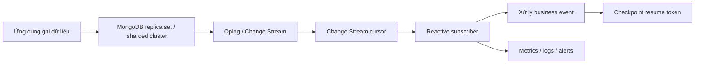
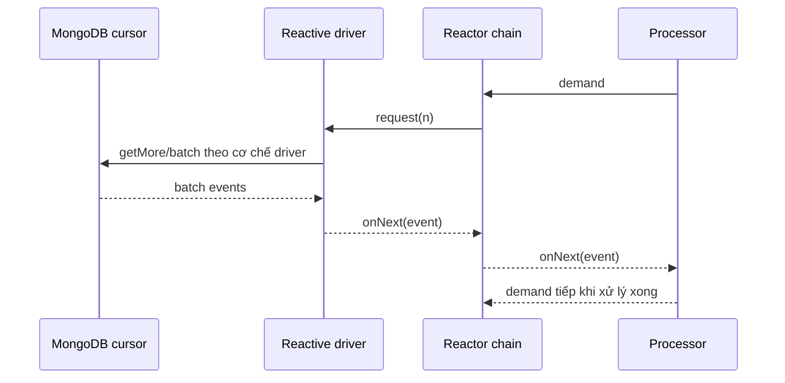
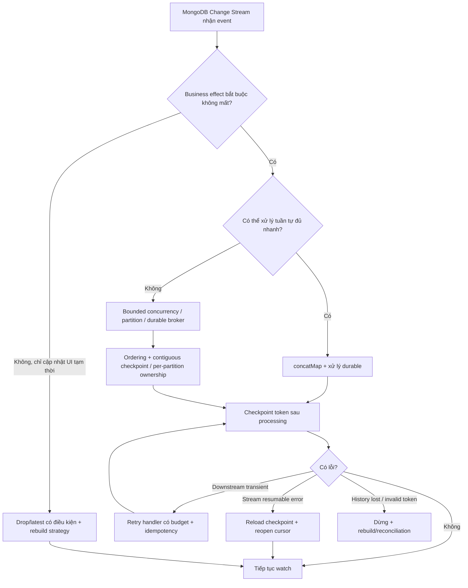

# Backpressure, lỗi listener và quản lý vòng đời subscription trong Change Streams

## 1. Vì sao một Change Stream hoạt động đúng vẫn có thể làm hệ thống quá tải?

Trong module **SPRING_DATA_MONGODB**, Change Streams cho phép ứng dụng Spring Data MongoDB theo dõi thay đổi đã được commit trên MongoDB replica set hoặc sharded cluster. Ứng dụng có thể dùng `ReactiveMongoTemplate`, reactive driver hoặc `MessageListenerContainer` để nhận các sự kiện insert/update/delete, rồi cập nhật cache, materialized view, search index hoặc gửi thông báo.

Vấn đề thực tế xuất hiện khi **tốc độ sự kiện đến lớn hơn tốc độ xử lý**:

- MongoDB ghi hàng chục nghìn thay đổi trong một đợt import, nhưng consumer chỉ xử lý được một phần.
- Listener gọi HTTP API chậm hoặc PostgreSQL tạm mất kết nối.
- Một exception không được xử lý khiến reactive `Flux` kết thúc.
- Worker restart và dùng sai resume token nên **mất sự kiện** hoặc **xử lý lặp**.
- Deploy rolling update tạo đồng thời hai subscriptions, cùng gửi một email hai lần.
- Một `subscribe()` không được quản lý vẫn mở cursor sau khi service đã bị dừng.

Ba nhóm vấn đề cần giải quyết cùng nhau:

1. **Backpressure:** giới hạn lượng công việc in-flight, kiểm soát buffer, đo độ trễ và không để một stream vô hạn tiêu thụ tài nguyên không giới hạn.
2. **Lỗi listener:** phân biệt lỗi nghiệp vụ của từng event, lỗi tạm thời của MongoDB/đích, và lỗi không thể resume; xác định khi nào retry, quarantine hay rebuild.
3. **Vòng đời subscription:** mở stream khi app sẵn sàng, sở hữu/cancel subscription, đóng cursor, restart từ checkpoint bền vững và kiểm soát nhiều replicas.

Bài tập trung vào đúng chủ đề **“Backpressure, lỗi listener và quản lý vòng đời subscription”**, trong phạm vi sử dụng Spring Data MongoDB để kết nối, truy vấn, aggregation, thao tác dữ liệu, reactive access, kiểm thử và chẩn đoán hiệu năng. Không có ghi chú bổ sung.

### 1.1. Những kết quả cần đạt

Sau bài, người học có thể:

- Giải thích sự khác biệt giữa **demand của Reactive Streams**, driver batch/prefetch, buffer trong app và **oplog retention** của MongoDB.
- Thiết kế pipeline có giới hạn concurrency bằng `concatMap`, `flatMap(..., concurrency)` hoặc partitioned processing khi thật sự cho phép.
- Nhận diện sự nguy hiểm của `onBackpressureDrop`/`onBackpressureLatest` trong quy trình bắt buộc xử lý mọi event.
- Lưu **resume token sau durable processing**, xử lý duplicate bằng idempotency và thiết lập reconnect đúng vị trí.
- Phân loại lỗi làm stream kết thúc và lỗi chỉ xảy ra khi xử lý một message.
- Quản lý `Disposable`/subscription khi Spring Boot startup, shutdown, rolling deploy và scaling.
- Phân biệt reactive subscription với imperative `MessageListenerContainer` và chính sách error handling tương ứng.
- Kiểm thử demand, cancellation, retry, crash windows và history-lost trên môi trường MongoDB phù hợp.

## 2. Bản chất Change Stream: cursor dài hạn và nguồn event vô hạn

### 2.1. Điều kiện sử dụng

MongoDB Change Streams dựa trên khả năng theo dõi thay đổi qua oplog và yêu cầu **replica set hoặc sharded cluster** phù hợp; một MongoDB standalone cơ bản không đủ. Các sự kiện được phát cho những thay đổi có thể quan sát theo change-stream contract và quyền truy cập cần thiết. Chúng **không phải** hàng đợi tác vụ độc lập được MongoDB giữ vĩnh viễn cho từng consumer.

Thành phần nhận sự kiện có thể đặt watch ở phạm vi:

- Collection cụ thể, ví dụ `orders`.
- Database với nhiều collections.
- Deployment theo capability/API được hỗ trợ.

Mỗi cấp có implications về authorization, lưu lượng, token và filtering. Bài sử dụng **collection watch** để giữ phạm vi rõ.

### 2.2. Sơ đồ dữ liệu



`MongoTemplate`/`ReactiveMongoTemplate` giúp xây truy vấn và ánh xạ document, nhưng không biến Change Stream thành một **durable queue** có ack per message như một số brokers. Cơ chế tiếp tục theo dõi sau restart là **resume token + lịch sử oplog còn khả dụng + application checkpointing**.

### 2.3. Một event chứa những gì?

Một event có thể có:

| Thuộc tính | Ý nghĩa |
|---|---|
| `_id`/resume token | Định danh vị trí để resume theo contract của Change Stream |
| `operationType` | `insert`, `update`, `replace`, `delete`, các sự kiện DDL phù hợp |
| `ns` | Namespace database/collection |
| `documentKey` | Key của document liên quan |
| `fullDocument` | Nội dung document tùy operation/`fullDocument` option |
| `updateDescription` | Những trường đã cập nhật/xóa theo change event |
| `clusterTime` | Timestamp logic của MongoDB, không phải wall-clock end-to-end SLA |
| `wallTime` | Có ở các server versions hỗ trợ; không phụ thuộc tuyệt đối |

Đừng nhầm **resume token** với business ID. Một document `orderId=O-101` có thể tạo nhiều change events với các tokens khác nhau; muốn idempotency theo event cần chính sách riêng.

### 2.4. fullDocument có thể không phải snapshot tại đúng thời điểm update

Khi dùng `FullDocument.UPDATE_LOOKUP` cho update event, MongoDB có thể truy vấn document hiện tại để cung cấp `fullDocument`. Nếu có các thay đổi tiếp theo chen vào, body được lookup **có thể phản ánh trạng thái mới hơn** so với đúng lần update đã sinh event.

Do đó:

- Dùng `updateDescription` nếu cần biết field nào được đổi trong operation.
- Dùng **pre/post images** khi cần bản trước/sau chính xác và deployment/collection được cấu hình hỗ trợ, có retention phù hợp.
- Dùng authoritative document + version guard khi xử lý state hiện tại.
- Không tính lại tiền/stock từ `UPDATE_LOOKUP` như thể nó luôn là immutable event payload.

Đây là giới hạn tính đúng đắn khác với backpressure: pipeline chạy không mất message vẫn có thể diễn dịch sai nội dung event.

## 3. Một lần subscribe mở một luồng xử lý độc lập

### 3.1. ReactiveMongoTemplate trả Flux

```java
import org.springframework.data.mongodb.core.ReactiveMongoTemplate;
import org.springframework.data.mongodb.core.ChangeStreamOptions;
import org.springframework.data.mongodb.core.ChangeStreamEvent;
import reactor.core.publisher.Flux;

public Flux<ChangeStreamEvent<OrderDocument>> events(
        ReactiveMongoTemplate template) {
    return template.changeStream(
        "orders",
        ChangeStreamOptions.empty(),
        OrderDocument.class);
}
```

`OrderDocument` là entity mẫu ứng dụng; Spring Data version phải hỗ trợ overload `changeStream(collectionName, options, targetType)` được dùng. Flux có thể tồn tại rất lâu, gần như không có completion khi collection còn được theo dõi và kết nối vẫn hợp lệ.

Trong reactive programming, **tạo Flux chưa mở stream**. MongoDB I/O bắt đầu khi có subscription.

### 3.2. Không gọi subscribe ở nhiều nơi vô tình

```java
Flux<ChangeStreamEvent<OrderDocument>> events = events(template);

events.subscribe(this::updateCache);
events.subscribe(this::sendNotification);
```

Đoạn trên thường tạo **hai independent subscriptions**. Mỗi subscription có cursor, retry, processing progress và checkpoint riêng. Nếu cả hai callbacks đều ảnh hưởng một business operation, có thể tạo duplicate effects hoặc thứ tự khác nhau.

Nếu mục tiêu có hai consumers nghiệp vụ khác nhau, hãy thiết kế chúng như hai consumer pipelines **độc lập với checkpoint/ownership riêng** hoặc publish một durable event trung gian. Đừng giả định `Flux` được shared mặc định chỉ vì biến Java được dùng chung.

### 3.3. Một stream và nhiều tác dụng nghiệp vụ

Nếu phải chạy nhiều bước **cho cùng một event** và chỉ checkpoint sau khi tất cả hoàn thành:

```java
Flux<ChangeStreamEvent<OrderDocument>> source = events(template);

return source.concatMap(event ->
    updateCache(event)
        .then(updateProjection(event))
        .then(saveCheckpoint(event))
);
```

`updateCache`, `updateProjection` và `saveCheckpoint` ở đây là helpers của ứng dụng trả `Mono<Void>`. Không dùng `doOnNext(event -> someMono.subscribe())`, vì không chờ completion/errors và không thiết lập một boundary có thể checkpoint an toàn.

Nếu cache update là best-effort nhưng projection bắt buộc durable, các bước phải có **failure policy khác nhau**; không đơn giản nuốt lỗi cache rồi nói “mọi event đã được xử lý”.

### 3.4. Subscription ownership là một quyết định kiến trúc

Một worker nên biết:

- Nó theo dõi collection/pipeline nào?
- Checkpoint ID và token thuộc **consumer identity** nào?
- Có bao nhiêu process instances được phép nhận cùng event?
- Điều kiện dừng: app shutdown, lease revoked, đổi tenant filter, index rebuild?
- Nếu lỗi xảy ra, ai restart và phát cảnh báo?

Trả lời rõ trước khi viết `subscribe()` quan trọng hơn chọn tên method Java.

## 4. Backpressure: request(n) không đồng nghĩa dữ liệu không bị mất

### 4.1. Tín hiệu Reactive Streams

Một subscriber có thể yêu cầu `request(n)` để phát tối đa `n` phần tử trước khi yêu cầu thêm. Trong Reactor, nhiều operators quản lý demand thay cho code application. `ReactiveMongoTemplate` và reactive MongoDB driver phối hợp với Reactive Streams để truyền signals.



Demand có thể giúp **không phát vô hạn vào subscriber**, nhưng không phải “MongoDB không còn ghi mới” khi app chậm. Database vẫn nhận writes; oplog tiếp tục tăng/chuyển vòng.

### 4.2. Bốn chỗ có thể tích tụ dữ liệu

| Nơi | Giới hạn bởi gì? | Khi consumer chậm |
|---|---|---|
| MongoDB oplog/history | Retention, kích thước oplog, workload, cluster config | Sự kiện cũ có thể bị loại khỏi lịch sử và token không còn resume được |
| Driver/cursor batches | `batchSize`, `maxAwaitTime`, prefetch/implementation | Có thể có dữ liệu đã fetch chưa được app xử lý |
| Reactor operators | `publishOn` prefetch, `buffer`, `flatMap` concurrency/queues | Memory pressure, latency, out-of-order processing |
| Application queues/external broker | Queue capacity, consumer concurrency, disk durability | Backlog/drops/retries tùy thiết kế |

Chỉ đặt `batchSize(100)` **không có nghĩa** toàn ứng dụng sẽ dùng tối đa 100 events bộ nhớ. Một `buffer(1000000)` hoặc `flatMap` concurrency cao phía sau vẫn có thể tăng memory đáng kể.

### 4.3. Không nhầm throughput với lag

Theo dõi riêng:

- **Arrival rate:** thay đổi MongoDB sinh ra mỗi giây.
- **Processing rate:** event có side effects được xác nhận hoàn tất mỗi giây.
- **Backlog:** lượng event còn chờ xử lý/retention, đôi khi không đo trực tiếp được từ Change Stream.
- **End-to-end lag:** từ thay đổi được commit đến xử lý/checkpoint thành công.
- **In-flight count:** số event đang chạy business handler.

Khi arrival rate lớn hơn processing rate trong thời gian dài, **backlog sẽ tăng** cho dù pipeline vẫn “đúng chuẩn Reactive Streams”. Phải nâng năng lực, giảm phạm vi theo dõi, tách consumer, đưa sang durable broker hoặc điều chỉnh retention.

### 4.4. Backpressure không tạo exactly-once

Giới hạn demand không ngăn:

- Process crash trước khi checkpoint.
- Duplicate sau reconnect/retry.
- Checkpoint nhầm event đã nhận nhưng chưa xử lý.
- History lost vì downtime quá dài.
- Hai instances cùng xem một event.

Backpressure giải quyết **dòng chảy tài nguyên**; idempotency, checkpoint, leases và reconciliation giải quyết **delivery correctness**.

## 5. Operator choice: concatMap, flatMap, buffer và drop

### 5.1. concatMap cho thứ tự và một event in-flight

```java
Flux<ChangeStreamEvent<OrderDocument>> changes =
    template.changeStream(
        "orders", ChangeStreamOptions.empty(),
        OrderDocument.class);

return changes.concatMap(event ->
    processBusinessEvent(event)
        .then(checkpoint(event))
);
```

Nếu cả `processBusinessEvent` và `checkpoint` trả `Mono<Void>`, `concatMap` chờ inner publisher kết thúc trước khi bắt đầu event tiếp theo. Cách này dễ lập luận về **ordered processing + checkpoint** và giới hạn concurrency của handler về một.

**Nhưng không bảo đảm buffer bằng không**: Reactor operator/driver vẫn có thể prefetch và giữ một lượng phần tử. Đo nhu cầu, sử dụng `concatMap(..., 1)` ở phiên bản hỗ trợ cấu hình prefetch hoặc `limitRate(...)` theo contract tương ứng nếu cần kiểm soát demand chặt hơn; đừng khẳng định chỉ gọi `concatMap` là cursor không fetch thêm bất kỳ event nào.

### 5.2. flatMap tăng throughput nhưng khó checkpoint

```java
return changes.flatMap(
    event -> processBusinessEvent(event),
    8
);
```

Đây là **tối đa tám handlers chạy đồng thời**, nhưng các event có thể **hoàn tất không theo thứ tự nguồn**.

Giả sử:

```text
Receive A(token=10), B(token=11), C(token=12)
A chậm; B và C hoàn tất nhanh
Checkpoint token=12
Crash
Resume sau 12 ⇒ A chưa xử lý bị bỏ qua
```

**Không** checkpoint “token của event vừa hoàn tất” khi dùng unordered concurrency. Cần một coordinator theo **contiguous committed prefix** hoặc một thiết kế partitioned events với checkpoint riêng. Nếu không có cơ chế đó, dùng `concatMap` tuần tự cho pipeline bắt buộc không mất event.

### 5.3. flatMapSequential không tự giải bài toán exactly-once

`flatMapSequential` có thể phát output theo thứ tự source trong khi xử lý inner publishers concurrently. Nhưng inner side effects vẫn chạy trước theo lịch concurrency; nếu một handler của event C đã ghi external database trước A, **side effect ordering đã thay đổi** dù downstream outputs được sắp theo thứ tự.

Nếu business commands cần ordering theo cùng aggregate, dùng `concatMap` hoặc partition by aggregate key với một worker/queue có thứ tự và checkpoint policy riêng.

### 5.4. onBackpressureBuffer có giới hạn và overflow policy

```java
import reactor.core.publisher.BufferOverflowStrategy;

Flux<ChangeStreamEvent<OrderDocument>> bounded =
    changes.onBackpressureBuffer(
        512,
        dropped -> recordOverflow(dropped),
        BufferOverflowStrategy.ERROR);
```

Đây là minh họa Reactor API; `recordOverflow` là callback logging/metric không blocking. Với `ERROR`, khi buffer đầy pipeline **phát lỗi**, không tiếp tục âm thầm bỏ event. Nó có thể dẫn đến **cursor cancellation + retry/resume** nếu hạ tầng có checkpoint/retention/idempotency đúng.

Giới hạn 512 chỉ là **buffer capacity của một operator**, không phải tổng bộ nhớ của pipeline. Overflow phải được giám sát và có runbook, không phải xử lý bằng `onErrorResume(e -> Flux.empty())`.

### 5.5. onBackpressureDrop và onBackpressureLatest nguy hiểm

```java
// Chỉ nên dùng khi sản phẩm chủ đích chấp nhận mất samples.
changes.onBackpressureDrop();

changes.onBackpressureLatest();
```

Trong Change Stream:

- `onBackpressureDrop` có thể bỏ event chưa được xử lý khi downstream không có demand.
- `onBackpressureLatest` chỉ giữ event mới nhất của giai đoạn quá tải.
- Nếu checkpoint vẫn tiến, những event bị bỏ có thể **không được phát lại** sau restart.

Chỉ hợp lý với **telemetry/sampled UI updates** khi business contract nói rõ mất intermediate updates được phép và có cách rebuild current state. **Không** dùng cho thanh toán, tồn kho, audit event bắt buộc hoặc outbox relay.

### 5.6. limitRate và publishOn prefetch

```java
Flux<ChangeStreamEvent<OrderDocument>> controlled =
    changes.limitRate(32);
```

`limitRate` thay đổi cách downstream demand được phát upstream; nó **không** giới hạn tốc độ writes vào MongoDB và cũng **không** là queue durable. `publishOn(scheduler)` có prefetch/queue riêng; khi đưa nó vào giữa nguồn và handler, hãy kiểm tra cả concurrency, prefetch, thread utilization và cancellation.

Nếu phải giảm throughput theo giới hạn API đích, dùng rate limiter/backpressure-aware publisher hoặc bounded queue phù hợp, nhưng phải xác định cách catch up từ resume token trong retention window.

## 6. Batch size, maxAwaitTime và giới hạn tài nguyên

### 6.1. Dùng reactive MongoDB driver để điều chỉnh cursor

Đối với các tùy chọn Change Stream cấp driver, có thể làm việc trực tiếp với collection từ `ReactiveMongoTemplate`:

```java
import java.util.concurrent.TimeUnit;
import com.mongodb.client.model.FullDocument;
import com.mongodb.client.model.changestream.ChangeStreamDocument;
import com.mongodb.reactivestreams.client.ChangeStreamPublisher;
import org.bson.Document;
import org.springframework.data.mongodb.core.ReactiveMongoTemplate;
import reactor.core.publisher.Flux;

public Flux<ChangeStreamDocument<Document>> watchOrders(
        ReactiveMongoTemplate template) {
    return template.getCollection("orders")
        .flatMapMany(collection -> {
            ChangeStreamPublisher<Document> watch = collection.watch()
                .fullDocument(FullDocument.UPDATE_LOOKUP)
                .batchSize(128)
                .maxAwaitTime(1, TimeUnit.SECONDS);

            return Flux.from(watch);
        });
}
```

Ví dụ sử dụng **raw driver event** nên các trường document body là `org.bson.Document` chứ không phải `OrderDocument` do Spring Data converter map tự động. `FullDocument.UPDATE_LOOKUP` chỉ minh họa cách yêu cầu full document cho update; nếu handler chỉ cần operation/documentKey/updateDescription, không nhất thiết bật option này.

### 6.2. batchSize không đồng nghĩa batch xử lý nghiệp vụ

`batchSize(128)` là hint số documents cho MongoDB cursor batch, không phải số event phải commit cùng transaction hoặc kích thước inbox. `maxAwaitTime(1, TimeUnit.SECONDS)` điều chỉnh thời gian tối đa server chờ thêm events trong một `getMore` phù hợp; nó **không** là business processing timeout.

Đừng cố giảm `maxAwaitTime` cực thấp để “xử lý càng nhanh càng tốt” mà không đo ảnh hưởng lên polling/getMore overhead và CPU/network.

### 6.3. Giới hạn concurrency và memory theo từng tầng

Một pipeline có:

```text
MongoDB batchSize=128
   ↓
Reactor publishOn prefetch
   ↓
onBackpressureBuffer capacity=512
   ↓
flatMap concurrency=16
   ↓
HTTP connections / DB pool
```

không có một giới hạn “chỉ 16 events trong toàn bộ pipeline”. Có thể đã có 128 events được fetch và hàng trăm events chờ downstream. Cần thiết lập:

- `max in-flight handlers`.
- `max local buffered events`.
- `external connection pool limit`.
- `per-event timeout/deadline`.
- `retry/backoff policy`.
- `oplog retention safety margin` và downstream backlog capacity.

Nếu handler có latency dài và hệ thống yêu cầu no-loss, một **durable queue/broker** hoặc tăng năng lực processing có thể là kiến trúc đúng hơn so với một JVM buffer ngày càng lớn.

### 6.4. Buffer overflow phải có phương án recovery

Khi buffer đầy và policy `ERROR`:

1. Pipeline phát lỗi và upstream subscription có thể bị cancel.
2. Driver stream cursor được cleanup theo cancellation.
3. Supervisor phân loại lỗi là backpressure overload, không phải bug dữ liệu.
4. Recovery đọc **checkpoint đã commit cuối cùng**, mở stream mới và replay những event chưa xử lý trong oplog retention window.
5. Processor idempotent chịu duplicate.

Nếu oplog history đã bị ghi đè, **không có guarantee** chỉ cần retry là lấy lại được mọi events. Cần rebuild/reconciliation plan (mục 11).

## 7. Resume token: checkpoint sau side effect bền vững

### 7.1. Hai thứ tự đều có cửa sổ lỗi

Giả sử handler cập nhật PostgreSQL sau khi nhận event `E-7`.

**Sai — checkpoint trước khi xử lý:**

```text
Receive E-7
Save resume token T7
Process crash
PostgreSQL chưa xử lý E-7
Resume after T7 ⇒ E-7 có thể bị bỏ qua vĩnh viễn
```

**Ưu tiên — xử lý trước, checkpoint sau:**

```text
Receive E-7
PostgreSQL COMMIT thành công
Process crash trước token T7 checkpoint
Resume từ T6 ⇒ E-7 được giao lại
Consumer inbox/dedup bỏ hiệu ứng trùng
```

Đây là **at-least-once processing**: chấp nhận replay để không mất business effect. Nếu side effect ở PostgreSQL và checkpoint ở MongoDB, hai commits **không tự atomic**; cần idempotency hoặc một durable downstream inbox.

### 7.2. Resume token là opaque BSON document

Trong raw driver:

```java
org.bson.BsonDocument token = change.getResumeToken();
```

Không lấy một trường con của `_data` để “tăng 1” như offset số; không tự sắp thứ tự tokens theo chữ cái. Resume token là **opaque** và có thể đổi format giữa versions/topologies.

Lưu token **nguyên vẹn**, gắn với:

- Consumer identity + scope (collection/database/pipeline).
- Search/aggregation `$match` pipeline version.
- Processor implementation version.
- Processing/checkpoint timestamp, worker ownership.
- Optional metrics/lag indicators.

Nếu chuyển consumer từ watch collection A sang database-wide watch hoặc thay change stream pipeline semantics, không mặc định token cũ vẫn hợp lệ/đúng phạm vi.

### 7.3. Oplog retention không phải vô hạn

MongoDB duy trì oplog history trong cửa sổ giới hạn. Một consumer tạm dừng quá lâu có thể khiến token không còn trong retained history, dẫn đến lỗi history-lost hoặc không thể resume.

Retention **phụ thuộc writes và cấu hình**, không thể suy ra một số giờ cố định chỉ từ cluster size. Một bulk import có thể làm oplog window ngắn lại đáng kể.

Do đó:

1. Đo `oldest available oplog history` và consumer lag.
2. Cảnh báo trước khi lag tiến sát retention margin.
3. Không coi local memory queue là durable buffer.
4. Có phương án rebuild projection/reconcile khi token không còn hợp lệ.
5. Cân nhắc broker/outbox được thiết kế retention riêng nếu downtime lâu là bình thường.

### 7.4. Chính sách checkpoint khi handler trả kết quả

```java
public Mono<Void> handleAndCheckpoint(
        ChangeStreamDocument<Document> change) {
    return businessHandler.handle(change)
        .then(checkpointStore.save(
            change.getResumeToken()));
}
```

`businessHandler` và `checkpointStore` là **abstractions do ứng dụng tự định nghĩa**. `businessHandler.handle` phải hoàn tất khi business effect đã bền vững theo contract, không chỉ khi gửi một async HTTP call chưa nhận acknowledgment.

`checkpointStore.save` cũng phải trả `Mono<Void>` đại diện cho một durable checkpoint write (hoặc loại response phù hợp) chứ không khởi chạy ghi token bằng `subscribe()` phụ.

### 7.5. Checkpoint mỗi event hay theo batch?

| Cách lưu | Ưu điểm | Đánh đổi |
|---|---|---|
| Sau mỗi event đã xử lý | Cửa sổ duplicate nhỏ, dễ suy luận | Write overhead lớn hơn |
| Sau mỗi N events liên tiếp đã xử lý | Giảm checkpoint I/O | Crash replay nhiều events hơn |
| Sau một khoảng thời gian | Giảm write load | Recovery có thể replay nhiều events; phải biết token contiguous |
| Theo batch transaction cùng state | Có thể atomic nếu state và token cùng MongoDB tx | Không mở rộng atomicity tới PostgreSQL/HTTP |

Batch checkpoint chỉ an toàn khi **mọi event trước token đã hoàn tất**. Nếu dùng concurrent handlers, không thể lấy token có giá trị “mới nhất theo completion time” như một contiguous sequence.

### 7.6. Một checkpoint trên nhiều workers

Nếu nhiều workers cùng dùng một checkpoint ID mà không có ownership/fencing:

```text
Worker A nhận E-10, đang xử lý chậm
Worker B nhận E-11, lưu token T11
Worker A crash trước xử lý E-10
Resume sau T11 ⇒ E-10 bị bỏ qua
```

Giải pháp:

- Single active owner cho mỗi checkpoint partition.
- Lease với **fencing token** hoặc compare-and-set khi lưu checkpoint.
- Partitioning by key với checkpoints độc lập nếu hệ thống có thể xác định ordering/ownership.
- Một durable queue đã có consumer-group semantics nếu cần fan-out/scale mạnh.

Đừng chỉ chọn `flatMap(concurrency=16)` rồi cho tất cả handlers ghi cùng token vào một document.

## 8. Resume after, startAfter và startAtOperationTime

### 8.1. Không có checkpoint thì bắt đầu ở đâu?

Lần khởi tạo đầu tiên:

- Chỉ listen **từ bây giờ**: dễ triển khai nhưng không bắt lại những thay đổi trước khi watch sẵn sàng.
- Dùng `startAtOperationTime` theo server-supported behavior khi có một timestamp hợp lệ và oplog còn history.
- Thực hiện bootstrap snapshot + stream/reconciliation có quy trình chống gap.

Chọn chính sách trước khi tạo projection production. Nếu service cần toàn bộ trạng thái hiện có, chỉ mở Change Stream “từ bây giờ” **không tự đồng bộ lịch sử documents**.

### 8.2. resumeAfter(token)

Khi đã xử lý thành công tới token `T6`, mở stream mới với:

```java
ChangeStreamPublisher<Document> resumed =
    collection.watch()
        .resumeAfter(token);
```

`token` là `BsonDocument` lấy từ MongoDB change event trước đó. Nó phải thuộc stream scope/pipeline tương thích và còn trong lịch sử có thể resume.

**Không** dùng token của event vừa nhận nhưng **chưa xử lý xong**. Vì `resumeAfter` bỏ qua vị trí đã checkpoint, nếu chưa hoàn tất event đó sẽ mất business effect.

### 8.3. startAfter(token) và invalidate

MongoDB có thể phát `invalidate` event sau một số thay đổi DDL, chẳng hạn drop/rename theo scope. `resumeAfter` **không thể resume sau invalidate event** theo quy tắc server. `startAfter` là cơ chế dùng cho một số trường hợp bắt đầu lại sau invalidate, theo phiên bản/topology được hỗ trợ.

Đừng coi `startAfter` là cách “bỏ qua mọi lỗi” hoặc tự tạo lại collection/index đúng ngữ nghĩa. Nếu collection bị drop/rename, consumer phải:

1. Phát hiện sự kiện DDL/invalidation.
2. Quyết định scope namespace mới.
3. Kiểm tra dữ liệu downstream còn hợp lệ hay cần rebuild.
4. Khởi tạo watcher mới theo lifecycle và token semantics chính thức.

Một consumer im lặng bắt đầu watch lại collection mới cùng tên có thể bỏ qua việc dữ liệu cũ đã bị xóa.

### 8.4. startAtOperationTime không phải phép màu

`startAtOperationTime(timestamp)` có thể bắt đầu stream tại timestamp logic MongoDB còn trong history. Nhưng:

- Không thể hỏi từ một thời điểm đã bị oplog truncation.
- Không tự bảo đảm snapshot consistency với một query đọc collection chạy trước/sau ở resource khác.
- Phải dùng server timestamp hợp lệ, không phải chuyển trực tiếp `Instant.now()` thành một BsonTimestamp rồi đoán counter.
- Với distributed cluster, bootstrap đúng cần tính ranh giới dữ liệu và token.

Nếu chưa xây quy trình bootstrap có thể chứng minh no-gap, nên thiết kế **rebuild projection idempotent** hoặc dùng một sự kiện outbox/durable stream có hỗ trợ.

### 8.5. Resume token trong Spring Data abstraction

Spring Data `ChangeStreamEvent<T>` cung cấp các trường/method hỗ trợ truy cập raw event và resume token theo version. Ví dụ ý tưởng:

```java
Flux<ChangeStreamEvent<OrderDocument>> changes =
    template.changeStream(
        "orders", options, OrderDocument.class);

return changes.concatMap(event ->
    process(event.getBody())
        .then(saveToken(event.getResumeToken())));
```

`options` phải được xây từ checkpoint bền vững (ví dụ `ChangeStreamOptions.builder().resumeToken(...)` ở các versions hỗ trợ), và `saveToken` phải phù hợp với kiểu token mà Spring Data version cung cấp. Không giả định `getBody()` luôn khác `null`: delete/invalidate events không nhất thiết có full document.

## 9. Lỗi listener và lỗi Change Stream là hai tầng khác nhau

### 9.1. Lỗi từ nguồn MongoDB

Nguồn `Flux` có thể phát `onError` khi:

- Mất kết nối, node stepdown, lỗi mạng hoặc server selection timeout.
- Cursor bị đóng/kill, operation bị ngắt.
- Token không còn resume được vì oplog/history đã mất.
- Token/cấu hình watch không hợp lệ, namespace bị drop/rename.
- Không đủ quyền watch collection/change stream.
- Pipeline aggregation có stage không hợp lệ hoặc incompatible.

Không nên bắt mọi MongoDB error rồi phát `Flux.empty()`: điều đó biến một consumer bắt buộc phải theo dõi 24/7 thành service **im lặng ngừng hoạt động**, không có lỗ hổng nào dễ bị phát hiện chỉ qua HTTP health check.

### 9.2. Lỗi khi xử lý một event

Listener/processor có thể lỗi dù MongoDB Change Stream vẫn khỏe:

- Không deserialize được event mới vì `schemaVersion` chưa hỗ trợ.
- Business handler gặp dữ liệu mâu thuẫn hoặc thiếu field bắt buộc.
- PostgreSQL/HTTP API tạm thời không khả dụng.
- Unique constraint đánh dấu duplicate.
- Checkpoint store bị lỗi trong khi business effect đã commit.
- Thread/callback làm blocking I/O, memory pool cạn hoặc bị cancel.

Đây là **lỗi của pipeline xử lý**, không nhất thiết phải restart entire MongoDB cursor ở mọi tình huống. Cần tách retry **operation** và retry **stream**.

### 9.3. Ma trận phân loại

| Lỗi | Ví dụ | Chính sách chính |
|---|---|---|
| Transient source error | Mạng chập chờn, primary failover | Reconnect có backoff, load token đã checkpoint |
| History-lost/invalid resume | Token ngoài oplog window | **Không** retry token cũ vô hạn; rebuild/resync |
| Authentication/authorization | Thiếu quyền `changeStream`/đọc namespace | Fail fast + alert/config repair |
| Pipeline/index/schema invalid | Stage không hỗ trợ server version | Fail fast, sửa triển khai |
| Downstream transient | SQL/broker unavailable | Retry xử lý event có giới hạn, không checkpoint sớm |
| Poison event | Payload không decode, schema version không tương thích | Quarantine/DLQ bền vững; có policy replay |
| Duplicate | EventId/business operation đã xử lý | Xác nhận idempotently, có thể checkpoint |
| Checkpoint failure | Side effect thành công nhưng lưu token thất bại | Không tiến token; retry lưu token hoặc replay idempotent |
| Backpressure overflow | Buffer giới hạn đầy | Alert, hạ tải/điều chỉnh capacity, reconnect an toàn |
| Cancellation | Deploy shutdown hoặc owner lease revoked | Dừng nhận event, drain in-flight, cleanup cursor |

Một lỗi có thể là transient ở tầng transport nhưng là **ambiguous outcome** ở tầng nghiệp vụ. Ví dụ HTTP timeout sau payment charge: không được gọi lại với idempotency key mới. Cần xác minh outcome từ provider như một workflow riêng, không chỉ tăng số lần `retryWhen`.

### 9.4. onError là terminal signal

Trong Reactor, một `Flux` phát `onError` thì **subscription đó kết thúc**. `doOnError` chỉ ghi log/metrics, **không** làm stream tự chạy lại:

```java
source
    .doOnError(error -> logStreamFailure(error))
    .subscribe();
```

Sau lỗi, subscriber đã kết thúc. Muốn reconnect có kiểm soát, cần `retryWhen` bao quanh **đúng source**, reload checkpoint khi retry, hoặc một supervisor restart policy rõ ràng.

### 9.5. onErrorContinue thường là lựa chọn sai

```java
// ANTI-PATTERN: có thể bỏ một event khi handler lỗi.
changes
    .map(this::decodeBusinessEvent)
    .onErrorContinue((error, value) ->
        log.warn("skip event", error));
```

`onErrorContinue` có semantics phụ thuộc operator support, có thể ảnh hưởng upstream và không phải phép “xử lý lỗi từng event” an toàn. Nếu event bị bỏ nhưng token sau đó tiến, dữ liệu downstream có **lỗ hổng**.

Thay bằng handling **trong inner publisher** với một chính sách tường minh:

```java
return changes.concatMap(event ->
    decodeAndProcess(event)
        .onErrorResume(PoisonEventException.class,
            error -> durableQuarantine(event, error))
        .then(checkpoint(event))
);
```

Ví dụ trên **chỉ an toàn** nếu `durableQuarantine` lưu đầy đủ event, token, lỗi và lý do vào một **DLQ/quarantine bền vững**, và nghiệp vụ cho phép checkpoint sau quarantine. Nếu yêu cầu “không event nào được bỏ qua”, phải dừng stream/alert thay vì auto-skip. Cũng không bắt lỗi của `checkpoint(event)` để tự xem như đã checkpoint.

### 9.6. Retry của handler và retry của nguồn

```java
return changes.concatMap(event ->
    downstreamProcessor.apply(event)
        .retryWhen(downstreamRetryPolicy)
        .then(checkpointStore.save(event.getResumeToken())));
```

`downstreamRetryPolicy` chỉ chọn lỗi tạm thời của **downstream operation**, có attempt limit/deadline và giữ idempotency key qua retries. Nếu những attempts hết, lỗi thoát khỏi `concatMap`; supervisor có thể dừng/restart Change Stream theo chính sách.

Không nên dùng một `Retry.max(1000000)` ở tầng handler khiến **một poison event chặn stream hàng tuần**, giữ oplog lag tăng trong khi không có alert.

## 10. Reconnect: retryWhen cần reload checkpoint mỗi attempt

### 10.1. Lỗi khi tạo source một lần rồi reuse token cũ

```java
// ANTI-PATTERN: token chỉ load một lần trước khi retry.
return checkpointStore.load(CONSUMER_ID)
    .flatMapMany(token -> openChangeStream(token))
    .retryWhen(reconnectPolicy);
```

Trong Reactor, resubscription có thể làm lại phần source cold, nhưng nếu `token` hoặc cursor publisher đã được tạo/cached **ngoài** retry boundary, một lần restart có thể sử dụng token stale hoặc publisher không còn khả dụng. Để thể hiện intent rõ và tránh mọi cache/shared reference, đặt **checkpoint lookup + cursor creation** trong một `Flux.defer`.

### 10.2. Mẫu reopen từ durable token

Ví dụ sau sử dụng raw reactive driver thông qua `ReactiveMongoTemplate`. `TokenStore.load` trả `Mono<Optional<BsonDocument>>`; `TokenStore.save` trả `Mono<Void>`; `ChangeProcessor.process` chỉ hoàn tất khi business effect đã durable.

```java
import java.time.Duration;
import java.util.Optional;
import java.util.concurrent.TimeUnit;
import org.bson.BsonDocument;
import org.bson.Document;
import com.mongodb.client.model.changestream.ChangeStreamDocument;
import com.mongodb.reactivestreams.client.ChangeStreamPublisher;
import org.springframework.data.mongodb.core.ReactiveMongoTemplate;
import org.springframework.stereotype.Component;
import reactor.core.publisher.Flux;
import reactor.core.publisher.Mono;
import reactor.util.retry.Retry;

public interface TokenStore {
    Mono<Optional<BsonDocument>> load(String consumerId);
    Mono<Void> save(String consumerId, BsonDocument token);
}

public interface ChangeProcessor {
    Mono<Void> process(ChangeStreamDocument<Document> event);
}

@Component
public final class ResumableOrderStream {
    public static final String CONSUMER_ID = "order-projection-v1";

    private final ReactiveMongoTemplate template;
    private final TokenStore tokens;
    private final ChangeProcessor processor;

    public ResumableOrderStream(
            ReactiveMongoTemplate template,
            TokenStore tokens,
            ChangeProcessor processor) {
        this.template = template;
        this.tokens = tokens;
        this.processor = processor;
    }

    public Flux<Void> run() {
        return Flux.defer(() ->
                tokens.load(CONSUMER_ID)
                    .flatMapMany(this::open))
            .concatMap(event ->
                processor.process(event)
                    .then(tokens.save(
                        CONSUMER_ID,
                        event.getResumeToken())),
                1)
            .retryWhen(reconnectPolicy());
    }

    private Flux<ChangeStreamDocument<Document>> open(
            Optional<BsonDocument> lastCommittedToken) {
        return template.getCollection("orders")
            .flatMapMany(collection -> {
                ChangeStreamPublisher<Document> cursor =
                    collection.watch()
                        .batchSize(64)
                        .maxAwaitTime(1, TimeUnit.SECONDS);

                if (lastCommittedToken.isPresent()) {
                    cursor = cursor.resumeAfter(
                        lastCommittedToken.get());
                }
                return Flux.from(cursor);
            });
    }

    private Retry reconnectPolicy() {
        return Retry.backoff(
                8, Duration.ofMillis(250))
            .maxBackoff(Duration.ofSeconds(20))
            .jitter(0.35)
            .filter(StreamFailureClassifier::isRetryable)
            .onRetryExhaustedThrow(
                (spec, signal) -> signal.failure());
    }
}
```

**Đọc mẫu theo đúng boundary:**

- Mỗi resubscription ở `Flux.defer` gọi lại `tokens.load(...)` và tạo cursor mới.
- `concatMap(..., 1)` thực thi event handlers theo thứ tự; không checkpoint token N+1 trước khi event N hoàn tất.
- Token được lưu **sau** processor success, không sau `onNext` thuần.
- Khi lỗi trong processor/checkpoint thoát ra, `retryWhen` quyết định **có restart cả stream** không.
- Nếu retry bị cạn hoặc exception không retry được, `Flux` kết thúc bằng error; outer lifecycle owner phải phát alert và đưa service sang trạng thái unhealthy/degraded.

Giả định quan trọng: **một active owner duy nhất** của `CONSUMER_ID`, processor idempotent, token store bền vững và watch scope không đổi. Ví dụ chưa có distributed fencing, lease coordinator, DLQ hoặc authentication; cần bổ sung trước khi chạy nhiều replicas production.

Khi đưa ví dụ vào dự án Java, đặt hai public interfaces `TokenStore` và `ChangeProcessor` vào các file Java tương ứng, cung cấp một bean triển khai `ChangeProcessor`, và giữ `ResumableOrderStream` trong class riêng (ví dụ với `@Component` như trên). `TokenStore` có ví dụ bean `MongoTokenStore` ở mục 12.

### 10.3. Không retry tất cả MongoException

`StreamFailureClassifier.isRetryable` là **policy ứng dụng**, không phải API Spring Data có sẵn. Nó phải cân nhắc:

- Connection/primary failover errors có thể hồi phục.
- Error labels như `ResumableChangeStreamError` do driver/server cung cấp.
- Lỗi timeout/cancel có thể có ambiguous downstream outcome.
- Invalid resume token, history-lost, permission/schema errors thường **không** tự hồi phục bằng retry y nguyên.
- Exception có thể bị Spring Data wrapping/translating, nên xét cause chain và error codes/labels.

Không viết classifier kiểu:

```java
// NGUY HIỂM: retry vô hạn cả history-lost/authorization.
return failure instanceof RuntimeException;
```

Việc phân loại phải được kiểm thử trên version MongoDB Java Driver/Spring Data triển khai. Driver tự resume một số lỗi theo contract riêng; app-level retry vẫn cần quản lý checkpoint và liveness.

### 10.4. Ví dụ classifier có điểm chặn rõ

```java
import com.mongodb.MongoException;
import reactor.core.Exceptions;

public final class StreamFailureClassifier {
    private StreamFailureClassifier() {}

    public static boolean isRetryable(Throwable failure) {
        Throwable current = Exceptions.unwrap(failure);

        for (int depth = 0;
                current != null && depth < 16;
                depth++, current = current.getCause()) {
            if (current instanceof MongoException mongo) {
                if (mongo.hasErrorLabel(
                        "ResumableChangeStreamError")) {
                    return true;
                }
            }
            // Các loại lỗi transient downstream được chọn
            // theo một policy riêng, không phải mọi RuntimeException.
        }
        return false;
    }
}
```

Đây là classifier **cố ý rất hẹp** để minh họa error labels. Một network error có thể được Spring Data translate khiến MongoException không lộ ra trong cause chain; hoặc một error không mang label nhưng có thể retry ở phiên bản cụ thể. Mở rộng policy phải dựa trên **driver guidance + integration tests**, không theo tên exception đoán mò. Dù gặp label resumable, vẫn cần đảm bảo token hiện tại còn hợp lệ.

### 10.5. retryWhen của nguồn không thay cho supervisor

Sau tám retries, `retryWhen` ở ví dụ trả lỗi cuối ra ngoài. Cần một supervisory mechanism:

- Ghi stream state `RUNNING / RETRYING / FAILED / STOPPED`.
- Gửi alert sau retry budget, không chỉ log stack trace.
- Có thể restart có giám sát qua orchestrator/Spring lifecycle policy sau khi điều kiện phục hồi được xác nhận.
- Nếu history lost, đi vào **rebuild/reconciliation**, không khởi động lại token cũ vô hạn.
- Tránh tự tạo vòng `while(true) subscribe()` làm leak cursors/threads.

Không nên cho `onErrorResume(e -> Flux.empty())` tại rìa subscription mà không set failed state/alert: service có thể vẫn nhận HTTP requests nhưng đã **ngừng theo dõi change events**.

## 11. History lost: không được dùng retry để che mất dữ liệu

### 11.1. Cửa sổ thời gian bị bỏ lỡ

```text
T0: Processor checkpoint token T100
T1: Service offline nhiều giờ/ngày
T2: Oplog đã loại bỏ lịch sử chứa T100
T3: Service mở resumeAfter(T100) và nhận history-lost
```

MongoDB không thể phục hồi những change events đã vượt quá history window chỉ bằng `resumeAfter`. Bỏ token rồi watch từ bây giờ sẽ **mất toàn bộ thay đổi trong khoảng nghỉ** nếu downstream phụ thuộc vào event history.

### 11.2. Rebuild projection thay vì giả vờ stream còn đủ lịch sử

Với một materialized view/search projection, có thể:

1. Đánh dấu consumer state `REBUILD_REQUIRED` và ngừng publish kết quả như đã bắt kịp.
2. Xác định authoritative source (MongoDB collection hoặc dữ liệu nghiệp vụ).
3. Rebuild snapshot/projection với **versioned/idempotent writes**.
4. Dùng một quy trình bootstrap stream + snapshot có **watermark/no-gap policy**; xử lý các events phát sinh trong lúc snapshot chạy.
5. Xác minh số liệu/correlation IDs và trạng thái converged.
6. Chỉ sau đó publish **checkpoint mới** và chuyển `RUNNING`.

**Cảnh báo:** cách “đọc toàn collection, rồi bắt đầu watch” có gap giữa snapshot và stream opening. Cách “watch trước, rồi snapshot” cũng cần quản lý overlap/version/ordering và buffer của stream. Không được khẳng định một trong hai tự có no-gap khi chưa thiết kế và kiểm thử.

### 11.3. Khi không thể rebuild lịch sử

Với email, payment hoặc audit log bắt buộc, snapshot hiện tại **không thể tái tạo** mọi sự kiện lịch sử đã mất. Nếu nghiệp vụ yêu cầu no-loss qua downtime dài, Change Stream không nên là nguồn lưu trữ event duy nhất.

Thiết kế phù hợp hơn:

- Transactional outbox lưu bền vững events/commands trong cùng MongoDB transaction với state.
- Relay đọc outbox, có retry/checkpoint/retention riêng.
- Broker có durable retention và consumer groups/inbox/idempotency.
- Archive append-only audit events vào storage có retention theo chính sách.

Change Streams có thể là cách **thông báo outbox có event mới**, nhưng bản ghi outbox mới là durable source cho replay dài hạn.

### 11.4. Đừng đổi silently sang “start now”

Khi recovery từ history-lost, luôn ghi log/metric/alert về data gap và quyết định migration. Nếu sản phẩm chủ ý chấp nhận mất intermediate UI updates (ví dụ chỉ cần trạng thái cuối của dashboard), có thể rebuild current state và bắt đầu stream mới. Đây là một **business-approved behavior**, không phải default recovery cho mọi consumer.

## 12. Lưu checkpoint có cấu trúc và không phá định dạng token

### 12.1. Mô hình lưu checkpoint

Một checkpoint record trong collection `cdc_checkpoints` có thể chứa:

```javascript
{
  _id: "order-projection-v1",
  sourceNamespace: "shop.orders",
  pipelineVersion: 1,
  tokenJson: "{ ... canonical Extended JSON của BSON resume token ... }",
  updatedAt: ISODate("2026-11-20T03:00:00Z"),
  ownerEpoch: NumberLong(12)
}
```

`tokenJson` ở đây là **chuỗi JSON**, không phải token object mà người dùng được phép chỉnh sửa. Token cần được bảo toàn nguyên vẹn theo Extended JSON/BSON encoding hoặc ở dạng raw BSON bytes; đừng trích `_data` rồi cắt ký tự. `ownerEpoch` chỉ cần khi có distributed ownership/fencing (mục 16); không mặc định một timestamp đơn giản thay thế được fencing.

### 12.2. Ví dụ TokenStore dùng reactive driver

Một triển khai cơ bản **chỉ dành cho single active owner**:

```java
import java.util.Optional;
import org.bson.BsonDocument;
import org.bson.Document;
import org.bson.json.JsonMode;
import org.bson.json.JsonWriterSettings;
import org.springframework.data.mongodb.core.ReactiveMongoTemplate;
import org.springframework.stereotype.Component;
import com.mongodb.client.model.Filters;
import com.mongodb.client.model.UpdateOptions;
import com.mongodb.client.model.Updates;
import reactor.core.publisher.Mono;

@Component
public class MongoTokenStore implements TokenStore {
    private final ReactiveMongoTemplate template;
    private final JsonWriterSettings settings =
        JsonWriterSettings.builder()
            .outputMode(JsonMode.CANONICAL)
            .build();

    public MongoTokenStore(ReactiveMongoTemplate template) {
        this.template = template;
    }

    @Override
    public Mono<Optional<BsonDocument>> load(String consumerId) {
        return template.getCollection("cdc_checkpoints")
            .flatMap(collection ->
                Mono.from(collection.find(
                    Filters.eq("_id", consumerId)).first()))
            .map(record -> Optional.of(
                BsonDocument.parse(
                    record.getString("tokenJson"))))
            .defaultIfEmpty(Optional.empty());
    }

    @Override
    public Mono<Void> save(
            String consumerId, BsonDocument token) {
        String canonical = token.toJson(settings);

        return template.getCollection("cdc_checkpoints")
            .flatMap(collection ->
                Mono.from(collection.updateOne(
                    Filters.eq("_id", consumerId),
                    Updates.combine(
                        Updates.set("tokenJson", canonical),
                        Updates.currentDate("updatedAt")),
                    new UpdateOptions().upsert(true))))
            .then();
    }
}
```

Trong ví dụ:

- Thời điểm save thuộc phía server vì `currentDate`.
- `token.toJson(CANONICAL)` → `BsonDocument.parse(...)` cần round-trip test theo đúng MongoDB Driver version và token thực tế; **không** thay một format JSON tự tạo tùy ý.
- Index trên `_id` đủ cho lookup một consumer checkpoint; không cần scan toàn collection.
- Không lưu token vào collection `orders` đang watch, tránh tự sinh vòng change stream feedback.
- Không xóa/TTL checkpoint khi retention business chưa được quyết định.

**Giới hạn:** ví dụ chưa bảo vệ hai instances ghi cùng checkpoint. Với nhiều replicas, phải bổ sung owner/fencing CAS trong write predicate; nếu không worker cũ có thể ghi lùi token.

### 12.3. Vì sao không có token khi chưa từng chạy?

`Optional.empty()` ở lần đầu có thể là trạng thái có chủ đích: mở stream từ thời điểm subscription bắt đầu. Nhưng nếu checkpoint bị vô tình xóa hoặc deserialize thất bại, **không** đổi lỗi parse thành empty rồi start from now. Token store phải phân biệt:

- **FIRST_START:** chưa có checkpoint được provision, có chính sách bootstrap.
- **RESUMING:** checkpoint tồn tại và hợp lệ.
- **CHECKPOINT_CORRUPT/MISSING_UNEXPECTEDLY:** cần operator intervention hoặc rebuild.

Để thực thi điều này, lưu thêm consumer registration/generation/bootstrapped flag trong store; ví dụ basic ở trên chưa có.

### 12.4. Ownership metadata trong checkpoint

Một record production có thể ghi:

```text
consumerId
sourceNamespace
pipelineHash / version
resumeToken (opaque)
ownerId
leaseUntil
ownerEpoch (monotonic fencing token)
lastProcessedAt
checkpointUpdatedAt
streamState
```

Không dùng dữ liệu checkpoint để suy “tất cả downstream consumers đã thành công” nếu một event còn có nhiều async side effects ngoài boundary được checkpoint.

## 13. Idempotency: chịu duplicate là bắt buộc nếu checkpoint sau xử lý

### 13.1. Vì sao nhận lại cùng một change event?

Đường đi:

```text
Receive E-101 / token T101
   ↓
Update PostgreSQL commit OK
   ↓
JVM crash trước save T101
   ↓
Restart resumeAfter(T100)
   ↓
Receive E-101 lần nữa
```

Đây không nhất thiết là một bug Change Stream. Nếu thiết kế ưu tiên **không mất event**, duplicate là kết quả tự nhiên của failure window giữa hai commits.

### 13.2. Inbox unique key cho PostgreSQL

```sql
CREATE TABLE processed_change_events (
    consumer_name text NOT NULL,
    event_key text NOT NULL,
    processed_at timestamptz NOT NULL DEFAULT now(),
    PRIMARY KEY (consumer_name, event_key)
);

CREATE TABLE order_projection (
    order_id text PRIMARY KEY,
    status text NOT NULL,
    source_version bigint NOT NULL
);
```

Consumer thực hiện **trong cùng SQL transaction**:

1. Insert một event-key vào `processed_change_events`; unique constraint từ chối duplicate.
2. Nếu đã xử lý, trả thành công idempotently mà không chạy lại projection effect.
3. Nếu là event mới, áp dụng business update có version guard.
4. Commit inbox marker + projection.
5. Chỉ sau đó đánh dấu Change Stream token trong MongoDB checkpoint store.

Điều này vẫn không biến MongoDB và PostgreSQL thành một global ACID transaction; nó làm replay **an toàn**, miễn là event-key ổn định và local SQL transaction đúng.

### 13.3. Chọn event identity

Có hai cấp:

- **Change Stream identity:** token hoặc hash của **nguyên token** theo format đã được normalize/round-trip chính xác, scope theo consumer/stream.
- **Business event identity:** eventId được lưu trong outbox document, ví dụ `"E-ORDER-101-v3"`.

Một change token gắn với thao tác trong MongoDB, còn business event ID gắn với ý định nghiệp vụ. Nếu cần downstream idempotency vững qua reprocessing/migration/pipeline changes, **business event ID** từ transactional outbox thường là lựa chọn rõ ràng hơn.

Đừng dùng `documentKey._id` làm event identity duy nhất: cùng order có thể phát nhiều updates, và dedup tất cả theo order ID sẽ bỏ qua những thay đổi hợp lệ.

### 13.4. Version guard chống out-of-order

Giả sử order projection đã có `source_version = 7` nhưng nhận lại event version 6:

```sql
UPDATE order_projection
SET status = :status,
    source_version = :version
WHERE order_id = :orderId
  AND source_version < :version;
```

Trạng thái cũ không được ghi đè phiên bản mới. Cần xử lý trường hợp **thiếu version** (nhảy từ 4 tới 7) theo nghiệp vụ: có thể tạm hoãn/replay/rebuild hoặc cho phép state overwrite nếu projection chỉ cần latest state. Không mặc định mọi event out-of-order đều được bỏ qua an toàn.

### 13.5. External HTTP effect phải có idempotency riêng

Không gọi:

```java
return paymentClient.charge(orderId)
    .then(checkpointStore.save(consumer, token));
```

mà thiếu stable payment operation ID, provider status lookup và policy cho unknown response. Khi timeout sau charge thành công, Change Stream replay có thể charge lần nữa.

Các thao tác không rollback được (payment, email, ship order) nên được điều phối qua **outbox/command + idempotent worker**, chứ không trực tiếp gắn vào Change Stream listener không có durable operation identity.

### 13.6. Một event có nhiều destinations

Nếu cùng event cần cập nhật search index và SQL projection:

- Hoặc chỉ checkpoint khi cả hai đã hoàn tất, chấp nhận replay cả hai (đều idempotent).
- Hoặc tách thành hai independent consumers với **checkpoint riêng** cho từng destination.
- Hoặc publish event vào durable broker để fan-out, để mỗi consumer group tự theo dõi offset.

Không checkpoint một token dùng chung sau khi chỉ SQL xong rồi để search index process sau trong một fire-and-forget Mono; crash sẽ khiến search index bỏ lỡ event.

## 14. Vòng đời Disposable và Spring Boot lifecycle

### 14.1. subscribe trả về Disposable

```java
import reactor.core.Disposable;

Disposable subscription = resumableOrderStream.run()
    .subscribe(
        ignored -> {},
        error -> reportTerminalFailure(error),
        () -> reportUnexpectedCompletion());

// Khi service phải dừng:
subscription.dispose();
```

`dispose()` yêu cầu cancel subscription; nó **không bảo đảm** mọi external side effect đang chạy đã rollback hoặc hoàn tất. Nếu handler đang gửi HTTP request hay SQL transaction, cancellation có thể để lại trạng thái ambiguous. Cần thiết kế graceful drain và idempotency.

`subscribe()` được phép ở **ứng dụng rìa lifecycle** chịu trách nhiệm sở hữu stream. Nó là anti-pattern khi bị gọi ẩn trong từng business repository method hoặc một reactive callback rồi không quản lý ai sẽ cancel.

### 14.2. SmartLifecycle để quản lý worker subscription

```java
import java.util.concurrent.atomic.AtomicReference;
import org.springframework.context.SmartLifecycle;
import org.springframework.stereotype.Component;
import reactor.core.Disposable;

@Component
public final class OrderChangeStreamLifecycle
        implements SmartLifecycle {

    private final ResumableOrderStream stream;
    private final AtomicReference<Disposable> current =
        new AtomicReference<>();

    private volatile boolean running;

    public OrderChangeStreamLifecycle(
            ResumableOrderStream stream) {
        this.stream = stream;
    }

    @Override
    public synchronized void start() {
        if (running) {
            return;
        }

        running = true;
        Disposable disposable = stream.run()
            .doFinally(signal -> running = false)
            .subscribe(
                ignored -> {},
                error -> reportTerminalFailure(error),
                () -> reportUnexpectedCompletion());

        current.set(disposable);
    }

    @Override
    public synchronized void stop() {
        Disposable disposable = current.getAndSet(null);
        if (disposable != null) {
            disposable.dispose();
        }
        running = false;
    }

    @Override
    public void stop(Runnable callback) {
        stop();
        callback.run();
    }

    @Override
    public boolean isRunning() {
        return running;
    }

    @Override
    public boolean isAutoStartup() {
        return true;
    }

    private void reportTerminalFailure(Throwable error) {
        // Log, metrics và alert; fail readiness theo policy.
    }

    private void reportUnexpectedCompletion() {
        // Stream vô hạn tự complete là dấu hiệu cần kiểm tra.
    }
}
```

Đây là **skeleton để quản lý một subscription**. Những method report chỉ là placeholder ở tầng ứng dụng; production phải thực sự gửi metrics/alerts và cập nhật health state. `SmartLifecycle` giúp Spring quản lý start/stop, nhưng:

- Một `subscribe()` chạy async có thể lỗi ngay sau `start()`; readiness phải quan sát stream state, không chỉ biến `running`.
- `stop()` trên mẫu này **cancel ngay**, không chờ in-flight completion. Để drain, cần cơ chế dừng demand/nhận mới, chờ worker xử lý đủ rồi checkpoint theo deadline, sau đó mới dispose.
- `current` nên đi cùng một generation/owner epoch nếu có tự restart sau terminal error để callback của subscription cũ không tác động trạng thái mới.
- Không tự start nhiều streams khi Spring context refresh hoặc khi job scheduler cũng tự gọi `start()`.

### 14.3. Startup readiness khác “bean được tạo”

`@PostConstruct` chỉ báo bean đã khởi tạo, không đảm bảo MongoDB sẵn sàng, checkpoint store đọc được, Search indexes hay downstream targets đã kết nối. Một Change Stream consumer production nên có:

1. Config đã được validate.
2. Checkpoint store và MongoDB connected.
3. Index/namespace/pipeline match production version.
4. Acquire ownership nếu có nhiều replicas.
5. Open stream thành công và quan sát liveness.
6. Chỉ sau đó đánh dấu consumer `RUNNING/READY`.

Nếu chọn start sau `ApplicationReadyEvent`, không tự đồng thời bật `SmartLifecycle.isAutoStartup() = true` mà tạo thêm một stream không được quản lý.

### 14.4. Graceful shutdown

```text
SIGTERM / rolling deploy
    |
    +-- Đánh dấu DRAINING, ngừng nhận event mới
    +-- Chờ event in-flight hoàn tất trong shutdown budget
    +-- Commit downstream effects và checkpoint theo thứ tự
    +-- Cancel/close Change Stream cursor
    +-- Release ownership lease / cập nhật state STOPPED
    \-- Process exit
```

Nếu deadline hết, **không checkpoint event chưa durable**; chấp nhận replay trên instance mới với idempotency. Shutdown hook không thể bảo đảm được gọi khi `kill -9`, node crash hoặc mất nguồn — recovery vẫn phải hoạt động sau crash bất ngờ.

### 14.5. Có cần shared Flux không?

`publish().refCount(...)` hoặc `share()` có thể làm nhiều local subscribers dùng một upstream subscription, nhưng mỗi subscriber vẫn có tốc độ/error handling khác nhau. Nếu một subscriber chậm, bạn phải biết buffering/drop behavior. Nếu họ có business side effects và checkpoint riêng, shared hot stream có thể không cung cấp durable replay khi một subscriber kết nối muộn.

**Đừng dùng `share()` để thay durable broker** khi cần fan-out có at-least-once và independent consumer progress. Chỉ dùng multicast trong process cho các consumers có contract rõ và lifecycle được quản lý.

## 15. MessageListenerContainer: imperative listener không có Reactor backpressure

### 15.1. Hai cách tiếp cận Spring Data MongoDB

| Đặc điểm | Reactive `Flux` / `ReactiveMongoTemplate` | Imperative `MessageListenerContainer` |
|---|---|---|
| Cơ chế tiêu thụ | Reactive Streams demand, subscription | Container quản lý polling/receive trên threads |
| API xử lý | `Flux<ChangeStreamEvent<T>>` hoặc raw reactive driver | `MessageListener`, `ChangeStreamRequest` |
| Vòng đời | `Disposable`, `SmartLifecycle`/owner | `container.start/stop`, `Subscription.cancel` |
| Lỗi handler | `onError` terminal nếu không xử lý | Error handler/task/container policy theo API/version |
| Backpressure | Reactive demand và operator queues | Phải kiểm soát thread pool, queue/capacity và callback time |
| Phù hợp | Non-blocking I/O và pipeline Reactor | Ứng dụng imperative hoặc integration có callback sync |

`MessageListenerContainer` **không phải** một reactive subscriber nhận `request(n)` từ business handler. Nếu listener gọi dịch vụ chậm, worker thread/container có thể bị chặn, dẫn tới lag; nếu listener offload sang unbounded executor, queue có thể phình ra.

### 15.2. Đăng ký ChangeStreamRequest

Ví dụ khung của Spring Data MongoDB imperative:

```java
import org.springframework.data.mongodb.core.MongoTemplate;
import org.springframework.data.mongodb.core.messaging.ChangeStreamRequest;
import org.springframework.data.mongodb.core.messaging.DefaultMessageListenerContainer;
import org.springframework.data.mongodb.core.messaging.MessageListenerContainer;
import org.springframework.data.mongodb.core.messaging.Subscription;

public final class ImperativeOrderWatcher {
    private final MessageListenerContainer container;
    private Subscription subscription;

    public ImperativeOrderWatcher(MongoTemplate template) {
        this.container =
            new DefaultMessageListenerContainer(template);
    }

    public void start() {
        ChangeStreamRequest<OrderDocument> request =
            ChangeStreamRequest.builder()
                .collection("orders")
                .publishTo(message -> {
                    // Handler phải có error policy và idempotency.
                    processSynchronously(message);
                })
                .build();

        subscription =
            container.register(request, OrderDocument.class);
        container.start();
    }

    public void stop() {
        if (subscription != null) {
            subscription.cancel();
        }
        container.stop();
    }

    private void processSynchronously(Object message) {
        // Thực thi business operation đồng bộ hoặc
        // enqueue vào một bounded, durable work queue.
    }
}
```

Đây là **khung minh họa lifecycle và callback**: kiểm tra type/generic của `ChangeStreamRequest`, `MessageListenerContainer` và `register(...)` theo Spring Data version hiện hành trước khi biên dịch. Ví dụ chưa cấu hình error handler, resume token/checkpoint và graceful drain; không deploy nguyên dạng rồi coi là at-least-once consumer.

### 15.3. Listener exception có thể làm task dừng

Với callback imperative:

```java
message -> {
    writeSql(message);  // Có thể ném SQLException/runtime wrapper.
}
```

nếu lỗi thoát khỏi listener, container/error handler sẽ quyết định hậu quả theo implementation và cấu hình; **đừng mặc định** request sẽ được retry vô hạn hay tiếp tục ngay từ token đúng.

Hãy:

1. Thiết lập error handler phù hợp API container đang dùng.
2. Ghi nhận terminal failure và liveness state của subscription.
3. Bảo đảm checkpoint chỉ sau durable processing.
4. Có restart/resume policy bền vững.
5. Không swallow error và âm thầm tiếp tục như event đã xử lý.

### 15.4. Offload sang executor cũng cần bounded queue

Một listener gửi message vào:

```java
executor.submit(() -> process(message));
```

rồi lập tức return có thể khiến container tiếp tục nhận events mà không biết các tasks có xong chưa. Nếu tiếp đó checkpoint theo token vừa nhận, mất event khi process crash là điều dễ xảy ra.

Nếu dùng executor:

- Queue phải **bounded** và có rejection/overflow policy rõ.
- Phải biết **completion** của từng task trước checkpoint.
- Không vượt qua những events chưa hoàn tất khi ghi token.
- Cần shutdown/drain/retention plan.
- Nếu nhiều workers xử lý song song, phải có contiguous checkpoint logic hoặc phân vùng độc lập.

Chuyển từ callback sang `CompletableFuture` không tự tạo backpressure hay durable replay.

### 15.5. Cấu hình container lifecycle theo Spring

Một container được khai báo thành bean và có lifecycle được Spring quản lý thường thuận tiện hơn một object được tạo trong nhiều controllers. Nhưng đừng chạy nhiều registration trùng nhau khi:

- Có cả `@PostConstruct` và `ApplicationReadyEvent` gọi `register/start`.
- Context refresh tạo thêm container mà chưa stop cũ.
- Test suite song song mở nhiều subscriptions cùng namespace.
- Rolling update cùng hai instances dùng chung checkpoint ID.

Đặt **owner** rõ ràng cho container/request/subscription. Khi dừng: cancel registration, stop container, đợi xử lý nốt (nếu có cơ chế drain), rồi giải phóng resources.

## 16. Nhiều replicas: Change Streams không tự có consumer group

### 16.1. Hai process cùng watch sẽ cùng nhận thay đổi

```text
MongoDB orders change event E-101
             |
             +--> Instance A watch orders --> process E-101
             |
             +--> Instance B watch orders --> process E-101
```

MongoDB Change Stream **không tự chia mỗi event cho một instance duy nhất** giống partition assignment của một consumer group trong Kafka. Mỗi watch subscription nhận các events trong phạm vi của nó theo stream semantics.

Nếu A và B cùng phát invoice/email từ cùng event, có thể thực hiện hai lần. Có ba hướng:

1. **Active-passive watcher:** một owner với lease/fencing, standby chỉ nhận khi takeover.
2. **Partitioned workers:** mỗi worker đọc một tập events độc lập theo key/pipeline, checkpoint riêng, và xử lý thứ tự đúng.
3. **Change Stream → durable broker:** một/nhóm connector có ownership; broker phân phối theo consumer groups và retention phù hợp.

### 16.2. Lease không thay idempotency

Một lease trong MongoDB có thể có:

```javascript
{
  _id: "order-projection-v1",
  ownerId: "pod-a",
  leaseUntil: ISODate("2026-11-20T03:00:30Z"),
  ownerEpoch: NumberLong(42),
  tokenJson: "...",
  status: "RUNNING"
}
```

Worker A có lease nhưng bị network pause. Lease hết hạn, B claim và bắt đầu xử lý. A có thể **tiếp tục** ngay sau đó, vì A không biết đã mất quyền trong thời gian pause. Do vậy:

- Lease acquisition/renewal phải dùng atomic conditional update.
- Mỗi lần owner thay đổi nên có **monotonically increasing fencing epoch**.
- Checkpoint write cần predicate `ownerId + ownerEpoch`, không chỉ `_id`.
- Nếu downstream hỗ trợ fencing, truyền epoch hoặc kiểm tra một durable ownership token.
- Nếu downstream không fencing được (email/payment HTTP), **idempotency** vẫn bắt buộc.

Lease chỉ giảm hoạt động trùng trong điều kiện bình thường, **không phải exactly-once guarantee**.

### 16.3. Fenced checkpoint update

Pseudo-code (giải thích atomic compare-and-set, không phải một API nguyên mẫu):

```text
UPDATE cdc_checkpoints
WHERE _id = consumerId
  AND ownerId = currentOwner
  AND ownerEpoch = acquiredEpoch
SET token = lastFullyProcessedToken,
    updatedAt = serverTime

IF matchedCount == 0:
    stop current stream; ownership revoked
```

Đừng cho worker cũ lưu token sau khi B đã takeover; token bị ghi lùi có thể làm replay nhiều hơn, hoặc ghi nhảy xa có thể bỏ event chưa xử lý của owner mới.

### 16.4. Single-leader không giải quyết throughput quá thấp

Nếu chỉ có một stream/handler tuần tự và arrival rate luôn cao hơn xử lý rate, active-passive có HA nhưng **không cải thiện throughput**. Lựa chọn:

- Tối ưu handler/database operations và index.
- Giảm lượng events theo dõi bằng watch pipeline phù hợp.
- Partition event processing theo aggregate key, nếu có chứng minh ordering/checkpoint no-gap.
- Đưa events vào broker có partition/consumer group.
- Dùng materialized state rebuild nếu event trung gian không bắt buộc.

Không chỉ tăng số pod cùng watch một collection rồi mong MongoDB tự chia tải; kết quả có thể chỉ là **nhân đôi toàn bộ workload**.

### 16.5. Đúng thứ tự theo aggregate, không nhất thiết theo mọi namespace

Một order có thể phát nhiều events theo phiên bản:

```text
Order O-101: v1 CREATED → v2 PAID → v3 SHIPPED
Order O-102: v1 CREATED → v2 CANCELLED
```

Nếu business effect cần đảm bảo O-101 không áp v3 trước v2, dùng per-aggregate ordering/sequence guard hoặc partition keys. Không ép toàn cluster phải chạy một worker nếu hai orders độc lập, nhưng cũng không cho phép concurrency không kiểm soát trên **cùng order**.

Một resume token toàn cục áp theo order nguồn không tự tạo per-key checkpoint khi xử lý phân tán; thiết kế cần một coordination layer hoặc durable broker để biết **mọi event trước checkpoint** đã bền vững.

## 17. Schema, operation types và listener safety

### 17.1. Delete và invalidate có thể không có fullDocument

```java
ChangeStreamDocument<Document> event = ...;

switch (event.getOperationType()) {
    case INSERT, REPLACE ->
        processDocument(event.getFullDocument());
    case UPDATE ->
        processUpdate(event.getUpdateDescription());
    case DELETE ->
        processDelete(event.getDocumentKey());
    default ->
        handleMetadataOrLifecycleEvent(event);
}
```

Đây là **phác thảo theo enum OperationType**; các method `process...` được ứng dụng triển khai. Nếu dùng Java `switch` expression/statement theo version Java Driver cụ thể, cần đối chiếu đầy đủ operation types và behavior.

Không viết:

```java
event.getFullDocument().getString("status");
```

cho mọi event: delete/invalidate có thể thiếu body; update không bật fullDocument lookup cũng có thể không có document đầy đủ.

### 17.2. Bản tin bất hợp lệ cần DLQ có schema

Quarantine record nên chứa:

```text
consumerId
eventId / exact resume token
namespace
operationType
raw event hash/reference (theo security policy)
schemaVersion
errorCode / errorCategory
firstSeenAt / lastTriedAt / attemptCount
replayState
```

Nếu event có PII, đừng tự động ghi nguyên raw document vào logs/DLQ mà không có encryption, access control và retention. Quarantine không phải “thùng rác không giới hạn”: cần owner, triage SLA, replay tool và auditing.

### 17.3. Filter có thể bỏ đi event lifecycle quan trọng

Khi dùng `$match` pipeline để chọn chỉ update/insert:

```javascript
[
  {
    $match: {
      operationType: { $in: ["insert", "update", "replace"] }
    }
  }
]
```

phải hiểu tác động đến events khác như delete, drop, rename, invalidate và resume behavior. Đừng lọc bỏ delete event nếu projection cần xóa object đã bị xóa nguồn. Và đừng mặc định event lifecycle sẽ được xử lý đúng chỉ vì query filter dùng `operationType`.

### 17.4. Projection sai có thể làm mất resume token

Trong change stream pipeline, **resume token `_id` là trường đặc biệt**. Không tự `$project: {_id: 0}` hoặc sửa `_id` tùy ý trong pipeline rồi mong driver vẫn resume được. MongoDB có thể từ chối pipeline làm mất/đổi token; một số server versions áp enforcement khác nhau.

Nếu cần giảm payload, lọc fields khác theo quy tắc Change Stream và giữ nguyên resume token/metadata cần cho checkpoints.

### 17.5. Operation type khác business event

Một update MongoDB:

```javascript
{ $set: { status: "PAID" } }
```

chưa chắc tương ứng một **PaymentConfirmed** business event. Có thể là migration, repair script hoặc backoffice operation. Nếu sản phẩm cần event có ngữ nghĩa nghiệp vụ ổn định, nên ghi một **outbox event có eventType/schemaVersion/idempotency key** trong cùng transaction với business state, rồi dùng Change Streams làm relay.

### 17.6. Không chạy external side effect trong doOnNext

```java
// ANTI-PATTERN: publisher của side effect không được await.
changes.doOnNext(event ->
    reactiveHttpClient.send(event).subscribe());
```

`doOnNext` chỉ là signal hook; inner `subscribe()` không được bind vào lifecycle/retry/checkpoint của outer stream. Dùng `concatMap(event -> httpClient.send(event).then(checkpoint(...)))` khi hành vi này được phép và có idempotency; với side effects bắt buộc/không rollback được, ưu tiên durable outbox/inbox.

## 18. Observability: đo lag, liveness và sự an toàn của checkpoint

### 18.1. Bộ metrics tối thiểu

| Metric gợi ý | Câu hỏi giải đáp | Cảnh báo |
|---|---|---|
| `change_stream_subscriptions_active` | Có bao nhiêu cursors/subscriptions đang mở? | 0 khi service cần watch hoặc nhiều owner ngoài dự kiến |
| `change_stream_cursor_restarts_total` | Đã reopen bao nhiêu lần? | Retry storm |
| `change_stream_terminal_errors_total` | Stream chết và hết policy retry? | Bất kỳ sự cố quan trọng nào |
| `change_stream_history_lost_total` | Oplog đã không còn lịch sử? | Cần rebuild/reconciliation |
| `change_stream_received_total` | Tốc độ nhận events | Tăng đột biến |
| `change_stream_processed_total` | Tốc độ durable processing | Thấp hơn arrival rate kéo dài |
| `change_stream_processing_latency_p95` | Handler chậm tới đâu? | Vượt SLO |
| `change_stream_inflight` | Bao nhiêu events đang được xử lý? | Gần concurrency limit |
| `change_stream_local_buffer_utilization` | Queue trong process còn chỗ? | Gần capacity |
| `change_stream_buffer_overflows_total` | Có overflow không? | Phải điều tra ngay |
| `change_stream_checkpoint_age` | Bao lâu chưa có progress checkpoint? | Vượt SLA **khi có events** |
| `change_stream_checkpoint_errors_total` | Lưu token có bị lỗi không? | Tăng hoặc retry loop |
| `change_stream_end_to_end_lag` | Thay đổi nguồn tới downstream durable hiệu lực mất bao lâu? | Tiệm cận retention/SLA |
| `change_stream_poison_events_total` | Event không thể decode/xử lý? | Cần DLQ triage |
| `change_stream_duplicates_total` | Có bao nhiêu event được replay? | Spike sau failover/restart |
| `change_stream_lease_conflicts_total` | Ownership/fencing có cạnh tranh? | Hai active owners |
| `change_stream_oplog_safety_margin` | Còn bao nhiêu thời gian trước history mất? | Margin nhỏ hơn recovery budget |

Tên metrics mang tính minh họa. Không cần tạo tất cả ngay, nhưng phải đo **liveness**, **progress**, **lag**, **terminal failure**, **overflow**, **duplicate** và **checkpoint durability** ít nhất.

### 18.2. Không có event không nhất thiết là lỗi

Một collection ít writes có thể không có event nhiều giờ. Nếu chỉ dùng `lastProcessedAt` làm health check, sẽ báo consumer “dead” dù stream vẫn kết nối và chờ getMore bình thường.

Phân biệt:

- **Cursor liveness:** watcher đang subscribe, driver kết nối/getMore bình thường.
- **Business activity:** có events mới hay không.
- **Processing progress:** nhận event và checkpoint được tới đâu.
- **Availability của downstream:** có xử lý được event khi nó xuất hiện không.

Có thể dùng một synthetic heartbeat/change record trong collection riêng với security/retention policy nếu cần đo end-to-end liveness. Nhưng synthetic writes cũng tạo throughput/chi phí và không tự phản ánh tải production; dùng có kiểm soát.

### 18.3. Lag dùng clusterTime cần hiểu precision

`clusterTime` là logical MongoDB timestamp, có trường seconds/increment; không thể diễn dịch phần increment thành microseconds rồi tính thời gian như wall clock.

Đo latency bằng:

- `wallTime` khi MongoDB version cung cấp và semantic phù hợp.
- Timestamp của business event do producer ghi, với clock skew policy.
- Local receive/process/checkpoint timestamps.
- Cùng một definition khi so across environments.

Đừng xem chênh lệch timestamp âm vài milliseconds do clock skew là bằng chứng ordering đã đảo. Nếu latency có ý nghĩa pháp lý/tài chính, cần đồng bộ clock/trace và tính theo một nguồn đáng tin cậy.

### 18.4. Diagnostic logging cho retry

```text
traceId
consumerId
sourceNamespace
pipelineVersion
ownerId / ownerEpoch
operationType
aggregateId (đã được kiểm tra quyền log)
eventKey/hash
attemptNumber
errorCategory
checkpointStatus
lagMillis
```

Không log nguyên resume token/PII ở debug production một cách vô hạn; token có thể là operational secret/metadata cần hạn chế quyền. Khi log token phục vụ triage, redaction/hash và quyền truy cập phải được áp.

### 18.5. Các chỉ số phải được đối chiếu

Một consumer có `received_total` tăng nhưng `processed_total` đứng yên chứng tỏ downstream đang tắc, dù Change Stream source vẫn healthy. Một consumer có `processed_total` tăng nhưng `checkpoint_errors_total` cũng tăng đang có rủi ro **replay nhiều** khi restart.

Nếu `cursor_restarts_total` tăng mạnh và `history_lost_total > 0`, không chỉ tăng Retry.backoff: cần kiểm tra oplog retention, index, downstream bottlenecks và có thể dừng phục vụ projection chưa đồng bộ.

## 19. Kiểm thử backpressure và stream lifecycle

### 19.1. Ba lớp test

| Lớp | Công cụ | Mục tiêu |
|---|---|---|
| Reactor unit | `StepVerifier`, `TestPublisher`, fake store | Demand, ordering, retry classification, cancellation |
| MongoDB integration | Replica set test, `ReactiveMongoTemplate` | Watch/cursor/resume token/save/driver errors |
| End-to-end fault injection | MongoDB + downstream DB/broker trong môi trường cô lập | Durable processing, crash windows, idempotency, failover |

Không lấy một unit test mock `getCollection().watch()` làm chứng cứ rằng resume token còn hợp lệ qua stepdown/sharding hay MongoDB driver sẽ auto-reconnect đúng khi lịch sử mất.

### 19.2. StepVerifier kiểm tra demand

```java
import org.junit.jupiter.api.Test;
import reactor.core.publisher.Flux;
import reactor.test.StepVerifier;

class ReactiveDemandTest {
    @Test
    void requestsOnlyWhatTheSubscriberNeeds() {
        Flux<Integer> events = Flux.range(1, 4);

        StepVerifier.create(events, 0)
            .thenRequest(1)
            .expectNext(1)
            .thenRequest(2)
            .expectNext(2, 3)
            .thenRequest(1)
            .expectNext(4)
            .verifyComplete();
    }
}
```

Test này kiểm tra **Reactive Streams demand** cơ bản; nó không chứng minh MongoDB server oplog đã bị “pause” hay không có batches được driver fetch trước.

### 19.3. concatMap không chạy hai handlers đồng thời

```java
import java.time.Duration;
import java.util.concurrent.atomic.AtomicInteger;
import org.junit.jupiter.api.Test;
import reactor.core.publisher.Flux;
import reactor.core.publisher.Mono;
import reactor.test.StepVerifier;

import static org.assertj.core.api.Assertions.assertThat;

class SequentialProcessingTest {
    @Test
    void handlesInOrderWithOneInflight() {
        AtomicInteger active = new AtomicInteger();
        AtomicInteger maxActive = new AtomicInteger();

        Flux<Integer> processed =
            Flux.range(1, 4)
                .concatMap(number ->
                    Mono.defer(() -> {
                        int n = active.incrementAndGet();
                        maxActive.accumulateAndGet(
                            n, Math::max);
                        return Mono.delay(
                                Duration.ofMillis(5))
                            .map(tick -> number)
                            .doFinally(signal ->
                                active.decrementAndGet());
                    }), 1);

        StepVerifier.create(processed)
            .expectNext(1, 2, 3, 4)
            .verifyComplete();

        assertThat(maxActive.get()).isEqualTo(1);
    }
}
```

Một test `flatMap(..., 4)` có thể cho maxActive lớn hơn một và kết quả không theo thứ tự, nhưng scheduling-dependent behavior cần có cách điều khiển thời gian để test deterministic. Mục tiêu là chứng minh **checkpoint không được advance** trước contiguous processing, không phải chỉ đếm concurrency.

### 19.4. Unit test lỗi không được checkpoint

Mô phỏng sự cố:

```text
Source: E1, E2, E3
E1 handler succeeds -> save token T1
E2 handler fails permanently -> no token T2
E3 must not be considered processed/checkpointed
```

Kiểm thử một fake `TokenStore` chỉ ghi token vào list khi `process` completed:

```java
import java.util.List;
import java.util.concurrent.CopyOnWriteArrayList;
import reactor.core.publisher.Flux;
import reactor.core.publisher.Mono;
import reactor.test.StepVerifier;

List<Integer> checkpoints = new CopyOnWriteArrayList<>();

Flux<Integer> pipeline =
    Flux.just(1, 2, 3)
        .concatMap(eventId ->
            (eventId == 2
                ? Mono.<Void>error(
                    new IllegalStateException("Injected fault"))
                : Mono.<Void>empty())
                .then(Mono.fromRunnable(() ->
                    checkpoints.add(eventId)))
                .thenReturn(eventId), 1);

StepVerifier.create(pipeline)
    .expectNext(1)
    .expectError(IllegalStateException.class)
    .verify();

// Chỉ token của E1 đã được checkpoint.
assertThat(checkpoints).containsExactly(1);
```

Đây là **đoạn trong test** cần import `assertThat` phù hợp. Nó chỉ mô phỏng checkpoint trên list, không chứng minh durability. Trong production checkpoint store write phải được acknowledge và lưu bền vững.

### 19.5. Test retry phải reload checkpoint

Một fake store có:

```text
load #1 -> T0
process E1 -> durable effect OK
save T1 -> OK
process E2 -> transient failure
retry/resubscribe
load #2 -> T1
resumeAfter(T1) -> E2
```

Assert:

- `TokenStore.load` được gọi lại trên mỗi retry.
- No checkpoint T2 khi E2 chưa durable.
- Replay E2 không tạo duplicate effect nếu lần đầu side effect đã commit nhưng ACK mất.
- Nếu token invalid/history lost, classifier **không** retry vô hạn.

Không chỉ assert `retryWhen` được gọi N lần trên một fake `Mono.just(...)`; điều quyết định là **state/token reload tại đúng boundary**.

### 19.6. Real MongoDB integration test dùng replica set

Một bài integration test đúng cần:

1. Tạo MongoDB replica set test instance (có thể dùng Testcontainers hoặc cluster CI cô lập).
2. Tạo `orders` và `cdc_checkpoints` trước khi watch.
3. Mở `changeStream`/driver watch trên collection với pipeline phù hợp.
4. **Xác nhận cursor thực sự đã established/ready** trước khi thực hiện write thử nghiệm; chỉ thấy `onSubscribe` của Flux chưa luôn đồng nghĩa server đã tạo cursor.
5. Insert document test với ID duy nhất.
6. Nhận event, kiểm tra `operationType=INSERT` và token không null.
7. Xử lý, save token bền vững, dispose/cancel watcher.
8. Mở watcher mới với `resumeAfter(savedToken)`, insert/update event kế tiếp, xác minh không mất event.
9. Test delete/update fullDocument semantics và idempotent dedup.
10. Cleanup bằng namespace test-specific; không `dropCollection` ở database dùng chung.

**Tránh race** kiểu:

```java
Flux<ChangeStreamEvent<OrderDocument>> flux = watch();
StepVerifier.create(flux)
    .then(() -> insertOrder().subscribe())
    .expectNextCount(1)
    .thenCancel()
    .verify();
```

`insertOrder().subscribe()` tách completion và không đảm bảo stream cursor sẵn sàng. Dùng test coordination/readiness có giới hạn, publish write từ một pipeline test được await, và assert kết quả sau commit. Không phụ thuộc một `Thread.sleep(1000)` như lời giải duy nhất cho readiness race.

### 19.7. Backpressure overflow test

Tạo một fake source phát nhanh hơn handler có thể consume; dùng bounded `onBackpressureBuffer` và `TestPublisher`/custom source có demand behavior rõ. Assert:

- Overflow báo error/metric theo policy (không silent drop).
- Subscription bị cancel khi fatal overflow.
- Last durable token không vượt quá event đã xử lý.
- Resume từ checkpoint replay những events chưa xong.
- Consumer không vượt memory/connection bounds trong test có tải.

Đặc biệt, một source **tuân thủ demand hoàn hảo** có thể tự giảm phát nên **không làm tràn buffer** trong unit test; cần thiết kế test intentionally tạo một upstream không tuân thủ hoặc một queue stage riêng. Đừng test overflow bằng giả định `Flux.range` sẽ luôn phát bất chấp request(n).

### 19.8. Crash/failover matrix

| Chỗ tiêm lỗi | Kỳ vọng |
|---|---|
| Trước khi xử lý E1 | T0 còn, E1 replay |
| Sau SQL commit, trước T1 checkpoint | E1 replay, SQL inbox ngăn duplicate |
| Sau T1 checkpoint | Resume sau E1, không bắt buộc replay E1 |
| Trong lúc lưu checkpoint | Có thể replay; không bỏ qua E1 |
| MongoDB primary stepdown | Driver hoặc app reconnect đúng policy, token còn hợp lệ |
| Oplog token đã hết hạn | Dừng retry token cũ; rebuild/reconciliation |
| Handler schema error | Durable quarantine hoặc fail state, không silent skip |
| Buffer overflow | Alert, cancel/reopen từ checkpoint, tránh data loss |
| SIGTERM khi handler đang chạy | Bounded drain; nếu hết thời gian thì replay idempotent |
| Hai replicas cùng active | Ownership/fencing ngăn checkpoint race; idempotency ngăn duplicate |
| Namespace drop/invalidate | Quản lý startAfter/rebuild theo contract, không start-now vô thức |
| Source yên lặng hàng giờ | Health liveness đúng, không false alarm chỉ vì lastProcessedAt cũ |

### 19.9. Không tiêm lỗi phá production

Không ngắt MongoDB primary, truncate oplog, drop collection hoặc gây backpressure overload trên production/shared cluster chỉ để test. Dùng isolated replica set, data test-specific IDs, giới hạn thời gian/throughput và rollback môi trường test sau mỗi case.

## 20. Runbook: xử lý sự cố mà không đánh mất event

### 20.1. Consumer lag tăng liên tục

Triệu chứng:

```text
received_rate > processed_rate
inflight ở giới hạn
buffer gần đầy
checkpoint_age tăng
```

Thao tác:

1. Kiểm tra source MongoDB vẫn khỏe hay đang restart cursor liên tục.
2. Kiểm tra downstream bottleneck: HTTP latency, SQL pool, lock contention, external API rate limits.
3. Đo hiệu năng theo operation type/tenant, tìm poison/hot keys.
4. Xác định còn bao nhiêu thời gian trước khi oplog history không đủ resume.
5. Giảm data fan-out/volume nếu contract cho phép; cân nhắc durable queue/broker.
6. Scale handler theo partition/ownership đã được chứng minh checkpoint-safe, không thêm replicas đọc trùng vô thức.
7. Giám sát backlog sau khắc phục cho đến khi lag giảm, mới đóng incident.

**Không** áp `onBackpressureDrop` chỉ để metric backlog đẹp hơn nếu mọi event cần được áp dụng.

### 20.2. Consumer bất ngờ ngừng nhận event

Kiểm tra:

- Subscription có còn active không (`Disposable.isDisposed()`, `SmartLifecycle.isRunning()`)?
- Source có phát `onError`/`onComplete` và lifecycle owner đã log chưa?
- Kết nối Mongod/`mongos`/primary có thay đổi?
- Driver timeout/server selection/cursor kill?
- Application có bị shutdown/restart không?
- Security permissions có bị thay đổi?
- Stream watch namespace có bị drop/rename/invalidate?
- Có thiếu health monitor khiến process vẫn READY dù stream FAILED?

Nếu chưa rõ nguồn lỗi, đừng gọi `subscribe()` lặp trong một vòng không có giới hạn: có thể mở thêm cursors và làm trùng business effects.

### 20.3. Checkpoint không tiến nhưng handler vẫn chạy

Có thể do:

- Processor hoàn tất nhưng `TokenStore.save` lỗi.
- Handler xử lý lâu hoặc bị stuck vì không có deadline.
- Một event lỗi liên tục, giữ `concatMap` chặn event sau.
- Quarantine/DLQ không commit được.
- Ownership bị thu hồi, fenced checkpoint write không match.
- Source không có event mới (trường hợp bình thường; đừng coi là stuck nếu không có arrival).

So sánh `received`, `processed`, `checkpoint save success/failure` và liveness. Không tự đặt token bằng event “đang thấy trên log” nếu chưa chứng minh tất cả effects trước nó đã durable.

### 20.4. Retry storm sau primary failover

Khi MongoDB election xảy ra, một số driver watchers có thể reconnect. Nếu application cũng cấu hình retry nhanh trên mọi error:

- Hàng trăm instances có thể đồng loạt reopen stream.
- Oplog/cursor/query load tăng mạnh.
- Downstream bị replay duplicate nhiều.
- Resume token store nhận nhiều concurrent writes.

Giảm retry storm bằng bounded backoff + jitter, limit active owners, liveness reporting và checkpoint policy. **Không** để mỗi event có một watcher riêng.

### 20.5. History lost hoặc invalid resume token

Runbook:

1. Phân loại error xác thực là token/history invalid, không phải timeout transient.
2. Dừng auto-retry token cũ.
3. Chuyển consumer state `REBUILD_REQUIRED`/`DATA_GAP`.
4. Xác định dữ liệu nào có thể rebuild từ MongoDB current state, dữ liệu nào cần audit/outbox archive.
5. Tạo recovery plan được duyệt, có no-gap bootstrap và idempotent replay.
6. Verify projection/billing/inventory/audit consistency.
7. Ghi checkpoint mới theo một **cutover procedure** rõ ràng.
8. Chỉ mở lại consumer và readiness khi bảo đảm business acceptance criteria.

Nếu dữ liệu lịch sử bắt buộc đã mất và không có archive, phải **ghi nhận giới hạn** và escalated incident; không tuyên bố hoàn thành chỉ vì Change Stream kết nối lại từ now.

### 20.6. Poison event khiến pipeline dừng

Phân biệt:

- **Unknown schema version:** cần rollout consumer support và replay.
- **Invalid payload:** producer bug hoặc dữ liệu bị sửa ngoài contract.
- **Authorization/security anomaly:** không tự mở quyền để xử lý.
- **Transient external failure:** có thể retry sau backoff.

Khi event không thể xử lý tự động:

1. Lưu quarantine record bền vững theo data protection policy.
2. Ghi event ID/token, schema version và reason code.
3. Chọn policy: **halt** nếu no-loss strict, hoặc **quarantine+checkpoint** nếu được business chấp nhận.
4. Alert owner và đưa vào triage.
5. Sau fix, replay một cách idempotent với cùng event/business ID.

`onErrorContinue` không phải DLQ và không phải một quy trình triage.

### 20.7. Rolling deployment

Trước rollout:

- Xác nhận consumer version cũ và mới hiểu schema events trong retention window.
- Có checkpoint token codec compatibility.
- Config watch pipeline/namespace thay đổi có migration/cutover policy.
- Có lease/owner fencing nếu nhiều pods chồng thời gian.
- Startup readiness chỉ true khi stream đã active và downstream baseline đạt.
- Shutdown drain budget, idempotency và rollback image/version.

Sau rollout:

- Theo dõi duplicate count, cursor restarts, checkpoint age, lag và error categories.
- Không xóa checkpoint để “sửa nhanh” một phiên bản lỗi nếu chưa xác định data gap.
- Rollback code phải tương thích với schema/index/token của version đang chạy.

## 21. Bài thực hành: Change Stream projection không mất event

### 21.1. Đề bài

Xây một Spring Boot reactive service:

```text
MongoDB source collection: orders
MongoDB checkpoint collection: cdc_checkpoints
PostgreSQL target: order_projection + processed_change_events
Consumer identity: order-projection-v1
```

Mục tiêu: khi order thay đổi, consumer cập nhật SQL projection nhưng vẫn chịu được transient MongoDB failover, SQL downtime, duplicate, JVM crash và rolling restart trong giới hạn retention.

Không cần một global transaction MongoDB + SQL; cần **local SQL transaction + idempotent inbox**, sau đó checkpoint MongoDB token. Nếu yêu cầu rebuild sau oplog history lost, phải có authoritative snapshot/reconciliation procedure.

### 21.2. Phần A — Hạ tầng

1. Chạy MongoDB **replica set test** và PostgreSQL test instance cô lập.
2. Tạo `orders` với vài documents và `cdc_checkpoints`.
3. Tạo SQL `order_projection` và `processed_change_events` với unique key.
4. Định nghĩa `OrderDocument` và raw Change Stream event handling.
5. Chọn watch collection `orders`, không watch luôn `cdc_checkpoints`.
6. Xác định những operation types cần hỗ trợ: insert, update, replace, delete.
7. Ghi rõ `fullDocument=UPDATE_LOOKUP` có thể phản ánh trạng thái mới hơn update event.

### 21.3. Phần B — Backpressure

1. Mở `ReactiveMongoTemplate.changeStream(...)` và ghi received metrics.
2. Viết handler `concatMap(event -> process.then(checkpoint))`.
3. Thêm `batchSize`, `maxAwaitTime` ở driver watch nếu cần.
4. Đo P95 processor latency và in-flight count.
5. Dùng `StepVerifier` test order `E1→E2→E3` khi E2 chậm.
6. Chuyển thử sang `flatMap(concurrency=4)` và quan sát rủi ro checkpoint T3 trước T2.
7. Thêm bounded buffer và fake overflow để kiểm tra error/metric.
8. Không dùng `onBackpressureDrop` trong flow phải đồng bộ SQL đủ mọi event.

### 21.4. Phần C — Idempotent SQL projection

1. Với mỗi change event, tạo `eventKey` ổn định từ opaque token hoặc dùng `outboxEventId` nếu có.
2. Trong **cùng PostgreSQL transaction**, insert inbox marker và update projection.
3. Dùng source version/conditional update chống stale event.
4. Khi duplicate, handler trả thành công **mà không áp effect lần nữa**.
5. Chỉ khi SQL transaction commit, gọi `TokenStore.save(...)`.
6. Inject crash sau SQL commit nhưng trước save token; xác minh replay E1 không tạo duplicate projection writes.
7. Thử invalid schema, tạo quarantine record và xử lý theo policy đã chọn.

### 21.5. Phần D — Reconnect và token checkpoint

1. Viết `TokenStore.load/save`, round-trip BSON token không sửa các trường bên trong.
2. Tạo stream trong `Flux.defer(() -> loadCheckpoint().flatMapMany(openCursor))`.
3. Đặt `retryWhen` ở **ngoài** toàn bộ processing pipeline để mỗi restart load token mới nhất.
4. Chỉ retry lỗi source transient theo classifier đã test.
5. Với checkpoint T7, restart phải tiếp tục sau T7, không mở lại từ now.
6. Với lỗi checkpoint save, không được tiến token và phải replay idempotent.
7. Với history lost, dừng auto-retry, kích hoạt recovery plan.
8. Đo lag so với oplog retention và báo cảnh báo trước khi hết safety window.

### 21.6. Phần E — Subscription lifecycle

1. Đặt một lifecycle owner (ví dụ `SmartLifecycle`), giữ `Disposable`.
2. Chỉ start sau khi app/config/identity/index/connection đạt yêu cầu.
3. Tránh hai subscriptions do `@PostConstruct` và `ApplicationReadyEvent` cùng start.
4. Thử `stop()` và assert driver stream không còn consume.
5. Test graceful drain khi một event đang xử lý dở.
6. Khi shutdown timeout, xác minh event chưa checkpoint được replay.
7. Tạo hai replicas cùng consumer ID; chứng minh lease/fencing hoặc consumer-group design ngăn checkpoint race.
8. Giám sát terminal error và chuyển readiness/degraded state đúng.

### 21.7. Phần F — Failure injection và recovery

| Bài test | Kỳ vọng tối thiểu |
|---|---|
| SQL tắt 30 giây | Không checkpoint event chưa xử lý, reconnect/handler retry có giới hạn |
| Mongo primary election | Watcher resume hoặc supervisor reconnect, không mất event trong oplog window |
| Poison schema event | Halt/quarantine có audit, không silent skip |
| Token store write lỗi | Replay idempotent, không tiến checkpoint |
| Tốc độ source tăng đột ngột | Buffer/concurrency bounded, overload được đo và xử lý |
| Kill JVM sau SQL commit | Resume from previous token, SQL inbox giữ một effect |
| Hai watcher active | Không được checkpoint vượt event chưa processed |
| Oplog token history lost | Rebuild/reconciliation; không start-now giả |
| Drop collection phát invalidate | Namespace lifecycle được xử lý theo policy |
| Rolling deploy, app shutdown | Cursor được cancel, in-flight xử lý theo drain budget |

Không thực hiện fault injection trên production/shared environments.

### 21.8. Tiêu chí hoàn thành bài thực hành

Đạt yêu cầu khi:

- Giải thích `request(n)`/driver batch/queue/oplog retention là **bốn tầng khác nhau**.
- Tạo được một pipeline reactive có giới hạn concurrency và error policy rõ.
- Không checkpoint event trước durable side effects.
- Chứng minh `flatMap` unordered có thể gây checkpoint skip.
- Lưu/đọc opaque BSON resume token, reload trong mỗi retry.
- Có MongoDB history-lost recovery plan, không retry vô hạn.
- Consumer idempotent chịu duplicate sau crash.
- Subscription có owner, lifecycle, cancellation và restart state.
- Có metrics liveness/lag/overflow/checkpoint và alert.
- Kiểm thử bằng `StepVerifier`, MongoDB replica set và downstream test DB.
- Không dùng Change Stream như một durable message queue có retention vô hạn.

## 22. Checklist triển khai production

### 22.1. Backpressure và throughput

- [ ] Có giới hạn concurrent handlers, local buffer và external connections.
- [ ] `concatMap` hoặc checkpoint coordinator giữ đúng contiguous event progress.
- [ ] Không dùng drop/latest cho event bắt buộc.
- [ ] Driver batchSize/maxAwaitTime được benchmark, không bị nhầm với business batch.
- [ ] Có `timeout`/backoff/rate limit theo downstream contract.
- [ ] Đo processed rate và backlog/lag; có cơ chế xử lý overload.
- [ ] Oplog retention margin đủ cho planned outage và recovery budget.

### 22.2. Lỗi và checkpoint

- [ ] Token opaque được lưu chính xác, bảo vệ quyền và có metadata scope/version.
- [ ] Checkpoint chỉ sau durable processing hoặc authorized quarantine.
- [ ] Handler idempotent theo event/business ID và version.
- [ ] Retry source reload checkpoint trong mỗi attempt.
- [ ] Source, downstream, poison, auth và history-lost errors được phân loại riêng.
- [ ] Không swallow terminal errors hoặc trả `Flux.empty` im lặng.
- [ ] Có DLQ/quarantine và replay policy.
- [ ] Có history-lost rebuild và bootstrap no-gap được review.

### 22.3. Lifecycle và ownership

- [ ] Có đúng một owner/supervisor của stream subscription.
- [ ] `Disposable`/`Subscription` được đóng khi shutdown.
- [ ] Graceful drain xử lý in-flight theo bounded deadline.
- [ ] Health/readiness phản ánh stream state, không chỉ HTTP alive.
- [ ] Có owner lease/fencing nếu nhiều instances chia cùng checkpoint.
- [ ] Không mở duplicate cursors do bean lifecycle/startup hooks.
- [ ] Không share hot Flux để thay durable broker cho nhiều consumers.
- [ ] Change stream pipeline/version và schema migration có rollout plan.

### 22.4. Security và vận hành

- [ ] Watch scope đúng collection/tenant/authorization.
- [ ] Database user chỉ có permissions cần thiết.
- [ ] Không log raw PII/secrets/opaque tokens không kiểm soát.
- [ ] Không dùng source event với fullDocument stale làm authorization truth.
- [ ] Có metrics/alerts cho terminal failure, buffer overflow và oplog history loss.
- [ ] Có integration/failover tests trên replica set test, không destructive production.
- [ ] Có runbook cho stalled listener, slow downstream, history lost, rollout.

## 23. Bảng ghi nhớ và quyết định kiến trúc

### 23.1. Tình huống — lựa chọn phù hợp

| Tình huống | Hướng xử lý |
|---|---|
| Muốn giữ thứ tự và checkpoint đơn giản | `concatMap` tuần tự, checkpoint sau durable processing |
| Handler quá chậm | Giảm công việc, tối ưu downstream, bounded concurrency và đo lag |
| Cần tăng concurrency nhưng vẫn checkpoint một token | Thiết kế contiguous checkpoint coordinator hoặc partitioned progress |
| Không quan tâm intermediate UI samples | Có thể drop/latest nếu được phép và rebuild current state |
| Bắt buộc không mất thanh toán/audit events | Không drop; outbox/durable broker/inbox |
| MongoDB mất kết nối tạm thời | Resumable retry có backoff, reload checkpoint |
| Token hết hạn/không resume được | Rebuild/reconciliation; không retry mãi |
| SQL commit xong nhưng checkpoint chưa lưu | Chấp nhận replay, SQL inbox idempotency |
| JVM chết khi một event đang xử lý | Restart từ token trước, idempotent handler |
| Spring Boot dừng/redeploy | DRAINING, bounded wait, dispose cursor, ownership handoff |
| Hai replicas cùng watch | Active owner/lease/fencing hoặc broker consumer group |
| Listener liên tục nhận schema lạ | Quarantine/DLQ có triage, không `onErrorContinue` vô thức |
| Change Stream yên lặng | Kiểm tra liveness riêng, không lấy lastProcessedAt làm tín hiệu duy nhất |
| Cần fan-out đến nhiều consumers | Independent checkpoints hoặc durable broker, không share hot Flux làm hàng đợi |
| Cần exact state sau update | Read authoritative document/version; UPDATE_LOOKUP có thể newer |
| Cần quay lại nhiều tháng lịch sử | Event archive/outbox/broker; oplog Change Stream không phải kho lưu vĩnh viễn |

### 23.2. Quy trình quyết định



Sơ đồ không thay cho transaction design: nếu downstream xử lý nhiều bước ở các databases khác nhau, mỗi resource vẫn cần local transaction, idempotency và compensation/reconciliation khi cần.

### 23.3. Năm nguyên tắc quan trọng nhất

1. **Demand không phải durable queue.** Reactive backpressure bảo vệ tài nguyên subscriber; nó không kéo dài oplog retention hoặc khiến MongoDB ngừng ghi.
2. **Checkpoint là lời cam kết đã xử lý.** Chỉ lưu token khi mọi business effects trong checkpoint scope đã bền vững, hoặc event đã được quarantine theo chính sách được phê duyệt.
3. **Retry phải mở lại đúng stream từ token đúng.** Dùng cold `Flux.defer` để reload checkpoint mỗi lần reconnect; không nuốt terminal error hoặc retry history-lost vô hạn.
4. **Subscription có owner và lifecycle.** Quản lý `Disposable`/`Subscription`, graceful shutdown, readiness và ownership giữa replicas.
5. **At-least-once và idempotency đi cùng nhau.** Crash giữa side effect và checkpoint tạo duplicate tự nhiên; inbox/outbox/version guards bảo đảm duplicate không thành duplicate business effect.

**Kết luận:** Một Change Stream consumer có thể đọc sự kiện rất nhanh nhưng vẫn **không an toàn** nếu backpressure làm tràn bộ nhớ, listener lỗi âm thầm, checkpoint vượt các events chưa xử lý, hoặc shutdown để lại cursor và side effects không xác minh. Trong Spring Data MongoDB, hãy thiết kế **reactive demand + bounded processing**, **error classification + durable resume token**, và **subscription lifecycle + ownership/fencing** như một phần của cùng một hệ thống. Chứng minh các giả định bằng StepVerifier, MongoDB replica set integration tests và fault injection trước khi production.

### 23.4. Tài liệu tham khảo chính thức

- [Spring Data MongoDB — Change Streams](https://docs.spring.io/spring-data/mongodb/reference/mongodb/change-streams.html): reactive và imperative Change Stream APIs.
- [Spring Data MongoDB — Reactive MongoDB](https://docs.spring.io/spring-data/mongodb/reference/mongodb/reactive-mongodb.html): reactive template/driver và context.
- [Spring Data MongoDB — Lifecycle Events](https://docs.spring.io/spring-data/mongodb/reference/mongodb/lifecycle-events.html): so sánh entity callbacks với change events.
- [Spring Data MongoDB — Client Sessions and Transactions](https://docs.spring.io/spring-data/mongodb/reference/mongodb/client-session-transactions.html): local transaction và session context.
- [MongoDB — Change Streams](https://www.mongodb.com/docs/manual/changestreams/): điều kiện triển khai, event types, resumability và các hạn chế.
- [MongoDB — Resume a Change Stream](https://www.mongodb.com/docs/manual/changeStreams/#resume-a-change-stream): resume token, `resumeAfter`/`startAfter` và lịch sử oplog.
- [MongoDB Java Reactive Streams Driver — Watch Changes](https://www.mongodb.com/docs/drivers/reactive-streams/current/usage-examples/watch/): `watch()`, raw `ChangeStreamDocument`, cursor options.
- [MongoDB — Change Stream Update Events](https://www.mongodb.com/docs/manual/changeStreams/#change-events): `fullDocument`, `updateDescription`, delete/invalidate semantics.
- [MongoDB — Change Stream Pre- and Post-Images](https://www.mongodb.com/docs/manual/changeStreams/#change-streams-with-document-pre--and-post-images): exact images và retention requirements.
- [Project Reactor — Backpressure](https://projectreactor.io/docs/core/release/reference/coreFeatures/advanced-broadcast-multiple-subscribers-connectableflux.html): Reactive Streams/Flux behavior, multicasting considerations.
- [Project Reactor — Error Handling](https://projectreactor.io/docs/core/release/reference/coreFeatures/error-handling.html): `retryWhen`, `onErrorResume` và terminal errors.
- [Project Reactor — Retry API](https://projectreactor.io/docs/core/release/api/reactor/util/retry/Retry.html): backoff, jitter, filtering và retry hooks.
- [Project Reactor — Testing](https://projectreactor.io/docs/core/release/reference/testing.html): `StepVerifier`, `TestPublisher` và virtual time.
- [Spring Framework — SmartLifecycle Javadoc](https://docs.spring.io/spring-framework/docs/current/javadoc-api/org/springframework/context/SmartLifecycle.html): startup/shutdown phases và callback.

**Lưu ý phiên bản:** Spring Data MongoDB, MongoDB Reactive Streams Driver, Reactor và MongoDB Server có thể thay đổi signatures, error labels, resume options, operation types và Change Stream lifecycle behavior giữa các phiên bản. Các Java snippets là ví dụ triển khai cần cấu hình và kiểm thử; chúng **không phải** bằng chứng đã compile/test trên dự án cụ thể. Các trường hợp history lost, invalidate, lease/fencing và bootstrap no-gap cần được xác minh theo phiên bản/topology đang chạy, đặc biệt trước khi dùng để xử lý tiền hoặc audit bắt buộc.
