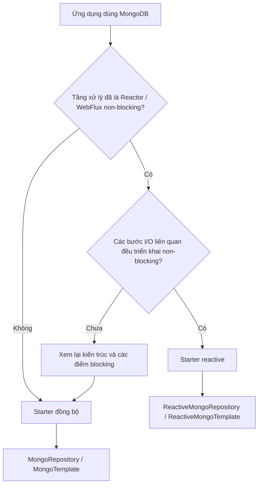

# Khai báo starter đồng bộ hoặc starter reactive phù hợp

## 1. Mục tiêu và bối cảnh

**Spring Data MongoDB** là lớp tích hợp giúp ứng dụng Spring kết nối MongoDB, ánh xạ document Java và thao tác dữ liệu qua **repository** hoặc **MongoTemplate**. Ngoài CRUD, ứng dụng có thể phát triển các truy vấn động, aggregation, index, transaction, kiểm thử tích hợp và công cụ chẩn đoán hiệu năng. Trước những bước đó, ta cần chọn **starter** phù hợp với mô hình xử lý của ứng dụng.

Bài học này sử dụng ứng dụng ví dụ **Mini Commerce** với ba đối tượng **Product** (sản phẩm), **Customer** (khách hàng) và **Order** (đơn hàng). Ở giai đoạn khởi tạo, chúng ta chỉ cần đọc một sản phẩm trong collection `products`. Cấu hình kết nối và dependency được chọn hôm nay sẽ quyết định API nào được sử dụng ở các bài sau.

Sau khi hoàn thành, bạn có thể:

- Phân biệt starter MongoDB **đồng bộ (imperative/blocking)** và **reactive (non-blocking)**.
- Khai báo đúng dependency Maven hoặc Gradle, để Spring Boot quản lý phiên bản tương thích.
- Chọn đúng nhóm interface: `MongoRepository`/`MongoTemplate` hoặc `ReactiveMongoRepository`/`ReactiveMongoTemplate`.
- Cấu hình MongoDB URI theo **dòng Spring Boot 3.x hoặc 4.x**, vì tên property có khác biệt.
- Kiểm tra dependency, kết nối thật và những lỗi cấu hình thường gặp trước khi viết nghiệp vụ.

**Điều kiện đầu vào:** Có một dự án Spring Boot sử dụng Maven hoặc Gradle, JDK phù hợp phiên bản Spring Boot đang dùng, cùng MongoDB có thể truy cập được (máy local, container hoặc dịch vụ quản lý). Ví dụ mã Java tập trung vào cách lựa chọn starter và bỏ qua lớp HTTP để người học thấy rõ chức năng của tầng persistence.

## 2. Starter là gì? Hai con đường truy cập MongoDB

Starter là một **bộ dependency được Spring Boot đóng gói theo nhu cầu sử dụng**. Khi khai báo starter, dự án có Spring Data MongoDB cùng các thư viện driver, mapping và tích hợp cần thiết mà không cần tự ghép từng JAR. Spring Boot còn dựa vào classpath và cấu hình để tự tạo những bean phù hợp.

| Tiêu chí | Đồng bộ (blocking) | Reactive (non-blocking) |
| --- | --- | --- |
| Artifact | `spring-boot-starter-data-mongodb` | `spring-boot-starter-data-mongodb-reactive` |
| Java driver | MongoDB synchronous driver | MongoDB Reactive Streams driver |
| Repository | `MongoRepository<Product, String>` | `ReactiveMongoRepository<Product, String>` |
| Template | `MongoTemplate` | `ReactiveMongoTemplate` |
| Client điển hình | `com.mongodb.client.MongoClient` | `com.mongodb.reactivestreams.client.MongoClient` |
| Phương thức trả kết quả | `Product`, `Optional<Product>`, `List<Product>`, `Page<Product>` | `Mono<Product>`, `Flux<Product>` |
| Thực thi I/O | Luồng gọi đợi kết quả MongoDB | Kết quả được biểu diễn bằng publisher; I/O qua driver reactive |
| Phù hợp | Spring MVC, batch, job, thao tác nghiệp vụ tuần tự | Luồng Reactor/WebFlux, nhiều I/O có thể chồng lấp, yêu cầu non-blocking nhất quán |
| Cần chú ý | Khả năng phục vụ đồng thời phụ thuộc thread pool và thời gian chờ I/O | Không chèn lệnh blocking vào chuỗi reactive; phải hiểu backpressure, subscription và lỗi bất đồng bộ |

### 2.1. Sơ đồ lựa chọn



**Nguyên tắc chọn:** Ưu tiên mô hình đang được ứng dụng dùng một cách nhất quán. Một endpoint thông thường dùng Spring MVC không tự động nhanh hơn khi thay repository bằng reactive. Reactive hữu ích khi tầng gọi, tầng dịch vụ và các đoạn I/O kết hợp với nhau cũng vận hành non-blocking. Với bài học CRUD cơ bản, starter đồng bộ thường dễ bắt đầu hơn.

Web framework và driver database là **hai quyết định có liên quan nhưng không đồng nhất**:

- `spring-boot-starter-data-mongodb` tạo khả năng truy cập MongoDB đồng bộ, không tự thêm API HTTP.
- `spring-boot-starter-data-mongodb-reactive` tạo khả năng truy cập MongoDB reactive, không tự biến ứng dụng thành HTTP server WebFlux.
- Khi xây dựng REST API đồng bộ, chọn Spring MVC starter tương thích phiên bản Boot đang dùng. Khi xây dựng REST API WebFlux, thêm `spring-boot-starter-webflux` nếu ứng dụng chưa có nó.
- Spring WebFlux có thể chạy code blocking về mặt kỹ thuật, nhưng gọi MongoDB blocking trên event-loop có thể gây nghẽn và giảm khả năng phục vụ; cần thiết kế việc chuyển luồng hoặc chọn lại persistence phù hợp.

Không nên thêm **cả hai starter MongoDB chỉ để phòng khi cần**. Khi cả hai loại driver và repository hiện diện, có thể có thêm các bean và cấu hình scanning cần quản lý. Chỉ dùng đồng thời khi thật sự có hai luồng truy cập và đã thiết kế rõ trách nhiệm của từng loại.

## 3. Khai báo dependency bằng Maven

Ví dụ Maven sau **giả định dự án đã sử dụng `spring-boot-starter-parent` hoặc import `spring-boot-dependencies` BOM**. Khi đó không ghi phiên bản thủ công cho hai starter. Chọn **một** trong hai phương án.

### 3.1. Phương án A: Đồng bộ

Thêm vào `pom.xml`:

```xml
<dependencies>
    <!-- Spring Data MongoDB synchronous driver + mapping + repository -->
    <dependency>
        <groupId>org.springframework.boot</groupId>
        <artifactId>spring-boot-starter-data-mongodb</artifactId>
    </dependency>
</dependencies>
```

Đây là lựa chọn phù hợp để triển khai CRUD sản phẩm, khách hàng, đơn hàng bằng `MongoRepository` và thao tác cập nhật tồn kho qua `MongoTemplate` trong service đồng bộ. Các lớp điển hình được inject:

```java
import org.springframework.data.mongodb.core.MongoTemplate;
import org.springframework.stereotype.Service;

@Service
public class ProductLookupService {
    private final MongoTemplate mongoTemplate;

    public ProductLookupService(MongoTemplate mongoTemplate) {
        this.mongoTemplate = mongoTemplate;
    }

    public long countProducts() {
        return mongoTemplate.getCollection("products").countDocuments();
    }
}
```

`countDocuments()` là thao tác I/O đồng bộ. Để gọi thử, cần MongoDB đang chạy và URI đã cấu hình đúng.

### 3.2. Phương án B: Reactive

Thay dependency MongoDB đồng bộ bằng:

```xml
<dependencies>
    <!-- Spring Data MongoDB with Reactive Streams driver -->
    <dependency>
        <groupId>org.springframework.boot</groupId>
        <artifactId>spring-boot-starter-data-mongodb-reactive</artifactId>
    </dependency>
</dependencies>
```

Với reactive, các thao tác mang kết quả bằng Reactor `Mono` (0 hoặc 1 giá trị) hoặc `Flux` (0 đến nhiều giá trị):

```java
import org.springframework.data.mongodb.core.ReactiveMongoTemplate;
import org.springframework.stereotype.Service;
import reactor.core.publisher.Mono;

@Service
public class ReactiveProductLookupService {
    private final ReactiveMongoTemplate mongoTemplate;

    public ReactiveProductLookupService(
            ReactiveMongoTemplate mongoTemplate) {
        this.mongoTemplate = mongoTemplate;
    }

    public Mono<Long> countProducts() {
        return mongoTemplate.count(
            new org.springframework.data.mongodb.core.query.Query(),
            "products"
        );
    }
}
```

`countProducts()` **trả publisher**, không trả ngay `long`. Truy vấn diễn ra khi publisher được **subscribe** (trực tiếp hoặc qua một thành phần như WebFlux hay StepVerifier). Không gọi `.block()` trong event-loop để biến reactive trở lại thành đồng bộ.

## 4. Khai báo dependency bằng Gradle

Nếu dùng Gradle, dự án cần plugin Spring Boot cùng cấu hình quản lý dependency phiên bản phù hợp. Chọn cú pháp theo DSL mà dự án đang dùng.

### 4.1. Gradle Groovy DSL — `build.gradle`

**Đồng bộ:**

```groovy
dependencies {
    implementation 'org.springframework.boot:spring-boot-starter-data-mongodb'
}
```

**Reactive (thay dòng trên):**

```groovy
dependencies {
    implementation 'org.springframework.boot:spring-boot-starter-data-mongodb-reactive'
}
```

### 4.2. Gradle Kotlin DSL — `build.gradle.kts`

**Đồng bộ:**

```kotlin
dependencies {
    implementation("org.springframework.boot:spring-boot-starter-data-mongodb")
}
```

**Reactive (thay dòng trên):**

```kotlin
dependencies {
    implementation("org.springframework.boot:spring-boot-starter-data-mongodb-reactive")
}
```

Nếu đã dùng Spring Boot dependency management qua plugin/BOM, không cần chỉ định riêng phiên bản `spring-data-mongodb`, `mongodb-driver-sync`, `mongodb-driver-reactivestreams` hay `reactor-core`. Ghi đè phiên bản driver khi không kiểm soát ma trận tương thích có thể gây lỗi class/method trong lúc chạy.

### 4.3. Nếu chưa có dự án Spring Boot

Có thể khởi tạo dự án từ Spring Initializr, chọn hệ build Maven/Gradle, ngôn ngữ Java, phiên bản Boot phù hợp với hệ thống và một dependency:

- **Spring Data MongoDB** cho nhánh đồng bộ.
- **Spring Data Reactive MongoDB** cho nhánh reactive.

Chỉ thêm web starter khi thực sự cần xây dựng HTTP API. Chọn Java và Spring Boot theo yêu cầu tương thích chính thức của phiên bản Boot đã chọn, thay vì sao chép số phiên bản từ một dự án khác.

## 5. Cấu hình MongoDB URI đúng với phiên bản Spring Boot

Một điểm dễ nhầm khi tham khảo tài liệu nhiều phiên bản là **tên property kết nối MongoDB**:

| Dòng Spring Boot | Thuộc tính URI cho auto-configuration |
| --- | --- |
| Spring Boot **3.x** | `spring.data.mongodb.uri` |
| Spring Boot **4.x** | `spring.mongodb.uri` |

Hai starter MongoDB ở trên vẫn dùng tên artifact đã nêu trong cả hai dòng này. Để xác định cú pháp property chính xác cho dự án, kiểm tra phiên bản Boot và trang tài liệu reference tương ứng. Không đặt cả hai khóa URI rồi hy vọng Boot chọn đúng.

### 5.1. Ví dụ `application.yml` cho Spring Boot 3.x

```yaml
spring:
  data:
    mongodb:
      uri: "mongodb://localhost:27017/mini_commerce"
```

### 5.2. Ví dụ `application.yml` cho Spring Boot 4.x

```yaml
spring:
  mongodb:
    uri: "mongodb://localhost:27017/mini_commerce"
```

Tên database ở đây là `mini_commerce`. Nếu không chỉ định rõ database/URI, mặc định có thể trỏ tới một database khác (ví dụ `test`), khiến kết quả kiểm thử sai lệch. Trong môi trường triển khai nên nhận URI từ biến môi trường hoặc hệ thống quản lý secret, ví dụ:

**Spring Boot 3.x:**

```yaml
spring:
  data:
    mongodb:
      uri: "${MONGODB_URI:mongodb://localhost:27017/mini_commerce}"
```

**Spring Boot 4.x:**

```yaml
spring:
  mongodb:
    uri: "${MONGODB_URI:mongodb://localhost:27017/mini_commerce}"
```

Khi chạy local, giá trị mặc định cho phép kết nối instance không có xác thực. Khi triển khai, đặt `MONGODB_URI` với thông tin thật tại môi trường chạy và **không commit mật khẩu** vào repository. Nếu URI chứa tên đăng nhập, mật khẩu có ký tự đặc biệt hoặc tùy chọn `authSource`, phải mã hóa/khai báo chúng đúng cú pháp URI. Với MongoDB Atlas, URI thường có tiền tố `mongodb+srv://` và môi trường cần DNS/TLS/network phù hợp.

Một số điểm kiểm tra trước khi kết nối:

1. MongoDB có đang lắng nghe đúng host/port, container network hay endpoint quản lý hay không?
2. URI chỉ tới đúng database và có đủ quyền đọc/ghi trên database đó hay không?
3. Nếu chạy ứng dụng trong container, `localhost` là **container ứng dụng**, thường không phải container MongoDB; phải dùng tên host trên cùng network.
4. Nếu dùng Atlas, đã cấu hình IP/network access, credentials, TLS và DNS SRV theo môi trường chưa?
5. Với transaction nhiều document, MongoDB cần cấu hình replica set hoặc sharded cluster hỗ trợ transaction; chỉ thêm starter không tự bật được tính năng này.

## 6. Từ starter đến repository đầu tiên

Khi starter đã được khai báo và cấu hình đúng, Spring Boot có thể tạo mapping context, client/factory, template và repository thông qua auto-configuration. Ví dụ chung:

```text
Mini Commerce service
        |
        +-- Nếu chọn đồng bộ:
        |      ProductRepository --> MongoTemplate --> synchronous MongoDB driver
        |
        +-- Nếu chọn reactive:
               ReactiveProductRepository --> ReactiveMongoTemplate
                                            --> Reactive Streams MongoDB driver
        |
        +------------------------------------> MongoDB / mini_commerce / products
```

Trong cả hai nhánh, document có thể được ánh xạ bằng lớp Java. Ví dụ tối giản:

```java
import org.springframework.data.annotation.Id;
import org.springframework.data.mongodb.core.mapping.Document;

@Document(collection = "products")
public class Product {
    @Id
    private String id;
    private String sku;
    private String name;
    private int stock;

    public Product() {}

    public String getId() { return id; }
    public void setId(String id) { this.id = id; }
    public String getSku() { return sku; }
    public void setSku(String sku) { this.sku = sku; }
    public String getName() { return name; }
    public void setName(String name) { this.name = name; }
    public int getStock() { return stock; }
    public void setStock(int stock) { this.stock = stock; }
}
```

Đây là phiên bản thu gọn của `Product` để minh họa starter; trong bài mô hình dữ liệu sẽ bổ sung giá (BigDecimal/Decimal128), danh mục, trạng thái bán và thời gian tạo.

### 6.1. Repository đồng bộ

```java
import java.util.Optional;
import org.springframework.data.mongodb.repository.MongoRepository;

public interface ProductRepository
        extends MongoRepository<Product, String> {
    Optional<Product> findBySku(String sku);
}
```

Một service đồng bộ có thể gọi `repository.findBySku("LAP-001")` và dùng `Optional` để phân biệt trường hợp không tìm thấy. Lời gọi trả về sau khi truy vấn I/O kết thúc.

### 6.2. Repository reactive

```java
import org.springframework.data.mongodb.repository.ReactiveMongoRepository;
import reactor.core.publisher.Mono;

public interface ReactiveProductRepository
        extends ReactiveMongoRepository<Product, String> {
    Mono<Product> findBySku(String sku);
}
```

Lời gọi `repository.findBySku("LAP-001")` trả về `Mono<Product>`. Trong service reactive, kết hợp tiếp:

```java
import reactor.core.publisher.Mono;
import org.springframework.stereotype.Service;

@Service
public class ProductQueryService {
    private final ReactiveProductRepository repository;

    public ProductQueryService(ReactiveProductRepository repository) {
        this.repository = repository;
    }

    public Mono<String> findProductName(String sku) {
        return repository.findBySku(sku)
                .map(Product::getName)
                .switchIfEmpty(Mono.error(
                        new IllegalArgumentException("Product not found")));
    }
}
```

Các ví dụ `ProductRepository` và `ReactiveProductRepository` là **hai phương án thay thế** trong bài này. Chỉ bật loại repository khớp với starter đang học. Để Spring Boot tự phát hiện, đặt lớp `@SpringBootApplication` ở package cha của document/repository/service, hoặc cấu hình vùng scan rõ ràng nếu dự án có cấu trúc khác. Reactive repository được bật tự động khi classpath/điều kiện cấu hình phù hợp; đừng nhầm thêm annotation `@EnableMongoRepositories` đồng bộ cho repository reactive.

## 7. Kiểm tra đã chọn starter đúng

Việc ứng dụng khởi động thành công **chưa đủ** để khẳng định đã kết nối tới MongoDB: một số client sẽ chỉ mở kết nối thực khi có truy vấn đầu tiên. Hãy kiểm tra cả dependency lẫn một truy vấn thật.

### 7.1. Kiểm tra dependency tree

Với Maven:

```bash
./mvnw dependency:tree
```

Với Gradle:

```bash
./gradlew dependencies --configuration runtimeClasspath
```

Trên Windows có thể dùng wrapper tương ứng `mvnw.cmd` hoặc `gradlew.bat`. Tìm các artifact sau trong dependency tree:

| Chọn | Dependency cần thấy | Điều cần kiểm tra |
| --- | --- | --- |
| Đồng bộ | `spring-boot-starter-data-mongodb`, `spring-data-mongodb`, synchronous driver | Không vô tình thêm starter reactive |
| Reactive | `spring-boot-starter-data-mongodb-reactive`, `spring-data-mongodb`, Reactive Streams driver, Reactor | Không vô tình thêm starter đồng bộ |

`spring-data-mongodb` là thư viện lõi dùng chung nên sự xuất hiện của nó **không đủ** để phân biệt hai starter. Cần kiểm tra **starter được khai báo và loại driver trong dependency tree**.

### 7.2. Kiểm tra truy vấn thật

Trong Mini Commerce, hãy có ít nhất một document hợp lệ trong collection `products`, ví dụ:

```javascript
use mini_commerce
db.products.insertOne({
  sku: "LAP-001",
  name: "Ban phim co Mini",
  stock: 20
})
db.products.findOne({ sku: "LAP-001" })
```

Thao tác khởi tạo dữ liệu ở trên dành cho môi trường thực hành và nên chạy **một lần** (chạy nhiều lần có thể tạo dữ liệu trùng SKU nếu chưa có unique index). Sau đó, dùng `ProductRepository.findBySku(...)` hoặc subscribe/test `ReactiveProductRepository.findBySku(...)` để xác nhận ứng dụng đọc được document. Nếu query thất bại, kiểm tra URI, mạng, xác thực và tên database.

Với reactive, có thể xác minh bằng StepVerifier trong integration test khi test đã cấu hình MongoDB:

```java
StepVerifier.create(repository.findBySku("LAP-001"))
    .assertNext(product ->
        assertEquals("Ban phim co Mini", product.getName()))
    .verifyComplete();
```

Đoạn test giả định đã có `repository`, `assertEquals` từ JUnit và `StepVerifier` từ Reactor Test. `StepVerifier` cần dependency test phù hợp; nó thực sự subscribe và chờ kết quả nên hữu ích để phát hiện lỗi kết nối/ánh xạ. Với nhánh đồng bộ, có thể kiểm tra `repository.findBySku("LAP-001").isPresent()` trong integration test.

### 7.3. Checklist chẩn đoán khi ứng dụng chưa hoạt động

| Triệu chứng | Nguyên nhân thường gặp | Hướng xử lý |
| --- | --- | --- |
| Không import được `MongoRepository` hoặc `MongoTemplate` | Thiếu starter đồng bộ, dependency chưa refresh | Kiểm tra khai báo và dependency tree |
| Không import được `ReactiveMongoRepository` hoặc `ReactiveMongoTemplate` | Thiếu starter reactive | Chọn đúng starter/driver và refresh IDE |
| `No qualifying bean of type MongoTemplate` | Chỉ dùng starter reactive hoặc auto-configuration bị tắt | Dùng `ReactiveMongoTemplate` nếu thiết kế reactive; kiểm tra điều kiện auto-config |
| `No qualifying bean of type ReactiveMongoTemplate` | Chỉ dùng starter đồng bộ | Khai báo đúng reactive starter |
| `MongoTimeoutException` / server selection timeout | MongoDB chưa chạy, host/port sai, không thông mạng | Kiểm tra URI, network, DNS, replica set và log driver |
| `Authentication failed` | Sai user/password hoặc auth database | Kiểm tra credentials, mã hóa ký tự URL, `authSource` |
| Query chạy nhưng không thấy dữ liệu | Sai database/collection, chưa insert, sai tên field | So sánh URI, `@Document`, dữ liệu trong mongosh |
| Đã đặt URI nhưng ứng dụng kết nối nơi khác | Dùng sai property Boot 3.x/4.x, cấu hình profile/biến môi trường ghi đè | Kiểm tra effective config và version Boot |
| Reactive không phát truy vấn | Publisher chưa được subscribe | Dùng WebFlux subscriber hoặc StepVerifier |
| Reactive bị chậm/nghẽn thread | Có `block()` hoặc I/O blocking trong pipeline | Loại bỏ blocking, rà soát driver và luồng thực thi |
| Dependency lỗi `NoSuchMethodError` / `ClassNotFoundException` | Ép phiên bản Spring Data/driver không tương thích | Dùng bộ phiên bản do Spring Boot BOM quản lý |
| Transaction không hoạt động | MongoDB standalone hoặc thiếu transaction manager thích hợp | Dùng replica set, cấu hình transaction theo sync/reactive |

## 8. Khi nào cần MongoTemplate, aggregation, index và transaction?

Lựa chọn starter cũng ảnh hưởng API ở các chủ đề nâng cao. Nên chọn theo nhu cầu nghiệp vụ Mini Commerce:

| Nhu cầu | Đồng bộ | Reactive |
| --- | --- | --- |
| Tìm sản phẩm theo SKU | `MongoRepository.findBySku` | `ReactiveMongoRepository.findBySku` trả `Mono` |
| Lọc sản phẩm, query động | `MongoTemplate` với `Query`/`Criteria` | `ReactiveMongoTemplate` với `Query`/`Criteria` |
| Trừ tồn kho có điều kiện | `MongoTemplate.updateFirst`, `$inc` và filter kiểm tra tồn | Phương thức cập nhật tương ứng trả publisher |
| Báo cáo doanh thu bằng aggregation | `MongoTemplate.aggregate` | `ReactiveMongoTemplate.aggregate` |
| Index | Khai báo mapping và tạo index theo quy trình quản lý schema | Tương tự, nhưng thao tác index reactive trả publisher |
| Giao dịch nhiều document | `MongoTransactionManager` cùng transaction đồng bộ | `ReactiveMongoTransactionManager` cùng ngữ cảnh giao dịch Reactor |
| Kiểm thử | Integration test với MongoDB, gọi repository/template trực tiếp | Integration test với MongoDB và StepVerifier |
| Chẩn đoán hiệu năng | Log query, `explain`, phân tích index | Tương tự, đồng thời quan sát subscription, latency và blocking |

**Lưu ý giao dịch:** Transaction nhiều document cần MongoDB ở cấu hình hỗ trợ transaction. Không lấy annotation hoặc transaction manager của nhánh đồng bộ để thay thế trực tiếp cho nhánh reactive. Cũng không nên dùng transaction như giải pháp mặc định cho tất cả các thao tác: cập nhật một document MongoDB vốn đã có tính nguyên tử ở cấp document.

## 9. Các tình huống ra quyết định

**Tình huống A — REST API quản lý sản phẩm bằng Spring MVC.** Endpoint `POST /products` lưu document, `GET /products/{id}` đọc thông tin, luồng service là các phương thức Java thông thường. Chọn `spring-boot-starter-data-mongodb` để làm việc với `MongoRepository` hoặc `MongoTemplate`. Dễ kiểm thử và phù hợp mục tiêu CRUD.

**Tình huống B — API WebFlux xử lý nhiều yêu cầu I/O.** API đọc danh mục kết hợp lời gọi đến các dịch vụ khác theo luồng Reactor. Nhóm đã thống nhất không dùng các lệnh blocking trong request pipeline. Chọn `spring-boot-starter-data-mongodb-reactive`, `ReactiveMongoRepository` hoặc `ReactiveMongoTemplate` và thêm web starter reactive nếu cần xây HTTP API.

**Tình huống C — Ứng dụng đang dùng Spring MVC nhưng muốn "bật reactive cho nhanh".** Chưa đủ lý do để đổi starter. Phân tích latency MongoDB, truy vấn, index, pool, tải thực tế và mô hình thread. Truy cập MongoDB reactive không sửa được truy vấn thiếu index; cũng không bảo đảm tăng throughput nếu phần lớn công việc vẫn blocking.

**Tình huống D — Dùng cả hai trong một ứng dụng.** Có thể thực hiện khi có nhu cầu được chứng minh, ví dụ module tác vụ đồng bộ và module API reactive tách biệt. Cần rà soát cả hai driver, template, cơ chế scanning repository, transaction manager và monitoring; tránh inject nhầm API. Đối với dự án thực hành một module, chọn một mô hình nhất quán sẽ dễ theo dõi hơn.

## 10. Bài tập và tiêu chí hoàn thành

Hãy hoàn thành bài tập theo **một** nhánh đã chọn:

1. Xác định ứng dụng đang dùng Spring Boot 3.x hay 4.x; ghi lại property URI đúng với phiên bản.
2. Thêm đúng một starter MongoDB trong Maven hoặc Gradle; đồng bộ hóa dependency qua công cụ build.
3. Cấu hình URI tới database `mini_commerce`; bảo đảm MongoDB truy cập được.
4. Tạo document `Product` và repository phù hợp; thêm ít nhất một sản phẩm mẫu.
5. Thực hiện truy vấn tìm `LAP-001`. Nếu reactive, đảm bảo có subscriber/test; nếu đồng bộ, gọi repository trực tiếp.
6. Xác nhận dependency tree khớp nhánh đã chọn, dữ liệu đọc đúng và lỗi kết nối được báo rõ.

Tự kiểm tra bằng các câu hỏi:

- Vì sao hai starter MongoDB không thể được thay bằng cách chỉ đổi kiểu trả về `Optional` sang `Mono`?
- Khi nào nên dùng `MongoRepository`, khi nào nên dùng `ReactiveMongoRepository`?
- Trên Spring Boot 3.x và 4.x, khóa cấu hình MongoDB URI có gì khác nhau?
- Nếu ứng dụng khởi động mà truy vấn đầu tiên thất bại, cần kiểm tra những gì?
- Vì sao thêm reactive starter không tự biến toàn bộ ứng dụng thành non-blocking?
- Để triển khai aggregation hoặc transaction trên nhánh đã chọn, template và transaction manager cần thuộc nhóm nào?

**Kết quả mong đợi:** dự án chỉ khai báo starter cần thiết; có dependency tree hợp lệ, cấu hình MongoDB URI đúng dòng Spring Boot, đọc được một document `products` bằng repository/template đã chọn. Nền tảng này sẽ được tái sử dụng khi học truy vấn, aggregation, index, transaction, reactive access, kiểm thử và chẩn đoán hiệu năng dữ liệu.

## Tài liệu tham khảo

- [Spring Boot 3.5 — Working with NoSQL Technologies](https://docs.spring.io/spring-boot/3.5/reference/data/nosql.html) — xem MongoDB starter và `spring.data.mongodb.uri`.
- [Spring Boot 4.x — Working with NoSQL Technologies](https://docs.spring.io/spring-boot/reference/data/nosql.html) — xem MongoDB starter và `spring.mongodb.uri`.
- [Spring Data MongoDB Reference Documentation](https://docs.spring.io/spring-data/mongodb/reference/) — mapping, repository, MongoTemplate, reactive, aggregation và transaction.
