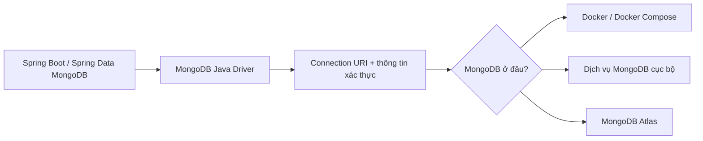

# Chuẩn bị MongoDB bằng Docker, máy cục bộ hoặc MongoDB Atlas

## 1. Mục tiêu và phạm vi

Spring Data MongoDB cung cấp `MongoTemplate`, repository và các API reactive để ứng dụng Java làm việc với document MongoDB. Trước khi viết truy vấn, aggregation, index hay transaction, cần có một MongoDB đang chạy, tài khoản có quyền phù hợp và chuỗi kết nối (`connection URI`) mà ứng dụng sử dụng được.

Bài học thuộc chương **Khởi tạo** này hướng dẫn ba cách chuẩn bị môi trường MongoDB:

1. **Docker Compose:** nhanh, dễ tái tạo và phù hợp cho học tập, phát triển hoặc kiểm thử cục bộ.
2. **Cài MongoDB Community Server trên máy:** phù hợp khi cần chạy dịch vụ trực tiếp trên Windows, macOS hoặc Linux.
3. **MongoDB Atlas:** dịch vụ MongoDB được quản lý trên đám mây, phù hợp để làm quen với kết nối từ xa, TLS và quản trị truy cập.

Sau khi hoàn thành, bạn có thể chạy lệnh `ping`, tạo database và tài khoản ứng dụng, lưu/đọc một document và kết nối một ứng dụng Spring Boot sử dụng Spring Data MongoDB. Các ví dụ ưu tiên môi trường phát triển; khi đưa vào vận hành thực tế, cần bổ sung thiết kế backup, giám sát, sẵn sàng cao và quản lý bí mật.

## 2. Chọn phương án và hiểu vị trí kết nối

| Tiêu chí | Docker Compose | MongoDB cài trực tiếp | MongoDB Atlas |
|---|---|---|---|
| Phụ thuộc chính | Docker Engine/Desktop và Compose | MongoDB Community Server, `mongosh` | Tài khoản Atlas, kết nối Internet, DNS |
| Quản lý tiến trình | `docker compose` | Service của hệ điều hành | Atlas quản lý |
| Dữ liệu lưu ở đâu | Docker volume hoặc thư mục mount | Thư mục dữ liệu máy chủ | Storage của cluster Atlas |
| Địa chỉ thường dùng từ ứng dụng trên máy | `127.0.0.1:27017` nếu publish port | `127.0.0.1:27017` | Host trong URI `mongodb+srv://...` |
| Xác thực | Chủ động bật qua biến môi trường hoặc cấu hình | Cần cấu hình theo môi trường cài đặt | Database user do bạn tạo |
| TLS và kết nối từ xa | Cần cấu hình thêm nếu cần | Cần cấu hình thêm nếu cần | Thường dùng TLS theo URI Atlas |
| Phù hợp nhất | Demo và môi trường có thể tái tạo | Học quản trị MongoDB hoặc tác vụ cục bộ | Kết nối cloud và môi trường dùng chung |

Luồng cơ bản:



Hai điểm cần ghi nhớ:

- `localhost` luôn chỉ về **chính môi trường mạng của tiến trình đang kết nối**. Spring Boot chạy trên máy host có thể dùng `127.0.0.1:27017` để kết nối container đã publish port. Spring Boot chạy trong container khác cần dùng tên service MongoDB trong cùng mạng Compose, thường là `mongodb:27017`.
- Tên database ở cuối URI, ví dụ `/spring_demo`, là database làm việc mặc định. Tài khoản có thể được xác thực tại một database khác; khi đó phải xác định đúng `authSource`.

Các lệnh dưới đây dùng `mongosh`, tức MongoDB Shell. Có thể chạy nó bên trong container MongoDB, từ bản cài độc lập trên máy hoặc qua công cụ kết nối tới Atlas.

## 3. Phương án A — Chạy MongoDB bằng Docker Compose

### 3.1. Điều kiện chuẩn bị

Cài Docker Desktop hoặc Docker Engine có Compose plugin, bảo đảm daemon đang chạy. Kiểm tra:

```bash
docker --version
docker compose version
docker info
```

Đối với Windows/macOS, Docker Desktop phải đang khởi động; trên Linux, người dùng cần quyền chạy Docker theo cấu hình hệ thống. Có thể đổi cổng host nếu cổng `27017` đang được sử dụng.

### 3.2. Tạo Compose và volume lưu dữ liệu

Tạo một thư mục thực hành riêng; đặt nội dung sau trong `compose.yaml`:

```yaml
services:
  mongodb:
    image: mongo:8.0
    restart: unless-stopped
    environment:
      MONGO_INITDB_ROOT_USERNAME: admin
      MONGO_INITDB_ROOT_PASSWORD: ${MONGO_ROOT_PASSWORD:?Set MONGO_ROOT_PASSWORD in .env}
    ports:
      - "127.0.0.1:27017:27017"
    volumes:
      - mongodb_data:/data/db

volumes:
  mongodb_data:
```

Giải thích cấu hình:

- `mongo:8.0` là tag phiên bản major được chọn cho ví dụ. Khi triển khai trong nhóm, chọn tag bản vá hoặc digest phù hợp để các máy có cùng bản MongoDB; kiểm tra khả năng tương thích với driver đang dùng.
- `MONGO_INITDB_ROOT_USERNAME` và `MONGO_INITDB_ROOT_PASSWORD` tạo tài khoản quản trị **khi khởi tạo thư mục dữ liệu trống**. Đây là tài khoản quản trị demo; ứng dụng Spring Data phải dùng tài khoản ít quyền hơn.
- `127.0.0.1:27017:27017` chỉ mở cổng ở loopback của máy chạy Docker; đây là lựa chọn phù hợp để phát triển cục bộ. Không tự động làm cho MongoDB truy cập được từ máy khác.
- `mongodb_data:/data/db` giữ dữ liệu khi container bị dừng hoặc được tạo lại; `docker compose down` thông thường không xóa named volume.

Tạo file `.env` **cạnh** `compose.yaml` với mật khẩu mạnh cho tài khoản admin:

```dotenv
MONGO_ROOT_PASSWORD=REPLACE_WITH_YOUR_STRONG_RANDOM_PASSWORD
```

Thay giá trị minh họa bằng một mật khẩu thực tế; không commit `.env` vào Git. Đối với hệ thống thật, dùng cơ chế quản lý secret của môi trường chạy thay vì lưu mật khẩu lâu dài dưới dạng văn bản thuần. Nếu mật khẩu chứa ký tự đặc biệt, chú ý cách Compose phân tích file `.env`.

Khởi động và xem trạng thái:

```bash
docker compose up -d
docker compose ps
docker compose logs mongodb
```

Khi database sẵn sàng, đăng nhập shell trong container và nhập mật khẩu khi được hỏi:

```bash
docker compose exec mongodb mongosh --username admin --authenticationDatabase admin --password
```

Trong `mongosh`, thử:

```javascript
db.adminCommand({ ping: 1 })
// Dự kiến trả về { ok: 1 }
```

Lệnh `ping` chỉ kiểm tra server trả lời yêu cầu; nó chưa chứng minh ứng dụng có quyền đọc/ghi vào một database cụ thể.

### 3.3. Tạo database và tài khoản riêng cho ứng dụng

Ở phiên `mongosh` đã đăng nhập bằng admin, chạy:

```javascript
use spring_demo

db.createUser({
  user: "spring_app",
  pwd: passwordPrompt(),
  roles: [
    { role: "readWrite", db: "spring_demo" }
  ]
})
```

`passwordPrompt()` yêu cầu nhập mật khẩu người dùng `spring_app` mà không gắn trực tiếp mật khẩu vào câu lệnh. Vai trò `readWrite` đủ cho ví dụ thao tác dữ liệu trong `spring_demo`; các thao tác quản trị hoặc thiết lập index đặc biệt có thể yêu cầu quyền tương ứng. MongoDB tạo database/collection thực tế khi có dữ liệu được ghi; lệnh `use` chỉ chọn database làm việc.

Thoát shell, rồi kết nối bằng người dùng ứng dụng:

```bash
docker compose exec mongodb mongosh "mongodb://localhost:27017/spring_demo?authSource=spring_demo" --username spring_app --password
```

Thử thao tác đọc/ghi theo mục 7. Tài khoản này không cần quyền `root`. Trên máy host, dùng URI cùng host `127.0.0.1` và cổng được publish trong Compose.

**Lưu ý khi đổi mật khẩu:** các biến `MONGO_INITDB_ROOT_*` chỉ áp dụng lúc Docker image khởi tạo database trên vùng dữ liệu trống. Đổi giá trị trong `.env` khi volume đã có dữ liệu **không tự đổi** mật khẩu tài khoản MongoDB hiện hữu. Hãy đổi mật khẩu bằng cơ chế quản trị MongoDB khi cần.

### 3.4. Dừng môi trường

```bash
docker compose stop         # Dừng container, dữ liệu vẫn trong volume
docker compose start        # Chạy lại container
docker compose down         # Gỡ container/network của Compose, giữ named volume
```

Lệnh `docker compose down --volumes` (hoặc `down -v`) còn xóa volume do Compose quản lý, dẫn đến mất dữ liệu demo bên trong; chỉ thực hiện khi đã xác định cần làm sạch dữ liệu.

## 4. Phương án B — Cài MongoDB Community Server trên máy

MongoDB Community Server có thể chạy trực tiếp như một dịch vụ của hệ điều hành. Các bước cài đặt phụ thuộc phiên bản OS; nên lấy gói cài đặt từ trang chính thức của MongoDB phù hợp với CPU/OS và kiểm tra phiên bản được hỗ trợ.

### 4.1. Windows

1. Tải bộ cài MongoDB Community Server dạng MSI chính thức, chọn cài như Windows Service nếu muốn tự khởi động cùng máy.
2. Cài `mongosh` riêng nếu gói Server chưa cung cấp shell.
3. Kiểm tra dịch vụ MongoDB trong **Services**; khởi động dịch vụ nếu đang dừng.
4. Mở PowerShell hoặc terminal và kết nối:

```powershell
mongosh "mongodb://127.0.0.1:27017"
```

Nếu máy có bản MongoDB khác, hãy kiểm tra cổng thực tế và tệp cấu hình `mongod.cfg`. Windows Service sử dụng cấu hình được xác định khi cài dịch vụ.

### 4.2. macOS

Với Homebrew và tap chính thức của MongoDB, một cách cài thường dùng cho MongoDB 8.0 là:

```bash
brew tap mongodb/brew
brew install mongodb-community@8.0
brew services start mongodb-community@8.0
mongosh "mongodb://127.0.0.1:27017"
```

Nếu máy đã dùng một phiên bản khác, chọn công thức tương ứng và tránh khởi động đồng thời hai dịch vụ cùng nghe cổng 27017. Đường dẫn data/config thay đổi tùy máy Intel hoặc Apple Silicon và công thức Homebrew.

### 4.3. Linux

Trên Linux, sử dụng repository và gói `mongodb-org` chính thức tương ứng với bản phân phối/version được MongoDB hỗ trợ. Sau khi cài, với hệ thống dùng systemd:

```bash
sudo systemctl enable --now mongod
sudo systemctl status mongod
mongosh "mongodb://127.0.0.1:27017"
```

Nếu `mongod` không khởi động được, xem log của service (ví dụ `journalctl -u mongod`) và kiểm tra quyền ghi thư mục data, cổng lắng nghe, dung lượng đĩa cùng cấu hình mạng trong `mongod.conf`.

### 4.4. Cấu hình xác thực và mạng khi cài trực tiếp

Trên một số bản cài phát triển, MongoDB chỉ lắng nghe tại loopback và có thể chưa yêu cầu xác thực. Cấu hình đó giúp dễ thử nghiệm trong máy đơn, nhưng không phù hợp để mở dịch vụ tới môi trường mạng dùng chung.

Khi cần xác thực, trình tự tổng quát là:

1. Trong môi trường mới và được giới hạn ở localhost, tạo tài khoản quản trị phù hợp theo hướng dẫn bảo mật MongoDB; xác minh có thể đăng nhập.
2. Bật `security.authorization: enabled` trong cấu hình `mongod` rồi khởi động lại dịch vụ theo phương thức quản trị của OS.
3. Đăng nhập bằng tài khoản quản trị để tạo database user riêng cho `spring_demo`, tương tự mục 3.3.
4. Chỉ mở `bindIp`, firewall và TLS cho các mạng thực sự được phép. Không dùng việc tắt xác thực hoặc tắt TLS như một cách xử lý lỗi kết nối trên máy chủ dùng chung.

Ví dụ cấu hình YAML ở cấp `mongod.conf` là:

```yaml
net:
  bindIp: 127.0.0.1
  port: 27017
security:
  authorization: enabled
```

Đoạn trên minh họa hai nhóm khóa, **không phải nội dung toàn bộ tệp cấu hình**: cần giữ các mục `storage`, `systemLog`, `processManagement`... đã có. Trước khi bật authorization, đảm bảo đã tạo và kiểm tra tài khoản quản trị theo trình tự phù hợp để tránh tự khóa quyền quản trị.

## 5. Phương án C — Tạo MongoDB trên Atlas

[MongoDB Atlas](https://www.mongodb.com/atlas) là dịch vụ MongoDB cloud được quản lý. Tên các nút giao diện có thể thay đổi, nhưng quy trình có cùng các bước: tạo project, triển khai database, tạo user, cho phép IP truy cập và lấy URI kết nối.

### 5.1. Khởi tạo cluster

1. Đăng nhập Atlas tại [MongoDB Atlas](https://www.mongodb.com/atlas), tạo **Project** cho bài thực hành.
2. Tạo deployment/cluster với mức tài nguyên phù hợp nhu cầu và vùng cloud gần máy ứng dụng khi có thể.
3. Chờ Atlas báo cluster sẵn sàng. Các gói dùng thử/miễn phí có thể có giới hạn chức năng, số kết nối hoặc tài nguyên, vì vậy kiểm tra trước khi chọn cấu hình cho transaction hay tải lớn.

### 5.2. Tạo tài khoản và quy tắc truy cập mạng

Trong phần **Database Access**, tạo database user `spring_app` với mật khẩu mạnh và quyền đủ cho database `spring_demo`. Với ví dụ phát triển, quyền `readWrite` trên database này là điểm khởi đầu; tránh sử dụng tài khoản có toàn quyền cho ứng dụng thông thường.

Trong phần **Network Access**, chỉ cho phép **IP public đi ra Internet** của máy chạy ứng dụng (hoặc hạ tầng đã được duyệt) truy cập cluster. Địa chỉ IP này có thể khác IP nội bộ `192.168.x.x` hoặc `127.0.0.1`, và có thể thay đổi khi đổi mạng, VPN hoặc môi trường CI. Không nên mở `0.0.0.0/0` lâu dài để xử lý nhanh lỗi kết nối.

**Database user** và **tài khoản đăng nhập giao diện Atlas** là hai loại tài khoản riêng, không thể thay thế cho nhau.

### 5.3. Lấy connection string

Trong giao diện cluster, chọn **Connect → Drivers**, chọn Java driver nếu cần và sao chép URI được Atlas cấp. Ví dụ về **cấu trúc**, không phải cluster có thật:

```text
mongodb+srv://spring_app:<URL_ENCODED_PASSWORD>@cluster0.example.mongodb.net/spring_demo?retryWrites=true&w=majority
```

- Thay hostname bằng hostname **nguyên bản** từ Atlas, thay mật khẩu bằng mật khẩu database user.
- Phần sau dấu `/` là tên database của ứng dụng, ở đây là `spring_demo`.
- Dùng URL encoding (percent-encoding) cho những ký tự đặc biệt trong username/password khi đưa vào URI. Ví dụ ký tự `@` trong mật khẩu phải mã hóa thành `%40`. Nếu chuỗi URI khó quản lý, có thể cấu hình credential riêng theo driver API phù hợp.
- `mongodb+srv://` dùng tra cứu DNS SRV/TXT để tìm các node và tùy chọn kết nối; Atlas thông thường yêu cầu TLS. Không tự thay nó bằng `mongodb://localhost` hoặc bỏ kiểm tra chứng chỉ.
- `retryWrites` và `w` là lựa chọn do Atlas cung cấp trong mẫu URI; tùy cluster và phiên bản driver, hãy giữ hoặc điều chỉnh theo yêu cầu thực tế.

Kiểm tra DNS, firewall và quyền cho phép IP đầu ra nếu kết nối thất bại. Với môi trường bị giới hạn truy vấn DNS SRV, Atlas có thể cung cấp chuỗi kết nối chuẩn cho một số trường hợp; hãy dùng lựa chọn chính thức thay vì tự đoán hostname node.

## 6. Kết nối từ Spring Boot / Spring Data MongoDB

### 6.1. Thêm dependency

Ví dụ với dự án Maven sử dụng Spring Boot và dependency management của Spring Boot:

```xml
<dependency>
    <groupId>org.springframework.boot</groupId>
    <artifactId>spring-boot-starter-data-mongodb</artifactId>
</dependency>
```

Starter này cung cấp các thành phần dùng MongoDB driver đồng bộ, `MongoTemplate` và repository. Nếu ứng dụng được thiết kế theo WebFlux/reactive, có starter riêng:

```xml
<dependency>
    <groupId>org.springframework.boot</groupId>
    <artifactId>spring-boot-starter-data-mongodb-reactive</artifactId>
</dependency>
```

Trong một dịch vụ, ưu tiên mô hình truy cập phù hợp (blocking hoặc reactive) và cân nhắc tránh trộn lẫn không có chủ đích. Các ví dụ dưới đây dùng API đồng bộ.

### 6.2. Cấu hình URI bên ngoài mã nguồn

Với cấu hình thường gặp ở **Spring Boot 3.x**, đặt trong `src/main/resources/application.yml`:

```yaml
spring:
  data:
    mongodb:
      uri: ${MONGODB_URI}
```

Biến môi trường `MONGODB_URI` chứa toàn bộ URI cho phương án được chọn. Ví dụ:

| Chỗ chạy ứng dụng | Mẫu `MONGODB_URI` |
|---|---|
| Spring Boot trên máy host ↔ MongoDB Docker | `mongodb://spring_app:<ENCODED_PASSWORD>@127.0.0.1:27017/spring_demo?authSource=spring_demo` |
| Spring Boot trên cùng máy ↔ MongoDB native, chưa bật auth (chỉ thử nghiệm cục bộ) | `mongodb://127.0.0.1:27017/spring_demo` |
| Spring Boot trong **cùng mạng Compose** ↔ service `mongodb` | `mongodb://spring_app:<ENCODED_PASSWORD>@mongodb:27017/spring_demo?authSource=spring_demo` |
| Spring Boot ↔ MongoDB Atlas | `mongodb+srv://spring_app:<ENCODED_PASSWORD>@<ATLAS_HOST>/spring_demo?retryWrites=true&w=majority` |

Chỉ thay placeholder bằng giá trị thật lúc cấu hình môi trường. Không đưa URI chứa thông tin bí mật vào Git, log ứng dụng hoặc ảnh chụp màn hình. Khi sử dụng Spring Boot phiên bản khác, đối chiếu **configuration metadata** của phiên bản đó để xác định đúng tên property MongoDB; một số phiên bản mới có thể thay đổi nhóm property.

**Chú ý về mật khẩu và `authSource`:** Trong ví dụ Docker, user `spring_app` được tạo trong database `spring_demo` nên đặt `authSource=spring_demo`. Tài khoản root của Docker được tạo trong database `admin`; nếu kết nối bằng root để thao tác quản trị, `authSource` phải phù hợp với `admin`. Đừng dùng root trong cấu hình ứng dụng.

Nếu muốn chạy cả Spring Boot và MongoDB bằng Docker Compose, đặt hai service trên cùng một mạng Compose, cho ứng dụng kết nối qua `mongodb:27017`. Publish port ra host **không bắt buộc** cho kết nối giữa các container trong cùng mạng; tên `localhost` trong container ứng dụng không trỏ đến MongoDB container.

### 6.3. Kiểm tra kết nối ngay khi khởi động ứng dụng

Với cấu hình Spring Boot 3.x dùng `MongoTemplate`:

```java
import org.bson.Document;
import org.springframework.boot.ApplicationRunner;
import org.springframework.context.annotation.Bean;
import org.springframework.context.annotation.Configuration;
import org.springframework.data.mongodb.core.MongoTemplate;

@Configuration
public class MongoConnectivityCheck {

    @Bean
    ApplicationRunner mongoPing(MongoTemplate template) {
        return args -> {
            Document result =
                    template.executeCommand(new Document("ping", 1));
            System.out.println("MongoDB ping result: " + result.toJson());
        };
    }
}
```

Khi ứng dụng khởi động, `MongoTemplate` yêu cầu MongoDB thực thi lệnh `ping`. Phản hồi có `ok: 1` cho thấy có thể kết nối và thực thi lệnh tương ứng. Đây là kiểm tra khởi tạo đơn giản; ở hệ thống thật, nên dùng health indicator có sẵn trong Spring Boot Actuator và không in thông tin kết nối nhạy cảm vào log.

Một dịch vụ reactive có thể thực hiện kiểm tra tương ứng bằng API của `ReactiveMongoTemplate` hoặc reactive driver. Không nên chuyển sang gọi blocking chỉ để kiểm tra kết nối trong luồng xử lý reactive.

## 7. Xác minh có thể đọc và ghi dữ liệu

Dùng `mongosh` đã xác thực bằng user `spring_app` và chọn database `spring_demo`:

```javascript
db.runCommand({ ping: 1 })

db.setupSmoke.updateOne(
  { _id: "mongodb-ready" },
  { $set: { source: "setup-003", checkedAt: new Date() } },
  { upsert: true }
)

db.setupSmoke.findOne({ _id: "mongodb-ready" })
db.getName()
```

Kết quả mong đợi:

- `ping` trả `ok: 1`.
- `updateOne` thành công, tạo mới hoặc cập nhật document tùy đã tồn tại.
- `findOne` trả document có `_id: "mongodb-ready"` và hai trường `source`, `checkedAt`.
- `db.getName()` trả `spring_demo`.

Lệnh `updateOne(..., { upsert: true })` có thể chạy nhiều lần mà không tạo document trùng `_id`. Nếu `ping` thành công nhưng thao tác ghi báo `not authorized`, nguyên nhân thường là quyền database user hoặc bạn đang chọn sai database.

Để tách kết nối khỏi logic Spring, hãy xác minh bằng `mongosh` trước, rồi chạy Spring Boot với đúng URI. Khi đổi phương án Docker ↔ native ↔ Atlas, thay duy nhất cấu hình kết nối và bí mật tương ứng; mã dùng `MongoTemplate` hoặc repository thường không cần thay đổi cho các thao tác CRUD cơ bản.

## 8. Vấn đề hay gặp và cách chẩn đoán

| Biểu hiện | Nguyên nhân cần kiểm tra | Hướng xử lý |
|---|---|---|
| `Connection refused` tới `127.0.0.1:27017` | MongoDB chưa chạy; service lỗi; container chưa publish port; cổng host đã đổi | Kiểm tra `docker compose ps` hoặc status service, port và URI |
| `UnknownHostException` hoặc lỗi SRV với Atlas | URI sai hostname; DNS không phân giải bản ghi SRV/TXT; proxy/mạng hạn chế | Sao chép URI từ Atlas, kiểm tra DNS và chính sách mạng |
| `Authentication failed` | Sai mật khẩu; user tạo ở database khác; sai `authSource`; mật khẩu chưa percent-encode | Kiểm tra database user, thông tin đăng nhập, URI và encoding |
| `not authorized on spring_demo` | Tài khoản xác thực được nhưng thiếu quyền thao tác | Kiểm tra role `readWrite` và database cần dùng |
| Atlas báo không kết nối/timeout | Chưa cho phép IP public; firewall outbound; cluster tạm dừng hoặc chưa sẵn sàng | Kiểm tra Network Access, deployment và khả năng truy cập |
| Lỗi TLS/certificate | Máy thiếu CA được tin cậy; proxy can thiệp TLS; cấu hình TLS bị thay đổi | Sửa truststore/chứng chỉ và cấu hình mạng; giữ xác minh TLS |
| Container chạy nhưng mất dữ liệu sau tạo lại | Không mount volume đúng hoặc đã xóa volume | Dùng named volume, kiểm tra quy trình stop/down |
| Đổi `MONGO_INITDB_ROOT_PASSWORD` nhưng không đăng nhập được | Volume đã được khởi tạo trước đó; biến môi trường không cập nhật user hiện hữu | Đổi mật khẩu bằng lệnh quản trị thích hợp |
| Spring Boot trong container không kết nối được `localhost` | `localhost` trỏ đến chính container ứng dụng | Dùng hostname service `mongodb` trong cùng Compose network |
| CRUD được nhưng transaction thất bại | MongoDB độc lập (`standalone`) chưa cung cấp điều kiện triển khai cho transaction | Dùng replica set/sharded cluster hỗ trợ transaction; kiểm tra khả năng của Atlas tier |

Nếu chương trình báo lỗi truy cập, hãy phân biệt **kết nối mạng**, **xác thực** và **phân quyền**:

```text
Không mở được socket / không tìm thấy host
    └─ Kiểm tra service, host, port, Docker network, DNS, firewall
Kết nối tới server nhưng authentication failed
    └─ Kiểm tra username, password, authSource, URI encoding
Đăng nhập được nhưng not authorized
    └─ Kiểm tra role và database/collection đang truy cập
Ping và CRUD đều thành công
    └─ Môi trường sẵn sàng cho bài repository/MongoTemplate
```

### Khi nào cần replica set?

Compose ở mục 3 cố ý dùng MongoDB **standalone** cho CRUD, truy vấn, aggregation cơ bản và học mapping. MongoDB transaction nhiều document và change stream đòi hỏi mô hình triển khai tương ứng như **replica set** hoặc sharded cluster; chạy một container độc lập không tự cung cấp các khả năng này. Nếu bài thực hành chuyển sang transaction hoặc reactive change stream, hãy chuẩn bị replica set dùng cho phát triển (ví dụ một replica set một node đúng cấu hình) hoặc Atlas cluster có hỗ trợ, rồi kiểm tra lại URI và phiên bản driver.

## 9. Bảo mật và vận hành tối thiểu

Các thao tác có thể làm cho môi trường học tập dễ dùng nhưng vẫn cần nguyên tắc rõ ràng:

1. **Tài khoản ứng dụng:** tạo user riêng với quyền cần thiết thay vì dùng `root` hoặc user quản trị.
2. **Quản lý secret:** dùng biến môi trường, secret manager hoặc giải pháp quản lý cấu hình của tổ chức. Tránh commit credential và tránh in URI có mật khẩu vào log.
3. **Giới hạn truy cập mạng:** khi chạy cục bộ, ưu tiên bind/publish cổng ở `127.0.0.1`; với Atlas, allowlist đúng IP nguồn. Cấu hình firewall và TLS khi kết nối từ xa.
4. **Dữ liệu bền vững:** dùng Docker volume hoặc data directory phù hợp; backup trước khi thực hiện thao tác xóa, thay đổi volume hoặc nâng cấp lớn.
5. **Tương thích phiên bản:** kiểm tra ma trận hỗ trợ của MongoDB Server, Java driver, Spring Data MongoDB và Spring Boot. Không tùy tiện nâng cấp major của MongoDB khi chưa đánh giá ứng dụng và dữ liệu.
6. **Kiểm tra thực tế:** `ping` là bước đầu; cần chạy thao tác đọc/ghi với user ứng dụng. Với các bài index, aggregation, transaction hay hiệu năng, phải chuẩn bị cấu hình và quy mô dữ liệu phù hợp với bài đó.

## 10. Bài tự thực hành

**Tình huống:** Bạn chuẩn bị môi trường cho ứng dụng quản lý sản phẩm sử dụng Spring Data MongoDB. Database có tên `spring_demo`, user ứng dụng là `spring_app`.

1. Chọn Docker Compose để chạy MongoDB cục bộ. Xác minh container `mongodb` hoạt động, có volume và chỉ publish cổng ở loopback.
2. Đăng nhập bằng tài khoản admin đã tạo trong bước khởi tạo, tạo user `spring_app` có quyền `readWrite` với `spring_demo`.
3. Kết nối qua `mongosh` bằng user ứng dụng và thử `ping`, `updateOne`, `findOne`.
4. Tạo dự án Spring Boot có `spring-boot-starter-data-mongodb`; cấu hình URI qua biến môi trường và gọi `MongoTemplate.executeCommand(new Document("ping", 1))`.
5. Thử chuyển MongoDB sang Atlas bằng cách tạo database user, allowlist IP nguồn, lấy URI và cập nhật biến `MONGODB_URI`. Quan sát rằng lớp truy cập dữ liệu không cần đổi cho bài toán CRUD.
6. Tự kiểm tra sự khác nhau giữa URI từ **máy host** (`127.0.0.1:27017`) và URI từ **container ứng dụng cùng mạng Compose** (`mongodb:27017`).

**Tiêu chí hoàn thành:** ứng dụng kết nối được, database user chỉ có quyền cần thiết, một document được ghi và đọc lại thành công, dữ liệu Docker vẫn tồn tại sau khi dừng rồi chạy lại container và URI chứa thông tin bí mật không nằm trong repository.

Khi những bước này hoàn tất, môi trường đã sẵn sàng cho các bài tiếp theo về `@Document`, `MongoRepository`, `MongoTemplate`, thiết kế query, aggregation và index. Với các bài cần transaction hay change stream, tiếp tục chuẩn bị replica set phù hợp.
