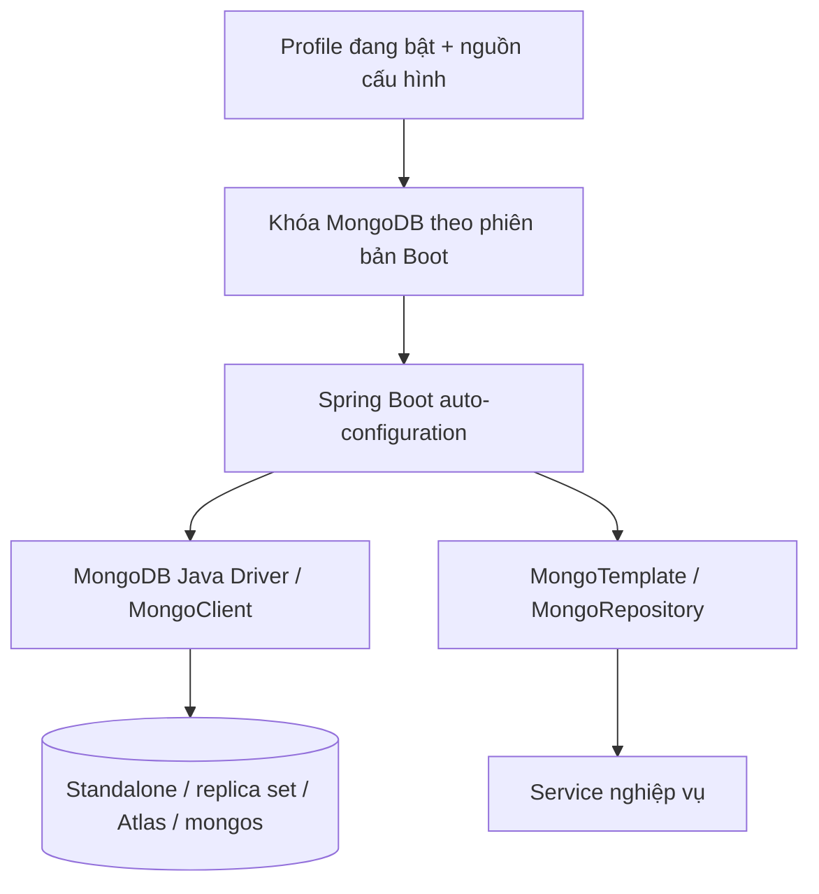

# Cấu hình URI và profile theo phiên bản Spring Boot

> **Chương:** Khởi tạo  
> **Module:** `SPRING_DATA_MONGODB` — kết nối và ánh xạ document MongoDB, truy cập dữ liệu bằng `MongoTemplate` hoặc repository; tiếp tục thực hành truy vấn, aggregation, index, transaction, reactive access, kiểm thử và chẩn đoán hiệu năng. Bài này tập trung vào cấu hình kết nối MongoDB an toàn, nhất quán giữa môi trường và **đúng namespace thuộc tính của từng phiên bản Spring Boot**.

## 1. Vì sao cấu hình kết nối cần đi cùng phiên bản?

Trong một ứng dụng Spring, repository và template không cần tự mở socket đến MongoDB. Nếu có starter và không tự thay thế bean hạ tầng, **Spring Boot auto-configuration** tạo `MongoClient`, `MongoDatabaseFactory`, `MongoTemplate` hoặc các thành phần reactive phù hợp. Các bean này nhận thông tin kết nối từ cấu hình Boot và MongoDB Java Driver.

Vấn đề thường gặp khi nâng cấp: code Java vẫn biên dịch, repository vẫn được tạo, nhưng **khóa cấu hình MongoDB đã đổi**. Ứng dụng có thể kết nối nhầm vào địa chỉ mặc định, vào sai database hoặc chỉ phát hiện lỗi khi truy vấn đầu tiên chạy. Để tránh điều đó cần phân biệt rõ:

1. **URI MongoDB:** địa chỉ server, database mặc định, thông tin xác thực và tùy chọn kết nối.
2. **Khóa thuộc tính Spring Boot:** nơi Boot tìm URI và ánh xạ nó vào driver.
3. **Profile Spring:** lựa chọn bộ cấu hình cho `local`, `test`, `staging`, `prod`.
4. **Nguồn cấp secret:** biến môi trường, secret manager, cấu hình ngoài package; không chứa credential thật trong Git.

Luồng cấu hình có thể hình dung:



## 2. Bảng đối chiếu các phiên bản Spring Boot

Đây là khác biệt phải kiểm tra đầu tiên khi chuyển phiên bản:

| Dòng Spring Boot | Khóa URI chính | Cấu trúc YAML | Ghi chú |
| --- | --- | --- | --- |
| **2.x** | `spring.data.mongodb.uri` | `spring → data → mongodb → uri` | Boot 2.4+ hỗ trợ `spring.config.activate.on-profile`; các bản cũ hơn có quy ước cấu hình profile khác. |
| **3.x**, gồm 3.4 và 3.5 | `spring.data.mongodb.uri` | `spring → data → mongodb → uri` | Vẫn dùng namespace có `data` cho cấu hình kết nối. |
| **4.x**, gồm 4.0 và 4.2 | `spring.mongodb.uri` | `spring → mongodb → uri` | Cấu hình kết nối chuyển sang `spring.mongodb.*`; một số thiết lập dành riêng Spring Data (ví dụ `spring.data.mongodb.auto-index-creation`) vẫn nằm dưới `spring.data.mongodb.*`. |

**Không mặc định rằng cấu hình Boot 3.x vẫn được đọc nguyên vẹn sau khi nâng cấp lên 4.x.** Khi chuyển lên Boot 4, đổi cả khóa trong YAML, biến môi trường bind trực tiếp và cấu hình test. Kiểm tra tài liệu chính xác của minor version đang sử dụng; bảng trên mô tả các nhánh Spring Boot chính, không thay thế migration guide.

### 2.1. Tối thiểu với Spring Boot 3.x

```yaml
# application.yml — Spring Boot 3.x
spring:
  data:
    mongodb:
      uri: "${MONGODB_URI}"
```

### 2.2. Tối thiểu với Spring Boot 4.x

```yaml
# application.yml — Spring Boot 4.x
spring:
  mongodb:
    uri: "${MONGODB_URI}"
```

Hai ví dụ cùng đọc **biến môi trường tên `MONGODB_URI`**, nhưng property do Spring Boot nhận ở hai nhánh khác nhau. Cú pháp `${MONGODB_URI}` là placeholder, được Spring tìm trong môi trường khi cần; nếu không có giá trị thì cấu hình không hoàn tất và có thể gây lỗi khi bean kết nối được tạo/sử dụng. Trong môi trường thật, cần chủ động kiểm chứng trường hợp thiếu biến để tránh chạy với kết nối mặc định.

Nếu không dùng placeholder, Spring Boot cũng hỗ trợ *relaxed binding* từ biến môi trường tương ứng:

| Phiên bản | Biến môi trường bind trực tiếp vào thuộc tính URI |
| --- | --- |
| Boot 2.x/3.x | `SPRING_DATA_MONGODB_URI` |
| Boot 4.x | `SPRING_MONGODB_URI` |

**`MONGODB_URI` và `SPRING_MONGODB_URI` không cùng ý nghĩa:** `MONGODB_URI` trong các ví dụ được tham chiếu **gián tiếp** qua placeholder. `SPRING_MONGODB_URI` là cách đặt tên biến môi trường để Boot 4 bind **trực tiếp** vào `spring.mongodb.uri`, kể cả khi không có placeholder trong YAML.

### 2.3. Các thuộc tính đi kèm cũng phụ thuộc phiên bản

Khi không dùng URI hoặc cần kiểm tra cấu hình đặc biệt:

| Mục đích | Boot 3.x | Boot 4.x |
| --- | --- | --- |
| URI | `spring.data.mongodb.uri` | `spring.mongodb.uri` |
| Database dạng property riêng | `spring.data.mongodb.database` | `spring.mongodb.database` |
| Host/port riêng | `spring.data.mongodb.host`, `spring.data.mongodb.port` | `spring.mongodb.host`, `spring.mongodb.port` |
| Kích hoạt SSL/TLS theo property | `spring.data.mongodb.ssl.enabled` | `spring.mongodb.ssl.enabled` |
| Cấu hình SSL bundle | `spring.data.mongodb.ssl.bundle` | `spring.mongodb.ssl.bundle` |
| Tự tạo index từ annotation | `spring.data.mongodb.auto-index-creation` | `spring.data.mongodb.auto-index-creation` |

Một cấu hình URI có thể ghi đè hoặc làm cho các thuộc tính host/port/credential riêng lẻ bị bỏ qua. Đừng rải địa chỉ và mật khẩu vừa trong URI vừa trong các trường riêng; hãy **chọn một cách khai báo kết nối nhất quán**, đối chiếu quy tắc ưu tiên property khi cần.

## 3. Hiểu URI MongoDB trước khi sử dụng

### 3.1. URI cơ bản và database mặc định

```text
mongodb://localhost:27017/orders_local
          └ host  ┘└port┘└ database ┘
```

- `mongodb://` là scheme kết nối thông thường.
- `localhost:27017` xác định server; nếu Java app chạy trong Docker, `localhost` của app container là chính container đó. Cần dùng hostname có thể truy cập thực sự, ví dụ DNS service trong cùng mạng container.
- `orders_local` là tên database được chọn mặc định từ URI. Không nên phụ thuộc vào database mặc định ngầm định khi dữ liệu quan trọng.

### 3.2. Replica set và retry

```text
mongodb://mongo1.example.net:27017,mongo2.example.net:27017,mongo3.example.net:27017/orders?replicaSet=rs0&retryWrites=true&w=majority
```

Driver dùng seed list để khám phá thành viên replica set và định tuyến thao tác đến node phù hợp. Tham số `replicaSet=rs0` giúp xác nhận tên replica set dự kiến; hostname do replica set công bố cũng phải truy cập được. `retryWrites=true` chỉ áp dụng cho các thao tác/điều kiện hỗ trợ; nghiệp vụ vẫn cần idempotency và xử lý trường hợp kết quả ghi không rõ ràng.

`w=majority` yêu cầu mức xác nhận ghi theo majority; đây là lựa chọn về độ bền dữ liệu, không tự động đảm bảo mọi yêu cầu đọc có dữ liệu mới nhất. Với transaction nhiều document, MongoDB cần topology tương thích, không phải standalone.

### 3.3. MongoDB Atlas và DNS SRV

```text
mongodb+srv://<db-user>:<url-encoded-password>@<cluster-hostname>/orders?retryWrites=true&w=majority
```

URI `mongodb+srv://` nhờ DNS SRV/TXT hỗ trợ khám phá địa chỉ server và một số tùy chọn. Thay các placeholder bằng thông tin **do Atlas cấp**, cấp database user với quyền tối thiểu và cấu hình network access/TLS đúng môi trường. Để tránh lỗi khi password có `@`, `:`, `/`, `?` hoặc ký tự đặc biệt khác, phải mã hóa đúng phần username/password theo quy tắc URI.

Không ghi URI chứa credential thật vào source code, ảnh chụp console, log, issue hay tài liệu. Không tắt kiểm tra chứng chỉ TLS chỉ để vượt qua lỗi kết nối; hãy sửa trust material, DNS hoặc cấu hình mạng.

### 3.4. Timeout và connection pool

Để chẩn đoán lỗi sớm ở môi trường phát triển, có thể thêm tùy chọn **MongoDB Java Driver** trong URI:

```text
mongodb://localhost:27017/orders_local?serverSelectionTimeoutMS=3000&connectTimeoutMS=2000&maxPoolSize=20
```

| Tham số URI | Ý nghĩa | Lưu ý |
| --- | --- | --- |
| `serverSelectionTimeoutMS` | Giới hạn thời gian driver chờ chọn server phù hợp. | Hết hạn thường báo vấn đề topology hoặc khả năng tiếp cận server. |
| `connectTimeoutMS` | Timeout mở kết nối mạng đến server. | Khác thời gian thực thi một truy vấn. |
| `socketTimeoutMS` | Timeout chờ thao tác đọc/ghi trên socket trong trường hợp áp dụng. | Cần cân đối với truy vấn/aggregation lâu; không dùng như biện pháp tối ưu truy vấn. |
| `maxPoolSize` | Giới hạn số kết nối trong pool của driver cho mỗi server phù hợp. | Pool quá nhỏ gây chờ; pool quá lớn tăng tài nguyên và kết nối ở server. |
| `authSource` | Database dùng xác thực khi thích hợp. | Không mặc định database nghiệp vụ là database xác thực. |

Những giá trị cụ thể là **ví dụ học tập**. Production cần đo tải thực tế, thời gian election, mạng và giới hạn connection của gói MongoDB/Atlas để đặt timeout, pool và chính sách retry. Cũng có thể dùng `MongoClientSettingsBuilderCustomizer` để cấu hình driver khi cần hơn khả năng biểu đạt của URI.

## 4. Profile Spring Boot: tách kết nối local, test và production

Profile là cơ chế lựa chọn **bộ thuộc tính và bean Spring** tương ứng với môi trường. Spring Boot xét `application.yml` làm cấu hình chung và có thể nạp `application-{profile}.yml`; biến môi trường, system property và command-line argument có thể ghi đè theo quy tắc ưu tiên nguồn cấu hình.

Ví dụ ba môi trường:

| Profile | Kết nối mong muốn | Nguyên tắc |
| --- | --- | --- |
| `local` | MongoDB máy phát triển hoặc container trong mạng local. | Có thể dùng URI local mặc định dành riêng cho development. |
| `test` | MongoDB dành riêng cho integration test, có thể cấp từ Testcontainers. | Cô lập dữ liệu; tuyệt đối tránh URI production. |
| `prod` | Replica set/Atlas/cluster thật qua secret và network production. | Không có fallback tự động về localhost hoặc database phát triển. |

### 4.1. Ví dụ nhiều YAML document cho Spring Boot 3.x

Đây là **một file mẫu** `src/main/resources/application.yml`. Dấu `---` tách ba YAML document; các document có `on-profile` chỉ được áp dụng khi profile tương ứng được bật.

```yaml
# Spring Boot 3.x — application.yml
spring:
  application:
    name: order-service

---
spring:
  config:
    activate:
      on-profile: local
  data:
    mongodb:
      uri: "${MONGODB_URI:mongodb://localhost:27017/orders_local}"

---
spring:
  config:
    activate:
      on-profile: prod
  data:
    mongodb:
      uri: "${MONGODB_URI}"
```

Khi chạy với `local` mà không có biến `MONGODB_URI`, Boot dùng mặc định `mongodb://localhost:27017/orders_local`. Khi chạy với `prod`, ứng dụng cần được cấp `MONGODB_URI`; không dùng giá trị mặc định trong bài mẫu. Với profile chưa được định nghĩa ở đây, không có thuộc tính MongoDB từ hai nhánh `local`/`prod`; hãy định nghĩa `test` hoặc cấu hình bắt buộc riêng trước khi chạy.

### 4.2. Cùng thiết kế cho Spring Boot 4.x

Chuyển cấu hình kết nối thành `spring.mongodb.uri`; vẫn dùng cùng tên biến secret và cơ chế profile:

```yaml
# Spring Boot 4.x — application.yml
spring:
  application:
    name: order-service

---
spring:
  config:
    activate:
      on-profile: local
  mongodb:
    uri: "${MONGODB_URI:mongodb://localhost:27017/orders_local}"

---
spring:
  config:
    activate:
      on-profile: prod
  mongodb:
    uri: "${MONGODB_URI}"
```

**Không dùng đồng thời hai cấu hình mẫu trong một file thật.** Chọn mẫu theo phiên bản dependency của dự án. Đặc biệt, không giữ lại `spring.data.mongodb.uri` từ bản Boot 3 khi ứng dụng chuyển sang Boot 4 rồi cho rằng nó tiếp tục cấu hình kết nối.

### 4.3. Một file cho mỗi profile: cách tổ chức khác

Thay vì các document `---`, có thể tổ chức:

```text
src/main/resources/
  application.yml
  application-local.yml
  application-test.yml
  application-prod.yml
```

Ví dụ `application-prod.yml` trên Boot **4.x**:

```yaml
spring:
  mongodb:
    uri: "${MONGODB_URI}"
```

Với Boot 3.x, thêm tầng `data` ngay dưới `spring`. Không cần đặt `spring.profiles.active: prod` trong `application-prod.yml`: Boot tự tải file theo profile đã chọn. Cũng không nên tạo song song cả `application-prod.yml` và một document `on-profile: prod` trùng cấu hình nếu đội ngũ chưa xác định rõ quy tắc ghi đè.

### 4.4. Bật profile khi chạy ứng dụng

Chọn profile bằng một trong các cách sau:

```bash
# Dạng trung lập cho executable JAR
java -jar app.jar --spring.profiles.active=local

# Ví dụ với production: URI đã được hệ thống triển khai cấp dưới dạng secret
java -jar app.jar --spring.profiles.active=prod
```

Hoặc dùng biến môi trường `SPRING_PROFILES_ACTIVE`. Ví dụ PowerShell khi phát triển trên Windows:

```powershell
$env:SPRING_PROFILES_ACTIVE = "local"
$env:MONGODB_URI = "mongodb://localhost:27017/orders_local"
java -jar app.jar
```

Lệnh này giả định đã có `app.jar`. Khi chạy bằng IDE, Gradle hoặc Maven, cấu hình các biến môi trường và active profile bằng cơ chế tương ứng; không cần thay đổi code repository.

**Quy tắc profile quan trọng:**

- `spring.profiles.active` và `spring.profiles.default` chỉ đặt trong **document không đặc thù profile** hoặc nguồn cấu hình ngoài; không đặt bên trong document `spring.config.activate.on-profile` hay `application-prod.yml`.
- `spring.config.activate.on-profile` áp dụng cho Spring Boot **2.4 trở lên**. Nếu dự án còn trên Boot 2.3 hoặc cũ hơn, tránh chép nguyên mẫu multi-document này; dùng `application-{profile}.yml` thích hợp với phiên bản hoặc nâng cấp.
- Có thể bật nhiều profile bằng danh sách dấu phẩy, nhưng **thứ tự và mức ưu tiên nguồn** có thể ảnh hưởng cấu hình cuối cùng; với URI cơ sở dữ liệu, nên áp dụng một môi trường kết nối rõ ràng cho mỗi lần chạy.
- Cấu hình `spring.profiles.group` hoặc `spring.profiles.include` (khi cần) thuộc phần không đặc thù profile; không dùng chúng để biến một deployment production thành một bộ profile khó kiểm soát.

## 5. Cấu hình từ biến môi trường và secret manager

**Tách bí mật khỏi artefact chạy ứng dụng.** Một giá trị URI production thường chứa hostname, username, password và thông số bảo mật. Nơi cấp nên là secret manager, biến môi trường của hệ thống triển khai hoặc file cấu hình ngoài có quyền truy cập giới hạn.

Thực hành khuyến nghị:

1. Trong Git, giữ mẫu `uri: "${MONGODB_URI}"` hoặc tài liệu hướng dẫn tên biến; không commit secret.
2. Đặt `MONGODB_URI` riêng cho từng deployment; mỗi môi trường dùng user/database và quyền phù hợp.
3. Production phải có kiểm soát network, TLS, cơ chế luân chuyển credential và lịch sử thay đổi cấu hình.
4. Không in nguyên văn URI trong log, thông báo lỗi hay đầu ra CI. Khi debug, chỉ in hostname hoặc tên database nếu được phép và đã loại bỏ phần nhạy cảm.
5. Bảo vệ quyền truy cập Actuator `env`/`configprops` và dashboard cấu hình; thông tin đã được che ở một nơi không có nghĩa mọi log hoặc endpoint đều an toàn.

### URI và property rời: chọn một nguồn sự thật

Với Boot 4, ví dụ sau là cấu hình kết nối bằng **property rời**, thay thế cho cách dùng URI:

```yaml
spring:
  mongodb:
    host: mongo.internal.example
    port: 27017
    database: orders
    username: "${MONGO_USER}"
    password: "${MONGO_PASSWORD}"
    authentication-database: admin
```

Ví dụ này chưa cấu hình TLS/replica set, chỉ minh họa mapping property; không chép nguyên cho production. Nếu dùng URI, đặt cả lựa chọn kết nối chính vào URI và tránh khai báo lại host/port/password ở nơi khác. Với Boot 3.x, nhóm thuộc tính trên chuyển thành `spring.data.mongodb.*`. Một số property độc lập như tên database có quy tắc ưu tiên riêng: cần xem tài liệu phiên bản khi cố ý ghi đè database có sẵn trong URI.

## 6. Phân biệt kết nối MongoDB với code truy cập dữ liệu

Khi đúng starter được thêm vào dependency và package scanning phù hợp, tầng repository không cần phụ thuộc vào hostname:

```java
import java.util.Optional;
import org.springframework.data.mongodb.repository.MongoRepository;

public interface OrderRepository extends MongoRepository<Order, String> {
    Optional<Order> findFirstByCustomerIdOrderByCreatedAtDesc(String customerId);
}
```

`Order` ở đây là class đã được ánh xạ `@Document` trong bài thực hành khác; không phải một entity được định nghĩa trong ví dụ cấu hình này. Với truy vấn linh hoạt, service có thể inject `MongoTemplate`; với reactive access dùng `ReactiveMongoRepository` hoặc `ReactiveMongoTemplate` và starter reactive phù hợp. Chuyển từ standalone sang Atlas/replica set thường chỉ cần đổi kết nối và chính sách đọc/ghi, nhưng topology vẫn ảnh hưởng transaction, retry, độ trễ và index.

**Thao tác kiểm chứng kết nối:** trong một cấu hình chỉ dành cho profile `local`, có thể tạo probe nhỏ để gửi lệnh ping thực tới MongoDB:

```java
import org.springframework.boot.ApplicationArguments;
import org.springframework.boot.ApplicationRunner;
import org.springframework.context.annotation.Profile;
import org.springframework.data.mongodb.core.MongoTemplate;
import org.springframework.stereotype.Component;

@Component
@Profile("local")
public class MongoLocalPing implements ApplicationRunner {

    private final MongoTemplate mongoTemplate;

    public MongoLocalPing(MongoTemplate mongoTemplate) {
        this.mongoTemplate = mongoTemplate;
    }

    @Override
    public void run(ApplicationArguments args) {
        mongoTemplate.executeCommand("{ ping: 1 }");
    }
}
```

Ví dụ áp dụng cho stack **imperative** và chủ động chạy ping khi khởi động profile local. Kết nối MongoDB có thể được tạo theo kiểu lazy, vì vậy chỉ thấy ứng dụng boot thành công chưa đủ xác nhận kết nối database. Với ứng dụng reactive, dùng API của `ReactiveMongoTemplate` và subscribe/chain đúng cơ chế reactive, tránh dùng mã blocking trên event loop.

Nếu tự định nghĩa `MongoClient`/`MongoDatabaseFactory` hoặc các bean cấu hình hạ tầng thay thế, một phần auto-configuration và property Boot có thể không còn điều khiển kết nối như trong ví dụ; lúc đó phải kiểm tra chính cấu hình Java đã tạo bean.

## 7. Cấu hình integration test và Testcontainers

Với test CRUD và mapping, dùng một MongoDB riêng cho test. Nếu kiểm tra transaction nhiều document, test topology phải hỗ trợ transaction (ví dụ replica set), không dựa vào standalone. **Tên property được cung cấp cho test cũng phải khớp phiên bản Boot.**

Ví dụ Spring Boot 3.x với Testcontainers và `@DynamicPropertySource`:

```java
import org.junit.jupiter.api.Test;
import org.springframework.boot.test.context.SpringBootTest;
import org.springframework.test.context.DynamicPropertyRegistry;
import org.springframework.test.context.DynamicPropertySource;
import org.testcontainers.junit.jupiter.Container;
import org.testcontainers.junit.jupiter.Testcontainers;
import org.testcontainers.mongodb.MongoDBContainer;

@Testcontainers
@SpringBootTest
class MongoConnectionIT {

    @Container
    static final MongoDBContainer mongo =
        new MongoDBContainer("mongo:7.0");

    @DynamicPropertySource
    static void configureMongo(DynamicPropertyRegistry registry) {
        registry.add("spring.data.mongodb.uri", mongo::getReplicaSetUrl);
    }

    @Test
    void applicationContextStarts() {
        // Bổ sung truy vấn/ping thật nếu cần xác nhận kết nối.
    }
}
```

Đây là **mẫu minh họa**, không khóa một phiên bản Testcontainers cụ thể. Package/class và API container của Testcontainers có thể khác giữa các phiên bản; khi triển khai cần đối chiếu dependency thực tế. Với Spring Boot **4.x**, đổi key trong `registry.add` thành `spring.mongodb.uri`. Đồng thời bảo đảm môi trường test không bị một nguồn cấu hình có độ ưu tiên cao hơn vô tình trỏ về MongoDB production. Để xác nhận transaction, cần một bài test có thao tác và rollback thật, không chỉ kiểm tra context khởi động.

## 8. Lỗi thường gặp và cách chẩn đoán

| Triệu chứng | Khả năng gây ra lỗi | Cách kiểm tra |
| --- | --- | --- |
| Nâng Boot 3 → 4 rồi app dùng địa chỉ không mong đợi | Vẫn đặt `spring.data.mongodb.uri` thay vì `spring.mongodb.uri` | Đối chiếu bảng phiên bản, cấu hình thật và source property được bind. |
| Local hoạt động nhưng profile `prod` không kết nối | Thiếu `MONGODB_URI`, DNS/TLS, firewall, credential hoặc network allowlist | Xác nhận profile, secret đã cấp, khả năng kết nối tới hostname. |
| Kết nối được nhưng dữ liệu ở sai database | Sai phần `/database` của URI hoặc có property database ghi đè | Đối chiếu database đang dùng với URI và phiên bản Boot. |
| Authentication failed | Sai tài khoản/mật khẩu, chưa percent-encode, sai `authSource` | Kiểm tra database user và URI đã được mã hóa đúng, không in password. |
| `MongoTimeoutException: Timed out after ...` | Server selection thất bại do DNS, replica set, election, mạng, pool | Kiểm tra log driver đã che secret, hostname công bố, TLS, server selection timeout. |
| Test transaction thất bại dù CRUD chạy được | Chạy trên standalone hoặc chưa cấu hình transaction manager/session | Chuyển sang topology hỗ trợ transaction và test rollback. |
| Đặt `SPRING_PROFILES_ACTIVE=prod` nhưng vẫn dùng URI local | Nguồn property khác có ưu tiên cao hơn hoặc trùng key | Kiểm tra command-line args, env, file ngoài JAR, profile và config import. |
| Tự tạo `MongoClient` nhưng URI YAML dường như bị bỏ qua | Bean người dùng thay thế hạ tầng auto-configured | Kiểm tra nơi tạo bean, customizer và cấu hình driver. |

Khi cần xác định **nguồn property**, xem cơ chế externalized configuration của Spring Boot và Actuator `env`/`configprops` trong môi trường được bảo vệ. Không bật chi tiết debug chứa credential ở production. Cần phân biệt ba trường hợp: URI không được bind; URI được bind nhưng không kết nối được; URI kết nối đúng nhưng query/index/transaction không cho kết quả mong muốn. Chỉ trường hợp đầu liên quan trực tiếp đến profile/property name.

## 9. Quy trình nâng cấp Boot 3.x sang 4.x

Giả sử dịch vụ đã chạy với `spring.data.mongodb.uri` trên Boot 3.5 và chuẩn bị nâng lên Boot 4:

1. **Xác nhận BOM/dependencies Spring Boot mới** cùng driver, Spring Data MongoDB và starter tương thích; đọc migration guide của minor version đích.
2. **Đổi namespace thuộc tính kết nối:** `spring.data.mongodb.uri` → `spring.mongodb.uri`; xem lại database, host/port, SSL, credential và các property liên quan. Không đổi máy móc `spring.data.mongodb.*` dành cho mapping/index nếu tài liệu Boot 4 vẫn giữ key đó.
3. **Rà soát tất cả cấu hình môi trường** (mẫu YAML profile, env, Kubernetes Secret/ConfigMap, Helm values, CI, cấu hình IDE). Với bind trực tiếp, đổi `SPRING_DATA_MONGODB_URI` → `SPRING_MONGODB_URI`; với mẫu placeholder `${MONGODB_URI}` có thể giữ nguyên tên biến secret.
4. **Xác minh mọi profile** bằng kết nối thực đến database đúng tên; phải kiểm tra ít nhất local, test và một deployment tương đương production. Kiểm tra tình huống thiếu secret.
5. **Kiểm tra hành vi dữ liệu:** repository, `MongoTemplate`, index, aggregation, transaction và reactive (nếu dùng). Nâng Boot có thể kéo theo nâng Spring Data/driver và thay đổi khác ngoài URI.
6. **Quan sát sau triển khai:** tỷ lệ timeout/auth failure, thời gian server selection, pool, độ trễ query và hoạt động failover nếu topology có replica set.

Một bẫy cụ thể: đổi key trong `application.yml` nhưng quên `@DynamicPropertySource` của integration test. Test có thể kết nối đến một địa chỉ khác dự kiến hoặc chỉ lỗi khi truy vấn. **Rà soát khóa property trong cả test code** là phần bắt buộc của nâng cấp.

## 10. Bài thực hành

**Mục tiêu:** dùng cùng một repository nhưng thay đổi nơi kết nối theo profile, sau đó kiểm tra tác động của việc đổi namespace cấu hình.

1. Khởi tạo một ứng dụng Spring Boot có starter Spring Data MongoDB phiên bản đồng bộ với Spring Boot.
2. Chọn một trong hai mẫu `application.yml` ở mục 4 theo **phiên bản Boot thực tế**; chạy profile `local` với MongoDB local.
3. Tạo `Order` được đánh dấu `@Document` và một `MongoRepository`; ghi rồi đọc lại một document, xác nhận đúng database `orders_local`.
4. Tạo profile `test` với MongoDB thử nghiệm riêng hoặc Testcontainers; đảm bảo test không chia sẻ database với local/prod.
5. Chuyển profile `prod` trong một môi trường **thử nghiệm tương đương production**, cấp `MONGODB_URI` bằng secret và xác nhận rằng thiếu secret sẽ gây lỗi cấu hình/kết nối thay vì truy cập database local.
6. So sánh mẫu Boot 3.x và Boot 4.x, liệt kê các key phải đổi nếu nâng cấp; xem thêm trường hợp cần transaction trên replica set.

**Tiêu chí đạt:** người học giải thích được vì sao cùng một `MongoRepository` có thể dùng trên nhiều môi trường, biết URI thực sự đến từ nguồn nào, chọn đúng key theo Boot 3/4 và xác nhận kết nối bằng thao tác thật mà không làm lộ thông tin xác thực.

## 11. Tài liệu đối chiếu

Tài liệu chính thức là nguồn quyết định khi cấu hình thực tế vì tên thuộc tính và khả năng auto-configuration có thể thay đổi theo phiên bản:

- [Spring Boot 3.5 — Working with NoSQL Technologies / MongoDB](https://docs.spring.io/spring-boot/3.5/reference/data/nosql.html)
- [Spring Boot 4.2 — Working with NoSQL Technologies / MongoDB](https://docs.spring.io/spring-boot/reference/data/nosql.html)
- [Spring Boot — Externalized Configuration](https://docs.spring.io/spring-boot/reference/features/external-config.html)
- [Spring Boot — Profiles](https://docs.spring.io/spring-boot/reference/features/profiles.html)

**Ghi nhớ:** khóa URI cho **Boot 2.x/3.x** là `spring.data.mongodb.uri`, còn cho **Boot 4.x** là `spring.mongodb.uri`. Profile quyết định môi trường cấu hình được nạp; URI quyết định kết nối MongoDB; repository và `MongoTemplate` sử dụng kết nối đã được cấu hình. Thực hành an toàn cần cả ba phần: **đúng phiên bản, đúng môi trường và bí mật được quản lý riêng**.
