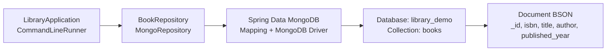

# Tạo @Document và MongoRepository đầu tiên

## 1. Mục tiêu và bức tranh tổng thể

Trong Spring Data MongoDB, ta có thể lưu một đối tượng Java vào MongoDB và đọc lại mà không cần tự viết lệnh chuyển đổi từng trường. Để bắt đầu, cần hiểu hai thành phần:

- **`@Document`** đánh dấu một lớp Java là đối tượng được ánh xạ tới một **collection** MongoDB. Đối tượng Java thường được gọi là *entity*; khi lưu, dữ liệu của nó được chuyển thành **document BSON**.
- **`MongoRepository<T, ID>`** là giao diện Spring Data cung cấp sẵn các thao tác truy cập dữ liệu như `save`, `findById`, `findAll` và `deleteById`. Ta chỉ cần khai báo interface repository cho entity của mình.

Bài thực hành xây dựng một ứng dụng quản lý sách rất nhỏ với entity `Book`, collection `books` và repository `BookRepository`. Ta sẽ chạy thử thao tác **tạo và tìm sách**, đối chiếu dữ liệu trong MongoDB, rồi xem những thao tác CRUD và truy vấn nào có thể phát triển tiếp.



Điều quan trọng là **`BookRepository` tồn tại trong ứng dụng Java**, còn collection `books` và các document tồn tại trong MongoDB. Repository không phải một collection hay một bảng dữ liệu.

## 2. Chuẩn bị môi trường và dự án Spring Boot

Ví dụ dưới đây dùng **Spring Boot 3.x**, Java 17 trở lên, Maven và MongoDB đang chạy tại `localhost:27017`. Chọn một phiên bản Spring Boot 3.x được dự án hỗ trợ và JDK tương thích; nếu đang dùng Spring Boot thuộc thế hệ khác, hãy kiểm tra lại tên thuộc tính cấu hình và yêu cầu phiên bản của bản đó.

### 2.1. Khởi chạy MongoDB để học trên máy cá nhân

Nếu đã có MongoDB chạy cục bộ, có thể bỏ qua bước này. Nếu dùng Docker, mở terminal và chạy:

```bash
docker run -d --name mongodb-learning -p 127.0.0.1:27017:27017 mongo:7
```

Lệnh tạo container MongoDB tên `mongodb-learning` và ánh xạ cổng `27017` về máy hiện tại. Đây là ví dụ **môi trường học tập cục bộ, không bật xác thực**; khi triển khai thực tế cần cấu hình kết nối, xác thực và quyền truy cập phù hợp.

Kiểm tra MongoDB có phản hồi:

```bash
docker exec mongodb-learning mongosh --quiet --eval "db.adminCommand({ ping: 1 })"
```

Kết quả mong đợi có `ok: 1`. Nếu container đã tồn tại nhưng đang dừng, dùng `docker start mongodb-learning` thay vì tạo lại container cùng tên.

### 2.2. Tạo project và dependency

Tạo dự án tại Spring Initializr hoặc công cụ tương đương với cấu hình:

| Tùy chọn | Giá trị minh họa |
| --- | --- |
| Project | Maven |
| Language | Java |
| Spring Boot | Một bản 3.x phù hợp với dự án |
| Group | `com.example` |
| Artifact / Name | `library` |
| Package | `com.example.library` |
| Dependency | **Spring Data MongoDB** |

Trong dự án Maven, dependency cốt lõi là:

```xml
<dependency>
    <groupId>org.springframework.boot</groupId>
    <artifactId>spring-boot-starter-data-mongodb</artifactId>
</dependency>
```

Đây là một **đoạn trong phần `<dependencies>`** của `pom.xml` do Spring Initializr sinh ra, không phải toàn bộ `pom.xml`. Spring Boot quản lý phiên bản tương thích của Spring Data và MongoDB Java Driver thông qua dependency management. Bài này sử dụng `CommandLineRunner` nên **chưa cần** `spring-boot-starter-web`, REST controller, Lombok hay Reactive MongoDB.

Sau khi tạo project, các file chính sẽ có cấu trúc:

```text
library/
├── pom.xml
└── src/
    └── main/
        ├── java/
        │   └── com/example/library/
        │       ├── LibraryApplication.java
        │       └── book/
        │           ├── Book.java
        │           └── BookRepository.java
        └── resources/
            └── application.properties
```

Đặt lớp khởi động tại package `com.example.library`, còn entity và repository trong package con `com.example.library.book`. Với cách bố trí này, Spring Boot có thể phát hiện các thành phần và repository theo cấu hình mặc định của ứng dụng.

## 3. Cấu hình kết nối MongoDB

Mở `src/main/resources/application.properties`:

```properties
spring.data.mongodb.uri=mongodb://localhost:27017/library_demo
```

Đây là thuộc tính cấu hình URI thường dùng với Spring Boot **3.x**. URI chỉ định:

- `localhost:27017`: máy và cổng MongoDB.
- `library_demo`: database mà ứng dụng thao tác.

Chỉ cấu hình kết nối **chưa có nghĩa** MongoDB đã ghi document, tạo database hoặc tạo collection. Với MongoDB thông thường, database và collection có thể được tạo khi ứng dụng ghi dữ liệu đầu tiên. Không cần tự tạo bảng như khi bắt đầu với một số cơ sở dữ liệu quan hệ.

Nếu Spring Boot và MongoDB chạy trong **hai container khác nhau**, `localhost` bên trong container ứng dụng trỏ về chính container đó, không phải container MongoDB. Khi ấy cần dùng tên host mà ứng dụng có thể truy cập qua mạng container.

## 4. Viết entity `Book` với `@Document`

Tạo file `src/main/java/com/example/library/book/Book.java`:

```java
package com.example.library.book;

import org.springframework.data.annotation.Id;
import org.springframework.data.mongodb.core.mapping.Document;
import org.springframework.data.mongodb.core.mapping.Field;

@Document(collection = "books")
public class Book {

    @Id
    private String id;

    private String isbn;
    private String title;
    private String author;

    @Field("published_year")
    private Integer publishedYear;

    protected Book() {
        // Spring Data sử dụng khi cần khởi tạo đối tượng từ document.
    }

    public Book(String isbn, String title, String author, Integer publishedYear) {
        this.isbn = isbn;
        this.title = title;
        this.author = author;
        this.publishedYear = publishedYear;
    }

    public String getId() {
        return id;
    }

    public String getIsbn() {
        return isbn;
    }

    public String getTitle() {
        return title;
    }

    public String getAuthor() {
        return author;
    }

    public Integer getPublishedYear() {
        return publishedYear;
    }

    public void changeTitle(String newTitle) {
        this.title = newTitle;
    }
}
```

### Giải thích từng thành phần

| Thành phần | Vai trò |
| --- | --- |
| `@Document(collection = "books")` | Ánh xạ entity `Book` tới collection có tên `books`. |
| `@Id` trên `id` | Ánh xạ property `id` của Java tới trường đặc biệt `_id` trong MongoDB. |
| `String id` | Repository sẽ dùng kiểu `String` cho ID. Khi một giá trị ID `String` hợp lệ theo dạng ObjectId, Spring Data MongoDB thường chuyển đổi giữa String và BSON ObjectId theo quy tắc ánh xạ mặc định. |
| `isbn`, `title`, `author` | Tên property Java trùng tên trường MongoDB khi không có cấu hình ánh xạ riêng. |
| `@Field("published_year")` | Ánh xạ property `publishedYear` sang field MongoDB `published_year`. |
| Constructor không tham số `protected` | Tạo một đường khởi tạo phục vụ mapping. |
| Getter và `changeTitle` | Cho phép mã ứng dụng đọc dữ liệu và thay đổi tên sách trước khi lưu lại. |

**`@Id` phải được import từ `org.springframework.data.annotation.Id`** trong ví dụ này. Không sử dụng nhầm `jakarta.persistence.Id` của JPA. Tương tự, `@Document` ở đây là annotation của Spring Data MongoDB, không phải annotation cho MongoDB shell.

Khi tạo đối tượng mới bằng `new Book(...)`, trường `id` sẽ là `null`. Trong trường hợp thông thường, lệnh lưu entity mới sẽ tạo định danh cho document; Spring Data ánh xạ định danh sinh ra về entity. Ở ví dụ với `String id`, ứng dụng nhận chuỗi ID, trong khi trường `_id` lưu dưới dạng BSON có thể là `ObjectId`. Không nên giả định mọi chuỗi ID đều tự chuyển thành ObjectId: cách chuyển đổi phụ thuộc vào kiểu và giá trị ID.

Ví dụ này giữ entity đơn giản để tập trung vào cơ chế mapping. Trong ứng dụng thực tế, nên bổ sung xác thực dữ liệu đầu vào, quy tắc duy nhất của ISBN nếu nghiệp vụ yêu cầu, và thiết kế constructor bất biến khi phù hợp.

## 5. Khai báo `BookRepository`

Tạo file `src/main/java/com/example/library/book/BookRepository.java`:

```java
package com.example.library.book;

import java.util.List;
import java.util.Optional;
import org.springframework.data.mongodb.repository.MongoRepository;

public interface BookRepository extends MongoRepository<Book, String> {

    Optional<Book> findByIsbn(String isbn);

    List<Book> findByAuthor(String author);
}
```

Interface này không chứa câu lệnh triển khai các phương thức. Khi ứng dụng khởi chạy, **Spring Data tạo implementation cho repository** dựa trên metadata của entity và tên phương thức truy vấn.

Phần `MongoRepository<Book, String>` có hai kiểu tham số:

1. `Book`: entity repository quản lý.
2. `String`: kiểu của property định danh `Book.id`.

Không nhầm tham số thứ hai với tên collection, tên database hay kiểu của trường `isbn`.

Các phương thức có sẵn từ repository:

| Phương thức | Ý nghĩa |
| --- | --- |
| `save(book)` | Lưu entity; có thể tạo mới hoặc ghi lại dữ liệu cho ID đã có. |
| `findById(id)` | Tìm một document theo `_id`; trả về `Optional<Book>`. |
| `findAll()` | Lấy toàn bộ document dưới dạng các `Book`; cần cân nhắc số lượng dữ liệu trong thực tế. |
| `count()` | Đếm số document trong collection. |
| `deleteById(id)` | Xóa document theo định danh. |

Hai phương thức do ta khai báo là **derived queries**:

- `findByIsbn("...")`: tìm theo property `isbn`. Trả về `Optional<Book>` khi giả định tối đa một bản ghi khớp.
- `findByAuthor("...")`: tìm tất cả sách có property `author` bằng giá trị cung cấp.

Nếu collection có nhiều document trùng ISBN, `Optional<Book>` không biến dữ liệu thành duy nhất; truy vấn có thể phát sinh lỗi do nhiều kết quả. Muốn bảo đảm ISBN duy nhất, phải thiết kế và tạo **unique index thực sự trong MongoDB** khi dữ liệu đáp ứng ràng buộc. Tên phương thức `findByIsbn` không tự tạo unique index.

Trong cấu hình Spring Boot đơn giản này, không cần thêm `@Repository` lên interface kế thừa `MongoRepository`. Điều kiện là Spring Data MongoDB được cấu hình và package repository nằm trong phạm vi được Spring Boot quét.

## 6. Chạy thử bằng `CommandLineRunner`

Mở `src/main/java/com/example/library/LibraryApplication.java` và thay nội dung lớp khởi động bằng:

```java
package com.example.library;

import com.example.library.book.Book;
import com.example.library.book.BookRepository;
import org.springframework.boot.CommandLineRunner;
import org.springframework.boot.SpringApplication;
import org.springframework.boot.autoconfigure.SpringBootApplication;
import org.springframework.context.annotation.Bean;

@SpringBootApplication
public class LibraryApplication {

    public static void main(String[] args) {
        SpringApplication.run(LibraryApplication.class, args);
    }

    @Bean
    CommandLineRunner firstMongoExample(BookRepository bookRepository) {
        return args -> {
            String isbn = "978-604-001-001-0";

            Book book = bookRepository.findByIsbn(isbn)
                .orElseGet(() -> bookRepository.save(
                    new Book(
                        isbn,
                        "Nhập môn Spring Data MongoDB",
                        "Nguyễn Minh",
                        2026
                    )
                ));

            System.out.println("ID đã lưu: " + book.getId());

            bookRepository.findByIsbn(isbn).ifPresent(found ->
                System.out.println("Tìm theo ISBN: " + found.getTitle())
            );

            bookRepository.findByAuthor("Nguyễn Minh").forEach(found ->
                System.out.println("Sách của tác giả: " + found.getTitle())
            );

            System.out.println("Tổng số sách: " + bookRepository.count());
        };
    }
}
```

Mục đích của `findByIsbn(...).orElseGet(...)` là tránh tạo một bản ghi demo mới **mỗi lần chạy lại ứng dụng tuần tự** nếu ISBN đã tồn tại. Đó không phải giải pháp chống chèn trùng khi nhiều tiến trình ghi đồng thời; ràng buộc duy nhất thực tế vẫn cần được thực thi ở database nếu nghiệp vụ yêu cầu.

**Luồng thực thi:**

1. `SpringApplication.run` khởi tạo Spring context, cấu hình kết nối MongoDB và đăng ký implementation của `BookRepository`.
2. Spring truyền `BookRepository` vào bean `CommandLineRunner`.
3. Runner truy vấn ISBN. Nếu chưa có, repository lưu một `Book` mới vào collection `books`.
4. Repository đọc document về entity Java; ứng dụng in tên sách, ID và tổng số bản ghi.

Chạy từ thư mục gốc của project Maven:

```bash
./mvnw spring-boot:run
```

Trên Windows PowerShell dùng Maven Wrapper tương ứng:

```powershell
.\mvnw.cmd spring-boot:run
```

Kết quả phần log do chương trình in ra sẽ có dạng:

```text
ID đã lưu: 507f1f77bcf86cd799439011
Tìm theo ISBN: Nhập môn Spring Data MongoDB
Sách của tác giả: Nhập môn Spring Data MongoDB
Tổng số sách: 1
```

**Lưu ý:** ID ở trên chỉ là ví dụ minh họa; mỗi lần tạo document mới, MongoDB có thể sinh giá trị khác. Giá trị `count()` cũng phụ thuộc vào collection thực tế, không được bảo đảm luôn bằng 1.

Vì đây là chương trình chạy một lượt qua `CommandLineRunner` và chưa thêm web server, ứng dụng có thể kết thúc sau khi thực hiện xong thao tác. Điều đó bình thường.

## 7. Đọc lại document bằng MongoDB shell

Khi `CommandLineRunner` đã lưu thành công, mở `mongosh` trong container:

```bash
docker exec -it mongodb-learning mongosh
```

Sau đó chạy từng lệnh:

```javascript
use library_demo

show collections

db.books.find(
  { isbn: "978-604-001-001-0" }
).pretty()
```

MongoDB trả về một document có hình dạng tương tự:

```javascript
{
  _id: ObjectId("507f1f77bcf86cd799439011"),
  isbn: "978-604-001-001-0",
  title: "Nhập môn Spring Data MongoDB",
  author: "Nguyễn Minh",
  published_year: 2026
}
```

Đối chiếu hai phía:

| Java entity `Book` | MongoDB document |
| --- | --- |
| `@Document(collection = "books")` | Collection `books` trong `library_demo` |
| `String id` và `@Id` | Trường `_id`, thường là BSON ObjectId khi sinh tự động |
| `isbn` | `isbn` |
| `title` | `title` |
| `author` | `author` |
| `publishedYear` và `@Field("published_year")` | `published_year` |

Đó là cơ chế ánh xạ document quan trọng nhất trong bài: **trong Java ta thao tác với `Book`; trong MongoDB dữ liệu được lưu dưới dạng document BSON**. Phần ánh xạ cụ thể giữa các property và field do Spring Data MongoDB thực hiện.

## 8. Thử thêm các thao tác CRUD và chú ý hành vi của `save`

Khi đã có `BookRepository`, ta có thể gọi thêm các thao tác sau từ service hoặc runner:

```java
// Read: tìm sách theo ID đã lưu trước đó
bookRepository.findById(book.getId()).ifPresent(found -> {
    System.out.println(found.getTitle());
});

// Update: thay đổi entity rồi lưu lại theo ID hiện có
book.changeTitle("Spring Data MongoDB - Bản cập nhật");
Book updated = bookRepository.save(book);

// Delete: chỉ chạy khi thật sự muốn xóa dữ liệu demo
// bookRepository.deleteById(updated.getId());
```

Đoạn mã này là **phần có thể bổ sung bên trong lambda của `CommandLineRunner` ở mục 6**, nơi hai biến `bookRepository` và `book` đang tồn tại. Nếu muốn quan sát tên ban đầu trong log mục 6, hãy chạy phiên bản trước khi thêm lệnh cập nhật.

Những điểm cần phân biệt:

- `save` là thao tác lưu entity theo ngữ nghĩa Spring Data; không đồng nghĩa luôn gọi `insertOne`. Với entity mới chưa có ID, thường là tạo document mới. Với entity có ID, dữ liệu được lưu theo ID hiện có.
- MongoDB bảo đảm tính duy nhất của `_id` trong một collection. Nếu repository chọn sai kiểu ID so với entity, thao tác `findById` có thể không tìm thấy document mong muốn.
- Với mô hình mới, không nên dùng `findAll()` để phục vụ màn hình có thể chứa hàng triệu bản ghi. Cần định nghĩa bộ lọc, giới hạn và phân trang từ nhu cầu nghiệp vụ.
- `MongoRepository` ở đây là API **đồng bộ (blocking)**. Khi học luồng reactive, Spring Data MongoDB có `ReactiveMongoRepository` và driver reactive; thay đổi đó cần thiết kế ứng dụng phù hợp, không chỉ đổi tên interface.

## 9. Những lỗi thường gặp khi làm bài đầu tiên

| Hiện tượng | Nguyên nhân cần kiểm tra | Hướng xử lý |
| --- | --- | --- |
| `Connection refused` hoặc không kết nối được MongoDB | Container chưa chạy, cổng sai, ứng dụng ở mạng container khác | Kiểm tra `docker ps`, lệnh ping trong mục 2, hostname/cổng trong URI |
| Ứng dụng khởi chạy nhưng không có document | Runner không chạy, dữ liệu chưa được ghi, đang kiểm tra nhầm database | Kiểm tra log `ID đã lưu`; xác nhận `library_demo` và `books` trong `mongosh` |
| Không inject được `BookRepository` | Repository nằm ngoài phạm vi quét, thiếu starter hoặc sai import | Đặt package như sơ đồ mục 2; kiểm tra dependency và `MongoRepository` đúng package |
| `findById` trả `Optional.empty()` | ID không tồn tại hoặc kiểu/giá trị ID không khớp | Xem `_id` lưu trong MongoDB; truyền đúng ID đã nhận từ `save` |
| Trường `publishedYear` không thấy cùng tên trong MongoDB | Entity có `@Field("published_year")` | Tra trường `published_year` trong document |
| `findByIsbn` báo lỗi vì có nhiều kết quả | Collection có nhiều document cùng ISBN | Rà dữ liệu trùng và tạo unique index nếu ISBN thực sự phải duy nhất |
| Khởi động lại thấy nội dung cũ | Đoạn demo cố ý không lưu lại sách khi ISBN đã có | Xem `orElseGet`; dùng lệnh cập nhật trong mục 8 nếu cần sửa dữ liệu |
| Lỗi xác thực khi dùng máy chủ khác | Tài khoản/`authSource` hoặc quyền truy cập chưa phù hợp | Kiểm tra URI và cấu hình quyền trên môi trường mục tiêu |

Một lỗi nhầm lẫn rất phổ biến là cho rằng annotation `@Document` tự tạo dữ liệu. Thực tế, annotation chỉ khai báo thông tin ánh xạ. Phải có một thao tác ghi như `save` hoặc một bước tạo dữ liệu khác thì collection mới xuất hiện trong ví dụ này.

## 10. Kiểm tra kết quả và hướng mở rộng

Trước khi xem bài thực hành là xong, hãy xác nhận cả **phía Java** và **phía MongoDB**:

1. Dự án khởi động thành công bằng Maven Wrapper, không phát sinh lỗi kết nối hoặc mapping.
2. `BookRepository` được Spring inject vào `CommandLineRunner`.
3. `save` tạo được `Book` có ID, và `findByIsbn` truy vấn được tên sách.
4. Trong `mongosh`, database `library_demo` có collection `books` với document tương ứng.
5. Field Java `publishedYear` được lưu bằng tên MongoDB `published_year`.
6. Chạy lại chương trình không tạo thêm sách demo trùng ISBN nếu dữ liệu ban đầu vẫn nguyên.

Khi đã chạy thành công, có thể mở rộng theo đúng lộ trình Spring Data MongoDB: thiết kế document theo câu hỏi nghiệp vụ, bổ sung query với repository hoặc `MongoTemplate`, aggregation, index, transaction, các phép đọc ghi reactive, kiểm thử tích hợp và phân tích hiệu năng bằng `explain`. Những chủ đề đó xây trên cùng ba lớp vừa thực hành: **entity Java → repository hoặc MongoTemplate → document trong MongoDB**.

### Tự kiểm tra

**Câu 1.** Vì sao `MongoRepository<Book, String>` khai báo `String` dù collection tên `books`?  
**Trả lời:** Vì `String` là kiểu của property định danh `Book.id`, không phải tên collection.

**Câu 2.** Nếu xóa `@Field("published_year")` mà không thay đổi cấu hình ánh xạ khác, field mới lưu thường có tên gì?  
**Trả lời:** `publishedYear`, theo tên property Java.

**Câu 3.** Vì sao tạo interface `BookRepository` mà không viết class triển khai vẫn có thể gọi `findByIsbn`?  
**Trả lời:** Spring Data MongoDB tạo implementation repository và diễn giải phương thức truy vấn dựa vào tên property của entity.

**Câu 4.** Nếu chỉ thêm `@Document` mà chưa gọi `save`, có chắc collection `books` đã chứa dữ liệu không?  
**Trả lời:** Không. Annotation xác định ánh xạ; dữ liệu chỉ xuất hiện khi có thao tác ghi thành công.

**Điểm cần ghi nhớ:** Bài đầu tiên chỉ cần kết nối được MongoDB, tạo entity có `@Document` và `@Id`, khai báo `MongoRepository`, gọi `save` rồi `findByIsbn`, cuối cùng kiểm tra document thật trong MongoDB. Khi kiểm soát được luồng này, các bài truy vấn, chỉ mục và hiệu năng sẽ dễ theo dõi hơn.
