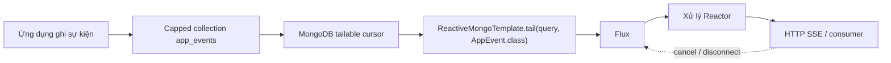
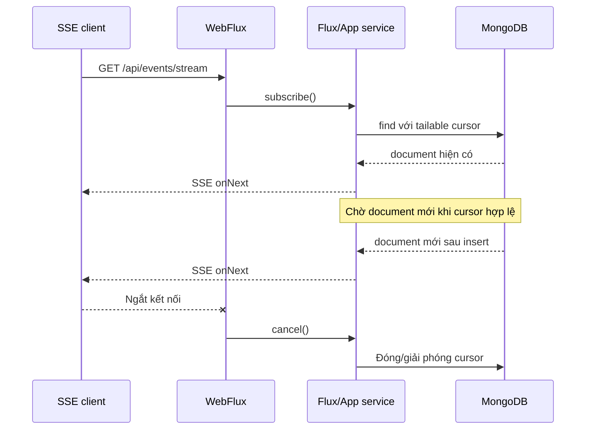

# Đọc bằng `ReactiveMongoTemplate.tail`

> **Chương:** Tailable cursor  
> **Nền tảng:** Spring Data MongoDB  
> **Đề bài:** Dùng `ReactiveMongoTemplate.tail(Query, Class<T>)` để đọc liên tục các document trong **capped collection**, xử lý `Flux` bằng Reactor, hủy subscription đúng cách và nhận biết các giới hạn khi áp dụng cho hệ thống thực tế.

## Mục tiêu học tập

Hoàn thành bài học, bạn có thể:

1. Mô tả vì sao `tail` khác `find` và khi nào MongoDB tailable cursor là lựa chọn hợp lý.
2. Tạo và xác minh capped collection, chuẩn bị document để truy vấn không bị kết thúc sớm.
3. Ánh xạ document bằng Spring Data MongoDB và nhận `Flux<T>` từ `ReactiveMongoTemplate.tail`.
4. Trả dòng dữ liệu qua HTTP Server-Sent Events (SSE) hoặc tiêu thụ bằng `subscribe` với quản lý vòng đời rõ ràng.
5. Phân tích trường hợp cursor bị đóng, bị ghi đè, điều kiện lọc không khớp, subscriber chậm, kết nối đứt và nhiều subscriber.
6. Phân biệt tailable cursor với Change Streams, `@Tailable` repository và các hệ thống message broker.

## 1. Tailable cursor hoạt động như thế nào?

Truy vấn `find` bình thường lấy tập kết quả hữu hạn. Khi đọc hết dữ liệu, cursor đóng; document ghi sau đó **không** tự xuất hiện trong lần truy vấn trước. Tailable cursor hoạt động tương tự lệnh `tail -f` trên tệp log: sau khi trả các document hiện có, cursor giữ vị trí ở cuối collection và chờ thêm document được ghi.

MongoDB chỉ cho phép tailable cursor đối với **capped collection** — collection có giới hạn dung lượng, vận hành như bộ đệm vòng: khi đầy, document cũ nhất sẽ bị thay thế để nhường chỗ cho document mới.



Khác biệt quan trọng:

| Tiêu chí | `find` / `findAll` | `ReactiveMongoTemplate.tail` |
|---|---|---|
| Loại luồng | Hữu hạn khi đã đọc hết kết quả | Có thể hoạt động liên tục khi còn hợp lệ |
| Collection | Thông thường hoặc capped | **Bắt buộc capped** |
| Document mới sau truy vấn | Không được gửi tiếp trong cùng cursor | Có thể được đẩy tới subscriber |
| Kết quả ban đầu | Các document đang khớp truy vấn | Cũng có thể phát các document **đã tồn tại**, sau đó mới chờ document mới |
| Kết thúc | Hoàn tất sau khi đọc hết | Hủy, lỗi, cursor mất hiệu lực hoặc điều kiện biên |
| Truy cập theo index | Theo kế hoạch truy vấn | Tailable cursor không sử dụng index, đọc theo thứ tự tự nhiên |
| Kiểu kết quả Spring Data | `Flux<T>` hữu hạn | `Flux<T>` có thể không kết thúc |

**Không đồng nhất “tailable” với “chỉ nhận sự kiện mới kể từ lúc bắt đầu”.** Lúc subscribe, cursor có thể đọc các document đã tồn tại và phù hợp truy vấn. Thiết kế consumer cần chấp nhận giai đoạn đọc dữ liệu cũ.

Tài liệu MongoDB nêu thêm: nếu truy vấn dựa chủ yếu vào trường được index và cần truy xuất theo khóa, cách phù hợp hơn có thể là truy vấn thường với checkpoint và lọc giá trị lớn hơn khóa cuối đã đọc. MongoDB tailable cursor không sử dụng index.

## 2. Khi nào nên dùng?

Một số ví dụ phù hợp:

- Theo dõi log ứng dụng hoặc thông báo ngắn được ghi liên tục và **được phép mất bản ghi cũ** khi bộ đệm đầy.
- Hiển thị bảng hoạt động trong một bản demo nội bộ, không yêu cầu replay bền vững hoặc delivery guarantee cao.
- Tiêu thụ tuần tự dữ liệu trên một capped collection có lưu lượng và tốc độ đọc kiểm soát được.

Nên cân nhắc giải pháp khác nếu yêu cầu là:

- **Bắt mọi thay đổi** insert/update/delete trên collection bình thường: dùng **MongoDB Change Streams** và đánh giá hỗ trợ resume token, topology triển khai.
- **Hàng đợi có consumer group, retry bền vững, ghi nhận offset, replay dài hạn:** dùng hệ thống event/message chuyên dụng khi tính năng đó là bắt buộc.
- **Đọc theo index, phân trang, truy vấn lịch sử lớn:** dùng `find` hoặc aggregation thông thường.
- **Lưu dữ liệu có chính sách retention linh hoạt:** capped collection không thay thế TTL trên collection thường trong mọi trường hợp.

MongoDB capped collection không hỗ trợ sharding và không được ghi trong transaction; các ràng buộc này phải được xét trước khi thiết kế nghiệp vụ.

## 3. Điều kiện cần trước khi gọi `tail`

### 3.1. Cấu hình dependency

Trong dự án Spring Boot sử dụng Java 17+, cấu hình starter MongoDB **reactive**. Nếu muốn phát dữ liệu qua HTTP SSE, thêm WebFlux:

```xml
<dependencies>
    <dependency>
        <groupId>org.springframework.boot</groupId>
        <artifactId>spring-boot-starter-data-mongodb-reactive</artifactId>
    </dependency>
    <dependency>
        <groupId>org.springframework.boot</groupId>
        <artifactId>spring-boot-starter-webflux</artifactId>
    </dependency>
</dependencies>
```

Chọn version thông qua Spring Boot BOM đang dùng, đồng bộ MongoDB Reactive Streams Driver và Spring Data MongoDB. `ReactiveMongoTemplate` cần cấu hình kết nối reactive đúng; không giả định bean này luôn có sẵn trong ứng dụng chỉ cấu hình `MongoTemplate` đồng bộ.

Ví dụ cấu hình phát triển:

```yaml
spring:
  data:
    mongodb:
      uri: mongodb://localhost:27017/spring_tail_demo
```

Với môi trường thật, thông tin xác thực, TLS, connection pool và URI nên được quản lý qua cấu hình an toàn, không nhúng credential vào mã nguồn.

### 3.2. Tạo capped collection

Có thể tạo bằng `mongosh`:

```javascript
use spring_tail_demo

db.createCollection("app_events", {
  capped: true,
  size: 4 * 1024 * 1024,
  max: 20000
});
```

Ý nghĩa:

- `capped: true`: collection giới hạn dung lượng.
- `size`: ngưỡng bộ đệm theo byte, ở đây là 4 MiB; không phải kích thước từng document.
- `max`: giới hạn số document bổ sung (tùy chọn). Dung lượng có thể chạm ngưỡng trước số lượng.

**Nếu `app_events` đã tồn tại là collection thường, gọi `createCollection` lần nữa sẽ không tự đổi loại collection.** Trong bài thực hành nên tạo database/collection riêng, xác minh tùy phiên bản và không xóa dữ liệu thật để thử nghiệm.

Kiểm tra thuộc tính:

```javascript
db.getCollectionInfos({ name: "app_events" });
```

Trong đầu ra, kiểm tra `options.capped` là `true` và kích thước đã cấu hình. Có thể dùng `db.runCommand({ collStats: "app_events" })` để theo dõi thống kê khi cần.

Spring Data MongoDB cũng hỗ trợ tạo collection bằng `CollectionOptions`; ví dụ sau sử dụng `ReactiveMongoTemplate` trong một luồng provisioning tách khỏi luồng đọc:

```java
import org.springframework.data.mongodb.core.CollectionOptions;
import org.springframework.data.mongodb.core.ReactiveMongoTemplate;
import reactor.core.publisher.Mono;

Mono<Void> createCappedCollection(ReactiveMongoTemplate mongo) {
    return mongo.createCollection(
        "app_events",
        CollectionOptions.empty().capped().size(4L * 1024 * 1024)
    ).then();
}
```

Chỉ gọi tạo khi collection chưa tồn tại; trong triển khai nhiều instance cần cơ chế khởi tạo schema tập trung để tránh race condition và lỗi trùng tên. Ở phần thực hành tiếp theo, giả sử collection đã được tạo bằng `mongosh`.

### 3.3. Ghi một document khớp điều kiện trước khi subscribe

Spring Data cảnh báo tailable cursor có thể trở nên **dead/invalid** nếu truy vấn không trả về document khớp khi mở cursor. Để tái hiện hành vi ổn định ở bài học, hãy seed ít nhất một document với đúng điều kiện lọc sẽ dùng:

```javascript
db.app_events.insertOne({
  tenantId: "demo",
  kind: "ORDER_CREATED",
  payload: "Order #1001",
  createdAt: new Date()
});
```

Sau đó có thể ghi thêm document với cùng `tenantId`/`kind` để quan sát sự kiện mới. Nếu thay filter thành `kind: "PAYMENT_RECEIVED"` mà collection chưa có bản ghi phù hợp, luồng có thể kết thúc ngay khi khởi tạo; đây không phải lỗi WebFlux.

## 4. API `ReactiveMongoTemplate.tail`

Trong Spring Data MongoDB, API cơ bản:

```java
<T> Flux<T> tail(Query query, Class<T> entityClass);

<T> Flux<T> tail(Query query, Class<T> entityClass, String collectionName);
```

`query` cho biết các tiêu chí (và có thể chọn trường); `entityClass` xác định kiểu đích để mapping BSON document sang Java. Biến thể ba tham số cho phép ghi rõ tên collection thay vì suy từ `@Document`.

Đây là **API reactive**: tạo `Flux` không đồng nghĩa đã mở cursor và truy vấn MongoDB. Khi có subscription, driver mới thực hiện thao tác đọc; mỗi subscription độc lập thông thường tạo một cursor độc lập.

### 4.1. Ánh xạ document

Ví dụ dùng Java record (Java 17+). Có thể thay bằng lớp Java có constructor/getter nếu dự án dùng phiên bản Java cũ.

```java
package example.tail;

import java.time.Instant;
import org.springframework.data.annotation.Id;
import org.springframework.data.mongodb.core.mapping.Document;

@Document("app_events")
public record AppEvent(
    @Id String id,
    String tenantId,
    String kind,
    String payload,
    Instant createdAt
) {}
```

Field `@Id` ánh xạ tới `_id`, `tenantId` và `kind` dùng để lọc, còn `payload` là nội dung hiển thị. Record giả sử document có cấu trúc tương ứng và Spring Data MongoDB hỗ trợ mapping record theo phiên bản sử dụng.

### 4.2. Service đọc liên tục

```java
package example.tail;

import org.slf4j.Logger;
import org.slf4j.LoggerFactory;
import org.springframework.data.mongodb.core.ReactiveMongoTemplate;
import org.springframework.data.mongodb.core.query.Criteria;
import org.springframework.data.mongodb.core.query.Query;
import org.springframework.stereotype.Service;
import reactor.core.publisher.Flux;

@Service
public class AppEventTailService {
    private static final Logger log =
        LoggerFactory.getLogger(AppEventTailService.class);

    private final ReactiveMongoTemplate mongo;

    public AppEventTailService(ReactiveMongoTemplate mongo) {
        this.mongo = mongo;
    }

    public Flux<AppEvent> followOrderCreated() {
        Query query = Query.query(
            Criteria.where("tenantId").is("demo")
                    .and("kind").is("ORDER_CREATED")
        );

        return mongo.tail(query, AppEvent.class)
            .doOnSubscribe(s -> log.info("Subscribed to app_events tail"))
            .doOnNext(event -> log.debug("Received event {}", event.id()))
            .doOnError(error -> log.error("Tail failed", error))
            .doFinally(signal -> log.info("Tail ended: {}", signal));
    }
}
```

Trong ví dụ:

- `mongo.tail(query, AppEvent.class)` trả `Flux<AppEvent>`; không cần tự lặp `while` hoặc gọi `getMore`.
- Reactor sẽ đưa mỗi document mới vào `onNext` khi đọc được.
- `doOnError` chỉ quan sát lỗi, không tự sửa hoặc nuốt lỗi. `doFinally` có thể nhận `CANCEL`, `ON_COMPLETE` hoặc `ON_ERROR` (và các loại signal khác).
- Filter `tenantId` trong ví dụ là giá trị cố định để làm lab. Với ứng dụng đa tenant, **tenant và quyền đọc phải được lấy từ thông tin xác thực của server**, không tin query parameter do người dùng tùy ý truyền vào.
- Việc lọc không bảo đảm hiệu quả như query có index: MongoDB tailable cursor đọc theo natural order, không sử dụng index.

Có thể gọi tường minh collection khi không sử dụng `@Document`:

```java
Flux<AppEvent> events = mongo.tail(
    Query.query(Criteria.where("kind").is("ORDER_CREATED")),
    AppEvent.class,
    "app_events"
);
```

### 4.3. Có cần `subscribe` thủ công?

Trong service trả `Flux` cho các component reactive khác, **thường không gọi `subscribe()` thủ công**. WebFlux sẽ subscribe để truyền dữ liệu đến client và cancel khi kết nối bị hủy.

Với consumer chủ động chạy nền, có thể tự quản lý subscription:

```java
import reactor.core.Disposable;

Disposable subscription = tailService.followOrderCreated()
    .subscribe(
        event -> process(event),
        error -> log.error("Consumer stopped", error),
        () -> log.info("Consumer completed")
    );

// Khi ứng dụng shutdown / worker dừng:
subscription.dispose();
```

Đoạn trên minh họa vòng đời; `process`, `log` là các thành phần của consumer. Không tạo `subscribe()` trong mỗi HTTP request rồi quên dispose: mỗi subscription có thể giữ tài nguyên cursor và kết nối. Nếu xử lý downstream là bất đồng bộ, cần thiết kế chuỗi `flatMap`/`concatMap` và giới hạn concurrency thay vì gọi hàm blocking ngay trên reactor thread.

## 5. Truyền dữ liệu qua SSE với Spring WebFlux

Một ứng dụng muốn phát dòng hoạt động theo thời gian thực có thể trả `Flux<ServerSentEvent<AppEvent>>`:

```java
package example.tail;

import org.springframework.http.MediaType;
import org.springframework.http.codec.ServerSentEvent;
import org.springframework.web.bind.annotation.GetMapping;
import org.springframework.web.bind.annotation.RequestMapping;
import org.springframework.web.bind.annotation.RestController;
import reactor.core.publisher.Flux;

@RestController
@RequestMapping("/api/events")
public class AppEventStreamController {
    private final AppEventTailService service;

    public AppEventStreamController(AppEventTailService service) {
        this.service = service;
    }

    @GetMapping(path = "/stream",
                produces = MediaType.TEXT_EVENT_STREAM_VALUE)
    public Flux<ServerSentEvent<AppEvent>> stream() {
        return service.followOrderCreated()
            .map(event -> ServerSentEvent.<AppEvent>builder()
                .id(event.id())
                .event("order-created")
                .data(event)
                .build());
    }
}
```

Ở đây `.id(event.id())` chỉ tạo trường ID cho **HTTP SSE**. Tailable cursor MongoDB **không có resume token kiểu Change Streams**; trình duyệt gửi `Last-Event-ID` cũng không khiến endpoint này tự phát lại đúng các sự kiện bị bỏ lỡ. Muốn hỗ trợ nối lại bằng ID thì cần tự thiết kế checkpoint và lưu trữ phù hợp.

### Thử nghiệm thủ công

1. Tạo capped collection và seed một document `ORDER_CREATED` như mục 3.
2. Khởi động ứng dụng Spring Boot; mở terminal và chạy:

   ```bash
   curl -N http://localhost:8080/api/events/stream
   ```

3. Trong `mongosh` khác, thực hiện:

   ```javascript
   db.app_events.insertOne({
     tenantId: "demo",
     kind: "ORDER_CREATED",
     payload: "Order #1002",
     createdAt: new Date()
   });

   db.app_events.insertOne({
     tenantId: "demo",
     kind: "PAYMENT_RECEIVED",
     payload: "Payment #1002",
     createdAt: new Date()
   });
   ```

4. Quan sát SSE: có thể thấy bản ghi `Order #1001` đã tồn tại rồi đến `Order #1002`. Bản ghi `PAYMENT_RECEIVED` không khớp `kind` nên không phải output của luồng này.
5. Dùng `Ctrl+C` đóng `curl`. Kết nối đóng khiến WebFlux cancel subscription, và tài nguyên đọc được giải phóng theo vòng đời reactive.

**Để quan sát dễ dàng:** seed document khớp filter *trước khi* mở SSE; nếu chưa có bản ghi khớp, cursor có thể chết trước khi nhận insert tiếp theo. Trình tự xử lý nhiều writer không nên được dùng làm cam kết thứ tự toàn cục.

## 6. Vòng đời `Flux`, backpressure và hủy đăng ký

Tailable cursor có thể dài hạn. Cần hiểu ba mốc quan trọng:



- **Cold publisher:** gọi `followOrderCreated()` tạo pipeline; subscription mới thực hiện đọc. Nhiều client đồng thời thường tạo nhiều cursor độc lập, đều có thể nhận dữ liệu cũ tương ứng.
- **Backpressure:** Reactor truyền nhu cầu tiêu thụ xuống chuỗi reactive; nó giúp điều phối yêu cầu dữ liệu nhưng **không làm MongoDB ngừng ghi**. Nếu writer nhanh hơn consumer và capped collection vòng qua vị trí đọc, cursor có thể mất hiệu lực và dữ liệu bị bỏ lỡ.
- **Cancel:** khi HTTP client đóng kết nối, hoặc consumer gọi `Disposable.dispose()`, subscription bị hủy; cần xác nhận driver và ứng dụng giải phóng cursor qua giám sát.
- **onComplete:** trong điều kiện lý tưởng cursor có thể mở lâu dài, nhưng có thể kết thúc khi query không có match hoặc cursor mất hiệu lực. Không coi `onComplete` là “hệ thống chắc chắn không còn sự kiện mới”.
- **onError:** kết nối MongoDB, collection không capped hoặc lỗi ánh xạ có thể phát `onError`, cần được log/giám sát và quyết định chính sách phục hồi.

Một số thao tác Reactor có thể vô tình chấm dứt việc theo dõi:

| Thao tác | Hiệu ứng | Gợi ý |
|---|---|---|
| `.take(10)` | Đọc 10 phần tử rồi cancel upstream | Dùng khi cần sample hoặc trong test |
| `.take(Duration.ofSeconds(30))` | Giới hạn thời gian theo dõi | Phù hợp cho thử nghiệm |
| `.collectList()` / `.blockLast()` | Chờ stream hoàn tất; có thể chờ mãi | Không dùng để trả kết quả của luồng vô hạn trong request đồng bộ |
| `.timeout(...)` | Phát lỗi nếu không có dữ liệu đúng thời hạn | Phân biệt không có sự kiện với lỗi kết nối; có thể thêm heartbeat SSE |
| `.publishOn(...)` | Chuyển luồng xử lý sang scheduler thích hợp | Nếu có logic tốn CPU; với I/O blocking cần cô lập và giới hạn |
| `.share()` | Chia sẻ một upstream cho nhiều subscriber khi phù hợp | Cần quyết định phạm vi dữ liệu, bảo mật và lifecycle rõ ràng |

**Không nên `cache()` vô hạn cho dòng sự kiện không giới hạn** vì bộ nhớ có thể tiếp tục tăng do lưu history. Nếu cần chia sẻ dữ liệu tới nhiều client, hãy thiết kế một fan-out có giới hạn, kiểm soát quyền theo client và làm rõ chính sách khi client kết nối lại.

## 7. Xử lý lỗi và phục hồi

### 7.1. Những tình huống khiến tailable cursor mất hiệu lực

Tài liệu Spring Data và MongoDB lưu ý hai nhóm tình huống:

1. **Truy vấn không có document phù hợp** khi mở tailable cursor: luồng có thể kết thúc sớm. Với bài lab, seed một record đúng filter; với sản phẩm, phải kiểm soát lifecycle và chiến lược khởi động.
2. **Vị trí cursor bị ghi đè** khi capped collection loại bỏ document cũ vì dung lượng đầy: consumer đọc quá chậm có thể mất dữ liệu và cần mở lại cursor.

Thêm các lỗi thường gặp: collection chưa tồn tại hoặc không capped; sai database; mapping document thất bại; driver bị ngắt kết nối; subscriber đóng; giới hạn tài nguyên.

### 7.2. `retryWhen` không xử lý mọi dạng dừng

Ví dụ cho lỗi **phát qua `onError`**:

```java
import java.time.Duration;
import reactor.core.publisher.Flux;
import reactor.util.retry.Retry;

Flux<AppEvent> resilientErrorsOnly = service.followOrderCreated()
    .retryWhen(Retry.backoff(5, Duration.ofSeconds(1)));
```

Đoạn trên có giới hạn tối đa 5 lần retry (có backoff). Cần thêm điều kiện chỉ retry lỗi tạm thời, log và alert trong hệ thống thật; lỗi cấu hình như “collection không capped” cần sửa nguyên nhân, retry vô hạn không có ích.

`retryWhen` **không chạy khi Flux kết thúc bằng `onComplete`**. Có thể dùng `repeatWhen`/`repeatWhenEmpty` hoặc điều phối supervisor để resubscribe sau một lần hoàn thành, nhưng phải có khoảng nghỉ, giới hạn và quan sát rõ ràng: resubscribe sẽ mở một cursor mới, có thể đọc lại document lịch sử hoặc bỏ lỡ document đã bị ghi đè. Không nên đặt `repeat()` vô hạn trên luồng rỗng vì có thể tạo vòng lặp nhanh, liên tục mở cursor.

### 7.3. Checkpoint, replay và tính nhất quán

Giả sử consumer đọc các sự kiện A, B, C rồi mất kết nối. Capped collection đã ghi thêm D, E và đồng thời ghi đè A, B. Khi kết nối lại, một cursor mới **không có resume token**; nó không đảm bảo bắt đầu chính xác ở D. Việc ghi lại `_id` của C hoặc timestamp trong ứng dụng cũng không tự chuyển cursor thành giải pháp resume đáng tin cậy, đặc biệt khi timestamp trùng nhau, dữ liệu cũ bị xóa hoặc nhiều writer cùng ghi.

Với nghiệp vụ cần phục hồi:

- Thiết kế ID sự kiện ổn định và consumer **idempotent** để xử lý trùng.
- Lưu checkpoint bên ngoài luồng và dùng dữ liệu lưu trữ bền vững có thể query lại khi có khoảng trống; bổ sung truy vấn catch-up nếu cần.
- Có metric phát hiện gián đoạn, độ trễ xử lý, số lần resubscribe và tần suất capped collection ghi đè dữ liệu.
- Nếu bài toán là theo dõi thay đổi dữ liệu MongoDB có thể resume khi phù hợp, đánh giá `ReactiveMongoTemplate.changeStream(...)` và Change Streams trên deployment được hỗ trợ. Đừng gán resume token của Change Streams cho `tail`.

## 8. Chẩn đoán và tối ưu hiệu năng

### 8.1. Checklist kỹ thuật

| Hiện tượng | Nguyên nhân khả dĩ | Cách xác minh / khắc phục |
|---|---|---|
| Vừa subscribe đã hoàn tất | Filter chưa có document phù hợp | Seed một record khớp; kiểm tra `tenantId`, `kind` và logic mở cursor |
| Báo lỗi `tailable` không hợp lệ | Collection không phải capped | Kiểm tra `getCollectionInfos`, tạo collection đúng kiểu |
| Không thấy bản ghi mới | Viết nhầm database/collection hoặc filter không khớp | Kiểm tra URI, log insert, đọc một `find` thường với cùng filter |
| Nhận cả document cũ | Tailable cursor đọc các bản ghi hiện có khi bắt đầu | Thiết kế hành vi khởi tạo; không giả định chỉ nhận dữ liệu sau subscription |
| Stream đang chạy rồi dừng | Cursor mất hiệu lực do vòng ghi đè, kết nối lỗi, client cancel | Log `doFinally`/`doOnError`, kiểm tra metric MongoDB và tốc độ ghi/đọc |
| Nhiều SSE client làm tải tăng | Mỗi subscription mở cursor riêng | Đo số cursor/connection; giới hạn client và cân nhắc fan-out |
| Consumer bị tụt hoặc mất sự kiện | Downstream chậm, capped quá nhỏ, writer nhanh | Tăng buffer có chủ đích, tối ưu xử lý, bổ sung cơ chế bền vững nếu yêu cầu |
| CPU cao khi lọc | Tailable cursor không sử dụng index, phải quét theo natural order | Giảm độ phức tạp filter hoặc chọn mô hình truy vấn khác |
| Luồng HTTP bị proxy đóng | Idle timeout không có dữ liệu | Cấu hình timeout phù hợp, cân nhắc heartbeat SSE |

### 8.2. Các số liệu nên theo dõi

- **Số cursor đang mở** và số lượng kết nối/HTTP clients, tách riêng theo luồng và tenant.
- **Tần suất onError, onComplete, cancel, resubscribe**; đặc biệt là stream bất ngờ dừng.
- **Thời gian từ `createdAt` đến lúc consumer nhận**; cẩn thận đồng hồ ở writer và consumer có thể lệch.
- **Tốc độ insert, tốc độ xử lý, kích thước capped collection** và dấu hiệu bị ghi đè.
- **Giới hạn tài nguyên**: CPU, heap, buffers, số downstream subscribers, timeout của proxy.

Capped collection có kích thước hữu hạn; tăng `size` giúp kéo dài thời gian dữ liệu lưu trong bộ đệm nhưng không biến nó thành log bền vững vô hạn. Chọn dung lượng theo lưu lượng đỉnh, kích thước trung bình mỗi document và thời gian tối đa chấp nhận consumer bị gián đoạn.

## 9. So sánh với các API gần kề

| Công cụ | Loại nguồn | API Spring Data | Nhu cầu |
|---|---|---|---|
| Reactive tailable cursor | Capped collection; phát document theo vị trí đọc tự nhiên | `ReactiveMongoTemplate.tail(...)` | Theo dõi log/nhật ký ngắn, stream đơn giản |
| Reactive repository tailable | Capped collection | `@Tailable` + `Flux<T>` trong `ReactiveMongoRepository` | Query tailable khai báo trong repository |
| MongoDB Change Streams | Các sự kiện thay đổi MongoDB trên deployment hỗ trợ | `ReactiveMongoTemplate.changeStream(...)` | Theo dõi insert/update/delete; cân nhắc resume token |
| Reactive `find` | Collection thông thường | `ReactiveMongoTemplate.find(...)` | Truy vấn hữu hạn với index và điều kiện phong phú |
| Message broker | Topic/queue với cơ chế lưu trữ và delivery riêng | Adapter/reactive client tương ứng | Consumer group, retry, replay, tải lớn và cam kết giao nhận |

Một repository có thể viết:

```java
import org.springframework.data.mongodb.repository.ReactiveMongoRepository;
import org.springframework.data.mongodb.repository.Tailable;
import reactor.core.publisher.Flux;

public interface AppEventRepository
        extends ReactiveMongoRepository<AppEvent, String> {

    @Tailable
    Flux<AppEvent> findByKind(String kind);
}
```

Lựa chọn `ReactiveMongoTemplate.tail` phù hợp khi cần dựng `Query` động và muốn kiểm soát các điều kiện tại tầng service. `@Tailable` gọn cho truy vấn repository cố định. Dù chọn API nào, yêu cầu collection capped và giới hạn của tailable cursor **không đổi**.

## 10. Bài thực hành có kiểm chứng

**Bài A — Luồng cơ bản.** Tạo `app_events` capped, seed một document `kind=ORDER_CREATED`, mở `curl -N` và insert thêm hai event phù hợp. Xác minh nhận được document đầu tiên và event mới; event `PAYMENT_RECEIVED` phải bị lọc.

**Bài B — Cancel và cleanup.** Mở một SSE client, quan sát log `Subscribed`; đóng client rồi xác minh `doFinally` ghi `cancel` và số cursor trở về bình thường. Mở hai client đồng thời, giải thích vì sao số cursor có thể tăng.

**Bài C — Query không có match.** Sửa filter thành `kind=UNKNOWN_KIND` khi collection chưa có document như vậy; quan sát `onComplete`/hành vi cursor. Giải thích tại sao chỉ `retryWhen` không đủ để tự khôi phục luồng.

**Bài D — Capped rollover.** Trong database thử nghiệm, dùng kích thước collection nhỏ và ghi nhiều document để buộc ghi đè. Tạo consumer chậm có chủ ý, ghi nhận thời điểm cursor dừng/mất dữ liệu. Đề xuất cách phát hiện, cảnh báo và xử lý trùng/mất khi mở lại.

**Bài E — Chọn công nghệ.** Với các yêu cầu (i) dashboard log không cần replay, (ii) đồng bộ mọi thay đổi có resume, (iii) thanh toán cần delivery bền vững, hãy chọn `tail`, Change Streams hoặc message broker và giải thích ràng buộc.

### Câu hỏi tự kiểm tra

1. Vì sao `tail` cần capped collection, và tại sao không thể dùng trực tiếp trên collection thường?
2. Luồng `Flux<AppEvent>` bắt đầu hoạt động ở thời điểm xây pipeline hay khi subscription được tạo?
3. Điều gì xảy ra khi gọi `.take(5)` trên `tail(...)`?
4. Vì sao có thể thấy document đã tồn tại trước khi mở SSE?
5. Sự khác nhau giữa `onError` và `onComplete` ảnh hưởng ra sao đến `retryWhen`?
6. Tại sao backpressure không đảm bảo không mất event khi capped collection đầy?
7. Khi nào nên chuyển sang Change Streams hoặc một hệ thống hàng đợi sự kiện?

## Tài liệu tham khảo

- [Spring Data MongoDB — Tailable Cursors](https://docs.spring.io/spring-data/mongodb/reference/mongodb/tailable-cursors.html)
- [Spring Data MongoDB — ReactiveMongoTemplate API](https://docs.spring.io/spring-data/mongodb/reference/api/java/org/springframework/data/mongodb/core/ReactiveMongoTemplate.html)
- [MongoDB Manual — Tailable Cursors](https://www.mongodb.com/docs/manual/core/tailable-cursors/)
- [MongoDB Manual — Capped Collections](https://www.mongodb.com/docs/manual/core/capped-collections/)
- [MongoDB Manual — `cursor.tailable()`](https://www.mongodb.com/docs/manual/reference/method/cursor.tailable/)
- [Reactor Core — Reference Guide](https://projectreactor.io/docs/core/release/reference/)
