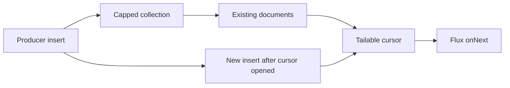

# @Tailable trên phương thức ReactiveMongoRepository

**Spring Data MongoDB** hỗ trợ phương thức repository reactive trả về một chuỗi các document mới được thêm vào **capped collection**. Khi đánh dấu phương thức `ReactiveMongoRepository` bằng `@Tailable` và khai báo kiểu kết quả `Flux<T>`, Spring Data mở một MongoDB **tailable cursor**, có thể tiếp tục đọc dữ liệu sau khi những document đã có được tiêu thụ. Đây là cách theo dõi luồng log hoặc feed dạng append-only, tương tự lệnh `tail -f` trong Unix.

Bài thuộc chương **Tailable cursor** của module `SPRING_DATA_MONGODB`. Module bao quát kết nối, ánh xạ document, thao tác qua `MongoTemplate`/repository, truy vấn, aggregation, index, transaction, reactive access, kiểm thử và chẩn đoán hiệu năng. Chủ đề cụ thể ở đây là **`@Tailable trên phương thức ReactiveMongoRepository`**, từ cấu hình MongoDB, định nghĩa entity/repository đến subscription, lỗi, test và vận hành.

> **Quan trọng:** `@Tailable` **không tạo capped collection**, **không có resume token** và **không đảm bảo luồng sống mãi**. Capped collection chỉ giữ lịch sử hữu hạn; tailable cursor có thể chết khi truy vấn ban đầu không match hoặc vị trí đọc bị ghi đè. Tailable cursor có thể dùng trên MongoDB standalone, không bắt buộc replica set như change streams.

## 1. Mục tiêu học tập

Sau bài này, bạn có thể:

1. Phân biệt regular cursor với tailable cursor.
2. Giải thích vì sao phải dùng **capped collection**.
3. Tạo capped collection với `size` theo bytes và `max` tùy chọn.
4. Xác minh collection đã capped, không chỉ nhìn `@Document`.
5. Hiểu natural order, collection scan và việc tailable không dùng index.
6. Hiểu `tailable`, `awaitData`, `getMore` và empty batches.
7. Biết nguyên nhân cursor invalid/dead khi query không khớp hoặc dữ liệu bị ghi đè.
8. Định nghĩa `@Tailable Flux<Entity>` trên `ReactiveMongoRepository`.
9. Dùng derived query, `@Query` và named parameters an toàn.
10. Tránh dùng `Mono`/`List` cho infinite stream.
11. Phân biệt `@Tailable` với `ReactiveMongoTemplate.tail` và change streams.
12. Tổ chức producer/consumer với Reactor mà không hidden `subscribe()`.
13. Kiểm soát subscription, cancellation, retry và backpressure.
14. Xây endpoint WebFlux/SSE với phân quyền tenant.
15. Hiểu vì sao nhiều subscribers có thể mở nhiều cursors.
16. Thiết kế test với seed event, `take(2)` và `StepVerifier`.
17. Phân biệt test standalone MongoDB với replica set.
18. Hiểu giới hạn capped: không sharding, không ghi transaction, không replay bền vững.
19. Đánh giá cảnh báo dữ liệu nhạy cảm, retention và quá tải.
20. Biết khi nào nên chuyển sang change streams hoặc message broker.

## 2. Regular cursor và tailable cursor

Với query thông thường, khi MongoDB trả hết document hiện có, cursor đóng và `Flux` phát `onComplete`. Việc insert một document sau thời điểm đó **không làm subscription cũ nhận thêm dữ liệu**.

Tailable cursor trên capped collection giữ trạng thái theo dõi cuối collection để tiếp tục nhận document mới được insert:



| Khía cạnh | Regular query cursor | Tailable cursor |
| --- | --- | --- |
| Collection | Thường hoặc capped | **Chỉ capped** |
| Kết quả đã đọc hết | Complete | Có thể tiếp tục chờ |
| Index | Query planner có thể dùng index | **Không dùng index** |
| Thứ tự | Query/sort plan | Natural order |
| Nhận insert tiếp theo | Không sau completion | Có khi cursor còn sống |
| Resume token | Không | Không |
| Tính bền vững | Kết quả query tại lần gọi | Không phải durable delivery |
| Khả năng kết thúc | Hữu hạn | Có thể complete, error hoặc cancel |

### 2.1. Infinite stream không có nghĩa bất tử

Spring Data docs gọi các `Flux` này là **infinite streams** theo thiết kế, nhưng cả MongoDB lẫn Javadoc `@Tailable` đều cảnh báo cursor có thể chết: query trả không có match, vị trí đọc bị thay thế, connection bị ngắt hoặc subscription bị hủy. Đừng mặc định `onComplete` là sự kiện không bao giờ xảy ra.

### 2.2. Cursor có thể đọc dữ liệu cũ trước

Khi subscribe trên một capped collection đã có documents, cursor có thể phát **các document đang tồn tại** rồi mới tiếp tục theo dõi inserts mới. `@Tailable` không có thuộc tính `fromNow` hay offset durability như consumer group của message broker.

## 3. Capped collection là gì?

Capped collection là một collection có **dung lượng cố định**, hoạt động như circular buffer: khi đầy, MongoDB loại dần các documents cũ nhất để dành chỗ cho inserts mới. Nó phù hợp cho feed dạng ghi bổ sung và lịch sử ngắn hạn.

```javascript
use reactive_feed_demo

db.createCollection("app_event_feed", {
  capped: true,
  size: 8 * 1024 * 1024,
  max: 10000
})
```

`size` là giới hạn **bytes** (8 MiB trong ví dụ); `max` là giới hạn document count **tùy chọn**. Size có thể đầy trước khi đạt 10.000 records, vì vậy không hứa collection luôn lưu đúng 10.000 bản ghi.

### 3.1. Kiểm tra đã capped

```javascript
const collections = db.getCollectionInfos({
  name: "app_event_feed"
})

printjson(collections.map(c => ({
  name: c.name,
  capped: c.options.capped,
  size: c.options.size,
  max: c.options.max
})))
```

Một collection đã tồn tại dạng regular **không tự biến thành capped** chỉ vì bạn thêm `@Tailable` hoặc `@Document`. Kiểm tra metadata trước khi subscribe.

### 3.2. Giới hạn của capped collections

- **Không thể sharding** capped collection.
- **Không thể ghi** vào capped collection trong multi-document transaction.
- `$out` không thể ghi kết quả vào capped collection.
- Capped collection không thuộc MongoDB Stable API V1; xem cấu hình Stable API strict của client.
- Tránh update làm tăng kích thước document; thiết kế append-only.
- Tránh delete tùy tiện, không dùng capped làm queue có ACK/xóa từng item.
- Đọc từ tailable cursor là collection scan, không tối ưu theo index như regular query.
- Khi producer ghi nhanh hơn khả năng reader theo dõi, dữ liệu cũ bị loại và cursor có thể mất hiệu lực.

### 3.3. So với TTL index

Regular collection kết hợp TTL index rất phù hợp với retention theo thời gian, nhưng **không** hỗ trợ tailable cursor. Ngược lại, capped collection giới hạn byte capacity chứ không bảo đảm giữ dữ liệu trong X phút. Chọn công cụ theo yêu cầu thay vì coi hai cơ chế là tương đương.

## 4. Tạo capped collection bằng Spring Data

`ReactiveMongoTemplate` hỗ trợ API `createCollection` kèm `CollectionOptions`:

```java
import org.springframework.data.mongodb.core.CollectionOptions;
import reactor.core.publisher.Mono;

Mono<Void> create = reactiveMongoTemplate
    .createCollection(
        "app_event_feed",
        CollectionOptions.empty()
            .capped()
            .size(8L * 1024 * 1024))
    .then();
```

`reactiveMongoTemplate` là bean đã được inject. Vì đây là reactive Publisher, câu lệnh chỉ chạy khi **được subscribe**. Thực hiện việc này qua **migration, application bootstrap hoặc test fixture** có kiểm soát, không gọi mỗi HTTP request.

### 4.1. Nếu collection đã tồn tại?

`createCollection` có thể thất bại vì namespace đã tồn tại. Không nuốt hết lỗi rồi tuyên bố collection đúng; một regular collection đang tồn tại **vẫn không hợp lệ** cho tailable cursor. Lập migration để xử lý dữ liệu, permissions và rollover. Đừng dùng `dropCollection` trực tiếp trên production để sửa lỗi này.

### 4.2. Tạo bằng imperative MongoTemplate

Nếu chương trình có bean `MongoTemplate`:

```java
mongoTemplate.createCollection(
    "app_event_feed",
    CollectionOptions.empty()
        .capped()
        .size(8L * 1024 * 1024)
);
```

Đây là một thao tác provision đồng bộ; code của repository ở bài vẫn dùng reactive driver khi chạy.

## 5. Dependency và MongoDB topology

Với Spring Boot, sử dụng reactive MongoDB starter:

```groovy
dependencies {
    implementation "org.springframework.boot:spring-boot-starter-data-mongodb-reactive"
    implementation "org.springframework.boot:spring-boot-starter-webflux"
    implementation "org.springframework.boot:spring-boot-starter-security"
    testImplementation "org.springframework.boot:spring-boot-starter-test"
    testImplementation "io.projectreactor:reactor-test"
}
```

BOM của Spring Boot nên quản lý versions Spring Data MongoDB, Project Reactor và MongoDB Reactive Streams Driver tương thích.

### 5.1. Có cần replica set không?

**Không**. Tailable cursor trên capped collection có thể chạy với MongoDB standalone, replica set hoặc topology hỗ trợ collection đó. Điều này khác MongoDB **change streams**, vốn yêu cầu replica set hoặc sharded cluster.

Tuy nhiên, một **capped collection không thể được sharding**, nên nếu ứng dụng cần sharded event feed, không dùng `@Tailable` như một chiến lược sharded queue.

### 5.2. Connection string chỉ cấu hình kết nối

Ví dụ Spring Boot 3.x:

```yaml
spring:
  data:
    mongodb:
      uri: mongodb://localhost:27017/reactive_feed_demo
```

Cần đối chiếu property namespace với Spring Boot major version đang dùng. URI không tạo capped collection, không đổi query thành tailable và không tự cấp quyền read/write.

## 6. Domain entity mẫu

Giả sử event feed lưu những bản ghi append-only:

```java
package dev.learning.feed;

import java.time.Instant;
import org.springframework.data.annotation.Id;
import org.springframework.data.mongodb.core.mapping.Document;

@Document("app_event_feed")
public record FeedEvent(
    @Id String id,
    String tenantId,
    String channel,
    String kind,
    String message,
    Instant createdAt
) {}
```

Java record phù hợp những phiên bản Spring Data/Java hỗ trợ constructor mapping. Nếu cần tương thích Java cũ, dùng một class với constructor/properties hợp lệ.

### 6.1. @Document không phải @Capped

`@Document("app_event_feed")` khai báo collection name phục vụ mapping, **không** tạo storage options `capped: true`. Spring Data không có một repository annotation chuẩn `@Capped` làm thay toàn bộ migration của MongoDB.

### 6.2. Vì sao entity không có acknowledged flag?

Một capped collection không phải queue với ACK. Cập nhật trạng thái từng item thường không hợp với append-oriented storage, và capped collection có nhiều hạn chế update/delete. Nếu cần per-consumer offsets, bền vững, retry hoặc backfill, hãy chọn broker hoặc event store phù hợp.

## 7. Định nghĩa @Tailable trên ReactiveMongoRepository

```java
package dev.learning.feed;

import org.springframework.data.mongodb.repository.ReactiveMongoRepository;
import org.springframework.data.mongodb.repository.Tailable;
import reactor.core.publisher.Flux;

public interface FeedEventRepository
        extends ReactiveMongoRepository<FeedEvent, String> {

    @Tailable
    Flux<FeedEvent> findByChannel(String channel);
}
```

Ý nghĩa:

1. `ReactiveMongoRepository<FeedEvent,String>` là repository reactive cho entity.
2. `findByChannel` được Spring Data chuyển thành query theo field `channel`.
3. `@Tailable` khiến query dùng tailable cursor.
4. `Flux<FeedEvent>` biểu diễn luồng có thể phát **nhiều** documents.
5. Collection `app_event_feed` phải được tạo **capped trước**.
6. MongoDB thao tác khi Publisher được subscribe, không chỉ khi gọi Java method.
7. Caller cần xử lý `onNext`, `onError`, `onComplete` và `cancel`.

### 7.1. Import chính xác

```java
import org.springframework.data.mongodb.repository.Tailable;
```

Annotation được đặt **trên method** (`Target: METHOD, ANNOTATION_TYPE`), không trên entity. Nó đã có từ Spring Data MongoDB 2.0.

### 7.2. Không dùng Mono làm return type

```java
// KHÔNG PHÙ HỢP: Mono chỉ tối đa một item.
@Tailable
Mono<FeedEvent> findFirstByChannel(String channel);
```

Javadoc `@Tailable` ghi rõ phải dùng reactive type có thể phát **nhiều phần tử**, chẳng hạn `Flux`. Nếu cần đọc một record hiện tại, dùng `Mono`/`findFirst...` **không** có `@Tailable`.

### 7.3. Có thể dùng @Query

```java
import org.springframework.data.mongodb.repository.Query;

@Tailable
@Query("{ 'channel': ?0, 'tenantId': ?1 }")
Flux<FeedEvent> tailForTenant(
    String channel, String tenantId);
```

Đặt phương thức trong cùng repository interface. `?0`, `?1` là query parameter binding Spring Data; `tenantId` phải đến từ security context/trusted service identity.

## 8. Ghi event qua repository

```java
package dev.learning.feed;

import java.time.Clock;
import java.time.Instant;
import java.util.UUID;
import org.springframework.stereotype.Service;
import reactor.core.publisher.Mono;

@Service
public class FeedPublisher {

    private final FeedEventRepository repository;
    private final Clock clock;

    public FeedPublisher(FeedEventRepository repository, Clock clock) {
        this.repository = repository;
        this.clock = clock;
    }

    public Mono<FeedEvent> publish(
            String trustedTenantId,
            String channel,
            String kind,
            String safeMessage) {

        FeedEvent event = new FeedEvent(
            UUID.randomUUID().toString(),
            trustedTenantId, channel, kind,
            safeMessage, Instant.now(clock));

        return repository.insert(event);
    }
}
```

`Clock` được cung cấp qua Spring configuration (ví dụ `Clock.systemUTC()`), hoặc có thể được khởi tạo trong service theo policy. Nếu inject `Clock` như ví dụ, khai báo bean riêng:

```java
import java.time.Clock;
import org.springframework.context.annotation.Bean;
import org.springframework.context.annotation.Configuration;

@Configuration
public class FeedClockConfiguration {
    @Bean
    Clock clock() {
        return Clock.systemUTC();
    }
}
```

Starter Security trong ví dụ Gradle cần thiết khi dùng `@AuthenticationPrincipal` ở controller SSE; vẫn phải cấu hình authentication/authorization cho ứng dụng, không chỉ thêm dependency.

- Dùng `insert` cho append-only event. `save` mang ý nghĩa insert/update và có thể sửa record cũ.
- `Mono<FeedEvent>` phải được return/compose để lỗi insert được propagate.
- **Không ghi vào capped collection trong transaction**: MongoDB không hỗ trợ transaction writes vào capped.
- Không gọi `repository.insert(event).subscribe()` bên trong service rồi trả `Mono.empty()`: đây là fire-and-forget, khó kiểm soát kết quả.

### 8.1. Cần đồng bộ event với transaction khác?

Nếu nghiệp vụ thanh toán cập nhật orders trong transaction và muốn publish event nguyên tử, không thể gộp write vào capped collection chung transaction ấy. Xem **transactional outbox** trong normal collection, rồi relay event sang capped feed hoặc message bus với retry/idempotency.

## 9. Consumer trả Flux thay vì subscribe ẩn

```java
package dev.learning.feed;

import org.springframework.stereotype.Service;
import reactor.core.publisher.Flux;

@Service
public class FeedTailService {

    private final FeedEventRepository repository;

    public FeedTailService(FeedEventRepository repository) {
        this.repository = repository;
    }

    public Flux<FeedEvent> follow(
            String authorizedTenantId, String channel) {

        if (authorizedTenantId == null
                || authorizedTenantId.isBlank()
                || channel == null || channel.isBlank()) {
            return Flux.error(new IllegalArgumentException(
                "Tenant hoặc channel không hợp lệ"));
        }

        return repository.tailForTenant(
            channel, authorizedTenantId);
    }
}
```

Luồng là Publisher do framework/client subscribe tại ranh giới ứng dụng. **Không** gọi `subscribe()` trong service nếu không có lifecycle owner rõ. Cần nhớ một query `tenantId + channel` không có match ban đầu **có thể complete trước khi event mới đến**; điều này được giải thích ở phần tiếp theo.

## 10. Bẫy lớn nhất: không có document khớp lúc bắt đầu

Theo Spring Data MongoDB Reference và Javadoc `@Tailable`, **tailable cursor có thể chết nếu truy vấn không tìm thấy bản ghi khớp**.

Ví dụ:

```text
T0: capped collection chỉ có channel=billing
T1: subscriber gọi findByChannel("shipping")
T2: truy vấn không có match ban đầu -> cursor có thể complete/invalid
T3: producer mới insert channel=shipping
T4: subscription cũ không tự nhận được event ở T3
```

Vì vậy không thể hiểu `@Tailable` là một bộ đăng ký sự kiện tồn tại vĩnh viễn cho mọi filter. Query càng chọn lọc theo tenant/channel thì càng có khả năng **chưa có match**.

### 10.1. Seed trong demo và test

Trước khi subscribe, insert một event khớp filter:

```java
FeedEvent seed = new FeedEvent(
    "SEED-" + java.util.UUID.randomUUID(),
    "tenant-a",
    "billing",
    "SEED",
    "stream ready",
    java.time.Instant.now());

Mono<FeedEvent> seedWrite = repository.insert(seed);
```

Trong test, **đợi seedWrite hoàn tất** rồi mới mở tailable Flux. Seed giúp demo/test ổn định nhưng không bảo đảm consumer production không chết: capped collection đầy sẽ loại lịch sử cũ.

### 10.2. Server-side filter so với Reactor filter

Một `@Tailable @Query` lọc `tenantId` ngay trên server:

```java
Flux<FeedEvent> scope =
    repository.tailForTenant("billing", "tenant-a");
```

Điều này giới hạn dữ liệu theo predicate, nhưng có thể gặp **no initial match**. Ngược lại, nếu tail toàn bộ collection rồi dùng `Flux.filter(...)`, consumer sẽ đọc events của mọi tenant; chi phí lớn hơn và có rủi ro quyền dữ liệu. **Không** bỏ tenant predicate một cách tùy tiện chỉ để giữ cursor sống.

### 10.3. Cách thiết kế nếu cần subscriber luôn sẵn sàng

- Trong demo một channel, có thể seed record sớm.
- Trong hệ thống ít channels, heartbeat/marker có thể giúp có initial match, nhưng vẫn không giải quyết overwrite/replay.
- Nếu dùng nhiều tenants/channels động, cân nhắc **change streams** trên collection thường hoặc event broker có durable offsets.
- Nếu vẫn chọn tailable, phải xử lý complete/error, mở lại với backoff, dedup và đối soát. Resubscribe **không có resume token**, có nguy cơ thiếu hoặc lặp events.

## 11. Cursor invalid khi dữ liệu bị ghi đè

Capped collection là circular buffer. MongoDB cảnh báo **vị trí cursor có thể bị ghi đè** khi producer ghi nhanh hơn consumer.

```text
Producer: e100 -> e101 -> ... -> e9000
Consumer: e100 -> e101 -> e102 (đọc quá chậm)
Capped collection đầy -> các record cũ bị loại
Cursor trỏ vị trí đã mất -> cursor có thể invalid
```

### 11.1. Dung lượng là giới hạn lịch sử

Ước tính sơ bộ:

\[
\text{bytesNeeded} \approx
\text{eventsPerSecond} \times
\text{averageEventBytes} \times
\text{retentionSeconds}
\]

Nếu một giây 100 events, một event trung bình 1 KiB và muốn giữ khoảng 600 giây, payload khoảng **60 MiB** chưa kể overhead/variance. Kích thước capped vẫn **không bảo đảm retention theo thời gian**, nên hãy đo ingest rate và giám sát.

### 11.2. Natural order không phải global order tuyệt đối

MongoDB ghi nhận khi có **nhiều writers đồng thời**, capped collections không bảo đảm mọi documents được trả đúng trình tự insert theo cách bạn suy từ timestamps. Nếu cần strict ordering qua nhiều producers, áp một sequence/partition contract hoặc dùng broker có ordering semantics rõ ràng.

## 12. awaitData và getMore

MongoDB tailable cursor có hai đặc tính:

- `tailable: true` giữ cursor có khả năng đọc thêm sau khi hết dữ liệu hiện tại.
- `awaitData: true` khiến một lần `getMore` có thể chờ trong khoảng thời gian trước khi trả kết quả.
- `maxAwaitTimeMS` giới hạn thời gian server đợi **một lần getMore**, không phải lifetime của toàn bộ cursor.

Ví dụ `mongosh`:

```javascript
const cursor = db.app_event_feed.find({
  channel: "billing"
})
.tailable({ awaitData: true })
.maxAwaitTimeMS(1000);

// Ví dụ kiểm tra trong terminal dev:
while (cursor.hasNext()) {
  printjson(cursor.next())
}
```

Vòng lặp chỉ dùng khi đã có seed phù hợp và chạy thử trên database dev. Đừng chạy vòng lặp blocking này trong HTTP request thread.

### 12.1. Empty batch không phải onComplete

MongoDB Driver Specification ghi rõ `getMore` có thể trả `nextBatch` rỗng cho tailable+awaitData, nhưng cursor vẫn active. Driver/Spring Data không được tự coi một batch rỗng là nguồn đã kết thúc nếu server còn cursor.

### 12.2. Timeout khác chờ event mới

`maxAwaitTimeMS(1000)` cho server chờ tối đa khoảng 1 giây trên một đợt `getMore`. Nó không có nghĩa luồng phải tự đóng sau một giây im lặng. `Flux.timeout(Duration)` của Reactor có thể **hủy luồng** khi không có event, và cần dùng có chủ đích.

### 12.3. @Tailable không mở mọi driver option

`@Tailable` chỉ là khai báo query method. Nếu cần kiểm soát các tùy chọn cursor cấp thấp không có trong repository API, xem `ReactiveMongoTemplate.tail` hoặc Reactive Streams Driver theo đúng Spring Data version. Đừng tự thêm một thuộc tính không tồn tại vào annotation.

## 13. Subscription và cancellation

`Flux<FeedEvent>` là Publisher lazy. Tạo nó **không đồng nghĩa** đã mở cursor:

```java
Flux<FeedEvent> stream =
    repository.findByChannel("billing");

// Chưa có subscriber, chưa thực hiện query.
```

Với một **background worker** chủ động quản lý subscription:

```java
import reactor.core.Disposable;

Disposable handle = repository.findByChannel("billing")
    .doOnNext(this::handleEvent)
    .doOnError(this::recordFailure)
    .doFinally(signal -> recordStop(signal))
    .subscribe();

// Đóng stream khi shutdown:
handle.dispose();
```

`handleEvent`, `recordFailure`, `recordStop` là các method nghiệp vụ do ứng dụng cung cấp. Ở production, giữ `handle` trong một Spring-managed lifecycle owner và gắn chính sách error/reconnect. Đừng tạo `Disposable` local rồi quên gọi `dispose()`.

### 13.1. Hidden subscribe là anti-pattern

```java
public Flux<FeedEvent> wrong() {
    repository.findByChannel("billing")
        .subscribe(event -> logEvent(event));
    return Flux.empty();
}
```

Đây là một subscription ẩn, caller không quản lý được cancel/error. Service thông thường phải **return Flux** và để WebFlux hoặc component background có lifecycle rõ ràng subscribe.

### 13.2. Hai subscribers có thể tạo hai cursors

```java
Flux<FeedEvent> events =
    repository.findByChannel("billing");

Disposable a = events.subscribe(this::handleA);
Disposable b = events.subscribe(this::handleB);
```

Hai subscriptions thường mở **hai MongoDB tailable cursors** riêng, có thể đọc cùng dữ liệu. Tailable không có consumer group tự chia events, không có ACK/offset độc lập cho từng subscriber.

### 13.3. Phân biệt terminal signals

| Tín hiệu | Ý nghĩa | Điều cần làm |
| --- | --- | --- |
| `onNext` | Một document mới/hiện có được phát | Xử lý nhanh và có kiểm soát |
| `onComplete` | Cursor không còn phát nữa | Đánh giá cursor dead/no-match hoặc intentional take |
| `onError` | Driver/mapping/connection/query lỗi | Phân loại, đo metric, retry khi hợp lệ |
| `cancel` | Downstream chủ động ngừng | Giải phóng cursor và resources |

`doFinally` thích hợp để cập nhật metrics trên complete/error/cancel. Đừng hiểu `onComplete` của tailable là “đã nhận toàn bộ lịch sử mãi mãi”.

## 14. Retry/resubscribe và giới hạn

Ví dụ retry cho **onError** transient:

```java
import java.time.Duration;
import reactor.util.retry.Retry;

Flux<FeedEvent> resilient = repository
    .findByChannel("billing")
    .doOnError(this::reportFailure)
    .retryWhen(
        Retry.backoff(3, Duration.ofSeconds(1))
            .maxBackoff(Duration.ofSeconds(10))
    );
```

- `retryWhen` chỉ xử lý **onError**, không tự chữa `onComplete` khi cursor dead.
- Query sẽ chạy lại từ đầu theo semantics mới, **không có resume token**.
- Có thể nhận **trùng** documents cũ, hoặc **mất** documents đã bị capped overwrite.
- Lỗi permanent (non-capped collection, unauthorized, invalid query) không thể tự sửa bằng retry.

### 14.1. repeatWhen không cấp replay guarantee

`repeatWhen` có thể resubscribe sau completion, nhưng mỗi cursor mới bắt đầu từ kết quả hiện có, không phải từ vị trí cũ đã được MongoDB lưu. Nếu nghiệp vụ yêu cầu event delivery có bảo đảm, cần durable watermark/event store, reconciliation hoặc broker.

### 14.2. Không nuốt tất cả lỗi thành Flux.empty

```java
Flux<FeedEvent> unsafe =
    repository.findByChannel("billing")
        .onErrorResume(error -> Flux.empty());
```

Cách này che lỗi và khiến upstream complete lặng lẽ. Với event sync quan trọng, hãy báo health DEGRADED, alert và có recovery plan.

## 15. Các Reactor operator nên tránh trên stream vô hạn

Một tailable `Flux` có thể không bao giờ complete khi cursor khỏe và producer còn ghi. Các operators cần được đánh giá theo **terminal behavior**.

| Operator | Rủi ro/hành vi | Khuyến nghị |
| --- | --- | --- |
| `collectList()` | Tích lũy đến khi nguồn complete, có thể không giới hạn RAM | Không dùng trên stream dài hạn |
| `last()` | Chờ phần tử cuối khi nguồn complete | Không phù hợp với tailable |
| `count()` | Chờ toàn bộ stream complete | Dùng query thống kê riêng |
| `blockLast()` | Có thể giữ thread vô hạn | Tránh trong reactive service |
| `take(2)` | Chỉ lấy hai items và cancel upstream | Hợp lý trong test/demo |
| `next()` | Lấy một item rồi cancel | Chỉ khi thực sự muốn một event |
| `timeout(Duration)` | Nếu không có event đủ lâu, phát TimeoutException/cancel | Chỉ theo chính sách inactivity |
| `limitRate(n)` | Điều tiết demand theo Reactor | Không đổi capped retention |
| `onBackpressureBuffer` | Có thể dùng rất nhiều RAM nếu unbounded | Chỉ dùng bounded và có metric |
| `concatMap` | Serial processing inner publishers | Tốt khi cần order, nhưng kiểm tra lag |
| `flatMap(f,n)` | Có thể xử lý n events concurrent | Không giữ thứ tự hoàn tất tự nhiên |

### 15.1. Im lặng không đồng nghĩa stream hỏng

Một channel không có event trong 10 phút có thể hoàn toàn bình thường. Nếu dùng `Flux.timeout(Duration.ofSeconds(30))`, consumer có thể tự hủy cursor vì **không có dữ liệu**, không phải vì kết nối đứt. Theo dõi driver/cursor health và heartbeat có chủ đích thay vì coi yên lặng là lỗi mặc định.

### 15.2. Đừng giả định backpressure chặn producer MongoDB

Demand của subscriber có thể điều tiết đọc từ cursor, **nhưng không chặn các service khác insert vào capped collection**. Records cũ vẫn bị overwrite khi bộ đệm đủ đầy. Đó là khác biệt quan trọng giữa Reactor flow control và durable storage/retention.

## 16. Tích hợp WebFlux và Server-Sent Events

Một cách hiển thị feed là trả `Flux<ServerSentEvent<FeedEvent>>`:

```java
package dev.learning.feed;

import org.springframework.http.MediaType;
import org.springframework.http.codec.ServerSentEvent;
import org.springframework.security.core.annotation.AuthenticationPrincipal;
import org.springframework.web.bind.annotation.GetMapping;
import org.springframework.web.bind.annotation.RequestMapping;
import org.springframework.web.bind.annotation.RequestParam;
import org.springframework.web.bind.annotation.RestController;
import reactor.core.publisher.Flux;

@RestController
@RequestMapping("/api/feed")
public class FeedSseController {

    private final FeedTailService service;

    public FeedSseController(FeedTailService service) {
        this.service = service;
    }

    @GetMapping(
        value = "/stream",
        produces = MediaType.TEXT_EVENT_STREAM_VALUE
    )
    public Flux<ServerSentEvent<FeedEvent>> stream(
            @AuthenticationPrincipal(expression = "tenantId")
            String tenantId,
            @RequestParam String channel) {

        return service.follow(tenantId, channel)
            .map(event -> ServerSentEvent
                .<FeedEvent>builder(event)
                .event("feed")
                .id(event.id())
                .build());
    }
}
```

Ví dụ giả định Spring Security principal có property/getter `tenantId` và controller chỉ được truy cập sau xác thực. Cần cấu hình security/authorization thực tế và kiểm tra channel hợp lệ. **Không nhận tenantId tùy ý từ request query parameter.**

### 16.1. SSE ID khác MongoDB resume token

`ServerSentEvent.id(event.id())` tạo SSE event ID do ứng dụng định nghĩa. Tailable cursor **không cung cấp MongoDB resume token**. Trình duyệt có thể gửi `Last-Event-ID` khi reconnect, nhưng ứng dụng phải tự thiết kế watermark/replay/reconciliation; chỉ có `@Tailable` không thể đáp ứng exactly-once.

### 16.2. HTTP disconnect và cancel

WebFlux thường truyền cancellation khi client đóng SSE. Hãy test và theo dõi số active cursors/subscribers để chắc chắn không có hidden subscription. Một `Flux` được return cho framework có vòng đời rõ hơn việc service gọi `subscribe()` riêng.

### 16.3. Mỗi SSE connection có thể tốn một cursor

Nếu 1.000 clients trực tiếp subscribe phương thức repository, hệ thống có thể mở khoảng 1.000 tailable cursors, tăng chi phí connections/getMore và MongoDB scan. Đối với traffic lớn, nên cân nhắc **một consumer được quản lý** rồi fan-out events đã được lọc và phân quyền, hoặc dùng event bus có hỗ trợ consumer groups.

## 17. Backpressure, tốc độ xử lý và bộ nhớ

Dữ liệu capped có dung lượng cố định nên backpressure **không bảo vệ** bạn khỏi producer liên tục ghi.

```text
Producer: 5000 events/s
   |
   v
Capped collection: 8 MiB
   |
   v
Consumer: chỉ xử lý 50 events/s
   |
   +--> lag tăng và dữ liệu cũ bị loại
   +--> cursor có thể mất vị trí
   +--> không có resume token để replay hoàn hảo
```

### 17.1. Bounded concurrency và thứ tự

Nếu mỗi event phải gọi API ngoài:

```java
Flux<ProcessingResult> pipeline = repository
    .findByChannel("billing")
    .flatMap(event -> process(event), 4);
```

`process` là method reactive của ứng dụng. `flatMap` concurrency 4 tăng throughput nhưng **không bảo đảm thứ tự hoàn thành**. Nếu thứ tự quan trọng:

```java
Flux<ProcessingResult> ordered = repository
    .findByChannel("billing")
    .concatMap(event -> process(event));
```

`concatMap` serial processing nhưng có thể làm consumer chậm hơn producer; cần đo lag và chọn kiến trúc đủ khả năng chịu tải.

### 17.2. Tránh blocking trong event loop

Không `Thread.sleep()` hoặc gọi driver/JDBC blocking trực tiếp bên trong `map`. Chuyển sang nonblocking client hoặc cô lập blocking operations trên `Schedulers.boundedElastic()` khi bất khả kháng. Thêm threads **không khôi phục** documents đã bị ghi đè.

### 17.3. Không unbounded buffer

`onBackpressureBuffer()` không giới hạn có thể gây OutOfMemoryError. Nếu dùng buffer bounded, phải có policy drop/fail, metrics và quyết định rõ event loss có được chấp nhận. Với business events bắt buộc không mất, sử dụng hệ thống có durable retention và ACK.

## 18. Thay thế cấp thấp: ReactiveMongoTemplate.tail

`@Tailable` tiện cho repository, nhưng Spring Data cũng cung cấp template reactive:

```java
import org.springframework.data.mongodb.core.ReactiveMongoTemplate;
import org.springframework.data.mongodb.core.query.Criteria;
import org.springframework.data.mongodb.core.query.Query;
import reactor.core.publisher.Flux;

Query query = Query.query(
    Criteria.where("channel").is("billing"));

Flux<FeedEvent> events =
    reactiveMongoTemplate.tail(query, FeedEvent.class);
```

`ReactiveMongoTemplate.tail(Query, Class)` giúp code có thể xây `Query` động mà không phải tạo mỗi repository method riêng. Nhưng nó có **cùng yêu cầu capped collection, no-match, cursor invalidation, cancellation và tài nguyên**; template không biến tailable thành change stream.

### 18.1. Repository @Tailable khác template tail ở đâu?

| Cách dùng | Điểm mạnh | Rủi ro chung |
| --- | --- | --- |
| `@Tailable Flux<T> findBy...` | Declarative, gọn, typed mapping | No-match, capped overwrite |
| `@Tailable @Query(...)` | Query tường minh, bind parameters | No-match, query security |
| `ReactiveMongoTemplate.tail(query,T.class)` | Query builder linh hoạt, dễ tái sử dụng | Cũng là tailable |
| Raw reactive Driver `find` + cursor options | Kiểm soát thấp hơn framework | Nhiều lifecycle/driver details |

### 18.2. Không nhầm với MongoTemplate imperative

Spring Data cung cấp `TailableCursorRequest`/`DefaultMessageListenerContainer` cho imperative API. Cách này có long-running blocking task và cần quản lý executor/lifecycle. Với ứng dụng WebFlux/reactive, Spring Data khuyến nghị reactive variant vì ít tài nguyên hơn cho nhiều streams.

## 19. Capped không có transaction write, sharding hay durable ACK

Một vài nhầm lẫn cần tháo gỡ:

| Tính chất | Tailable cursor | Change streams |
| --- | --- | --- |
| Cần capped collection | **Có** | Không, dùng collection thường |
| Có thể chạy MongoDB standalone | **Có** | **Không** |
| Cần replica set/sharded cluster | Không bắt buộc | **Có** |
| Phát content khi insert | Có, từ capped collection | Có, event envelope |
| Theo dõi update/delete trên normal collection | Không | Có |
| Resume token chính thức | **Không** | Có, trong oplog window |
| Delivery exactly-once | Không | Không tự đảm bảo side effects exactly-once |
| Capped có thể sharding | **Không** | Change stream có thể mở trên sharded collections |
| Ghi capped trong transaction | **Không hỗ trợ** | Writes vào regular collection có thể transactional |
| Consumer groups/ACK | Không | Không tự là message broker |
| Order | Natural order, lưu ý concurrent writes | Theo semantics change event/cluster |

### 19.1. Tại sao không dùng @Tailable cho reliable CDC?

Nếu consumer offline lâu, capped buffer loại documents cũ; cursor cũng không có resume token chính thức. Truy vấn lại từ `createdAt`/`_id` có thể bị sai vì clock skew, concurrent writers, non-monotonic IDs và dữ liệu đã overwrite. Nếu mục tiêu là cập nhật search index, audit changes hoặc integration events quan trọng, cân nhắc **change streams + checkpoint** hoặc **transactional outbox + durable broker**.

### 19.2. Khi nào @Tailable vẫn hợp lý?

- Theo dõi **log thử nghiệm/dev** hoặc dashboard vận hành tạm thời.
- Live feed append-only, chấp nhận mất những events cũ khi subscriber quá chậm.
- Capped collection được provision rõ, throughput vừa phải.
- Nhu cầu chỉ là tail document mới, **không phải đọc mọi update/delete**.
- Consumer có lifecycle, metrics và giới hạn tài nguyên.

## 20. Nhiều consumers không tự tạo consumer group

Giả sử hai replicas của cùng Spring Boot service đều subscribe:

```text
Pod A -> @Tailable -> Cursor A -> e1,e2,e3
Pod B -> @Tailable -> Cursor B -> e1,e2,e3
```

Đây là **broadcast-like independent reading**, không phải workload partitioning. Nếu cả hai đều gửi email cho cùng một event, có nguy cơ gửi hai lần. Giải pháp:

1. Một consumer application-scoped có quyền sở hữu rõ ràng.
2. Leader election/lease + idempotent handler khi cần failover.
3. Event bus/queue có consumer group semantics cho throughput cao.
4. Shared fan-out sau tầng xử lý, kèm filtering/authorization per client.

### 20.1. Leader lease không tự là exactly-once

Có thể có thời điểm leader cũ chưa biết lease mất, leader mới đã chạy. Dùng fencing/idempotency hoặc downstream unique keys, không dựa tuyệt đối vào một lock hết hạn.

### 20.2. Không dùng một cursor cho mọi tenant nếu không kiểm soát quyền

Nếu consumer chung đọc events nhiều tenants, phải xử lý tenant isolation **trước khi fan-out**. Không cho một subscriber tùy ý xem cả collection rồi lọc ở trình duyệt; đây là lỗi bảo mật.

## 21. Logging, metrics và chẩn đoán hiệu năng

Các metrics nên đo:

- Số active tailable cursors/subscriptions.
- Số `getMore` operations và độ trễ chờ.
- Consumer lag nếu có business sequence/timestamps đáng tin.
- Tổng events/s producer và consumer.
- Kích thước/bộ nhớ capped collection, tốc độ rollover.
- Số lần cursor complete bất ngờ, error, restart.
- Số lượng subscribers, SSE disconnects.
- Driver connection pool pressure và server resources.
- Mapping failures và handler retry/drop counts.
- Thời gian xử lý event, backpressure/memory pressure.

`db.currentOp()` (theo quyền) có metadata cursor `tailable`, `awaitData`, command, namespaces và trạng thái hoạt động. Không bật profiling toàn cluster vô thời hạn chỉ để debug một dev stream.

### 21.1. Tailable cursors không dùng indexes

MongoDB Manual xác nhận tailable cursors **không dùng indexes** và trả documents theo natural order. Nếu query cần lọc một field có index và hiệu năng có vấn đề, một giải pháp khác là regular polling với **last seen indexed value**, hoặc change stream, thay vì kỳ vọng thêm `@Indexed` sẽ làm tailable nhanh như indexed range query.

### 21.2. Bài toán lưu trữ

Theo dõi kích thước trung bình event, peak write rate, thời gian dữ liệu tồn tại trước khi bị loại và tỷ lệ subscriber chậm. Một threshold như “8 MiB đủ cho 1 giờ” phải được chứng minh bằng tải thật, không dựa vào một seed record nhỏ.

## 22. Bảo mật và chính sách dữ liệu

Event feed có thể chứa tenant ID, nội dung tài chính, thông báo khách hàng hoặc dữ liệu nhạy cảm. Cần:

- Chỉ cho phép authenticated principal đọc channel/tenant đúng quyền.
- Không tin raw `tenantId` từ query parameter không kiểm tra.
- Không nhận raw MongoDB `Query`/`$where` từ client.
- Validate channel/kind/ID và giới hạn kích thước `message`.
- Không log nguyên payload/PII/JWT cho mọi event.
- Kiểm soát retention, backup và quyền đọc capped collection.
- Nếu dùng SSE, hạn chế số subscriptions và có rate limits/quota.
- Có chính sách xử lý event missing/replayed khi stream restart.
- Giữ producer và consumer permissions tối thiểu, không dùng admin credentials.
- Tách dữ liệu audit hoặc sự kiện quan trọng khỏi capped ring buffer ngắn hạn.

### 22.1. Tailable không thay authorization hoặc encryption

Mặc dù MongoDB driver kết nối được, repository `findByChannel` không tự bảo đảm tenant isolation. Query filter và security rules phải thống nhất. Nếu cần bảo mật dữ liệu tại rest/in transit, cấu hình MongoDB TLS/encryption và policies phù hợp; `@Tailable` không tạo ra các tính năng đó.

## 23. Thiết kế integration test đúng lifecycle

Để chứng minh `@Tailable` thật sự hoạt động, cần test trên **MongoDB thật**, không chỉ mock `Flux`. Một test tốt xác minh cả lưu trữ, subscription và cancellation:

1. Tạo collection `app_event_feed` với `capped:true` và `size` rõ.
2. Insert **seed** đã khớp query trước khi subscribe.
3. Bắt đầu `repository.findByChannel(channel)`.
4. Đợi `onNext` phát seed, chứng tỏ cursor đã hoạt động.
5. Insert event thứ hai.
6. Kiểm tra `onNext` phát event mới.
7. `take(2)` hoặc cancel subscription để cursor được giải phóng.

Không dựa vào `Thread.sleep(100)` để ước đoán khi nào cursor sẵn sàng. Dưới tải CI, một thời gian chờ cố định có thể gây flaky tests.

### 23.1. Test MongoDB standalone cũng hợp lệ

Tailable cursors **không bắt buộc replica set**. Một standalone MongoDB test có capped collection là đủ. Nếu dự án đã dùng `MongoDBContainer` replica set để thử change streams/transactions, vẫn có thể tái sử dụng, nhưng không ghi trong tài liệu rằng replica set là điều kiện của `@Tailable`.

### 23.2. Tạo unique channel và ID

Một channel `"test-" + UUID` cùng IDs riêng giúp nhiều tests không lẫn events. Nếu suite chạy song song trên cùng collection, cần isolation theo database hoặc các filters thích hợp. Không dùng `deleteAll` trên collection có thể chứa dữ liệu của người khác để dọn test.

## 24. Testcontainers + StepVerifier: đọc seed và insert tiếp theo

Ví dụ **Spring Boot 3.x, Testcontainers 1.x**, có `ReactiveMongoRepository` và entity từ mục 6–7:

```java
package dev.learning.feed;

import static org.assertj.core.api.Assertions.assertThat;

import java.time.Instant;
import java.util.UUID;
import org.junit.jupiter.api.BeforeEach;
import org.junit.jupiter.api.Test;
import org.springframework.beans.factory.annotation.Autowired;
import org.springframework.boot.test.context.SpringBootTest;
import org.springframework.data.mongodb.core.CollectionOptions;
import org.springframework.data.mongodb.core.ReactiveMongoTemplate;
import org.springframework.test.context.DynamicPropertyRegistry;
import org.springframework.test.context.DynamicPropertySource;
import org.testcontainers.containers.MongoDBContainer;
import org.testcontainers.junit.jupiter.Container;
import org.testcontainers.junit.jupiter.Testcontainers;
import org.testcontainers.utility.DockerImageName;
import reactor.test.StepVerifier;

@Testcontainers
@SpringBootTest
class FeedTailableIntegrationTest {

    @Container
    static final MongoDBContainer mongo =
        new MongoDBContainer(
            DockerImageName.parse("mongo:7.0"));

    @DynamicPropertySource
    static void mongodbProperties(DynamicPropertyRegistry registry) {
        // Spring Boot 3.x; kiểm tra namespace nếu dùng Boot 4+.
        registry.add(
            "spring.data.mongodb.uri",
            mongo::getReplicaSetUrl);
    }

    @Autowired ReactiveMongoTemplate template;
    @Autowired FeedEventRepository repository;

    @BeforeEach
    void prepareCappedCollection() {
        Boolean exists =
            template.collectionExists("app_event_feed").block();

        if (!Boolean.TRUE.equals(exists)) {
            template.createCollection(
                "app_event_feed",
                CollectionOptions.empty()
                    .capped()
                    .size(8L * 1024 * 1024)
            ).block();
        }
    }

    @Test
    void seesExistingSeedAndLaterInsert() {
        String channel = "test-" + UUID.randomUUID();

        FeedEvent first = new FeedEvent(
            UUID.randomUUID().toString(),
            "tenant-test", channel, "SEED", "initial",
            Instant.parse("2026-11-20T00:00:00Z"));

        FeedEvent second = new FeedEvent(
            UUID.randomUUID().toString(),
            "tenant-test", channel, "NEW", "later",
            Instant.parse("2026-11-20T00:00:01Z"));

        template.insert(first).block();

        StepVerifier.create(
            repository.findByChannel(channel).take(2))
            .assertNext(event ->
                assertThat(event.id()).isEqualTo(first.id()))
            .then(() -> template.insert(second).block())
            .assertNext(event ->
                assertThat(event.id()).isEqualTo(second.id()))
            .verifyComplete();
    }
}
```

### 24.1. Vì sao ở test lại block()?

`block()` chỉ xuất hiện trong JUnit fixture/test thread để đảm bảo collection và seed đã sẵn sàng trước subscription. Không copy `block()` vào WebFlux controller hoặc reactive service production.

### 24.2. Vì sao test dùng take(2)?

Một tailable `Flux` có thể không complete tự nhiên. `take(2)` lấy hai events rồi **cancel upstream**, cho phép `StepVerifier.verifyComplete()` kết thúc mà không treo vô hạn. Đây là test contract, không phải cách tự ý giới hạn production event stream.

### 24.3. Kiểm tra test isolation

Test giả định một database riêng, không có regular collection cùng tên `app_event_feed` được tạo trước. Nếu collection tồn tại, chỉ kiểm tra `collectionExists` **chưa chứng minh** `capped:true`; test suite cần xác minh collection options hoặc provision bằng migration test. Nếu tests chạy đồng thời, cần tránh race khi nhiều fixtures cùng create.

### 24.4. Testcontainers version và môi trường

`MongoDBContainer` trong ví dụ là Testcontainers Java 1.x; 2.x có thể khác module/package. Hãy theo BOM đang dùng. Test cần Docker hoặc một MongoDB test service tương đương; không dùng database production.

### 24.5. Các test bổ sung

- Mở `@Tailable` trên **normal collection** và xác minh không được hỗ trợ, không khóa cứng error text.
- Mở channel **không có seed** và ghi nhận cursor có thể complete/invalid; không viết test giả định chắc chắn chờ mãi.
- Test `dispose()`/cancellation khi subscriber ngừng.
- Ghi nhiều records vào một capped collection nhỏ để quan sát rollover, nhưng không cho test kéo dài vô hạn.
- Kiểm tra tenant filtering không phát events của tenant khác.
- Đo mức sử dụng resources nếu tạo nhiều subscriptions.

## 25. Quan sát MongoDB và chẩn đoán hiệu năng

Kiểm tra capped metadata trong `mongosh`:

```javascript
db.getCollectionInfos({ name: "app_event_feed" })
```

Mở một tailable cursor để thử với `mongosh` trên database test:

```javascript
const cursor = db.app_event_feed
    .find({ channel: "billing" })
    .tailable({ awaitData: true })
    .maxAwaitTimeMS(1000);
```

Admin có thể xem `db.currentOp()` theo quyền; các thông tin liên quan bao gồm `cursor.tailable`, `cursor.awaitData`, originating command, namespace, state và thời gian `getMore`.

### 25.1. Không có index scan để tối ưu @Tailable

MongoDB tailable cursors **không sử dụng indexes** và trả records theo natural order. Nếu cần lọc một field có index với hiệu suất cao, có thể dùng **regular polling** với một last-seen indexed value hoặc change streams, thay vì chỉ thêm `@Indexed` rồi kỳ vọng tailable sử dụng index.

### 25.2. Không dùng Pageable/Sort tùy ý

Tailable có semantics natural order. `Sort.by("createdAt")` hoặc deep pagination không biến nó thành một stream có thứ tự business/offset bền vững. Nếu cần sort/pagination, dùng regular query/aggregation phù hợp.

### 25.3. Đo throughput và rủi ro rollover

Theo dõi số active cursors, số `getMore`, producer events/s, consumer processing rate, capped storage size, lag, cursor restarts, duplicates và các dấu hiệu overwrite. Quan sát data thực, không suy rằng 8 MiB luôn đủ giữ một số phút cố định.

## 26. Lỗi thường gặp

| Triệu chứng | Nguyên nhân có thể | Hướng xử lý |
| --- | --- | --- |
| Tailable query lỗi ngay | Collection không phải capped | Provision/migrate đúng |
| Có `@Document` nhưng vẫn lỗi | Annotation không tạo capped | `CollectionOptions`/migration |
| Phương thức trả `Mono` không hợp lệ | Tailable cần multi-value type | `Flux<T>` |
| Không nhận insert sau đó | Query ban đầu không match, cursor đã chết | Seed/test hoặc đổi kiến trúc |
| Cursor bị invalid khi traffic cao | Dữ liệu ở vị trí đang đọc bị overwrite | Monitor capacity/consumer lag |
| Không có event nhưng không lỗi | `awaitData` đang chờ | Kiểm tra producer và query |
| Query lọc tenant bị complete | Tenant/channel chưa có seed | Thiết kế scope và startup |
| Reactive mapping lỗi | Field/constructor mismatch | Kiểm tra entity và BSON |
| Nhiều pods cùng xử lý | Nhiều cursors độc lập | Dedup/leader/broker |
| `collectList()` treo hoặc OOM | Stream không hữu hạn | Xử lý từng event |
| `verifyComplete()` test treo | Không có terminal event | `take(n)`/cancel |
| `Thread.sleep` làm test flaky | Không đồng bộ cursor readiness | Chờ onNext seed |
| `retryWhen` vẫn mất event | Không có resume token, capped đã rollover | Reconciliation/đổi công cụ |
| WebFlux giữ nhiều cursors | SSE mỗi client mở subscription | Quota/fan-out/lifecycle |
| `timeout` trên stream im lặng | Inactivity bị coi thành error | Đặt policy heartbeat riêng |
| Tailable không thấy update/delete | Chỉ theo documents trong capped | Change streams |
| Ghi trong transaction lỗi | MongoDB cấm write capped trong transaction | Transactional outbox |
| Capped không sharding được | Storage restriction | Redesign theo broker/regular |
| Index không giúp query tail nhanh | Tailable không dùng index | Indexed polling/change streams |
| Natural order khác timestamps | Writers concurrent/clock skew | Sequence/ordering policy |
| Missing tenant authorization | Repository chỉ lọc channel | Trusted principal + scoped query |
| DTO trả toàn bộ event | Vô tình rò PII/tenant data | DTO và access control |
| Test chạy MongoDB thật nhưng collection sai | Normal collection cùng tên | Kiểm tra listCollection options |

### 26.1. Trình tự debug

1. Có kết nối đúng MongoDB database/collection?
2. Metadata collection có `capped:true`, `size` hợp lệ?
3. Method annotated `@Tailable` ở đúng repository và return `Flux`?
4. Query có ít nhất một document khớp lúc bắt đầu?
5. Producer có thực sự insert và được acknowledgement?
6. Có `subscription` hay chỉ tạo Publisher?
7. Có `take`, `timeout`, `onErrorResume` hoặc `dispose` khiến stream dừng?
8. Capped collection đã rollover làm cursor invalid?
9. Có nhiều consumers và duplicates?
10. Handler có blocking/lag/backpressure vấn đề?
11. Return type/mapping/filter/security có chính xác?
12. Nhu cầu thực tế có cần durable offsets hoặc CDC update/delete không?

## 27. Bài tập thực hành

**Bài 1 — Collection.** Tạo capped collection 8 MiB, giới hạn 10.000 records; kiểm tra `getCollectionInfos`.

**Bài 2 — Entity.** Thiết kế `FeedEvent` với ID, tenantId, channel, kind, message và createdAt.

**Bài 3 — Repository.** Viết `@Tailable Flux<FeedEvent> findByChannel(String channel)`.

**Bài 4 — Query.** Dùng `@Tailable @Query` bind channel và tenantId.

**Bài 5 — Return type.** Giải thích vì sao `Mono<FeedEvent>` không phù hợp.

**Bài 6 — No-match.** Mở cursor khi chưa có event của channel và phân tích vì sao stream có thể complete.

**Bài 7 — Seed.** Chèn seed trước subscription, sau khi nhận seed mới insert event kế.

**Bài 8 — Test.** Dùng `StepVerifier.create(repo.findByChannel(...).take(2))` để verify hai IDs.

**Bài 9 — awaitData.** Mở `mongosh` tailable awaitData và phân biệt empty batch với completion.

**Bài 10 — Rollover.** Ghi nhanh vào capped nhỏ để quan sát cursor invalid/old data eviction.

**Bài 11 — Lifecycle.** Giữ `Disposable` trong managed component và dispose khi shutdown.

**Bài 12 — Backpressure.** Giải thích vì sao hạn chế Reactor demand không buộc producer dừng insert.

**Bài 13 — SSE.** Tạo controller `text/event-stream` và cung cấp tenant từ authenticated principal.

**Bài 14 — Security.** Phân tích rủi ro nếu tail mọi tenants rồi mới lọc ở browser.

**Bài 15 — Throughput.** So sánh `flatMap` concurrency và `concatMap` ordering.

**Bài 16 — Multi-pod.** Hai pods tail cùng channel, tại sao cùng xử lý một event?

**Bài 17 — Resume.** Vì sao resubscribe không đảm bảo đúng event kế tiếp? Đề xuất idempotency/reconciliation.

**Bài 18 — Transaction.** Thiết kế outbox khi không thể ghi capped trong transaction cập nhật order.

**Bài 19 — Comparison.** So sánh tailable cursor, change streams và Kafka về topology, loại event, replay và ACK.

**Bài 20 — Capacity.** Với 200 events/s, 1 KiB mỗi event và backlog 15 phút, ước lượng dung lượng rồi thêm overhead/safety margin; giải thích đây không phải retention guarantee.

## 28. Checklist và tài liệu chính thức

- [ ] Collection đã được provision `capped:true` và size rõ ràng.
- [ ] Không nhầm regular collection/TTL với capped.
- [ ] Biết capped không sharding, không ghi transaction.
- [ ] Repository khai báo `@Tailable` trên method, không trên entity.
- [ ] Phương thức trả `Flux<T>` hoặc reactive multi-value type phù hợp.
- [ ] `@Document` khớp tên capped collection thật.
- [ ] Query derived/`@Query` đã được bind đúng, không ghép BSON input thô.
- [ ] Tenant/channel từ nguồn được ủy quyền.
- [ ] Có chiến lược no initial match.
- [ ] Không coi seed là bảo đảm cursor luôn sống.
- [ ] Theo dõi cursor invalid khi bị overwrite.
- [ ] Hiểu `awaitData`/`getMore` empty batch.
- [ ] Không mong tailable query sử dụng indexes.
- [ ] Không dùng pageable, collectList hoặc blockLast trên stream vô hạn.
- [ ] Service không hidden subscribe, lifecycle owner quản lý cancellation.
- [ ] SSE disconnect không làm rò cursor.
- [ ] Giới hạn subscribers, tài nguyên MongoDB và ứng dụng.
- [ ] Cân bằng consumer throughput, backpressure và capacity.
- [ ] Không nhầm tailable với consumer group hoặc CDC có resume token.
- [ ] Có idempotency/reconciliation nếu downstream side effect quan trọng.
- [ ] Test MongoDB thật có capped collection + seed + new insert + take(n).
- [ ] Không coi replica set là điều kiện bắt buộc của tailable.
- [ ] Không lưu dữ liệu quan trọng duy nhất trong capped.
- [ ] Kiểm soát privacy, authorization, logs và retention.
- [ ] `WRITTEN` là trạng thái hoàn thành bước viết, chưa phải Content QA.

### Tài liệu tham khảo chính thức

1. [Spring Data MongoDB — Tailable Cursors](https://docs.spring.io/spring-data/mongodb/reference/mongodb/tailable-cursors.html): repository `@Tailable`, template `tail` và cursor lifecycle.
2. [Spring Data MongoDB — Tailable Annotation Javadoc](https://docs.spring.io/spring-data/mongodb/docs/current/api/org/springframework/data/mongodb/repository/Tailable.html): return type, no-match và disposal.
3. [Spring Data MongoDB — Collection Management](https://docs.spring.io/spring-data/mongodb/reference/mongodb/template-collection-management.html): `CollectionOptions` và createCollection.
4. [Spring Data MongoDB — ReactiveMongoTemplate Javadoc](https://docs.spring.io/spring-data/mongodb/docs/current/api/org/springframework/data/mongodb/core/ReactiveMongoTemplate.html): reactive `tail`.
5. [Spring Data MongoDB — Repositories](https://docs.spring.io/spring-data/mongodb/reference/mongodb/repositories/repositories.html): derived methods và query annotations.
6. [MongoDB Manual — Tailable Cursors](https://www.mongodb.com/docs/manual/core/tailable-cursors/): natural order và giới hạn.
7. [MongoDB Manual — Capped Collections](https://www.mongodb.com/docs/manual/core/capped-collections/): ring buffer, sharding và transaction restrictions.
8. [MongoDB Manual — cursor.tailable](https://www.mongodb.com/docs/manual/reference/method/cursor.tailable/): tailable/awaitData.
9. [MongoDB Manual — cursor.maxAwaitTimeMS](https://www.mongodb.com/docs/manual/reference/method/cursor.maxawaittimems/): thời gian đợi `getMore`.
10. [MongoDB Driver Specification — find/getMore/killCursors](https://specifications.readthedocs.io/en/latest/find_getmore_killcursors_commands/find_getmore_killcursors_commands/): tailable empty batches.
11. [MongoDB Manual — MongoDB Cursors](https://www.mongodb.com/docs/manual/core/cursors/): cursor lifecycle.
12. [MongoDB Manual — Create Collection](https://www.mongodb.com/docs/manual/reference/method/db.createCollection/): `capped`, `size`, `max`.
13. [MongoDB Manual — Transactions and Operations](https://www.mongodb.com/docs/manual/core/transactions-operations/): cấm ghi capped trong transaction.
14. [MongoDB Manual — Change Streams](https://www.mongodb.com/docs/manual/changestreams/): so sánh CDC/resume token.
15. [Project Reactor — Mono and Flux](https://projectreactor.io/docs/core/release/reference/coreFeatures/mono-flux.html): publisher multi-value.
16. [Project Reactor — Testing](https://projectreactor.io/docs/core/release/reference/testing.html): `StepVerifier` và cancellation.
17. [Testcontainers — MongoDB](https://java.testcontainers.org/modules/databases/mongodb/): test MongoDB thực.
18. [Spring Framework — WebFlux Controller Return Types](https://docs.spring.io/spring-framework/reference/web/webflux/controller/ann-methods/return-types.html): reactive SSE.

**Kết luận:** `@Tailable` trên `ReactiveMongoRepository` cho phép một phương thức trả `Flux<T>` tiếp tục theo dõi các document được chèn vào **capped collection**, tương tự `tail -f`. Để dùng đúng, phải provision capped collection, chọn multi-value reactive return type, xử lý **no-match ban đầu**, cursor invalid do rollover, subscription/cancellation, backpressure và giới hạn tài nguyên. Tailable không có resume token và không có consumer group, nên không phải giải pháp durable CDC. Hãy kiểm thử bằng MongoDB thật, seed và StepVerifier; nếu cần cập nhật/xóa, replay chính xác hoặc delivery bền vững, hãy đánh giá change streams, transactional outbox hoặc message broker phù hợp.


