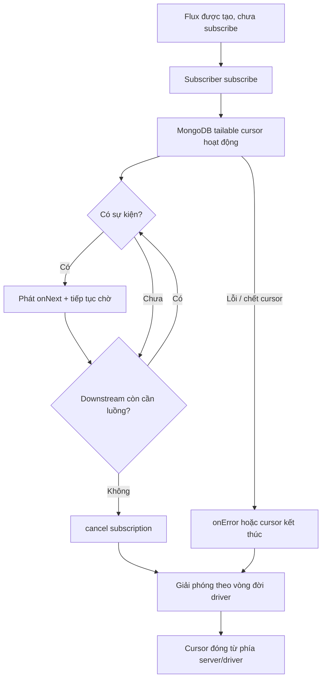
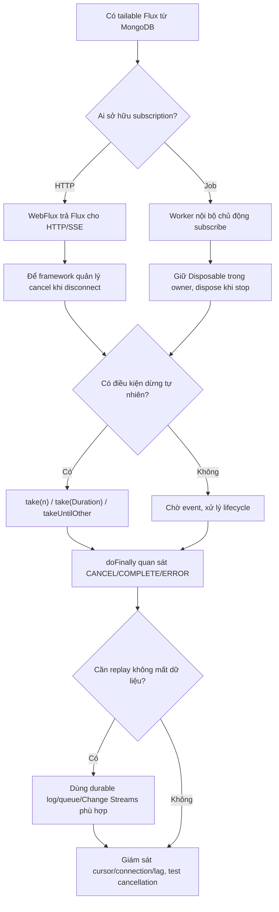

# Hủy subscription và giải phóng tài nguyên

Một ứng dụng theo dõi sự kiện đơn hàng có thể dùng **tailable cursor** trên MongoDB **capped collection** để nhận những document mới được thêm vào. Với Spring Data MongoDB Reactive, ứng dụng có thể nhận dữ liệu liên tục dưới dạng `Flux<Event>` thay vì lặp `find()` theo chu kỳ. Nhưng luồng ấy không tự dừng sau một lần trả kết quả: nó có thể chờ sự kiện mới rất lâu, giữ cursor phía MongoDB, connection/session liên quan và tài nguyên xử lý trong ứng dụng.

Vì thế câu hỏi quan trọng không chỉ là **“làm sao mở một tailable cursor?”**, mà còn là **“ai có trách nhiệm hủy subscription, khi nào tài nguyên thực sự được giải phóng và làm sao biết việc hủy đã diễn ra?”**

Ví dụ tình huống:

```text
MongoDB capped collection: order_events
             │
             ▼
ReactiveMongoTemplate.tail(...)
             │
             ▼
Flux<OrderEvent>
             │
      HTTP Server-Sent Events
             │
             ▼
      Người dùng mở dashboard
             │
      Người dùng đóng tab
             ▼
WebFlux cancel subscription
             │
             ▼
Driver nhận cancellation
             │
             ▼
Cursor/connection resources được thu hồi
  theo tiến trình bất đồng bộ của driver và server
```

Nếu ứng dụng gọi `subscribe()` rồi bỏ quên `Disposable`, cursor có thể tiếp tục sống dù không còn người sử dụng. Nếu coi `doOnComplete` là nơi cleanup duy nhất, ứng dụng có thể bỏ sót trường hợp **cancel** — điều rất phổ biến đối với một Flux tailable có chủ đích chạy lâu.

Bài học thuộc chương **Tailable cursor** của module **SPRING_DATA_MONGODB**: sử dụng Spring Data MongoDB để kết nối, ánh xạ document và thao tác MongoDB qua `MongoTemplate` hoặc repository, đồng thời thực hành truy vấn, index, transaction, reactive access, kiểm thử và chẩn đoán hiệu năng dữ liệu. Trọng tâm trực tiếp của bài là **hủy subscription và giải phóng tài nguyên**. Phần ví dụ ưu tiên reactive API vì `Flux` cho phép quản lý hủy subscription bằng Reactive Streams; đồng thời chỉ ra khác biệt với cursor/stream blocking.

Sau bài, bạn sẽ có thể:

- Mô tả vòng đời **subscribe → request → onNext → cancel/complete/error** của tailable `Flux`.
- Hiểu sự khác nhau giữa **Reactor cancellation** và **việc cursor thực sự đóng trên MongoDB server**.
- Dùng `Disposable.dispose()`, `take(n)`, `takeUntilOther(...)`, `doOnCancel(...)` và `doFinally(...)` đúng mục đích.
- Trả `Flux` trực tiếp cho WebFlux SSE để framework quản lý subscription khi client ngắt kết nối; không fire-and-forget.
- Gắn cơ chế shutdown cho các subscription do ứng dụng chủ động sở hữu.
- Tránh kết nối/cursor bị bỏ quên khi dùng `retryWhen`, `repeatWhen`, `share` và các operator backpressure.
- Dùng `mongosh` tạo capped collection thử nghiệm cách ly; kiểm tra dữ liệu mới và giới hạn của cursor.
- Viết test `StepVerifier.thenCancel()` chứng minh signal cancellation, không suy diễn việc `killCursors` diễn ra tức thời.
- Biết khi nào phải chuyển sang **MongoDB Change Streams** nếu cần cập nhật/xóa, resume token hoặc sự kiện bền vững hơn.

## 1. Tailable cursor là gì và vì sao cần hủy?

### 1.1. Khác `find()` thông thường ở điểm nào?

`find()` thông thường truy vấn một tập document tại thời điểm chạy và cursor thường **kết thúc** khi đã đi qua kết quả hiện có. Với tailable cursor trên **capped collection**, khi đã đọc tới cuối các document hiện có, cursor có thể **tiếp tục mở** để theo dõi document mới được thêm vào.

```text
Cursor thường:
  subscribe → đọc A, B, C → onComplete

Tailable cursor:
  subscribe → đọc A, B, C → chờ → đọc D → chờ → đọc E → ...
                                       └─ chỉ dừng khi bị hủy,
                                          có lỗi hoặc cursor bị đóng
```

Tailable cursor không phải một polling loop do ứng dụng tự viết. Driver/MongoDB cung cấp cơ chế cursor theo sau vị trí ghi tự nhiên của capped collection; tùy thiết lập có thể dùng chế độ **tailable await** để chờ dữ liệu.

### 1.2. Capped collection là điều kiện nền tảng

Một capped collection có giới hạn kích thước, lưu document theo thứ tự chèn tự nhiên và có cơ chế loại document cũ khi dung lượng bị lấp đầy. Ví dụ:

```javascript
db.createCollection("order_events_demo", {
  capped: true,
  size: 1024 * 1024,
  max: 1000
});
```

Các đặc điểm quan trọng:

- Cursor tailable chỉ hoạt động trên **capped collection** phù hợp.
- Khi hết chỗ, document cũ bị thay thế theo vòng đời capped; đây **không phải queue bền vững có ACK theo consumer**.
- Tài liệu mới có thể bị bỏ lỡ nếu consumer tụt quá xa hoặc cursor bị đóng khi vị trí đọc bị ghi đè.
- Không thiết kế thao tác update làm tăng kích thước document tùy ý trong capped collection.
- Không thể tùy tiện xóa riêng lẻ document khỏi capped collection như một collection thông thường; khi cần dọn thử nghiệm, chỉ drop **collection do phiên thực hành tự tạo**.
- Cursor không cung cấp một resume token bền vững như Change Streams.

### 1.3. Capped collection khác transaction log hay hàng đợi

| Yêu cầu | Tailable cursor trên capped collection | Cơ chế khác thường phù hợp hơn |
| --- | --- | --- |
| Quan sát document được insert nối tiếp | Phù hợp | — |
| Xem update/delete trên collection thường | Không phải chức năng chính | Change Streams |
| Replay chắc chắn sau downtime dài | Không được bảo đảm | Log/queue bền vững |
| Resume tại vị trí xác thực | Không có resume token như Change Streams | Change Streams với resume token |
| Backpressure của người tiêu thụ | Có qua Publisher, trong giới hạn driver | Queue có lưu lượng/ACK |
| Consumer group, retry delivery, dead-letter | Không tự có | Kafka/RabbitMQ hoặc hạ tầng queue |
| Tắt luồng khi client thoát | Cần cancel subscription | WebFlux/Reactive Streams |

Nếu nghiệp vụ đòi **không mất bất cứ sự kiện nào**, đừng kết luận “tailable” đồng nghĩa “lossless”. Cần thiết kế lưu trữ, checkpoint, gap detection và khả năng phục hồi riêng.

## 2. Vòng đời Reactive Streams từ subscribe tới cancel

### 2.1. Các loại signal

Một `Publisher<T>` theo Reactive Streams có những tín hiệu cốt lõi:

| Tín hiệu / sự kiện | Ai phát hoặc gọi? | Ý nghĩa |
| --- | --- | --- |
| `onSubscribe(Subscription)` | Publisher → Subscriber | Subscriber nhận quyền yêu cầu/hủy |
| `request(n)` | Subscriber → Subscription | Yêu cầu tối đa n phần tử (demand) |
| `onNext(value)` | Publisher → Subscriber | Có một document/entity |
| `onComplete()` | Publisher → Subscriber | Nguồn kết thúc bình thường |
| `onError(error)` | Publisher → Subscriber | Nguồn kết thúc vì lỗi |
| `cancel()` | Subscriber → Subscription | Subscriber không còn muốn nhận dữ liệu |

**Cancel khác onComplete.** Cancellation là hành động do downstream yêu cầu, **không phải** một terminal signal `onComplete` được phát về downstream. Nếu bạn chỉ dùng `doOnComplete` để ghi log giải phóng tài nguyên, sẽ bỏ sót việc khách hàng đóng kết nối.

### 2.2. Ai là subscriber của tailable cursor?

Ba mô hình phổ biến:

1. **WebFlux controller trả Flux:** WebFlux là thành phần subscribe để ghi SSE/HTTP response, và có thể cancel khi response bị đóng.
2. **Job/worker nội bộ gọi subscribe có chủ đích:** code sở hữu `Disposable` và chịu trách nhiệm hủy trong lifecycle của job.
3. **Integration test `StepVerifier`:** verifier là subscriber, có thể gọi `thenCancel()` để chấm dứt luồng vô hạn.

Khi chưa có subscriber, một `Flux` tailable cold thông thường **chưa mở cursor chỉ vì được gán cho biến**:

```java
Flux<OrderEvent> events = reactiveMongoTemplate
    .tail(new Query(), OrderEvent.class, collectionName);

// Tạo Flux không có nghĩa cursor đã được mở.
// Cursor bắt đầu hoạt động khi có subscription.
```

### 2.3. Tailable stream không hứa sẽ tự complete

Một tailable cursor đang chờ document mới có thể không phát thêm `onNext` và cũng **không phát `onComplete`** trong thời gian rất dài. Đây là tình huống hợp lệ.

Đừng viết test:

```java
// SAI với luồng có thể chạy mãi:
StepVerifier.create(tailableFlux)
    .expectNextCount(2)
    .verifyComplete();
```

Nếu muốn dừng sau hai phần tử, phải **đặt giới hạn chủ động**:

```java
StepVerifier.create(tailableFlux.take(2))
    .expectNextCount(2)
    .verifyComplete();
```

Ở đây `take(2)` yêu cầu dừng nguồn sau khi đủ hai phần tử; từ góc nhìn downstream, Flux đã giới hạn có thể complete thành công, còn **upstream tailable subscription được hủy** khi không cần nữa.

### 2.4. Chuyển trạng thái cơ bản



Sơ đồ chỉ minh họa ý nghĩa quản lý tài nguyên. Trong thực tế, việc đóng server cursor có thể bất đồng bộ hoặc phụ thuộc network; **không khẳng định ngay lập tức nhìn thấy một lệnh `killCursors` sau mỗi cancellation**.

## 3. Mở tailable cursor bằng Spring Data MongoDB Reactive

### 3.1. Entity dùng trong ví dụ

Giả sử ứng dụng có capped collection `order_events_lab` chứa document sự kiện. Entity:

```java
package com.example.mongo.tailable;

import java.time.Instant;
import org.bson.types.ObjectId;
import org.springframework.data.annotation.Id;
import org.springframework.data.mongodb.core.mapping.Document;

@Document(collection = "order_events_lab")
public class OrderEvent {

    @Id
    private ObjectId id;
    private String tenantId;
    private String eventType;
    private String orderId;
    private Instant createdAt;

    protected OrderEvent() {}

    public OrderEvent(
            String tenantId,
            String eventType,
            String orderId,
            Instant createdAt) {
        this.tenantId = tenantId;
        this.eventType = eventType;
        this.orderId = orderId;
        this.createdAt = createdAt;
    }

    public ObjectId getId() { return id; }
    public String getTenantId() { return tenantId; }
    public String getEventType() { return eventType; }
    public String getOrderId() { return orderId; }
    public Instant getCreatedAt() { return createdAt; }
}
```

Sự kiện mẫu:

```javascript
{
  _id: ObjectId("..."),
  tenantId: "T1",
  eventType: "ORDER_CREATED",
  orderId: "O-100",
  createdAt: ISODate("2026-11-20T09:00:00Z")
}
```

Trong môi trường nhiều tenant, `tenantId` phải được lấy từ authentication/authorization; tailable cursor không tự tạo ranh giới quyền. Capped collection có thể chứa dữ liệu nhiều tenant; nếu cần bảo mật mạnh, cần xác minh quy tắc lọc/phân phối phù hợp, bao gồm trường hợp dữ liệu mới được append.

### 3.2. Tạo capped collection trước khi mở cursor

Ví dụ tạo collection bằng `ReactiveMongoTemplate` trong **bootstrap/migration của ứng dụng**, không phải mỗi lần HTTP request:

```java
import org.springframework.data.mongodb.core.CollectionOptions;
import org.springframework.data.mongodb.core.ReactiveMongoTemplate;
import reactor.core.publisher.Mono;

public Mono<Void> initializeCappedCollection(
        ReactiveMongoTemplate template,
        String collectionName) {

    return template.createCollection(
        collectionName,
        CollectionOptions.empty()
            .capped()
            .size(4L * 1024 * 1024)
            .maxDocuments(10000)
    ).then();
}
```

`CollectionOptions.empty().capped().size(...)` thể hiện capped collection và giới hạn kích thước; `maxDocuments` thêm giới hạn số document. API cụ thể có thể thay đổi theo Spring Data MongoDB version; khi áp dụng phải đối chiếu dependency hiện hành. Nếu collection đã tồn tại, lệnh tạo có thể báo lỗi; migration cần **kiểm tra tồn tại, kiểu collection và kích thước đúng** thay vì âm thầm ghi đè cấu hình.

**Không** tạo/drop capped collection trong mỗi lần gọi API streaming. Đó là tài nguyên cơ sở dữ liệu dùng chung; client ngắt kết nối chỉ nên hủy cursor của mình, không xóa collection.

### 3.3. `ReactiveMongoTemplate.tail(...)` trả `Flux<T>`

```java
import org.springframework.data.mongodb.core.ReactiveMongoTemplate;
import org.springframework.data.mongodb.core.query.Criteria;
import org.springframework.data.mongodb.core.query.Query;
import reactor.core.publisher.Flux;

public Flux<OrderEvent> tailTenantEvents(
        ReactiveMongoTemplate template,
        String trustedTenantId,
        String collectionName) {

    if (trustedTenantId == null || trustedTenantId.isBlank()) {
        return Flux.error(
            new IllegalArgumentException("Tenant is required")
        );
    }

    Query query = Query.query(
        Criteria.where("tenantId").is(trustedTenantId)
    );

    return template.tail(
        query, OrderEvent.class, collectionName
    );
}
```

`tail(query, domainType, collectionName)` tạo **Flux của root entities** thông qua reactive MongoDB driver. Khi subscriber yêu cầu và bắt đầu nhận dữ liệu, MongoDB sử dụng cursor phù hợp để theo dõi capped collection.

**Lưu ý về criteria và vị trí mở:** MongoDB tailable cursor có các hạn chế so với find thông thường. Với các điều kiện lọc quá hẹp, cursor có thể không bắt đầu đúng vị trí mong đợi hoặc bị đóng nếu không có kết quả ban đầu. Không coi tailable query là một API message broker có thể “chờ lần đầu document thuộc tenant xuất hiện” trong mọi trạng thái collection. Khi cần bắt đầu từ cuối một tập dữ liệu, replay chính xác hoặc nhiều tenant song song, hãy thiết kế và kiểm chứng riêng.

### 3.4. Tailable repository method với `@Tailable`

Spring Data MongoDB cũng hỗ trợ đánh dấu method reactive repository:

```java
package com.example.mongo.tailable;

import org.bson.types.ObjectId;
import org.springframework.data.mongodb.repository.ReactiveMongoRepository;
import org.springframework.data.mongodb.repository.Tailable;
import reactor.core.publisher.Flux;

public interface OrderEventRepository
        extends ReactiveMongoRepository<OrderEvent, ObjectId> {

    @Tailable
    Flux<OrderEvent> findByTenantId(String tenantId);
}
```

Nếu domain entity được ánh xạ tới `order_events_lab` và đó là capped collection đúng loại, method có thể trả một tailable `Flux`. Với repository annotation, **không mặc định method kết thúc sau những record đang tồn tại**; subscriber cần lifecycle hủy rõ ràng.

Chọn template khi muốn chủ động tên collection/query, chọn repository khi derived query và mapping phù hợp. Không cần trộn `@Tailable` vào mọi repository method bình thường.

### 3.5. Khi nào cursor có thể tự đóng?

Ngoài cancellation, cursor tailable có thể dừng do:

- Collection bị drop hoặc đổi kiểu/tài nguyên bị xóa.
- Cursor bị server đóng/kill, network bị gián đoạn.
- Capped collection xoay vòng làm vị trí cursor không còn.
- Query/cursor không hợp lệ hoặc không có vị trí khởi đầu hợp lệ.
- Process/server failover, connection bị hủy.
- Subscriber dừng do `take(n)`/`timeout`/lỗi downstream.

Tùy driver và tình huống, downstream có thể quan sát **`onComplete` hoặc `onError`**. Đừng thiết kế auto-reconnect chỉ dựa trên giả định mọi cursor chết đều tạo cùng một exception; cần test với hạ tầng thực của phiên bản ứng dụng.

## 4. `doOnCancel`, `doOnComplete` và `doFinally`

### 4.1. Chọn hook đúng signal

| Reactor hook | Khi được gọi | Không bao gồm |
| --- | --- | --- |
| `doOnCancel(action)` | Khi downstream cancel subscription | Complete/error bình thường |
| `doOnComplete(action)` | Khi nguồn complete bình thường | Cancel/error |
| `doOnError(action)` | Khi nguồn lỗi | Complete/cancel |
| `doOnTerminate(action)` | Khi complete hoặc error | Cancel |
| `doFinally(consumer)` | Khi chuỗi dừng do COMPLETE, ERROR hoặc CANCEL | Không có loại kết thúc nào trong ba loại đó |
| `doOnDiscard(...)` | Khi giá trị bị loại theo operator có hỗ trợ | Không phải callback đóng cursor |

**`doFinally` thường là điểm phù hợp để đo vòng đời tổng quát** vì tailable Flux có thể dừng theo bất cứ đường nào. Nhưng đó vẫn chỉ là callback quan sát/cleanup do bạn đăng ký: **không cần tự gọi `killCursors` nếu ReactiveMongoTemplate/driver đang sở hữu cursor**.

### 4.2. Quan sát signal bằng `SignalType`

```java
import java.util.concurrent.atomic.AtomicLong;
import reactor.core.publisher.Flux;
import reactor.core.publisher.SignalType;

public Flux<OrderEvent> observeLifecycle(
        Flux<OrderEvent> source,
        AtomicLong cancels) {

    return source
        .doOnCancel(() ->
            cancels.incrementAndGet()
        )
        .doFinally(signal -> {
            if (signal == SignalType.CANCEL) {
                // Ghi metric theo signal, không log thông tin nhạy cảm.
            } else if (signal == SignalType.ON_COMPLETE) {
                // Nguồn kết thúc bình thường.
            } else if (signal == SignalType.ON_ERROR) {
                // Nguồn phát lỗi.
            }
        });
}
```

`doFinally` nhận `SignalType` như `CANCEL`, `ON_COMPLETE`, `ON_ERROR`. Code này chỉ **quan sát**, không tự tạo một subscription mới.

Không nên lưu `OrderEvent` hoặc `tenantId` theo từng event thành tag metric có cardinality vô hạn; nếu đo theo tenant, cần chính sách bảo mật và giới hạn số tag.

### 4.3. Hook nào chạy khi `take(2)`?

```java
Flux<OrderEvent> tail =
    template.tail(new Query(), OrderEvent.class, collection);

Flux<OrderEvent> limited = tail
    .doFinally(signal -> {
        // Hook gần nguồn có thể thấy CANCEL khi take đủ.
    })
    .take(2)
    .doFinally(signal -> {
        // Hook phía downstream thấy ON_COMPLETE nếu đủ hai item.
    });
```

Khi có hai phần tử:

```text
tail source → doFinally(upstream: CANCEL)
       → take(2) → doFinally(downstream: ON_COMPLETE)
```

Điều này **không mâu thuẫn**: operator `take` hoàn tất Flux đầu ra nhưng **hủy upstream** vì nó không cần document thứ ba.

### 4.4. `doFinally` có thể chạy sau khi downstream thấy terminal signal

Đừng viết test:

```java
StepVerifier.create(stream.take(1))
    .expectNextCount(1)
    .verifyComplete();
assertEquals(SignalType.CANCEL, lastSignal.get());
```

rồi cho rằng assertion luôn không race. Hook `doFinally` có thể được thực thi sau khi signal đã được chuyển downstream. Dùng `CountDownLatch`/một cơ chế đồng bộ trong test để đợi hook hoàn thành nếu muốn assert chính xác. Điều này **không có nghĩa MongoDB server cursor cũng đã biến mất ngay tại thời điểm latch báo**.

### 4.5. Hook không được trở thành nơi làm blocking I/O

Sai:

```java
return source.doFinally(signal -> {
    // SAI: blocking call trong Reactive Streams hook.
    auditRepository.save(audit).block();
});
```

Hook được gọi trong vòng đời reactive, đôi khi trên thread nhạy cảm. Một thao tác blocking hoặc throw exception trong hook có thể làm phức tạp signal/cleanup.

Nếu cần cleanup một **tài nguyên riêng của ứng dụng** có thao tác bất đồng bộ, xem `Flux.usingWhen` hoặc orchestration reactive có ownership rõ. Nếu cleanup liên quan nghiệp vụ quan trọng (ví dụ commit event), không đặt nó vào một callback fire-and-forget rồi coi hoàn tất là chắc chắn.

## 5. `Disposable.dispose()`: chủ sở hữu subscription phải quyết định lúc dừng

### 5.1. Khi code chủ động `subscribe()`

Nếu một service nội bộ thực sự phải subscribe mà không trả Publisher cho bên ngoài, `subscribe()` trả `Disposable`:

```java
import reactor.core.Disposable;

Disposable handle = template
    .tail(new Query(), OrderEvent.class, collectionName)
    .subscribe(
        event -> processEvent(event),
        error -> reportError(error)
    );

// Khi job dừng hoặc owner không còn cần luồng:
handle.dispose();
```

Đoạn minh họa **ownership**, không có nghĩa mọi code nên gọi `subscribe`. Hai method `processEvent` và `reportError` là hàm do ứng dụng cung cấp; nếu `processEvent` thực hiện I/O/blocking, callback `subscribe(Consumer)` có thể không phù hợp. Cần orchestration reactive, backpressure và failure handling riêng.

### 5.2. Điều gì xảy ra khi gọi `dispose()`?

`dispose()` yêu cầu subscription bị hủy; những operator `doOnCancel/doFinally(CANCEL)` có thể được kích hoạt. Reactive MongoDB driver được thông báo downstream không còn cần kết quả và thực hiện dọn tài nguyên cursor/connection theo cơ chế của nó.

**Những điều không được bảo đảm chỉ từ việc `dispose()` trả về:**

- MongoDB đã nhận và xử lý `killCursors` đồng bộ.
- Mọi network packet đang bay đã bị thu hồi.
- Một document vừa phát đã được consumer xử lý thành công.
- Không còn bất kỳ work nào trong race giữa onNext và cancellation.
- Sẽ không có event mới nếu có subscriber khác cùng đang tail collection.
- Document đã bị xóa khỏi capped collection (nó không bị xóa bởi cancel).

`Disposable.isDisposed()` mô tả trạng thái dispose phía Reactor, **không phải API hỏi server còn bao nhiêu cursor**.

### 5.3. Vòng đời của owner là ranh giới tự nhiên

| Owner | Khi mở | Khi hủy |
| --- | --- | --- |
| WebFlux HTTP SSE response | Client subscribe khi response bắt đầu | Client disconnect/response timeout/cancel |
| Job nội bộ | Job bắt đầu và subscriber được tạo | Job stop/completion/application shutdown |
| Component chia sẻ một luồng | Subscriber đầu tiên theo policy | Subscriber cuối cùng rời đi hoặc component stop |
| Integration test | `StepVerifier.create` subscribe | `thenCancel()` hoặc operator limit |
| CLI debug | Command chủ động subscribe | Người dùng yêu cầu dừng, command exit |

Mỗi lần tự tạo subscription nên trả lời được: **ai giữ handle, ai gọi dispose, điều gì xảy ra khi start lần thứ hai, khi fail và khi shutdown?**

## 6. WebFlux SSE: để framework sở hữu subscription của HTTP response

### 6.1. Trả `Flux`, không tự subscribe trong controller

Một dashboard có thể nhận sự kiện qua Server-Sent Events:

```java
package com.example.mongo.tailable;

import org.springframework.http.MediaType;
import org.springframework.http.codec.ServerSentEvent;
import org.springframework.web.bind.annotation.GetMapping;
import org.springframework.web.bind.annotation.RequestMapping;
import org.springframework.web.bind.annotation.RestController;
import reactor.core.publisher.Flux;

@RestController
@RequestMapping("/api/events")
public class OrderEventsController {

    private final OrderEventsService eventsService;
    private final TrustedTenantResolver tenantResolver;

    public OrderEventsController(
            OrderEventsService eventsService,
            TrustedTenantResolver tenantResolver) {
        this.eventsService = eventsService;
        this.tenantResolver = tenantResolver;
    }

    @GetMapping(
        path = "/stream",
        produces = MediaType.TEXT_EVENT_STREAM_VALUE
    )
    public Flux<ServerSentEvent<OrderEvent>> stream() {
        return tenantResolver.requireTenant()
            .flatMapMany(eventsService::tailForTenant)
            .map(event -> ServerSentEvent
                .<OrderEvent>builder()
                .event("order-event")
                .id(event.getId().toHexString())
                .data(event)
                .build());
    }
}
```

Trong ví dụ, `TrustedTenantResolver` là interface do ứng dụng tự triển khai, trả `Mono<String>` lấy tenant từ **authentication/authorization đã được xác thực**. Không lấy tenant trực tiếp từ query parameter do client gửi rồi mở cursor ngoài quyền. `OrderEventsService` được định nghĩa ở mục 6.2.

Khi WebFlux subscribe để trả response, nó sở hữu subscription của response. Khi client đóng connection hoặc WebFlux cancel response, cancellation có thể được truyền upstream tới tailable Flux. Bạn **không cần và không nên** gọi `subscribe()` bên trong controller.

### 6.2. Service cung cấp Publisher cold

```java
package com.example.mongo.tailable;

import java.util.concurrent.atomic.AtomicLong;
import org.springframework.data.mongodb.core.ReactiveMongoTemplate;
import org.springframework.data.mongodb.core.query.Criteria;
import org.springframework.data.mongodb.core.query.Query;
import org.springframework.stereotype.Service;
import reactor.core.publisher.Flux;
import reactor.core.publisher.SignalType;

@Service
public class OrderEventsService {

    private final ReactiveMongoTemplate template;
    private final AtomicLong cancelledStreams =
        new AtomicLong();

    public OrderEventsService(ReactiveMongoTemplate template) {
        this.template = template;
    }

    public Flux<OrderEvent> tailForTenant(
            String trustedTenantId) {

        if (trustedTenantId == null
                || trustedTenantId.isBlank()) {
            return Flux.error(
                new IllegalArgumentException("Missing tenant")
            );
        }

        Query scoped = Query.query(
            Criteria.where("tenantId").is(trustedTenantId)
        );

        return template.tail(
                scoped, OrderEvent.class, "order_events_lab"
            )
            .doFinally(signal -> {
                if (signal == SignalType.CANCEL) {
                    cancelledStreams.incrementAndGet();
                }
            });
    }

    public long cancelledStreamCount() {
        return cancelledStreams.get();
    }
}
```

Đây là ví dụ đo số lần subscription kết thúc theo tín hiệu CANCEL. Trong production, dùng metrics/tracing chính thức với tag cardinality thấp thay vì chỉ một biến đếm trong instance.

### 6.3. Tenant resolver thuộc security boundary

Giả định `TrustedTenantResolver` có hợp đồng:

```java
package com.example.mongo.tailable;

import reactor.core.publisher.Mono;

public interface TrustedTenantResolver {
    Mono<String> requireTenant();
}
```

Implementation phải áp dụng Spring Security reactive và kiểm tra tenant được phép; `Mono.empty()` không nên bị diễn giải mặc định thành “tất cả tenant”. Với route cần xác thực, khi không có tenant hợp lệ nên phát lỗi phù hợp trước khi mở cursor.

Trong một capped collection đa tenant, một tailable cursor áp filter theo tenant có thể chịu hạn chế vị trí và thông báo sự kiện khi document phù hợp không liên tục. Nếu cần một luồng tin cậy cho từng tenant, thiết kế phân vùng, pipeline phân phối hoặc Change Streams theo business requirements; không giả định một query chọn tenant tạo queue độc lập.

### 6.4. Client ngắt kết nối không luôn được nhận biết ngay lập tức

Trên trình duyệt, `EventSource.close()` hoặc đóng tab thường làm kết nối SSE kết thúc. Tuy nhiên thực tế còn có:

- Reverse proxy buffering hoặc timeout.
- Load balancer giữ TCP connection.
- Network bị đứt mà server chưa phát hiện.
- Client ngủ/đổi mạng và reconnect tự động.
- HTTP response đã gửi headers nên không thể đổi trạng thái HTTP sau đó như một response thường.

Vì vậy, **không hứa mọi lần đóng tab sẽ gọi `doFinally(CANCEL)` ngay lập tức**. Cần timeout/heartbeat ở HTTP/proxy layer được cấu hình đúng, theo dõi số luồng đang mở và có shutdown lifecycle của server.

### 6.5. SSE heartbeat giúp phát hiện kết nối chết

Một tailable stream có thể không có event trong hàng giờ. Heartbeat SSE giúp giữ kết nối và phát hiện mạng chết sớm hơn, nhưng nó không làm thay đổi cách tailable cursor vận hành:

```java
import java.time.Duration;
import org.springframework.http.codec.ServerSentEvent;
import reactor.core.publisher.Flux;

public Flux<ServerSentEvent<OrderEvent>> withHeartbeat(
        Flux<OrderEvent> source) {

    Flux<ServerSentEvent<OrderEvent>> events =
        source.map(e ->
            ServerSentEvent.<OrderEvent>builder()
                .event("order-event")
                .data(e)
                .build()
        );

    Flux<ServerSentEvent<OrderEvent>> heartbeats =
        Flux.interval(Duration.ofSeconds(15))
            .map(tick ->
                ServerSentEvent.<OrderEvent>builder()
                    .comment("heartbeat")
                    .build()
            );

    return Flux.merge(events, heartbeats);
}
```

`Flux.merge` hủy các nguồn còn lại khi downstream cancel, theo semantics của composition. Một lỗi của nguồn tail thông thường cũng làm merged Flux lỗi nếu không có error policy riêng. **Heartbeat không phải change-event, không tạo resume token**. Nếu client quá chậm, các heartbeat và dữ liệu có thể tạo pressure; phải có policy backpressure/timeout phù hợp.

### 6.6. SSE `id` không phải MongoDB resume token

`ServerSentEvent.id(...)` đặt HTTP/SSE event ID để client có thể gửi `Last-Event-ID` khi reconnect. Nhưng tailable cursor **không tự hỗ trợ replay chính xác** theo ID đó. Nếu muốn triển khai resume:

- Định nghĩa ID/sequence của sự kiện, retention và cách tìm vị trí an toàn.
- Phát hiện gap khi capped collection đã ghi đè document cần replay.
- Không tin ID client gửi để bỏ qua tenant/authorization.
- Nếu cần resume có cơ chế chuẩn và theo dõi cả insert/update/delete, cân nhắc **Change Streams**.

Không thêm `.id(event.getId().toHexString())` rồi tuyên bố hệ thống đã có at-least-once delivery hoặc exactly-once.

## 7. Dừng có chủ đích khi ứng dụng shutdown

### 7.1. `takeUntilOther` kết thúc luồng theo một tín hiệu điều khiển

Khi mọi SSE subscription của một component cần dừng trước khi ứng dụng tắt, có thể dùng `Sinks.One<Void>`:

```java
package com.example.mongo.tailable;

import jakarta.annotation.PreDestroy;
import org.springframework.data.mongodb.core.ReactiveMongoTemplate;
import org.springframework.data.mongodb.core.query.Query;
import org.springframework.stereotype.Service;
import reactor.core.publisher.Flux;
import reactor.core.publisher.Sinks;

@Service
public class ShutdownAwareTailService {

    private final ReactiveMongoTemplate template;
    private final Sinks.One<Void> stopSignal = Sinks.one();

    public ShutdownAwareTailService(
            ReactiveMongoTemplate template) {
        this.template = template;
    }

    public Flux<OrderEvent> events() {
        return template.tail(
                new Query(), OrderEvent.class, "order_events_lab"
            )
            .takeUntilOther(stopSignal.asMono());
    }

    @PreDestroy
    public void stop() {
        stopSignal.tryEmitEmpty();
    }
}
```

Ví dụ dùng `jakarta.annotation.PreDestroy` (Spring Boot 3+). Với phiên bản cũ dựa trên `javax.annotation`, cần chọn import theo dependency thật.

`takeUntilOther` là operator kết thúc main Flux khi companion Publisher phát tín hiệu hoặc hoàn tất theo contract Reactor. Các subscription của `events()` đang chờ sẽ được yêu cầu dừng khi `stopSignal` hoàn thành. Đây là cơ chế **hủy có chủ đích**, không phải đồng bộ chờ MongoDB server xác nhận `killCursors`.

### 7.2. Đừng dùng một stop signal cho mọi request nếu muốn chỉ dừng một client

`stopSignal` ở ví dụ trên có phạm vi **toàn service**. Khi gọi `stop()`, nó dừng **mọi subscription** của service đó.

Nếu chỉ một người dùng đóng tab, WebFlux cancellation là đủ; **không gọi `service.stop()` từ HTTP cancel hook**, vì nó sẽ ngắt luôn các client khác.

Phân biệt:

```text
Client A đóng SSE  → cancel subscription A
Client B vẫn mở    → subscription B còn chạy
Ứng dụng shutdown  → stopSignal dừng A/B/các stream còn lại
```

### 7.3. Shutdown graceful cần phối hợp với hạ tầng

Khi tiến trình nhận SIGTERM:

1. Ngừng nhận request mới và bắt đầu graceful shutdown của server.
2. Gửi tín hiệu dừng cho những stream không cần giữ thêm.
3. Từng downstream nhận completion/cancellation theo chuỗi operator.
4. Driver có cơ hội dọn cursors và connections.
5. Chờ trong **shutdown grace period hữu hạn** theo cấu hình runtime.
6. Đóng MongoDB client/connection pools qua Spring lifecycle, không tự đóng client dùng chung từ một request.

**Không** cố giữ process vô thời hạn để chờ một tailable cursor phát `onComplete`. Đó là luồng được thiết kế chờ thêm dữ liệu, nên cần tín hiệu dừng tường minh.

### 7.4. Cleanup tài nguyên tự quản lý với `usingWhen`

`ReactiveMongoTemplate.tail` để driver/template sở hữu cursor, nên phần lớn ứng dụng **không cần** tự lập cơ chế đóng server cursor. Nhưng nếu bạn tạo thêm một tài nguyên bất đồng bộ riêng (ví dụ lease đăng ký feed, session ngoài MongoDB hoặc client connection chuyên biệt), Reactor có `Flux.usingWhen`:

```java
import reactor.core.publisher.Flux;
import reactor.core.publisher.Mono;

// FeedLease là tài nguyên do ứng dụng định nghĩa.
// acquire/closeAsync đều là API non-blocking của ứng dụng.
Flux<OrderEvent> stream = Flux.usingWhen(
    leaseProvider.acquire(),
    lease -> lease.openEvents(),
    lease -> lease.closeAsync(),          // complete
    (lease, error) -> lease.closeAsync(), // error
    lease -> lease.closeAsync()           // cancel
);
```

Đây là **mẫu cấu trúc**, `leaseProvider`/`FeedLease` không phải các class có sẵn của Spring Data. `usingWhen` cho phép khai báo cả cleanup khi cancel, lỗi và hoàn thành theo Publisher, nhưng không biến một tài nguyên không hỗ trợ cleanup thành tài nguyên có thể đóng tức thời.

Đặc biệt, **không bọc `ReactiveMongoTemplate.tail` trong một resource wrapper rồi gọi `MongoClient.close()` sau mỗi HTTP request**: MongoClient thường là tài nguyên dùng chung của cả ứng dụng.

## 8. Worker nội bộ: `Disposable` cần được quản lý như tài nguyên

Nếu không có HTTP response sở hữu subscription, có thể tạo một component chịu trách nhiệm start/stop rõ ràng:

```java
package com.example.mongo.tailable;

import jakarta.annotation.PreDestroy;
import org.springframework.data.mongodb.core.ReactiveMongoTemplate;
import org.springframework.data.mongodb.core.query.Query;
import org.springframework.stereotype.Component;
import reactor.core.Disposable;
import reactor.core.publisher.Mono;

@Component
public final class OrderEventsWorker {

    private final ReactiveMongoTemplate template;
    private Disposable subscription;

    public OrderEventsWorker(ReactiveMongoTemplate template) {
        this.template = template;
    }

    public synchronized void start() {
        if (subscription != null && !subscription.isDisposed()) {
            return;
        }

        subscription = template.tail(
                new Query(), OrderEvent.class, "order_events_lab"
            )
            .concatMap(this::handleEvent)
            .subscribe(
                ignored -> {},
                error -> reportFailure(error)
            );
    }

    private Mono<Void> handleEvent(OrderEvent event) {
        // Hàm non-blocking do ứng dụng hiện thực.
        return Mono.empty();
    }

    private void reportFailure(Throwable error) {
        // Log/metrics an toàn và quyết định restart ở owner.
    }

    @PreDestroy
    public synchronized void stop() {
        if (subscription != null) {
            subscription.dispose();
            subscription = null;
        }
    }
}
```

**Quan trọng:** `start()` phải được gọi từ một lifecycle hook đáng tin (ví dụ application ready/job controller) và `stop()` từ owner. Mã trên là ví dụ ownership tối thiểu; khi Publisher kết thúc tự nhiên hoặc lỗi, `Disposable` có thể đã kết thúc dù không được owner dispose bằng tay. Muốn tự reconnect, phải thiết kế restart policy tường minh, có backoff, giới hạn số lần và quan sát lỗi.

`concatMap(this::handleEvent)` giữ thứ tự từng event ở application processing stage, nhưng **không biến capped collection thành queue có ACK/replay**. Nếu handler quá chậm, capped collection có thể cuộn vòng, làm mất khả năng đọc đầy đủ sự kiện.

## 9. Idle timeout, giới hạn thời gian và reconnect

### 9.1. Không có sự kiện mới không đồng nghĩa cursor lỗi

Tailable cursor có thể ở trạng thái **chờ append** lâu mà không có `onNext` mới. Vì vậy:

```java
source.timeout(Duration.ofSeconds(30));
```

có nghĩa nếu **30 giây không có tín hiệu `onNext` đáp ứng điều kiện timeout**, Reactor có thể phát `TimeoutException`, **ngay cả khi MongoDB và cursor hoàn toàn khỏe mạnh**. Đây là timeout **ở tầng Publisher**, không phải phép đo chính xác “cursor server đã chết”.

Nếu yêu cầu UX là “trong 30 giây không có đơn hàng mới thì cho rằng hệ thống lỗi”, phải nêu rõ đó là **policy nghiệp vụ**, không phải sự thật kỹ thuật về tailable cursor.

### 9.2. Phân biệt ba loại thời gian

| Cơ chế | Kiểm soát | Điều không bảo đảm |
| --- | --- | --- |
| Driver/server `maxAwaitTime` hoặc cấu hình cursor await | Thời gian một lần `getMore` chờ dữ liệu | Không có nghĩa tailable Flux sẽ tự complete |
| Reactor `timeout(Duration)` | Bao lâu không phát signal mà downstream chờ | Không phân biệt quiet period hợp lệ với outage |
| Reactor `take(Duration)` | Tuổi đời tối đa của luồng theo ứng dụng | Không bảo đảm đã nhận đủ event nghiệp vụ |
| HTTP/proxy idle timeout | Tuổi kết nối/độ trễ I/O | Không phản ánh trạng thái MongoDB chính xác |
| Shutdown grace period | Bao lâu tiến trình được phép dọn | Không chứng minh server cursor đã bị kill đúng thời điểm |

Một hệ thống có thể dùng nhiều mức timeout, nhưng phải cấu hình chúng không mâu thuẫn. Ví dụ heartbeat SSE có thể giữ HTTP connection hoạt động dù **MongoDB tail stream không có event mới**.

### 9.3. Giới hạn một phiên stream bằng `take(Duration)`

Nếu policy quy định mỗi kết nối SSE tối đa 15 phút:

```java
import java.time.Duration;
import reactor.core.publisher.Flux;

Flux<OrderEvent> session = source
    .take(Duration.ofMinutes(15));
```

Khi hết khoảng thời gian đó, Flux downstream kết thúc và upstream được yêu cầu hủy. Đừng dùng việc tự ngắt mọi 15 phút mà không tính đến hành vi reconnect của browser/proxy; nhiều client cùng reconnect có thể tạo **thundering herd**. Có thể cần jitter và giới hạn connections.

### 9.4. Retry theo lỗi transient

`retryWhen` dùng khi Publisher phát `onError`. Ví dụ policy có giới hạn:

```java
import com.mongodb.MongoSocketException;
import com.mongodb.MongoTimeoutException;
import java.time.Duration;
import reactor.util.retry.Retry;

Flux<OrderEvent> retrying = template
    .tail(new Query(), OrderEvent.class, collectionName)
    .retryWhen(
        Retry.backoff(3, Duration.ofSeconds(1))
            .maxBackoff(Duration.ofSeconds(8))
            .filter(error ->
                error instanceof MongoSocketException
                || error instanceof MongoTimeoutException
            )
    );
```

Đây là **minh họa một filter lỗi có thể transient**, không phải danh sách đầy đủ các lỗi an toàn để retry trên mọi deployment. Dùng một retry budget theo nghiệp vụ và báo lỗi khi hết hạn. Lỗi authentication, permission, missing collection hoặc sai cú pháp query thường không nên retry mù.

**Quan trọng:** retry trên một cold tailable Publisher tạo một **subscription/cursor mới**. Nó không tự phục hồi vị trí đọc cũ. Có thể bỏ lỡ document được ghi trong lúc mất kết nối hoặc đọc trùng tùy query và vòng quay capped.

### 9.5. `retryWhen` không xử lý một lần `onComplete` bình thường

Một tailable cursor có thể kết thúc mà không phát error (tùy tình huống). Trong Reactor:

- `retryWhen`: retry khi **onError** được chấp nhận.
- `repeatWhen`: resubscribe khi **onComplete**.
- `cancel` từ downstream: **không tự biến thành một cơ hội retry/repeat**.

Ví dụ về repeat có khoảng nghỉ:

```java
Flux<OrderEvent> restarting = template
    .tail(new Query(), OrderEvent.class, collectionName)
    .repeatWhen(completions ->
        completions.delayElements(Duration.ofSeconds(2))
    );
```

Đừng dùng ví dụ này như production policy ngay lập tức. Nếu cursor vừa mở đã complete vì collection rỗng, quyền bị cấu hình sai hoặc capped rollover, repeat liên tục có thể làm load tăng, lặp event cũ hoặc che nguyên nhân. Phải có **giới hạn, trạng thái, quan sát, khoảng nghỉ và chính sách dừng**. Dùng `repeatWhen` không tạo khả năng resume bền vững.

### 9.6. Không retry khi downstream đã chủ động cancel

Nếu người dùng đóng SSE, upstream phải ngừng thay vì tự reconnect vô hạn vì một hook khác đã ghi “stream ended”. Không làm:

```java
source.doFinally(signal ->
    startAnotherSubscriptionWithoutOwner()
);
```

Đoạn này là pattern nguy hiểm: dù `SignalType.CANCEL`, nó cũng tự mở một subscription mới nằm ngoài owner đã ngắt kết nối. **Không tự subscribe/reconnect trong `doFinally`**; nếu phải restart, logic owner phải phân biệt shutdown/cancel thực sự với lỗi transient.

### 9.7. Recovery đúng cần phát hiện gap

Một cách thiết kế sự kiện có field `eventSequence` tăng dần theo partition:

```text
Consumer đã xử lý: 1001, 1002
Cursor bị lỗi
Producer tiếp tục ghi: 1003, 1004, 1005
Consumer reconnect chỉ thấy: 1005, 1006
                          ↑ gap 1003–1004
```

Khi phát hiện gap, cần giải quyết bằng nguồn dữ liệu bền vững hơn (history API, log lưu riêng, queue hoặc Change Streams phù hợp). Không suy ra không có gap chỉ vì `ObjectId` sau reconnect “lớn hơn” ID cuối; ObjectId không phải sequence gap-free và không giải quyết được ngữ nghĩa replay.

## 10. Backpressure: hủy sớm không thay thế điều tiết tốc độ

### 10.1. `request(n)` không phải `limit(n)` ở MongoDB

Reactive Streams cho phép subscriber yêu cầu lượng dữ liệu cần. Nhưng khi tailable cursor còn mở, nó có thể tiếp tục **chờ** document mới, ngay cả khi đã cấp đủ kết quả hiện có và chưa complete.

Phân biệt:

- `limitRate(32)`: điều chỉnh nhu cầu upstream của Reactor, **không biến nguồn thành 32 event**.
- `take(32)`: nhận tối đa 32 event, rồi cancel upstream.
- MongoDB query `limit(32)` (nếu áp dụng): giới hạn tập server trả theo semantics query, không phải chiến lược sở hữu lifetime của mọi tailable stream.
- `onBackpressureBuffer`: đệm dữ liệu downstream chưa xử lý, không tự tạo lưu trữ bền vững.

### 10.2. Khi consumer chậm hơn producer

```text
MongoDB capped append:   A B C D E F G H I ...
Reactive cursor:         A B C D E ...
Consumer xử lý chậm:     A ... B ... C ...
Capped vòng xoay:        A/B/C có thể bị ghi đè
```

Tồn tại ít nhất ba loại áp lực:

1. **Backpressure trong ứng dụng:** downstream không đủ sức xử lý item đã được phát.
2. **Connection/driver buffering:** có những giới hạn batch, memory và scheduling.
3. **Retention ở capped collection:** producer tiếp tục ghi, document cũ có thể biến mất dù consumer đang chậm.

Một Reactor operator không thể tự ngăn MongoDB producer ghi quá nhanh. Vì thế **không được cam kết lossless delivery chỉ bằng việc dùng `Flux`**.

### 10.3. Không dùng buffer vô hạn

Sai:

```java
Flux<OrderEvent> stream = source
    .onBackpressureBuffer(); // Có thể tăng memory không giới hạn.
```

Nếu client yếu hoặc disconnect chậm, RAM có thể tăng. Với dashboard hiển thị trạng thái gần nhất, có thể cân nhắc operator **được phép mất item** như `onBackpressureLatest`, nhưng phải công khai semantics:

```java
Flux<OrderEvent> latestOnly = source
    .onBackpressureLatest();
```

Nó **có thể bỏ sự kiện trung gian**, không phù hợp cho kế toán, audit bất biến hay xử lý thanh toán. Với sự kiện cần đảm bảo, dùng queue/log durable thay vì hy vọng buffer Reactor vô hạn.

### 10.4. `concatMap` giữ thứ tự xử lý nhưng không tăng retention

```java
Flux<Void> handled = source
    .concatMap(event -> handler.handle(event));
```

`handler.handle` được giả định trả `Mono<Void>` non-blocking. `concatMap` giúp xử lý tuần tự theo thứ tự publisher phát. Tuy nhiên nếu handler mất 5 giây mỗi event trong khi producer ghi 100 event/giây, dữ liệu vẫn có thể bị cuộn mất ở capped collection trước khi được đọc.

Nếu hệ thống bắt buộc xử lý mọi event, cần thiết kế **retention đủ dài hoặc durable ingestion** và giám sát consumer lag/gap; không dùng `concatMap` như một bảo đảm chống mất dữ liệu.

### 10.5. `onBackpressureDrop` và `onBackpressureLatest` phải có hợp đồng

| Use case | Được phép bỏ item? | Gợi ý |
| --- | --- | --- |
| Dashboard thời gian thực, chỉ quan tâm giá trị mới nhất | Có thể | Latest/drop có kiểm soát, báo độ trễ |
| Notification UI không quan trọng | Tùy SLA | Backpressure policy rõ, có dedup |
| Thay đổi số dư/đơn hàng phải xử lý đủ | Không | Durable queue/replay, idempotency |
| Audit/compliance event | Không | Event log bất biến, Change Streams/outbox theo kiến trúc |
| Debug stream ngắn hạn | Có thể | `take(n)`, timeout chủ động, cancel |

**Hủy subscription** giúp ngừng nhận và giải phóng tài nguyên khi không còn consumer, nhưng nó không giải quyết mọi vấn đề tốc độ/độ bền khi consumer vẫn đang hoạt động.

## 11. Nhiều subscriber: một cursor mỗi subscription hay chia sẻ nguồn?

### 11.1. Cold Publisher thường mở nhiều subscription độc lập

```java
Flux<OrderEvent> source = template
    .tail(new Query(), OrderEvent.class, collectionName);

Disposable a = source.subscribe(e -> handleA(e));
Disposable b = source.subscribe(e -> handleB(e));
```

Trong mô hình cold thông thường, **hai subscription có thể dẫn đến hai cursor riêng**, tạo thêm tải phía server và driver. `a.dispose()` không có nghĩa `b` cũng bị dừng. Nếu rất nhiều HTTP client cùng mở SSE, việc mở mỗi client một cursor có thể làm cạn tài nguyên.

Không dùng mô hình này nếu số client có thể lên hàng chục nghìn mà chưa có capacity planning.

### 11.2. `share()` / `refCount` có thể giảm cursor nhưng đổi semantics

```java
Flux<OrderEvent> shared = template
    .tail(new Query(), OrderEvent.class, collectionName)
    .publish()
    .refCount(1);
```

Đây là một publisher được chia sẻ: khi có subscriber đầu tiên, upstream bắt đầu; khi **không còn subscriber**, refCount có thể hủy upstream. Thay vì mở một cursor cho mỗi consumer, nhiều consumer dùng chung một stream **trong cùng phạm vi đã được thiết kế**.

Đổi lại:

- Subscriber đến muộn không được tự replay mọi event cũ.
- Consumer chậm có thể ảnh hưởng luồng và buffering/backpressure của nhóm.
- Khi subscriber cuối cùng rời đi rồi subscriber mới tới, nguồn có thể được subscribe lại.
- Không dùng một `shared` toàn hệ thống đa tenant mà bỏ qua security scope.
- Với error/complete, behavior của sharing/re-subscription cần test theo operator/phiên bản.

### 11.3. Không share dữ liệu trước authorization

Sai về ranh giới quyền:

```java
Flux<OrderEvent> allEvents = template
    .tail(new Query(), OrderEvent.class, collectionName)
    .share();

// Sau đó trao allEvents không filter/không kiểm quyền
// trực tiếp cho mọi WebFlux client.
```

Một kiến trúc fan-out nhiều tenant cần tách eligibility, phân phối dữ liệu và authorization phù hợp:

- Có thể phân vùng theo tenant và dùng một stream/bus theo tenant.
- Hoặc có một nguồn nội bộ được bảo vệ, rồi filter và reauthorize **trước từng delivery** theo thiết kế.
- Cần tính tới index/retention lag khi quyền thay đổi.
- Không để shared stream cho phép suy luận sự tồn tại của document tenant khác qua metadata/logs.

### 11.4. `cache()` không phải một giải pháp universal

```java
Flux<OrderEvent> cached = source.cache();
```

`cache()` không giới hạn có thể giữ toàn bộ giá trị từng phát trong bộ nhớ, **đặc biệt nguy hiểm với một stream không giới hạn**. `replay(n)`/cache giới hạn cũng chỉ có ý nghĩa in-memory, không có exactly-once/durable replay; cần chọn có chủ đích và test memory.

Nếu chỉ cần một stream live cho dashboard, `share()/refCount` có thể thích hợp, nhưng phải có policy disconnect, error, subscription và scope bảo mật.

## 12. Quan sát tài nguyên: không đo từ một log cancellation duy nhất

### 12.1. Cần theo dõi những gì?

Một tailable stream có thể tác động đến:

- **MongoDB cursor** đang mở hoặc đang chờ `getMore`.
- **Connection pool** và hoạt động network của driver.
- **Subscriber count** trong WebFlux/job.
- Memory/buffer trong Reactor và HTTP serialization.
- CPU từ xử lý sự kiện, logging, retry/reconnect.
- Capped collection retention và **consumer lag**.

Một bộ metrics tối thiểu:

| Metric | Ý nghĩa |
| --- | --- |
| `tailable_subscriptions_active` | Số subscription đang được ứng dụng coi là hoạt động |
| `tailable_subscriptions_started_total` | Tổng số lần subscribe |
| `tailable_subscriptions_cancelled_total` | Tổng số lần upstream/downstream cancel được quan sát |
| `tailable_subscriptions_completed_total` | Tổng số lần complete |
| `tailable_subscriptions_failed_total` | Tổng số lần error |
| `tailable_reconnect_attempts_total` | Tổng số lần retry/repeat tạo lượt subscribe mới |
| `tailable_events_received_total` | Số event đã phát tới giai đoạn quan sát |
| `tailable_delivery_lag_ms` | Độ trễ giữa `createdAt` và thời điểm nhận, nếu clock phù hợp |
| `tailable_gap_detected_total` | Số gap được phát hiện bằng eventSequence, nếu có |
| `sse_clients_active` | Số HTTP SSE subscriptions thực sự đang hoạt động |

Tất cả metric cần tên/tag **cardinality được kiểm soát**. Không biến mỗi `orderId`, `tenantId` hay `cursorId` thành metric tag công khai, vừa gây tải vừa có thể lộ thông tin.

### 12.2. Gắn metrics đúng lifecycle

Ví dụ minh họa không phụ thuộc Micrometer:

```java
import java.util.concurrent.atomic.AtomicInteger;
import java.util.concurrent.atomic.AtomicLong;
import reactor.core.publisher.Flux;
import reactor.core.publisher.SignalType;

public final class TailMetrics {

    private final AtomicInteger active = new AtomicInteger();
    private final AtomicLong cancels = new AtomicLong();
    private final AtomicLong errors = new AtomicLong();
    private final AtomicLong completed = new AtomicLong();

    public <T> Flux<T> observe(Flux<T> source) {
        return source
            .doOnSubscribe(s -> active.incrementAndGet())
            .doFinally(signal -> {
                active.decrementAndGet();
                if (signal == SignalType.CANCEL) {
                    cancels.incrementAndGet();
                } else if (signal == SignalType.ON_ERROR) {
                    errors.incrementAndGet();
                } else if (signal == SignalType.ON_COMPLETE) {
                    completed.incrementAndGet();
                }
            });
    }

    public int active() { return active.get(); }
    public long cancels() { return cancels.get(); }
    public long errors() { return errors.get(); }
    public long completed() { return completed.get(); }
}
```

Khi dùng code thật, bảo đảm mỗi subscribe có đúng một lần `doFinally` tương ứng; nếu gắn observe ở cả trước và sau các toán tử `take/share`, bạn có thể **đếm những lifecycle khác nhau**. Thống nhất vị trí instrument trong pipeline rồi kiểm thử metrics.

`active==0` nghĩa là **không còn subscription mà lớp instrument đang đếm**, chứ không phải chứng minh server đã đóng mọi cursor thuộc app. Đó là hai mức quan sát khác nhau.

### 12.3. Quan sát MongoDB cursor ở phía server

MongoDB cung cấp `serverStatus` và các công cụ quan sát hoạt động/cursor, nhưng mức quyền, số liệu và tên trường phụ thuộc phiên bản/hạ tầng:

```javascript
// Chỉ trên môi trường quan sát được cho phép, thường cần quyền admin.
db.serverStatus().metrics.cursor
```

Các số đo như cursor đang mở là **toàn server hoặc phạm vi metrics tương ứng**, không chứng minh một cursor cụ thể thuộc request nào. `$currentOp`/driver command monitoring có thể giúp xem hoạt động `getMore` trong môi trường phù hợp, nhưng các operation chờ có thể chỉ xuất hiện trong một khoảng thời gian; không nhìn thấy chúng không phải luôn chứng minh cursor đã đóng.

Đặc biệt, test:

```text
1. Application dispose handle
2. Chạy db.serverStatus().metrics.cursor
3. Thấy số không giảm lập tức
4. Kết luận Reactor cancel không hoạt động
```

là suy luận thiếu cơ sở. Cursor cleanup có thể bất đồng bộ, còn server đồng thời có cursor của client khác.

### 12.4. Driver command monitoring chỉ dùng khi cần

MongoDB Java driver có command monitoring cho các lệnh như `find`, `getMore` và `killCursors` khi phát sinh, nhưng:

- Không có **một lệnh `killCursors` trên mỗi lần cancel** được bảo đảm.
- Một cursor có thể hết hạn/được đóng bằng cơ chế khác.
- Monitoring có thể có latency/race và chứa metadata query nhạy cảm.
- Cần cấu hình sampling/redaction phù hợp, không bật verbose command logs vô hạn trong production.

Để chứng minh lifecycle ở lớp ứng dụng, dùng `StepVerifier.thenCancel()` và `doFinally(CANCEL)`; để đánh giá resource leak, quan sát **xu hướng cursor/connection/subscription** dưới tải có kiểm soát.

### 12.5. Nguy cơ đóng nhầm tài nguyên dùng chung

Khi một SSE client rời đi:

**Nên:** cancel đúng subscription và để driver xử lý cursor của nó.

**Không nên:** gọi `mongoClient.close()`, đóng connection pool, drop capped collection hoặc gửi lệnh kill mọi cursor trên server. Những tài nguyên ấy có thể đang phục vụ hàng trăm request khác.

**Lời nhắc:** mỗi tài nguyên có **owner**. Subscription/cursor có owner là subscriber/driver tương ứng; `MongoClient` thường có owner là Spring application context.

## 13. Thực hành `mongosh`: tạo, quan sát và đóng cursor trên capped collection

Phần này dùng `mongosh` để hiểu **cursor server**, còn Reactor cancellation sẽ được kiểm thử ở mục 14. Đây là hai góc nhìn khác nhau, không nên đồng nhất.

**Yêu cầu:** MongoDB database dùng để học tập, quyền tạo/drop collection riêng và quyền chạy command `find/getMore/killCursors` trong phạm vi collection đó. Không chạy trên production.

### 13.1. Tạo một collection ngẫu nhiên riêng cho phiên

Trong **mongosh session A**:

```javascript
use spring_data_training

const suffix = new ObjectId().toHexString();
const name = "tail_cancel_lab_" + suffix;
const tenant = "T1-" + suffix;

db.createCollection(name, {
  capped: true,
  size: 1024 * 1024,
  max: 1000
});

const events = db.getCollection(name);

events.insertMany([
  {
    _id: new ObjectId(),
    tenantId: tenant,
    eventType: "READY",
    orderId: "O-1",
    createdAt: new Date()
  },
  {
    _id: new ObjectId(),
    tenantId: tenant,
    eventType: "ORDER_CREATED",
    orderId: "O-2",
    createdAt: new Date()
  }
]);

printjson({
  collection: name,
  tenant,
  count: events.countDocuments({})
});
// Dự kiến count = 2.
```

Tài liệu `READY` giúp có document ban đầu để cursor khởi động. Không giả định một tailable cursor trên collection hoàn toàn rỗng sẽ luôn đợi đến document đầu tiên theo cùng semantics trên mọi đường truy cập/phiên bản.

### 13.2. Kiểm tra collection thực sự capped

```javascript
const info = db.getCollectionInfos({ name });
printjson(info);

if (info.length !== 1
    || info[0].options.capped !== true) {
  throw new Error("Lab collection is not capped");
}
```

Chỉ dùng một collection **đã được xác nhận capped** cho tailable cursor. Nếu lỡ kết nối sang collection thông thường, driver có thể báo lỗi hoặc truy vấn không có semantics mà bài muốn kiểm chứng.

### 13.3. Mở tailable cursor bằng MongoDB `find` command

Trong session A:

```javascript
const opened = db.runCommand({
  find: name,
  filter: { tenantId: tenant },
  tailable: true,
  awaitData: true,
  batchSize: 2
});

printjson({
  ok: opened.ok,
  firstBatch: opened.cursor?.firstBatch,
  cursorId: opened.cursor?.id?.toString()
});

if (opened.ok !== 1) {
  throw new Error("Cannot open tailable cursor");
}

const cursorId = opened.cursor.id;
```

`tailable:true` yêu cầu cursor theo sau capped collection, `awaitData:true` cho phép chờ thêm document trong `getMore`. `cursorId` dùng để yêu cầu batch tiếp theo hoặc đóng cursor. Nếu `cursorId` bằng 0, cursor đã không còn mở; cần xem lại dữ liệu ban đầu, query, quyền và server behavior.

### 13.4. Từ session khác thêm event mới

Trong **mongosh session B**, chuyển sang cùng database và dùng **chính xác tên collection/tenant** vừa được in ở session A:

```javascript
use spring_data_training

// Thay hai chuỗi bằng giá trị thật do session A đã in.
const collectionFromA = "tail_cancel_lab_<suffix-from-A>";
const tenantFromA = "T1-<suffix-from-A>";
const feed = db.getCollection(collectionFromA);

feed.insertOne({
  _id: new ObjectId(),
  tenantId: tenantFromA,
  eventType: "ORDER_PAID",
  orderId: "O-2",
  createdAt: new Date()
});
```

Các placeholder trên phải được thay bằng giá trị lab do chính bạn tạo. **Không dùng một tên collection khác** rồi kết luận cursor không nhận được event mới.

### 13.5. Đọc batch mới bằng `getMore`

Quay lại session A:

```javascript
if (cursorId.toString() !== "0") {
  const next = db.runCommand({
    getMore: cursorId,
    collection: name,
    batchSize: 10,
    maxTimeMS: 2000
  });

  printjson(next);
}
```

Nếu session B vừa thêm document mới và cursor còn hợp lệ, `getMore` có thể trả event đó. Nếu không có event, một tailable-await `getMore` có thể hết lượt chờ với batch rỗng nhưng **cursor vẫn mở**; không kết luận `batch rỗng = cursor đã đóng`. Kiểm tra trường `cursor.id` trong response.

### 13.6. Đóng chính cursor của lab

Trong session A, sau khi đã thực hành:

```javascript
if (cursorId.toString() !== "0") {
  const killed = db.runCommand({
    killCursors: name,
    cursors: [cursorId]
  });

  printjson(killed);
}
```

Đây là **lệnh server-side có chủ đích đóng một cursor được tạo bởi chính phiên lab**. Nó giúp hiểu tài nguyên phía MongoDB, nhưng **không phải** cách thông thường để đóng Reactor subscription từ WebFlux. Trong Java, cần cancel/`dispose()` subscription do ứng dụng sở hữu và để driver/template quản lý cursor.

Một cursor có thể đã tự đóng trước khi `killCursors` được gọi; MongoDB có thể trả thông tin cursor không còn tồn tại. Không coi đó là lỗi của bài nếu đã xác nhận query/cursor lifecycle.

### 13.7. Cleanup collection riêng

```javascript
printjson({
  collection: name,
  count: events.countDocuments({})
});

// Chỉ thực hiện khi bạn chắc chắn name chính là
// collection ngẫu nhiên đã tạo ở mục 13.1.
events.drop();
```

`drop()` xóa toàn bộ capped collection và index; **không gọi trên collection dùng chung**. Cũng không dùng `deleteMany({})` để dọn tài liệu trong capped collection: đó không phải cơ chế dọn phù hợp của capped collections.

### 13.8. Bài học từ lab

| Quan sát | Kết luận đúng |
| --- | --- |
| `find` trả cursor ID khác 0 | Có server cursor để tiếp tục truy vấn |
| `getMore` trả batch rỗng nhưng ID còn | Có thể chỉ chưa có dữ liệu mới |
| `getMore` trả event vừa insert | Cursor đang theo dõi append đúng |
| `killCursors` đóng được cursor lab | Server có cơ chế đóng cursor có chủ đích |
| `events.drop()` xóa collection | Collection lifecycle khác subscription lifecycle |
| MongoDB `currentOp` không thấy cursor chờ | Chưa đủ cơ sở kết luận cursor đã đóng |
| Reactor `dispose()` trả về | Đã yêu cầu cancellation phía client, chưa chứng minh server ACK ngay |

## 14. Kiểm thử `StepVerifier`: cancellation có thể kiểm chứng được

### 14.1. Phân biệt hai loại test

| Loại test | Môi trường | Chứng minh được |
| --- | --- | --- |
| Unit test Reactor | Không MongoDB | `doFinally(CANCEL)`, `take(n)`, `Disposable.dispose()`, cancellation signal |
| Integration test MongoDB | Capped collection test thật | Spring Data tail nhận document; cancellation đi qua pipeline |
| Integration test SSE/WebFlux | WebFlux test server + DB test | Ngắt HTTP response hủy subscription phù hợp |
| Resource/load test | Driver metrics + MongoDB monitoring | Cursor/connection/active subscriptions không tăng vô hạn |
| Failover/rollover test | Hạ tầng chuyên biệt, có kiểm soát | Lỗi/complete/reconnect và rủi ro gap |

Một test Reactor thuần **không chứng minh MongoDB đã nhận `killCursors`**. Ngược lại, một test MongoDB “đọc được một event” không chứng minh cancellation đã được propagate.

### 14.2. Unit test: `StepVerifier.thenCancel()`

```java
package com.example.mongo.tailable;

import static org.junit.jupiter.api.Assertions.*;

import java.time.Duration;
import java.util.concurrent.CountDownLatch;
import java.util.concurrent.TimeUnit;
import java.util.concurrent.atomic.AtomicReference;
import org.junit.jupiter.api.Test;
import reactor.core.publisher.Flux;
import reactor.core.publisher.SignalType;
import reactor.test.StepVerifier;

class ReactiveCancellationTest {

    @Test
    void cancellingNeverEndingFluxSendsCancelSignal()
            throws InterruptedException {

        AtomicReference<SignalType> finalSignal =
            new AtomicReference<>();
        CountDownLatch finished = new CountDownLatch(1);

        Flux<String> neverEnding = Flux.<String>never()
            .doFinally(signal -> {
                finalSignal.set(signal);
                finished.countDown();
            });

        StepVerifier.create(neverEnding)
            .expectSubscription()
            .thenCancel()
            .verify(Duration.ofSeconds(3));

        assertTrue(
            finished.await(3, TimeUnit.SECONDS),
            "doFinally must observe cancellation"
        );
        assertEquals(SignalType.CANCEL, finalSignal.get());
    }
}
```

`Flux.never()` không phát dữ liệu hay terminal signal. `StepVerifier.thenCancel()` yêu cầu dừng; `doFinally` quan sát `SignalType.CANCEL`. `CountDownLatch` tránh race khi xác nhận hook sau verification.

### 14.3. Unit test: `take(2)` hoàn tất output nhưng hủy upstream

```java
@Test
void takeCompletesDownstreamAndCancelsUpstream()
        throws InterruptedException {

    AtomicReference<SignalType> upstream =
        new AtomicReference<>();
    AtomicReference<SignalType> downstream =
        new AtomicReference<>();
    CountDownLatch hooks = new CountDownLatch(2);

    Flux<Integer> flow = Flux.range(1, 100)
        .doFinally(signal -> {
            upstream.set(signal);
            hooks.countDown();
        })
        .take(2)
        .doFinally(signal -> {
            downstream.set(signal);
            hooks.countDown();
        });

    StepVerifier.create(flow)
        .expectNext(1, 2)
        .verifyComplete();

    assertTrue(hooks.await(3, TimeUnit.SECONDS));
    assertEquals(SignalType.CANCEL, upstream.get());
    assertEquals(SignalType.ON_COMPLETE, downstream.get());
}
```

Method này được đặt trong cùng class `ReactiveCancellationTest`, với imports của mục 14.2. Nó cho thấy **một pipeline có nhiều vị trí quan sát**: cùng một lần chạy, upstream có thể bị cancel trong khi downstream nhận onComplete hợp lệ.

### 14.4. Unit test: dispose của subscriber tự quản lý

```java
import reactor.core.Disposable;

@Test
void disposedSubscriptionReleasesLogicalOwnership()
        throws InterruptedException {

    CountDownLatch cancelled = new CountDownLatch(1);

    Flux<String> source = Flux.<String>never()
        .doOnCancel(cancelled::countDown);

    Disposable handle = source.subscribe();
    assertFalse(handle.isDisposed());

    handle.dispose();

    assertTrue(cancelled.await(3, TimeUnit.SECONDS));
    assertTrue(handle.isDisposed());
}
```

Đây là test **cancellation của Reactor**, không có MongoDB driver. `isDisposed()` không phải câu hỏi “server đã đóng cursor chưa?”.

### 14.5. Unit test: doOnComplete không chạy khi hủy

```java
import java.util.concurrent.atomic.AtomicBoolean;

@Test
void cancelDoesNotCallDoOnComplete() {
    AtomicBoolean completed = new AtomicBoolean(false);

    Flux<String> source = Flux.<String>never()
        .doOnComplete(() -> completed.set(true));

    StepVerifier.create(source)
        .thenCancel()
        .verify(Duration.ofSeconds(3));

    assertFalse(completed.get());
}
```

Nếu cleanup chỉ được đặt trong `doOnComplete`, nó sẽ không chạy ở test này. Hãy dùng đúng owner/resource mechanism hoặc `doFinally` khi cần quan sát mọi dạng kết thúc.

### 14.6. Tạo capped collection cho integration test

Với Spring Boot/Spring Data MongoDB Reactive đã cấu hình MongoDB test riêng:

```java
package com.example.mongo.tailable;

import static org.junit.jupiter.api.Assertions.*;

import java.time.Duration;
import java.time.Instant;
import java.util.UUID;
import java.util.concurrent.CountDownLatch;
import java.util.concurrent.TimeUnit;
import java.util.concurrent.atomic.AtomicReference;
import org.junit.jupiter.api.AfterEach;
import org.junit.jupiter.api.BeforeEach;
import org.junit.jupiter.api.Test;
import org.springframework.beans.factory.annotation.Autowired;
import org.springframework.boot.test.autoconfigure.data.mongo.DataMongoTest;
import org.springframework.data.mongodb.core.CollectionOptions;
import org.springframework.data.mongodb.core.ReactiveMongoTemplate;
import org.springframework.data.mongodb.core.query.Query;
import reactor.core.publisher.Flux;
import reactor.core.publisher.SignalType;
import reactor.test.StepVerifier;

@DataMongoTest
class TailableCursorIntegrationTest {

    @Autowired
    ReactiveMongoTemplate template;

    private String collection;

    @BeforeEach
    void setup() {
        collection = "tail_cancel_006_" +
            UUID.randomUUID().toString().replace("-", "");

        StepVerifier.create(
            template.createCollection(
                collection,
                CollectionOptions.empty()
                    .capped()
                    .size(1024 * 1024)
                    .maxDocuments(1000)
            )
        )
        .expectNextCount(1)
        .verifyComplete();

        StepVerifier.create(
            template.insert(
                new OrderEvent(
                    "T1", "READY", "O-1", Instant.now()
                ),
                collection
            )
        )
        .expectNextCount(1)
        .verifyComplete();
    }

    @AfterEach
    void cleanup() {
        // Chỉ drop collection ngẫu nhiên do chính test tạo.
        StepVerifier.create(
            template.dropCollection(collection)
        ).verifyComplete();
    }

    @Test
    void tailReceivesSeedAndCanBeCancelled()
            throws InterruptedException {

        AtomicReference<SignalType> finalSignal =
            new AtomicReference<>();
        CountDownLatch signalSeen = new CountDownLatch(1);

        Flux<OrderEvent> source = template
            .tail(new Query(), OrderEvent.class, collection)
            .doFinally(signal -> {
                finalSignal.set(signal);
                signalSeen.countDown();
            });

        StepVerifier.create(source)
            .assertNext(event -> {
                assertEquals("T1", event.getTenantId());
                assertEquals("READY", event.getEventType());
            })
            .thenCancel()
            .verify(Duration.ofSeconds(10));

        assertTrue(signalSeen.await(5, TimeUnit.SECONDS));
        assertEquals(SignalType.CANCEL, finalSignal.get());
    }
}
```

Chạy trên MongoDB test instance hỗ trợ capped collections. `@DataMongoTest` test slice và auto-configuration thay đổi theo phiên bản Spring Boot; nếu cần, import/configure reactive MongoDB driver/template/test database rõ ràng. Mã này **chưa được chạy khi soạn bài**; bài chỉ xây test plan và ví dụ để project tích hợp.

### 14.7. Test `take(1)` thay vì chờ `onComplete` của tail

Trong cùng class:

```java
@Test
void takeOneCompletesWithoutHangingForever() {
    StepVerifier.create(
        template.tail(
            new Query(), OrderEvent.class, collection
        ).take(1)
    )
    .assertNext(event ->
        assertEquals("READY", event.getEventType())
    )
    .verifyComplete();
}
```

`take(1)` là **giới hạn do consumer chủ động đặt**, giúp test kết thúc. Nếu dùng `verifyComplete()` trực tiếp trên `template.tail(...)` không có điều kiện dừng, test có thể chờ vô hạn hoặc hết timeout vì tailable cursor đang hoạt động đúng.

### 14.8. Test append sau khi subscriber đã sẵn sàng

Với MongoDB test thật, bài test nên xác nhận một tailable cursor đang mở có thể nhận document thêm sau đó. Để giảm race:

1. Seed document `READY` **trước khi subscribe**.
2. Subscribe và assert đã nhận `READY`.
3. Từ một publisher/producer test độc lập, insert `ORDER_PAID`.
4. Assert nhận `ORDER_PAID` với timeout hữu hạn.
5. `thenCancel()` hoặc dùng `take(2)`, xác nhận hook cancellation phù hợp.
6. Dọn collection đúng phạm vi.

Không dùng `Thread.sleep(100)` làm bằng chứng rằng cursor đã mở. Một test đáng tin hơn cần synchronization/latch dựa trên tín hiệu **đã nhận READY** hoặc hạ tầng test được phép theo dõi operation. Không thực hiện insert bằng một `subscribe()` fire-and-forget không có error handler rồi hy vọng test chạy đúng thời điểm.

### 14.9. Không chứng minh cursor server đóng tức thời bằng một assertion thiếu dữ liệu

Test `StepVerifier.thenCancel()` cho biết **Publisher đã nhận cancel**. Để test resource leak thực sự:

- Tạo nhiều subscription trong một test environment cách ly.
- Hủy tất cả theo ownership.
- Quan sát mức cursor/connection hoạt động trước, trong và sau test.
- Dùng deadline hữu hạn chờ tiến trình cleanup có thể bất đồng bộ.
- Loại nhiễu từ những client/query khác và connection pool dùng chung.
- Nếu thấy cursor tăng liên tục qua nhiều vòng, điều tra command monitoring/driver version và code ownership.

Không assert “sau dispose, serverStatus cursor.open.total phải giảm chính xác 1 trong cùng millisecond”. Đó là kiểm thử mong đợi quá chặt, dễ sai vì thực thi bất đồng bộ và tài nguyên chung.

### 14.10. Kiểm thử WebFlux disconnect

Một bài integration test HTTP cần mô phỏng client subscribe SSE, nhận ít nhất một event, **hủy HTTP response body subscription**, sau đó:

- Xác nhận service `doFinally(CANCEL)`/gauge phản ánh cancellation.
- Xác nhận subscription khác vẫn tồn tại nếu thiết kế một cursor/client.
- Xác nhận không có consumer ngầm mới được tạo bởi retry hook.
- Quan sát cursor/connection ổn định sau một đợt kết nối–ngắt kết nối liên tục.

Trường hợp proxy/load balancer có thể ảnh hưởng thời điểm server phát hiện ngắt kết nối; test ở mức WebFlux local chưa thay thế kiểm thử end-to-end trên deployment thật.

## 15. Chẩn đoán các lỗi khi hủy và giải phóng cursor

### 15.1. Bảng triệu chứng và nguyên nhân

| Triệu chứng | Nguyên nhân thường gặp | Cách xử lý |
| --- | --- | --- |
| Không có event sau khi mở tail | Collection chưa capped, chưa có vị trí bắt đầu, query quá hẹp | Xác nhận `getCollectionInfos`, seed ban đầu, kiểm tra query |
| `$sort` hoặc pagination không chạy như kỳ vọng | Tailable không phải một query find có sort/skip tùy ý | Dùng thứ tự chèn tự nhiên, thiết kế sequence/query khác |
| `tail(...)` tạo Flux nhưng không thấy hoạt động | Chưa có subscription | WebFlux trả Publisher hoặc test `StepVerifier` |
| Dashboard vẫn nhận dữ liệu sau khi đã “tắt” job | Owner không giữ/không dispose handle | Quản lý `Disposable` theo lifecycle |
| SSE client đóng tab nhưng app vẫn còn cursor | Proxy/network chưa phát hiện disconnect, hoặc subscribe riêng tồn tại | Kiểm tra HTTP cancellation, connection lifetime, fire-and-forget |
| Hủy một client khiến tất cả client mất stream | Gọi shared stopSignal hoặc đóng shared MongoClient | Cancel đúng subscription; chỉ shutdown toàn cục khi application stop |
| `doOnComplete` không chạy khi client đóng | Cancel không phải onComplete | Dùng `doOnCancel`/`doFinally` |
| `doOnTerminate` cũng không chạy khi cancel | Terminate hook chỉ cho complete/error | Theo dõi `SignalType.CANCEL` |
| `doFinally` thấy `ON_COMPLETE` nhưng cursor upstream vẫn bị hủy | Hook đặt **sau** `take(n)` | Kiểm tra hook trước/sau operator `take` |
| Test `verifyComplete()` bị treo | Tailable cursor có chủ đích chờ lâu | Dùng `thenCancel()` hoặc `take(n)` |
| `Disposable.isDisposed()==true` nhưng cursor metrics còn cao | Driver cleanup bất đồng bộ/tài nguyên của client khác | Monitor theo thời gian/owner, không kết luận tức thì |
| Cursor không được dọn khi app shutdown | Subscription owner không có stop hook | Graceful lifecycle, `dispose()` hoặc stop signal |
| `retryWhen` chạy mãi dù hạ tầng lỗi | Retry không giới hạn/không lọc lỗi | Backoff, retry budget, phân loại lỗi |
| Tailable cursor complete nhưng không retry | `retryWhen` chỉ áp dụng lỗi | Cân nhắc `repeatWhen` với policy rõ và gap detection |
| User ngắt kết nối nhưng app tự mở lại cursor | Hook `doFinally` luôn start mới bất kể CANCEL | Không reconnect sau intentional cancel |
| Vài sự kiện bị mất sau reconnect | Không có checkpoint durable, capped ghi đè | Sequence/gap detection, durable log/Change Streams |
| Một event bị xử lý hai lần | Resubscribe từ vị trí không xác định | Idempotency theo event ID, kiểm tra replay policy |
| Bộ nhớ tăng khi client chậm | `onBackpressureBuffer()` vô hạn, `cache()` | Bounded policy, giới hạn, fan-out đúng |
| `limitRate(32)` không tự dừng stream | Chỉ điều tiết demand | `take(n)` hoặc cancel explicit |
| `onBackpressureLatest` làm mất event nghiệp vụ | Operator được phép bỏ item | Không dùng cho luồng lossless |
| Mở 1.000 SSE làm tăng cursor đột biến | Mỗi cold subscription mở cursor riêng | Capacity planning, shared/fan-out theo scope |
| Hai tenant thấy dữ liệu của nhau | Shared stream không filter/re-authorize đúng | Phân vùng/authorization ở mọi đường phân phối |
| `Flux.merge(events,heartbeat)` vẫn mở sau HTTP close | Có subscription tự tạo ngoài WebFlux | Xóa subscribe thủ công, kiểm tra owner |
| `timeout(30s)` lỗi khi ít dữ liệu | Không có `onNext` trong 30 giây là hợp lệ | Heartbeat/timeout policy riêng, không coi là DB lỗi |
| `doFinally` có log nhưng resource thực tế leak | Hook chỉ log, owner/resource khác chưa đóng | Kiểm tra driver monitoring, connection/cursor metrics |
| Capped cursor chết khi collection ghi quá nhanh | Vị trí đọc bị rollover | Tăng retention hoặc dùng hệ thống có replay |
| Hệ thống tìm thấy update/delete và tưởng tail phát event | Tailable theo document append, không phải Change Streams | Chọn Change Streams cho mutation events |
| Một client dùng `Last-Event-ID` nhưng vẫn bị mất dữ liệu | SSE ID không có cơ chế replay tailable chuẩn | Thiết kế replay nguồn bền hoặc dùng change stream resume token |
| Raw `killCursors` làm client lỗi | Server cursor bị đóng ngoài driver lifecycle | Không dùng lệnh admin để đóng cursor của client khác |
| Không thấy `killCursors` sau cancel | Cursor đóng cách khác/monitoring bỏ lỡ | Không dựa vào một command log như điều kiện duy nhất |
| Test MongoDB chạy nhưng không tạo capped collection | Setup gọi `createCollection` mặc định | Dùng `CollectionOptions.capped` hoặc fixture phù hợp |
| `@Tailable` không chạy như mong đợi | Method signature non-reactive, collection không capped, mapping khác | Xác nhận `Flux`, package annotation và underlying collection |

### 15.2. Quy trình debug khi SSE không giải phóng tài nguyên

1. Xác định **ai là subscriber cuối cùng** của tailable Flux: WebFlux hay một `subscribe()` do service tự gọi.
2. Tìm các `subscribe()` fire-and-forget trong controller, service, startup code và callbacks.
3. Gắn `doFinally` **ở nguồn tail** và **sau operator downstream** để phân biệt loại kết thúc.
4. Đóng một SSE test client, theo dõi `SignalType.CANCEL` ở request tương ứng.
5. Kiểm tra có `share/refCount` hay `cache/replay` giữ upstream sau khi subscriber rời đi không.
6. Kiểm tra có `retryWhen`/`repeatWhen` hoặc callback nào tự mở luồng mới không.
7. Kiểm tra shutdown signal dùng đúng scope per-client/global không.
8. Quan sát connection/cursor metrics theo chu kỳ, không chỉ tại một millisecond sau disconnect.
9. Kiểm tra reverse proxy, SSE heartbeat, idle timeout và connection detection.
10. Chạy test kết nối–hủy nhiều lượt với load kiểm soát, xác nhận active subscriptions trở về nền và server resources không tăng mãi.

Nếu `doFinally(CANCEL)` đã chạy, đó là bằng chứng **cancellation được quan sát ở lớp Reactor**. Nếu cursor metrics không giảm đúng kỳ vọng, cần điều tra driver/timing/connection pool và các cursor khác, không vội kết luận một lớp đã sai.

### 15.3. Quy trình debug khi luồng không nhận sự kiện mới

1. Xác nhận collection là capped và còn tồn tại.
2. Xác nhận document mới được **insert** chứ không chỉ update tài liệu cũ.
3. Kiểm tra query filter/tenant có thể match event mới.
4. Kiểm tra cursor đã mở khi collection có vị trí bắt đầu thích hợp.
5. Kiểm tra source đã bị `take/timeout/cancel` hoặc downstream hoàn tất không.
6. Kiểm tra error/reconnect logs theo đúng subscription ID.
7. Kiểm tra network, failover và cursor death do capped rollover.
8. Nếu có gap giữa producer và consumer, chẩn đoán khả năng mất dữ liệu trước khi thử resubscribe.

Không sửa lỗi bằng cách **bỏ tenant filter** hoặc tăng quyền MongoDB một cách mù quáng. Đó là vấn đề security độc lập với cursor lifecycle.

### 15.4. Quy trình debug khi memory/connection tăng

Kiểm tra:

- Số client SSE đồng thời và connection/session retention.
- `Flux.share/refCount` có thật sự hủy upstream khi subscriber cuối rời đi?
- Có `cache()` hoặc `onBackpressureBuffer()` không giới hạn không?
- Có nhiều subscription tới cùng cold publisher không?
- Downstream xử lý blocking khiến cursor/buffer tích lũy không?
- Cancellation có bị ngăn bởi operator custom không đúng Reactive Streams contract không?
- Application shutdown có cleanup owner trước khi đóng MongoClient chung không?
- MongoDB driver pool metrics có ổn định sau chu kỳ load test không?

Với một bài toán có hàng nghìn client live, có thể cần **fan-out gateway** hoặc message broker thay vì mỗi client giữ một tailable cursor.

## 16. Quy trình chọn cơ chế dừng và checklist review

### 16.1. Sơ đồ quyết định



### 16.2. Checklist về lifecycle

1. **Collection:** nguồn dữ liệu đã được xác nhận capped chưa?
2. **Semantics:** consumer có cần insert-only tail hay change events?
3. **Owner:** biết chính xác ai subscribe và ai cancel không?
4. **Cold/hot:** mỗi subscriber mở cursor riêng hay dùng shared stream?
5. **Connection budget:** concurrency dự kiến có phù hợp driver/DB pool không?
6. **SSE:** controller có return `Flux` thay vì tự subscribe không?
7. **Disconnect:** có quan sát cancellation từ HTTP response không?
8. **Hook:** có dùng `doFinally` thay vì chỉ `doOnComplete` khi đo lifecycle không?
9. **Take:** giới hạn số lượng/thời gian có đặt đúng chỗ không?
10. **Shutdown:** service toàn cục và job owner có stop signal/`dispose` không?
11. **Scope:** đóng một client có làm ảnh hưởng client khác không?
12. **Cursor cleanup:** không tự đóng shared MongoClient từ request đúng không?
13. **Retry:** chỉ retry lỗi transient với backoff/budget có kiểm soát?
14. **Repeat:** cursor complete có chính sách rõ thay vì loop vô hạn?
15. **Cancellation:** intentional cancel không tự bị biến thành reconnect?
16. **Backpressure:** không có buffer/cache vô hạn hoặc drop event ngoài policy?
17. **Retention:** capped collection có đủ thời gian cho consumer lag?
18. **Gap:** nếu quan trọng, có event ID/sequence/reconciliation?
19. **Security:** tenant/ACL không bị bỏ trong stream hoặc fan-out?
20. **Test:** có `StepVerifier.thenCancel()`/`take(n)`/WebFlux disconnect test?
21. **Observability:** metrics active/cancel/error/reconnect/cursor resource đúng scope?
22. **Graceful shutdown:** hạ tầng đủ thời gian best-effort cleanup?
23. **Version:** kiểm tra Spring Data, Reactor, MongoDB driver và server behavior?
24. **Delivery guarantee:** có mô tả trung thực việc có thể mất/trùng khi reconnect?
25. **Fallback:** khi tailable không đáp ứng, có kiến trúc Change Streams/queue thay thế?

### 16.3. Thứ tự ưu tiên khi sự cố

Khi gặp quá nhiều cursor hoặc memory spike:

1. Bảo vệ hệ thống: hạn chế số SSE subscriptions, reject request vượt quota, không mở thêm cursor không kiểm soát.
2. Xác nhận có **orphan subscription** do code tự subscribe mà không giữ handle.
3. Kiểm tra `cache/buffer/share/retry` làm tăng retention/cursor.
4. Xác nhận mỗi disconnect đã được WebFlux phát hiện và cancel.
5. Đo cursor/connection metrics trước/sau load test có kiểm soát.
6. Sửa cơ chế ownership/cancellation, không “fix” bằng cách drop collection.
7. Đánh giá liệu cần shared stream/fan-out hoặc durable event bus.

Với yêu cầu dữ liệu quan trọng, **ưu tiên tính đúng đắn delivery/authorization** hơn việc giảm cursor bằng cách bỏ filter bảo mật hay drop events không có chủ đích.

## 17. Bài tập thực hành

**Bài 1 — Vẽ vòng đời.** Vẽ đường từ `ReactiveMongoTemplate.tail` tới một WebFlux SSE client. Đánh dấu đâu là thời điểm Publisher được tạo, lúc subscriber subscribe, khi phát `onNext` và khi client disconnect. Ai là owner của subscription?

**Bài 2 — Capped collection.** Viết lệnh `mongosh` tạo capped collection dung lượng 1 MiB, tối đa 1.000 document. Giải thích vì sao không dùng `deleteMany({})` như cleanup thông thường và vì sao document cũ có thể biến mất khi đầy.

**Bài 3 — Một method tail.** Tạo `OrderEvent` entity và method `Flux<OrderEvent> tailForTenant(String trustedTenantId)` qua `ReactiveMongoTemplate.tail`. Nêu nơi tenant ID phải được xác thực.

**Bài 4 — Repository `@Tailable`.** Tạo method `@Tailable Flux<OrderEvent> findByTenantId(String tenantId)`. Nếu collection là collection thông thường chứ không capped, điều gì có thể xảy ra? Tại sao không được mặc định nó giống một derived query `findBy...` trả list hữu hạn?

**Bài 5 — Callback signal.** So sánh `onComplete`, `onError` và `cancel`. Khi client đóng tab, `doOnComplete` có bắt buộc chạy không? Nêu hook nên dùng để quan sát mọi lý do kết thúc.

**Bài 6 — `take(n)`.** Cho một tailable Flux và `take(3)`. Sau ba item, hook `doFinally` đặt **trước** `take` và **sau** `take` lần lượt có thể thấy loại signal nào?

**Bài 7 — `Disposable`.** Một job gọi `subscribe()` rồi bỏ kết quả trả về. Vì sao dễ tạo orphan subscription? Viết class giữ `Disposable` và gọi `dispose()` khi job stop.

**Bài 8 — Hủy HTTP.** Controller gọi `source.subscribe(...)` rồi trả `Flux.empty()`. Client đóng response có hủy subscription do service tạo không? Viết lại controller trả `Flux<ServerSentEvent<OrderEvent>>` trực tiếp.

**Bài 9 — Một người đóng tab.** Có hai SSE client A và B. A disconnect. Nếu code gọi một global `stopSignal.tryEmitEmpty()` từ `doOnCancel` của A, điều gì xảy ra với B? Sửa ownership để chỉ hủy A.

**Bài 10 — Shutdown.** Dùng `Sinks.One<Void>` và `takeUntilOther` để dừng stream khi bean bị destroy. Vì sao không nên gọi `MongoClient.close()` cho mỗi client?

**Bài 11 — Hook chỉ quan sát.** Viết `Flux<OrderEvent>.doFinally(signal -> log(...))`. Nếu callback này chỉ log, nó có tự đóng connection pool riêng của ứng dụng không? Phân biệt driver-owned cursor với app-owned resource.

**Bài 12 — `usingWhen`.** Một adapter tự tạo `FeedLease` với `closeAsync()`. Viết `Flux.usingWhen` khai báo cleanup cho complete/error/cancel. Giải thích tại sao callback cleanup phải không blocking.

**Bài 13 — Timeout khi ít sự kiện.** Luồng bình thường có thể 2 giờ không có event. Một lập trình viên đặt `timeout(Duration.ofSeconds(30))` và log “MongoDB down”. Phân tích lỗi suy luận. Đề xuất cách giám sát connectivity/heartbeat khác.

**Bài 14 — Session tối đa.** Business yêu cầu mỗi SSE session dài tối đa 15 phút. Dùng `take(Duration.ofMinutes(15))` để giới hạn. Chỉ ra tác động tới reconnect policy của client.

**Bài 15 — Retry và cancel.** Tại sao `retryWhen` không nên reconnect sau khi client chủ động cancel? Nếu một callback `doFinally` tự `subscribe` lại nguồn, rủi ro nào xuất hiện?

**Bài 16 — Retry vs repeat.** Khi tail phát `onError`, operator nào phù hợp để thử lại theo policy? Khi tail phát `onComplete`, operator nào cho phép mở lại? Vì sao cả hai không tạo replay bền vững?

**Bài 17 — Capped rollover.** Consumer nhận sequence 1001–1002, disconnect, sau reconnect thấy 1005–1006. Thiết kế gap detection và recovery. Vì sao ObjectId không tự cung cấp gap-free sequence?

**Bài 18 — Backpressure.** So sánh `limitRate(32)`, `take(32)`, `onBackpressureBuffer()` và `onBackpressureLatest()`. Toán tử nào kết thúc stream? Toán tử nào có thể mất event? Toán tử nào có nguy cơ tăng memory?

**Bài 19 — Consumer chậm.** Producer ghi 100 event/giây, handler xử lý 1 event/giây. Dùng `concatMap` có giúp đảm bảo không mất sự kiện không? Đề xuất giải pháp durable/capacity phù hợp.

**Bài 20 — Shared stream.** Hai subscriber cùng dùng cold Flux được tạo bởi `template.tail`. Có thể có mấy cursor? Nếu thêm `publish().refCount(1)`, điều gì thay đổi về ownership, replay và resource?

**Bài 21 — Cache vô hạn.** Tại sao `source.cache()` nguy hiểm với tailable Flux có thể chạy nhiều ngày? Đề xuất bounded strategy chỉ khi use case cho phép và vẫn cần policy hủy.

**Bài 22 — Tenant và fan-out.** Ứng dụng muốn một cursor chung để phát sự kiện cho nhiều tenant. Thiết kế cách authorization và phân phối bảo mật; những gì không được làm với một shared Flux toàn hệ thống?

**Bài 23 — SSE heartbeat.** Gộp một Flux heartbeat mỗi 15 giây vào Flux events. Khi client disconnect, những nguồn nào cần bị cancel? Heartbeat có làm MongoDB phát `onNext` không?

**Bài 24 — SSE Event ID.** Nếu đặt `ServerSentEvent.id(event.getId().toHexString())`, client có tự resume chính xác từ ID ấy sau reconnect không? Thiết kế những thành phần bổ sung phải có nếu muốn replay.

**Bài 25 — `StepVerifier`.** Viết unit test cho `Flux.never().doFinally(...)`, dùng `thenCancel()`, `CountDownLatch` và assert `SignalType.CANCEL`. Vì sao không dùng `verifyComplete()` trên Flux never?

**Bài 26 — Capped integration test.** Tạo collection ngẫu nhiên bằng `CollectionOptions.empty().capped().size(...)`, seed `READY` rồi tail. Dùng `StepVerifier` nhận một event và `thenCancel()`. Đảm bảo cleanup chỉ collection test.

**Bài 27 — Server cursor ID.** Trong `mongosh`, dùng command `find` với `tailable:true`/`awaitData:true`, rồi `getMore`. Nếu batch rỗng nhưng `cursor.id` còn khác 0, có thể kết luận cursor đã đóng không? Vì sao?

**Bài 28 — Giải phóng phía server.** Một test gọi `Disposable.dispose()` và quan sát MongoDB cursor metric chưa giảm ngay. Hãy nêu ít nhất ba khả năng khác nhau trước khi khẳng định resource leak và mô tả load test thích hợp.

**Bài 29 — Khi nào dùng Change Streams?** Hệ thống cần nhận insert, update, delete, có resume token và tiến trình downstream có thể offline dài ngày. Tại sao tailable capped collection không đủ? So sánh các yêu cầu triển khai Change Streams.

**Bài 30 — Thiết kế end-to-end.** Thiết kế dashboard nhiều tenant có 5.000 SSE clients và nguồn sự kiện MongoDB. Nêu capped retention, cách tail/fan-out, ai subscribe/cancel, cơ chế dừng trên shutdown, ngưỡng connection/cursor, chính sách backpressure, cách phát hiện gap và test load/security trước rollout.

### Gợi ý đối chiếu

- **Bài 1:** WebFlux sở hữu HTTP subscription nếu controller trả Flux; cursor được khởi tạo khi subscribe theo publisher lifecycle.
- **Bài 5:** cancel không bắt buộc phát `onComplete`; `doFinally` quan sát CANCEL/ERROR/COMPLETE.
- **Bài 6:** hook trước `take(n)` có thể thấy CANCEL; hook sau `take(n)` thấy ON_COMPLETE.
- **Bài 7:** lưu `Disposable` trong owner và dispose đúng lúc; không bỏ qua handle.
- **Bài 9:** stop signal global dừng cả A và B; chỉ để cancellation của HTTP A propagate.
- **Bài 13:** quiet period có thể hợp lệ; idle timeout không tự chứng minh MongoDB hỏng.
- **Bài 16:** `retryWhen` xử lý onError, `repeatWhen` xử lý onComplete; cần policy có giới hạn.
- **Bài 17:** nếu sequence 1003/1004 bị mất, tail không có replay token chuẩn để tự lấy lại.
- **Bài 18:** `take(32)` kết thúc sau 32 event; `limitRate` chỉ đổi demand; buffer vô hạn có rủi ro memory; latest có thể drop.
- **Bài 20:** cold source được subscribe hai lần có thể mở hai cursor; refCount dùng chung trong cùng scope nhưng không có replay bền.
- **Bài 24:** SSE event ID là cơ chế HTTP, không phải resume token của MongoDB tailable.
- **Bài 27:** batch rỗng không đồng nghĩa cursor chết nếu ID vẫn còn và query đang await.
- **Bài 28:** driver async cleanup, cursor khác và metrics trễ có thể giải thích hiện tượng.
- **Bài 29:** Change Streams có semantics dành cho mutation events và resume, với điều kiện deployment hỗ trợ và xử lý retention/resume failures đúng cách.

## 18. Tổng kết

**Tailable cursor** là cách theo dõi document được chèn vào **MongoDB capped collection**. Với Spring Data MongoDB Reactive, `ReactiveMongoTemplate.tail(...)` hoặc repository `@Tailable` trả `Flux<T>` có thể chờ dữ liệu mới rất lâu. Điểm cốt lõi là **luồng dài hạn cần chủ sở hữu subscription và cơ chế hủy rõ ràng**.

Khi một client WebFlux SSE rời đi, hãy để framework cancel subscription của response; **không tự gọi `subscribe()` rồi bỏ quên `Disposable`**. Khi một job nội bộ sở hữu subscription, job phải giữ handle và gọi `dispose()` khi stop. Khi ứng dụng shutdown, có thể phối hợp `takeUntilOther` với stop signal và graceful shutdown để các stream dừng có trật tự.

`doOnCancel` quan sát yêu cầu hủy; `doFinally` phân biệt `CANCEL`, `ON_COMPLETE` và `ON_ERROR`; `doOnComplete` không chạy chỉ vì client cancel. `take(n)` có thể hoàn tất downstream đồng thời cancel upstream, và `timeout(Duration)` không tự chứng minh MongoDB hỏng nếu nguồn chỉ đang chờ dữ liệu.

**Cancellation phía Reactor không đồng nghĩa server cursor đã đóng tức thời.** Driver/template quản lý tài nguyên cursor của chính subscription; MongoDB có thể dọn bất đồng bộ. Kiểm thử `StepVerifier.thenCancel()` để xác nhận signal, rồi dùng resource/load test và monitoring thích hợp để phát hiện leak thực sự. Không đóng shared MongoClient, drop collection hay kill cursor không thuộc request chỉ để “giải phóng tài nguyên”.

Cuối cùng, `retryWhen`/`repeatWhen` có thể mở cursor mới nhưng **không cung cấp replay bền vững** sau rollover/downtime. Backpressure trong Reactor cũng không thể ngăn capped collection ghi đè document cũ. Nếu yêu cầu nhận đủ mọi update/delete hoặc phục hồi từ checkpoint, hãy cân nhắc **MongoDB Change Streams** hoặc một durable event/queue architecture phù hợp.

**Điều cần nhớ:** *Hủy đúng subscription ở đúng owner, quan sát signal ở đúng vị trí và đo cleanup ở đúng tầng*. Chỉ khi ba việc này được xác minh riêng, ứng dụng mới có thể vận hành nhiều tailable streams mà không nhầm “client đã đóng kết nối” với “mọi tài nguyên đã được giải phóng an toàn”.

### Tài liệu API tham khảo

- Spring Data MongoDB — Tailable Cursors: https://docs.spring.io/spring-data/mongodb/reference/mongodb/tailable-cursors.html
- Spring Data MongoDB — ReactiveMongoTemplate: https://docs.spring.io/spring-data/mongodb/reference/api/java/org/springframework/data/mongodb/core/ReactiveMongoTemplate.html
- MongoDB Manual — Tailable Cursors: https://www.mongodb.com/docs/manual/core/tailable-cursors/
- MongoDB Manual — Capped Collections: https://www.mongodb.com/docs/manual/core/capped-collections/
- MongoDB Manual — Change Streams: https://www.mongodb.com/docs/manual/changeStreams/
- Project Reactor — Reference Guide: https://projectreactor.io/docs/core/release/reference/

Các khả năng, method signatures và chi tiết driver cleanup có thể khác theo phiên bản Spring Data MongoDB, Reactor, MongoDB Java Driver, server và topology. Khi tích hợp, đối chiếu tài liệu **của đúng phiên bản đang triển khai** và kiểm tra riêng trên database test trước khi phát hành production.


