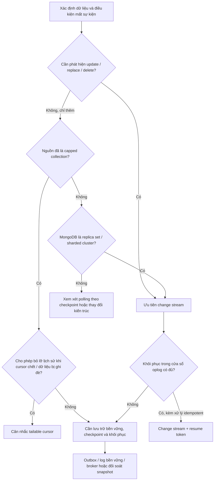

# Chọn tailable cursor hay change stream theo loại dữ liệu cần theo dõi

Trong **Spring Data MongoDB**, hai cơ chế có thể cung cấp luồng dữ liệu gần thời gian thực nhưng trả lời hai câu hỏi khác nhau:

- **Tailable cursor**: “Có những *document mới được nối thêm* vào một **capped collection** nào?” Nó gần với thao tác `tail -f` trên tệp log.
- **Change stream**: “Những *thao tác thay đổi dữ liệu* nào vừa xảy ra trong MongoDB?” Nó cung cấp sự kiện `insert`, `update`, `replace`, `delete` và các sự kiện liên quan, dựa trên cơ chế theo dõi thay đổi của replica set hoặc sharded cluster.

Đối với module `SPRING_DATA_MONGODB`, lựa chọn này quyết định cách sử dụng `ReactiveMongoTemplate`, repository, kiểu collection, chiến lược khôi phục và mức độ tin cậy của ứng dụng. Không nên chọn chỉ vì cả hai đều có thể trả về `Flux`: **hãy xác định loại dữ liệu cần quan sát và ngữ nghĩa sự kiện trước**.

## 1. Bắt đầu từ mô hình dữ liệu, không phải từ API

Xét hai collection minh họa:

```javascript
// Dòng log bổ sung liên tục, mỗi document ghi một sự kiện bất biến.
db.audit_feed_capped.insertOne({
  type: "LOGIN",
  message: "user u42 logged in",
  occurredAt: new Date()
});

// Document nghiệp vụ có trạng thái thay đổi theo thời gian.
db.orders.insertOne({ _id: "o-101", status: "CREATED", total: 250000 });
db.orders.updateOne({ _id: "o-101" }, { $set: { status: "PAID" } });
db.orders.deleteOne({ _id: "o-101" });
```

Với `audit_feed_capped`, người tiêu thụ thường muốn đọc các dòng log mới khi chúng được ghi. Với `orders`, người tiêu thụ cần phân biệt lúc đơn hàng được tạo, chuyển trạng thái và bị xóa. Một tailable cursor không biến lần `updateOne` thành “dòng mới”; ngược lại, change stream mô tả các thay đổi đó.

| Tiêu chí | Tailable cursor | Change stream |
|---|---|---|
| Đối tượng quan sát | Document được đọc theo luồng ở **capped collection** | Sự kiện thay đổi của collection/database/deployment được hỗ trợ |
| Collection nguồn | **Phải là capped collection** | Thông thường là collection thông thường; không cần chuyển thành capped |
| Loại thao tác phù hợp | Chủ yếu là `insert` nối thêm | `insert`, `update`, `replace`, `delete`; thêm các sự kiện đặc biệt tùy phạm vi và phiên bản |
| Thông tin trả về | Nội dung document khớp truy vấn | Loại thao tác, khóa document, thời điểm, resume token; nội dung document tùy thao tác và tùy chọn |
| Hạ tầng MongoDB | Có thể dùng trên standalone nếu collection là capped | Cần **replica set hoặc sharded cluster**; không hoạt động trên standalone thông thường |
| Theo dõi nhiều collection | Mỗi cursor gắn với một collection | Có thể theo dõi ở cấp collection hoặc database; driver MongoDB còn hỗ trợ cấp deployment |
| Khôi phục sau mất kết nối | Không có resume token chuẩn cho vị trí đã đọc | Có resume token, nhưng còn phụ thuộc lịch sử trong oplog và điều kiện khôi phục |
| Giới hạn lưu trữ | Capped collection có kích thước cố định, tự loại bỏ bản ghi cũ | Oplog cũng có cửa sổ lịch sử hữu hạn; không phải kho lưu trữ sự kiện vĩnh viễn |
| Quy mô và ràng buộc | Capped collection **không sharding**, không ghi trong transaction | Hoạt động với replica set hoặc sharded cluster; có chi phí duy trì watcher và xử lý sự kiện |

**Quy tắc chọn nhanh:** Nếu dữ liệu là một dãy bản ghi *chỉ thêm* và việc đọc như log trực tiếp đáp ứng yêu cầu, cân nhắc tailable cursor. Nếu cần biết **document hiện có bị sửa, thay thế hoặc xóa**, ưu tiên change stream. Nếu mọi sự kiện phải được lưu giữ và xử lý chắc chắn trong thời gian dài, hai cơ chế này chỉ là một phần của kiến trúc, chưa thay thế được hàng đợi/bản ghi sự kiện bền vững và checkpoint nghiệp vụ.

## 2. Khi nào chọn tailable cursor?

Tailable cursor sử dụng kiểu cursor đặc biệt của MongoDB để tiếp tục chờ document mới sau khi đã đọc đến cuối capped collection. Capped collection hoạt động gần giống **bộ đệm vòng**: khi đầy, dữ liệu cũ nhất được loại bỏ để nhường chỗ cho dữ liệu mới. Vì vậy, cách làm này phù hợp với luồng cập nhật giao diện log nội bộ, thông báo kỹ thuật ngắn hạn hoặc feed sự kiện có thể chấp nhận việc bỏ lỡ một phần lịch sử.

Ví dụ, hệ thống ghi một dòng log bất biến cho mỗi lần thiết bị gửi tín hiệu:

```javascript
// Thực hiện một lần khi khởi tạo môi trường, không lặp lại nếu đã tồn tại.
db.createCollection("audit_feed_capped", {
  capped: true,
  size: 10 * 1024 * 1024,
  max: 100000
});

// Một document khởi tạo có thể giúp người đọc bắt đầu trên collection rỗng.
db.audit_feed_capped.insertOne({
  type: "BOOTSTRAP",
  message: "feed initialized",
  occurredAt: new Date()
});

db.audit_feed_capped.isCapped(); // true
```

Kích thước `size` là giới hạn tính bằng byte; `max` giới hạn số document. Dữ liệu có thể bị loại bỏ khi đạt **một trong các ngưỡng**, nên dung lượng thực tế cần dựa trên tốc độ ghi, cỡ document và thời gian mà người đọc có thể bị gián đoạn. Việc tạo collection phải được quản lý như bước triển khai có kiểm soát; collection thông thường không trở thành capped chỉ vì gọi `tail()`.

Các điều kiện và đánh đổi quan trọng:

1. **Bản ghi là append-only theo nghĩa nghiệp vụ.** Mỗi trạng thái mới được ghi thành một document mới, thay vì cập nhật tại chỗ. Capped collection không thích hợp với cập nhật làm document lớn lên và không hỗ trợ xóa tùy ý như collection thông thường.
2. **Dữ liệu cũ được phép hết hạn theo dung lượng.** Nếu người đọc dừng lâu, bản ghi có thể bị ghi đè trước khi đọc được. Khi đó, reconnect đơn thuần không bảo đảm phục hồi các bản ghi đã mất.
3. **Không phụ thuộc vào chỉ mục để tiếp tục đuổi theo luồng.** Tailable cursor chủ yếu quét theo thứ tự tự nhiên của capped collection. Nếu nhu cầu là “lấy bản ghi mới hơn `lastSeenId` bằng index”, một truy vấn thường kết hợp checkpoint có thể phù hợp hơn.
4. **Xử lý vòng đời cursor.** Cursor có thể kết thúc hoặc mất hiệu lực, trong đó có tình huống truy vấn ban đầu không khớp document. Cần theo dõi việc hoàn thành bất ngờ, lỗi, độ trễ và cơ chế mở lại cursor; trong thử nghiệm collection rỗng, có thể dùng document khởi tạo và lọc nó ở tầng ứng dụng.
5. **Không giả định thứ tự toàn cục tuyệt đối.** Với nhiều người ghi đồng thời, thứ tự quan sát không mặc nhiên tương đương thứ tự thời gian nghiệp vụ; cần `sequence` hoặc `occurredAt` và quy tắc xử lý riêng nếu thứ tự quan trọng.

Ví dụ chọn đúng: một dashboard hiển thị **100 dòng log gần nhất**, có thể bị bỏ lỡ khi dashboard tắt; log đã được lưu ở hệ thống lưu trữ khác để truy vấn lâu dài. Tailable cursor có thể cung cấp feed tức thời từ capped collection. Ngược lại, “log kiểm toán bắt buộc bảo toàn mọi bản ghi” **không** nên chỉ dựa vào vòng đệm capped này.

## 3. Khi nào chọn change stream?

Change stream sử dụng thông tin thay đổi của MongoDB để phát ra **sự kiện thao tác**, vì vậy thích hợp với những collection mô hình hóa *trạng thái hiện tại*: đơn hàng, tồn kho, hồ sơ, danh mục sản phẩm, cấu hình hoặc trạng thái xử lý tác vụ.

Với một document `orders`, luồng sự kiện điển hình có thể là:

```text
insert  { _id: "o-101", status: "CREATED" }
update  { documentKey: { _id: "o-101" },
          updateDescription: { updatedFields: { status: "PAID" } } }
delete  { documentKey: { _id: "o-101" } }
```

Đây là hình dạng rút gọn để giải thích; payload thực tế chứa thêm metadata và resume token. `update` **mặc định thường chỉ cung cấp phần thay đổi** trong `updateDescription`, không đồng nghĩa luôn có document đầy đủ. Có thể bật chế độ `updateLookup` để yêu cầu đọc phiên bản document đã cập nhật, nhưng giá trị lấy về phản ánh trạng thái đã được majority-commit tại lúc lookup, có thể khác trạng thái ngay sau chính thao tác đó; document cũng có thể đã bị xóa. Các trường trước thay đổi (*pre-image*) cần được cấu hình riêng khi tính năng và phiên bản MongoDB hỗ trợ.

Change stream phù hợp khi:

- Cần phản ứng với chuyển trạng thái như `CREATED → PAID → SHIPPED`, không chỉ quan sát document mới.
- Cần vô hiệu hóa cache khi `update`, gỡ dữ liệu từ index tìm kiếm khi `delete`, hoặc cập nhật projection dựa trên thay đổi của collection nghiệp vụ.
- Cần theo dõi nhiều loại entity hoặc nhiều collection trong cùng database, với chiến lược mapping riêng cho từng loại document.
- Cần giữ **resume token** để cố gắng tiếp tục từ vị trí đã xử lý sau khi ứng dụng khởi động lại.

Cần kiểm tra trước khi thiết kế:

- **Topology:** Change streams yêu cầu replica set hoặc sharded cluster. Môi trường phát triển chỉ chạy `mongod` standalone sẽ không đáp ứng; có thể chạy replica set một node để thử API, nhưng cách này không mô phỏng đầy đủ failover production.
- **Phạm vi hỗ trợ:** Không phải mọi namespace hoặc loại collection đều xem được qua change stream. Chẳng hạn, MongoDB **không hỗ trợ change streams trực tiếp cho time series collection**; các collection hệ thống và database đặc biệt cũng có hạn chế.
- **Cửa sổ oplog:** Resume token chỉ hữu ích khi MongoDB còn đủ lịch sử để xác định vị trí đó. Nếu downtime lớn hơn cửa sổ lưu oplog hoặc token không còn hợp lệ, phải có quy trình tái đồng bộ.
- **Chi phí:** Mỗi watcher giữ tài nguyên và kết nối chờ `getMore`. Tăng số lượng watcher tùy tiện có thể gây áp lực lên connection pool và độ trễ. Lọc sự kiện sớm, giới hạn watcher và theo dõi tải hệ thống.

Change stream không phải bản sao vô hạn của event sourcing: nó phản ánh các thao tác dữ liệu đã được ghi nhận ở MongoDB và không tự cấp cho ứng dụng cơ chế xử lý chính xác một lần (*exactly once*) ở hệ thống đích.

## 4. Cây quyết định theo dữ liệu cần theo dõi



### Một số trường hợp điển hình

| Bài toán | Chọn cách nào? | Lý do và điểm cần giữ lại |
|---|---|---|
| Màn hình theo dõi dòng log vận hành mới, có thể bỏ lỡ khi tắt | **Tailable cursor** nếu log nằm trong capped collection | Mô hình chỉ thêm; không cần xử lý `update`/`delete`; chấp nhận giới hạn của vòng đệm |
| Theo dõi đơn hàng thay đổi trạng thái và hủy đơn | **Change stream** | Cần phân biệt `insert`, `update`, `delete`, có document key và token để phục hồi |
| Cập nhật cache khi thông tin sản phẩm bị sửa | **Change stream** | Nếu dùng tailable cursor, bản sửa của document có sẵn không thành bản ghi thêm mới |
| Đồng bộ MongoDB sang chỉ mục tìm kiếm | **Change stream + initial snapshot + checkpoint** | Cần áp dụng cả tạo, sửa, xóa và xử lý khoảng giao giữa snapshot và luồng thay đổi |
| Event log bất biến, cần audit không mất bản ghi và truy xuất sau nhiều tháng | **Kho lưu trữ bền vững / outbox hoặc broker**; dùng stream khi phù hợp để đẩy đi | Capped bị loại bỏ dữ liệu cũ; oplog cũng hữu hạn; cần retention và cơ chế replay của riêng hệ thống |
| Sensor sử dụng native **time series collection** | **Không chọn trực tiếp một trong hai** | Time series collection không phải capped và không hỗ trợ change stream trực tiếp; cân nhắc luồng ingest song song, broker hoặc truy vấn theo watermark |
| MongoDB standalone, chỉ muốn xem document mới trong collection thường | **Polling có checkpoint**, hoặc đổi topology/thiết kế | Collection thường không hỗ trợ tailable; change stream cần replica set/sharded cluster |
| Muốn thấy thay đổi ở nhiều collection nghiệp vụ trong một database | **Change stream ở cấp database** | Tailable cursor chỉ đi theo từng capped collection; cần đọc payload thô hoặc ánh xạ phù hợp từng entity |

Một câu hỏi hay bị bỏ qua: **“Tôi muốn nhận document mới hay muốn nhận mọi thay đổi đối với document?”** Chỉ hai câu trả lời này đã quyết định phần lớn lựa chọn. Sau đó mới kiểm tra topology, khả năng chịu mất dữ liệu, độ trễ và chính sách khôi phục.

## 5. Ví dụ triển khai với Spring Data MongoDB Reactive

Spring Data MongoDB cho phép tạo cả hai luồng bằng `ReactiveMongoTemplate`. Ví dụ dưới sử dụng `Document` để tập trung vào ngữ nghĩa luồng; trong ứng dụng thực tế có thể thay bằng lớp domain được Spring Data ánh xạ.

```java
import org.bson.Document;
import org.springframework.data.mongodb.core.ChangeStreamEvent;
import org.springframework.data.mongodb.core.ChangeStreamOptions;
import org.springframework.data.mongodb.core.ReactiveMongoTemplate;
import org.springframework.data.mongodb.core.query.Query;
import org.springframework.stereotype.Service;
import reactor.core.publisher.Flux;

@Service
public class MongoFeedService {

    private final ReactiveMongoTemplate mongo;

    public MongoFeedService(ReactiveMongoTemplate mongo) {
        this.mongo = mongo;
    }

    // Nguồn: capped collection audit_feed_capped, document được nối thêm.
    public Flux<Document> followAuditFeed() {
        return mongo.tail(new Query(), Document.class, "audit_feed_capped")
                .filter(doc -> !"BOOTSTRAP".equals(doc.getString("type")));
    }

    // Nguồn: collection orders bình thường trên replica set/sharded cluster.
    // Mỗi phần tử là sự kiện thao tác chứ không chỉ là nội dung document.
    public Flux<ChangeStreamEvent<Document>> watchOrderChanges() {
        return mongo.changeStream(
                null,                           // database mặc định của template
                "orders",
                ChangeStreamOptions.empty(),
                Document.class);
    }
}
```

Cách đọc kết quả:

```java
// Phần xử lý minh họa; consumer thực tế cần xử lý lỗi và checkpoint riêng.
mongoFeedService.followAuditFeed()
        .subscribe(log -> System.out.println(log.toJson()));

mongoFeedService.watchOrderChanges()
        .subscribe(event -> {
            System.out.println("operation = " + event.getOperationType());
            System.out.println("documentKey = " +
                    (event.getRaw() != null ? event.getRaw().getDocumentKey() : null));
            System.out.println("resumeToken = " + event.getResumeToken());
            System.out.println("fullDocument = " + event.getBody());
        });
```

Các ví dụ trên **không tự biến `subscribe()` thành một tiến trình nền được quản trị**. Trong dịch vụ dài hạn, cần quản lý `Disposable`/vòng đời bean, hủy subscription khi shutdown, ghi nhận lỗi và quyết định chính sách mở lại luồng. Với workload reactive, không chặn luồng đọc bằng thao tác I/O đồng bộ tốn thời gian; nên dùng pipeline bất đồng bộ và điều chỉnh backpressure nếu cần.

Nếu chỉ muốn document có `type = LOGIN`, có thể lọc ở Reactor sau khi nhận từ `tail()` như ví dụ `BOOTSTRAP` ở trên. Query tailable có điều kiện ban đầu không khớp có thể khiến cursor kết thúc, vì thế cần cân nhắc kỹ giữa lọc phía server và bảo đảm cursor tiếp tục theo dõi khi chưa có bản ghi phù hợp.

### Theo dõi thay đổi với chế độ đọc document đầy đủ

Khi một thao tác `update` chỉ báo các trường được sửa, có thể lựa chọn trả thêm nội dung document:

```java
ChangeStreamOptions options = ChangeStreamOptions.builder()
        .returnFullDocumentOnUpdate() // tương ứng fullDocument: updateLookup
        .build();

Flux<ChangeStreamEvent<Document>> events = mongo.changeStream(
        null, "orders", options, Document.class);
```

Không nên dùng `event.getBody()` làm nguồn dữ liệu duy nhất khi xử lý mọi loại thao tác: `delete` thường không còn document sau xóa; `updateLookup` có thể không trả lại document hoặc trả trạng thái đã thay đổi thêm. Hãy đọc `getOperationType()`, `getRaw()`/`documentKey` và thiết kế thao tác đích cho từng loại sự kiện.

### Lấy lại change stream từ resume token

Từ `event.getResumeToken()` có thể nhận một `BsonValue`. Sau khi lưu checkpoint bền vững, khởi tạo lại với token đó:

```java
import org.bson.BsonValue;

// Chỉ gọi khi kho checkpoint đã trả về một token BSON hợp lệ.
public Flux<ChangeStreamEvent<Document>> resumeOrders(
        BsonValue tokenFromCheckpoint) {
    ChangeStreamOptions resumeOptions = ChangeStreamOptions.builder()
            .resumeAfter(tokenFromCheckpoint)
            .build();

    return mongo.changeStream(
            null, "orders", resumeOptions, Document.class);
}
```

Phương thức minh họa này được đặt trong `MongoFeedService` ở ví dụ trên; `tokenFromCheckpoint` phải được truyền từ kho lưu checkpoint thực tế. Đây mới là **cách cấu hình API**, chưa phải triển khai checkpoint hoàn chỉnh. Cần bảo toàn token BSON nguyên vẹn, phạm vi namespace, pipeline và các tùy chọn liên quan để tiếp tục đúng luồng. `resumeAfter` không dùng để đi qua một sự kiện `invalidate` như `drop`/`rename`; trường hợp hỗ trợ cần xem xét `startAfter` và chính sách tái tạo dữ liệu đích. Nếu token đã ngoài cửa sổ oplog, xử lý lỗi và chạy lại quy trình đối soát/snapshot thay vì retry vô hạn cùng token.

## 6. Thiết kế khôi phục và chống trùng lặp

Điểm khác biệt lớn nhất về vận hành là **change stream có resume token**, còn tailable cursor không có một token theo dõi thay đổi tương đương. Nhưng token không thay thế checkpoint nghiệp vụ.

### Với tailable cursor

- Nắm rõ dung lượng capped và tốc độ ghi: ví dụ 10 MiB cho dữ liệu trung bình 1 KiB/document chỉ lưu xấp xỉ mười nghìn document trước khi trừ overhead; thời gian giữ thực tế còn phụ thuộc tải ghi.
- Đánh dấu một vị trí ứng dụng như `sequence` hoặc mốc thời gian chỉ hỗ trợ **phát hiện khoảng trống và đối soát** nếu nguồn còn giữ lịch sử; nó không biến capped collection thành log có thể replay vô hạn.
- Cần xử lý `onError` và `onComplete` ngoài dự kiến, thực hiện reconnect có backoff, cảnh báo khi phát hiện gap. Đọc lại một đoạn có thể gây trùng; dùng định danh sự kiện nếu consumer có tác dụng phụ.

### Với change stream

Quy trình consumer thường cần bảo đảm thứ tự sau:

1. Nhận event gồm loại thao tác, `documentKey` và `resumeToken`.
2. Áp dụng thay đổi vào hệ thống đích theo kiểu **idempotent** (xử lý lại cùng event không tạo kết quả sai); định danh khóa và event giúp kiểm soát trùng lặp.
3. **Sau khi** tác dụng phụ thành công, lưu token checkpoint trong kho bền vững. Khi hệ thống đích và checkpoint không có transaction chung, chấp nhận khả năng phát lại event và thiết kế idempotency tương ứng.
4. Khi khởi động lại, đọc token, mở change stream từ đó, retry có backoff đối với lỗi phục hồi được, cảnh báo khi token hết hiệu lực.

Nếu lưu token **trước** khi cập nhật hệ thống đích, một sự cố ở bước cập nhật có thể khiến event bị bỏ qua vĩnh viễn. Nếu cập nhật đích thành công nhưng lưu token thất bại, event có thể được phát lại. Đây là lý do “có resume token” **không tương đương** “exactly once”.

Với nghiệp vụ tài chính, kiểm toán bắt buộc hoặc đồng bộ không chấp nhận mất event, cân nhắc **transactional outbox** ở nguồn nghiệp vụ, một broker/log có retention phù hợp, hoặc cơ chế đối soát định kỳ bên cạnh change stream. Nếu cần đồng bộ trạng thái hiện có, hãy chụp snapshot ban đầu và thiết kế **ranh giới snapshot–stream** cẩn thận: chỉ chạy `findAll()` rồi mới đăng ký change stream có thể bỏ sót các thay đổi xảy ra giữa hai bước. Phải chọn mốc bắt đầu stream có thể khôi phục, đồng bộ snapshot và event ở vùng giao, và khử trùng lặp trước khi chuyển hệ thống sang chế độ theo dõi liên tục.

## 7. Hiệu năng, tài nguyên và những hiểu nhầm thường gặp

| Nhận định | Thực tế cần áp dụng |
|---|---|
| “Dùng `@Tailable` trên bất cứ repository nào là có realtime.” | Repository tailable chỉ hợp lệ với **capped collection**; API không thay đổi cấu trúc lưu trữ. Spring Data hỗ trợ `@Tailable` cho phương thức reactive trả nhiều phần tử như `Flux`. |
| “Tailable cursor trả về mọi lần sửa document.” | Nó đọc luồng document ở capped collection, không phát event `update`/`delete` như change stream. |
| “Change stream luôn trả document mới nhất và cũ nhất.” | Cần xét `operationType`, delta, `fullDocument` và tùy chọn pre-image; nhiều trường hợp không có document đầy đủ. |
| “Resume token giúp phát lại vô hạn.” | Oplog hữu hạn. Token/pipeline không tương thích hoặc lịch sử bị xóa khiến không thể tiếp tục từ vị trí cũ. |
| “Một watcher luôn miễn phí.” | Watcher tiêu thụ kết nối và tài nguyên server; nhiều watcher hoặc lookup lớn có thể ảnh hưởng độ trễ. |
| “Chỉ cần mở một listener là mọi instance sẽ tự chia đều event.” | Mỗi subscriber độc lập có thể nhận cùng sự kiện; cần cơ chế điều phối, phân vùng công việc hoặc idempotency nếu có nhiều instance. |
| “Dùng capped collection để tự xóa log giống TTL là tương đương.” | Capped giới hạn dung lượng/số bản ghi, TTL xóa theo thời gian; cả khả năng truy vấn, cập nhật và mục đích quản trị dữ liệu khác nhau. |

Các chỉ số nên theo dõi gồm: tuổi của event gần nhất đã xử lý, số lần cursor đóng/lỗi, số lần reconnect, tốc độ ghi/đọc, tỷ lệ event xử lý lỗi, tuổi checkpoint so với cửa sổ oplog, kích thước connection pool và thời gian lookup/ghi hệ thống đích. Với tailable cursor, thêm cảnh báo về độ dài khoảng ngắt so với vòng đời dữ liệu trong capped collection.

## 8. Bài thực hành kiểm chứng quyết định

**Bài A — Feed append-only:** Tạo `audit_feed_capped` như ở phần 2, chèn bản ghi `BOOTSTRAP`, mở `followAuditFeed()`, rồi `insertOne` ba log mới. Xác nhận subscriber nhìn thấy ba dòng mới. Tắt subscriber, tạo thêm nhiều bản ghi cho đến khi capped collection loại bỏ log cũ, rồi mở lại. Kiểm tra bản ghi nào còn tồn tại để thấy vì sao không thể dựa vào tailable cursor cho lịch sử bắt buộc.

**Bài B — Trạng thái nghiệp vụ:** Chạy MongoDB ở chế độ replica set, tạo collection `orders` thông thường, mở `watchOrderChanges()`, rồi lần lượt `insertOne`, `updateOne`, `deleteOne` cùng khóa. Đối chiếu `getOperationType()` với sự kiện nhận được. Bật `returnFullDocumentOnUpdate()` và kiểm tra điểm khác giữa delta của `update` và `getBody()`; với `delete`, dùng `documentKey` để xóa projection tương ứng.

**Bài C — Khôi phục:** Lưu token sau khi xử lý thành công một event trong bài B, hủy subscription, phát sinh thêm sự kiện và đăng ký lại qua `resumeAfter(token)`. Xác nhận luồng tiếp tục từ sau token trong khi oplog còn đủ lịch sử. Mô phỏng xử lý đích thành công nhưng checkpoint thất bại để kiểm tra idempotency. Không cần cố tình làm hỏng oplog; hãy ghi rõ phương án tái đồng bộ khi token quá cũ.

**Câu hỏi tự đánh giá:** Một team muốn đồng bộ trạng thái `inventory.quantity` và gỡ sản phẩm đã bị xóa khỏi cache. Team hiện dùng capped collection cho các dòng log truy cập. Có thể tái sử dụng tailable cursor của log để bảo đảm cập nhật tồn kho không? **Không**, vì log truy cập và trạng thái tồn kho là hai nguồn có ngữ nghĩa khác nhau; hãy theo dõi thay đổi collection tồn kho bằng change stream (hoặc ghi event nghiệp vụ riêng), xử lý `update`/`delete`, lưu token và đối soát nếu cần.

## Tài liệu tham khảo

- [Spring Data MongoDB — Tailable Cursors](https://docs.spring.io/spring-data/mongodb/reference/mongodb/tailable-cursors.html)
- [Spring Data MongoDB — Change Streams](https://docs.spring.io/spring-data/mongodb/reference/mongodb/change-streams.html)
- [MongoDB — Tailable Cursors](https://www.mongodb.com/docs/manual/core/tailable-cursors/)
- [MongoDB — Capped Collections](https://www.mongodb.com/docs/manual/core/capped-collections/)
- [MongoDB — Change Streams](https://www.mongodb.com/docs/manual/changestreams/)

Khi ra quyết định, hãy viết rõ trong thiết kế: **(1)** document có bất biến hay được cập nhật/xóa, **(2)** collection và topology thực tế, **(3)** khả năng chấp nhận khoảng trống/trùng lặp, **(4)** cách khởi động lại và đồng bộ lịch sử. Bốn thông tin này giúp chọn đúng giữa tailable cursor, change stream và một kiến trúc sự kiện bền vững hơn.
