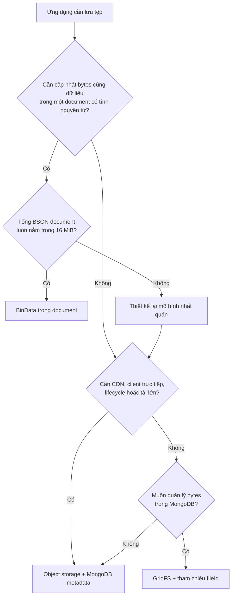

# Khi nào lưu file bằng GridFS thay vì một document hoặc object storage?

## 1. Vấn đề cần giải quyết

Khi xây dựng ứng dụng với **Spring Data MongoDB**, dữ liệu nhị phân như ảnh, hợp đồng PDF, bản ghi âm, tệp đính kèm hoặc bản xuất báo cáo có thể được lưu theo ba cách phổ biến:

1. Đặt dữ liệu nhị phân (`BinData`) trong **một MongoDB document**.
2. Đưa nội dung tệp vào **MongoDB GridFS**, để MongoDB quản lý các phần của tệp trong nhiều document.
3. Ghi tệp vào **object storage** (ví dụ Amazon S3 hoặc một dịch vụ tương thích), còn MongoDB chỉ giữ khóa đối tượng và metadata nghiệp vụ.

Không có lựa chọn nào tối ưu cho mọi trường hợp. Cần xét **kích thước tệp, mẫu truy cập, mức độ gắn kết với dữ liệu nghiệp vụ, khả năng phân phối cho người dùng, chi phí vận hành và tính nhất quán**. Đặc biệt, **16 MiB là giới hạn kích thước của *toàn bộ BSON document***, không phải ngưỡng mà mọi tệp nhỏ hơn đều nên nhúng vào document.

Mục tiêu bài học: biết khi nào nên chọn GridFS, khi nào nên chọn một document, khi nào nên dùng object storage; hiểu đánh đổi để áp dụng trong `GridFsTemplate`, `GridFsOperations` hoặc `ReactiveGridFsTemplate` của Spring Data MongoDB.

## 2. Ba phương án thực sự lưu dữ liệu ở đâu?

### 2.1. Nhúng nội dung vào một document

Ví dụ một chứng từ nhỏ được lưu cùng metadata:

```javascript
// Ví dụ minh họa: trường bytes dùng BSON Binary, không phải chuỗi Base64.
{
  _id: ObjectId("691a00000000000000000001"),
  ownerId: "customer-42",
  filename: "receipt.pdf",
  contentType: "application/pdf",
  content: BinData(0, "<base64-payload>"),
  createdAt: ISODate("2026-11-20T03:00:00Z")
}
```

Một lần đọc document có thể nhận cả metadata và bytes; một thao tác cập nhật document là đơn vị nguyên tử của MongoDB. Đổi lại, dữ liệu nhị phân lớn làm tăng dung lượng truyền, áp lực bộ nhớ/bộ đệm và chi phí đọc nếu truy vấn vô tình lấy cả trường `content`. Có thể dùng projection bỏ trường nhị phân khi chỉ cần metadata, nhưng dữ liệu vẫn được lưu trong document đó.

**Dùng khi:** tệp tương đối nhỏ, giới hạn kích thước document còn dư an toàn, số lượng/tần suất đọc phù hợp, và có lý do rõ ràng để cập nhật bytes cùng các trường liên quan trong một document. Một file 15,9 MiB vẫn có thể làm document vượt 16 MiB sau khi thêm metadata hoặc thay đổi schema, vì thế cần tính *tổng kích thước BSON* và để dư địa tăng trưởng.

### 2.2. GridFS: tệp là nhiều document trong MongoDB

**GridFS** là quy ước của MongoDB driver để chia nội dung tệp thành các **chunk**, mặc định mỗi chunk tối đa **255 KiB**. Với bucket mặc định `fs`, driver làm việc với hai collection:

- `fs.files`: một document metadata cho mỗi tệp, gồm `_id`, `filename`, `length`, `chunkSize`, `uploadDate` và `metadata` nếu có.
- `fs.chunks`: các document mang bytes thực, liên kết về tệp qua `files_id`, có số thứ tự `n` và trường `data` kiểu nhị phân.

```text
                        Bucket GridFS: fs
  ┌────────────────────────────────────────────────────────┐
  │ fs.files                                              │
  │ { _id: file-123, filename: "contract.pdf",            │
  │   length: 25000000, chunkSize: 261120,               │
  │   metadata: { ownerId: "customer-42" } }              │
  └───────────────────────┬────────────────────────────────┘
                          │ files_id = file-123
             ┌────────────┼────────────┐
             ▼            ▼            ▼
         fs.chunks     fs.chunks     fs.chunks ...
         {n: 0, data}  {n: 1, data}  {n: 2, data}
                          │
                      Driver ghép
                      khi đọc tệp
```

`261120` bytes tương đương 255 KiB. Tên bucket là tiền tố collection, không nhất thiết luôn là `fs`; `filename` cũng **không phải khóa duy nhất**, vì các phiên bản tệp có thể trùng tên. Khi đọc, ứng dụng nên ưu tiên định danh file `_id` đã lưu trong dữ liệu nghiệp vụ.

GridFS giúp lưu tệp **vượt giới hạn 16 MiB của một document** mà vẫn sử dụng hạ tầng MongoDB, replica set, backup, quyền truy cập và công cụ giám sát MongoDB hiện có. API driver hỗ trợ đọc/ghi tuần tự theo luồng để ứng dụng không phải tạo một mảng `byte[]` chứa toàn bộ tệp.

**Giới hạn quan trọng:** GridFS **không hỗ trợ multi-document transactions**. Không thể xem toàn bộ việc thêm, xóa hay thay thế nhiều chunk là một cập nhật nguyên tử giống thao tác trên một document. MongoDB cũng khuyến nghị **không dùng GridFS khi cần cập nhật nguyên tử toàn bộ nội dung file**. Có thể tạo phiên bản mới, kiểm tra đầy đủ, rồi đổi con trỏ `currentFileId` trong một document nghiệp vụ bằng cập nhật nguyên tử; việc thu gom phiên bản cũ thực hiện sau đó.

### 2.3. Object storage: MongoDB chỉ giữ tham chiếu

Với object storage, ứng dụng lưu bytes ở một hệ thống chuyên phục vụ đối tượng; document MongoDB chỉ chứa thông tin để tìm và kiểm soát tệp:

```javascript
{
  _id: ObjectId("691a00000000000000000002"),
  ownerId: "customer-42",
  storage: "OBJECT",
  bucket: "private-attachments",
  objectKey: "customer-42/contracts/8f2d.../contract.pdf",
  originalFilename: "contract.pdf",
  contentType: "application/pdf",
  sizeBytes: NumberLong("25000000"),
  sha256: "<sha256-hex>",
  status: "READY"
}
```

Ứng dụng có thể cung cấp đường dẫn tải lên/tải xuống có thời hạn, truyền trực tiếp giữa client và dịch vụ lưu trữ (nếu đáp ứng yêu cầu bảo mật). Hệ thống này thường thích hợp với dung lượng lớn, nhiều lượt tải, phân phối qua CDN, quản lý vòng đời/lớp lưu trữ và mở rộng độc lập với MongoDB. Đổi lại, **ghi object và ghi MongoDB là hai thao tác thuộc hai hệ thống**: cần quy trình xử lý khi một bên thành công, bên kia thất bại.

## 3. Bảng quyết định: document, GridFS hay object storage?

| Tiêu chí | Một MongoDB document (`BinData`) | MongoDB GridFS | Object storage + metadata MongoDB |
|---|---|---|---|
| Kích thước | Tổng document **phải nhỏ hơn hoặc bằng giới hạn 16 MiB**; nên có biên an toàn | Phù hợp file vượt 16 MiB; cũng dùng được cho file nhỏ khi có lý do | Dùng được cho file nhỏ hoặc rất lớn, tùy giới hạn dịch vụ |
| Kiểu đọc/ghi | Đọc/ghi cả trường binary, có thể projection metadata | Đọc/ghi theo stream qua API GridFS; file chia thành chunk | Upload/download object; thường hỗ trợ truy cập trực tiếp và range HTTP theo dịch vụ |
| Tính nguyên tử | Cập nhật trong **một document** có tính nguyên tử | **Không** có giao dịch đa document cho toàn bộ file/chunk; ưu tiên file bất biến và versioning | Không có giao dịch ACID chung với MongoDB; cần trạng thái và bù trừ |
| Hạ tầng | Chỉ MongoDB | Chỉ MongoDB, tận dụng driver, backup và phân quyền MongoDB | Thêm dịch vụ object storage; vận hành quyền, khóa, vòng đời và đồng bộ metadata |
| Khả năng phân phối | Ứng dụng thường phải phục vụ bytes | Ứng dụng thường truyền file từ MongoDB đến client | Thích hợp cho URL ký tạm, CDN và phân phối nhiều client |
| Tác động lên MongoDB | Binary lớn có thể làm nặng document | Chunk chiếm dung lượng, replica, I/O, backup và dung lượng index MongoDB | MongoDB nhẹ hơn vì thường chỉ chứa metadata |
| Trường hợp tiêu biểu | Ảnh nhỏ/bản ký số nhỏ gắn chặt một bản ghi | Hồ sơ nội bộ lớn, truy cập qua API nghiệp vụ và muốn quản lý chung trong MongoDB | Ảnh sản phẩm, video, tệp công khai, kho lưu trữ lớn hoặc tải xuống nhiều |

**Quy tắc lựa chọn ban đầu:**

1. Nếu bytes và metadata cần cập nhật **nguyên tử trong cùng một document**, tổng document nhỏ và đủ biên an toàn: cân nhắc `BinData`.
2. Nếu đã quyết định lưu bytes *trong MongoDB* nhưng một tệp có thể vượt 16 MiB, hoặc muốn đọc/ghi theo stream qua driver: cân nhắc **GridFS**.
3. Nếu tệp phục vụ nhiều người dùng, cần CDN, client tải trực tiếp, lưu trữ dài hạn, chính sách lifecycle hoặc tăng dung lượng độc lập với database: ưu tiên đánh giá **object storage**.
4. Nếu chưa rõ, đo trên workload thật: kích thước trung bình/P95, lượt đọc mỗi tệp, lưu lượng ra mạng, thời gian lưu giữ, chi phí backup/replica và độ trễ chấp nhận được.



Sơ đồ là điểm khởi đầu của quyết định kiến trúc. Không có nghĩa rằng file lớn hơn 16 MiB *bắt buộc* phải dùng GridFS: giới hạn này chỉ buộc phải thay đổi cách lưu nếu muốn tiếp tục đặt bytes trong MongoDB.

## 4. Các tình huống để lựa chọn

### Tình huống A — Biểu mẫu nhỏ, cần cập nhật đồng bộ

Hệ thống nội bộ lưu chữ ký ảnh nhỏ khoảng 40 KiB cùng trạng thái ký và dấu thời gian của một yêu cầu. Mỗi lần tải trang thường cần cả chữ ký và metadata; tổng document còn rất xa 16 MiB. **Một document** có thể đơn giản và cho phép cập nhật dữ liệu cùng trạng thái trong một thao tác nguyên tử. Tuy vậy, nếu trang danh sách chỉ cần trạng thái, luôn dùng projection bỏ bytes để giảm tải.

### Tình huống B — Hợp đồng PDF 25 MiB trong hệ thống nội bộ

Các hợp đồng được tải qua API sau khi xác thực, không có nhu cầu CDN hoặc liên kết tải trực tiếp. Đội vận hành muốn backup và kiểm soát truy cập qua MongoDB hiện hữu. **GridFS** là lựa chọn hợp lý: lưu tệp thành chunk, giữ `fileId` trong document `Contract`, đọc qua stream khi tải xuống. Vẫn cần xác minh quyền truy cập theo `contract.ownerId`, bởi bản thân `fileId` không phải token cấp quyền.

### Tình huống C — Ảnh sản phẩm và video phục vụ công khai

Hàng triệu ảnh và video được tải nhiều lần, một số phát theo HTTP Range, người dùng trải rộng nhiều khu vực. **Object storage + CDN** thường phù hợp hơn. MongoDB giữ `objectKey`, phiên bản, quyền và metadata tìm kiếm; client tải qua CDN hoặc URL được cấp quyền. Việc chọn GridFS chỉ vì video vượt 16 MiB có thể đẩy phần lớn băng thông và backup vào cụm MongoDB không cần thiết.

### Tình huống D — Kho chứng cứ có phiên bản

Một tệp 80 MiB chỉ được tải vài lần/tháng, cần ghi nhận lịch sử, kiểm tra SHA-256 và không được sửa file cũ. GridFS hoặc object storage đều khả thi. Nếu cần quản trị hoàn toàn trong MongoDB và lưu lượng nhỏ, GridFS có thể thuận tiện. Nếu thời hạn lưu giữ dài, số lượng tăng nhanh hoặc cần lưu trữ theo lớp chi phí, object storage thường đáng đánh giá hơn. **Versioning ở tầng nghiệp vụ** quan trọng hơn tên công nghệ lưu bytes.

## 5. Cách dùng GridFS trong Spring Data MongoDB

Spring Data MongoDB cung cấp `GridFsOperations`/`GridFsTemplate` cho ứng dụng imperative và `ReactiveGridFsOperations`/`ReactiveGridFsTemplate` cho ứng dụng reactive. Phần dưới dùng kiểu imperative để minh họa ý tưởng. Các dependency, cấu hình kết nối MongoDB và bean GridFS cần được thiết lập phù hợp với phiên bản Spring Data đang dùng.

### 5.1. Lưu nội dung từ `InputStream`

```java
import java.io.InputStream;
import java.io.OutputStream;
import java.io.IOException;
import java.util.NoSuchElementException;

import org.bson.Document;
import org.bson.types.ObjectId;
import org.springframework.data.mongodb.gridfs.GridFsOperations;
import org.springframework.data.mongodb.core.query.Criteria;
import org.springframework.data.mongodb.core.query.Query;
import org.springframework.stereotype.Service;

import com.mongodb.client.gridfs.model.GridFSFile;

@Service
public class ContractFileStore {
    private final GridFsOperations gridFs;

    public ContractFileStore(GridFsOperations gridFs) {
        this.gridFs = gridFs;
    }

    public ObjectId save(InputStream source, String filename,
                         String contentType, String contractId,
                         String sha256) {
        Document metadata = new Document("contractId", contractId)
                .append("sha256", sha256);

        // Driver ghi các chunk; hàm trả về _id trong fs.files.
        return gridFs.store(source, filename, contentType, metadata);
    }

    public void copyTo(ObjectId fileId, OutputStream destination)
            throws IOException {
        GridFSFile file = gridFs.findOne(
                Query.query(Criteria.where("_id").is(fileId)));

        if (file == null) {
            throw new NoSuchElementException("Không thấy file: " + fileId);
        }

        // Đọc theo luồng, không gom cả file vào byte[].
        try (InputStream source = gridFs.getResource(file).getInputStream()) {
            source.transferTo(destination);
        }
    }
}
```

Hàm `save` nhận một stream đang mở; **bên gọi chịu trách nhiệm đóng stream đầu vào** sau khi thao tác hoàn thành. Ví dụ với `MultipartFile`:

```java
try (InputStream in = multipartFile.getInputStream()) {
    ObjectId fileId = contractFileStore.save(
        in, multipartFile.getOriginalFilename(),
        multipartFile.getContentType(), contractId, calculatedSha256);
    // Lưu fileId vào document nghiệp vụ sau khi GridFS upload thành công.
}
```

Đoạn mã chỉ minh họa API lưu/đọc. Trong ứng dụng thật, cần kiểm tra kích thước, MIME thực tế, tên file, quyền của `contractId`, quota, lỗi tải lên và chính sách quét mã độc nếu nhận nội dung từ người dùng. Không lấy `contractId` của người dùng làm căn cứ cấp quyền nếu chưa xác thực.

### 5.2. Lưu fileId trong document nghiệp vụ

```javascript
{
  _id: "contract-2026-42",
  ownerId: "customer-42",
  title: "Hợp đồng thuê dịch vụ",
  currentFileId: ObjectId("691a00000000000000000003"),
  version: 3,
  status: "SIGNED"
}
```

`currentFileId` là liên kết đến `fs.files._id`, cho phép truy vấn nghiệp vụ gọn và độc lập với kích thước tệp. Để cập nhật, **ghi file mới trước**, kiểm tra checksum, rồi đổi `currentFileId` bằng cập nhật có điều kiện hoặc optimistic locking tại document `Contract`. Sau đó mới xóa file cũ theo chính sách lưu giữ; có thể giữ nhiều phiên bản để audit hoặc rollback. Nếu cập nhật con trỏ thất bại, cần cơ chế dọn phiên bản chưa được tham chiếu.

### 5.3. Truy vấn, chỉ mục và metadata

Bucket mặc định có các chỉ mục GridFS cơ bản trên `fs.chunks(files_id, n)` và `fs.files(filename, uploadDate)` do driver hỗ trợ bảo đảm khi hoạt động. Khi cần lọc theo `metadata.contractId` trong `fs.files`, cân nhắc chỉ mục ứng dụng dựa trên truy vấn đo được:

```javascript
db.fs.files.createIndex({ "metadata.contractId": 1, uploadDate: -1 });
```

Chỉ mục nghiệp vụ thêm chi phí ghi và lưu trữ, vì vậy không tạo cho mọi metadata vô điều kiện. `GridFsOperations.find(Query)` có giới hạn riêng: một số tiêu chí `Sort` trong `Query` không được áp dụng cho việc truy xuất GridFS theo tài liệu Spring Data. Nếu cần chọn phiên bản, ứng dụng nên dựa vào định danh/phiên bản đã lưu và kiểm thử thứ tự truy xuất trong phiên bản API cụ thể.

`filename` có thể trùng giữa các lần upload; `metadata` có thể chứa mã tenant, phân loại tài liệu, checksum hoặc phiên bản. Không phụ thuộc vào trường `md5` cũ của GridFS cho yêu cầu toàn vẹn: trường này đã bị deprecated; có thể tính **SHA-256 tại tầng ứng dụng** và lưu trong `metadata`.

### 5.4. Khi dùng Reactive Spring Data MongoDB

Trong pipeline reactive, dùng `ReactiveGridFsTemplate` và đầu vào `Publisher<DataBuffer>` để tránh buộc toàn bộ nội dung vào bộ nhớ. Cần kiểm soát backpressure, giải phóng `DataBuffer` theo contract API khi cần, truyền lỗi và hủy upload đúng cách. **Reactive không làm thay đổi** mô hình `files/chunks` hoặc giới hạn giao dịch của GridFS; nó thay đổi cách ứng dụng thực thi I/O.

## 6. Rủi ro vận hành thường bị bỏ sót

### 6.1. Dung lượng lưu trữ, sao lưu và băng thông

GridFS đặt bytes cùng nền tảng MongoDB nên file tăng sẽ kéo theo chi phí replication, snapshot/backup, restore, băng thông giữa các replica, IOPS và thời gian phục hồi. Ví dụ, **10.000 file × 20 MiB ≈ 195 GiB** dữ liệu nhị phân trước overhead; với ba bản sao, chỉ riêng phần dữ liệu có thể tương đương khoảng **586 GiB** trên các node. Đây là ví dụ tính dung lượng, không phải dự đoán chi phí cho mọi cụm; còn phải tính nén, chỉ mục và chính sách backup thực tế.

Đối với object storage, cần tính thêm phí yêu cầu, dữ liệu tải ra, mạng/CDN, phiên bản, lớp lưu trữ và thao tác truy xuất. Không kết luận phương án nào rẻ hơn chỉ từ chi phí lưu một GB.

### 6.2. Quyền truy cập và đường đi của dữ liệu

- **Document / GridFS:** mọi request lấy tệp nên đi qua kiểm tra quyền nghiệp vụ trước khi truy cập bytes. Quản lý `ObjectId` và bucket không thay thế phân quyền theo người sở hữu/tenant.
- **Object storage:** cấu hình quyền bucket riêng tư, cấp URL tạm có phạm vi hẹp khi cần, kiểm soát thời hạn và hành vi cache/CDN; không dùng khóa object dễ đoán làm cơ chế bảo mật.
- **Cả ba:** xác thực loại file thực, giới hạn kích thước và số lượng, ghi log truy cập phù hợp, lưu checksum và bảo vệ dữ liệu nhạy cảm ở cả đường truyền lẫn nơi lưu trữ.

### 6.3. Upload thất bại, dữ liệu mồ côi và xóa file

Trong GridFS, một file gồm nhiều chunk, vì vậy cần xử lý upload lỗi, timeout và sự cố trước khi metadata nghiệp vụ được cập nhật. Dùng `fileId` và trạng thái nghiệp vụ để đối soát; ưu tiên API GridFS khi xóa để driver xử lý file cùng các chunk liên quan. Không xóa tùy tiện một document trong `fs.files` rồi giả định `fs.chunks` sẽ tự biến mất. Nếu có can thiệp thủ công hoặc crash, quy trình vận hành có thể cần rà soát chunk/file mồ côi.

Với object storage, thường dùng chu trình `PENDING_UPLOAD → READY` sau khi upload và xác minh thành công. Nếu tạo object thành công nhưng cập nhật MongoDB thất bại, đưa object vào hàng chờ dọn. Nếu metadata đã tồn tại nhưng upload hỏng, đánh dấu lỗi và cho phép retry. Đây là **nhất quán ở tầng ứng dụng**, không phải một giao dịch trải rộng qua hai hệ thống.

### 6.4. Cập nhật, streaming và phân phối file

GridFS phù hợp với mô hình **tệp bất biến sau khi ghi**. Khi sửa nội dung, hãy ghi phiên bản mới rồi đổi tham chiếu. Có thể truy cập các phần của tệp bằng khả năng của driver, nhưng **HTTP Range/206, phát video thích ứng và CDN không tự xuất hiện chỉ vì dùng GridFS**: ứng dụng phải tự triển khai các lớp đó nếu cần. Streaming giúp giảm nhu cầu giữ toàn bộ file trong RAM; không tự động giảm dung lượng mạng hoặc loại bỏ nút nghẽn của MongoDB.

## 7. Checklist thiết kế trước khi chốt phương án

Hãy trả lời các câu hỏi sau bằng dữ liệu thực tế hoặc giả định đã được xác nhận:

1. Kích thước file tối đa, trung bình và P95 là bao nhiêu? Tổng BSON document có thể tiệm cận 16 MiB không?
2. File được đọc bao nhiêu lần, có cần CDN, tải trực tiếp, tìm theo metadata hay truy cập một đoạn file không?
3. Có cần cập nhật bytes và metadata **nguyên tử** không? Nếu có, giới hạn của GridFS và object storage ảnh hưởng thế nào?
4. File có bất biến không? Cần giữ bao nhiêu phiên bản, trong bao lâu, và xóa khi nào?
5. Tệp thuộc tenant nào? Ai được upload/download? Kiểm tra quyền ở đâu?
6. Với GridFS, chi phí backup, restore, replica, chỉ mục, throughput của cụm MongoDB có còn phù hợp không?
7. Với object storage, kế hoạch phục hồi khi MongoDB metadata và object lệch trạng thái là gì?
8. Đã đo p95 latency, bộ nhớ ứng dụng, throughput, tổng chi phí vận hành và phương án xử lý lỗi bằng workload đại diện chưa?

**Kết luận:** Chọn **một document** khi nội dung nhỏ và cần tính đơn giản/nguyên tử trong chính document đó. Chọn **GridFS** khi muốn quản lý tệp bằng MongoDB, nhất là tệp vượt 16 MiB hoặc yêu cầu I/O theo luồng qua Spring Data, đồng thời chấp nhận chi phí MongoDB và giới hạn giao dịch. Chọn **object storage** khi nhu cầu phân phối file, mở rộng dung lượng, quản lý vòng đời và tính kinh tế của storage độc lập quan trọng hơn việc giữ bytes trong database. Đối với cả GridFS và object storage, nên lưu **tham chiếu ổn định, checksum và trạng thái phiên bản** trong dữ liệu nghiệp vụ.

## Tài liệu tham khảo

- [MongoDB Manual — GridFS, trường hợp sử dụng và giới hạn](https://www.mongodb.com/docs/manual/core/gridfs/)
- [MongoDB GridFS Specification — mô hình bucket, files và chunks](https://github.com/mongodb/specifications/blob/master/source/gridfs/gridfs-spec.md)
- [Spring Data MongoDB — GridFS Support](https://docs.spring.io/spring-data/mongodb/reference/mongodb/template-gridfs.html)
- [Spring Data MongoDB — `GridFsTemplate` API](https://docs.spring.io/spring-data/mongodb/reference/api/java/org/springframework/data/mongodb/gridfs/GridFsTemplate.html)
- [Amazon S3 — Presigned URL (ví dụ cơ chế truy cập object storage)](https://docs.aws.amazon.com/AmazonS3/latest/userguide/using-presigned-url.html)
