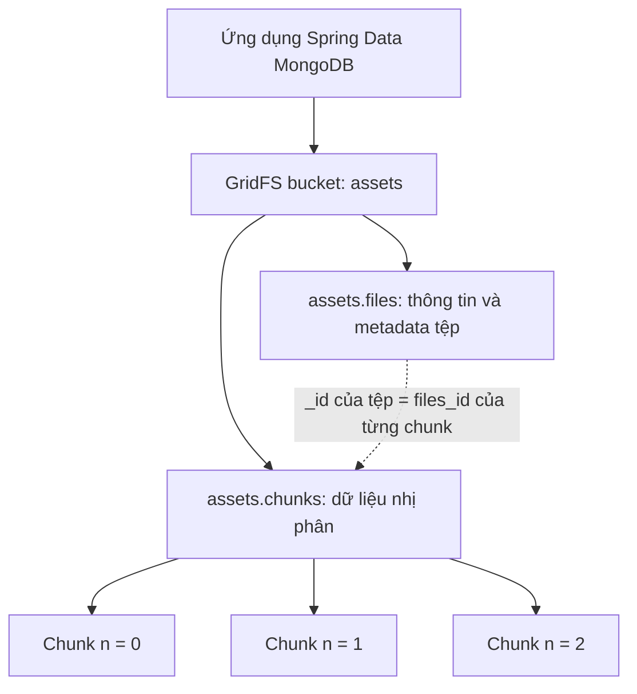

# Bucket, collection files/chunks và metadata trong GridFS

## Mục tiêu học tập

Sau bài này, bạn có thể:

- Giải thích bucket GridFS là gì và vì sao mỗi bucket sử dụng hai collection `files` và `chunks`.
- Đọc được cấu trúc một bản ghi tệp, liên kết các chunk với tệp gốc và tính số chunk dự kiến.
- Thiết kế metadata phục vụ tra cứu, phân quyền và vòng đời dữ liệu mà không nhầm metadata với nội dung nhị phân.
- Cấu hình bucket, lưu/đọc tệp bằng Spring Data MongoDB, kiểm tra chỉ mục và nhận diện dữ liệu mồ côi.

## 1. Vì sao GridFS cần bucket?

Một document MongoDB có giới hạn kích thước BSON là **16 MiB**. GridFS là quy ước lưu tệp bằng cách chia nội dung nhị phân thành các **chunk** nhỏ, lưu trong MongoDB, đồng thời duy trì một document mô tả tệp. Nhờ đó, ứng dụng có thể lưu và đọc tệp lớn hơn giới hạn của một document thông thường.

Trong module **SPRING_DATA_MONGODB**, ứng dụng Java thường sử dụng **`GridFsTemplate`** hoặc **`ReactiveGridFsTemplate`** để truy cập GridFS, bên cạnh `MongoTemplate` và các repository dùng cho dữ liệu nghiệp vụ.

**Bucket** là tên nhóm lưu trữ logic của GridFS, không phải một collection riêng hay một thư mục vật lý. Một bucket có tên `assets` tương ứng với hai collection:

| Thành phần | Collection của bucket `assets` | Vai trò |
|---|---|---|
| File records | `assets.files` | Mỗi document đại diện cho một tệp; chứa định danh, tên, độ dài, kích thước chunk, thời điểm tải lên và metadata. |
| Binary chunks | `assets.chunks` | Mỗi document giữ một đoạn dữ liệu nhị phân và số thứ tự của đoạn trong tệp. |

Tên bucket mặc định thường là **`fs`**, tạo `fs.files` và `fs.chunks`. Có thể đặt các bucket khác như `avatars`, `reports` hoặc `assets` để phân tách nhóm tệp theo nhu cầu ứng dụng. Các bucket trong cùng database được phân biệt bằng tên collection.



**Khi nào nên dùng?** GridFS phù hợp khi dữ liệu là tệp nhị phân cần lưu, đọc theo luồng và quản lý cùng hệ MongoDB, đặc biệt khi tệp có thể vượt 16 MiB. Với tệp rất nhỏ, một trường nhị phân trong document có thể đơn giản hơn. Nếu yêu cầu chủ yếu là lưu lượng tải tệp công khai rất lớn, chi phí truyền tải và lưu trữ đối tượng cần được đánh giá cùng các giải pháp object storage.

## 2. Cấu trúc collection `<bucket>.files`

Mỗi tệp được mô tả bằng **một document** trong collection `assets.files`. Ví dụ sau mô tả một tệp PDF dài 700.000 byte:

```javascript
// Ví dụ minh họa document trong db.assets.files
{
  _id: ObjectId("66aa00bb11cc22dd33ee44ff"),
  length: NumberLong("700000"),
  chunkSize: 261120,
  uploadDate: ISODate("2026-11-20T04:00:00Z"),
  filename: "bao-cao-quy-4.pdf",
  metadata: {
    ownerId: "u-42",
    category: "quarterly-report",
    contentType: "application/pdf",
    sha256: "gia-tri-sha256-da-duoc-tinh-cho-file",
    schemaVersion: 1
  }
}
```

| Trường | Ý nghĩa và lưu ý |
|---|---|
| `_id` | Định danh duy nhất của tệp trong bucket. Thường là `ObjectId` nhưng giao thức GridFS cho phép định danh kiểu BSON khác nếu driver hỗ trợ. |
| `length` | Tổng số byte của nội dung tệp, không phải số chunk hoặc kích thước metadata. |
| `chunkSize` | Kích thước chunk danh định khi upload; chunk cuối thường nhỏ hơn. Ví dụ 261.120 byte = 255 KiB. |
| `uploadDate` | Thời điểm upload do GridFS ghi nhận, thường được biểu diễn dưới dạng UTC khi xem bằng `ISODate`. |
| `filename` | Tên gợi ý để hiển thị hoặc tìm kiếm; **không được đảm bảo duy nhất**. |
| `metadata` | Document tùy chọn cho dữ liệu nghiệp vụ, ví dụ chủ sở hữu, loại tệp, MIME type, checksum và phiên bản schema metadata. |

Các trường như `contentType` hoặc `md5` có thể xuất hiện ở các tài liệu/dữ liệu GridFS cũ. Trong thiết kế mới, nên đặt thông tin ứng dụng cần dùng trong `metadata` và tự quản lý checksum đáng tin cậy, chẳng hạn SHA-256. Không giả định luôn có trường MD5 do GridFS cung cấp.

**Phân biệt `_id` và `filename`:** Hai lần tải lên cùng `filename` vẫn có thể tạo hai document khác nhau với hai `_id` khác nhau. Vì thế, API truy xuất một tệp cụ thể nên sử dụng định danh, kèm điều kiện sở hữu/quyền truy cập, thay vì chỉ dựa vào tên tệp.

## 3. Cấu trúc collection `<bucket>.chunks`

Nội dung tệp được chia thành nhiều document trong `assets.chunks`. Mỗi chunk có ba trường cốt lõi:

| Trường | Vai trò |
|---|---|
| `_id` | Định danh duy nhất của document chunk. |
| `files_id` | Tham chiếu logic đến `_id` của document trong `assets.files`. |
| `n` | Số thứ tự chunk, **bắt đầu từ 0**, để ghép lại đúng thứ tự. |
| `data` | Nội dung nhị phân (`BinData`) của chunk. |

Ví dụ rút gọn cho tệp 700.000 byte ở phần trước:

```javascript
// Ba document khác nhau trong db.assets.chunks.
// data được mô tả bằng chú thích, không phải cú pháp BSON thực thi.
{
  _id: ObjectId("66aa00bb11cc22dd33ee4501"),
  files_id: ObjectId("66aa00bb11cc22dd33ee44ff"),
  n: 0,
  data: /* 261120 byte nhị phân */
}
{
  _id: ObjectId("66aa00bb11cc22dd33ee4502"),
  files_id: ObjectId("66aa00bb11cc22dd33ee44ff"),
  n: 1,
  data: /* 261120 byte nhị phân */
}
{
  _id: ObjectId("66aa00bb11cc22dd33ee4503"),
  files_id: ObjectId("66aa00bb11cc22dd33ee44ff"),
  n: 2,
  data: /* 177760 byte nhị phân */
}
```

Với độ dài **`L`** và kích thước chunk **`S`**, số chunk mong đợi của tệp có dữ liệu là:

```text
soChunk = ceil(L / S)

L = 700000 byte
S = 261120 byte (255 KiB)
soChunk = ceil(700000 / 261120) = 3

261120 + 261120 + 177760 = 700000 byte
```

Kích thước mặc định thường dùng theo chuẩn GridFS là **255 KiB** (261.120 byte), nhưng ứng dụng có thể chọn giá trị khác khi upload. Chunk size ảnh hưởng số lượng document và chi phí truy cập: chunk nhỏ tạo nhiều document hơn; chunk lớn làm mỗi lần đọc/ghi một chunk nặng hơn. Không thay đổi `chunkSize` trong document đã lưu mà không viết lại nội dung tệp theo đúng giao thức.

GridFS sử dụng liên kết **logic**, không có khóa ngoại được MongoDB tự kiểm tra giữa `files_id` và `_id`. Driver cần đọc các chunk theo `n` tăng dần, phát hiện tình trạng thiếu hoặc trùng chunk và ghép dữ liệu thành luồng byte. Ứng dụng nên dùng API GridFS có sẵn thay vì tự nối các document `data`.

## 4. Quy trình upload và download

### 4.1. Upload

Một lần upload điển hình diễn ra như sau:

1. Chọn bucket và tạo định danh tệp.
2. Đọc `InputStream`; ghi tuần tự các chunk với cùng `files_id` và `n` tăng từ 0.
3. Sau khi đã ghi đủ nội dung, ghi document `files` với `length`, `chunkSize`, `uploadDate`, `filename` và `metadata`.
4. Trả về `_id` của tệp cho ứng dụng để lưu vào bản ghi nghiệp vụ.

Điểm cần nhớ: một lần upload thông thường **không phải một thao tác nguyên tử duy nhất trên mọi chunk và document tệp**. Nếu tiến trình gián đoạn, một số chunk có thể đã tồn tại nhưng document trong `files` chưa được tạo. Đây là một nguồn **orphan chunks** cần được theo dõi. Các tệp chưa hoàn tất có thể chưa xuất hiện trong kết quả truy vấn `files`.

### 4.2. Download

Khi download theo định danh, client GridFS:

1. Tìm document tệp trong `files`.
2. Dựa vào `_id` và `chunkSize`, đọc các chunk có `files_id` tương ứng theo `n`.
3. Ghép nội dung theo thứ tự và trả dữ liệu qua stream.

Đọc theo luồng giúp ứng dụng không phải giữ toàn bộ tệp trong bộ nhớ. Điều này đặc biệt quan trọng khi phục vụ file lớn qua HTTP. Tầng web nên trả nội dung theo stream và đóng tài nguyên khi kết thúc hoặc khi client ngắt kết nối.

## 5. Metadata: thông tin nghiệp vụ gắn với tệp

`metadata` giúp ứng dụng tìm kiếm và quản trị file mà không cần đọc nội dung nhị phân. Ví dụ một ứng dụng quản lý chứng từ có thể lưu:

```javascript
metadata: {
  ownerId: "u-42",
  tenantId: "org-7",
  category: "invoice",
  contentType: "application/pdf",
  originalFilename: "hoa-don-11-2026.pdf",
  sha256: "gia-tri-sha256-hop-le",
  schemaVersion: 1,
  retentionUntil: ISODate("2031-12-31T00:00:00Z")
}
```

Một số nguyên tắc thiết kế:

- **Chỉ lưu metadata cần thiết:** `ownerId`, `tenantId`, loại tệp hoặc trạng thái xử lý có thể hữu ích; không đưa cả bản nội dung hoặc payload nghiệp vụ lớn vào `metadata`.
- **Quy định tên và kiểu trường ổn định:** ví dụ `metadata.ownerId` luôn là chuỗi hoặc luôn là `ObjectId`, tránh trộn kiểu khiến truy vấn không nhất quán.
- **Phân quyền ở tầng ứng dụng:** lưu `ownerId` hay `tenantId` không tự tạo cơ chế cấp quyền. Mọi truy vấn xem, tải hoặc xóa tệp cần kiểm tra quyền truy cập thực tế.
- **Phân biệt MIME type khai báo và nội dung thực:** `contentType` hỗ trợ HTTP và UI nhưng không chứng minh tệp an toàn. Với file tải lên từ người dùng, cần kiểm tra loại file và giới hạn kích thước trước khi xử lý.
- **Checksum có chủ đích:** có thể tính SHA-256 khi nhận upload và lưu vào metadata để đối chiếu khi cần; chỉ đặt giá trị thật đã tính, không coi checksum là dữ liệu GridFS tự cung cấp.
- **Có phiên bản metadata:** `schemaVersion` giúp đổi cấu trúc metadata theo thời gian mà không phải viết lại mọi tệp ngay lập tức.

Metadata được lưu trong document `files` nên có thể truy vấn và tạo index như các trường document MongoDB thông thường. Nó **không phải phần thân tệp**, vì vậy sửa metadata không có nghĩa là sửa các byte trong `chunks`.

## 6. Chỉ mục và truy vấn theo bucket

GridFS thường cần hai index cơ bản:

| Collection | Index | Mục đích |
|---|---|---|
| `assets.files` | `{ filename: 1, uploadDate: 1 }` | Hỗ trợ tìm tệp theo tên và thời gian upload. |
| `assets.chunks` | `{ files_id: 1, n: 1 }`, **unique** | Giúp đọc các chunk theo tệp và thứ tự, đồng thời ngăn trùng `n` trong một tệp. |

Driver GridFS có thể tạo các index chuẩn khi bucket được sử dụng lần đầu, tùy điều kiện và phiên bản driver. Nên **kiểm tra index đang tồn tại** trước khi tự tạo hay thay đổi, nhất là với collection đã có dữ liệu.

Dùng `mongosh` để kiểm tra một bucket:

```javascript
// Xem danh sách index thực tế:
db.getCollection("assets.files").getIndexes()
db.getCollection("assets.chunks").getIndexes()

// Tra metadata của một tệp:
db.getCollection("assets.files").findOne({
  _id: ObjectId("66aa00bb11cc22dd33ee44ff")
})

// Tìm tệp thuộc người dùng u-42, mới nhất trước:
db.getCollection("assets.files")
  .find({ "metadata.ownerId": "u-42" })
  .sort({ uploadDate: -1 })

// Kiểm tra số chunk và thứ tự của một tệp:
db.getCollection("assets.chunks")
  .find(
    { files_id: ObjectId("66aa00bb11cc22dd33ee44ff") },
    { n: 1, files_id: 1 }
  )
  .sort({ n: 1 })
```

Khi hệ thống thường xuyên truy vấn theo chủ sở hữu và thời gian, có thể thêm index ứng dụng:

```javascript
db.getCollection("assets.files").createIndex({
  "metadata.ownerId": 1,
  uploadDate: -1
})
```

Index metadata giúp lọc hiệu quả hơn nhưng cũng tiêu tốn dung lượng và chi phí ghi. Chỉ tạo index theo các mẫu truy vấn có thật, quan sát bằng `explain()` khi lượng dữ liệu đủ lớn. Không xem `filename` là khóa duy nhất; nếu nghiệp vụ cần một tên duy nhất trong từng tổ chức, phải định nghĩa quy tắc và index phù hợp với chính sách phiên bản.

## 7. Ví dụ Spring Data MongoDB với bucket tùy chỉnh

Spring Data MongoDB cung cấp `GridFsTemplate` để thao tác GridFS theo mô hình đồng bộ. Ví dụ sau cấu hình bucket `assets` dùng converter và database factory của ứng dụng:

```java
import org.springframework.context.annotation.Bean;
import org.springframework.context.annotation.Configuration;
import org.springframework.data.mongodb.MongoDatabaseFactory;
import org.springframework.data.mongodb.core.convert.MongoConverter;
import org.springframework.data.mongodb.gridfs.GridFsTemplate;

@Configuration
public class GridFsConfiguration {

    @Bean("assetsGridFs")
    public GridFsTemplate assetsGridFs(
            MongoDatabaseFactory databaseFactory,
            MongoConverter converter) {
        return new GridFsTemplate(databaseFactory, converter, "assets");
    }
}
```

Khi sử dụng bean này, các tệp được quản lý trong `assets.files` và `assets.chunks`. Nếu ứng dụng cũng có bucket mặc định, cần chỉ rõ bean được inject để tránh lẫn bucket.

Ví dụ service lưu tệp với metadata và đọc lại theo `_id` **cùng điều kiện sở hữu**:

```java
import java.io.FileNotFoundException;
import java.io.IOException;
import java.io.InputStream;

import com.mongodb.client.gridfs.model.GridFSFile;
import org.bson.Document;
import org.bson.types.ObjectId;
import org.springframework.beans.factory.annotation.Qualifier;
import org.springframework.data.mongodb.core.query.Criteria;
import org.springframework.data.mongodb.core.query.Query;
import org.springframework.data.mongodb.gridfs.GridFsTemplate;
import org.springframework.stereotype.Service;

@Service
public class AssetStorageService {
    private final GridFsTemplate gridFs;

    public AssetStorageService(
            @Qualifier("assetsGridFs") GridFsTemplate gridFs) {
        this.gridFs = gridFs;
    }

    public ObjectId upload(
            InputStream source,
            String filename,
            String contentType,
            String ownerId) {

        Document metadata = new Document("ownerId", ownerId)
                .append("category", "report")
                .append("contentType", contentType)
                .append("schemaVersion", 1);

        return gridFs.store(source, filename, contentType, metadata);
    }

    public InputStream download(ObjectId fileId, String ownerId)
            throws IOException {

        Query query = Query.query(
                Criteria.where("_id").is(fileId)
                        .and("metadata.ownerId").is(ownerId));

        GridFSFile file = gridFs.findOne(query);
        if (file == null) {
            throw new FileNotFoundException("File not found or inaccessible");
        }

        // Bên gọi phải đóng stream sau khi sử dụng.
        return gridFs.getResource(file).getInputStream();
    }
}
```

Ở ví dụ này:

- `store(...)` dùng input stream, tên file, MIME type và metadata; kết quả là định danh tệp.
- `findOne(...)` truy vấn trong collection `assets.files`. Điều kiện `metadata.ownerId` cho thấy cách ràng buộc phạm vi dữ liệu, nhưng hệ thống thực tế phải lấy `ownerId` từ phiên xác thực đáng tin cậy, không tin giá trị người dùng tự gửi.
- `getResource(file).getInputStream()` cung cấp nội dung từ các chunk. Bên gọi cần đóng stream bằng `try-with-resources` hoặc cơ chế quản lý vòng đời phản hồi HTTP.
- Metadata có thể được xây dựng bằng `Document` hoặc một object mà `MongoConverter` ánh xạ được; nên giữ kiểu dữ liệu nhất quán giữa cách ghi và cách truy vấn.

Với ứng dụng reactive, Spring Data cung cấp `ReactiveGridFsTemplate` để triển khai đọc/ghi qua publisher, phù hợp pipeline WebFlux. Việc chọn đồng bộ hay reactive không thay đổi mô hình hai collection của GridFS; chỉ thay đổi cách API đưa dữ liệu qua luồng xử lý.

## 8. Những thao tác metadata cần phân biệt

**Đổi tên file:** sửa trường `filename` của document tệp hoặc dùng thao tác đổi tên mà API GridFS hỗ trợ. Việc đổi tên không yêu cầu viết lại nội dung các chunk.

**Cập nhật metadata:** có thể cập nhật riêng các trường con của `metadata` trong `assets.files`, chẳng hạn gắn nhãn sau kiểm duyệt:

```javascript
db.getCollection("assets.files").updateOne(
  { _id: ObjectId("66aa00bb11cc22dd33ee44ff") },
  { $set: { "metadata.category": "approved-report" } }
)
```

Trong ứng dụng thật, truy vấn cập nhật cũng phải kèm điều kiện phạm vi hoặc phải có bước kiểm tra phân quyền phù hợp.

**Thay đổi nội dung:** nên upload phiên bản tệp mới và cập nhật tham chiếu nghiệp vụ đến `_id` mới khi hoàn tất. Không chỉnh trực tiếp `data`, `length`, `chunkSize`, `files_id` hoặc `n` tùy ý, vì có thể làm hỏng cấu trúc tệp.

**Xóa file:** sử dụng API GridFS để xóa tệp và các chunk tương ứng. Xóa riêng document trong `files` bằng lệnh MongoDB thông thường sẽ không tự xóa các chunk liên quan. Cần thiết kế xử lý lỗi và kiểm tra dữ liệu dư thừa cho quy trình xóa.

## 9. Lỗi thường gặp và cách chẩn đoán

| Triệu chứng | Nguyên nhân cần kiểm tra | Hướng xử lý |
|---|---|---|
| Có chunk nhưng không tìm được file | Upload gián đoạn trước khi document `files` hoàn tất; hoặc thao tác xóa chưa dọn hết chunk. | Đối chiếu `files_id` với `files._id`, xem log upload, xác nhận tệp không còn đang ghi trước khi dọn dữ liệu. |
| Download lỗi hoặc dữ liệu thiếu | Thiếu chunk, trùng thứ tự `n`, metadata cấu trúc file sai hoặc lỗi dữ liệu. | Kiểm tra `length`, `chunkSize`, số và thứ tự chunk; đối chiếu checksum nếu đã lưu. |
| Truy vấn file của người dùng chậm | Thiếu index trên trường `metadata` đang lọc hoặc sắp xếp. | Kiểm tra `getIndexes()` và `explain()`; bổ sung index theo mẫu truy vấn. |
| Trả nhầm file khi trùng tên | Dùng `filename` thay vì `_id` và điều kiện quyền truy cập. | Lưu `_id` trong bản ghi nghiệp vụ, kết hợp truy vấn sở hữu/tenant. |
| Bộ nhớ ứng dụng tăng mạnh | Đọc toàn bộ file thành `byte[]` thay vì streaming. | Dùng `InputStream`/reactive stream, giới hạn kích thước và đóng tài nguyên. |
| Tệp ghi vào bucket không mong muốn | Cấu hình/inject nhầm `GridFsTemplate`. | Xác nhận tên bucket và bean đang sử dụng, kiểm tra hai collection tương ứng. |

### Phát hiện orphan chunks một cách thận trọng

Một phép kiểm tra chuyên biệt có thể tìm chunk mà `files_id` không khớp với document nào trong `assets.files`:

```javascript
db.getCollection("assets.chunks").aggregate([
  {
    $lookup: {
      from: "assets.files",
      localField: "files_id",
      foreignField: "_id",
      as: "matchingFiles"
    }
  },
  { $match: { matchingFiles: { $size: 0 } } },
  { $project: { _id: 1, files_id: 1, n: 1 } },
  { $limit: 20 }
])
```

Kết quả chỉ là **danh sách nghi vấn**: chunk của một upload đang diễn ra cũng có thể chưa có document `files`. Phép `$lookup` trên nhiều chunk có thể tốn tài nguyên, vì vậy nên giới hạn phạm vi, chạy lúc tải thấp và kết hợp log upload hoặc cơ chế theo dõi phiên ghi. Chỉ dọn dẹp sau khi đã xác định dữ liệu không còn thuộc upload hợp lệ; tránh tự động xóa chỉ từ kết quả kiểm tra tức thời.

## 10. Bài thực hành: kiểm tra bucket của một bản PDF

Giả sử ứng dụng upload tệp `bao-cao-quy-4.pdf` dài **700.000 byte** vào bucket `assets`, với chunk size **261.120 byte**, metadata có `ownerId = "u-42"`.

Thực hiện lần lượt:

1. Upload bằng `GridFsTemplate` và lưu `ObjectId` trả về vào một bản ghi nghiệp vụ.
2. Tra `assets.files` theo `_id` vừa nhận. Xác nhận `length = 700000`, `filename`, `chunkSize` và `metadata.ownerId`.
3. Tra `assets.chunks` theo `files_id` và sắp tăng theo `n`. Kỳ vọng **3 chunk**, có số thứ tự **0, 1, 2** và tổng độ dài dữ liệu nhị phân là **700.000 byte**.
4. Dùng API GridFS tải lại nội dung, tính SHA-256 và so sánh với giá trị đã tính từ file nguồn (nếu ứng dụng có lưu checksum).
5. Xem index trên `assets.files` và `assets.chunks`; giải thích vì sao index unique `{ files_id: 1, n: 1 }` quan trọng và khi nào cần index `metadata.ownerId`.
6. Thử upload một tệp khác có cùng `filename`. Quan sát hai `_id` khác nhau, rồi truy cập từng tệp theo định danh tương ứng.

**Tự kiểm tra kiến thức:**

- Nếu một file dài 700.000 byte có 3 chunk, document nào chứa độ dài tổng và document nào giữ các byte thực tế?
- Trường nào liên kết một chunk với tệp, trường nào quyết định thứ tự ghép dữ liệu?
- Vì sao chỉ có `metadata.ownerId` chưa đủ để bảo đảm phân quyền?
- Nếu upload thất bại sau khi ghi hai chunk, điều gì có thể còn lại trong MongoDB và cần lưu ý gì trước khi xóa?

## Kết luận

Trong GridFS, một **bucket** là cặp collection `<bucket>.files` và `<bucket>.chunks`. `files` giữ định danh, thuộc tính và metadata của tệp; `chunks` giữ các phần nhị phân, liên kết với tệp qua `files_id` và thứ tự `n`. Hiểu cấu trúc này giúp bạn thiết kế truy vấn, chỉ mục, phân quyền, streaming và quy trình xử lý lỗi chính xác khi dùng Spring Data MongoDB.
