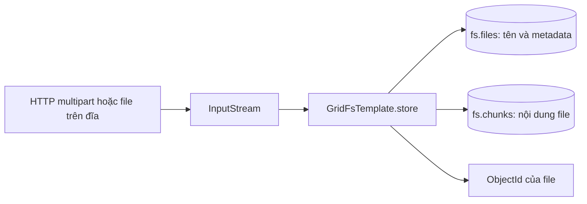

# Lưu file từ `InputStream` kèm tên và metadata trong GridFS

## Mục tiêu

Trong Spring Data MongoDB, `GridFsTemplate` cho phép ghi nội dung nhị phân từ một `InputStream` vào MongoDB GridFS, đồng thời gắn **tên file** (`filename`), **loại nội dung** (`contentType`) và **metadata** phục vụ nghiệp vụ. Sau bài này, bạn có thể:

- Giải thích vì sao GridFS tiếp nhận dữ liệu qua luồng thay vì buộc ứng dụng giữ toàn bộ file trong bộ nhớ.
- Dùng `GridFsTemplate.store(InputStream, String, String, Object)` và lấy `_id` của file đã lưu.
- Tạo metadata có cấu trúc, chuyển `MultipartFile` thành `InputStream` và quản lý vòng đời luồng đúng cách.
- Kiểm tra bản ghi GridFS, xử lý các trường hợp tên trùng, file lỗi và rủi ro bảo mật khi nhận file từ người dùng.

## 1. GridFS lưu những gì?

MongoDB có giới hạn kích thước đối với một BSON document. **GridFS** chia nội dung file thành nhiều chunk và quản lý chúng bằng các collection riêng. Với bucket mặc định `fs`:

| Collection | Dữ liệu chính | Vai trò |
| --- | --- | --- |
| `fs.files` | `_id`, `filename`, `length`, `chunkSize`, `uploadDate`, `metadata` | Mô tả một file đã tải lên. |
| `fs.chunks` | `files_id`, `n`, `data` | Chứa các phần dữ liệu nhị phân thuộc file đó. |

`InputStream` là nguồn byte để GridFS đọc dần và chia thành các chunk. Ứng dụng không cần gọi `readAllBytes()` hoặc `MultipartFile.getBytes()` để tạo một mảng chứa toàn bộ nội dung trước khi lưu. Tuy nhiên, HTTP multipart, driver và server vẫn sử dụng bộ đệm nội bộ; *streaming* không đồng nghĩa với sử dụng 0 byte RAM.



**Phân biệt:** `filename` là tên hiển thị/tìm kiếm, không phải khóa duy nhất. Hai lần lưu có thể dùng cùng một tên và vẫn sinh hai `_id` khác nhau. Hãy dùng `_id` làm định danh ổn định khi tải xuống hoặc xóa.

## 2. Chuẩn bị Spring Data MongoDB

Ví dụ dưới đây dùng Java, Spring Boot, Spring Data MongoDB và API **blocking** `GridFsTemplate`. Với Gradle, ứng dụng web có thể khai báo:

```groovy
dependencies {
    implementation 'org.springframework.boot:spring-boot-starter-data-mongodb'
    implementation 'org.springframework.boot:spring-boot-starter-web'
}
```

Thiết lập kết nối MongoDB bằng cấu hình phù hợp với môi trường, chẳng hạn:

```yaml
spring:
  data:
    mongodb:
      uri: ${MONGODB_URI}
  servlet:
    multipart:
      max-file-size: 50MB
      max-request-size: 55MB
```

Khi ứng dụng chưa có bean `GridFsTemplate`, có thể khai báo tường minh:

```java
import org.springframework.context.annotation.Bean;
import org.springframework.context.annotation.Configuration;
import org.springframework.data.mongodb.MongoDatabaseFactory;
import org.springframework.data.mongodb.core.convert.MongoConverter;
import org.springframework.data.mongodb.gridfs.GridFsTemplate;

@Configuration
public class GridFsConfig {

    @Bean
    GridFsTemplate gridFsTemplate(MongoDatabaseFactory factory,
                                  MongoConverter converter) {
        return new GridFsTemplate(factory, converter);
    }
}
```

Nếu cấu hình hiện tại đã tạo bean tương ứng, hãy dùng lại bean đó để tránh khai báo trùng. `GridFsTemplate` mặc định dùng bucket `fs`; khi cấu hình bucket khác, tên các collection sẽ đổi theo prefix của bucket.

## 3. Hiểu chữ ký `store(...)`

Ví dụ thường dùng là:

```java
ObjectId id = gridFsTemplate.store(
    inputStream,
    "hop-dong-2026.pdf",
    "application/pdf",
    metadata
);
```

| Đối số | Ý nghĩa | Điều cần nhớ |
| --- | --- | --- |
| `InputStream inputStream` | Nguồn byte được đọc để ghi vào GridFS. | Đưa luồng còn mở và đọc được, ở vị trí bắt đầu dữ liệu cần ghi. |
| `String filename` | Tên file được lưu cùng bản ghi GridFS. | Có thể trùng; chuẩn hóa tên lấy từ client. |
| `String contentType` | Kiểu MIME, ví dụ `application/pdf`. | Hữu ích khi phục vụ tải xuống; giá trị do client gửi chưa được kiểm chứng. |
| `Object metadata` | Thông tin nghiệp vụ do ứng dụng cung cấp. | Có thể dùng `org.bson.Document` hoặc object mà `MongoConverter` chuyển đổi được. |
| Giá trị trả về `ObjectId` | `_id` mới của file trong GridFS. | Lưu hoặc trả về ID này cho các thao tác tiếp theo. |

Spring Data còn có các overload với ít tham số hơn, chẳng hạn `store(inputStream, filename)`. Dùng dạng bốn tham số khi muốn giữ cả tên, content type và metadata trong một lần lưu.

Metadata **không thay thế** các thuộc tính hệ thống như `length` và `uploadDate` do GridFS quản lý. Nên ưu tiên các trường nghiệp vụ có ích, chẳng hạn `ownerId`, `category`, `documentId` hoặc `source`; tránh đưa mật khẩu, token, thông tin cá nhân không cần thiết hay dữ liệu đầu vào chưa kiểm soát vào metadata.

## 4. Xây dựng service lưu `InputStream`

Giả sử hệ thống quản lý tài liệu cần lưu file đính kèm và biết người sở hữu. Service sau chỉ nhận một luồng đã mở, gắn metadata ở phía server và trả về ID sau khi ghi hoàn tất:

```java
import java.io.InputStream;
import java.time.Instant;
import java.util.Date;

import org.bson.Document;
import org.bson.types.ObjectId;
import org.springframework.data.mongodb.gridfs.GridFsTemplate;
import org.springframework.stereotype.Service;

@Service
public class GridFsFileService {

    private final GridFsTemplate gridFsTemplate;

    public GridFsFileService(GridFsTemplate gridFsTemplate) {
        this.gridFsTemplate = gridFsTemplate;
    }

    public ObjectId save(InputStream input,
                         String filename,
                         String contentType,
                         String ownerId) {
        if (input == null) {
            throw new IllegalArgumentException("InputStream không được null");
        }
        if (filename == null || filename.isBlank()) {
            throw new IllegalArgumentException("Tên file không hợp lệ");
        }
        if (ownerId == null || ownerId.isBlank()) {
            throw new IllegalArgumentException("Thiếu mã người sở hữu");
        }

        Document metadata = new Document("ownerId", ownerId)
                .append("category", "attachment")
                .append("uploadedAt", Date.from(Instant.now()));

        String mimeType = (contentType == null || contentType.isBlank())
                ? "application/octet-stream"
                : contentType;

        return gridFsTemplate.store(input, filename, mimeType, metadata);
    }
}
```

Trong ví dụ, `metadata.ownerId` hỗ trợ tra cứu hoặc kiểm tra quyền truy cập theo người dùng; `category` dùng để phân loại nghiệp vụ. `uploadedAt` là dấu thời gian riêng của ứng dụng, còn GridFS cũng tự ghi `uploadDate`. Trường metadata được tạo **ở server**, không lấy nguyên một document tùy ý do client gửi lên.

### Ai chịu trách nhiệm đóng `InputStream`?

Service trên **không tự đóng** luồng vì luồng do nơi gọi tạo ra và quản lý. Caller nên dùng `try-with-resources` để đóng cả khi ghi thành công lẫn khi có ngoại lệ. `store(...)` ở đây là lời gọi blocking và tiêu thụ luồng trong lời gọi; không đóng luồng trước khi `store(...)` trả về.

Ví dụ với file sẵn có trên đĩa:

```java
import java.io.InputStream;
import java.nio.file.Files;
import java.nio.file.Path;
import org.bson.types.ObjectId;

Path path = Path.of("./documents/hop-dong.pdf");

try (InputStream input = Files.newInputStream(path)) {
    ObjectId id = fileService.save(
            input,
            "hop-dong.pdf",
            "application/pdf",
            "user-123");
    System.out.println("Đã lưu GridFS ID: " + id.toHexString());
}
```

Ví dụ giả định `fileService` đã được inject vào một thành phần Spring. Không tái sử dụng `InputStream` đã đọc hết để lưu lần thứ hai nếu chưa tạo lại luồng hoặc chủ động đặt lại vị trí đọc một cách hợp lệ.

## 5. Nhận `MultipartFile` từ HTTP và chuyển thành luồng

Với Spring MVC, `MultipartFile.getInputStream()` là cách trực tiếp kết nối request upload với service GridFS. Controller sau giả định endpoint đã được bảo vệ bằng cơ chế xác thực để `Principal` tồn tại:

```java
import java.io.IOException;
import java.io.InputStream;
import java.security.Principal;

import org.bson.types.ObjectId;
import org.springframework.http.HttpStatus;
import org.springframework.http.MediaType;
import org.springframework.http.ResponseEntity;
import org.springframework.web.bind.annotation.PostMapping;
import org.springframework.web.bind.annotation.RequestMapping;
import org.springframework.web.bind.annotation.RequestParam;
import org.springframework.web.bind.annotation.RestController;
import org.springframework.web.multipart.MultipartFile;
import org.springframework.web.server.ResponseStatusException;

@RestController
@RequestMapping("/api/files")
public class FileUploadController {

    private final GridFsFileService fileService;

    public FileUploadController(GridFsFileService fileService) {
        this.fileService = fileService;
    }

    @PostMapping(consumes = MediaType.MULTIPART_FORM_DATA_VALUE)
    public ResponseEntity<UploadResult> upload(
            @RequestParam("file") MultipartFile file,
            Principal principal) throws IOException {

        if (file.isEmpty()) {
            throw new ResponseStatusException(HttpStatus.BAD_REQUEST, "File trống");
        }

        String filename = safeFilename(file.getOriginalFilename());

        try (InputStream input = file.getInputStream()) {
            ObjectId id = fileService.save(
                    input, filename, file.getContentType(), principal.getName());

            return ResponseEntity.status(HttpStatus.CREATED)
                    .body(new UploadResult(id.toHexString(), filename));
        }
    }

    private static String safeFilename(String original) {
        if (original == null || original.isBlank()) {
            throw new ResponseStatusException(HttpStatus.BAD_REQUEST, "Thiếu tên file");
        }

        String normalized = original.replace('\\', '/');
        String name = normalized.substring(normalized.lastIndexOf('/') + 1).trim();
        if (name.isBlank() || name.equals(".") || name.equals("..")) {
            throw new ResponseStatusException(HttpStatus.BAD_REQUEST, "Tên file không hợp lệ");
        }
        return name;
    }

    public record UploadResult(String id, String filename) { }
}
```

Luồng dữ liệu đi theo thứ tự: nhận multipart → kiểm tra thông tin cơ bản → mở `InputStream` → ghi GridFS kèm metadata → nhận `ObjectId` → trả HTTP `201 Created`. Việc gọi `getInputStream()` tránh tự sao chép toàn bộ file vào một `byte[]`; giới hạn multipart vẫn phải được cấu hình ở tầng HTTP.

Ví dụ gửi request (thay token và đường dẫn theo ứng dụng):

```bash
curl -X POST "http://localhost:8080/api/files" \
  -H "Authorization: Bearer <ACCESS_TOKEN>" \
  -F "file=@./documents/hop-dong.pdf;type=application/pdf"
```

Response ví dụ:

```json
{
  "id": "656ed5ba8508c96f2d952e01",
  "filename": "hop-dong.pdf"
}
```

ID trong JSON chỉ minh họa định dạng. Giá trị thực được MongoDB tạo trong mỗi lần upload.

## 6. Kiểm tra file và metadata đã lưu

Sau khi `save(...)` trả về `ObjectId`, có thể tra lại bản ghi để xác nhận tên và metadata bằng Spring Data:

```java
import com.mongodb.client.gridfs.model.GridFSFile;
import org.bson.types.ObjectId;
import org.springframework.data.mongodb.core.query.Criteria;
import org.springframework.data.mongodb.core.query.Query;

ObjectId id = new ObjectId("656ed5ba8508c96f2d952e01");
GridFSFile stored = gridFsTemplate.findOne(
        Query.query(Criteria.where("_id").is(id)));

if (stored != null) {
    System.out.println(stored.getFilename());
    System.out.println(stored.getLength());
    System.out.println(stored.getMetadata());
}
```

Hoặc kiểm tra bằng `mongosh` khi dùng bucket mặc định:

```javascript
const id = ObjectId("656ed5ba8508c96f2d952e01");

db.fs.files.findOne(
  { _id: id },
  { filename: 1, length: 1, uploadDate: 1, metadata: 1 }
);

db.fs.chunks.countDocuments({ files_id: id });
```

Bạn sẽ thấy `filename` trong `fs.files`, metadata như `ownerId` và `category` trong `metadata`, cùng các chunk có `files_id` tham chiếu đến file. Số chunk tùy kích thước file và `chunkSize`; một file nhỏ vẫn có thể nằm trong một chunk. Có thể tìm theo thuộc tính nghiệp vụ bằng `metadata.ownerId`, nhưng cần kiểm tra quyền người dùng trước khi trả nội dung file.

## 7. Những lỗi thường gặp và cách tránh

| Tình huống | Nguyên nhân hoặc hệ quả | Cách xử lý |
| --- | --- | --- |
| Upload file lớn gây tăng RAM | Đọc toàn bộ file bằng `getBytes()`/`readAllBytes()` trước khi lưu. | Dùng `getInputStream()` và truyền trực tiếp vào `store(...)`; cấu hình giới hạn upload. |
| File ghi ra có độ dài 0 | Luồng rỗng, đã bị đọc hết hoặc nguồn dữ liệu không đúng. | Kiểm tra dữ liệu đầu vào và vị trí đọc trước khi gọi `store(...)`. |
| Có nhiều file trùng `filename` | GridFS không yêu cầu tên file là duy nhất. | Lưu `_id` để truy xuất; áp dụng chính sách phiên bản/tên riêng nếu nghiệp vụ cần. |
| Metadata thiếu hoặc không đúng kiểu | Gửi object không chuyển đổi được hoặc bỏ qua đối số metadata. | Dùng `Document`/kiểu được MongoConverter hỗ trợ; xem bản ghi thực tế trong `fs.files`. |
| Lỗi `413 Payload Too Large` | Giới hạn request multipart ở web server, proxy hoặc Spring. | Kiểm tra giới hạn ở toàn bộ đường đi và áp dụng quota phù hợp. |
| Không tải xuống được dù có ID | Truy vấn nhầm bucket, ID sai kiểu hoặc thiếu quyền. | Kiểm tra bucket, tạo `ObjectId` hợp lệ và xác minh chủ sở hữu. |
| Ghi bị gián đoạn | Lỗi kết nối, dữ liệu nguồn hoặc dung lượng lưu trữ. | Chỉ xác nhận thành công khi `store(...)` trả về; theo dõi lỗi và kiểm tra dữ liệu dở dang khi cần. |

**Giới hạn bảo mật và vận hành:**

- `getOriginalFilename()` có thể chứa thành phần đường dẫn hoặc tên bất thường. Hàm `safeFilename` chỉ minh họa bước loại bỏ đường dẫn; hệ thống thực tế còn cần giới hạn ký tự, độ dài, chuẩn hóa Unicode và chống tên gây nhầm lẫn.
- `getContentType()` do client cung cấp nên chỉ là gợi ý. Với loại file có rủi ro, xác minh định dạng dựa trên nội dung, áp dụng kiểm tra mã độc, giới hạn dung lượng và quyền truy cập.
- Không cho phép client tự quyết định `ownerId` trong metadata nếu thuộc tính này dùng để phân quyền; lấy nó từ ngữ cảnh xác thực trên server.
- Các thay đổi liên quan tới tài liệu nghiệp vụ và các collection GridFS cần cơ chế xử lý lỗi/hoàn tác thích hợp. Đừng mặc định việc lưu GridFS và ghi document nghiệp vụ tạo thành một thao tác transaction nguyên tử.
- `GridFsTemplate` là API blocking; ứng dụng reactive nên cân nhắc `ReactiveGridFsTemplate` và `Publisher<DataBuffer>`/`Flux<DataBuffer>` theo API tương ứng, thay vì chạy lời gọi blocking trên event loop.

## 8. Bài tập thực hành

1. Tạo endpoint upload file PDF bằng `MultipartFile.getInputStream()`, lưu với tên file đã chuẩn hóa và metadata gồm `ownerId`, `category` và `uploadedAt`.
2. Upload hai file cùng tên và quan sát hai `_id` khác nhau trong `fs.files`.
3. Dùng `_id` trả về để truy vấn bản ghi GridFS, đối chiếu `filename`, `length` và các trường metadata. So sánh số chunk theo kích thước file.
4. Thử upload file trống, file vượt giới hạn và request không hợp lệ. Kiểm tra mã HTTP, thông báo lỗi và việc không trả ID thành công khi lưu thất bại.

**Ghi nhớ:** `GridFsTemplate.store(inputStream, filename, contentType, metadata)` kết hợp nội dung file với dữ liệu mô tả trong một lời gọi. Caller quản lý việc đóng luồng, server kiểm soát metadata và quyền truy cập, còn `_id` do GridFS trả về là định danh cần giữ lại cho các thao tác tiếp theo.
