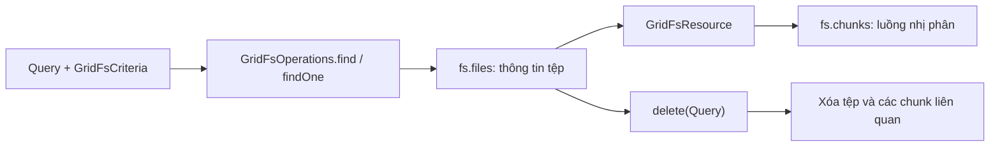

# Tìm, tải và xóa file bằng `GridFsCriteria`

## Mục tiêu bài học

Trong ứng dụng sử dụng **Spring Data MongoDB**, GridFS cho phép lưu tệp thành nhiều phần dữ liệu (chunk) trong MongoDB, còn `GridFsTemplate`/`GridFsOperations` cung cấp API Java để thao tác với chúng. Bài này tập trung vào ba tác vụ thường gặp: **tìm tệp theo điều kiện, tải nội dung tệp và xóa đúng tệp**. Trọng tâm là cách tạo `Query` bằng `GridFsCriteria` và cách chọn tệp an toàn khi có nhiều tệp cùng tên.

Sau bài học, bạn có thể:

- Phân biệt metadata của tệp với nội dung nhị phân và biết nên lọc theo trường nào.
- Dùng `whereFilename()`, `whereContentType()` và `whereMetaData()` để truy vấn tệp.
- Kết hợp `find()`/`findOne()` với `getResource(GridFSFile)` để tải dữ liệu dưới dạng luồng.
- Xóa tệp bằng `delete(Query)` với bộ lọc theo `_id` và phạm vi quyền truy cập.
- Tránh các lỗi như chọn nhầm bản trùng tên, tải toàn bộ tệp vào bộ nhớ hoặc xóa nhiều tệp ngoài ý muốn.

## 1. GridFS lưu gì và `GridFsCriteria` truy vấn ở đâu?

Mỗi bucket GridFS dùng hai collection. Với bucket mặc định `fs`:

| Collection | Dữ liệu chính | Vai trò |
| --- | --- | --- |
| `fs.files` | `_id`, `filename`, `length`, `chunkSize`, `uploadDate`, `metadata` | Mô tả tệp và là nơi truy vấn danh sách tệp |
| `fs.chunks` | `files_id`, `n`, `data` | Chứa các chunk nhị phân của mỗi tệp |

Ví dụ một document minh họa trong `fs.files`:

```json
{
  "_id": { "$oid": "6560d2a4a1b2c3d4e5f60718" },
  "filename": "hoa-don-11-2026.pdf",
  "length": 7340032,
  "chunkSize": 261120,
  "uploadDate": { "$date": "2026-11-15T10:00:00Z" },
  "metadata": {
    "tenantId": "cong-ty-a",
    "documentType": "invoice"
  }
}
```

Các chunk tương ứng có `files_id` trỏ tới `_id` của tệp và `n` là thứ tự chunk. Khi tải, GridFS ghép nội dung từ các chunk; khi tìm danh sách, phần lớn truy vấn chỉ cần đọc metadata ở `fs.files`.



**Điểm cốt lõi:** `GridFsCriteria` là lớp hỗ trợ tạo điều kiện truy vấn (kế thừa `Criteria`), không phải API đọc byte hoặc xóa tệp. Bạn truyền `Query` chứa điều kiện đó vào `GridFsOperations`, thường được thực thi bởi `GridFsTemplate`.

## 2. Chuẩn bị một tệp mẫu

Ví dụ dưới đây giả định dự án Spring Boot đã kết nối MongoDB và có bean `GridFsOperations`/`GridFsTemplate`. Nếu ứng dụng chưa khai báo template, có thể cấu hình:

```java
@Configuration
class GridFsConfig {

    @Bean
    GridFsTemplate gridFsTemplate(
            MongoDatabaseFactory factory,
            MongoConverter converter) {
        return new GridFsTemplate(factory, converter);
    }
}
```

Các kiểu tương ứng là `org.springframework.data.mongodb.MongoDatabaseFactory`, `org.springframework.data.mongodb.core.convert.MongoConverter` và `org.springframework.data.mongodb.gridfs.GridFsTemplate`. Nếu ứng dụng đã có bean phù hợp, không khai báo thêm bean trùng tên.

Để các điều kiện ở phần sau có dữ liệu, giả sử chúng ta tải lên một tệp như sau:

```java
Document metadata = new Document("tenantId", "cong-ty-a")
        .append("documentType", "invoice");

try (InputStream stream = Files.newInputStream(
        Path.of("hoa-don-11-2026.pdf"))) {
    ObjectId id = gridFs.store(
            stream,
            "hoa-don-11-2026.pdf",
            "application/pdf",
            metadata
    );
    System.out.println("GridFS id: " + id.toHexString());
}
```

Trong đoạn mã này, `gridFs` là một `GridFsOperations` đã được inject; `Document` thuộc `org.bson`. Phần `tenantId` và `documentType` là metadata nghiệp vụ do ứng dụng xác định. `store(...)` trả về `ObjectId` khi dùng đường tải lên thông thường; hãy lưu ID này để truy cập chính xác phiên bản tệp.

Tên tệp **không phải khóa duy nhất**: tải lên hai lần với cùng `filename` vẫn có thể tạo hai bản ghi GridFS khác `_id`. Điều đó quyết định cách thiết kế API tải và xóa ở các phần tiếp theo.

## 3. Viết `Query` bằng `GridFsCriteria`

Các factory method quan trọng:

| Điều kiện | Ví dụ Java | Ý nghĩa |
| --- | --- | --- |
| Tên chính xác | `GridFsCriteria.whereFilename().is("hoa-don-11-2026.pdf")` | Lọc theo `filename` |
| Tên theo mẫu | `GridFsCriteria.whereFilename().regex("^hoa-don-.*[.]pdf$")` | Lọc theo biểu thức chính quy |
| MIME type | `GridFsCriteria.whereContentType().is("application/pdf")` | Lọc theo content type do Spring Data GridFS quản lý |
| Metadata cụ thể | `GridFsCriteria.whereMetaData("tenantId").is("cong-ty-a")` | Lọc theo khóa trong `metadata` |
| Metadata khác | `GridFsCriteria.whereMetaData("documentType").is("invoice")` | Kết hợp quy tắc nghiệp vụ |
| ID của tệp | `Criteria.where("_id").is(new ObjectId(fileId))` | Chọn chính xác một tệp theo ID |

Các ví dụ ở trên cần import `org.springframework.data.mongodb.gridfs.GridFsCriteria`, `org.springframework.data.mongodb.core.query.Criteria` và `org.springframework.data.mongodb.core.query.Query`.

Tìm tất cả PDF hóa đơn trong một phạm vi tenant:

```java
Query query = Query.query(
        GridFsCriteria.whereMetaData("tenantId").is("cong-ty-a")
);
query.addCriteria(
        GridFsCriteria.whereMetaData("documentType").is("invoice")
);
query.addCriteria(
        GridFsCriteria.whereContentType().is("application/pdf")
);

List<GridFSFile> files = gridFs.find(query)
        .limit(50)
        .into(new ArrayList<>());
```

`GridFSFile` thuộc `com.mongodb.client.gridfs.model`; kết quả `find(query)` là `GridFSFindIterable` từ MongoDB Java Driver. Đây là dữ liệu mô tả tệp; **chưa tải các byte của tệp**.

### Lọc tên tệp và kết hợp điều kiện

```java
Query query = Query.query(
        GridFsCriteria.whereFilename().is("hoa-don-11-2026.pdf")
);
query.addCriteria(
        GridFsCriteria.whereMetaData("tenantId").is("cong-ty-a")
);

for (GridFSFile file : gridFs.find(query)) {
    System.out.printf("%s - %s - %d bytes%n",
            file.getObjectId().toHexString(),
            file.getFilename(),
            file.getLength());
}
```

Trong ví dụ này, `getObjectId()` phù hợp vì tệp được tạo bằng `store(...)` có ID kiểu `ObjectId`. Nếu hệ thống cho phép custom ID có kiểu BSON khác, hãy dùng `getId()` và xử lý đúng kiểu thay vì mặc định mọi ID đều là `ObjectId`.

Khi lọc theo tên do người dùng nhập, ưu tiên `is(...)` nếu cần khớp chính xác. Nếu sử dụng `regex(...)`, hãy giới hạn độ dài input và thoát ký tự đặc biệt bằng `Pattern.quote(...)` trước khi ghép thành pattern, tránh để input tự biến thành biểu thức chính quy tùy ý.

### Lấy một tệp hay nhiều tệp?

- `find(query)` trả về một iterable của các `GridFSFile` phù hợp, hữu ích khi lập danh sách và lọc.
- `findOne(query)` trả về một `GridFSFile` hoặc `null` nếu không có kết quả. Với tên không duy nhất, đừng dựa vào nó để xác định phiên bản mong muốn.
- `getResource(String filename)`/`getResources(String pattern)` tiện khi truy cập theo tên hoặc mẫu tên; để kiểm soát tenant và phiên bản cụ thể, nên `findOne(query)` theo ID và quyền truy cập rồi gọi `getResource(GridFSFile)`.

**Lưu ý về thứ tự:** thuộc tính `Sort` gắn vào `Query` truyền cho `GridFsOperations.find(...)` không được Spring Data áp dụng cho việc duyệt GridFS. Nếu cần sắp xếp, có thể sử dụng `sort(...)` ngay trên `GridFSFindIterable`:

```java
import com.mongodb.client.model.Sorts;

List<GridFSFile> newestFirst = gridFs.find(query)
        .sort(Sorts.descending("uploadDate"))
        .limit(20)
        .into(new ArrayList<>());
```

`limit(...)` giới hạn số kết quả trả về. Với danh sách lớn, xem xét phân trang (`skip/limit` hoặc chiến lược khác phù hợp quy mô dữ liệu), index trên các trường lọc và thứ tự ổn định khi sắp xếp.

## 4. Ví dụ service hoàn chỉnh: tìm, mở luồng, xóa

Ví dụ dùng **Java 17+**, Spring Data MongoDB và các ID do `store(...)` sinh ra (kiểu `ObjectId`). Giả sử mỗi tệp có `metadata.tenantId`; `tenantId` đầu vào phải được lấy từ ngữ cảnh đã xác thực và được ứng dụng phân quyền.

```java
import com.mongodb.client.gridfs.model.GridFSFile;
import org.bson.types.ObjectId;
import org.springframework.data.mongodb.core.query.Criteria;
import org.springframework.data.mongodb.core.query.Query;
import org.springframework.data.mongodb.gridfs.GridFsCriteria;
import org.springframework.data.mongodb.gridfs.GridFsOperations;
import org.springframework.data.mongodb.gridfs.GridFsResource;
import org.springframework.stereotype.Service;

import java.util.ArrayList;
import java.util.List;
import java.util.Optional;

@Service
public class GridFsFileService {

    private final GridFsOperations gridFs;

    public GridFsFileService(GridFsOperations gridFs) {
        this.gridFs = gridFs;
    }

    // Tìm tối đa 50 tệp thuộc tenant; tên là bộ lọc tùy chọn.
    public List<GridFSFile> search(String tenantId, String filename) {
        Query query = Query.query(
                GridFsCriteria.whereMetaData("tenantId").is(tenantId)
        );
        if (filename != null && !filename.isBlank()) {
            query.addCriteria(
                    GridFsCriteria.whereFilename().is(filename)
            );
        }
        return gridFs.find(query).limit(50).into(new ArrayList<>());
    }

    // Trả về resource của đúng ID thuộc tenant; chưa đọc toàn bộ tệp.
    public Optional<GridFsResource> findForDownload(
            String tenantId, String fileId) {

        GridFSFile file = gridFs.findOne(queryForId(tenantId, fileId));
        if (file == null) {
            return Optional.empty();
        }
        return Optional.of(gridFs.getResource(file));
    }

    // Xóa tất cả bản ghi khớp Query; ở đây Query chứa _id duy nhất.
    public void deleteById(String tenantId, String fileId) {
        gridFs.delete(queryForId(tenantId, fileId));
    }

    private Query queryForId(String tenantId, String fileId) {
        if (tenantId == null || tenantId.isBlank()) {
            throw new IllegalArgumentException("tenantId is required");
        }
        if (!ObjectId.isValid(fileId)) {
            throw new IllegalArgumentException("Invalid GridFS ObjectId");
        }

        Query query = Query.query(
                Criteria.where("_id").is(new ObjectId(fileId))
        );
        query.addCriteria(
                GridFsCriteria.whereMetaData("tenantId").is(tenantId)
        );
        return query;
    }
}
```

Các tính chất đáng chú ý của service:

1. `search(...)` chỉ đọc metadata, cho phép lọc tên và luôn giới hạn phạm vi tenant.
2. `findForDownload(...)` chọn tệp bằng hai điều kiện: `_id` **và** `metadata.tenantId`. Hai người dùng có thể có tệp cùng tên mà không truy cập chéo nhau.
3. `getResource(file)` gắn luồng tải với chính `GridFSFile` đã được kiểm tra.
4. `deleteById(...)` dùng đúng query theo ID. Nếu không có tệp phù hợp, `delete(Query)` trả về `void`; muốn phân biệt `404` với thao tác xóa thành công phải xây dựng cơ chế kiểm tra/trả trạng thái riêng.

Ứng dụng thực tế nên chuyển `GridFSFile` thành DTO (`id`, `filename`, `length`, `uploadDate`, ...) thay vì trả thẳng kiểu dữ liệu từ driver ra REST API.

## 5. Tải tệp: đọc bằng luồng, không nạp toàn bộ vào RAM

Sau khi đã truy vấn và kiểm tra quyền, `GridFsResource` cung cấp `getInputStream()` để đọc nội dung. Ví dụ tải xuống trong một đoạn xử lý HTTP (ở đây `tenantId` được xác định từ thông tin đăng nhập đã xác thực):

```java
GridFsResource resource = service
        .findForDownload(tenantId, fileId)
        .orElseThrow(() ->
                new ResponseStatusException(HttpStatus.NOT_FOUND));

response.setContentType("application/octet-stream");
response.setContentLengthLong(resource.contentLength());
response.setHeader(
        HttpHeaders.CONTENT_DISPOSITION,
        ContentDisposition.attachment()
                .filename(resource.getFilename(), StandardCharsets.UTF_8)
                .build()
                .toString()
);

try (InputStream input = resource.getInputStream()) {
    input.transferTo(response.getOutputStream());
}
```

Đoạn mã minh họa dùng `HttpServletResponse` (Spring MVC/Servlet), `ContentDisposition`, `HttpHeaders`, `HttpStatus`, `ResponseStatusException` và `StandardCharsets`; biến `service` là `GridFsFileService`. `resource.contentLength()` lấy kích thước tệp, còn `getInputStream()` đọc chunk dần khi truyền tới client.

**Vì sao dùng stream?** Tệp có thể lớn hơn nhiều so với RAM sẵn có. Các cách như `input.readAllBytes()` hay gom mọi byte vào `byte[]` dễ làm tăng sử dụng bộ nhớ đột ngột. Với REST API, nên truyền stream tới output và đóng stream khi hoàn tất; nếu lỗi xảy ra sau khi HTTP đã gửi một phần body, không thể giả định vẫn đổi được mã trạng thái.

Nếu cần trả MIME type thực của tệp, hãy xác thực giá trị do ứng dụng lưu ở metadata rồi ánh xạ sang header phù hợp; `application/octet-stream` là lựa chọn an toàn cho tải xuống chung. Không suy nội dung tệp từ phần mở rộng tên file. `ContentDisposition.attachment()` giúp trình duyệt xử lý nội dung như tệp tải về, đồng thời mã hóa tên tệp UTF-8.

### Khác biệt giữa tìm tệp và mở tệp

| Phương thức | Kết quả | Khi nào dùng? |
| --- | --- | --- |
| `gridFs.find(query)` | `GridFSFindIterable` | Danh sách kết quả/lọc metadata |
| `gridFs.findOne(query)` | `GridFSFile` hoặc `null` | Chọn đúng tệp sau khi kiểm tra phạm vi |
| `gridFs.getResource(file)` | `GridFsResource` | Mở đúng tệp tìm được để đọc nội dung |
| `gridFs.getResource(filename)` | `GridFsResource` | Tải theo tên khi tính duy nhất/phạm vi đã được xử lý |
| `gridFs.getResources("*.pdf")` | `GridFsResource[]` | Lấy nhiều resource theo mẫu tên |

Không dùng `getResources(...)` làm cơ chế phân quyền hoặc để thay thế bộ lọc tenant. Mẫu tên không cho biết tệp thuộc ai.

## 6. Xóa bằng `GridFsCriteria`: chọn đủ hẹp trước khi gọi `delete`

`GridFsOperations.delete(Query)` có thể xóa **mọi tệp khớp điều kiện**; quá trình xóa GridFS cần xử lý cả tài liệu metadata và các chunk liên quan. Hãy dùng API GridFS thay vì chỉ xóa tài liệu trong `fs.files` bằng thao tác CRUD thông thường vì cách đó có thể để lại chunk mồ côi.

Ví dụ rủi ro:

```java
// Nguy hiểm: nếu có nhiều phiên bản cùng filename, tất cả đều có thể bị xóa.
gridFs.delete(Query.query(
        GridFsCriteria.whereFilename().is("hoa-don-11-2026.pdf")
));
```

Ví dụ xóa đúng tệp mà người dùng đã được phép thao tác:

```java
Query scope = Query.query(
        Criteria.where("_id").is(new ObjectId(fileId))
);
scope.addCriteria(
        GridFsCriteria.whereMetaData("tenantId").is(tenantId)
);

gridFs.delete(scope);
```

Ứng dụng có thể kiểm tra `findOne(scope)` trước khi xóa để quyết định có phản hồi `404` hay không. Tuy nhiên, nếu tác vụ xóa đang chạy đồng thời với tác vụ khác, kết quả kiểm tra trước không đảm bảo trạng thái sau cùng; cần thiết kế idempotency, audit log hoặc quy trình xử lý phù hợp yêu cầu nghiệp vụ. Tránh công bố một con số “đã xóa N tệp” từ `delete(Query)` vì phương thức này trả về `void`.

Một câu hỏi thực tế: “Xóa tất cả hóa đơn cũ của tenant” là thao tác hàng loạt có chủ đích khác hoàn toàn với “Xóa một tệp đã chọn”. Trước khi chạy thao tác hàng loạt, hãy có chính sách lưu trữ/xóa, phân quyền, bước xác nhận ở tầng ứng dụng và khả năng kiểm tra phạm vi truy vấn.

## 7. Hiệu năng, index và các tình huống thực tế

GridFS mặc định cần index để tìm tệp theo tên/ngày tải lên và để ghép đúng thứ tự các chunk. Các index thường dùng:

```javascript
// Các index chuẩn trên hai collection của bucket fs:
db.fs.files.createIndex({ filename: 1, uploadDate: 1 });
db.fs.chunks.createIndex({ files_id: 1, n: 1 }, { unique: true });

// Ví dụ index bổ sung khi ứng dụng thường lọc tenant và tên tệp:
db.fs.files.createIndex({ "metadata.tenantId": 1, filename: 1 });
```

Trước khi tạo index mới trên môi trường thật, kiểm tra `getIndexes()` vì driver GridFS thường đã tạo index chuẩn; tránh tạo dư thừa. Dùng `explain()` trên truy vấn `fs.files` tương ứng khi cần phân tích hiệu năng. Điều kiện lọc metadata cần index riêng nếu có lưu lượng lớn; index cho `_id` đã có sẵn.

Các lưu ý vận hành:

- **Nhiều phiên bản cùng tên:** luôn trả ID từ API danh sách và dùng ID cho thao tác tải/xóa; tên chỉ để hiển thị hoặc lọc.
- **Tách tenant:** thêm điều kiện metadata hoặc phân tách bucket/database theo kiến trúc, đồng thời lấy tenant từ danh tính đã xác thực.
- **Không giới hạn kết quả:** dùng giới hạn số bản ghi và không trả hàng nghìn `GridFSFile` trong một response.
- **Tìm theo nội dung tệp:** `GridFsCriteria` lọc metadata, không thực hiện tìm kiếm toàn văn trong bytes của file; cần pipeline trích xuất và lập chỉ mục riêng cho nhu cầu đó.
- **Không nên trộn CRUD thường với API GridFS:** cập nhật/xóa trực tiếp `fs.chunks` hoặc `fs.files` dễ làm sai lệch quan hệ giữa hai collection.
- **Quyền trên tệp đã xóa:** handle tình huống tệp biến mất sau bước `findOne(...)` nhưng trước khi lấy stream, và ánh xạ lỗi lưu trữ/thời gian chờ sang phản hồi phù hợp.

## 8. Thực hành tự kiểm tra

**Bài tập 1 — Tìm kiếm.** Một bucket có ba tệp: hai bản `bao-cao.pdf` thuộc `cong-ty-a` với `_id` khác nhau và một bản cùng tên thuộc `cong-ty-b`. Viết `Query` liệt kê tối đa 20 bản `bao-cao.pdf` của `cong-ty-a`. Kỳ vọng thu được hai kết quả thay vì chọn tùy ý một tệp.

Gợi ý:

```java
Query query = Query.query(
        GridFsCriteria.whereFilename().is("bao-cao.pdf")
);
query.addCriteria(
        GridFsCriteria.whereMetaData("tenantId").is("cong-ty-a")
);

List<GridFSFile> result = gridFs.find(query)
        .limit(20)
        .into(new ArrayList<>());
```

**Bài tập 2 — Tải đúng phiên bản.** Dùng một `_id` lấy từ bài 1 và `tenantId` đã xác thực. Gọi `findOne(...)` theo cả hai điều kiện; nếu tìm thấy, chuyển qua `getResource(file)` và dùng try-with-resources để copy `InputStream` tới nơi nhận. Kiểm tra trường hợp ID hợp lệ nhưng thuộc tenant khác phải được xem là không tìm thấy.

**Bài tập 3 — Xóa và kiểm chứng.** Thực hiện `delete(...)` theo `_id` và `tenantId`, sau đó tìm lại đúng ID đó. Xác nhận phiên bản cùng tên còn lại vẫn truy cập được. Thực hành trên dữ liệu thử nghiệm riêng, không xóa theo tên trên dữ liệu chung.

## 9. Câu hỏi thường gặp

**Có bắt buộc dùng `GridFsCriteria` cho `_id` không?** Không. `Criteria.where("_id")` là cách trực tiếp và rõ ràng. `GridFsCriteria` hữu ích với các trường đặc thù của GridFS như tên file, content type và metadata.

**`findOne(...)` có tải tệp về bộ nhớ không?** Không. Nó tìm thông tin tệp (`GridFSFile`). Nội dung được đọc khi truy cập stream từ `GridFsResource`.

**`whereFilename().is(...)` có chọn bản mới nhất không?** Không. Tên tệp có thể trùng; muốn chọn bản cụ thể hãy dùng `_id`. Nếu cần danh sách mới nhất, sắp xếp trên `GridFSFindIterable` theo `uploadDate` và có quy tắc xử lý trường hợp trùng thời điểm.

**Có thể xóa tệp chỉ bằng tên không?** Có, nhưng `delete(query)` áp dụng lên mọi bản ghi khớp. Vì vậy thao tác xóa một tệp nên lọc bằng ID và phạm vi quyền; xóa hàng loạt phải được thiết kế riêng.

**Khi nào dùng `ReactiveGridFsTemplate`?** Khi ứng dụng dùng stack reactive, có thể áp dụng cách xây dựng `GridFsCriteria` tương tự rồi làm việc với `Mono`/`Flux` và `ReactiveGridFsResource`. Tránh trộn API blocking của `GridFsTemplate` vào luồng xử lý reactive.

## Tài liệu tham khảo

- [Spring Data MongoDB — GridFS Support](https://docs.spring.io/spring-data/mongodb/reference/mongodb/template-gridfs.html)
- [Spring Data MongoDB API — GridFsCriteria](https://docs.spring.io/spring-data/mongodb/docs/current/api/org/springframework/data/mongodb/gridfs/GridFsCriteria.html)
- [Spring Data MongoDB API — GridFsOperations](https://docs.spring.io/spring-data/mongodb/docs/current/api/org/springframework/data/mongodb/gridfs/GridFsOperations.html)
- [MongoDB — GridFS specification and indexes](https://www.mongodb.com/docs/manual/core/gridfs/)
- [MongoDB Java Driver — GridFSFindIterable](https://mongodb.github.io/mongo-java-driver/5.2.1/apidocs/mongodb-driver-sync/com/mongodb/client/gridfs/GridFSFindIterable.html)
