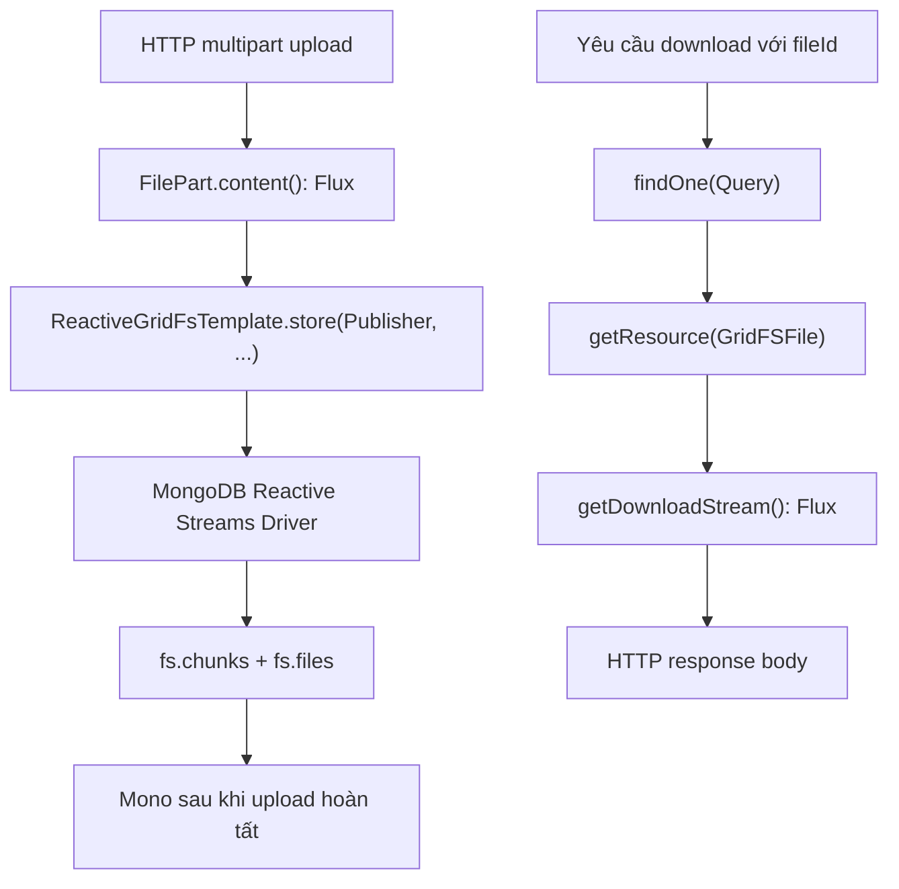

# ReactiveGridFsTemplate với Publisher<DataBuffer>

## 1. Bài toán và mục tiêu

Trong ứng dụng **Spring Data MongoDB** sử dụng Spring WebFlux, một tệp được tải lên qua HTTP thường đến dưới dạng một chuỗi các vùng nhớ nhị phân. Ta muốn chuyển các vùng nhớ đó sang **MongoDB GridFS** và đọc tệp trở lại qua HTTP mà không tạo một mảng `byte[]` chứa toàn bộ nội dung.

`ReactiveGridFsTemplate` thực hiện công việc này thông qua giao diện `ReactiveGridFsOperations`. Phương thức `store(…)` nhận `Publisher<DataBuffer>`, còn phía tải xuống có thể phát `Flux<DataBuffer>`. Đây là cách kết nối luồng dữ liệu của WebFlux với luồng upload/download của MongoDB Reactive Streams Driver.

Sau bài học, người đọc có thể:

- Phân biệt `Publisher<DataBuffer>`, `Flux<DataBuffer>` và `Mono<ObjectId>` trong quy trình GridFS.
- Viết luồng upload từ `FilePart.content()` vào `ReactiveGridFsTemplate.store(…)`.
- Tìm tệp bằng `fileId` và truyền về client qua `ReactiveGridFsResource.getDownloadStream()`.
- Hiểu backpressure, vòng đời pooled `DataBuffer`, xử lý lỗi, hủy subscription và nguy cơ đọc hết file vào RAM.
- Gắn tệp với metadata nghiệp vụ và kiểm soát quyền truy cập trong ứng dụng.

## 2. Cơ chế truyền dữ liệu

GridFS lưu nội dung file thành các document trong collection `fs.chunks` và một document mô tả file trong `fs.files` (với tên bucket mặc định `fs`). Mỗi file có định danh riêng; mặc định GridFS dùng kích thước chunk là **255 KiB**. Kích thước **GridFS chunk** là khái niệm khác với kích thước mỗi **`DataBuffer`** mà HTTP request phát ra.



**Vai trò của các kiểu dữ liệu:**

| Kiểu | Ý nghĩa | Ví dụ |
|---|---|---|
| `Publisher<DataBuffer>` | Hợp đồng Reactive Streams cung cấp nhiều phần nhị phân; `Flux<DataBuffer>` là một hiện thực | Input cho `store` |
| `DataBuffer` | Một phân đoạn bytes; có thể được cấp phát từ pool và cần quản lý vòng đời | Một phần body HTTP |
| `Mono<ObjectId>` | Phát một id khi GridFS upload thành công; phát lỗi khi upload thất bại | Giá trị trả về từ `store` |
| `GridFSFile` | Metadata lưu trong `fs.files` như `_id`, tên, độ dài, thời điểm upload | Kết quả `findOne` |
| `Mono<ReactiveGridFsResource>` | Tài nguyên phản ứng dùng để mở luồng tải xuống | Kết quả `getResource` |
| `Flux<DataBuffer>` | Các phần nhị phân đi ra theo nhu cầu của subscriber | `getDownloadStream` |

`Publisher` không có nghĩa là dữ liệu đã được đọc hoặc ghi ngay lúc gọi hàm. Các publisher reactive thường **lazy**: thao tác I/O bắt đầu khi được subscribe. Trong controller WebFlux, framework subscribe vào publisher mà endpoint trả về; vì vậy ứng dụng không nên gọi `subscribe()` thủ công rồi bỏ mặc kết quả.

Khi downstream yêu cầu thêm phần tử, tín hiệu **backpressure** có thể truyền ngược qua pipeline. Điều này giúp hạn chế dữ liệu đang được xử lý đồng thời; tuy nhiên việc dùng API reactive **không đồng nghĩa mức sử dụng RAM luôn bằng không**. HTTP multipart parser, driver, thao tác đệm, prefetch và số upload chạy đồng thời đều ảnh hưởng bộ nhớ.

## 3. Cài đặt và cấu hình

Với ứng dụng Spring Boot dùng WebFlux, các dependency thường là:

```gradle
dependencies {
    implementation("org.springframework.boot:spring-boot-starter-webflux")
    implementation("org.springframework.boot:spring-boot-starter-data-mongodb-reactive")
    // Chỉ thêm nếu dùng Authentication của Spring Security trong controller mẫu.
    implementation("org.springframework.boot:spring-boot-starter-security")
}
```

Các starter thường cấu hình sẵn các bean cần thiết khi có thông tin kết nối MongoDB phù hợp. Nếu tự cấu hình, có thể khai báo template dựa trên `ReactiveMongoDatabaseFactory` và `MongoConverter`:

```java
import org.springframework.context.annotation.Bean;
import org.springframework.context.annotation.Configuration;
import org.springframework.data.mongodb.ReactiveMongoDatabaseFactory;
import org.springframework.data.mongodb.core.convert.MongoConverter;
import org.springframework.data.mongodb.gridfs.ReactiveGridFsTemplate;

@Configuration
class GridFsReactiveConfig {

    @Bean
    ReactiveGridFsTemplate reactiveGridFsTemplate(
            ReactiveMongoDatabaseFactory factory,
            MongoConverter converter) {
        return new ReactiveGridFsTemplate(factory, converter);
    }
}
```

Chỉ khai báo bean này khi ứng dụng chưa có bean phù hợp; tránh tạo hai bean không rõ bean nào được tiêm. Mẫu tập trung vào API reactive, không tự động tạo ra bộ điều khiển upload, giới hạn dung lượng hay chính sách truy cập.

## 4. Ghi file qua `store(Publisher<DataBuffer>, ...)`

### 4.1. Những overload cần nhớ

`ReactiveGridFsOperations` có các overload thường dùng:

```java
Mono<ObjectId> store(Publisher<DataBuffer> content, String filename);

Mono<ObjectId> store(
    Publisher<DataBuffer> content,
    String filename,
    String contentType);

Mono<ObjectId> store(
    Publisher<DataBuffer> content,
    String filename,
    String contentType,
    Object metadata);
```

Đây là **chữ ký minh họa**, không phải mã cần chép nguyên vào một class. `metadata` có thể là một `org.bson.Document` hoặc đối tượng Java được `MongoConverter` chuyển đổi; tên file có thể trùng giữa nhiều lần upload, nên cần giữ `ObjectId` thực tế trả về.

Trên đường đi:

1. Publisher phát các `DataBuffer` từ nguồn.
2. Template chuyển các phần dữ liệu sang API upload của driver.
3. Driver chia nội dung thành GridFS chunk và lưu vào MongoDB.
4. Khi upload hoàn thành, `Mono<ObjectId>` phát `_id` của file đã tạo.

`Mono<ObjectId>` phát ra **sau khi luồng upload được xử lý thành công**. Nó **không** tự động cập nhật document nghiệp vụ (hợp đồng, hóa đơn, avatar...), không xác nhận checksum của ứng dụng và không đảm bảo dữ liệu đã được backup. Các bước này phải được thiết kế riêng.

### 4.2. Service lưu file và mở luồng tải xuống

Ví dụ dưới đây dùng một bucket mặc định, giữ `ownerId` trong metadata và yêu cầu lọc quyền theo id chủ sở hữu đã được xác thực. Định danh người dùng phải xuất phát từ cơ chế xác thực của ứng dụng, không lấy trực tiếp từ form upload.

```java
import org.bson.Document;
import org.bson.types.ObjectId;
import org.reactivestreams.Publisher;
import org.springframework.core.io.buffer.DataBuffer;
import org.springframework.data.mongodb.core.query.Criteria;
import org.springframework.data.mongodb.core.query.Query;
import org.springframework.data.mongodb.gridfs.ReactiveGridFsOperations;
import org.springframework.data.mongodb.gridfs.ReactiveGridFsResource;
import org.springframework.stereotype.Service;
import reactor.core.publisher.Mono;

@Service
public class ReactiveAttachmentStore {

    private final ReactiveGridFsOperations gridFs;

    public ReactiveAttachmentStore(ReactiveGridFsOperations gridFs) {
        this.gridFs = gridFs;
    }

    public Mono<ObjectId> upload(
            Publisher<DataBuffer> content,
            String generatedFilename,
            String contentType,
            String authenticatedOwnerId) {

        Document metadata = new Document("ownerId", authenticatedOwnerId)
                .append("kind", "attachment");

        return gridFs.store(
                content, generatedFilename, contentType, metadata);
    }

    public Mono<ReactiveGridFsResource> open(
            ObjectId fileId,
            String authenticatedOwnerId) {

        Query authorizedQuery = Query.query(
                Criteria.where("_id").is(fileId)
                        .and("metadata.ownerId").is(authenticatedOwnerId));

        // findOne không tìm thấy sẽ trả về Mono.empty().
        // getResource(file) trả về Mono<ReactiveGridFsResource>.
        return gridFs.findOne(authorizedQuery)
                .flatMap(gridFs::getResource);
    }
}
```

Trong hệ thống nhiều tenant, cần bổ sung điều kiện tenant và quyền truy cập tài liệu trong **document nghiệp vụ**; `metadata.ownerId` chỉ là lớp minh họa kiểm tra chủ sở hữu. Nếu phân quyền phụ thuộc hợp đồng/chia sẻ nhóm, hãy truy vấn bản ghi nghiệp vụ trước khi phát file và kiểm soát việc thay đổi quyền tại đó.

### 4.3. Endpoint WebFlux upload bằng `FilePart`

`FilePart` biểu diễn một phần file của multipart request. `file.content()` trả về `Flux<DataBuffer>`, đúng kiểu đầu vào `store` cần. Controller sau giả định ứng dụng đã cấu hình Spring Security và `Authentication` chứa định danh tin cậy:

```java
import java.util.UUID;
import org.bson.types.ObjectId;
import org.springframework.http.HttpStatus;
import org.springframework.http.MediaType;
import org.springframework.http.ResponseEntity;
import org.springframework.http.codec.multipart.FilePart;
import org.springframework.security.core.Authentication;
import org.springframework.web.bind.annotation.PostMapping;
import org.springframework.web.bind.annotation.RequestMapping;
import org.springframework.web.bind.annotation.RequestPart;
import org.springframework.web.bind.annotation.RestController;
import reactor.core.publisher.Mono;

@RestController
@RequestMapping("/api/attachments")
public class AttachmentUploadController {

    private final ReactiveAttachmentStore store;

    public AttachmentUploadController(ReactiveAttachmentStore store) {
        this.store = store;
    }

    @PostMapping(consumes = MediaType.MULTIPART_FORM_DATA_VALUE)
    public Mono<ResponseEntity<UploadReceipt>> upload(
            @RequestPart("file") FilePart file,
            Authentication authentication) {

        // Tên lưu trữ do server phát sinh, không tin đường dẫn từ client.
        String generatedFilename = "attachment-" + UUID.randomUUID();
        String contentType = MediaType.APPLICATION_OCTET_STREAM_VALUE;

        return store.upload(
                    file.content(),
                    generatedFilename,
                    contentType,
                    authentication.getName())
                .map(id -> ResponseEntity.status(HttpStatus.CREATED)
                        .body(new UploadReceipt(id.toHexString())));
    }

    public record UploadReceipt(String fileId) {}
}
```

Lệnh `curl` minh họa:

```bash
curl -X POST "http://localhost:8080/api/attachments" \
  -H "Authorization: Bearer <access-token>" \
  -F "file=@./contract.pdf"
```

Response dự kiến khi thành công:

```json
{
  "fileId": "691a00000000000000000007"
}
```

Giá trị `fileId` ở đây **chỉ minh họa**; giá trị thực do MongoDB cấp. Trong ứng dụng, cần kiểm tra quyền upload, kích thước, định dạng thật của file, quota và malware scanning nếu nhận dữ liệu không tin cậy. `Content-Type` do người dùng gửi **không** phải bằng chứng chắc chắn về định dạng file. Tên file gốc nếu cần giữ phải được chuẩn hóa và lưu như metadata hiển thị, không tin dùng làm đường dẫn hệ thống.

**Một nguyên tắc quan trọng:** Controller trả về `Mono` cho WebFlux thực hiện subscription. Không viết `store.upload(...).subscribe()` rồi lập tức trả HTTP 201, vì khi đó response có thể được gửi trước khi ghi xong và lỗi upload bị tách khỏi request.

## 5. Đọc file theo stream qua `ReactiveGridFsResource`

### 5.1. Luồng đọc đúng

```java
Mono<ReactiveGridFsResource> resource =
    gridFs.findOne(Query.query(Criteria.where("_id").is(fileId)))
          .flatMap(gridFs::getResource);

Flux<DataBuffer> content =
    resource.flatMapMany(ReactiveGridFsResource::getDownloadStream);
```

`findOne(Query)` trả về `Mono<GridFSFile>`; sau đó `getResource(GridFSFile)` trả về `Mono<ReactiveGridFsResource>`. Gọi `getDownloadStream()` để phát các phần nội dung. Khi không tìm thấy file, `findOne` kết thúc rỗng và chuỗi đọc không phát nội dung; endpoint cần chuyển kết quả đó thành HTTP 404.

**Không dùng** `ReactiveGridFsResource.getInputStream()` cho file lớn: theo JavaDoc, cách này đệm dữ liệu vào bộ nhớ. Tương tự, `collectList()`, `DataBufferUtils.join()` hay `block()` trên toàn bộ file làm mất lợi thế của luồng.

Một `ReactiveGridFsResource` có **nội dung chỉ tiêu thụ được một lần**. Nếu muốn tính checksum hoặc ghi audit, nên xử lý trong cùng pipeline hoặc mở lại luồng theo file id, không mặc định subscribe hai lần trên cùng resource.

### 5.2. Endpoint download WebFlux

Ví dụ sau dùng service đã có `open(fileId, ownerId)`. HTTP body sử dụng publisher trả về từ GridFS nên WebFlux có thể ghi dữ liệu ra socket theo luồng.

```java
import java.nio.charset.StandardCharsets;
import org.bson.types.ObjectId;
import org.springframework.core.io.buffer.DataBuffer;
import org.springframework.http.ContentDisposition;
import org.springframework.http.HttpHeaders;
import org.springframework.http.HttpStatus;
import org.springframework.http.MediaType;
import org.springframework.http.ResponseEntity;
import org.springframework.security.core.Authentication;
import org.springframework.web.bind.annotation.GetMapping;
import org.springframework.web.bind.annotation.PathVariable;
import org.springframework.web.bind.annotation.RequestMapping;
import org.springframework.web.bind.annotation.RestController;
import reactor.core.publisher.Flux;
import reactor.core.publisher.Mono;

@RestController
@RequestMapping("/api/attachments")
public class AttachmentDownloadController {

    private final ReactiveAttachmentStore store;

    public AttachmentDownloadController(ReactiveAttachmentStore store) {
        this.store = store;
    }

    @GetMapping("/{fileId}")
    public Mono<ResponseEntity<Flux<DataBuffer>>> download(
            @PathVariable String fileId,
            Authentication authentication) {

        if (!ObjectId.isValid(fileId)) {
            return Mono.just(ResponseEntity.status(HttpStatus.BAD_REQUEST)
                    .<Flux<DataBuffer>>build());
        }

        return store.open(new ObjectId(fileId), authentication.getName())
                .map(resource -> ResponseEntity.ok()
                        .contentType(MediaType.APPLICATION_OCTET_STREAM)
                        .header(HttpHeaders.CONTENT_DISPOSITION,
                                ContentDisposition.attachment()
                                        .filename(resource.getFilename(),
                                                StandardCharsets.UTF_8)
                                        .build()
                                        .toString())
                        .body(resource.getDownloadStream()))
                .switchIfEmpty(Mono.just(ResponseEntity
                        .status(HttpStatus.NOT_FOUND)
                        .<Flux<DataBuffer>>build()));
    }
}
```

Ví dụ kiểm tra:

```bash
curl -L "http://localhost:8080/api/attachments/<file-id>" \
  -H "Authorization: Bearer <access-token>" \
  --output downloaded.bin
```

Việc trả `Flux<DataBuffer>` trong `ResponseEntity` mới chỉ chuyển tải nội dung; ứng dụng cần quyết định `Content-Type`, `Content-Disposition`, tên file hiển thị, caching, `Content-Length` và HTTP Range nếu nghiệp vụ yêu cầu. **GridFS không tự động cung cấp HTTP Range/206, CDN hoặc cơ chế resume download**; những chức năng đó phải được thiết kế, kiểm thử riêng.

## 6. Backpressure, bộ nhớ và vòng đời `DataBuffer`

### 6.1. Một `DataBuffer` có thể dùng bộ nhớ pooled

Tùy adapter HTTP và `DataBufferFactory`, buffer có thể là `PooledDataBuffer`, dùng reference count. Một buffer chưa được release sau khi dùng có thể gây rò rỉ bộ nhớ trực tiếp; release quá sớm hoặc hai lần có thể khiến ứng dụng đọc dữ liệu không hợp lệ.

Quy tắc sở hữu:

| Tình huống | Cách xử lý |
|---|---|
| Chuyển thẳng `file.content()` vào `ReactiveGridFsOperations.store(...)` | Để thành phần tiêu thụ stream xử lý buffer theo hợp đồng của API; tránh tự `release()` trên từng buffer song song với bên tiêu thụ |
| Tự viết operator lấy bytes rồi **kết thúc vòng đời** buffer | Dùng `DataBufferUtils.release(buffer)` khi thực sự là người tiêu thụ cuối |
| Pipeline lọc, bỏ qua hoặc giữ buffer trong hàng đợi | Cân nhắc `doOnDiscard(DataBuffer.class, DataBufferUtils::release)` theo hướng dẫn Reactor/Spring, tránh quên buffer bị loại trong lỗi/hủy |
| Muốn lưu buffer để dùng sau | Chỉ `retain()` khi cần, và phải cân bằng `release()` đúng số lần |
| Gửi `Flux<DataBuffer>` trực tiếp vào WebFlux response | Để HTTP body writer tiêu thụ và quản lý buffer; không tự release trong `doOnNext` trước khi socket ghi xong |

Ví dụ nếu có operator **thật sự loại bỏ** một số buffer:

```java
Flux<DataBuffer> filtered = input
        .filter(buffer -> buffer.readableByteCount() > 0)
        .doOnDiscard(DataBuffer.class, DataBufferUtils::release);
```

Đây chỉ là ví dụ về **buffer bị bỏ đi**. Không thêm `doOnNext(DataBufferUtils::release)` vào upload/download đang tiếp tục chuyển buffer xuống downstream, vì việc release trước khi bên nhận đọc xong có thể làm hỏng dữ liệu.

### 6.2. Những thao tác dễ làm mất streaming

```java
// Sai cho file lớn: tích lũy tất cả buffer vào bộ nhớ.
Mono<java.util.List<DataBuffer>> all = file.content().collectList();

// Sai cho file lớn: hợp nhất toàn bộ nội dung thành một DataBuffer.
Mono<DataBuffer> merged = DataBufferUtils.join(file.content());

// Tránh block() trên luồng xử lý WebFlux.
// ObjectId id = store.upload(file.content(), ...).block();
```

`DataBufferUtils.join(…)` vẫn có tình huống sử dụng hợp lý với payload nhỏ có giới hạn, nhưng phải hiểu rằng tổng dữ liệu được giữ lại cùng lúc và phải release kết quả theo hợp đồng. Với upload lớn, truyền trực tiếp publisher đến `store` thường là lựa chọn tự nhiên.

**Đừng nhầm hai kích thước:** một `DataBuffer` đến từ WebFlux có thể vài KiB, còn GridFS lưu dữ liệu thành chunk theo kích thước cấu hình của bucket. Driver có thể ghép hoặc tách dữ liệu theo chunk, do đó không thể suy luận số document `fs.chunks` từ số `DataBuffer`.

### 6.3. Giới hạn dung lượng và số upload đang chạy

Backpressure giúp phối hợp tốc độ phát/nhận, nhưng không thay thế giới hạn nghiệp vụ. Cần thiết lập:

1. Giới hạn kích thước request/multipart phù hợp với server thực tế; tùy cấu hình WebFlux, multipart có thể dùng bộ nhớ hoặc ghi tạm ra đĩa.
2. Quota dung lượng và số file theo tài khoản/tenant.
3. Số upload đồng thời và độ dài hàng chờ, nhất là trên cụm MongoDB có giới hạn IOPS.
4. Timeout, chính sách hủy khi client ngắt kết nối và quy trình dọn file upload chưa hoàn tất.

Đừng đặt `maxInMemorySize` rất lớn để “hỗ trợ upload file lớn”: tùy loại phần multipart, điều đó có thể làm tăng nguy cơ giữ dữ liệu trong RAM. Kiểm tra cấu hình multipart của đúng phiên bản Spring WebFlux đang chạy và thử bằng file thực tế.

## 7. Lỗi, hủy upload, phiên bản và tính nhất quán

### 7.1. Phân biệt hoàn tất và thất bại

| Tín hiệu | Ý nghĩa | Hành động của ứng dụng |
|---|---|---|
| `Mono<ObjectId>` phát id và hoàn tất | Upload được driver báo thành công | Lưu `fileId` vào bản ghi nghiệp vụ, cập nhật trạng thái |
| `onError` | Có lỗi nguồn upload, mạng, MongoDB hoặc xử lý metadata | Trả lỗi tương ứng, log request/correlation id, đối soát tài nguyên chưa tham chiếu |
| `cancel` | Subscriber hủy, ví dụ client ngắt kết nối | Không coi upload thành công; cần chiến lược rà soát file/chunk mồ côi |
| Document nghiệp vụ lưu tham chiếu thất bại | File có thể đã lưu nhưng chưa được tham chiếu | Retry có điều kiện hoặc dọn file theo chính sách |

Không dùng `retry()` mù quáng với `FilePart.content()`: multipart body có thể chỉ đọc được một lần, retry có thể tạo một file mới hoặc không phát lại được bytes. Chỉ retry khi nguồn **phát lại được**, có cách kiểm soát idempotency và biết trạng thái của upload trước đó.

### 7.2. Luồng cập nhật trạng thái phù hợp

Với hệ thống tài liệu nghiệp vụ, có thể quản lý trạng thái như sau:

```text
PENDING_UPLOAD
  │
  ├─ upload GridFS thành công → nhận fileId
  │      │
  │      ├─ xác minh checksum/kích thước, cập nhật metadata nghiệp vụ
  │      │      └─ READY
  │      └─ cập nhật thất bại → đối soát / dọn file chưa tham chiếu
  │
  └─ lỗi / client hủy → FAILED / EXPIRED → dọn phần dư
```

GridFS là nhiều document `files/chunks`; **GridFS không hỗ trợ multi-document transactions** để coi việc ghi toàn bộ file và cập nhật bản ghi nghiệp vụ thành một thao tác ACID. Khi thay thế file, nên ghi **file mới**, xác minh, sau đó đổi `currentFileId` trong document nghiệp vụ bằng optimistic locking hoặc cập nhật có điều kiện. Phiên bản cũ được giữ/xóa sau theo chính sách để tránh làm gián đoạn download hiện tại.

### 7.3. Metadata, chỉ mục và phân quyền

- Định danh MongoDB `ObjectId` từ `store` là khóa truy xuất nên lưu trong document nghiệp vụ; tránh dùng `filename` làm khóa duy nhất.
- Metadata có thể chứa `ownerId`, `tenantId`, `documentType`, `sha256`; không lưu bí mật truy cập hoặc token dài hạn.
- Nếu tra cứu tệp theo trường `metadata.*` với tần suất cao, cân nhắc chỉ mục trên `fs.files` sau khi đo truy vấn thực tế.
- `ReactiveGridFsOperations.find(Query)` có giới hạn về sắp xếp: tài liệu Spring Data nêu tiêu chí `Sort` của GridFS `find` bị bỏ qua. Khi cần phiên bản mới nhất, nên quản lý phiên bản bằng document nghiệp vụ hoặc cơ chế truy vấn đã kiểm thử.
- Kiểm tra quyền theo người dùng **trước** khi phát bất kỳ buffer nào. Id hợp lệ không phải bằng chứng người dùng được đọc file.

## 8. Đánh giá hiệu năng và kiểm thử tích hợp

Một bài kiểm thử thực tế nên upload file có kích thước lớn hơn giới hạn 16 MiB của một BSON document, đọc lại toàn bộ qua `getDownloadStream` và so sánh SHA-256 của nguồn/đích. Đồng thời đo heap, direct memory, throughput, thời gian phản hồi và số request đồng thời khi dùng một cấu hình MongoDB đại diện.

| Trường hợp | Kỳ vọng cần kiểm tra |
|---|---|
| Upload tệp nhỏ, tệp lớn | `Mono<ObjectId>` hoàn tất; tìm thấy file; bytes đọc ra khớp nguồn |
| Download bằng `fileId` không tồn tại | Trả HTTP 404, không phát body nhị phân |
| `fileId` không hợp lệ | Trả HTTP 400 |
| Người không sở hữu tài liệu truy cập file | Bị chặn theo chính sách phân quyền, không nhận bytes |
| Client ngắt kết nối giữa upload/download | Luồng bị hủy phù hợp; không giữ vô hạn tài nguyên; có bước đối soát |
| MongoDB mất kết nối giữa upload | Lỗi được truyền đến HTTP; có cơ chế theo dõi phần ghi dở |
| Nhiều upload file lớn đồng thời | Bộ nhớ, kết nối MongoDB và I/O nằm trong giới hạn đã đặt |
| Tải lại file hai lần | Mở **một resource/stream mới mỗi lần**; không tiêu thụ lại một resource một lần |

Trong môi trường Reactor, có thể dùng `StepVerifier` để kiểm tra tín hiệu `Mono`/`Flux`, nhưng kiểm thử tính đúng của GridFS cần một MongoDB thật hoặc môi trường tích hợp tương đương. Mock chỉ kiểm tra cách ứng dụng nối publisher, không thể xác nhận bytes đã được lưu thành chunks đúng.

## 9. Các lỗi thường gặp và cách sửa

| Hiện tượng | Nguyên nhân thường gặp | Cách xử lý |
|---|---|---|
| Endpoint trả thành công nhưng MongoDB chưa có file | Gọi `subscribe()` riêng, response không đợi upload | Trả `Mono<ObjectId>` đã `map` sang response |
| File lớn gây `OutOfMemoryError` | `collectList()`, `join()` hoặc `getInputStream()` | Chuyển sang `Publisher<DataBuffer>` / `getDownloadStream()` |
| Leak `DataBuffer` trong Netty | Operator giữ/bỏ buffer nhưng không release đúng hợp đồng | Kiểm tra ownership, `doOnDiscard` và quan sát leak detector |
| `IllegalReferenceCountException` | Release buffer quá sớm hoặc release hai lần | Không release trước khi downstream tiêu thụ xong |
| Tải xuống cùng resource lần hai không hoạt động | Resource được thiết kế tiêu thụ nội dung một lần | Gọi lại `findOne` + `getResource` để mở luồng mới |
| Không nhận được id file | Publisher chưa được subscribe, upload lỗi hoặc bị hủy | Trả publisher về framework và kiểm tra `onError`/`cancel` |
| Có file mồ côi | Upload và cập nhật bản ghi nghiệp vụ là hai bước | Dùng trạng thái upload, kiểm toán và dọn dẹp định kỳ |
| File đọc được dù người dùng không có quyền | Chỉ kiểm tra `ObjectId`, thiếu xác thực/phân quyền | Đối chiếu bản ghi nghiệp vụ và tenant trước download |

## 10. Tổng kết

Trong `SPRING_DATA_MONGODB`, `ReactiveGridFsTemplate` giúp kết nối Spring WebFlux với MongoDB GridFS bằng luồng `Publisher<DataBuffer>`. Sơ đồ thao tác cốt lõi:

```text
UPLOAD:
FilePart.content() → Flux<DataBuffer> → store(...) → Mono<ObjectId>

DOWNLOAD:
findOne(Query) → getResource(GridFSFile)
               → getDownloadStream() → Flux<DataBuffer> → HTTP response
```

Ưu điểm của cách làm này là đọc/ghi theo luồng và phối hợp được với backpressure của Reactive Streams. Để hoạt động an toàn trong production, vẫn phải xử lý **ownership của DataBuffer, giới hạn request, phân quyền, lỗi/cancel, versioning và đối soát file mồ côi**. Khi cần nối nghiệp vụ cập nhật document, lập chỉ mục, transaction hoặc chẩn đoán hiệu năng dữ liệu, hãy đánh giá toàn bộ workflow MongoDB thay vì chỉ phương thức `store`.

## Tài liệu tham khảo

- [Spring Data MongoDB — GridFS Support](https://docs.spring.io/spring-data/mongodb/reference/mongodb/template-gridfs.html)
- [Spring Data MongoDB — ReactiveGridFsOperations API](https://docs.spring.io/spring-data/mongodb/reference/api/java/org/springframework/data/mongodb/gridfs/ReactiveGridFsOperations.html)
- [Spring Data MongoDB — ReactiveGridFsResource API](https://docs.spring.io/spring-data/mongodb/reference/api/java/org/springframework/data/mongodb/gridfs/ReactiveGridFsResource.html)
- [Spring Framework — Data Buffers and Codecs](https://docs.spring.io/spring-framework/reference/core/databuffer-codec.html)
- [MongoDB Manual — GridFS](https://www.mongodb.com/docs/manual/core/gridfs/)
