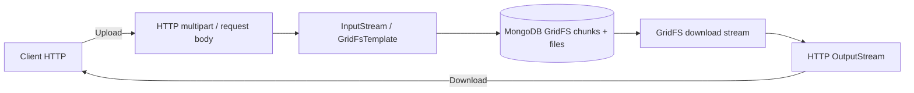
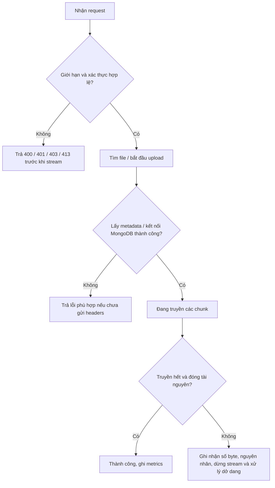

# Quản lý bộ nhớ, stream và lỗi truyền file trong GridFS

## Mục tiêu bài học

Trong module **SPRING_DATA_MONGODB**, Spring Data MongoDB cho phép ánh xạ document và thao tác MongoDB qua `MongoTemplate`, repository và các API chuyên biệt. Với GridFS, bài toán quan trọng là **truyền nội dung tệp lớn mà không cần giữ toàn bộ dữ liệu trong RAM**, đồng thời xử lý đúng các lỗi có thể xảy ra ở HTTP, ứng dụng và MongoDB.

Sau bài này, bạn có thể:

- Phân biệt **streaming thực tế** với việc chỉ đổi một mảng byte thành `InputStream` sau khi đã tải toàn bộ tệp vào bộ nhớ.
- Tính tác động của kích thước bộ đệm, chunk GridFS, số request đồng thời và cơ chế multipart lên RAM.
- Tải lên/tải xuống bằng `GridFsTemplate`, `InputStream` và `StreamingResponseBody` với vòng đời tài nguyên rõ ràng.
- Nhận diện các trường hợp upload gián đoạn, client hủy download, lỗi ghi chunk và phản hồi HTTP đã gửi dở.
- Thiết kế timeout, giới hạn kích thước, retry, quan sát hệ thống và kiểm thử truyền tệp để giảm nguy cơ tệp hỏng hoặc rò rỉ tài nguyên.

## 1. Dòng dữ liệu đi qua những đâu?

GridFS lưu nội dung tệp thành các document chunk trong collection `<bucket>.chunks` và lưu thông tin tệp trong `<bucket>.files`. MongoDB không yêu cầu ứng dụng ghép tất cả chunk thành một mảng byte lớn trước khi tải xuống: driver GridFS cung cấp stream để đọc tuần tự các chunk theo thứ tự.

Ứng dụng đồng bộ điển hình có hai hướng truyền:



Mục tiêu là để mỗi tầng xử lý dữ liệu theo từng phần. Tuy vậy, việc dùng `InputStream` **không tự động bảo đảm** mọi tầng đều streaming: multipart resolver, reverse proxy, gateway, trình xử lý virus, bộ nhớ đệm ứng dụng hoặc HTTP client vẫn có thể nạp trước toàn bộ tệp.

**Ví dụ:** một tệp 200 MiB được tải lên đồng thời bởi 25 người dùng. Nếu mỗi request gọi `getBytes()` và giữ mảng byte đến cuối xử lý, riêng dữ liệu thô có thể chiếm xấp xỉ **5.000 MiB** RAM, chưa kể bản sao, metadata và bộ nhớ của JVM. Nếu mỗi request dùng bộ đệm sao chép **64 KiB**, phần bộ đệm do code sao chép chủ động cấp phát chỉ khoảng **1,6 MiB** cho 25 request. Đây **không phải** tổng RAM thực tế: driver MongoDB, bộ đệm mạng, multipart parser, thread và các tầng khác cũng tiêu thụ tài nguyên.

## 2. Những quy tắc quản lý bộ nhớ quan trọng

| Cách làm | Tác động | Khuyến nghị |
|---|---|---|
| `multipartFile.getBytes()`, `readAllBytes()` hoặc `ByteArrayOutputStream` để giữ toàn bộ tệp | RAM tăng theo kích thước tệp; số request đồng thời khuếch đại vấn đề | Tránh cho luồng truyền file lớn; xử lý qua stream |
| `InputStream` -> bộ đệm cố định -> `OutputStream` | Bộ nhớ của vòng lặp copy tăng theo kích thước bộ đệm, không tăng theo kích thước tệp | Dùng bộ đệm cố định, chẳng hạn 64 KiB; theo dõi bộ nhớ của các tầng khác |
| `MultipartFile.getInputStream()` | Có thể đọc dữ liệu đã được multipart resolver lưu tạm trên đĩa hoặc trong bộ nhớ | Cấu hình ngưỡng lưu tạm và dung lượng đĩa; tránh suy đoán rằng controller nhận byte trực tiếp từ mạng |
| `GridFsTemplate.store(InputStream, ...)` | Driver lần lượt ghi nội dung thành các chunk GridFS | Đưa stream vào trực tiếp và đóng stream đúng phạm vi |
| `GridFsResource.getInputStream()` | Đọc nội dung từ GridFS theo stream | Mở và đóng stream trong thời gian thực sự ghi HTTP response |
| `StreamingResponseBody` | Ghi nội dung HTTP từ tác vụ bất đồng bộ của Spring MVC | Cấu hình executor có giới hạn, giám sát kết nối chậm |
| `collectList()` hoặc `DataBufferUtils.join()` cho cả tệp trong WebFlux | Tập hợp các buffer, có thể gây áp lực RAM lớn | Dùng `Flux<DataBuffer>` xuyên suốt đường truyền khi phù hợp |

### Chunk size khác với copy buffer

Chunk size của GridFS thường mặc định là **255 KiB (261.120 byte)**, nhưng có thể cấu hình khi upload. Nó quy định kích thước dữ liệu của từng document chunk trong MongoDB. Trong khi đó, buffer 64 KiB của vòng lặp Java chỉ là kích thước mỗi lần đọc/ghi giữa hai stream.

Hai giá trị này **không cần bằng nhau**. Chọn buffer lớn hơn không tự thay đổi chunk size; chọn chunk lớn hơn không khiến HTTP tự gửi chunk có cùng kích thước. Bộ đệm mạng, HTTP chunked transfer encoding và GridFS chunk là ba khái niệm riêng.

Để kiểm soát RAM trong tải cao, cần giới hạn đồng thời số upload/download, quan sát heap và các buffer ngoài heap, đồng thời tránh để hàng trăm stream chậm chiếm hết thread, connection pool hoặc tài nguyên tạm.

## 3. Upload theo stream bằng Spring Data MongoDB

Giả sử ứng dụng dùng bucket `assets` với hai collection `assets.files` và `assets.chunks`. Cấu hình bean:

```java
import org.springframework.context.annotation.Bean;
import org.springframework.context.annotation.Configuration;
import org.springframework.data.mongodb.MongoDatabaseFactory;
import org.springframework.data.mongodb.core.convert.MongoConverter;
import org.springframework.data.mongodb.gridfs.GridFsTemplate;

@Configuration
class GridFsConfig {

    @Bean("assetsGridFs")
    GridFsTemplate assetsGridFs(
            MongoDatabaseFactory databaseFactory,
            MongoConverter converter) {
        return new GridFsTemplate(databaseFactory, converter, "assets");
    }
}
```

Một controller Spring MVC tối giản nhận tệp qua multipart và truyền `InputStream` vào GridFS:

```java
import java.io.IOException;
import java.io.InputStream;
import java.security.Principal;
import java.util.Map;

import org.bson.Document;
import org.bson.types.ObjectId;
import org.springframework.beans.factory.annotation.Qualifier;
import org.springframework.data.mongodb.gridfs.GridFsTemplate;
import org.springframework.http.HttpStatus;
import org.springframework.http.MediaType;
import org.springframework.http.ResponseEntity;
import org.springframework.web.bind.annotation.PostMapping;
import org.springframework.web.bind.annotation.RequestMapping;
import org.springframework.web.bind.annotation.RequestParam;
import org.springframework.web.bind.annotation.RestController;
import org.springframework.web.multipart.MultipartFile;

@RestController
@RequestMapping("/api/assets")
class GridFsUploadController {

    private final GridFsTemplate gridFs;

    GridFsUploadController(@Qualifier("assetsGridFs") GridFsTemplate gridFs) {
        this.gridFs = gridFs;
    }

    @PostMapping(consumes = MediaType.MULTIPART_FORM_DATA_VALUE)
    ResponseEntity<Map<String, String>> upload(
            @RequestParam("file") MultipartFile file,
            Principal principal) throws IOException {

        // Endpoint cần được bảo vệ bởi cơ chế xác thực của ứng dụng.
        String filename = safeFilename(file.getOriginalFilename());
        String contentType = file.getContentType();

        Document metadata = new Document("ownerId", principal.getName())
                .append("contentType", contentType)
                .append("status", "uploaded");

        try (InputStream input = file.getInputStream()) {
            ObjectId fileId = gridFs.store(
                    input, filename, contentType, metadata);

            return ResponseEntity.status(HttpStatus.CREATED)
                    .body(Map.of("fileId", fileId.toHexString()));
        }
    }

    private static String safeFilename(String original) {
        String normalized = original == null
                ? ""
                : original.replace('\\', '/');
        String name = normalized.substring(normalized.lastIndexOf('/') + 1)
                .replace("\r", "")
                .replace("\n", "");
        return name.isBlank() ? "upload.bin" : name;
    }
}
```

Ví dụ dùng `Principal` làm nguồn định danh người dùng; ứng dụng thực tế cần yêu cầu đăng nhập, kiểm tra quyền upload và giới hạn quyền truy cập theo tenant khi cần. `safeFilename()` chỉ loại bỏ phần đường dẫn và xuống dòng ở mức cơ bản; chính sách tên file và loại file cần được kiểm soát theo nghiệp vụ. `contentType` lấy từ request là **thông tin do client khai báo**, không phải kết quả kiểm tra nội dung an toàn.

**Vòng đời tài nguyên:** `try-with-resources` đóng stream dù lưu thành công hay ném lỗi. Không giữ tham chiếu đến `MultipartFile` hoặc `InputStream` trong một tác vụ chạy sau khi request multipart đã được dọn dẹp, trừ khi bạn đã chủ động quản lý nguồn dữ liệu và vòng đời của nó.

**Lưu ý về multipart:** Spring MVC có thể đã nhận và lưu tạm phần multipart trước khi controller được gọi. Để giới hạn tài nguyên, cấu hình cả giới hạn request và vị trí/khả năng sử dụng dung lượng tạm; nếu cần streaming từ network socket đến MongoDB theo đúng từng phần mà không qua file tạm, phải đánh giá riêng thiết kế HTTP/multipart và servlet stack.

### Giới hạn upload trong Spring Boot

Ví dụ cấu hình cho endpoint chấp nhận tệp tối đa 200 MiB:

```yaml
spring:
  servlet:
    multipart:
      max-file-size: 200MB
      max-request-size: 205MB
      file-size-threshold: 0B
```

`max-request-size` cần có dư địa cho các phần multipart khác. `file-size-threshold: 0B` hướng đến lưu tạm file multipart lên đĩa trong cấu hình servlet phổ biến; cần kiểm tra nơi lưu tạm và dung lượng khả dụng trong môi trường triển khai. Bên cạnh ứng dụng, reverse proxy/ingress có thể có giới hạn payload độc lập.

Nếu vượt giới hạn, request thường bị chặn ở giai đoạn xử lý multipart trước khi chạy logic controller, do đó cần cấu hình ánh xạ lỗi thành **HTTP 413 Payload Too Large** và cung cấp thông báo phù hợp. Không nên trông đợi phép kiểm tra `file.getSize()` trong controller là hàng rào duy nhất.

## 4. Download qua `StreamingResponseBody`

Đối với ứng dụng Spring MVC đồng bộ, `StreamingResponseBody` là một cách xuất dữ liệu theo stream: controller xác định tệp, tạo headers, sau đó Spring thực thi callback để ghi byte ra response.

```java
import java.io.IOException;
import java.io.InputStream;
import java.nio.charset.StandardCharsets;
import java.security.Principal;

import com.mongodb.client.gridfs.model.GridFSFile;
import org.bson.types.ObjectId;
import org.springframework.beans.factory.annotation.Qualifier;
import org.springframework.data.mongodb.core.query.Criteria;
import org.springframework.data.mongodb.core.query.Query;
import org.springframework.data.mongodb.gridfs.GridFsTemplate;
import org.springframework.http.ContentDisposition;
import org.springframework.http.HttpHeaders;
import org.springframework.http.HttpStatus;
import org.springframework.http.MediaType;
import org.springframework.http.ResponseEntity;
import org.springframework.web.bind.annotation.GetMapping;
import org.springframework.web.bind.annotation.PathVariable;
import org.springframework.web.bind.annotation.RequestMapping;
import org.springframework.web.bind.annotation.RestController;
import org.springframework.web.server.ResponseStatusException;
import org.springframework.web.servlet.mvc.method.annotation.StreamingResponseBody;

@RestController
@RequestMapping("/api/assets")
class GridFsDownloadController {

    private static final int BUFFER_SIZE = 64 * 1024;
    private final GridFsTemplate gridFs;

    GridFsDownloadController(@Qualifier("assetsGridFs") GridFsTemplate gridFs) {
        this.gridFs = gridFs;
    }

    @GetMapping("/{id}")
    ResponseEntity<StreamingResponseBody> download(
            @PathVariable String id,
            Principal principal) {

        if (!ObjectId.isValid(id)) {
            throw new ResponseStatusException(
                    HttpStatus.BAD_REQUEST, "Invalid file id");
        }

        // Không truy vấn riêng theo filename: có thể có nhiều file trùng tên.
        Query allowedFile = Query.query(
                Criteria.where("_id").is(new ObjectId(id))
                        .and("metadata.ownerId").is(principal.getName()));
        GridFSFile file = gridFs.findOne(allowedFile);

        if (file == null) {
            throw new ResponseStatusException(
                    HttpStatus.NOT_FOUND, "File not found");
        }

        String filename = file.getFilename() == null
                ? "download.bin"
                : file.getFilename();

        StreamingResponseBody body = output -> {
            // Mở stream bên trong callback: response được ghi sau khi
            // phương thức controller đã trả về.
            try (InputStream input =
                         gridFs.getResource(file).getInputStream()) {
                byte[] buffer = new byte[BUFFER_SIZE];
                int bytesRead;
                while ((bytesRead = input.read(buffer)) != -1) {
                    output.write(buffer, 0, bytesRead);
                }
            }
            // Spring quản lý HTTP output stream; không tự close(output).
        };

        String disposition = ContentDisposition.attachment()
                .filename(filename, StandardCharsets.UTF_8)
                .build()
                .toString();

        return ResponseEntity.ok()
                .header(HttpHeaders.CONTENT_DISPOSITION, disposition)
                .header("X-Content-Type-Options", "nosniff")
                .contentType(MediaType.APPLICATION_OCTET_STREAM)
                .contentLength(file.getLength())
                .body(body);
    }
}
```

Một số điểm cần hiểu đúng:

1. **Chỉ xác định metadata trong controller.** Lệnh `findOne(...)` kiểm tra định danh và quyền truy cập, không tải toàn bộ nội dung file.
2. **Mở GridFS stream trong callback.** Không mở rồi đóng bằng `try-with-resources` ở ngoài callback, vì lúc đó response chưa bắt đầu đọc nội dung.
3. **Dùng buffer có kích thước cố định.** Mỗi vòng chỉ giữ một phần dữ liệu; driver sẽ nạp các chunk MongoDB khi cần.
4. **Đóng stream đọc, không tự đóng stream HTTP.** Khi callback kết thúc hoặc ném lỗi, `try-with-resources` đóng `InputStream`. Servlet container/Spring quản lý `OutputStream`.
5. **Chỉ trả về file đã được phép truy cập.** Metadata ownerId không tự thực thi phân quyền; truy vấn trong ví dụ đã ràng buộc theo người dùng xác thực. Với multi-tenant, thêm điều kiện tenant và chính sách quyền phù hợp.
6. **Đặt `Content-Length` cho full download.** Giá trị lấy từ `GridFSFile.getLength()`. Nếu truyền lỗi giữa chừng, client có thể thấy response bị cắt ngắn và cần coi đó là download thất bại.

Kiểu `Content-Disposition: attachment` làm trình duyệt tải xuống thay vì cố render tệp. Ví dụ dùng `application/octet-stream` để hạn chế rủi ro hiển thị nội dung không tin cậy; nếu cần xem nội dung trực tiếp trong trình duyệt, phải có chính sách MIME type, kiểm tra tệp và bảo vệ riêng.

### Executor cho streaming trong Spring MVC

`StreamingResponseBody` cho phép xử lý request bất đồng bộ ở tầng servlet, nhưng callback vẫn **dùng thread chờ I/O** trong thời gian truyền dữ liệu. Nên cấu hình executor chuyên dụng có giới hạn và thời gian chờ, thay vì tạo vô hạn công việc.

```java
import org.springframework.beans.factory.annotation.Qualifier;
import org.springframework.context.annotation.Bean;
import org.springframework.context.annotation.Configuration;
import org.springframework.core.task.TaskExecutor;
import org.springframework.scheduling.concurrent.ThreadPoolTaskExecutor;
import org.springframework.web.servlet.config.annotation.AsyncSupportConfigurer;
import org.springframework.web.servlet.config.annotation.WebMvcConfigurer;

@Configuration
class GridFsStreamingMvcConfig implements WebMvcConfigurer {

    private final ThreadPoolTaskExecutor streamingExecutor;

    GridFsStreamingMvcConfig(
            @Qualifier("gridFsStreamingExecutor")
            ThreadPoolTaskExecutor streamingExecutor) {
        this.streamingExecutor = streamingExecutor;
    }

    @Bean("gridFsStreamingExecutor")
    static ThreadPoolTaskExecutor gridFsStreamingExecutor() {
        ThreadPoolTaskExecutor executor = new ThreadPoolTaskExecutor();
        executor.setCorePoolSize(4);
        executor.setMaxPoolSize(16);
        executor.setQueueCapacity(100);
        executor.setThreadNamePrefix("gridfs-stream-");
        return executor;
    }

    @Override
    public void configureAsyncSupport(AsyncSupportConfigurer configurer) {
        configurer.setTaskExecutor(streamingExecutor);
        configurer.setDefaultTimeout(120_000L);
    }
}
```

Các con số trên chỉ mang tính minh họa. Cần lựa chọn dựa trên tốc độ mạng, thời gian một request chiếm thread, số connection MongoDB và tài nguyên máy chủ. Khi hàng đợi đầy, phải có chính sách giới hạn tải và trả lỗi phù hợp. Timeout của Spring MVC không thay thế cho timeout của proxy, MongoDB driver hay client.

## 5. Lỗi trong quá trình truyền file xảy ra ở giai đoạn nào?



| Trường hợp | Điều ứng dụng quan sát | Xử lý hợp lý |
|---|---|---|
| Tệp vượt giới hạn HTTP/multipart | Lỗi giới hạn request, có thể xảy ra trước controller | Trả 413 khi còn có thể; đảm bảo proxy và ứng dụng đồng bộ chính sách |
| File không tồn tại hoặc người dùng không có quyền | Không tìm thấy document phù hợp ở `files` | Kiểm tra trước khi ghi body; thường trả 404 để tránh lộ thông tin tài nguyên |
| Mất kết nối tới MongoDB khi bắt đầu upload | Ngoại lệ kết nối, timeout hoặc thao tác ghi thất bại | Dừng upload, đóng stream, ghi log có correlation id và trả lỗi phù hợp nếu response chưa commit |
| Mất kết nối MongoDB khi download giữa chừng | Đọc stream thất bại sau khi đã gửi một phần byte | Hủy stream, ghi nhận download thất bại; không cố gửi JSON lỗi vào body nhị phân |
| Client ngắt kết nối trong lúc download | `IOException`/broken pipe/connection reset khi `output.write(...)` | Dừng đọc từ MongoDB, đóng tài nguyên, phân loại là client abort nếu xác định được |
| Client upload bị ngắt | Nguồn dữ liệu HTTP/multipart có thể báo lỗi, dữ liệu chỉ ghi được một phần | Đảm bảo driver/ứng dụng abort khi hỗ trợ, kiểm tra chunk dư sau khi xác nhận upload kết thúc |
| Tài liệu chunk thiếu hoặc sai thứ tự | Driver GridFS có thể báo lỗi khi tải nội dung | Không coi response cắt ngắn là thành công; kiểm tra tính toàn vẹn và quy trình sửa dữ liệu |
| Executor quá tải hoặc timeout | Tác vụ chờ quá lâu, bị từ chối hoặc quá thời hạn | Giới hạn đồng thời, theo dõi hàng đợi và phân loại lỗi để điều chỉnh capacity |

### Trước và sau khi response được commit

**Trước khi gửi header/body**, ứng dụng còn có thể đổi HTTP status sang 400, 404, 413 hoặc 5xx phù hợp và trả JSON mô tả lỗi theo quy ước API.

**Sau khi byte đầu tiên đã được ghi**, header có thể đã được commit. Không thể bảo đảm đổi status hay thay response thành JSON hợp lệ. Một exception handler tổng quát có thể chỉ ghi log hoặc làm kết nối kết thúc; client phải coi response thiếu byte, kết nối lỗi hoặc checksum sai là **tải xuống thất bại**.

Vì vậy, cần kiểm tra những điều có thể biết sớm (định danh, quyền truy cập, metadata, kích thước) trước khi phát stream, và có cơ chế nhận diện **lỗi phát sinh khi đã stream** qua log/metrics thay vì chỉ dựa vào HTTP status.

### Xử lý lỗi ngay trong callback có nên nuốt exception?

Không. Mẫu nguy hiểm:

```java
StreamingResponseBody body = output -> {
    try (InputStream in = resource.getInputStream()) {
        in.transferTo(output);
    } catch (IOException error) {
        // Sai: chỉ log rồi coi callback như thành công.
    }
};
```

Cần bảo đảm lỗi được ghi nhận và truyền lên cơ chế xử lý phù hợp; không trả về trạng thái thành công giả hoặc ghi nội dung lỗi văn bản vào giữa các byte của tệp. Nếu cần phân biệt client abort và lỗi backend, đặt logic phân loại/metrics tại điểm bắt exception, sau đó cho phép quá trình request kết thúc thất bại.

## 6. Upload gián đoạn và chunk mồ côi

Với GridFS, mỗi upload thường ghi các document `chunks` trước, rồi ghi document tương ứng trong `files` khi hoàn tất. Các thao tác này không mặc nhiên là một transaction nguyên tử duy nhất xuyên suốt toàn bộ tệp.

Ví dụ: upload file 900 MiB bị ngắt sau khi driver ghi một phần chunk. Một số document trong `assets.chunks` có thể còn tồn tại nhưng không có document trong `assets.files`. Đó là **orphan chunks**, chiếm dung lượng và không đại diện cho tệp hoàn chỉnh có thể tải qua API GridFS thông thường.

Cách xử lý theo vòng đời:

1. **Khi lỗi xảy ra**, để driver đóng/hủy phiên upload đúng cách; nếu đang dùng API upload stream mức thấp, tận dụng thao tác `abort()` được driver hỗ trợ để dọn các chunk đã ghi khi có thể.
2. **Ghi log/metric** định danh upload hoặc file id, owner, thời điểm bắt đầu, số byte nhận, lỗi và tình trạng abort.
3. **Rà soát định kỳ** các chunk không có tệp tương ứng, kết hợp thông tin phiên upload đang chạy và thời gian đủ dài trước khi kết luận là mồ côi.
4. **Chỉ xóa sau khi xác nhận** upload thực sự đã chấm dứt; chunk của một upload hợp lệ đang diễn ra cũng có thể chưa có bản ghi `files`.
5. **Thử lại có kiểm soát** để tránh tạo nhiều bản sao tệp cùng tên hoặc cùng nghiệp vụ.

Không xóa trực tiếp document `files` bằng lệnh MongoDB rồi giả định các chunk tự bị xóa. Khi xóa tệp hoàn chỉnh, ưu tiên API xóa GridFS vì nó có trách nhiệm xử lý cả hai collection.

### Retry không đồng nghĩa resume

Giả sử client bị mất mạng ở 80% upload. Nếu API chỉ có một request HTTP chứa toàn bộ file, retry đơn giản thường tạo **một upload mới từ đầu**; không tự tiếp tục từ 80%.

Để thiết kế retry an toàn:

- Dùng một mã yêu cầu upload do client tạo, lưu trạng thái/idempotency ở tầng nghiệp vụ, và bảo đảm cùng một mã không tạo hai kết quả hoàn tất khác nhau khi retry đồng thời.
- Chỉ công bố file cho hệ thống khác sau khi upload hoàn tất và xác minh trạng thái.
- Nếu cần resume upload theo block, thiết kế giao thức tách phiên tải lên, offsets, checkpoint, kiểm tra toàn vẹn và bước hoàn tất riêng; GridFS `store(InputStream, ...)` không tự trở thành API resumable HTTP.
- Với download bị ngắt, chỉ quảng cáo hỗ trợ `Accept-Ranges: bytes` nếu endpoint đã thực sự triển khai xử lý `Range`, trả `206 Partial Content` và `Content-Range` đúng chuẩn. `StreamingResponseBody` trong ví dụ trên **chỉ trả full content**, không tự cung cấp HTTP Range.

## 7. Timeout, backpressure và tải đồng thời

Ứng dụng cần nhìn toàn bộ chuỗi truyền:

| Tài nguyên | Rủi ro | Biện pháp |
|---|---|---|
| Heap / direct memory | Nhiều buffer/byte array hoặc giữ tài liệu dài trong RAM | Buffer cố định, tránh materialize toàn file, theo dõi GC và native memory |
| Đĩa tạm multipart | Hết dung lượng trong lúc nhận upload | Đặt quota, kiểm tra vị trí temp, thu dọn tệp tạm và giới hạn request |
| Thread Spring MVC | Client chậm khiến stream giữ thread lâu | Bounded executor, timeout, giới hạn request đồng thời |
| Connection pool MongoDB | Upload/download dài hoặc quá nhiều request làm cạn pool | Theo dõi số connection chờ, max pool size, timeout và mức đồng thời |
| HTTP server/proxy | Proxy buffer, timeout hoặc hủy kết nối giữa chừng | Kiểm tra cấu hình buffering, request timeout, idle timeout và giới hạn body |
| Network | Băng thông thấp, packet loss, client disconnect | Streaming, tránh retry vô hạn, quan sát byte và thời lượng truyền |

**Backpressure** nghĩa là phía tiêu thụ có thể làm chậm phía phát dữ liệu khi chưa xử lý kịp. Vòng lặp `input.read(...)` rồi `output.write(...)` trong Spring MVC thường tạo hiệu ứng chờ tự nhiên khi socket ghi chậm, nhưng nó vẫn dùng thread chặn (blocking). Đây không phải mô hình nonblocking end-to-end.

Với **Spring WebFlux**, `ReactiveGridFsTemplate` và `ReactiveGridFsResource` cung cấp hướng tiếp cận reactive bằng publisher. Đường truyền có thể dùng các luồng `DataBuffer` và cơ chế demand, tuy nhiên cần tránh `block()`, `collectList()` hoặc `join()` trên toàn bộ tệp. Khi tự giữ hoặc giải phóng `DataBuffer`, phải tuân thủ ownership/lifecycle của Spring để tránh leak, nhất là với buffer được pool. Các bước như mã hóa, quét virus hay ghi sang dịch vụ ngoài vẫn có thể tạo hàng đợi và làm mất khả năng streaming nếu chúng tích lũy dữ liệu.

## 8. Kiểm tra tính toàn vẹn và quan sát hệ thống

GridFS lưu các chunk theo thứ tự, nhưng ứng dụng vẫn cần xác định **tệp khách nhận có nguyên vẹn không** khi liên quan đến tài liệu quan trọng.

- **Kích thước:** so sánh số byte thực nhận với `length` của `GridFSFile` cho full download. HTTP `Content-Length` giúp client phát hiện phản hồi ngắn khi được sử dụng đúng.
- **Checksum:** tính SHA-256 bằng cách đọc từng phần trong khi upload, lưu giá trị vào metadata hoặc bản ghi nghiệp vụ sau khi upload hoàn tất. Khi download hoặc kiểm toán, tính lại từ các byte nhận được và so sánh. Chỉ lưu checksum thật đã tính; nó không mặc nhiên được GridFS cung cấp.
- **Tính nhất quán nghiệp vụ:** chỉ cập nhật trạng thái `READY` hoặc cho phép tải xuống khi việc lưu file và metadata liên quan hoàn tất theo quy trình của ứng dụng.
- **Audit:** ghi log người dùng/tenant, file id, loại hoạt động, số byte, thời gian và kết quả. Không ghi nội dung nhị phân hay thông tin nhạy cảm không cần thiết vào log.

Ví dụ tính hash theo stream, không giữ toàn bộ file trong bộ nhớ:

```java
import java.io.IOException;
import java.io.InputStream;
import java.security.MessageDigest;
import java.security.NoSuchAlgorithmException;
import java.util.HexFormat;

public final class StreamChecksums {

    private StreamChecksums() {}

    public static String sha256(InputStream input) throws IOException {
        final MessageDigest digest;
        try {
            digest = MessageDigest.getInstance("SHA-256");
        } catch (NoSuchAlgorithmException e) {
            throw new IllegalStateException("SHA-256 unavailable", e);
        }

        byte[] buffer = new byte[64 * 1024];
        int count;
        while ((count = input.read(buffer)) != -1) {
            digest.update(buffer, 0, count);
        }
        // Java 17+: định dạng byte digest thành chuỗi hex.
        return HexFormat.of().formatHex(digest.digest());
    }
}
```

**Chú ý:** hàm này tiêu thụ stream đến cuối. Nếu cần vừa upload vừa tính checksum, dùng cơ chế bọc stream để cập nhật digest khi driver đọc, hoặc tính checksum trong một lượt đọc riêng từ nguồn có thể mở lại. Không gọi `sha256(input)` rồi tiếp tục `store(input, ...)` với chính stream đã cạn.

### Metrics nên theo dõi

| Metric | Câu hỏi trả lời |
|---|---|
| `gridfs_upload_total{result=...}` | Có bao nhiêu upload thành công, thất bại, bị hủy? |
| `gridfs_download_total{result=...}` | Có bao nhiêu download hoàn tất hoặc bị ngắt? |
| `gridfs_transfer_bytes` | Hệ thống thực sự đã đọc/ghi bao nhiêu byte? |
| `gridfs_transfer_duration_seconds` | Tốc độ và độ trễ truyền tệp thay đổi thế nào? |
| `gridfs_active_streams` | Có bao nhiêu stream đang hoạt động đồng thời? |
| `gridfs_orphan_chunks` | Có dấu hiệu chunk dư sau upload lỗi không? |
| `http_stream_executor_active/queued` | Streaming executor có bị nghẽn không? |

Không thêm `fileId`, `userId` hoặc tên file trực tiếp làm label metrics vì cardinality sẽ tăng rất lớn. Những giá trị này phù hợp hơn với structured log hoặc trace có chính sách bảo vệ dữ liệu.

## 9. Kịch bản thực hành và kiểm chứng

### Kịch bản A — tệp lớn và bộ nhớ

Tải lên một tệp lớn hơn 16 MiB (ví dụ 50 MiB), sau đó tải xuống nhiều lần đồng thời.

1. Kiểm tra trong `assets.files` có `length` phù hợp và `assets.chunks` chứa nhiều chunk.
2. Quan sát heap, bộ nhớ ngoài heap, số thread và connection pool khi tăng số request.
3. So sánh với phiên bản thử nghiệm cố ý gọi `getBytes()` để thấy sự khác biệt về phân bổ bộ nhớ; chỉ làm trong môi trường thử nghiệm có giới hạn.
4. Đảm bảo bản tải xuống có cùng byte và SHA-256 với file nguồn.

**Tiêu chí:** kích thước file tăng không làm code sao chép cấp phát thêm một mảng tỉ lệ với toàn bộ file. Tổng bộ nhớ hệ thống vẫn có thể tăng vì các tầng khác, do đó cần đo thật.

### Kịch bản B — client ngắt download giữa chừng

1. Bắt đầu tải file đủ lớn để quá trình kéo dài.
2. Hủy request từ client trước khi xong.
3. Kiểm tra ứng dụng ghi nhận client abort hoặc `IOException` tương ứng.
4. Xác nhận `InputStream` GridFS được đóng và số active stream giảm.
5. Đảm bảo không ghi nội dung lỗi vào response nhị phân và không ghi nhận đây là một download hoàn tất.

**Tiêu chí:** không rò rỉ tài nguyên, metrics thể hiện kết quả thất bại hoặc hủy, phần tệp nhận được không bị diễn giải là hoàn chỉnh.

### Kịch bản C — MongoDB gián đoạn khi upload

1. Tại môi trường thử nghiệm, gây lỗi kết nối khi một upload lớn đang chạy.
2. Kiểm tra phản hồi HTTP, log lỗi, quá trình đóng nguồn dữ liệu.
3. Sau khi hệ thống phục hồi, đối chiếu `assets.files` và `assets.chunks`.
4. Nếu có chunk mồ côi, xác minh không còn upload đang thực hiện trước khi dọn.
5. Thử lại có idempotency để kiểm tra không xuất hiện hai tệp hoàn tất cho cùng một thao tác nghiệp vụ.

**Tiêu chí:** file dở dang không bị công bố là hoàn chỉnh; quá trình dọn và retry có dấu vết rõ ràng.

### Kịch bản D — tệp rỗng và tên trùng

Tải lên tệp **0 byte** và hai tệp khác có cùng `filename`. GridFS có thể đại diện cho tệp rỗng mà không cần chunk dữ liệu. Hai tệp trùng tên vẫn có `_id` riêng. Kiểm tra download theo `_id`, `Content-Length` và quyền truy cập, tránh suy luận rằng tên file là khóa duy nhất.

## 10. Những lỗi thiết kế cần tránh

- **Mở stream trong controller rồi đóng trước khi callback chạy.** `StreamingResponseBody` sẽ dùng một stream đã bị đóng.
- **Nuốt `IOException` trong callback.** Ứng dụng có thể báo thành công giả cho lần truyền bị hỏng.
- **Gọi `getBytes()` hoặc `readAllBytes()` cho file lớn.** Bộ nhớ tăng theo kích thước file và số request.
- **Dựa duy nhất vào timeout để kiểm soát tải.** Timeout không thay thế giới hạn đồng thời, backpressure hoặc giới hạn kích thước request.
- **Đồng nhất GridFS chunk với HTTP chunk.** Chúng thuộc các tầng khác nhau và có quy tắc riêng.
- **Giả định upload hoặc download là thao tác nguyên tử.** Lỗi giữa chừng có thể để lại chunk dở dang hoặc response HTTP bị cắt ngắn.
- **Tự động retry không có idempotency.** Có thể sinh file trùng hoặc cập nhật trạng thái nghiệp vụ sai.
- **Hứa hỗ trợ resume/Range khi endpoint chưa triển khai.** Download full-stream không mặc nhiên hỗ trợ `206 Partial Content`.
- **Bỏ qua quản lý dữ liệu tạm.** Multipart có thể chiếm đĩa ngay cả khi code controller dùng `InputStream`.

## Tổng kết

Quản lý bộ nhớ tốt với GridFS bắt đầu từ việc **giữ dữ liệu ở dạng stream qua toàn bộ đường truyền**, dùng bộ đệm có giới hạn và khống chế số yêu cầu đồng thời. Khi tích hợp Spring Data MongoDB, `GridFsTemplate` phù hợp cho upload qua `InputStream` và download qua `GridFsResource`; `StreamingResponseBody` giúp Spring MVC gửi nội dung theo từng phần, với yêu cầu cấu hình executor và vòng đời tài nguyên phù hợp.

Trong vận hành, cần phân biệt lỗi **trước** và **sau** khi HTTP response được commit, xử lý upload gián đoạn để không công bố tệp thiếu, và dùng checksum, log, metrics để xác nhận kết quả thực sự. Những nguyên tắc này áp dụng xuyên suốt truy cập đồng bộ và reactive, dù API cụ thể khác nhau.
