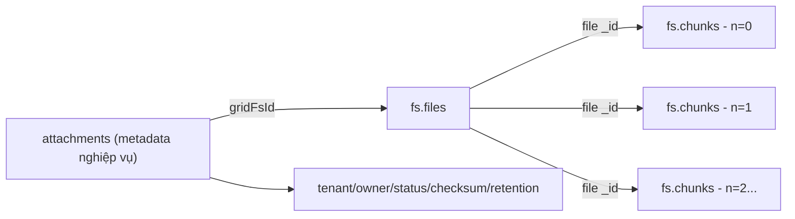
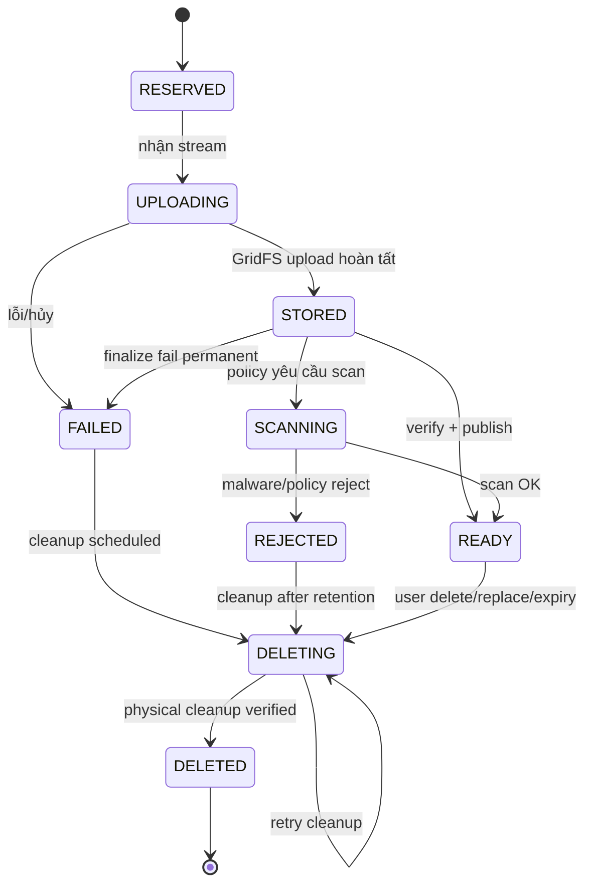
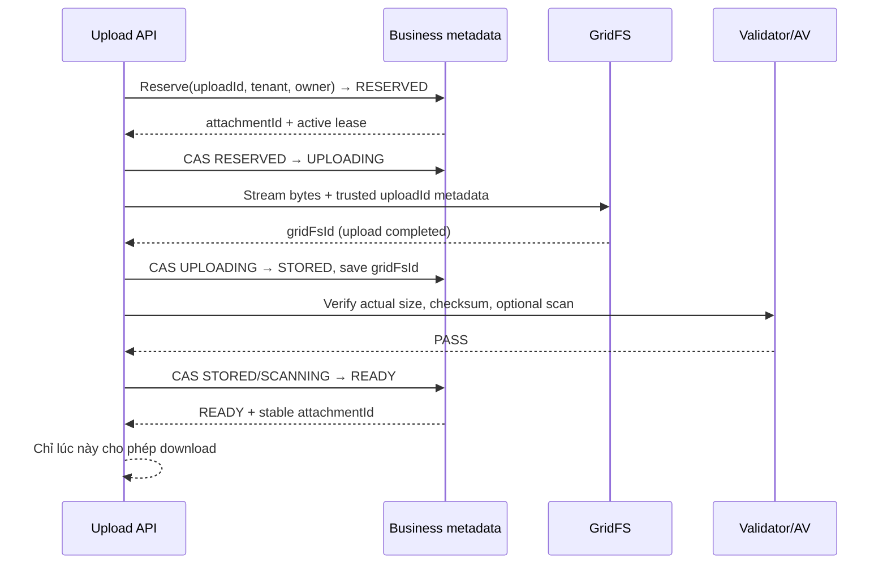
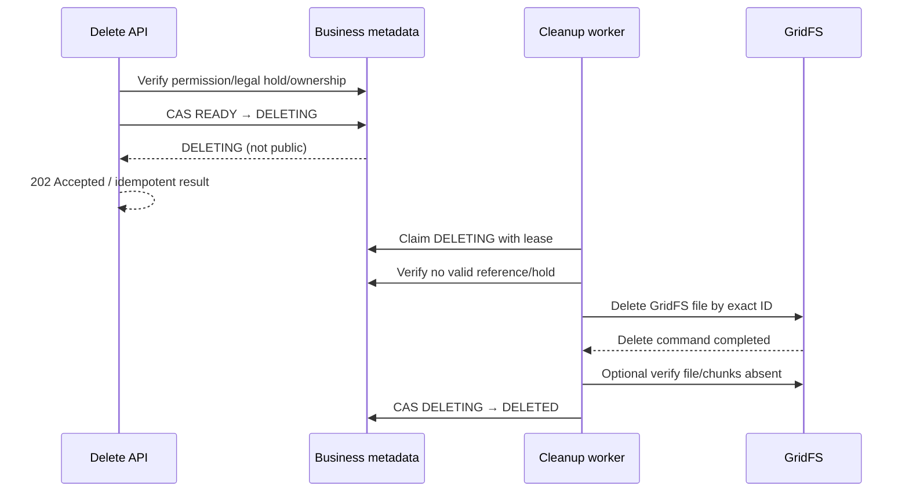
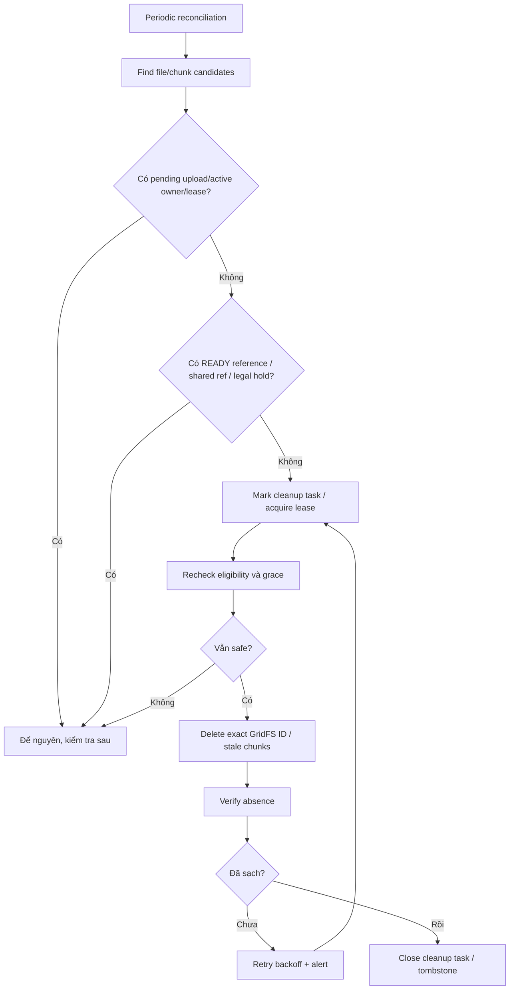
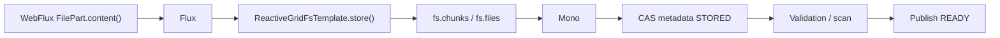
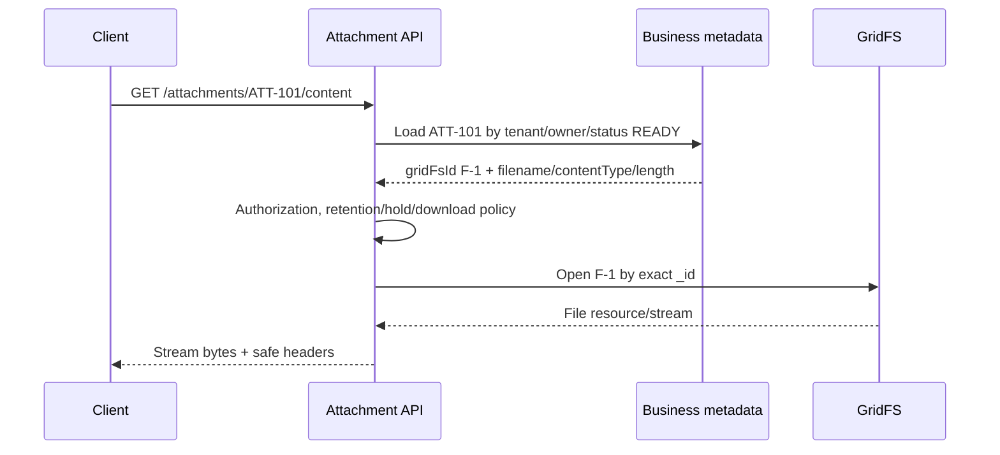
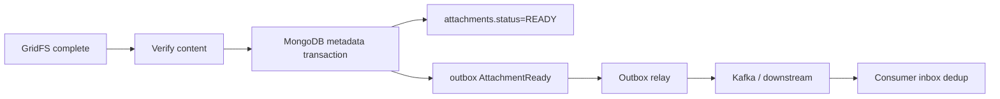
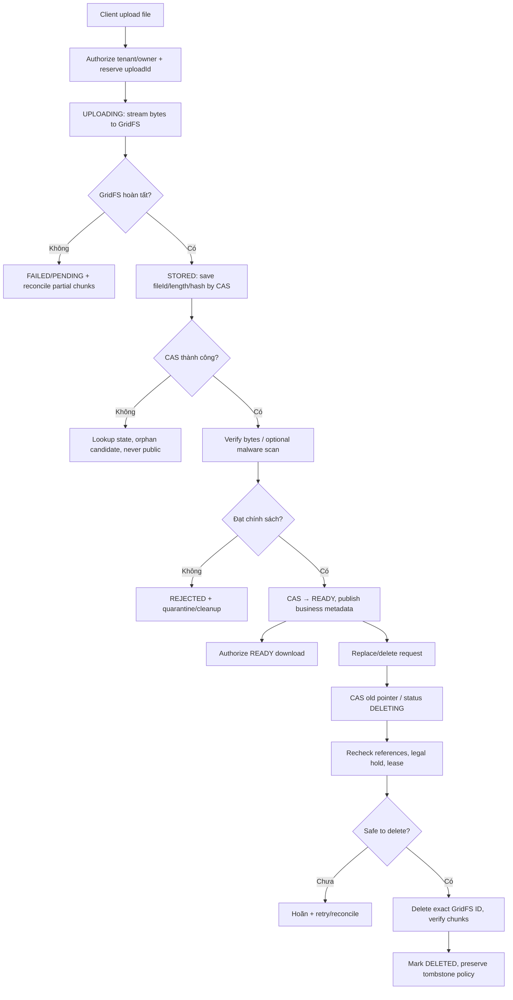

# Nhất quán giữa metadata nghiệp vụ, nội dung file và cleanup với GridFS

## 1. Bài toán: tệp đã lưu nhưng nghiệp vụ chưa hoàn tất

Trong module **SPRING_DATA_MONGODB**, GridFS cho phép ứng dụng Java/Spring Data MongoDB lưu và đọc tệp lớn theo dòng dữ liệu thay vì đặt toàn bộ byte vào một document BSON. Cách làm này hữu ích khi hệ thống có hợp đồng, ảnh sản phẩm, tài liệu kiểm toán, bản ghi xuất báo cáo hoặc tệp đính kèm cho đơn hàng.

Nhưng một lần lưu tệp không chỉ là `gridFsTemplate.store(...)`:

1. Người dùng tải lên một chuỗi byte.
2. GridFS lưu các **chunk** và một bản ghi mô tả file.
3. Ứng dụng lưu **metadata nghiệp vụ**: file thuộc tenant nào, order nào, ai được đọc, ở trạng thái nào, checksum bao nhiêu.
4. API thông báo “tải lên thành công”, có thể kích hoạt OCR, chống virus, xem trước hoặc xuất sự kiện.
5. Khi người dùng thay thế/xóa hoặc request thất bại, hệ thống phải dọn dẹp **đúng dữ liệu không còn dùng**, không xóa nhầm file đang được tham chiếu.

Giả sử đã tải xong tệp ở GridFS nhưng ghi document `attachments` bị lỗi:

```text
GridFS:
  fs.files → file id F-1 tồn tại
  fs.chunks → dữ liệu F-1 tồn tại

Nghiệp vụ:
  attachments → không có bản ghi tham chiếu F-1
```

Tệp có thể trở thành **orphan**, chiếm dung lượng và khó truy vết. Ở chiều ngược lại, nếu tạo metadata “READY” trước rồi upload thất bại, ứng dụng có thể trả link đến **file không có nội dung hoàn chỉnh**.

Bài này tập trung vào đúng chủ đề **“Nhất quán giữa metadata nghiệp vụ, nội dung file và cleanup”** thuộc chương **GridFS**. Nội dung kết hợp ánh xạ document, CRUD qua `MongoTemplate`/`GridFsTemplate`, reactive access, indexing, transaction boundary, testing và chẩn đoán vận hành. Không có ghi chú bổ sung cho bài.

### 1.1. Kết quả học tập

Sau bài, người học có thể:

- Phân biệt metadata hệ thống của GridFS với **metadata nghiệp vụ** của ứng dụng.
- Mô tả quan hệ `fs.files`, `fs.chunks` và `attachments`, cũng như những cửa sổ lỗi của quá trình upload.
- Thiết kế một **state machine** `STAGING → READY → DELETING/DELETED` thay vì gán trạng thái thành công quá sớm.
- Xác định thời điểm một tệp được phép xuất hiện trong API tìm kiếm/download.
- Dùng idempotency key, unique constraints và compare-and-set để chống retry tạo nhiều bản sao.
- Xử lý **replacement**, delete, shared references, cleanup queue, orphan scan và crash recovery.
- Hiểu vì sao MongoDB transaction không tự biến mọi GridFS streaming operation thành một giao dịch xuyên suốt.
- Tính checksum/length theo streaming, đặt giới hạn tệp và kiểm soát quyền truy cập theo tenant.
- Viết integration tests có fault injection giữa GridFS và metadata, cùng runbook giám sát dung lượng/orphan.

## 2. GridFS thật sự lưu những gì?

### 2.1. Hai collections theo một bucket

Với bucket mặc định `fs`, MongoDB lưu:

| Collection | Nội dung | Trường đáng chú ý |
|---|---|---|
| `fs.files` | Mỗi bản ghi mô tả một file upload đã hoàn tất | `_id`, `length`, `chunkSize`, `uploadDate`, `filename`, `metadata` |
| `fs.chunks` | Các đoạn dữ liệu nhị phân của file | `_id`, `files_id`, `n`, `data` |

Mỗi chunk có `files_id` tham chiếu tới `fs.files._id` và `n` xác định vị trí chunk trong tệp. Đọc file thường dựa vào metadata file và tuần tự các chunk theo `n`. Không được tự trộn/thay đổi thứ tự chunk.



**MongoDB không tự áp một foreign key** từ `attachments.gridFsId` sang `fs.files._id` hay từ `fs.chunks.files_id` sang `fs.files._id`. Các quy tắc referential integrity xuyên collections là trách nhiệm của ứng dụng/thiết kế phục hồi.

### 2.2. fs.files.metadata không phải là toàn bộ metadata nghiệp vụ

Ví dụ document GridFS:

```javascript
// fs.files (minh họa)
{
  _id: ObjectId("673c765a0a5e0af8c76b04a1"),
  length: NumberLong(1847296),
  chunkSize: 261120,
  uploadDate: ISODate("2026-11-20T03:00:00Z"),
  filename: "contract.pdf",
  metadata: {
    uploadId: "UP-123",
    tenantId: "T-A",
    purpose: "ORDER_ATTACHMENT",
    contentType: "application/pdf"
  }
}
```

`metadata` trong `fs.files` là **tùy biến** do application gửi qua GridFS driver/template, không phải vùng được MongoDB tự xác nhận tính hợp lệ nghiệp vụ. Nó hữu ích cho đối soát/cleanup, nhưng không mặc định thay thế:

- Trạng thái nghiệp vụ `STAGING/READY/DELETING`.
- Phân quyền truy cập theo order/owner.
- Version logic để thay thế file.
- Chính sách retention/legal hold.
- Idempotency/retry ownership.
- Reference counting khi file được nhiều object dùng chung.
- Nhật ký sự kiện “ai duyệt file, ai xóa file”.

Không nên để client tự gắn `tenantId` vào GridFS metadata rồi tin nó là căn cứ phân quyền; tenant phải đến từ authenticated context.

### 2.3. Ví dụ document metadata ứng dụng

```javascript
// attachments (minh họa)
{
  _id: "ATT-101",
  tenantId: "T-A",
  ownerType: "ORDER",
  ownerId: "O-101",
  uploadId: "UP-123",
  status: "READY",
  gridFsId: ObjectId("673c765a0a5e0af8c76b04a1"),
  originalFilename: "contract.pdf",
  mediaType: "application/pdf",
  length: NumberLong(1847296),
  sha256: "64-ký-tự-hex-thực-tế-khi-tính-hash",
  createdAt: ISODate("2026-11-20T03:00:00Z"),
  readyAt: ISODate("2026-11-20T03:00:02Z")
}
```

Trường `sha256` ở đây là placeholder **mô tả dạng dữ liệu**, không phải digest hợp lệ để copy dùng thật. Chương trình phải tính SHA-256 từ các byte thực tế, không tin checksum mà client gửi.

### 2.4. filename không phải định danh duy nhất

GridFS cho phép **nhiều file có cùng filename**. Vì vậy:

```java
gridFsTemplate.findOne(
    Query.query(Criteria.where("filename").is("contract.pdf")));
```

không thể là cách chọn “file đúng của order” nếu nhiều tenants/orders cùng upload `contract.pdf`. Nên lưu **file ID** trong metadata nghiệp vụ, và truy vấn file bằng `_id` sau khi xác minh authorization.

Không dùng tên tệp trong URL làm khóa định danh cấp quyền. Tên file là thuộc tính hiển thị do người dùng có thể lựa chọn, không phải access-control token.

### 2.5. Nội dung vượt 16 MiB và tính chất streaming

GridFS chia dữ liệu thành các chunks để lưu file có kích thước lớn hơn giới hạn BSON document. Nhưng:

- Việc chia chunks **không** tự bảo đảm upload một file là một atomic operation bao trùm mọi chunks/metadata.
- Đọc/tải phải được triển khai streaming để tránh đưa cả file vào heap.
- Một request có thể bị hủy sau khi đã ghi một phần chunks.
- Cleanup phải xét cả **complete files** lẫn **orphaned partial chunks**.

Không chọn GridFS chỉ vì muốn bypass mọi giới hạn file size; vẫn cần quota, max upload bytes, timeout, antivirus/content validation và retention.

## 3. Ba lớp nhất quán cần phân biệt

### 3.1. Byte-level consistency

**Câu hỏi:** các chunk thực sự tạo thành file hoàn chỉnh, đúng độ dài và nội dung mong đợi không?

Kiểm tra:

- `fs.files.length` đối chiếu tổng bytes.
- Chunk sequence không thiếu/trùng vị trí.
- Checksum tính từ byte stream (ví dụ SHA-256) so với digest đã lưu.
- Không trả file bị hủy giữa chừng như một upload thành công.

GridFS driver chịu trách nhiệm đọc/ghi đúng chunks theo protocol; nhưng nếu upload crash, cleanup/recovery của application vẫn phải tìm dữ liệu không hoàn tất.

### 3.2. Referential consistency

**Câu hỏi:** mỗi attachment ở trạng thái READY có trỏ tới một GridFS file tồn tại, đúng tenant/owner, và mỗi complete file có ownership/reference hợp lệ?

```text
READY attachment → complete GridFS file
complete file → attachment/intent hợp lệ hoặc ứng viên orphan
chunks → file tương ứng hoặc ứng viên partial-chunk orphan
```

Không thể chỉ đếm `fs.files` rồi kết luận không có orphan: chunks không có file record cũng có thể tồn tại sau một upload bị gián đoạn.

### 3.3. Business visibility consistency

**Câu hỏi:** người dùng có thể tải một file ngay sau khi service nói READY, và file DELETING/QUARANTINED có bị ẩn khỏi API không?

Các quy tắc điển hình:

- Chỉ hiển thị/download attachment khi `status == READY` và quyền cho phép.
- Không cho client download trực tiếp một `gridFsId` chưa được application xác nhận.
- Một upload đã lưu xong bytes nhưng metadata chưa finalize vẫn **không public**.
- Một delete request đã được chấp nhận có thể ẩn file ngay trước khi xóa chunks thực tế.
- Một tệp đang legal hold không được cleanup dù người dùng muốn xóa.

Đây là lý do cần **state machine**, không dựa riêng vào sự tồn tại của `fs.files`.

### 3.4. Vì sao không thể suy “cùng MongoDB là đủ atomic”?

Một service có thể dùng MongoDB cho cả metadata và GridFS, nhưng quá trình upload thường ghi nhiều chunks rồi mới ghi file record. GridFS API/driver có các giới hạn transaction riêng; tài liệu MongoDB nêu **GridFS không hỗ trợ multi-document transactions** theo GridFS workflow.

Do đó không nên viết:

```java
// SAI VỀ GIẢ ĐỊNH: @Transactional không tự làm cho
// GridFS streaming + metadata update + remote antivirus
// trở thành một atomic business operation.
@Transactional
public void uploadEverything(...) {
    gridFsTemplate.store(...);
    mongoTemplate.save(...);
    antivirusClient.scan(...);
}
```

Ngay cả khi một số metadata updates có thể được bọc trong MongoDB transaction, **không** suy GridFS upload dài, chunks, file metadata và HTTP calls cùng được rollback như một unit.

Thiết kế an toàn là **workflow có trạng thái + idempotency + compensation/cleanup + reconciliation**, thay vì giấu mọi lỗi bằng một annotation.

## 4. State machine cho metadata nghiệp vụ

### 4.1. Những trạng thái cần thiết

| Trạng thái | Ý nghĩa | API download? | Cleanup? |
|---|---|---|---|
| `RESERVED` | Đã nhận upload intent/idempotency key, chưa bắt đầu lưu bytes | Không | Có sau timeout/grace |
| `UPLOADING` | Đang ghi chunks/GridFS | Không | Chỉ sau khi ownership hết hạn |
| `STORED` | GridFS đã trả file ID, chờ xác minh/finalize metadata | Không | Có thể cleanup khi finalize thất bại |
| `SCANNING` | Chờ antivirus/content check nếu bắt buộc | Không | Giữ tạm theo SLA |
| `READY` | Content đã xác minh và metadata được publish | Có, sau authorization | Không, trừ khi delete/retention policy |
| `REJECTED` | File không hợp lệ/virus/checksum fail | Không | Có, bảo vệ bằng forensic policy |
| `FAILED` | Upload/process không hoàn tất | Không | Có sau retry/grace |
| `DELETING` | Không còn public, đang chờ xóa vật lý | Không | Worker xử lý |
| `DELETED` | Hoàn thành cleanup theo policy | Không | Bản tombstone retention tùy nghiệp vụ |

Không phải hệ thống nào cũng cần đủ chín trạng thái. Nhưng tối thiểu phải phân biệt **“đang tải”**, **“sẵn sàng public”** và **“đang xóa”**. Một flag Boolean `uploaded=true` thường không diễn tả được các cửa sổ lỗi quan trọng.

### 4.2. Sơ đồ chuyển trạng thái



Một request upload lỗi tạm thời **không** nên được tự động biến thành `READY` chỉ vì tìm thấy file record; phải biết file đó thuộc đúng intent, bytes đã xác minh và scan chính sách đã đạt.

### 4.3. Bất biến cần viết thành test

1. **READY ⇒ có GridFS file hoàn chỉnh** tham chiếu bằng `gridFsId`, trừ trường hợp race delete được giao thức hóa rõ.
2. **READY ⇒ business authorization hợp lệ**: tenantId/ownerId đúng và không bị quarantine.
3. **Một uploadId ⇒ tối đa một attachment READY** theo ràng buộc idempotency.
4. **Created metadata bất biến**: `createdBy`, `createdAt`, tenant/owner không thể bị client ghi đè.
5. **DELETING ⇒ API không cấp download mới**, dù bytes chưa bị xóa vật lý.
6. **Physical deletion chỉ được phép khi không còn reference hợp lệ**, không có legal hold và không còn upload/reader lease theo chính sách.
7. **Failed cleanup có thể retry** mà không xóa nhầm file được tái sử dụng.
8. **Content checksum/length** đại diện cho bytes upload thực, không phải payload khai báo chưa xác minh.

### 4.4. Upload intent là dữ liệu bền vững

Trước khi đọc file stream, ghi intent:

```javascript
{
  _id: "ATT-101",
  uploadId: "UP-123",
  tenantId: "T-A",
  ownerType: "ORDER",
  ownerId: "O-101",
  status: "RESERVED",
  expectedMaxBytes: NumberLong(10485760),
  gridFsId: null,
  createdBy: "user-42",
  createdAt: ISODate("2026-11-20T03:00:00Z"),
  updatedAt: ISODate("2026-11-20T03:00:00Z"),
  leaseUntil: ISODate("2026-11-20T03:05:00Z")
}
```

Intent giúp phát hiện upload chạy dở, kiểm soát retry và giải thích tại sao một file/GridFS object được tạo. Không nên tạo intent **sau** khi upload kết thúc, vì process crash khi đó khiến không có bản ghi durable để tìm sự cố.

## 5. Quy trình upload hai giai đoạn: chuẩn bị và công bố

### 5.1. Giao thức đề xuất



Các thao tác trên **không phải một transaction toàn cục**. Sức mạnh của giao thức là **mỗi lần chuyển bước đều có checkpoint**, có thể xác định bước nào đã hoàn tất và bước nào cần compensation khi process crash.

### 5.2. Bước 1 — kiểm tra quyền và reserve

Trước khi nhận bytes:

1. Xác thực actor và tenant từ nguồn đáng tin cậy.
2. Xác minh order/document owner tồn tại, cùng tenant và cho phép đính kèm.
3. Áp quota của tenant, kích thước cho phép, loại file được hỗ trợ.
4. Nhận hoặc tạo một **upload idempotency key** bất biến cho một ý định tải lên.
5. Ghi `attachments` ở trạng thái `RESERVED` bằng unique index.
6. Trả `attachmentId` để client kiểm tra trạng thái, không trả download URL ngay.

Không dùng `filename + uploadDate` làm idempotency key: cùng một tên có thể được upload hai lần có chủ đích; retry cùng một ý định phải được nhận diện bằng key riêng.

### 5.3. Bước 2 — stream bytes qua GridFS

Trong lúc upload:

- Set `status=UPLOADING` và owner/lease khi giành quyền xử lý.
- Truyền metadata `uploadId`, `tenantId`, `attachmentId`, `purpose` đáng tin cậy vào GridFS.
- Đọc từ `InputStream` theo dòng; giới hạn số bytes thực tế, không chỉ tin HTTP `Content-Length`.
- Tính SHA-256 trên bytes thực tế đã được consume.
- Khi GridFS trả file ID, đó là **dấu mốc upload API hoàn tất**, chưa phải dấu mốc người dùng có thể download.
- Nếu client disconnect hoặc stream lỗi, đánh dấu intent để recovery; nếu biết file ID/partial data, cleanup theo policy.

**Không** tạo file tạm chứa toàn bộ payload trong RAM chỉ để tính hash trước khi store. Có thể tính digest trong quá trình streaming và kiểm tra kết quả sau khi GridFS hoàn tất.

### 5.4. Bước 3 — ghi GridFS ID vào metadata

Sau khi `store(...)` hoàn tất, cập nhật:

```javascript
{
  $set: {
    status: "STORED",
    gridFsId: ObjectId("673c765a0a5e0af8c76b04a1"),
    actualLength: NumberLong(1847296),
    sha256: "<digest từ bytes thực tế>",
    updatedAt: ISODate("2026-11-20T03:00:02Z")
  }
}
```

Update phải dùng **compare-and-set** với `uploadId`, `tenantId`, `status=UPLOADING`, lease owner/generation nếu có. Nếu update matched count bằng 0, đừng tự đổi một record ở trạng thái `DELETING` trở về `READY`. File mới lưu nhưng không attach được phải đi vào **cleanup/reconciliation**.

### 5.5. Bước 4 — kiểm tra content và publish

Tùy nghiệp vụ:

- So `actualLength` với `expectedMaxBytes`/client declared length.
- Tính/đối chiếu SHA-256; digest của client chỉ là expectation cần verify.
- Sniff MIME/magic bytes, không chỉ tin `Content-Type` hoặc đuôi file.
- Quét mã độc, kiểm tra file type/format, thông tin nhạy cảm theo policy.
- Ghi kết quả `PASSED/REJECTED/SCAN_PENDING`, có scanner version và thời gian.
- Chuyển `STORED/SCANNING → READY` **chỉ sau khi tất cả kiểm tra bắt buộc đạt**.

Nếu antivirus service timeout, **không** mặc định coi file sạch rồi publish. Giữ `SCANNING`, retry có giới hạn hoặc đưa vào queue xử lý có owner/alert.

### 5.6. Bước 5 — phản hồi và retry API

Phản hồi có thể là:

```json
{
  "attachmentId": "ATT-101",
  "uploadId": "UP-123",
  "status": "READY",
  "length": 1847296,
  "sha256": "<sha256 thực tế>"
}
```

Với upload dài, API có thể trả `202 Accepted` + `attachmentId` trước, sau đó client poll/subscribe status. `202` **không có nghĩa** GridFS đã chứa file hoàn chỉnh. Nếu trả `201 Created` cho attachment READY, hãy bảo đảm read path đã kiểm tra file thực có và policy đã thông qua.

Nếu HTTP response bị mất sau khi backend đã READY, client retry **cùng uploadId** phải nhận lại attachment đã tạo, không tạo một bản sao. Nếu retry với **cùng key nhưng payload khác**, trả `409 Idempotency Conflict` và không tự overwrite bytes cũ.

## 6. Ma trận cửa sổ lỗi: biết khôi phục từ bước nào

| Thời điểm lỗi | Trạng thái có thể còn | Nguy cơ | Recovery |
|---|---|---|---|
| Trước khi reserve | Chưa có intent/file | Không có tài nguyên | Trả lỗi/retry request |
| Sau reserve, trước upload | `RESERVED` nhưng không có file | Intent treo | Expire sau lease/grace, đánh dấu FAILED |
| Đang upload chunks | `UPLOADING`, có thể có chunks không có `fs.files` | Orphan partial chunks | Abort upload nếu có thể; sweeper theo upload lease/age |
| GridFS store xong, trước lưu gridFsId | Có complete GridFS file, intent vẫn UPLOADING | Orphan complete file | Tìm bằng trusted `metadata.uploadId` hoặc preallocated ID; reconcile |
| Sau lưu gridFsId, trước scan | `STORED` | File chưa an toàn | Scan/retry; tuyệt đối không public |
| Scan reject | `REJECTED` | Nội dung độc hại | Quarantine/cleanup theo policy, không download |
| Scan OK, CAS READY lỗi | File tốt nhưng chưa public | Upload thành công kỹ thuật, chưa nghiệp vụ | Kiểm tra status/owner, retry finalize có điều kiện |
| READY commit, HTTP response mất | File public, client tưởng thất bại | Duplicate khi retry | Idempotency lookup trả cùng attachment |
| Mark DELETING xong, trước GridFS delete | Không public nhưng bytes còn | Storage leak tạm thời | Cleanup worker retry |
| GridFS delete xong, trước DELETED | File không còn, metadata DELETING | Cleanup retry | Xác minh không tồn tại rồi finalize tombstone |
| Delete đang chạy, một reader đã mở stream | Read có thể bị gián đoạn hoặc race theo driver | UX/error consistency | Reader lease/grace hoặc chấp nhận download failure |
| Hai uploader cùng key | Có thể có 2 GridFS objects | Orphan/duplicate | Unique intent, lease/fencing, cleanup loser |
| Hai requests replace cùng version | Hai file mới, cùng tranh pointer | Mất update và orphans | CAS generation, chỉ 1 winner, cleanup loser |
| Cleaner crash giữa delete chunks | File/chunks có thể xóa một phần | Partial cleanup | Retry idempotent, quét xác minh còn hay không |

**Quy tắc quan trọng:** “Operation đã được gọi” và “operation đã durable/commit” không giống nhau. Khi timeout xảy ra sau khi gửi lệnh xóa, outcome có thể không rõ; hãy **đọc lại trạng thái**, không giả định delete chắc chắn chưa diễn ra rồi phục hồi reference.

### 6.1. Retry không biến nhiều collections thành atomic

```java
for (int retry = 0; retry < 3; retry++) {
    gridFsTemplate.store(inputStream, filename);
    mongoTemplate.save(attachment);
}
```

Đây là **anti-pattern**:

- InputStream đã bị consume ở attempt đầu, không thể replay an toàn.
- Mỗi `store` có thể tạo một file ID khác nhau.
- Khi metadata save lỗi nhưng GridFS upload đã thành công, retry tạo thêm bản sao.
- Nếu có scanner/API bên ngoài, side effects còn phức tạp hơn.

Retry phải dựa trên **uploadId + state checkpoint**: nhìn thấy cùng intent trước khi quyết định resume, tránh phát lại cả dòng byte khi kết quả cũ chưa được xác minh.

### 6.2. Kết quả không rõ phải có trạng thái riêng

Đặc biệt khi connection timeout giữa GridFS store và client ACK:

```text
Backend không chắc:
  - fs.files đã xuất hiện?
  - chunks có đầy đủ?
  - metadata business đã lưu gridFsId?
  - READY có được commit?
```

Đừng trả `"failed and safe to retry as new upload"` nếu chưa biết. API có thể trả `PENDING_CONFIRMATION`/`202`, tra cứu theo uploadId, và để reconciliation xử lý. Tính đúng đắn quan trọng hơn cố trả thành công/thất bại tức thì.

## 7. Mô hình dữ liệu và chỉ mục cho idempotency

### 7.1. Entity lưu metadata nghiệp vụ

```java
import java.time.Instant;
import org.bson.types.ObjectId;
import org.springframework.data.annotation.Id;
import org.springframework.data.annotation.Version;
import org.springframework.data.mongodb.core.index.CompoundIndex;
import org.springframework.data.mongodb.core.mapping.Document;

@Document("attachments")
@CompoundIndex(
    name = "ux_tenant_upload",
    def = "{'tenantId': 1, 'uploadId': 1}",
    unique = true)
public class AttachmentRecord {

    @Id
    private String id;

    private String tenantId;
    private String ownerType;
    private String ownerId;
    private String uploadId;
    private AttachmentStatus status;
    private ObjectId gridFsId;
    private String originalFilename;
    private String mediaType;
    private long actualLength;
    private String sha256;
    private String createdBy;
    private Instant createdAt;
    private Instant updatedAt;
    private Instant leaseUntil;

    @Version
    private Long version;

    protected AttachmentRecord() {}

    // Factory/constructor, getters và chuyển trạng thái
    // cần được triển khai tại domain/service layer.
}

enum AttachmentStatus {
    RESERVED,
    UPLOADING,
    STORED,
    SCANNING,
    READY,
    REJECTED,
    FAILED,
    DELETING,
    DELETED
}
```

Đây là **entity skeleton**, không phải class copy-paste đầy đủ. Các methods và validation cần bổ sung. Nếu upload file ID từ GridFS là `ObjectId`, lưu dưới đúng BSON/Java type; không thay bằng một String tự format không nhất quán giữa các paths.

### 7.2. Unique uploadId đúng scope

Một idempotency key chỉ có ý nghĩa khi cùng:

```text
tenantId + uploadId + immutable request fingerprint
```

Ví dụ fingerprint có thể gồm:

- `tenantId`, `ownerType`, `ownerId`.
- Mục đích upload, declared media type (sau validation).
- Expected length/checksum nếu protocol có.
- Client-generated upload ID được xác thực.

Nếu một request dùng lại `uploadId` nhưng đổi ownerId hoặc payload, không được âm thầm trả READY file của người khác. So sánh **business parameters được khóa** và từ chối conflict. Nếu checksum thật chỉ biết sau upload, không thể dùng nó để bảo vệ giai đoạn reserve trước khi bytes tới; cần policy hai pha với expected checksum hoặc generation/lease.

### 7.3. Index cần có

```javascript
db.attachments.createIndex(
  { tenantId: 1, uploadId: 1 },
  { unique: true, name: "ux_tenant_upload" }
);

db.attachments.createIndex(
  { tenantId: 1, ownerType: 1, ownerId: 1, status: 1 },
  { name: "ix_owner_ready" }
);

db.attachments.createIndex(
  { status: 1, leaseUntil: 1 },
  { name: "ix_stale_uploads" }
);

db.attachments.createIndex(
  { status: 1, updatedAt: 1 },
  { name: "ix_cleanup_queue" }
);

db.fs.files.createIndex(
  { "metadata.uploadId": 1, "metadata.tenantId": 1 },
  { name: "ix_gridfs_upload_lookup" }
);
```

Không vừa dùng `@CompoundIndex` tạo index tự động vừa giả định mọi môi trường sẽ chạy `createIndex` bằng migration: xác định **một** quy trình index management, kiểm tra existing indexes trước khi production rollout.

Lưu ý: GridFS driver/bucket còn yêu cầu những index chuẩn cho `fs.files`/`fs.chunks`, đặc biệt trên `fs.chunks(files_id, n)`. Đừng xóa/đổi các chỉ mục GridFS mặc định chỉ vì muốn tối ưu business query.

### 7.4. Trạng thái cleanup không nên bị TTL xóa ngay

Nếu đặt TTL trên `attachments` cho `FAILED`/`DELETING` mà không có worker dọn GridFS trước, metadata có thể biến mất trong khi chunks/file vẫn còn: **mất luôn thông tin để cleanup**.

TTL chỉ phù hợp với **tombstones/intent records đã hoàn tất cleanup và hết retention**, hoặc một collection điều phối riêng mà việc xóa không làm mất trách nhiệm cleanup. Phải thiết kế thứ tự:

```text
mark DELETING
    ↓
physical GridFS deletion + verification
    ↓
mark DELETED
    ↓
retention / archival
    ↓
TTL delete tombstone nếu được phép
```

Đừng đặt TTL trực tiếp trên `fs.files.uploadDate` và cho rằng GridFS chunks sẽ tự được xóa theo: TTL xóa file record **không tương đương** gọi GridFS bucket delete, có thể để lại orphan chunks.

## 8. Upload với GridFsTemplate và ghi nhận byte stream thật

### 8.1. Ví dụ Spring Data MongoDB imperative

`GridFsTemplate` hỗ trợ lưu `InputStream` vào GridFS và trả `ObjectId` của file:

```java
import java.io.IOException;
import java.io.InputStream;
import org.bson.Document;
import org.bson.types.ObjectId;
import org.springframework.data.mongodb.gridfs.GridFsTemplate;

public ObjectId uploadRawFile(
        GridFsTemplate gridFsTemplate,
        InputStream input,
        String safeName,
        String verifiedMediaType,
        String trustedTenantId,
        String attachmentId,
        String uploadId) throws IOException {

    Document metadata = new Document()
        .append("tenantId", trustedTenantId)
        .append("attachmentId", attachmentId)
        .append("uploadId", uploadId)
        .append("contentType", verifiedMediaType);

    return gridFsTemplate.store(
        input, safeName, verifiedMediaType, metadata);
}
```

Trong ví dụ:

- `safeName` là tên đã kiểm tra length/Unicode/control chars, chỉ để hiển thị; không làm path trên máy chủ.
- `trustedTenantId` phải lấy từ authentication/authorization context.
- `uploadId` là khóa idempotency do service đã reserve/kiểm tra.
- Sau khi `store` trả về, **chưa** cập nhật API thành READY cho tới khi business metadata finalization/checks đạt.
- Tất cả trường `metadata.*` đều là dữ liệu **ứng dụng chủ động cung cấp**, không có hệ thống phân quyền tự động dựa trên chúng.

**Đừng** chuyển `InputStream` thành byte array toàn bộ bằng `readAllBytes()` trong endpoint upload lớn. Có thể scan/sniff một phần header có giới hạn bằng stream có khả năng reset hoặc parser streaming phù hợp.

### 8.2. Đếm bytes và tính SHA-256 trong lúc đọc

Để kiểm tra giới hạn **thực tế**, có thể đặt một stream wrapper ở trước `DigestInputStream`. Ví dụ Java 17+:

```java
import java.io.FilterInputStream;
import java.io.IOException;
import java.io.InputStream;

public final class LimitedCountingInputStream
        extends FilterInputStream {

    private final long maximum;
    private long count;

    public LimitedCountingInputStream(
            InputStream source, long maximum) {
        super(source);
        if (maximum <= 0) {
            throw new IllegalArgumentException("maximum <= 0");
        }
        this.maximum = maximum;
    }

    @Override
    public int read() throws IOException {
        int byteValue = in.read();
        if (byteValue >= 0) {
            record(1);
        }
        return byteValue;
    }

    @Override
    public int read(byte[] target, int offset, int len)
            throws IOException {
        int n = in.read(target, offset, len);
        if (n > 0) {
            record(n);
        }
        return n;
    }

    @Override
    public int read(byte[] target) throws IOException {
        return read(target, 0, target.length);
    }

    private void record(int bytes) throws IOException {
        if (count > maximum - bytes) {
            throw new IOException("Upload exceeds max bytes");
        }
        count += bytes;
    }

    public long count() {
        return count;
    }
}
```

Đây là một wrapper nhằm **báo lỗi khi vượt ngưỡng**. Nó có thể đã đọc thêm bytes từ nguồn trước khi phát exception, nhưng không trả bytes vượt giới hạn cho `store(...)`. Giới hạn phải được đặt sớm ở HTTP ingress/proxy và file upload controller để tránh cả network/quota abuse.

### 8.3. Một upload tạo StoredBlob evidence

```java
import java.io.InputStream;
import java.io.IOException;
import java.security.DigestInputStream;
import java.security.MessageDigest;
import java.security.NoSuchAlgorithmException;
import java.util.HexFormat;
import org.bson.Document;
import org.bson.types.ObjectId;
import org.springframework.data.mongodb.gridfs.GridFsTemplate;

public record StoredBlob(
    ObjectId fileId, long length, String sha256
) {}

public final class GridFsBlobWriter {
    private final GridFsTemplate files;
    private final long maxBytes;

    public GridFsBlobWriter(
            GridFsTemplate files, long maxBytes) {
        this.files = files;
        this.maxBytes = maxBytes;
    }

    public StoredBlob write(
            InputStream raw,
            String safeFilename,
            String verifiedMediaType,
            String trustedTenantId,
            String attachmentId,
            String uploadId) throws IOException {
        MessageDigest sha256;
        try {
            sha256 = MessageDigest.getInstance("SHA-256");
        } catch (NoSuchAlgorithmException e) {
            throw new IllegalStateException(
                "SHA-256 unavailable", e);
        }

        Document gridMetadata = new Document()
            .append("tenantId", trustedTenantId)
            .append("attachmentId", attachmentId)
            .append("uploadId", uploadId)
            .append("contentType", verifiedMediaType);

        try (LimitedCountingInputStream bounded =
                 new LimitedCountingInputStream(raw, maxBytes);
             DigestInputStream digestInput =
                 new DigestInputStream(bounded, sha256)) {

            ObjectId fileId = files.store(
                digestInput,
                safeFilename,
                verifiedMediaType,
                gridMetadata);

            return new StoredBlob(
                fileId,
                bounded.count(),
                HexFormat.of().formatHex(sha256.digest()));
        }
    }
}
```

`GridFsBlobWriter` ghi bằng streaming, lấy **file ID**, **số byte đã đọc** và **digest** sau khi `store` thành công. Đây là evidence để kiểm tra trong business metadata, **không tự commit READY**.

**Giới hạn và lưu ý:**

- Giả định file upload được đọc hết qua `DigestInputStream` trong `store` theo contract của driver. Test bằng input fixture nhiều chunk và so hash thực tế.
- Cần so sánh với `fs.files.length` sau upload nếu policy yêu cầu, để phát hiện sai khác giữa bytes ứng dụng đọc và persisted metadata.
- Nếu upload thất bại giữa chừng, code caller phải đánh dấu intent và cleanup/reconcile partial chunks; try-with-resources chỉ đóng input stream, **không** thay thế GridFS cleanup workflow.
- Nếu process crash sau `store` nhưng trước khi trả `StoredBlob` cho caller, cần dùng `metadata.uploadId`/preallocated ID để phát hiện file hoàn chỉnh chưa được attach.
- Tính SHA-256 giúp phát hiện nội dung khác mong đợi, nhưng **không** thay thế malware scanning hoặc đảm bảo nguồn tệp đáng tin cậy.

### 8.4. Đọc/kiểm tra GridFS file theo ID

```java
import com.mongodb.client.gridfs.model.GridFSFile;
import org.bson.types.ObjectId;
import org.springframework.data.mongodb.core.query.Criteria;
import org.springframework.data.mongodb.core.query.Query;
import org.springframework.data.mongodb.gridfs.GridFsTemplate;

public GridFSFile findById(
        GridFsTemplate files, ObjectId fileId) {
    return files.findOne(
        Query.query(Criteria.where("_id").is(fileId)));
}
```

Nếu kết quả `null` sau khi `store` đã từng báo thành công, đây là dấu hiệu cần đối soát với storage write outcome, cluster/consistency và concurrent cleanup. Không đơn giản đặt `status=READY` vì code có một biến `ObjectId` trong bộ nhớ.

### 8.5. Content length do client khai báo chỉ là kỳ vọng

Một request có thể khai:

```text
Content-Length: 1000000
Content-Type: application/pdf
filename: invoice.pdf
```

nhưng gửi tệp lớn hơn, nội dung `.exe` được đổi đuôi hoặc truncated data. Vì vậy:

- HTTP server/proxy phải giới hạn size.
- Stream reader giới hạn bytes thực.
- Checksum và media type verification phải dùng bytes thực.
- Khai báo client chỉ dùng làm **expected value** cần kiểm tra.
- Không tạo link download public cho tới khi các checks bắt buộc đã đạt.

## 9. Chuyển trạng thái với compare-and-set, không ghi đè tùy ý

### 9.1. Vì sao update theo ID là chưa đủ?

Mẫu lỗi:

```java
mongoTemplate.updateFirst(
    Query.query(Criteria.where("_id").is("ATT-101")),
    new Update().set("status", "READY"),
    AttachmentRecord.class);
```

Giả sử trong lúc upload, một request khác đã yêu cầu xóa và chuyển `ATT-101` sang `DELETING`. Cập nhật theo `_id` đơn thuần có thể **hồi sinh file bị xóa** thành READY.

### 9.2. CAS UPLOADING → STORED

```java
import java.time.Instant;
import com.mongodb.client.result.UpdateResult;
import org.bson.types.ObjectId;
import org.springframework.data.mongodb.core.MongoTemplate;
import org.springframework.data.mongodb.core.query.Criteria;
import org.springframework.data.mongodb.core.query.Query;
import org.springframework.data.mongodb.core.query.Update;

public boolean markStored(
        MongoTemplate mongo,
        String attachmentId,
        String tenantId,
        String uploadId,
        ObjectId gridFsId,
        long actualLength,
        String sha256) {

    Query expected = Query.query(
        Criteria.where("_id").is(attachmentId)
            .and("tenantId").is(tenantId)
            .and("uploadId").is(uploadId)
            .and("status").is("UPLOADING"));

    Update changed = new Update()
        .set("gridFsId", gridFsId)
        .set("actualLength", actualLength)
        .set("sha256", sha256)
        .set("status", "STORED")
        .set("updatedAt", Instant.now());

    UpdateResult result = mongo.updateFirst(
        expected, changed, AttachmentRecord.class);
    return result.getMatchedCount() == 1;
}
```

Nếu `false`, không thể kết luận “file không tồn tại”. File ở GridFS đã được upload, nhưng **cập nhật nghiệp vụ không thắng CAS**. Caller phải kiểm tra attachment hiện tại:

- Đã READY với **cùng uploadId, gridFsId, hash/size**: có thể là idempotent completion.
- Đã READY với **uploadId khác**: file mới là loser/orphan candidate.
- Đã DELETING/DELETED: không publish; đưa GridFS file vừa upload vào cleanup.
- Missing/khác tenant: báo lỗi security/consistency, không attach chéo.

**Lưu ý về `@Version`:** nếu dùng raw `updateFirst`, cần kiểm tra cụ thể cách Spring Data tăng version và optimistic locking trong phiên bản của dự án. Nếu application dùng version để CAS, hãy thêm predicate version và một cơ chế tăng version được thống nhất trên **mọi write path**, không mặc định `updateFirst` có cùng semantics như `save(entity)`.

### 9.3. CAS STORED/SCANNING → READY

```java
Query expected = Query.query(
    Criteria.where("_id").is(attachmentId)
        .and("tenantId").is(trustedTenantId)
        .and("uploadId").is(uploadId)
        .and("gridFsId").is(fileId)
        .and("status").is("STORED"));

Update publish = new Update()
    .set("status", "READY")
    .set("readyAt", Instant.now())
    .set("updatedAt", Instant.now());

UpdateResult result =
    mongoTemplate.updateFirst(
        expected, publish, AttachmentRecord.class);
```

Nếu có bước `SCANNING`, chỉ publish khi trạng thái phù hợp **và scanner result thực sự PASSED**, không đơn giản đổi tên trạng thái trong update. Kết quả `getMatchedCount()==0` là một **race/lỗi cần phân loại**, không tự xem là success.

### 9.4. Cấp quyền download bằng chính metadata trạng thái

```java
Query authorized = Query.query(
    Criteria.where("_id").is(attachmentId)
        .and("tenantId").is(trustedTenantId)
        .and("ownerId").is(authorizedOwnerId)
        .and("status").is("READY"));
```

Query này chỉ là một phần policy, chưa xử lý role/ownership transfers/legal hold/download permission. Quan trọng là **không** chỉ có:

```java
Criteria.where("gridFsId").is(fileId)
```

và cho bất kỳ user biết ObjectId tải xuống. Một ObjectId không phải bí mật đủ mạnh để làm authorization token.

### 9.5. Validate transition trong domain trước khi ghi

Có thể quản lý chuyển trạng thái bằng một method kiểm tra allowed transitions:

```java
boolean canMove(
        AttachmentStatus from,
        AttachmentStatus to) {
    return switch (from) {
        case RESERVED ->
            to == AttachmentStatus.UPLOADING
            || to == AttachmentStatus.FAILED;
        case UPLOADING ->
            to == AttachmentStatus.STORED
            || to == AttachmentStatus.FAILED;
        case STORED ->
            to == AttachmentStatus.SCANNING
            || to == AttachmentStatus.READY
            || to == AttachmentStatus.FAILED;
        case SCANNING ->
            to == AttachmentStatus.READY
            || to == AttachmentStatus.REJECTED;
        case READY, REJECTED, FAILED ->
            to == AttachmentStatus.DELETING;
        case DELETING ->
            to == AttachmentStatus.DELETED;
        case DELETED -> false;
    };
}
```

Phương thức này chỉ thể hiện **quy tắc domain**. Ở database phải có **atomic CAS** để chống hai workers cùng chuyển từ một trạng thái; check trước trong JVM rồi `save` không đủ nếu có concurrent requests.

## 10. Xóa đúng hai lớp: ẩn trước, xóa byte sau

### 10.1. Vì sao không xóa file trước metadata?

Nếu:

```java
gridFsTemplate.delete(
    Query.query(Criteria.where("_id").is(fileId)));
mongoTemplate.remove(attachment);
```

và service crash sau dòng đầu, metadata vẫn có thể ở `READY` trỏ tới file đã mất. Download API có thể trả lỗi 500/404 cho người dùng, hoặc retry xóa không biết nghiệp vụ đang ở đâu.

### 10.2. Giao thức delete nhiều bước



Ở bước đầu, **API ngừng cấp download mới** bằng cách lọc status. Tệp có thể còn chiếm disk cho tới khi cleanup hoàn tất. Điều đó là **eventual physical cleanup có trạng thái được biết**, tốt hơn xóa bytes trước rồi để business pointer công khai không hợp lệ.

### 10.3. Delete GridFS bằng ID

```java
import org.bson.types.ObjectId;
import org.springframework.data.mongodb.core.query.Criteria;
import org.springframework.data.mongodb.core.query.Query;
import org.springframework.data.mongodb.gridfs.GridFsTemplate;

public void deleteExactFile(
        GridFsTemplate files, ObjectId fileId) {
    files.delete(
        Query.query(Criteria.where("_id").is(fileId)));
}
```

**Không** delete theo filename (có thể trùng) hay bằng một search query quá rộng từ client. Chỉ xóa file ID được **cleanup worker tin cậy** nhận từ metadata đã claim, sau khi kiểm tra no-reference/legal hold.

GridFS delete thường phải tác động tới cả `fs.files` và `fs.chunks`. Nếu process hoặc network lỗi giữa các thao tác, có thể còn dữ liệu một phần; cleanup cần retry và **xác minh thực tế** thay vì đánh dấu DELETED chỉ vì đã gửi request.

### 10.4. Repeated delete phải idempotent

Đôi lúc cleanup worker:

```text
Delete F-1 thành công
↓
Process crash trước khi mark DELETED
↓
Retry delete F-1
```

Trong retry, file có thể đã biến mất. Tuỳ API/driver version, delete file ID không tồn tại có thể trả một exception như `MongoGridFSException` thay vì no-op. Một **idempotent cleanup handler** nên:

1. Thực hiện delete.
2. Khi lỗi “file not found” được phân loại chính xác, kiểm tra file không tồn tại và không còn chunks theo chính sách.
3. Nếu xác nhận đã sạch và metadata vẫn thuộc lease/DELETING, đánh dấu DELETED.
4. Nếu lỗi mạng outcome unknown, đọc lại storage và retry có backoff; không xóa file khác.
5. Không nuốt mọi GridFS exception rồi mặc định “đã dọn sạch”.

### 10.5. Download đang chạy lúc delete

Một `GridFSDownloadStream` đang đọc có thể cần chunks trong suốt quá trình trả response. Nếu cleanup xóa chunks khi reader đang giữa download, download có thể hỏng hoặc bị ngắt.

Ba chính sách khả thi:

| Chính sách | Ưu điểm | Đánh đổi |
|---|---|---|
| Xóa vật lý ngay khi mark DELETING | Giải phóng dung lượng sớm | Download đang mở có thể thất bại |
| Grace period trước delete | Đơn giản, giảm race | Bytes tồn tại thêm một khoảng |
| Reader lease/reference tracking | Bảo vệ active readers tốt hơn | Nhiều state/cleanup, cần xử lý crash và lease expiry |

Nếu hệ thống có yêu cầu xóa ngay vì bảo mật/pháp lý, phải ghi rõ **readers hiện tại có thể bị cancel**. Nếu yêu cầu đảm bảo download đã mở hoàn tất, cần reader leases/drain và thời hạn; không có một thiết lập duy nhất luôn thỏa cả hai.

### 10.6. Legal hold và retention

Một người dùng bấm “xóa” không nhất thiết có quyền xóa vật lý:

- Tài liệu kế toán có thời hạn lưu.
- File đang là bằng chứng audit/legal hold.
- File được nhiều business records tham chiếu.
- File đang được scan hoặc transaction khác bảo vệ.

Đặt retention/hold policy vào **business metadata**, kiểm tra lại ngay trước physical delete. Không cho scheduled TTL xóa bytes khi legal hold còn hiệu lực.

### 10.7. Retry cleanup khác retry upload

Với cleanup, một operation được lặp có thể hợp lý khi **cùng file ID, cùng intent/lease**. Với upload, `store` lại có thể tạo một file ID mới. Đừng áp một generic `Retry.max(5)` cho cả hai.

Đối với cleanup, giới hạn attempts/backoff, ghi failure reason/nextAttemptAt và đưa vào DLQ/manual intervention khi vượt SLA. Nếu một file có yêu cầu retention đặc biệt, không retry đến mức xóa bất chấp policy đã thay đổi.

## 11. Thay thế tệp: upload bản mới trước, đổi pointer sau

### 11.1. Vì sao không overwrite tại chỗ?

Một người dùng thay tài liệu `contract.pdf` bằng bản mới. Nếu delete file cũ rồi upload file mới:

```text
Attachment READY → GridFS F-old
    |
    +-- DELETE F-old
    +-- UPLOAD F-new (network timeout)
    |
    \-- Attachment vẫn READY nhưng F-old đã mất
```

Khi upload bản mới lỗi, không còn file cũ để trả. Phương án an toàn hơn là **immutable file versions + atomic pointer swap**:

```text
Active: version 7 → F-old, READY

Upload candidate version 8 → F-new, STORED/SCANNING
Verify F-new complete and safe
CAS active version 7 → 8

Active: version 8 → F-new, READY
Retire F-old → cleanup queue sau retention/grace
```

File bytes không cần “overwrite” lên cùng `gridFsId`. Mỗi version giữ file ID bất biến, giúp rollback, audit và checksum rõ ràng.

### 11.2. Hai collections: logical document và attachment versions

Một mô hình:

```javascript
// business_documents
{
  _id: "O-101",
  tenantId: "T-A",
  activeAttachmentId: "ATT-008",
  attachmentGeneration: NumberLong(8)
}

// attachments
{
  _id: "ATT-008",
  ownerId: "O-101",
  tenantId: "T-A",
  status: "READY",
  gridFsId: ObjectId("673c765a0a5e0af8c76b04a2"),
  sha256: "<thực tế>",
  generation: NumberLong(8)
}
```

Pointer `activeAttachmentId` là định danh của **bản được hiển thị**. Một attachment version đã STORED chưa phải bản active, dù file tồn tại. API business phải luôn load owner/tenant/status trước download.

### 11.3. Atomic compare-and-set pointer

```java
import java.time.Instant;
import com.mongodb.client.result.UpdateResult;
import org.springframework.data.mongodb.core.query.Query;
import org.springframework.data.mongodb.core.query.Criteria;
import org.springframework.data.mongodb.core.query.Update;

Query expectedOldVersion = Query.query(
    Criteria.where("_id").is(orderId)
        .and("tenantId").is(trustedTenantId)
        .and("activeAttachmentId").is(oldAttachmentId)
        .and("attachmentGeneration").is(7L));

Update promote = new Update()
    .set("activeAttachmentId", candidateAttachmentId)
    .set("attachmentGeneration", 8L)
    .set("updatedAt", Instant.now());

UpdateResult result = mongoTemplate.updateFirst(
    expectedOldVersion,
    promote,
    "business_documents");
```

Chỉ khi `getMatchedCount()==1` mới có quyền coi candidate đã thắng race. Nếu hai uploads cạnh tranh, một request thắng; request thua phải **không xóa bản được người thắng dùng** và không tự overwrite pointer.

Ở ví dụ đơn giản, candidate phải đã được verify và status chuẩn trước CAS. Nếu nhiều business documents phải chuyển pointer đồng thời, đó là một **quy tắc nghiệp vụ khác** cần transaction phù hợp cho metadata documents, nhưng không kéo GridFS upload vào transaction theo giả định.

### 11.4. Không xóa bản cũ ngay khi pointer swap

Sau CAS thắng, file cũ có thể còn:

- Download stream đã mở trước đó.
- Một workflow vừa lấy oldAttachmentId, chuẩn bị xử lý.
- Legal hold/retention.
- Version history cần phục hồi.
- Các owner khác tham chiếu chung.

Hãy enqueue retirement/cleanup và kiểm tra **reference hợp lệ còn lại**. Nếu chính sách cho phép, áp grace period trước physical delete. Nếu không có yêu cầu lưu phiên bản, xóa sau grace nhưng vẫn giữ tombstone/metadata cho idempotent retry và incident tracing.

### 11.5. Khi business pointer update thành công nhưng finalize version thất bại

Một race/cửa sổ:

```text
CAS business_documents.activeAttachmentId = ATT-008 OK
   ↓
Process crash trước khi đánh dấu ATT-007 RETIRED
```

Recovery không được xóa `ATT-008` vì chưa thấy old version đã retired. Nên đối soát **source of truth là active pointer + business metadata status** và tạo cleanup tasks idempotent cho những versions không active.

Nếu API chỉ dựa vào `attachments.status==READY` mà không kiểm tra logical active pointer, cả phiên bản cũ và mới có thể xuất hiện. Quy định rõ “READY & active” khác với “READY & historical version”.

### 11.6. Một file được nhiều records tham chiếu

Nếu hệ thống làm dedup theo checksum và nhiều attachments trỏ cùng `gridFsId`, lifecycle thay đổi đáng kể:

- Xóa một attachment **không** đồng nghĩa có thể xóa GridFS file.
- Không được chỉ đếm reference trên `attachments` không có khóa/coordination khi những attachments mới đang được tạo.
- Cần blob registry/refcount được cập nhật đồng bộ với reference transitions hoặc một mark-and-sweep policy bảo thủ.
- Checksum giống nhau không đủ chứng minh tenant/security policy cho phép dùng chung file.
- Nếu file có legal hold ở **một** owner, cleanup toàn blob phải bị chặn.

Với hệ thống đơn giản, nên chọn **một attachment sở hữu một GridFS file**, dù có thể tốn thêm storage, để giảm nguy cơ xóa nhầm. Dedup là tối ưu hóa cần một mô hình sở hữu riêng, không phải tính năng an toàn miễn phí của SHA-256.

## 12. Orphan cleanup: phải tìm cả files lẫn chunks

### 12.1. Ba nhóm cần đối soát

| Nhóm | Dấu hiệu | Hành động an toàn |
|---|---|---|
| Complete file chưa có business reference | Có `fs.files` và chunks, không có attachment hợp lệ | Kiểm tra uploadId/lease/grace rồi đưa vào cleanup |
| Partial chunks không có `fs.files` | `fs.chunks.files_id` không tìm được file record | Không xóa khi upload còn chạy; có owner/id registry và grace |
| READY reference trỏ file mất | Attachment READY nhưng `fs.files` vắng mặt hoặc content hỏng | Alert, quarantine/unavailable, restore/rebuild theo policy |

**Orphan không phải luôn là lỗi cần delete ngay.** Trong lúc upload GridFS có thể ghi chunks trước khi tạo `fs.files` record. Một checker chạy đúng thời điểm đó sẽ nhìn thấy “chunks chưa có file” dù upload vẫn đang hoạt động bình thường.

### 12.2. Tìm complete GridFS files theo uploadId

Khi upload dùng metadata có `uploadId`/`attachmentId`, có thể đối soát:

```javascript
db.getCollection("fs.files").find({
  "metadata.uploadId": "UP-123",
  "metadata.tenantId": "T-A"
});
```

Đây là lý do phải ghi trusted identifiers vào GridFS metadata khi upload. Nếu service crash sau khi `store` hoàn tất nhưng trước `markStored`, sweeper vẫn có thể tìm complete file theo intent.

Tuy nhiên, việc tìm thấy một complete file cùng uploadId **không tự có nghĩa** nó là file đúng để publish. Cần so:

- Tenant/attachment/owner tương ứng.
- Expected upload fingerprint, size, checksum.
- Số lượng file candidates cùng uploadId.
- Status/lease của intent và scanner policy.

Nếu có hai complete files cùng uploadId do retry, phải chọn một theo quy trình có CAS; file thua được đưa vào cleanup, không tự attach cả hai.

### 12.3. Tìm files không được attachment READY/STORED tham chiếu

Một hướng query chẩn đoán trên môi trường test hoặc off-peak:

```javascript
db.getCollection("fs.files").aggregate([
  {
    $lookup: {
      from: "attachments",
      localField: "_id",
      foreignField: "gridFsId",
      as: "references"
    }
  },
  {
    $match: {
      references: { $size: 0 }
    }
  },
  {
    $project: {
      filename: 1,
      uploadDate: 1,
      "metadata.uploadId": 1,
      "metadata.tenantId": 1
    }
  }
]);
```

**Kết quả chỉ là candidates**, không phải danh sách nên xóa ngay. `attachments` có thể nằm trên database/bucket khác, có pending intents chưa gắn gridFsId, shared blob registry hoặc một uploader đang hoạt động. `$lookup` trên toàn GridFS lớn cũng có thể rất tốn tài nguyên. Trong production, ưu tiên quét theo **đợt nhỏ, thời gian/tenant/owner xác định**, có index và scan budget, không chạy full join liên tục trên hàng triệu file.

Nếu `fs.files` dùng custom bucket hoặc metadata business nằm ở database khác, pipeline `$lookup` trên không áp dụng nguyên mẫu; cần thiết kế reconciliation có quyền/truy cập đúng topology.

### 12.4. Tìm partial chunks không có file record

```javascript
db.getCollection("fs.chunks").aggregate([
  {
    $group: {
      _id: "$files_id",
      chunkCount: { $sum: 1 },
      minN: { $min: "$n" },
      maxN: { $max: "$n" }
    }
  },
  {
    $lookup: {
      from: "fs.files",
      localField: "_id",
      foreignField: "_id",
      as: "files"
    }
  },
  {
    $match: {
      files: { $size: 0 }
    }
  }
]);
```

Đây cũng chỉ là **diagnostic candidate scan**. Vì `fs.chunks` không mặc định lưu `uploadDate`/`tenantId` cho mỗi chunk, bạn không thể từ mỗi candidate xác định chắc chắn “nó cũ hơn 5 phút” chỉ bằng thông tin chuẩn.

Không tự suy thời gian chunk từ `_id`: GridFS driver hoặc app có thể dùng ID không chứa timestamp. Nếu muốn cleanup partial chunks tự động an toàn, cần:

1. Gán **file ID trước khi upload** bằng lower-level driver API cho phép caller cung cấp ID, rồi persist ID/lease trong intent.
2. Hoặc có upload registry mapping `fileId → active owner/lease` đáng tin cậy.
3. Có max upload duration/grace và cơ chế xác nhận uploader không còn active.
4. Quét hai lần cách nhau một khoảng phù hợp để tránh race với writes đang tiến hành.
5. Chỉ sau đó cleanup theo file ID và verify.

Với `GridFsTemplate.store(...)` sinh file ID khi trả kết quả, application có thể **không biết ID của partial chunks nếu process crash trước khi nhận kết quả**. Đây là một giới hạn của workflow đơn giản; muốn tự động cleanup partial chunks chắc chắn hơn, cần thiết kế trước ID allocation/registry ở tầng driver phù hợp.

### 12.5. Đừng gán nhãn orphan bằng một phép join duy nhất

```text
SCAN #1: complete file F không có attachments reference
       ↓
Uploader đang ở khoảng giữa GridFS store và metadata finalize
       ↓
SCAN #2: attachment READY trỏ F
```

Nếu cleaner xóa F ngay sau SCAN #1, nó tự tạo ra một metadata READY → missing file race. Hãy dùng:

- **Grace window** lớn hơn upload/finalization SLA.
- Intent status/lease để biết upload đang chạy.
- Recheck reference/owner ngay trước delete.
- CAS mark cleanup candidate, cấm promotion đồng thời.
- Fencing/generation để worker cũ không xóa file vừa được winner attach.

Một grace window cố định **không đủ** nếu có tác vụ upload dài hợp lệ, network pause hoặc scanner đang xử lý. Lease và trạng thái cần được gia hạn/có owner và được đối chiếu, không chỉ đợi N phút.

### 12.6. Orphan cleanup là workflow, không phải lệnh xóa một phát



### 12.7. Không xóa chunks trực tiếp khi còn khả năng upload hoạt động

GridFS driver quản lý file/chunk consistency theo protocol. Thao tác thủ công:

```javascript
db.getCollection("fs.chunks").deleteMany({
  files_id: someFileId
});
```

chỉ nên thực hiện trong **quy trình orphan repair có kiểm chứng**, với `someFileId` chính xác, uploader đã dừng, không có `fs.files` hợp lệ và được operator/tool đã cấp quyền ghi lại audit. Nếu ứng dụng đang ghi thêm chunks, xóa thủ công có thể phá hỏng file đang upload.

Ưu tiên API GridFS bucket delete cho các **complete files**, dùng raw chunk cleanup riêng chỉ cho orphan partial-chunk cases được xác minh.

## 13. Xây cleanup worker idempotent

### 13.1. Một task có thể chạy lại

Một queue document:

```javascript
{
  _id: "CLEANUP-ATT-101",
  tenantId: "T-A",
  attachmentId: "ATT-101",
  gridFsId: ObjectId("673c765a0a5e0af8c76b04a1"),
  status: "PENDING",
  reason: "USER_DELETE",
  nextAttemptAt: ISODate("2026-11-20T03:05:00Z"),
  attempts: 0,
  leaseOwner: null,
  leaseUntil: null,
  createdAt: ISODate("2026-11-20T03:00:00Z")
}
```

Worker nhận/claim task bằng atomic conditional update (ví dụ `findAndModify` kiểm tra `PENDING + nextAttemptAt <= now` hoặc lease đã hết). Giới hạn số tasks in-flight để không làm MongoDB I/O pool bão hòa khi có burst deletes.

### 13.2. Cleanup phải kiểm tra lại ngay trước khi xóa

Thứ tự:

1. Claim task, lấy lease owner/generation.
2. Đọc lại attachment và xác minh vẫn ở `DELETING`, đúng file ID/tenant.
3. Kiểm tra legal hold, retention, shared references và download lease nếu policy có.
4. Xác nhận file ID không được một READY owner khác tham chiếu.
5. Gọi delete GridFS theo **_id** chính xác.
6. Xác minh `fs.files` vắng mặt và xử lý chunks tồn nếu cần.
7. CAS `DELETING→DELETED`; close task bằng cùng lease/generation.
8. Nếu có lỗi, cập nhật `attempts`/`nextAttemptAt`, ghi mã lỗi, alert khi SLA cạn.

**Không** xóa ở bước 5 chỉ vì task nói “file X phải xóa”: task có thể stale khi user đổi quyết định/khôi phục attachment, hoặc một uploader khác đã attach file. Cần thiết kế state transitions để không tự biến `DELETING` trở lại `READY` sau khi physical cleanup đã bắt đầu.

### 13.3. Bounded retry, không retry mù

| Loại lỗi | Chính sách |
|---|---|
| Network timeout/MongoDB temporary unavailable | Backoff + jitter, verify outcome trước retry |
| File đã không tồn tại, chunks cũng không còn | Có thể coi cleanup hoàn tất theo idempotency policy |
| Authorization/permission lỗi | Alert/fix quyền; không retry vô hạn |
| Document có active reference mới | Dừng xóa; reconcile race/invariant violation |
| Legal hold vừa được áp | Hoãn cleanup, ghi lý do |
| Orphan chunk chưa chứng minh stale | Không xóa, chờ operator/grace |
| Storage xóa một phần | Retry exact ID và verify, có runbook repair |
| Quota/timeout khi quét toàn collection | Giảm scan batch, optimize index, không brute-force |

### 13.4. Quota release không đồng nhất với physical reclaim

Nếu tenant có quota 10 GiB, một file `DELETING` chưa bị xóa bytes thì hệ thống phải quyết định:

- **Logical quota:** dung lượng READY file đang sử dụng.
- **Physical quota:** bytes thực còn trong GridFS gồm STORED/DELETING/orphans.
- **Reserved quota:** dung lượng upload intent được cấp phép nhưng chưa hoàn tất.

Không giải phóng mọi quota ngay khi chuyển DELETING nếu điều đó cho phép user tạo vô hạn dữ liệu rác trước khi cleaner bắt kịp. Áp retry-aware quota/reservation logic để tránh bị lạm dụng bằng chu kỳ upload-delete liên tục.

### 13.5. Cleanup metrics phải theo dõi hiệu quả thực

Các biến cần đo:

```text
cleanup_tasks_pending
cleanup_tasks_retrying
cleanup_oldest_pending_age
cleanup_files_deleted_total
cleanup_bytes_reclaimed_estimate
cleanup_orphan_files_candidates
cleanup_partial_chunk_candidates
cleanup_delete_failures_total
gridfs_storage_bytes
ready_attachment_bytes
staging_attachment_bytes
```

`cleanup_bytes_reclaimed_estimate` chỉ là ước lượng logical data bytes từ file metadata, **không** tương đương dung lượng disk vật lý giải phóng ngay do storage engine, padding, compression, replication và filesystem behavior.

## 14. Reactive GridFS: quản lý Mono, DataBuffer và cancellation

### 14.1. Reactive không thay đổi consistency contract

`ReactiveGridFsTemplate` hỗ trợ lưu file qua publisher byte buffers thay vì `InputStream` blocking. Trong một ứng dụng Spring WebFlux, dữ liệu thường đi từ `FilePart.content()` đến template/driver dưới dạng dòng `DataBuffer`. Reactive cho phép kiểm soát demand và không chiếm thread blocking cho I/O, nhưng **không** biến upload nhiều chunks thành một transaction với `attachments`.



Việc tạo `Mono<ObjectId>` chưa đồng nghĩa upload đã chạy; MongoDB I/O xảy ra khi pipeline được subscribe. Khi controller trả một reactive response, WebFlux thường sở hữu subscription ở rìa ứng dụng. Không tự `subscribe()` trong service rồi phản hồi “thành công” trước khi GridFS hoàn tất.

### 14.2. Ví dụ ReactiveGridFsTemplate

```java
import org.bson.Document;
import org.bson.types.ObjectId;
import org.springframework.core.io.buffer.DataBuffer;
import org.springframework.data.mongodb.gridfs.ReactiveGridFsTemplate;
import org.springframework.http.codec.multipart.FilePart;
import reactor.core.publisher.Mono;

public Mono<ObjectId> storeReactive(
        ReactiveGridFsTemplate files,
        FilePart part,
        String trustedTenantId,
        String attachmentId,
        String uploadId,
        String verifiedContentType) {

    Document metadata = new Document()
        .append("tenantId", trustedTenantId)
        .append("attachmentId", attachmentId)
        .append("uploadId", uploadId);

    return files.store(
        part.content(),                    // Flux<DataBuffer>
        part.filename(),                   // phải sanitize trước production
        verifiedContentType,
        metadata);
}
```

Đây là ví dụ Spring Data Reactive GridFS API theo overload hỗ trợ `Publisher<DataBuffer>`, filename, contentType, metadata trong các phiên bản tương ứng. Khi áp dụng, đối chiếu Javadoc cụ thể của dependency đang dùng. Trong production, không dùng thẳng `part.filename()` làm tên hiển thị/header, và phải kiểm soát byte count, content sniffing/virus scan, tenant authorization, idempotency và status transitions.

### 14.3. Compose cả upload và metadata transition

```java
public Mono<AttachmentResult> uploadAndFinalize(
        UploadCommand command,
        FilePart file) {

    return reserveAndClaim(command)
        .flatMap(intent ->
            storeWithLimitHashAndMetadata(
                    intent, file.content())
                .flatMap(stored ->
                    markStored(intent, stored)
                        .flatMap(updated ->
                            scanAndPublish(updated))));
}
```

Ở đây `UploadCommand`, `AttachmentResult`, `reserveAndClaim`, `storeWithLimitHashAndMetadata`, `markStored` và `scanAndPublish` là **abstractions ứng dụng**, không phải built-in APIs của Spring Data. Mục đích là chỉ ra rằng **tất cả bước phải nằm trong một reactive chain có completion/error signals rõ**, không dùng `doOnNext(...subscribe())`.

Trong implementation thực tế, cần thêm `onErrorResume` **có phân loại** để ghi FAILED/cleanup task; không bỏ qua lỗi khi metadata markStored thất bại sau GridFS store thành công. Việc request cancel ở giữa vẫn có thể để lại partial chunks/complete file cần sweeper.

### 14.4. DataBuffer memory và release policy

`DataBuffer` từ WebFlux có thể backed bởi pooled buffers (Netty). Nếu giữ lại một `DataBuffer` sau khi publisher hoàn tất hoặc sao chép nó sai cách, ứng dụng có thể leak memory.

Các nguyên tắc:

- Ưu tiên truyền publisher trực tiếp qua API hỗ trợ `DataBuffer` thay vì `collectList()`/`join()` toàn file.
- Khi tự xây một operator tiêu thụ/đổi buffers, tuân thủ contract ownership và `DataBufferUtils.release(...)` với pooled buffers khi thích hợp.
- Không vừa hash vừa upload bằng cách subscribe **hai lần** vào `FilePart.content()`; một request body stream thường không replay được.
- Khi cần checksum trên reactive stream, đặt transform/hashing **trong cùng subscription**, với concurrency/serialization phù hợp.
- Quan sát cancellation: event handler cleanup/lease phải chịu được việc client ngắt kết nối.

Không khuyên sao chép tất cả `DataBuffer` ra `byte[]` để tính SHA-256 nếu kích thước file lớn; có thể cập nhật digest theo từng buffer trong streaming operator được kiểm thử, cẩn thận các read positions và pooled-buffer lifetimes.

### 14.5. doFinally không phải durable cleanup

```java
return gridFsUploadMono
    .doFinally(signal -> {
        // Chỉ log/metrics/notify ở đây.
        metrics.record(signal);
    });
```

`doFinally` chạy với complete/error/cancel nhưng callback **không được đợi** một async cleanup hoàn tất. Nếu gọi:

```java
.doFinally(signal ->
    cleanupRepository.save(task).subscribe())
```

thì đây là fire-and-forget, có thể mất task khi process crash hoặc context shutdown. Đối với cleanup bắt buộc, cần **durable upload intent được reserve trước**, retry/reconciliation worker độc lập; không chỉ dựa vào cancellation hook của subscriber.

### 14.6. Retry khi reactive request body không replayable

```java
files.store(part.content(), name, type)
    .retryWhen(Retry.max(3));
```

**Không an toàn làm default.** Một stream từ HTTP upload có thể đã tiêu thụ bytes, không thể resubscribe mà phát lại chính xác nội dung. Retry có thể tạo files khác nhau hoặc fail do body stream không replayable.

Phân biệt:

- **Retry upload raw bytes:** cần nguồn bytes replayable từ durable staging hoặc client phải upload lại theo cùng intent.
- **Retry metadata CAS:** có thể retry theo điều kiện, không upload lại bytes.
- **Retry cleanup:** cùng exact file ID, verify outcome.
- **Retry network sau upload commit không rõ:** lookup/reconcile theo uploadId trước khi quyết định upload lại.

Nếu muốn hỗ trợ resumable/chunked client upload, đó là **protocol riêng** với upload sessions, chunk offsets/checksums, concurrency và finalize rules; GridFS không tự là tus/S3 multipart resume protocol của API công khai.

### 14.7. Streaming download và backpressure

Reactive download có thể trả `Flux<DataBuffer>` từ GridFS resource API trong phiên bản tương ứng. Tránh `DataBufferUtils.join(...)` toàn tệp để tạo một `byte[]` response. Nhưng backpressure khi trả HTTP không ngăn cleanup worker xóa chunks cùng lúc; download lease/deletion policy vẫn cần thiết.

Luôn kiểm tra business metadata `READY` + tenant + quyền **trước** khi mở GridFS download stream. Không cho client truy cập raw bucket/filename trực tiếp để bypass API.

## 15. Integrity, checksum, malware và tránh metadata giả

### 15.1. GridFS md5 không đủ làm integrity contract của ứng dụng

Một số phiên bản GridFS/driver từng dùng hoặc lưu trường `md5`; tính năng này không nên được lấy làm checksum bảo mật/đáng tin cậy cho ứng dụng. MD5 yếu về collision resistance và không phải cơ chế xác thực payload/nguồn.

Hãy dùng SHA-256 hoặc thuật toán phù hợp security policy:

```text
sha256 = HEX(SHA-256(bytes thực đã lưu))
length = số byte thực đã consume
```

Checksum là **fingerprint nội dung**, không chứng minh file đến từ người có quyền hay không chứa malware. Nếu cần chống giả mạo bởi actor có quyền ghi database, cân nhắc digest được ký/HMAC/tamper-evident log với key management riêng.

### 15.2. Checksum trước và sau upload

Nếu client cung cấp `X-Content-SHA256`:

1. Chỉ nhận digest đúng format, length và encoding.
2. Tính digest bên server trong lúc đọc bytes.
3. So sánh bằng quy tắc rõ (hex lower-case, không bỏ leading zeros).
4. Nếu mismatch: `REJECTED/FAILED`, không READY.
5. Đưa GridFS file đã lưu vào cleanup/quarantine theo policy.
6. Ghi metrics mà không log raw file bytes.

Để phát hiện storage/data corruption sau này, có thể thực hiện **sampled integrity sweeps**: mở file stream, hash lại, so với metadata business, kiểm tra file length; thực hiện off-peak có rate limit vì đọc lại toàn bộ file tốn I/O.

### 15.3. Content-Type và filename không đáng tin

`Content-Type: application/pdf` hoặc đuôi `.pdf` là metadata từ client, không đảm bảo bytes là PDF. Khi phục vụ download:

- Giới hạn loại file được upload theo business policy.
- Sniff magic bytes/parse file format bằng thư viện được duy trì an toàn.
- Quét virus hoặc sandbox nếu sản phẩm yêu cầu.
- Tránh auto-render HTML/SVG hoặc nội dung thực thi ở cùng origin có quyền cao.
- Đặt `Content-Disposition: attachment` khi không chủ đích inline.
- Thiết lập `X-Content-Type-Options: nosniff` theo security policy.
- Sanitize tên file để tránh header injection/path traversal và Unicode trickery.

File name được hiển thị phải có length cap, normalized representation, không chứa newline/control chars, không dùng làm local filesystem path. Nếu app có tính năng extract archive, còn phải chống zip slip/zip bomb và giới hạn số lượng files sau giải nén.

### 15.4. Antivirus là workflow có thể lỗi

```text
STORED → SCANNING
    |
    +-- PASS → READY
    +-- REJECT → REJECTED + cleanup/quarantine
    +-- TIMEOUT → SCANNING + retry/alert
    \-- ENGINE_UNAVAILABLE → SCANNING/FAILED theo SLA
```

Không đánh đồng timeout với PASS. Khi scan trả kết quả, kiểm tra nó thuộc đúng `uploadId + gridFsId + sha256`, không chấp nhận scan result của một version cũ hoặc file ID đã bị thay thế.

Nếu scanner tải bytes qua một URL, dùng scoped internal access token/lease; không mở endpoint GridFS public chỉ để scanner đọc. Chỉ cấp quyền download ra ngoài khi policy cho phép.

### 15.5. Checksum và dedup: ranh giới tenant

Hai tệp có cùng SHA-256 có thể giống bytes nhưng thuộc hai tenants khác nhau với yêu cầu encryption/retention khác nhau. Không tự deduplicate xuyên tenant nếu thiếu thiết kế shared ownership, authorization và cryptographic isolation.

Một hash không phải authorization token. Không cho client đưa digest rồi nhận file của tenant khác chỉ vì nội dung đã từng được upload bởi tenant đó.

## 16. Download API: metadata quyết định quyền, GridFS cung cấp bytes

### 16.1. Giao thức read



Mọi lookup quyền phải dựa trên **attachment business record**, không chỉ dựa trên việc `fs.files.metadata.tenantId` trùng query param. GridFS metadata hữu ích để đối soát thêm nhưng không thay policy quyền ở tầng nghiệp vụ.

### 16.2. Ví dụ lookup an toàn

```java
import com.mongodb.client.gridfs.model.GridFSFile;
import org.springframework.data.mongodb.core.MongoTemplate;
import org.springframework.data.mongodb.core.query.Criteria;
import org.springframework.data.mongodb.core.query.Query;
import org.springframework.data.mongodb.gridfs.GridFsResource;
import org.springframework.data.mongodb.gridfs.GridFsTemplate;

public GridFsResource authorizedResource(
        String attachmentId,
        String trustedTenantId,
        String authorizedOwnerId,
        MongoTemplate mongo,
        GridFsTemplate files) {

    Query attachmentQuery = Query.query(
        Criteria.where("_id").is(attachmentId)
            .and("tenantId").is(trustedTenantId)
            .and("ownerId").is(authorizedOwnerId)
            .and("status").is("READY"));

    AttachmentRecord attachment = mongo.findOne(
        attachmentQuery, AttachmentRecord.class);

    if (attachment == null || attachment.getGridFsId() == null) {
        throw new AttachmentNotAvailableException();
    }

    GridFSFile file = files.findOne(
        Query.query(Criteria.where("_id")
            .is(attachment.getGridFsId())));

    if (file == null) {
        // READY pointer không có file → consistency incident.
        throw new AttachmentContentMissingException();
    }

    return files.getResource(file);
}
```

Đây là **service skeleton**: bổ sung getters cho `AttachmentRecord`, định nghĩa custom exceptions và authorization policy trong project. Việc getResource không giữ một reader lease tự động ở tầng business; nếu cleanup đang xóa chunks song song, cần chiến lược đọc/xóa của mục 10.5.

### 16.3. Download không nhất thiết nên trả 404 cho mọi lỗi

Các trường hợp khác nhau:

| Trạng thái | Gợi ý phản hồi |
|---|---|
| Attachment không tồn tại/không được phép xem | 404 hoặc 403 theo API disclosure policy |
| `RESERVED/UPLOADING/SCANNING` | 202/409 với trạng thái đang xử lý nếu caller có quyền |
| `REJECTED/QUARANTINED` | 403/423/409 theo security policy |
| `DELETING/DELETED` | 404/410 theo contract |
| READY nhưng GridFS file mất | 500/503 + alert consistency incident; không coi là file rỗng |
| File đã bắt đầu trả bytes nhưng stream lỗi | HTTP stream failure; logs/tracing và có thể resume/range policy |

Không tiết lộ existence của attachment thuộc tenant khác qua các response chi tiết. API authorization và status disclosure phải được thiết kế cùng nhau.

### 16.4. Khi cần download có điều kiện hoặc signed URL

GridFS không tự phát hành pre-signed URLs như S3. Nếu ứng dụng muốn link hết hạn:

- Tạo một token ở tầng API, có subject/scope/expiry/attachment ID.
- Mỗi download vẫn phải kiểm tra trạng thái READY/authorization hoặc policy revocation phù hợp.
- Không encode raw GridFS ID thành một “chữ ký” và coi nó là bảo mật.
- Với file nhạy cảm, cân nhắc audit mọi lần truy cập và giới hạn đồng thời.

Nếu cấp link tĩnh CDN/cache ngoài GridFS, việc người dùng xóa metadata không tự thu hồi bản cache. Cần cache invalidation/TTL/revocation policy riêng để bảo đảm deletion/retention semantics.

### 16.5. Không tin length header của business metadata mà không đối chiếu

`attachments.actualLength` và `fs.files.length` nên thống nhất sau upload. Khi tạo HTTP `Content-Length`, ưu tiên giá trị đã verify theo contract, kiểm tra không phát header length sai dẫn tới truncated responses. Một health sweep có thể định kỳ so sánh length, checksum (sample) và business status.

## 17. Transaction boundary, outbox và consistency xuyên hệ thống

### 17.1. GridFS upload là một workflow dài, không phải một lệnh CRUD duy nhất

Một upload lớn có thể gồm hàng trăm/thousands chunks và tốn hàng giây đến phút. Nếu cố mở một MongoDB multi-document transaction xuyên toàn bộ quá trình:

- Transaction giữ tài nguyên/snapshot lâu.
- GridFS upload API không được thiết kế để tự đảm bảo all-or-nothing cùng nghiệp vụ theo giả định đó.
- Tính năng scan virus/HTTP bên ngoài MongoDB không thể join transaction.
- Client có thể cancel/timeout nhưng bytes đã ghi vào các collections.

Vì vậy hãy tách **short metadata transactions** khỏi **long-running streaming/upload/scan**. Các bước có CAS, trạng thái và reconciliation cụ thể.

### 17.2. Điều MongoDB transaction có thể hỗ trợ

Trong **metadata nghiệp vụ thuần MongoDB**, các thay đổi ngắn có thể dùng `MongoTransactionManager` hoặc `ReactiveMongoTransactionManager` theo stack:

```text
MongoDB transaction ngắn:
  - Mark attachment STORED/READY
  - Update owner activeAttachmentId
  - Insert business outbox event

Ngoài transaction này:
  - GridFS streaming chunks/files
  - Antivirus HTTP API
  - Kafka/email/SQL remote effect
  - Physical GridFS deletion
```

Không suy một transaction manager của MongoDB bảo đảm atomicity với antivirus, Kafka, SQL hoặc GridFS upload streaming. Nếu cần update nhiều business documents + outbox atomically, kiểm tra deployment hỗ trợ transactions, write concern, session scope và retry policies; không trộn việc streaming file dài vào transaction.

### 17.3. Outbox để thông báo file READY

Một workflow muốn gửi sự kiện `AttachmentReady`:

1. GridFS hoàn tất upload.
2. Antivirus/checksum PASS.
3. Transaction ngắn trong MongoDB **chuyển attachment thành READY** và **insert outbox event** với event ID ổn định.
4. Relay đọc outbox và publish Kafka/webhook.
5. Consumer idempotent dedup bằng eventId/inbox.



Nếu MongoDB transaction commit nhưng response bị mất, client/retry phải tra lại `uploadId`/`eventId`, không publish một sự kiện mới với random ID. Nếu relay crash sau broker ACK nhưng trước khi mark SENT, duplicate delivery là bình thường; downstream cần dedup.

### 17.4. Upload-ready không đồng nghĩa downstream đã hoàn tất

`status=READY` có thể nghĩa:

- Blob đã lưu/verify và có thể download.
- Outbox event sẽ được publish khi relay sẵn sàng.

Nó **không** tự nghĩa OCR, search indexing hoặc notification đã thành công. Những bước đó cần trạng thái riêng:

```text
Attachment: READY
OCR job: PENDING / RUNNING / DONE / FAILED
Search sync: PENDING / INDEXED / RETRYING
Notification: PENDING / SENT / DEAD_LETTER
```

Nếu chính sách sản phẩm yêu cầu OCR/scan trước khi download, phải nằm trong gate `SCANNING/PROCESSING` trước READY; nếu OCR chỉ để tối ưu tìm kiếm, có thể là bước hậu xử lý bất đồng bộ.

### 17.5. Delete intent cũng cần outbox/queue bền vững

Khi người dùng delete:

- Mark `DELETING` và tạo cleanup intent/task trong **một metadata transaction** nếu phù hợp.
- Worker thực hiện physical delete sau commit, idempotent, có retries.
- Khi cleanup thành công, update metadata `DELETED` và có thể tạo `AttachmentDeleted` outbox event.

Nếu chỉ làm:

```java
attachmentRepository.save(deleting);
cleanupScheduler.submit(() -> files.delete(query));
```

thì process crash sau metadata save có thể làm **mất hoàn toàn in-memory cleanup task**. Durable queue/document hoặc periodic scanner trên `DELETING` là thiết kế có khả năng phục hồi tốt hơn.

### 17.6. Saga/compensation là quy trình, không phải “rollback ngược”

Nếu upload content thành công nhưng metadata finalize fail, **compensation** có thể là cleanup file. Nhưng “delete file” không khôi phục mọi side effect khác:

- Virus scanner đã lưu audit result.
- Search index đã nhận event.
- Một notification đã gửi.
- Quota đã tính.

Cần xác định **đơn vị công việc và các hiệu ứng** được bù trừ/idempotent ở từng giai đoạn. Không gọi một method `rollbackUpload()` rồi mặc định cả hệ thống quay lại đúng state trước đó.

### 17.7. Unknown outcome khác failed outcome

Lỗi mạng sau một MongoDB metadata write hoặc GridFS delete có thể để lại trạng thái “server đã commit, client không nhận được ACK”. Những nguyên tắc:

- Idempotent key/ID giữ ổn định giữa retries.
- Sau lỗi không rõ, tra state trước khi phát lại lệnh thay đổi.
- Có trạng thái `PENDING_CONFIRMATION`/reconciliation nếu không đủ bằng chứng.
- Không đánh dấu FAILED chỉ vì HTTP client mất kết nối.
- Không xóa file khác để “dọn bừa” một upload đã bị timeout.

GridFS stream và MongoDB transaction có những error/outcome semantics khác nhau; classifier nên dựa vào API/driver và thời điểm lỗi thay vì mọi `RuntimeException` đều retry cùng một cách.

## 18. Security và isolation khi cleanup, di chuyển và sao lưu

### 18.1. Tenant isolation là yêu cầu xuyên cả metadata và bytes

Một user tenant T-A không được:

- Dùng `attachmentId` của T-B để download.
- Truy vấn `fs.files.metadata.tenantId` rồi thấy file của T-B do query param tự chọn.
- Xóa `gridFsId` của T-B bằng một endpoint admin sơ suất.
- Khôi phục file T-B từ orphan cleanup candidates bằng một tenant không có quyền.

Mỗi read/write/delete phải có **authorization policy**. MongoDB database account của app nên có quyền tối thiểu cho bucket/collections cần thiết, không cấp quyền xóa tùy ý trên cả database cho endpoint mà không có trung gian service.

### 18.2. Bucket theo tenant hay dùng chung?

| Lựa chọn | Ưu điểm | Chi phí/giới hạn |
|---|---|---|
| Một bucket `fs` chung, tenantId trong metadata | Dễ vận hành, ít collections | Cần kiểm soát tenant tại mọi API/cleanup |
| Bucket riêng theo tenant | Tách dữ liệu/retention/index tốt hơn trong vài trường hợp | Nhiều collections/indexes, migration/scale complexity |
| Database riêng cho tenant | Isolation và backup policy riêng | Quản lý connection/db/schemas tốn hơn |

Không tạo bucket name trực tiếp từ một chuỗi client cung cấp mà chưa canonicalize/authorize. Mọi chiến lược vẫn cần business metadata và idempotency state để xử lý cleanup, không phải chỉ tách collection là hết orphan.

### 18.3. Mã hóa và key rotation

GridFS lưu chunks BSON binary theo cấu hình deployment. Nếu cần mã hóa riêng mỗi tenant hoặc mỗi file:

- Xác định encryption ở tầng application, TLS/network, disk at-rest và KMS.
- Không lưu encryption key plaintext trong `fs.files.metadata`.
- Lưu key reference/version, nonce/algorithm metadata theo security policy.
- Nếu dedup theo plaintext checksum, cân nhắc rò liên kết dữ liệu và quyền giữa tenants.
- Key rotation có thể cần copy file sang ID mới, swap pointer an toàn và cleanup file cũ theo retention.

Một workflow “đổi khóa” về bản chất giống **replace version**: đừng xóa bản cũ trước khi nội dung mới được verify và pointer được promote.

### 18.4. Backup/restore phải gồm cả ba nhóm dữ liệu

Nếu chỉ sao lưu `attachments` mà không có `fs.files`/`fs.chunks`, metadata READY không còn bytes. Nếu chỉ sao lưu GridFS mà không có business metadata, không biết quyền/owner/status.

Tối thiểu, kế hoạch backup/restore phải xét:

```text
Business metadata collections (attachments/owners)
GridFS bucket collections (fs.files / fs.chunks)
Idempotency intents, cleanup tasks, outbox
Encryption/KMS references, retention/legal-hold state
```

Khôi phục tại các mốc thời gian khác nhau có thể tạo mismatched references. Sau restore, chạy **reconciliation read-only trước**, rồi cleanup có checkpoint/approval. Không chạy orphan cleaner destructive ngay sau restore trong khi metadata còn đang được phục hồi.

### 18.5. Migrations đổi bucket/collection

Khi chuyển từ bucket `fs` sang `documents`:

1. Tạo/migrate nội dung mới ở bucket đích, giữ old file IDs trong registry.
2. Check length/hash/scan policy.
3. CAS metadata pointer sang bucket mới cùng file ID mới.
4. Giữ mapping old→new cho rollback trong grace window.
5. Chỉ xóa old blob khi không còn active/historical/legal-held references.
6. Sửa read/cleanup pipeline để biết cả `bucketName` và `gridFsId`.

Không chỉ lưu một `ObjectId` nếu hệ thống đã có nhiều buckets; cần thêm `bucketName`/storage location trong attachment record. Một file ID có ý nghĩa **trong phạm vi storage bucket/namespace**, không đủ để định tuyến toàn hệ thống khi có nhiều buckets.

### 18.6. Quyền của cleanup worker phải chặt

Cleanup worker cần quyền xóa GridFS, do đó là thành phần nhạy cảm. Nên có:

- Service account riêng và network isolation.
- Tasks có scope và fileId chính xác.
- Lease/fencing và audit trail.
- Rate limits để tránh một bug xóa hàng loạt.
- Dry-run/report mode cho các cleanup candidates chưa rõ.
- Approval/manual review cho dữ liệu legal hold/large batch.

Không để endpoint public truyền `{"fileId":"...", "force":true}` thẳng tới worker mà bỏ qua business authorization.

## 19. Performance và quota: đọc, ghi, xóa đều có chi phí

### 19.1. Chunk size ảnh hưởng throughput và overhead

GridFS dùng kích thước chunk mặc định theo driver/spec; nhiều driver dùng `261120` bytes (255 KiB) khi không cấu hình. Chunk size ảnh hưởng:

- Số documents trong `fs.chunks`.
- Overhead index/document trên mỗi file.
- Pattern truy cập và batch I/O.
- Chi phí cleanup khi có hàng nghìn chunks.

Đừng chọn chunk size chỉ vì tệp lớn; benchmark với corpus thực và version/driver hỗ trợ. Khi file đã tạo, không tự sửa `fs.files.chunkSize` để “tối ưu” vì chunk layout phải nhất quán.

### 19.2. Tính số chunks để ước lượng

Với file length \(L\) bytes và chunk size \(C\) bytes, số chunks dự kiến là:

\[
N = \left\lceil \frac{L}{C} \right\rceil
\]

Ví dụ với `L = 10,485,760` bytes (10 MiB) và `C = 261,120` bytes, số chunks xấp xỉ **41**. Tệp thực tế có thể thay đổi số chunks nếu cấu hình khác; khi tính quota/cleanup kiểm tra metadata thực, không suy trực tiếp từ tên file.

### 19.3. Xử lý nhiều concurrent uploads

Một endpoint cho mỗi user tải 20 file song song có thể:

- Tăng kết nối/cursor/buffer.
- Làm `fs.chunks` write volume tăng đột biến.
- Giữ nhiều `UPLOADING` leases.
- Tăng antivirus queue.
- Giảm oplog/history retention margin nếu workload lớn.

Giới hạn:

- Per-user/per-tenant concurrent uploads.
- Max file bytes và aggregate tenant quota.
- Global in-flight streams và connection pools.
- Scanner concurrency.
- Cleanup worker concurrency.
- Index/collection hot spots.

Không bật `flatMap(concurrency=1000)` chỉ để tăng throughput mà không đo ổ đĩa, connection pool và request cancel/cleanup behavior.

### 19.4. Đọc file lớn không nên giữ toàn bộ RAM

Anti-pattern:

```java
byte[] all = gridFsResource.getInputStream().readAllBytes();
return ResponseEntity.ok(all);
```

Với hàng trăm concurrent downloads, ứng dụng có thể OOM. Tận dụng Spring `Resource`/streaming HTTP response và giới hạn tốc độ đồng thời. Nếu muốn hỗ trợ Range requests, phải xác minh GridFS streaming/seek behavior, chunk boundaries và response headers theo API/driver version, không tự cắt một byte array hàng GiB.

### 19.5. Quota logic và physical capacity

Theo dõi ba chiều:

| Thước đo | Giá trị |
|---|---|
| Logical READY bytes | File nghiệp vụ đang sử dụng |
| Pending/RESERVED bytes | Dung lượng đã cấp phép nhưng chưa hoàn tất |
| Actual GridFS storage | `fs.files` + `fs.chunks` + indexes, orphan/failed/DELETING blobs |

Logical usage không cộng đúng physical bytes vì compression, index overhead, orphan chunks, shared references và replication. Đặt quota cả **business** và **storage backpressure**, tránh server hết đĩa do failed uploads chưa cleanup.

### 19.6. Không tối ưu cleanup bằng cách bỏ verification

Một sweeper nhanh nhưng xóa nhầm 0,1% file READY gây thiệt hại lớn hơn chi phí storage của orphan vài ngày. Khi cleanup cần tối ưu:

- Dùng index trên `status/leaseUntil/updatedAt`.
- Quét theo batch/page nhỏ.
- Tập trung oldest candidates đã vượt grace.
- Dùng lease/fencing để tránh duplicate workers.
- Recheck references trước delete.
- Có dry-run metrics và audit trail.

Giới hạn p95 latency của cleanup không nên đạt bằng cách bỏ kiểm tra legal hold và source-of-truth pointers.

## 20. Kiểm thử nhất quán GridFS bằng MongoDB thật

### 20.1. Ba cấp kiểm thử

| Cấp | Mục tiêu | Không chứng minh |
|---|---|---|
| Unit test | Transition rules, uploadId fingerprint, size limiter, checksum | File/chunks thực được MongoDB lưu và xóa |
| MongoDB integration | `GridFsTemplate.store/find/getResource/delete`, indexes, CAS | Một lỗi mạng/failover phân tán có outcome như production |
| Fault-injection/end-to-end | Crash windows upload/metadata/delete, duplicate, shutdown, legal hold | Không thể thay bằng mock một lần `store` |

Với tests basic GridFS, một MongoDB test deployment phù hợp có thể đủ. Nếu muốn kiểm thử **metadata multi-document transaction/outbox** và failover, dùng replica set/test cluster hỗ trợ transactions, không suy một MongoDB standalone chứng minh được.

### 20.2. Unit test kiểm tra size limiter và checksum

```java
import java.io.ByteArrayInputStream;
import java.io.IOException;
import java.nio.charset.StandardCharsets;
import java.security.DigestInputStream;
import java.security.MessageDigest;
import java.util.HexFormat;
import org.junit.jupiter.api.Test;

import static org.assertj.core.api.Assertions.assertThat;
import static org.assertj.core.api.Assertions.assertThatThrownBy;

class UploadStreamValidationTest {

    @Test
    void readsActualLengthAndSha256() throws Exception {
        byte[] bytes = "hello GridFS"
            .getBytes(StandardCharsets.UTF_8);

        MessageDigest digest =
            MessageDigest.getInstance("SHA-256");

        try (LimitedCountingInputStream bounded =
                 new LimitedCountingInputStream(
                     new ByteArrayInputStream(bytes), 1024);
             DigestInputStream hashed =
                 new DigestInputStream(bounded, digest)) {

            byte[] content = hashed.readAllBytes();

            assertThat(content).isEqualTo(bytes);
            assertThat(bounded.count()).isEqualTo(bytes.length);
            assertThat(HexFormat.of().formatHex(digest.digest()))
                .hasSize(64);
        }
    }

    @Test
    void failsWhenActualBytesExceedMaximum() throws Exception {
        byte[] bytes = new byte[2049];
        try (LimitedCountingInputStream bounded =
                 new LimitedCountingInputStream(
                     new ByteArrayInputStream(bytes), 2048)) {
            assertThatThrownBy(bounded::readAllBytes)
                .isInstanceOf(IOException.class)
                .hasMessageContaining("max bytes");
        }
    }
}
```

Test này chứng minh stream wrapper phát hiện vượt giới hạn, **không** chứng minh HTTP proxy có từ chối request quá lớn hoặc GridFS cleanup đã xử lý chunks partial. Cần test từng tầng.

### 20.3. GridFS integration test: upload rồi đọc lại bytes

```java
import java.io.ByteArrayInputStream;
import java.io.InputStream;
import java.nio.charset.StandardCharsets;
import java.util.UUID;
import com.mongodb.client.gridfs.model.GridFSFile;
import org.bson.Document;
import org.bson.types.ObjectId;
import org.junit.jupiter.api.Test;
import org.springframework.beans.factory.annotation.Autowired;
import org.springframework.boot.test.context.SpringBootTest;
import org.springframework.data.mongodb.core.query.Criteria;
import org.springframework.data.mongodb.core.query.Query;
import org.springframework.data.mongodb.gridfs.GridFsResource;
import org.springframework.data.mongodb.gridfs.GridFsTemplate;

import static org.assertj.core.api.Assertions.assertThat;

@SpringBootTest
class GridFsFileRoundTripIntegrationTest {

    @Autowired
    GridFsTemplate files;

    @Test
    void storesAndReadsExactContent() throws Exception {
        String uploadId = "UP-" + UUID.randomUUID();
        byte[] bytes = "GridFS round trip"
            .getBytes(StandardCharsets.UTF_8);

        Document metadata = new Document()
            .append("uploadId", uploadId)
            .append("tenantId", "T-TEST");

        ObjectId fileId = files.store(
            new ByteArrayInputStream(bytes),
            "fixture.txt",
            "text/plain",
            metadata);

        GridFSFile file = files.findOne(
            Query.query(Criteria.where("_id").is(fileId)));

        assertThat(file).isNotNull();
        assertThat(file.getLength()).isEqualTo(bytes.length);
        assertThat(file.getMetadata().getString("uploadId"))
            .isEqualTo(uploadId);

        GridFsResource resource = files.getResource(file);
        try (InputStream input = resource.getInputStream()) {
            // readAllBytes chỉ dùng với fixture nhỏ trong test.
            assertThat(input.readAllBytes()).isEqualTo(bytes);
        }
    }
}
```

Test dùng `@SpringBootTest` với bean `GridFsTemplate` và MongoDB test database riêng. Trong production, không nên `readAllBytes()` cho file lớn; ở đây fixture chỉ vài chục bytes nên có thể xác minh chính xác.

**Lưu ý isolation:** Dùng `uploadId`/filename test-specific, không `dropCollection("fs.files")` hoặc `dropCollection("fs.chunks")` trên database dùng chung. Cleanup test data sau bằng exact file IDs nếu cần, không xóa toàn bộ bucket.

### 20.4. Test CAS không hồi sinh attachment DELETING

Kịch bản:

1. Seed `ATT-101` với `status="UPLOADING"`, `uploadId="UP-123"` và tenant T-A.
2. Upload GridFS thành công, có `fileId`.
3. Trước `markStored`, một delete workflow chuyển attachment sang `DELETING` bằng CAS.
4. Gọi `markStored(...)`, assert trả `false`.
5. Assert attachment vẫn `DELETING`, không READY/STORED.
6. Assert file mới không được public; tạo cleanup candidate có file ID chính xác.
7. Chạy cleanup worker test, assert bytes/file được dọn theo policy.

Không chỉ kiểm tra boolean Java; phải đọc lại **business BSON + GridFS BSON** để xác định consistency. Nếu ứng dụng dùng enum serialization khác string, điều chỉnh predicates cho Mongo mapping.

### 20.5. Test crash sau GridFS store trước metadata finalize

Mô phỏng:

```text
intent: UPLOADING, uploadId=UP-123
GridFS store() → F-1 thành công
Injected exception trước markStored
```

Đáp ứng kỳ vọng:

- Intent vẫn không READY.
- `fs.files.metadata.uploadId` có thể tìm F-1.
- Download API từ chối trước khi finalize.
- Reconciler phân loại F-1 là **candidate**; không xóa ngay khi lease còn active.
- Khi lease/grace hết, policy quyết định **adopt/verify/finalize** hoặc cleanup, không âm thầm bỏ file.

Đây là test cốt lõi để chứng minh application xử lý trường hợp GridFS bytes và metadata business không commit cùng nhau.

### 20.6. Test duplicate uploadId và payload conflict

1. Gửi hai reserve requests cùng `tenantId=T-A, uploadId=UP-123`.
2. Unique index chỉ cho một intent với immutable request fingerprint hợp lệ.
3. Request cùng key/cùng payload nhận cùng `attachmentId`/status.
4. Request cùng key nhưng `ownerId` hoặc expected checksum khác trả conflict.
5. Hai upload streams tranh cùng lease chỉ một owner được finalize READY; loser file được cleanup.
6. Nếu process crash sau READY trước HTTP response, request retry cùng key **không** tạo file mới.

MongoDB unique index bảo vệ key, nhưng **không tự xử lý** “same key, different payload”. Ứng dụng phải so sánh fingerprint và phát conflict theo API contract.

### 20.7. Test GridFS cleanup thực

Trong một fixture có exact file ID:

```java
import org.bson.Document;
import org.bson.types.ObjectId;
import org.springframework.data.mongodb.core.MongoTemplate;
import org.springframework.data.mongodb.core.query.Criteria;
import org.springframework.data.mongodb.core.query.Query;
import org.springframework.data.mongodb.gridfs.GridFsTemplate;

public void assertDeleted(
        GridFsTemplate files,
        MongoTemplate mongo,
        ObjectId id) {

    var file = files.findOne(
        Query.query(Criteria.where("_id").is(id)));

    long chunks = mongo.getCollection("fs.chunks")
        .countDocuments(new Document("files_id", id));

    org.assertj.core.api.Assertions.assertThat(file)
        .isNull();
    org.assertj.core.api.Assertions.assertThat(chunks)
        .isZero();
}
```

Đây là helper đọc trạng thái sau delete, không phải bản thân chức năng delete. Chỉ gọi trên database/bucket test chuẩn, cần điều chỉnh bucket name nếu dùng non-default. Nếu có lỗi/network outcome không rõ, kiểm tra nhiều lần với bounded wait/read concern phù hợp, không mặc định một lần read là chứng cứ tuyệt đối trong mọi topology.

### 20.8. Test không xóa file còn được tham chiếu

Fixture:

```text
Attachment A → GridFS F-1 (READY)
Attachment B → GridFS F-1 (READY)
Cleanup task A yêu cầu delete A
```

Kỳ vọng: A có thể được đánh dấu DELETED về mặt business, nhưng F-1 **không** bị xóa vì B còn reference hợp lệ. Khi B cũng được delete và không còn hold/reader lease, cleaner mới được xem xét physical delete. Nếu thiết kế không hỗ trợ shared files, phải cấm tạo B → F-1 ngay từ đầu; không test một mô hình ngoài contract.

### 20.9. Test replacement race

```text
Owner đang dùng generation 7, F-old
Candidate A đã STORED file F-a
Candidate B đã STORED file F-b
Hai CAS cùng expected generation 7
```

Assert:

- Chính xác **một** candidate thắng, owner pointer sang generation 8.
- Candidate thua không trở thành active.
- F-old vẫn còn theo retention/active reader policy.
- F-thua cleanup sau grace và no-reference checks.
- API không có khoảng giữa trả missing file nếu candidate thắng đã verify trước swap.

### 20.10. Test reactive cancellation

Với `ReactiveGridFsTemplate` và WebFlux test client:

1. Tạo stream nhiều chunks từ một `FilePart` test.
2. Cancel subscription giữa upload.
3. Assert business attachment không READY.
4. Xác minh stale intent có trạng thái đủ để reconciler nhận ra.
5. Kiểm tra complete file/partial chunks, không giả định driver đã xóa sạch mọi dữ liệu partial.
6. Chạy cleanup trong môi trường isolated, assert không xóa upload khác đang active.

Không chỉ kiểm tra `doFinally(CANCEL)` chạy; một callback không chứng minh cleanup đã durable.

### 20.11. Test restore/migration

Trong bản backup test:

- Khôi phục chỉ metadata để thấy checker phát hiện READY missing file.
- Khôi phục chỉ GridFS để thấy checker phát hiện unreferenced files, nhưng chưa tự xóa.
- Thử metadata trỏ bucket cũ trong lúc upload mới dùng bucket mới.
- Verify SHA-256/length sau restore và CAS pointer migration.
- Thử legal hold để cleanup worker từ chối delete.

Các bài kiểm thử này nên có **fault injection trên test database** và không tác động production/shared collections.

### 20.12. Test coverage matrix

| Tình huống | Unit | Integration/fault |
|---|---|---|
| Size vượt giới hạn | Limited stream test | HTTP upload + GridFS partial cleanup |
| SHA-256 sai | Hash/compare test | GridFS store + reject + cleanup |
| READY publish CAS thua | State transition test | Mongo metadata vs existing GridFS |
| HTTP response mất sau READY | Idempotency resolution | Retry cùng uploadId không duplicate |
| Scanner timeout | Scan outcome policy | Queue retry, file vẫn không public |
| Delete timeout sau file removal | Error classifier | Verify absent, mark DELETED |
| Shared file còn reference | Refcount/query policy | Không xóa F-1 |
| Concurrent replace | Generation CAS | Một pointer winner, orphan cleanup loser |
| Orphan partial chunks | Scanner decision | Không xóa khi upload lease active |
| Process crash trước markStored | Resume workflow logic | Discover by metadata.uploadId |
| Restore lệch trạng thái | Reconcile classifier | Read-only sweep + repair |
| Tenant khác truy cập file ID | Authorization logic | Web API returns no content |

## 21. Troubleshooting: chẩn đoán file mất, orphan và cleanup stuck

### 21.1. Bảng triệu chứng

| Hiện tượng | Nguyên nhân có thể | Điều cần kiểm tra |
|---|---|---|
| API báo upload success nhưng không download được | READY được set trước GridFS hoàn tất, ID/tenant sai hoặc content bị xóa | `attachments.status`, `gridFsId`, `fs.files`, chunks/metadata |
| Storage tăng dù user xóa file | `DELETING` chưa được cleanup, orphan hoặc shared references | Cleanup queue age, status, GridFS sizes |
| Có `fs.files` nhưng không có attachment | Crash giữa `store` và `markStored`, migration/backup mismatch | `metadata.uploadId`, intent lease/grace |
| Có chunks nhưng không có `fs.files` | Upload partial/crash hoặc delete partial | Active upload registry, file ID, age evidence |
| Cleaner xóa file người khác đang dùng | Delete theo filename, thiếu CAS/refcount/lease | Exact file ID, tenant scope, active reference count |
| Upload retry sinh nhiều file ID | Retry nguyên `store`, idempotency không đủ | uploadId, ownership, complete GridFS candidates |
| Same uploadId nhưng file khác được gắn | Không so payload fingerprint/lease | Unique constraint, hash/size/owner |
| READY nhưng checksum mismatch | Bytes sai, metadata sai, restore hỏng, hash không tính đúng stream | Re-hash content và verify fs.files.length |
| Kích thước GridFS file bằng 0 | InputStream đã bị đọc trước hoặc reactive publisher bị consume | Streaming lifecycle, duplicate subscriptions |
| Reactive upload làm heap tăng | `collectList()`/`join()` hoặc buffer leak | DataBuffer handling, cancellation, quotas |
| Upload lớn bị timeout thường xuyên | HTTP/proxy timeout, connection pool, chunk size, antivirus delay | Latency từng phase, request size |
| User xóa rồi file READY trở lại | Stale uploader finalize thiếu CAS | Transition predicate và generation |
| Upload version mới làm file cũ mất khi fail | Delete-old-before-upload | Immutable version + pointer CAS |
| Quota âm/không giảm | Logical/physical quota không tách, cleanup retries | READY, RESERVED, STAGING, physical orphan bytes |
| TTL chạy nhưng chunks vẫn tồn | TTL chỉ xóa fs.files/intent | Không TTL trực tiếp GridFS files; dùng bucket delete |
| Không tìm thấy file theo filename | Filename không unique hoặc query sai bucket | gridFsId/bucket, metadata trusted IDs |
| SHA-256 bằng client digest nhưng file hỏng | Client/server cùng dùng sai bytes hoặc digest chưa verify readback | Re-hash GridFS bytes, length, safe source |
| Antivirus đã PASS nhưng file bị thay thế | Scan result áp vào wrong upload/version | scan result bind fileId+sha256+uploadId |
| Download bị ngắt sau delete | Physical cleanup khi reader đang mở | Reader lease/grace/policy |
| Cleanup retry mãi không thành công | Missing permissions, wrong bucket, stale lease, failed chunks | Error classification, owner/fencing, exact ID |
| Restore xong thấy nhiều orphans | Metadata và GridFS restore không cùng mốc | Reconcile before delete, backup consistency |
| Không xóa được file legal hold | Policy hoạt động đúng hoặc hold stale | Retention source, approved release workflow |

### 21.2. Một checklist điều tra theo sáu câu hỏi

1. **Business state là gì?** `RESERVED`, `UPLOADING`, `STORED`, `SCANNING`, `READY` hay `DELETING`? Đọc theo tenant/attachment ID, không chỉ filename.
2. **GridFS có gì?** `fs.files` record đúng ID/bucket không? `length`, `chunkSize`, chunks có tồn tại và số lượng phù hợp?
3. **Có đang hoạt động không?** Uploader/reader/scanner/cleanup lease còn hiệu lực? Một worker có bị pause hay mất ownership?
4. **Cửa sổ lỗi nào vừa xảy ra?** Sau reserve, sau GridFS store, sau metadata CAS, sau delete, trước HTTP ACK hay sau event publish?
5. **Có duplicate/reference không?** Cùng uploadId đã có READY attachment khác? File ID còn owner khác/legal hold/active generation?
6. **Recovery an toàn nhất là gì?** Finalize file đã verify, re-run cleanup exact ID, quarantine, restore từ backup hay manual escalation?

Đừng “sửa nhanh” bằng cách xóa nguyên `fs.chunks`/`fs.files` collection hoặc đổi mọi attachment sang READY. Điều đó có thể phá toàn bộ referential integrity.

### 21.3. Truy vấn quan sát read-only

Tổng metadata theo status:

```javascript
db.attachments.aggregate([
  {
    $group: {
      _id: "$status",
      count: { $sum: 1 },
      totalBytes: { $sum: "$actualLength" }
    }
  },
  { $sort: { _id: 1 } }
]);
```

Tìm các upload intent lâu chưa hoàn tất:

```javascript
db.attachments.find(
  {
    status: { $in: ["RESERVED", "UPLOADING", "STORED", "SCANNING"] },
    updatedAt: { $lt: ISODate("2026-11-20T01:00:00Z") }
  },
  {
    uploadId: 1,
    tenantId: 1,
    status: 1,
    leaseUntil: 1,
    gridFsId: 1,
    updatedAt: 1
  }
);
```

Timestamp ở đây **chỉ minh họa**; production phải tính threshold theo SLA và thời điểm hiện tại, không dùng nguyên một ngày cố định. Một upload chậm hợp lệ có thể có `updatedAt` cũ nhưng `leaseUntil` còn hiệu lực hoặc scanner chưa báo kết quả.

Đếm file/chunks:

```javascript
db.getCollection("fs.files").estimatedDocumentCount();
db.getCollection("fs.chunks").estimatedDocumentCount();
```

`estimatedDocumentCount` thích hợp quan sát xu hướng, **không** chứng minh referential integrity hay số bytes có thể reclaimed. Muốn đối soát chính xác, cần query theo file IDs, trạng thái và sampling/hash.

### 21.4. Điều tra một file ID cụ thể

```javascript
const fileId = ObjectId("673c765a0a5e0af8c76b04a1");

db.getCollection("fs.files").findOne({ _id: fileId });

db.getCollection("fs.chunks").countDocuments({
  files_id: fileId
});

db.attachments.find({
  gridFsId: fileId
});
```

Phải chạy trên **đúng database/bucket** và bằng tài khoản được cấp quyền. Nếu file chưa được attach vì crash giữa upload/finalize, tra thêm `metadata.uploadId` và intent matching; đừng thấy no reference là xóa ngay.

### 21.5. Diễn giải số chunks hợp lệ

Nếu file length \(L\) và chunk size \(C\), expected chunks \(N = \lceil L/C \rceil\). Nhưng một thao tác đang upload hoặc xóa có thể có số chunks tạm không bằng N. Không dùng “count khác N” làm tín hiệu xóa tự động khi file còn active.

Với file đã READY và không có write/delete active, count mismatch là consistency incident, cần kiểm tra integrity và bảo vệ khỏi trả nội dung sai.

## 22. Runbook vận hành và observability

### 22.1. Chỉ số nên theo dõi

| Metric minh họa | Ý nghĩa |
|---|---|
| `gridfs_upload_started_total` | Số upload attempts |
| `gridfs_upload_completed_total` | `store` trả success, không đồng nghĩa READY |
| `attachment_ready_total` | Số attachments được publish |
| `attachment_upload_failed_total` | Upload/scan/finalize errors theo phase |
| `attachment_upload_pending_age_p95` | Thời gian từ reserve đến READY |
| `attachment_staging_count` | Số RESERVED/UPLOADING/STORED/SCANNING |
| `attachment_ready_missing_file_total` | READY metadata nhưng không có file |
| `attachment_digest_mismatch_total` | File không khớp checksum |
| `attachment_idempotency_hit_total` | Retry cùng uploadId được reuse |
| `attachment_idempotency_conflict_total` | Cùng key nhưng payload/owner khác |
| `gridfs_orphan_complete_candidates` | Complete file có thể không được tham chiếu |
| `gridfs_orphan_partial_chunks_candidates` | Chunk groups chưa có file record |
| `gridfs_cleanup_oldest_age` | Thời gian task chờ delete lâu nhất |
| `gridfs_cleanup_retries_total` | Lỗi cleanup/đang retry |
| `gridfs_delete_verified_total` | Đã xác minh file/chunks không còn |
| `gridfs_storage_bytes_estimated` | Storage theo bucket/index/tính toán |
| `gridfs_concurrent_uploads` | Uploads đang in-flight |
| `gridfs_download_errors_total` | Download stream fail/permission/content missing |

Không dùng một metric `upload_success_total` chung để gộp “GridFS đã tạo file”, “metadata READY” và “HTTP response 200”: đây là ba mốc khác nhau, có cửa sổ lỗi giữa chúng.

### 22.2. Alert theo invariant

Những cảnh báo quan trọng:

- READY attachment missing GridFS file > 0.
- Orphan candidates tăng liên tục và vượt grace.
- Cleanup task `DELETING` cũ hơn SLA.
- `STORED/SCANNING` vượt SLA mà không có owner/lease sống.
- Storage growth nhanh hơn logical READY bytes trong thời gian dài.
- Antivirus scanner unavailable nhiều lần, nhưng có file bị publish READY.
- Repeated idempotency conflicts/cross-tenant access attempts.
- Unexpected spike trong `fs.chunks` count hoặc primary disk utilization.

Alert phải có owner và runbook; đừng chỉ gửi một biểu đồ storage mà không phân biệt quota/backlog/cleanup cause.

### 22.3. Sự cố: storage tăng nhưng attachments không tăng

Xử lý:

1. Đo `fs.files` count/length, `fs.chunks` count/index storage và READY logical bytes.
2. Phân loại complete unreferenced files và partial chunk candidates.
3. Kiểm tra burst upload failures/client cancellation và virus scanning backlog.
4. Kiểm tra cleanup queue/worker leases, quyền xóa, retries.
5. Chạy **dry-run orphan scan** có grace/ref-check/ownership.
6. Nếu policy an toàn, thực hiện cleanup batch nhỏ, đo reclaimed logical bytes và latency.
7. Tiếp tục giám sát tới khi backlog ổn định, không chỉ khi disk free nhất thời tăng.

Không tự xóa `fs.files` docs bằng Mongo shell chỉ để giảm count; thao tác đó có thể để lại chunks và làm tình hình khó khôi phục hơn.

### 22.4. Sự cố: READY attachment trả 404/500

1. Dừng publish/download thêm file nếu checksum/security nghi vấn.
2. Đọc metadata READY và xác nhận pointer/bucket/tenant.
3. Đọc `fs.files` theo exact file ID, đếm chunks và verify length/hash.
4. Kiểm tra delete/cleanup worker logs có xóa nhầm/retry không.
5. Xác định file có tồn tại trong backup/object archive không.
6. Nếu không khôi phục được, ghi incident và hiển thị “content unavailable” thay vì trả file khác cùng tên.
7. Bổ sung regression test cho race gây mất file.

**Không** map một file khác chỉ vì cùng filename hoặc checksum mà không xác minh owner/security/idempotency.

### 22.5. Sự cố: upload stuck ở UPLOADING/STORED

1. Đọc `leaseOwner, leaseUntil, updatedAt, uploadId`.
2. Kiểm tra worker/request còn sống, bytes còn streaming hoặc antivirus chưa đáp ứng.
3. Nếu lease còn active, không cleanup.
4. Nếu lease hết và workflow đã vượt timeout có bằng chứng, claim recovery task với generation/fencing.
5. Tìm GridFS candidate bằng `metadata.uploadId` hoặc preallocated file ID.
6. Verify size/hash/scan, rồi có thể finalize **hoặc** cleanup theo policy.
7. Nếu không có complete file, kiểm tra orphan chunk registry và cleanup sau grace.
8. Ghi thông tin recovery/alerts, không âm thầm reset status thành RESERVED.

### 22.6. Sự cố: delete không hoàn tất

1. Kiểm tra attachment đã bị ẩn (`DELETING`) chưa.
2. Kiểm tra task lease/retry/backoff và error code.
3. Xác minh legal hold/retention/shared refs/active reader leases.
4. Nếu đã xóa file nhưng chưa mark DELETED, verify fs.files/chunks vắng mặt rồi finalize idempotently.
5. Nếu partial chunks còn, thực hiện repair có owner và xác minh không có upload hoạt động.
6. Khi vượt SLA, escalated alert; không bỏ nhiệm vụ bằng cách xóa task record.

### 22.7. Restore/migration: ưu tiên chế độ chỉ đọc trước

Sau restore database:

```text
1. Freeze destructive cleaner
2. Verify metadata/owner pointers and GridFS bucket
3. Read-only reconcile and classify mismatches
4. Repair missing/reference issues
5. Validate checksum/length sample
6. Enable cleanup with small canary batches
7. Monitor until consistency invariants PASS
```

Điều này ngăn một sweeper nhìn vào metadata restore chưa đầy đủ rồi xóa những tệp thực ra vẫn còn được business owner sử dụng.

### 22.8. Đừng xóa dữ liệu production để thử nghiệm

Không chạy:

```javascript
db.getCollection("fs.chunks").deleteMany({});
db.getCollection("fs.files").deleteMany({});
```

trên production hay môi trường chia sẻ. Các lệnh này sẽ phá dữ liệu GridFS. Mọi fault-injection, cleanup và rollback thực hành phải có **database/bucket test cô lập**, test-specific IDs, quyền có giới hạn và phương án khôi phục.

## 23. Bài thực hành: upload, thay thế và cleanup file đính kèm đơn hàng

### 23.1. Đề bài

Xây một dịch vụ Spring Boot dùng Spring Data MongoDB với:

```text
Business collections:
  orders
  attachments
  cleanup_tasks
  outbox_events (optional nhưng khuyến khích)

GridFS bucket:
  fs.files
  fs.chunks

Business invariant:
  Mỗi order có tối đa một attachment active theo generation.
  Một attachment chỉ được download khi READY.
  Không xóa physical file còn active reference.
```

API:

```text
POST   /api/orders/{orderId}/attachments
GET    /api/attachments/{attachmentId}
GET    /api/attachments/{attachmentId}/content
POST   /api/orders/{orderId}/attachments/{attachmentId}/replace
DELETE /api/attachments/{attachmentId}
GET    /api/uploads/{uploadId}/status
```

User nhận `attachmentId`, không được phép chọn `gridFsId` hoặc bucket tự do. Tenant/actor lấy từ authenticated context; tên file, media type và length phải được kiểm tra.

### 23.2. Phần A — model và indexes

1. Tạo entity `AttachmentRecord`/`AttachmentStatus` ở mục 7.
2. Tạo business owner `OrderDocument` với `tenantId`, `activeAttachmentId` và `attachmentGeneration`.
3. Tạo unique index `(tenantId, uploadId)`.
4. Tạo index `(status, leaseUntil)`, `(status, updatedAt)` cho reconciliation/cleanup.
5. Index GridFS metadata `metadata.uploadId` và `metadata.tenantId`.
6. Kiểm tra các indexes chuẩn `fs.chunks(files_id, n)` còn nguyên.
7. Thiết kế legal hold, quota, scan result và event ID nếu nghiệp vụ yêu cầu.

Đừng định nghĩa unique index trên `filename`: nhiều users được phép upload cùng tên.

### 23.3. Phần B — upload workflow

1. Reserve upload intent trước khi đọc bytes.
2. Claim `RESERVED→UPLOADING` theo lease/generation.
3. Stream file với max bytes và SHA-256, không `readAllBytes()`.
4. Lưu trusted `tenantId, attachmentId, uploadId` vào GridFS metadata.
5. Nhận `ObjectId` sau `GridFsTemplate.store(...)`.
6. CAS `UPLOADING→STORED`, lưu ID, actual length, checksum.
7. Kiểm tra file length/readback sample và antivirus/format nếu bắt buộc.
8. CAS `STORED/SCANNING→READY`.
9. Trả cùng attachment/status cho client retry cùng uploadId.
10. Bảo đảm request reuse key với payload/owner khác trả `409`.

### 23.4. Phần C — download và quyền

1. Yêu cầu user đã xác thực và có quyền trên order.
2. Query attachment theo tenant/owner/`status=READY`.
3. Tìm GridFS file bằng exact `_id`, không bằng filename.
4. Trả stream cùng headers an toàn.
5. Nếu file mất/chunks không đủ, trả consistency error và alert thay vì file rỗng.
6. Test tenant T-A không thể download file T-B dù biết `ObjectId`.
7. Test attachment `UPLOADING/SCANNING/DELETING` không public.

### 23.5. Phần D — replace/version

1. Tạo order đang dùng `ATT-7→F-old`, generation 7.
2. Upload candidate `ATT-8→F-new` và verify.
3. CAS `activeAttachmentId=ATT-7, generation=7` sang `ATT-8, generation=8`.
4. Chỉ request thắng CAS được promote.
5. Request thua không được xóa F-new của người thắng.
6. Giữ F-old theo retention/grace trước cleanup.
7. Test crash sau CAS nhưng trước retirement metadata; reconciliation vẫn xác định đúng active version.

### 23.6. Phần E — delete và cleanup

1. API kiểm tra tenant/permission/hold.
2. CAS `READY→DELETING`, enqueue cleanup task durable.
3. API ẩn file ngay; có thể trả `202 Accepted` nếu xóa vật lý còn chờ.
4. Worker claim task bằng lease.
5. Recheck không còn active/shared reference và retention cho phép.
6. Gọi `GridFsTemplate.delete` bằng file ID.
7. Verify `fs.files` và chunks của file ID không còn.
8. CAS `DELETING→DELETED`, lưu tombstone/cleanup evidence.
9. Retry delete khi outcome không rõ nhưng không xóa nhầm file khác.
10. Test one-time và repeated worker execution.

### 23.7. Phần F — orphan reconciliation

Tạo ba fixture độc lập:

| Fixture | Dấu hiệu | Expected handling |
|---|---|---|
| A: upload hoàn thành rồi crash trước markStored | `fs.files` có trusted uploadId, intent UPLOADING | Không public; verify/adopt hoặc cleanup sau lease/grace |
| B: upload fail giữa stream | `fs.chunks` có partial data, `fs.files` chưa có | Đợi active upload kết thúc; cleanup với file-id evidence |
| C: attachment READY trỏ file không có | Business metadata READY, fs.files missing | Alert, stop download, restore/quarantine/reconcile |

Thêm fixture D: một file F-1 được hai attachments tham chiếu (nếu app hỗ trợ shared blob). Cleanup A không được xóa F-1 khi B vẫn READY.

Thực hiện **dry-run candidate scan** trước. Không xóa mọi candidate ngay vì giai đoạn GridFS đang upload có thể chưa có `fs.files`.

### 23.8. Phần G — lỗi và recovery

| Nơi inject lỗi | Kết quả cần chứng minh |
|---|---|
| Sau reserve, trước store | Intent expires/FAILED, không READY |
| Giữa stream upload | Cleanup orphan chunks sau grace, không xóa active upload |
| Sau GridFS store, trước markStored | File candidate được tìm qua metadata.uploadId |
| Sau markStored, trước scan | STORED, không public |
| Sau scan PASS, trước READY CAS | Resume finalize có điều kiện |
| Sau READY CAS, trước HTTP response | Retry cùng uploadId trả cùng attachment |
| Sau mark DELETING, trước delete | Metadata ẩn file, worker eventually deletes |
| Sau GridFS delete, trước DELETED | Retry idempotent xác minh file đã mất |
| Hai concurrent replacements | Một winner, không mất old pointer trước swap |
| Legal hold khi cleanup bắt đầu | Cleanup bị hoãn |
| Request upload quá lớn | Server từ chối, intent/partial file cleanup |
| Restore lệch business/GridFS | Read-only reconciliation, không auto delete |
| Reactive cancellation | Không READY, recovery có intent |

### 23.9. Phần H — vận hành và chất lượng

1. Đo upload-to-READY P95/P99, số failures theo phase.
2. Đo storage bytes thực so logical READY + STAGING bytes.
3. Đo orphan candidate counts theo age và cleanup backlog.
4. Theo dõi scanner timeouts/invalid media types.
5. Test checksum của tệp lớn nhiều chunks và tệp rỗng theo policy.
6. Giới hạn concurrency uploads/downloads/cleanup workers.
7. Thử lệnh xóa tệp ngay lúc đang download, xác minh policy user experience.
8. Test restore bản sao test database có metadata/files/chunks.
9. Viết runbook cho READY missing file và orphan backlog.
10. Ghi rõ tất cả trường hợp outcome unknown và cách hiển thị cho API client.

### 23.10. Tiêu chí chấm

Một bài thực hành đạt yêu cầu khi:

- Có **upload intent bền vững** trước khi gửi bytes.
- File chỉ thành READY **sau khi** GridFS hoàn tất, content verified và metadata CAS thành công.
- Retry cùng uploadId không tạo duplicate business attachment.
- Không có transaction giả bao trùm GridFS streaming + HTTP + MongoDB metadata.
- Delete chuyển trạng thái trước, cleanup idempotent và kiểm tra references/hold.
- Có kế hoạch cleanup cả complete files lẫn partial chunks; không xóa khi uploader còn hoạt động.
- Replace dùng version/generation CAS, không delete-old-before-new.
- Tenant/owner authorization áp ở cả upload, download và delete.
- Có checksum, quota, scanner policy và response statuses rõ.
- Integration/fault tests trên MongoDB test riêng chứng minh các failure windows.
- Metrics và runbook đủ để vận hành sau crash/rolling deployment.

## 24. Checklist cuối cùng và bảng quyết định

### 24.1. Checklist trước khi mở upload API

- [ ] Đã xác thực tenant/actor và quyền attach vào owner.
- [ ] Có unique idempotency key với fingerprint yêu cầu bất biến.
- [ ] Reserve intent trước khi đọc bytes.
- [ ] Giới hạn size, concurrency, quota và request timeout ở nhiều tầng.
- [ ] Stream bytes, không gom toàn file vào heap.
- [ ] Ghi trusted identifiers trong GridFS metadata để reconciliation.
- [ ] Tính actual length và SHA-256 từ bytes thực.
- [ ] Có content-type sniff/scan và kết quả gắn với đúng fileId+hash.
- [ ] Chỉ publish READY sau GridFS upload + verify + metadata CAS.
- [ ] Khi metadata CAS thua, file mới có cleanup/recovery path.
- [ ] Có chính sách client retry/unknown outcome rõ ràng.

### 24.2. Checklist trước khi cho download

- [ ] Query business attachment theo `READY`, tenant/owner và quyền.
- [ ] Lookup GridFS bằng exact `gridFsId` và bucket.
- [ ] Không dùng filename/ObjectId như authorization credential.
- [ ] Có content length/type/header sanitization và streaming response.
- [ ] Missing GridFS content trở thành consistency incident, không file rỗng.
- [ ] Có policy khi download đang mở và delete bắt đầu.
- [ ] Cân nhắc retention/legal hold, audit downloads nếu cần.

### 24.3. Checklist trước khi cleanup

- [ ] Attachment đã `DELETING` hoặc được policy chứng minh eligible.
- [ ] Cleanup task/lease/generation được claim hợp lệ.
- [ ] Không còn active/shared reference hoặc legal hold.
- [ ] Đã vượt grace và không có uploader/reader lease cần bảo vệ.
- [ ] Xóa exact file ID, không theo filename/substring.
- [ ] Xử lý delete outcome unknown bằng verification và retry.
- [ ] Kiểm tra `fs.files`/`fs.chunks` trước khi mark DELETED.
- [ ] Không dùng TTL trực tiếp trên fs.files để thay GridFS cleanup.
- [ ] Không xóa partial chunks chỉ dựa vào một snapshot `fs.files` vắng mặt.
- [ ] Có metrics, dry-run, audit trail, max retries và manual escalation.

### 24.4. Bảng các quyết định quan trọng

| Câu hỏi | Trả lời |
|---|---|
| GridFS lưu ở đâu? | Hai collections `fs.files` và `fs.chunks` theo bucket |
| GridFS filename có unique không? | Không; dùng file ID và business attachment ID |
| `store()` hoàn thành có nghĩa API READY? | Chưa; còn metadata CAS, verify, scan/policy |
| GridFS upload có atomic với attachments/outbox không? | Không được giả định; cần workflow/state/idempotency |
| Khi nào ghi READY? | Sau upload thực và checks, bằng transition có CAS |
| Có nên xóa file cũ trước khi replace? | Không; upload/version mới, verify rồi pointer CAS |
| Delete nên bắt đầu thế nào? | Mark DELETING/ẩn download trước rồi cleanup bytes |
| TTL trên fs.files có xóa fs.chunks không? | Không xem TTL là GridFS bucket delete; tránh orphan |
| Tìm orphan thế nào? | Complete fs.files unreferenced và partial chunks không file record, kết hợp intent/lease/grace |
| Orphan candidate có được xóa ngay? | Không; có thể là upload active hoặc restore đang chạy |
| Khi delete kết quả không rõ? | Verify file/chunks, retry idempotent theo cùng file ID |
| Có thể dedup theo SHA-256 tự động? | Không an toàn nếu chưa có shared reference/tenant ownership model |
| Checksum có thay antivirus không? | Không |
| Client biết GridFS ObjectId có quyền download? | Không; phải authorize bằng business metadata |
| WebFlux cancellation có bảo đảm cleanup? | Không; cần durable intent và reconciler |
| Quota nên tính thế nào? | Phân biệt READY, RESERVED/STAGING và physical orphan bytes |
| Backup phải gồm gì? | Attachments/owners, fs.files/chunks, cleanup/outbox/retention |
| Làm sao test consistency? | Unit + MongoDB integration + crash/fault injection |

### 24.5. Sơ đồ quyết định toàn quy trình



### 24.6. Sáu nguyên tắc không được đánh đổi

1. **Metadata nghiệp vụ là cổng công bố file.** GridFS lưu bytes, nhưng `READY`/tenant/owner mới quyết định file có thể xuất hiện trong API hay không.
2. **Không giả định một transaction xuyên streaming.** GridFS chunks/files, business metadata và external scanners tạo nhiều failure windows; xử lý bằng state machine, CAS và reconciliation.
3. **Idempotency nằm ở upload intent.** Cùng uploadId phải phân biệt retry hợp lệ với request đổi payload/owner, không tạo vô hạn file duplicates.
4. **Xóa phải chứng minh an toàn.** Mark DELETING trước, recheck no-reference/legal hold/lease, delete exact file ID rồi verify.
5. **Orphan có hai loại.** Complete files không còn reference và partial chunks không có fs.files; cả hai cần grace/ownership, không xóa ngay khi nhìn thấy.
6. **Kiểm thử failure windows quan trọng hơn happy path.** Thử crash sau GridFS store, trước READY, sau delete, concurrent replace và restore mismatch để thấy thiết kế có thật sự phục hồi.

**Kết luận:** Với Spring Data MongoDB, tính đúng đắn của GridFS không chỉ là lưu và đọc được byte stream. Cần một **business metadata state machine có idempotency**, bảo vệ chuyển trạng thái bằng **atomic CAS**, và một **cleanup/reconciliation worker có thể chạy lại an toàn**. File chỉ được download khi đã READY và được cấp quyền; delete/replace không được làm mất reference đang dùng. Khi stream hoặc process crash, hệ thống phải biết giữ, verify, finalize hay xóa đúng file — không giả định GridFS upload và metadata tự commit cùng nhau.

### 24.7. Tài liệu tham khảo chính thức

- [Spring Data MongoDB — GridFS Support](https://docs.spring.io/spring-data/mongodb/reference/mongodb/template-gridfs.html): `GridFsTemplate`, `ReactiveGridFsTemplate`, resource và mapping metadata.
- [Spring Data MongoDB — MongoTemplate](https://docs.spring.io/spring-data/mongodb/reference/mongodb/template-crud-operations.html): query/update/CAS và thao tác metadata.
- [Spring Data MongoDB — Reactive MongoDB](https://docs.spring.io/spring-data/mongodb/reference/mongodb/reactive-mongodb.html): reactive I/O, stream processing.
- [Spring Data MongoDB — Sessions and Transactions](https://docs.spring.io/spring-data/mongodb/reference/mongodb/client-session-transactions.html): ranh giới transaction ở Spring Data.
- [MongoDB Manual — GridFS](https://www.mongodb.com/docs/manual/core/gridfs/): bucket, fs.files/fs.chunks, metadata và giới hạn GridFS.
- [MongoDB Java Driver — GridFS](https://www.mongodb.com/docs/drivers/java/sync/current/crud/gridfs/): upload, download, delete và bucket API.
- [MongoDB — Transactions](https://www.mongodb.com/docs/manual/core/transactions/): transaction scope, limitations và guarantees.
- [MongoDB — TTL Indexes](https://www.mongodb.com/docs/manual/core/index-ttl/): TTL xóa documents, không tự chạy GridFS bucket cleanup.
- [Spring Framework — WebFlux Multipart Content](https://docs.spring.io/spring-framework/reference/web/webflux/controller/ann-methods/multipart-forms.html): `FilePart` và streaming uploads.
- [Spring Framework — Data Buffers and Codecs](https://docs.spring.io/spring-framework/reference/core/databuffer-codec.html): `DataBuffer`, pooled resources và memory handling.
- [Project Reactor — Error Handling](https://projectreactor.io/docs/core/release/reference/coreFeatures/error-handling.html): `onErrorResume`/`retryWhen`/cancellation semantics.
- [Project Reactor — Testing](https://projectreactor.io/docs/core/release/reference/testing.html): `StepVerifier` và reactive tests.

**Lưu ý phiên bản:** Cú pháp overloads của Spring Data GridFS, MongoDB Java Driver/GridFS bucket, cleanup/delete error handling, transaction limitations, `ReactiveGridFsTemplate` và `DataBuffer` lifecycle có thể thay đổi giữa các versions. Ví dụ code là hướng dẫn thiết kế cần bổ sung service interfaces, DTO/error mapping, security và tests; **không có tuyên bố đã compile hoặc chạy integration tests trong dự án**. Cần đối chiếu Javadoc/version cụ thể và kiểm thử trên MongoDB test deployment trước production.

