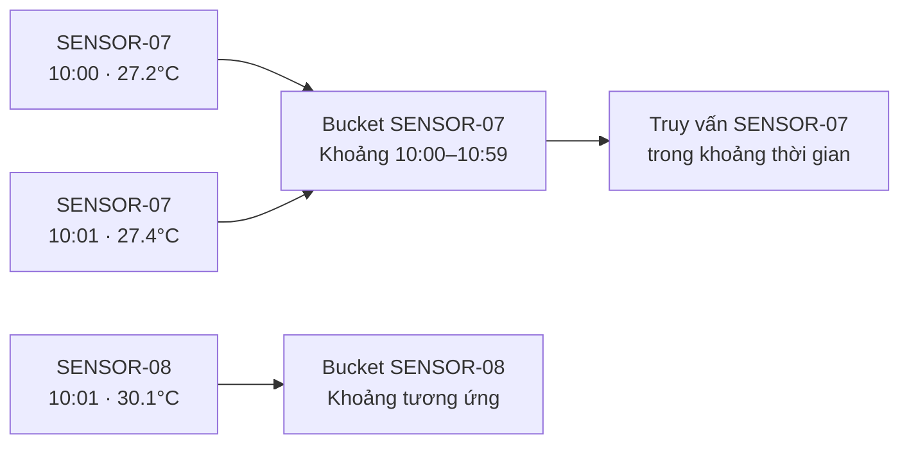

# Khi nào dùng time-series collection cho dữ liệu đo hoặc sự kiện?

Trong **Spring Data MongoDB**, một hệ thống thường phải lưu hai nhóm dữ liệu khác nhau:

- **Trạng thái hiện tại**: hồ sơ khách hàng, đơn hàng, thiết bị đang bật hay tắt. Cùng một document được cập nhật nhiều lần.
- **Quan sát theo thời gian**: nhiệt độ mỗi phút, mức CPU mỗi giây, lưu lượng truy cập, giá cổ phiếu, hoặc một chuỗi sự kiện chỉ bổ sung thêm. Mỗi document mô tả điều xảy ra **tại một thời điểm**.

MongoDB cung cấp **time-series collection** từ phiên bản 5.0 để tối ưu cách lưu và truy vấn nhóm dữ liệu thứ hai. Trong module `SPRING_DATA_MONGODB`, ta có thể dùng `MongoTemplate`, `ReactiveMongoTemplate` hoặc repository để chèn, tìm kiếm và aggregation dữ liệu đo. Tuy nhiên, việc một document có trường thời gian **chưa đủ** để kết luận nên dùng time-series collection: quyết định còn phụ thuộc mô hình ghi, cách truy vấn, độ ổn định của metadata và nhu cầu sửa/xóa sự kiện.

> **Tiêu chí cốt lõi:** Chọn time-series collection khi phần lớn công việc là **ghi thêm nhiều điểm dữ liệu bất biến theo thời gian**, sau đó **lọc theo chuỗi và khoảng thời gian, tổng hợp thống kê hoặc áp dụng thời hạn lưu trữ**. Chọn collection thông thường khi cần CRUD linh hoạt, unique constraint, change stream hoặc transaction ghi cho chính các document đó.

## 1. Time-series collection lưu gì?

Ví dụ một cảm biến đo nhiệt độ trong nhà kho gửi dữ liệu mỗi 30 giây:

```javascript
{
  measuredAt: ISODate("2026-11-20T03:10:00.000Z"),
  sensor: {
    sensorId: "SENSOR-07",
    warehouseId: "WH-HCM-01"
  },
  temperatureC: 27.4,
  humidityPercent: 64,
  batteryPercent: 89
}
```

Document này gồm ba phần:

| Thành phần | Ví dụ | Vai trò |
|---|---|---|
| **`timeField`** | `measuredAt` | Thời điểm đo hoặc thời điểm sự kiện xảy ra; **bắt buộc có giá trị BSON Date** |
| **`metaField`** | `sensor` gồm `sensorId`, `warehouseId` | Mô tả chuỗi dữ liệu; nên tương đối ổn định và thường được dùng làm điều kiện lọc |
| **Các trường đo** | `temperatureC`, `humidityPercent`, `batteryPercent` | Giá trị thay đổi qua các lần đo; không nên nhét vào metadata |

Khi tạo collection, MongoDB được cấu hình tên `timeField`, có thể thêm `metaField` và khoảng thời gian dùng để nhóm dữ liệu (`granularity`). Các tùy chọn này xác định **cấu trúc collection**, không chỉ là cách đặt tên trong Java.

Mỗi phép đo được ghi thành một document mới. Chẳng hạn, cảm biến `SENSOR-07` gửi ba giá trị nhiệt độ ở 10:00, 10:01, 10:02 thì có ba document; hệ thống không liên tục ghi đè một document `SENSOR-07` duy nhất. Nếu chỉ cần giữ **giá trị mới nhất của mỗi cảm biến**, collection thông thường với một document/cảm biến có thể đơn giản và tiết kiệm hơn.

### Vì sao MongoDB gọi là time series?

MongoDB tự nhóm các document có **metadata giống nhau** và **thời điểm gần nhau** vào các *bucket* vật lý, tối ưu việc nén và xử lý truy vấn theo chuỗi thời gian. Ứng dụng vẫn đọc và viết theo tên collection bình thường; nó không phải quản lý trực tiếp các bucket trong `system.buckets`.



Sơ đồ minh họa trường hợp chọn `granularity: "seconds"`, ở đó cửa sổ thời gian của bucket có thể rộng tới một giờ; **một bucket thực tế còn chịu các giới hạn dung lượng và số phép đo**. Không được suy rằng MongoDB sẽ gộp mọi bản ghi của một cảm biến trong giờ vào đúng một bucket, hoặc rằng kích thước mỗi bucket luôn bằng nhau.

## 2. Lúc nào chọn time-series collection?

Có năm tín hiệu tích cực:

1. **Luồng ghi theo thời gian, chủ yếu `insert`.** Cảm biến, metric hoặc sự kiện được ghi vào như lịch sử bất biến; rất ít sửa/xóa từng bản ghi.
2. **Nhiều bản ghi, dữ liệu liên tục tăng.** Hệ thống nhận hàng nghìn điểm đo mỗi phút, cần tối ưu không gian và tốc độ đọc theo thời gian. Lợi ích thực tế tùy kích thước document, cardinality của metadata, độ phân tán thời gian và truy vấn.
3. **Truy vấn có chuỗi và khoảng thời gian.** Ví dụ “nhiệt độ trung bình của `SENSOR-07` trong 24 giờ”, “p95 latency dịch vụ A trong từng 5 phút” hoặc “lưu lượng theo khu vực theo giờ”.
4. **Metadata nhận diện nguồn tương đối ổn định.** Những điểm đo cùng cảm biến/thiết bị/dịch vụ được nhóm hiệu quả; không tạo metadata mới cho từng event.
5. **Có chính sách retention rõ ràng.** Ví dụ lưu raw metrics 30 ngày, tổng hợp ngày 365 ngày; có thể cấu hình `expireAfterSeconds` cho raw collection.

| Dữ liệu thực tế | Mức phù hợp | Giải thích |
|---|---|---|
| Telemetry của thiết bị IoT: nhiệt độ, độ ẩm, điện áp | **Rất phù hợp** | Append-only; truy vấn theo thiết bị và thời gian; có thể TTL dữ liệu cũ |
| Monitoring: CPU, RAM, throughput, response time | **Rất phù hợp** | Nhiều điểm đo, thường xem biểu đồ và tổng hợp theo time window |
| Giá giao dịch/tỷ giá ghi nhận định kỳ | **Phù hợp** | Lưu lịch sử các mẫu đo của từng mã; lưu ý giao dịch sửa/hủy có thể cần nguồn dữ liệu riêng |
| Lượt nhấp/truy cập bất biến để phân tích xu hướng | **Có thể phù hợp** | Nếu mục tiêu là aggregate theo thời gian và ít phải thay đổi/xóa riêng từng event |
| Nhật ký kiểm toán phải bảo toàn, tái phát được từng event | **Chỉ khi đáp ứng yêu cầu bổ sung** | Time series không tự cấp retention vô hạn, unique index hay change stream; cần thiết kế lưu trữ bền vững/đối soát |
| Đơn hàng thường xuyên cập nhật trạng thái, hoàn tiền, hủy | **Không phù hợp** | Cần cập nhật field nghiệp vụ và phát hiện thay đổi CRUD |
| Hồ sơ khách hàng cần tra cứu theo email duy nhất | **Không phù hợp** | Truy vấn điểm và unique constraint quan trọng hơn nhóm theo thời gian |
| Một thiết bị chỉ giữ số đo mới nhất, không cần lịch sử | **Thường không cần** | Một document/cảm biến trong collection thông thường dễ quản lý hơn |

**Dữ liệu “sự kiện” không đồng nghĩa tự động là time series.** Một sự kiện `page_view` chỉ chèn để phân tích có thể phù hợp; một sự kiện `payment_received` cần bảo đảm exactly-once, đối soát, nghiệp vụ huỷ/hoàn và xử lý transaction có thể cần **event log/outbox** thiết kế riêng. Nên xét tính bất biến và cách dùng dữ liệu, không quyết định theo chữ “event” trong tên collection.

## 3. Khác gì với collection thông thường và capped collection?

| Câu hỏi | Time-series collection | Collection thông thường | Capped collection |
|---|---|---|---|
| Mô hình lý tưởng | Nhiều quan sát gần nhau theo thời gian | Entity CRUD và truy vấn đa dạng | Luồng document nối thêm như log có giới hạn dung lượng |
| Cách lưu | Bucket theo `metaField` + thời gian | Document riêng lẻ theo mô hình thông thường | Vòng đệm kích thước cố định |
| Update nghiệp vụ | **Rất hạn chế** | Linh hoạt | Có hạn chế về cập nhật/xóa |
| Xóa dữ liệu cũ | Có retention TTL ở mức bucket | Có thể dùng TTL index hoặc job | Tự loại bản ghi cũ khi đạt giới hạn dung lượng |
| Unique index | **Không hỗ trợ** | Hỗ trợ | Tùy chỉ mục và quy tắc capped |
| Change stream trực tiếp | **Không hỗ trợ** theo tài liệu MongoDB hiện tại | Hỗ trợ khi chạy topology phù hợp | Nên kiểm tra khả năng theo dõi theo phiên bản và mục tiêu; tailable là cách riêng |
| Tailable cursor | Không, vì time series không thể là capped | Không (trừ khi là capped) | Có |
| Phù hợp để sửa/xóa từng record thường xuyên? | Không | Có | Không |

Điều này đặc biệt quan trọng khi hệ thống vừa cần **lịch sử đo** vừa cần **trạng thái hiện tại**. Có thể tách:

- `sensor_readings`: time-series collection cho mọi lần đo.
- `sensors`: collection thông thường cho cấu hình, trạng thái online/offline, ngưỡng cảnh báo, thông tin vị trí.
- `sensor_daily_stats`: kết quả tổng hợp theo ngày, có retention và quyền cập nhật độc lập.

Không cần dồn trạng thái hiện tại và toàn bộ lịch sử vào cùng một collection chỉ để giảm số collection.

## 4. Quyết định `timeField`, `metaField`, `granularity` và retention

### 4.1. `timeField`: thời điểm nào có ý nghĩa?

`timeField` là một trường kiểu **BSON Date**. Trong Java, `Instant` hoặc `java.util.Date` là những lựa chọn tự nhiên khi ánh xạ sang MongoDB.

- **`measuredAt` / `eventAt`:** lúc dữ liệu được đo/sự kiện xảy ra. Hợp lý cho phân tích thời gian thực tế, nhưng thiết bị có thể gửi trễ, gửi dữ liệu quá khứ hoặc sai đồng hồ.
- **`ingestedAt`:** lúc server nhận thông điệp. Dễ vận hành theo tốc độ ingest, nhưng các phân tích “thời gian đo thực” phải giữ `measuredAt` ở field khác và có thể không tận dụng bucket pruning theo event-time tốt bằng.

Với TTL, tuổi của dữ liệu được tính từ **`timeField` đã cấu hình**, không mặc nhiên tính từ lúc insert. Một document mang timestamp của 40 ngày trước có thể bị coi là hết hạn ngay khi chèn vào collection có TTL 30 ngày; việc xóa thực tế diễn ra bất đồng bộ. Nên xác định rõ cách xử lý *late arrivals* trước khi chọn field.

### 4.2. `metaField`: định danh một chuỗi, càng ổn định càng tốt

Tốt:

```javascript
{
  sensor: { sensorId: "SENSOR-07", warehouseId: "WH-HCM-01" },
  measuredAt: ISODate("2026-11-20T03:10:00Z"),
  temperatureC: 27.4,
  humidityPercent: 64
}
```

Không tốt nếu metadata thay đổi ở mọi bản ghi:

```javascript
{
  sensor: {
    sensorId: "SENSOR-07",
    uniqueEventId: "evt-9e8f2",  // Mỗi lần đo lại tạo chuỗi metadata mới
    temperatureC: 27.4           // Giá trị đo luôn thay đổi
  },
  measuredAt: ISODate("2026-11-20T03:10:00Z")
}
```

MongoDB gom các điểm đo có giá trị `metaField` **trùng nhau** vào bucket phù hợp. Đưa `requestId`, `eventId`, timestamp hoặc giá trị đo biến thiên vào metadata gây **cardinality cao**, phát sinh nhiều bucket thưa, giảm hiệu quả nén và truy vấn. Metadata có thể là object; trong bộ lọc, nên dùng đường dẫn trường con như `"sensor.sensorId"` thay vì so cả object khi không cần.

**Phân biệt:** `sensorId` có nhiều giá trị khác nhau không nhất thiết là sai. Điều đáng quan tâm là số chuỗi đang hoạt động đồng thời, tần suất mỗi chuỗi được ghi và mức độ metadata thay đổi giữa các điểm đo. Hãy benchmark với workload thật.

### 4.3. `granularity`: khoảng gom bucket, không phải định dạng hiển thị

MongoDB hỗ trợ ba mức phổ biến:

| Tùy chọn | Khoảng bucket tối đa theo cấu hình mặc định | Ví dụ phù hợp |
|---|---|---|
| `seconds` | Khoảng 1 giờ | Điểm đo dày, khoảng cách giây hoặc phút |
| `minutes` | Khoảng 24 giờ | Điểm đo thưa hơn, vài chục phút hoặc giờ |
| `hours` | Khoảng 30 ngày | Điểm đo rất thưa, chẳng hạn vài lần mỗi ngày |

Đây là khoảng tối đa theo chính sách bucket, không phải lời hứa mọi document sẽ nằm cùng bucket suốt khoảng đó. MongoDB còn đóng bucket do giới hạn dung lượng, số document hoặc điều kiện vận hành. Chọn `granularity` theo **khoảng cách thời gian giữa các phép đo của cùng chuỗi**, pattern truy vấn và retention, thay vì theo đơn vị hiển thị trên biểu đồ.

Từ MongoDB 6.3, có thể dùng cặp `bucketMaxSpanSeconds` và `bucketRoundingSeconds` để tùy chỉnh thời gian bucket. **Hai giá trị phải bằng nhau** và không dùng cùng `granularity` khi tạo collection. Sau khi tạo, các mức bucket chỉ được nới rộng theo các điều kiện MongoDB hỗ trợ, không tùy ý thu hẹp; cần thử trước với dữ liệu mẫu.

### 4.4. `expireAfterSeconds`: tự xóa nhưng không đúng chính xác đến từng giây

Ví dụ retention 30 ngày: `expireAfterSeconds: 2592000`. MongoDB xóa **bucket** khi các document trong bucket đủ điều kiện hết hạn, thông qua tác vụ nền. Vì thế một document đã quá hạn có thể vẫn tồn tại cho tới khi bucket đủ điều kiện và tác vụ TTL thực thi. Không sử dụng TTL như bộ hẹn giờ nghiệp vụ có cam kết xóa tại đúng thời điểm.

Nếu cần dữ liệu raw chỉ giữ 30 ngày nhưng biểu đồ năm phải tiếp tục xem được, hãy tạo **bảng tổng hợp trước khi dữ liệu raw hết hạn**. Quy tắc retention phải tính cả dữ liệu gửi trễ và quá trình backfill.

## 5. Ví dụ với mongosh: tạo, ghi, lọc và tổng hợp

Giả sử một nhà kho gửi điểm đo mỗi 30 giây. Ta tạo collection đúng kiểu ngay từ đầu:

```javascript
// Chạy một lần trong bước khởi tạo database, trước khi insert.
db.createCollection("sensor_readings", {
  timeseries: {
    timeField: "measuredAt",
    metaField: "sensor",
    granularity: "seconds"
  },
  expireAfterSeconds: 30 * 24 * 60 * 60
});

// Dùng để xác nhận collection có type "timeseries" và cấu hình đúng.
db.getCollectionInfos({ name: "sensor_readings" });
```

**Lưu ý triển khai:** `createCollection` sẽ lỗi nếu collection đã tồn tại. Bước migration/startup cần kiểm tra cấu hình đã tồn tại, phát hiện khác biệt và báo lỗi rõ ràng. Collection thông thường đã có từ trước **không thể đổi tại chỗ** sang time-series collection; cần lập kế hoạch tạo collection mới và di chuyển dữ liệu. `timeField` và `metaField` không được đổi tên sau khi tạo.

Chèn thử ba phép đo (thời điểm trong ví dụ chỉ để minh họa; khi thử TTL hãy dùng thời điểm hiện tại):

```javascript
db.sensor_readings.insertMany([
  {
    measuredAt: ISODate("2026-11-20T03:00:00.000Z"),
    sensor: { sensorId: "SENSOR-07", warehouseId: "WH-HCM-01" },
    temperatureC: 27.2, humidityPercent: 63
  },
  {
    measuredAt: ISODate("2026-11-20T03:00:30.000Z"),
    sensor: { sensorId: "SENSOR-07", warehouseId: "WH-HCM-01" },
    temperatureC: 27.4, humidityPercent: 64
  },
  {
    measuredAt: ISODate("2026-11-20T03:00:30.000Z"),
    sensor: { sensorId: "SENSOR-08", warehouseId: "WH-HCM-01" },
    temperatureC: 29.3, humidityPercent: 57
  }
]);
```

Truy vấn theo đúng **metadata + khoảng thời gian**:

```javascript
db.sensor_readings.find({
  "sensor.sensorId": "SENSOR-07",
  measuredAt: {
    $gte: ISODate("2026-11-20T03:00:00.000Z"),
    $lt: ISODate("2026-11-20T04:00:00.000Z")
  }
}).sort({ measuredAt: 1 });
```

Tổng hợp nhiệt độ trung bình theo cửa sổ 5 phút:

```javascript
db.sensor_readings.aggregate([
  {
    $match: {
      "sensor.sensorId": "SENSOR-07",
      measuredAt: {
        $gte: ISODate("2026-11-20T03:00:00.000Z"),
        $lt: ISODate("2026-11-20T04:00:00.000Z")
      }
    }
  },
  {
    $group: {
      _id: {
        $dateTrunc: { date: "$measuredAt", unit: "minute", binSize: 5 }
      },
      samples: { $sum: 1 },
      avgTemperatureC: { $avg: "$temperatureC" },
      minTemperatureC: { $min: "$temperatureC" },
      maxTemperatureC: { $max: "$temperatureC" }
    }
  },
  { $sort: { _id: 1 } }
]);
```

Nên dùng khoảng thời gian nửa mở `[$gte, $lt)` để các cửa sổ liền kề không đếm lặp ở ranh giới. `$dateTrunc` thực hiện gom theo năm/tháng/ngày/giờ/phút, còn lựa chọn timezone phải thống nhất với báo cáo nghiệp vụ. Kết quả `$group` trong ví dụ trả số mẫu và các thống kê của mỗi khoảng 5 phút, không cập nhật dữ liệu raw.

Để đánh giá hiệu năng, so sánh truy vấn có và không có `"sensor.sensorId"`, xem `explain("executionStats")` trên dữ liệu đủ lớn và theo dõi thời gian xử lý thực tế. Index compound `metaField + timeField` được MongoDB tạo mặc định cho các phiên bản hỗ trợ khi khai báo metadata; **không mặc định có unique index trên `_id`** như collection thường. Việc thêm index phụ phải dựa trên query pattern và ràng buộc của phiên bản MongoDB đang chạy.

## 6. Dùng Spring Data MongoDB: mapping và khởi tạo collection

Trong Spring Data MongoDB, có thể đánh dấu entity bằng `@TimeSeries`. Ví dụ sau dùng Java record để mô hình hóa một mẫu đo:

```java
import java.time.Instant;
import org.springframework.data.mongodb.core.mapping.TimeSeries;

@TimeSeries(
    collection = "sensor_readings",
    timeField = "measuredAt",
    metaField = "sensor",
    expireAfter = "30d"
)
public record SensorReading(
    Instant measuredAt,
    SensorMetadata sensor,
    double temperatureC,
    double humidityPercent
) {}

record SensorMetadata(String sensorId, String warehouseId) {}
```

`@TimeSeries` xác định `timeField`, `metaField` và collection đích trong metadata mapping của Spring Data. Thuộc tính `expireAfter` thuộc các phiên bản Spring Data MongoDB có hỗ trợ (API mới công bố từ 4.4); nếu ứng dụng đang dùng phiên bản cũ, hãy cấu hình TTL khi tạo collection bằng MongoDB/migration tương thích thay vì sao chép annotation này nguyên xi.

**Quan trọng:** annotation chỉ mô tả collection; collection vẫn cần được **tạo với time-series options trước lần ghi đầu tiên**. Theo tài liệu Spring Data MongoDB, `MongoTemplate.createCollection(Entity.class)` lấy cấu hình từ `@TimeSeries`:

```java
import org.springframework.data.mongodb.core.MongoTemplate;

// Ví dụ chạy trong migration/init một lần trước khi ghi.
public void createSensorCollection(MongoTemplate template) {
    if (!template.collectionExists(SensorReading.class)) {
        template.createCollection(SensorReading.class);
    }
}
```

Trong hệ thống nhiều instance, kiểm tra `collectionExists` rồi mới `createCollection` vẫn có race condition; quản lý migration tập trung, hoặc xác minh sau lỗi “already exists” rằng cấu hình thực tế phù hợp. Đừng để lần `save()` đầu tự tạo ra collection thường do chưa khởi tạo đúng.

Chèn điểm đo và truy vấn bằng `MongoTemplate`:

```java
import java.time.Instant;
import java.time.temporal.ChronoUnit;
import java.util.List;
import org.springframework.data.domain.Sort;
import org.springframework.data.mongodb.core.MongoTemplate;
import org.springframework.data.mongodb.core.query.Criteria;
import org.springframework.data.mongodb.core.query.Query;

// Ví dụ bên trong service có MongoTemplate template đã được tiêm.
Instant now = Instant.now();

template.insert(new SensorReading(
    now,
    new SensorMetadata("SENSOR-07", "WH-HCM-01"),
    27.4,
    64.0
));

Query query = new Query(Criteria.where("sensor.sensorId").is("SENSOR-07")
    .and("measuredAt")
    .gte(now.minus(1, ChronoUnit.HOURS))
    .lt(now.plus(1, ChronoUnit.SECONDS)));
query.with(Sort.by(Sort.Direction.ASC, "measuredAt"));

List<SensorReading> recent = template.find(query, SensorReading.class);
```

`ReactiveMongoTemplate` cung cấp cách làm tương đương theo reactive API; cần **subscribe/chain publisher** của lệnh tạo collection và lệnh đọc/ghi. Ví dụ:

```java
import java.time.Instant;
import reactor.core.publisher.Mono;

// template là ReactiveMongoTemplate, thực hiện trong pipeline được quản lý.
Mono<Void> initialize = template.createCollection(SensorReading.class).then();

Mono<SensorReading> inserted = template.insert(new SensorReading(
    Instant.now(),
    new SensorMetadata("SENSOR-07", "WH-HCM-01"),
    27.4, 64.0
));
```

Hai publisher trên chỉ là ví dụ API. Trong ứng dụng thật, chỉ chạy `createCollection` khi migration yêu cầu; dùng `initialize.then(inserted)` hoặc một bước startup có thứ tự và xử lý lỗi. Không gọi tạo collection mỗi lần ingest.

Nếu dùng repository, các phương thức `findBy...`, truy vấn khoảng thời gian và projection có thể hữu ích. Nhưng **repository không bỏ qua giới hạn cập nhật, index hay transaction của time-series collection**; các thao tác domain như `save()` để cập nhật record cũ hoặc upsert theo `_id` không mặc nhiên phù hợp. Với dữ liệu đo, ưu tiên `insert`; nếu cần chống trùng event, dùng cơ chế định danh/đối soát ở tầng ingest.

## 7. Các giới hạn phải kiểm tra trước khi quyết định

### 7.1. Không xử lý CRUD giống collection thông thường

Theo tài liệu MongoDB về time-series limitations, update chỉ được phép trong phạm vi rất hẹp: bộ lọc phải dựa vào `metaField`, chỉ sửa được giá trị `metaField`, dùng update operator, thực hiện nhiều bản ghi (`multi: true`) và không upsert. Không thiết kế luồng nghiệp vụ dựa vào việc sửa `temperatureC`, `measuredAt` hoặc thay document mỗi khi cần hiệu chỉnh số đo.

Với dữ liệu bị hiệu chỉnh sau khi ghi, cân nhắc một trong các cách:

- Ghi thêm **mẫu hiệu chỉnh** có quan hệ đến mẫu gốc và tính quy tắc áp dụng khi truy vấn.
- Ghi nguồn raw bất biến vào time series, còn trạng thái đã hiệu chỉnh vào collection thông thường/projection.
- Nếu sửa/xóa tự do trên từng document là nghiệp vụ chính, chọn collection thông thường từ đầu.

Xóa trực tiếp và các tính năng phụ trợ có hành vi, giới hạn thay đổi theo phiên bản MongoDB; hãy xác nhận yêu cầu phiên bản khi thiết kế purge/repair. Đừng dùng `deleteMany` tùy tiện thay cho retention TTL nếu mục đích chỉ là dọn dữ liệu cũ.

### 7.2. Những tính năng có thể là điều kiện loại trừ

Trong tài liệu MongoDB hiện hành, time-series collection có các ràng buộc đáng chú ý:

| Nhu cầu | Điều cần biết |
|---|---|
| Xử lý trực tiếp `changeStream()` trên chính collection đo | **Không hỗ trợ**. Nếu cần CDC, dùng pipeline ingest/broker hoặc nguồn sự kiện song song |
| Ghi time-series trong multi-document transaction | **Không hỗ trợ ghi**; đọc trong transaction được hỗ trợ theo điều kiện MongoDB |
| Unique index để bảo đảm mỗi `sensorId + measuredAt` chỉ tồn tại một điểm | **Không hỗ trợ unique index**. Phải xử lý dedup phía ingestion hoặc thiết kế khóa riêng |
| Dùng time series như capped collection và tailable cursor | **Không thể là capped collection** |
| Tạo schema validation trực tiếp trên collection | **Không hỗ trợ** theo tài liệu hiện hành; validate ở application/ingest |
| Truy vấn MongoDB Search trực tiếp trên time series | **Không hỗ trợ** theo tài liệu hiện hành |
| Dùng `$merge` để ghi vào time-series collection | Không hỗ trợ `$merge` làm đích; có thể xem xét `$out` theo điều kiện MongoDB |
| Chuyển collection thường có sẵn sang time series tại chỗ | **Không hỗ trợ**; cần tạo collection khác và migrate |
| Dùng `_id` như điểm truy vấn được index sẵn | Không có index `_id` mặc định như collection thường; cần kiểm tra index/phiên bản nếu có nhu cầu này |

Giới hạn tính năng có thể thay đổi giữa các phiên bản. Khi xây dựng hệ thống thực tế, kiểm tra **MongoDB server version, feature compatibility version (FCV) và Spring Data MongoDB version** thay vì suy từ annotation hoặc chỉ từ phiên bản driver.

### 7.3. Những trường hợp làm lợi thế bị triệt tiêu

- **Cardinality metadata quá cao:** mỗi record một metadata khác nhau tạo nhiều bucket thưa.
- **Gửi dữ liệu trễ rất nhiều hoặc backfill rải nhiều năm:** dữ liệu khó tập trung vào bucket mở, tạo chi phí ghi/đọc khác dự kiến.
- **Đọc theo khóa không liên quan metadata và thời gian:** có thể phải quét lớn; collection thường với index chuyên biệt có thể tốt hơn.
- **Ghi ít và không tổng hợp:** chi phí quản trị mô hình mới có thể lớn hơn lợi ích.
- **Yêu cầu sửa/xóa hoặc xác thực tính duy nhất mạnh:** giới hạn tính năng sẽ trở thành rủi ro nghiệp vụ.
- **Giữ dữ liệu theo hạn riêng từng tenant/sự kiện:** TTL ở mức collection hoặc tính năng TTL riêng theo metadata (tùy phiên bản) phải được xác nhận; không mặc nhiên đáp ứng mọi chính sách.

Time-series collection có thể giúp giảm kích thước dữ liệu và cải thiện một số truy vấn, nhưng **không bảo đảm mọi truy vấn nhanh hơn**. Cần benchmark trên số lượng cảm biến, tần suất ghi, phân bố metadata và vùng thời gian đúng với production.

## 8. Checklist thiết kế và bài thực hành

Trước khi đưa time-series collection vào hệ thống, hãy trả lời:

1. **Mục đích đọc là gì?** Biểu đồ theo thời gian, aggregation theo khoảng, phát hiện xu hướng, hay tra cứu/sửa một record cụ thể?
2. **Dữ liệu có append-only không?** Các lần hiệu chỉnh, hủy, dedup được xử lý thế nào?
3. **Dùng thời gian sự kiện hay thời gian ingest?** Điều gì xảy ra nếu đồng hồ cảm biến sai hoặc event đến muộn?
4. **`metaField` xác định một chuỗi ổn định không?** Có giá trị nào thay đổi liên tục làm bucket thưa?
5. **Tần suất đo là bao nhiêu?** Chọn `granularity` phù hợp, đo thử với phân bố thực tế.
6. **Retention bao lâu?** TTL có chấp nhận độ trễ không; phải tổng hợp/lưu dữ liệu dài hạn như thế nào?
7. **Có cần transaction ghi, change stream, unique index hoặc update tự do không?** Nếu có, cân nhắc collection thông thường hay kiến trúc bổ trợ.
8. **Đo hiệu năng bằng gì?** Tốc độ ingest, p95/p99 query latency, kích thước lưu trữ, số bucket, độ trễ truy vấn theo sensor/time và chi phí index.

### Bài thực hành A — Đo và truy vấn

Tạo `sensor_readings` với `granularity: "seconds"`, `metaField: "sensor"`. Sinh dữ liệu cho 100 cảm biến, mỗi cảm biến gửi 1 điểm mỗi phút trong 7 ngày. Thử truy vấn của một cảm biến trong 24 giờ và aggregation 5 phút. Đối chiếu `explain`, kích thước lưu trữ và thời gian xử lý với collection thông thường cùng dữ liệu, cùng chỉ mục truy vấn thích hợp.

### Bài thực hành B — Thử mô hình metadata

Lặp lại workload A nhưng thêm một `uniqueEventId` thay đổi ở mỗi lần đo vào **`metaField`**. Đo mức thay đổi số bucket, dung lượng và độ trễ. Sau đó chuyển `uniqueEventId` về trường thường. Giải thích vì sao metadata ổn định tác động mạnh tới hiệu quả bucketing.

### Bài thực hành C — Retention và event đến muộn

Tạo collection có TTL ngắn trong môi trường thử nghiệm. Chèn một document có `measuredAt` là thời gian hiện tại và một document có `measuredAt` rất cũ. Quan sát hành vi xóa bất đồng bộ theo bucket; đừng đòi hỏi đúng từng giây. Sau đó viết quy tắc từ chối/sắp xếp lại backfill và kiến trúc tổng hợp dữ liệu trước khi raw hết hạn.

### Tình huống quyết định

Một ứng dụng có hai yêu cầu: (1) lưu nhiệt độ từ 20.000 cảm biến mỗi phút trong 90 ngày để vẽ đồ thị, (2) nhận sự kiện thay đổi trạng thái cảm biến từ `ACTIVE` sang `DISABLED` để khóa thiết bị ngay. Có nên đưa tất cả vào một time-series collection?

**Lời giải gợi ý:** Dùng time-series collection cho lịch sử đo theo `sensorId` + `measuredAt` và retention 90 ngày. Lưu trạng thái `ACTIVE`/`DISABLED` trong collection thường; cần phản ứng với cập nhật trạng thái thì dùng change stream trên collection thường khi MongoDB chạy replica set/sharded cluster, hoặc phát sự kiện qua broker. Việc tách này phù hợp ngữ nghĩa dữ liệu và tránh đòi hỏi change stream từ time-series collection.

## Tài liệu tham khảo

- [MongoDB — About Time Series Data / Bucketing](https://www.mongodb.com/docs/manual/core/timeseries/timeseries-bucketing/)
- [MongoDB — Create and Query a Time Series Collection](https://www.mongodb.com/docs/manual/core/timeseries/timeseries-procedures/)
- [MongoDB — Time Series Collection Limitations](https://www.mongodb.com/docs/manual/core/timeseries/timeseries-limitations/)
- [MongoDB — Set Granularity for Time Series Data](https://www.mongodb.com/docs/manual/core/timeseries/timeseries-granularity/)
- [MongoDB — Set up Automatic Removal (TTL)](https://www.mongodb.com/docs/manual/core/timeseries/timeseries-automatic-removal/)
- [Spring Data MongoDB — Index and Collection Management, Time Series](https://docs.spring.io/spring-data/mongodb/reference/mongodb/template-collection-management.html)
- [Spring Data MongoDB — @TimeSeries API](https://docs.spring.io/spring-data/mongodb/docs/current/api/org/springframework/data/mongodb/core/mapping/TimeSeries.html)

**Kết luận:** `timeField` cho biết **khi nào**, `metaField` cho biết **thuộc chuỗi nào**, còn các trường đo cho biết **giá trị gì**. Khi hệ thống lưu rất nhiều quan sát bất biến và cần phân tích chúng theo khoảng thời gian, time-series collection là một lựa chọn đáng thử. Nếu chức năng trọng tâm là thay đổi trạng thái document hoặc bảo đảm tính duy nhất, nên ưu tiên collection thông thường và thiết kế luồng sự kiện riêng khi cần.
