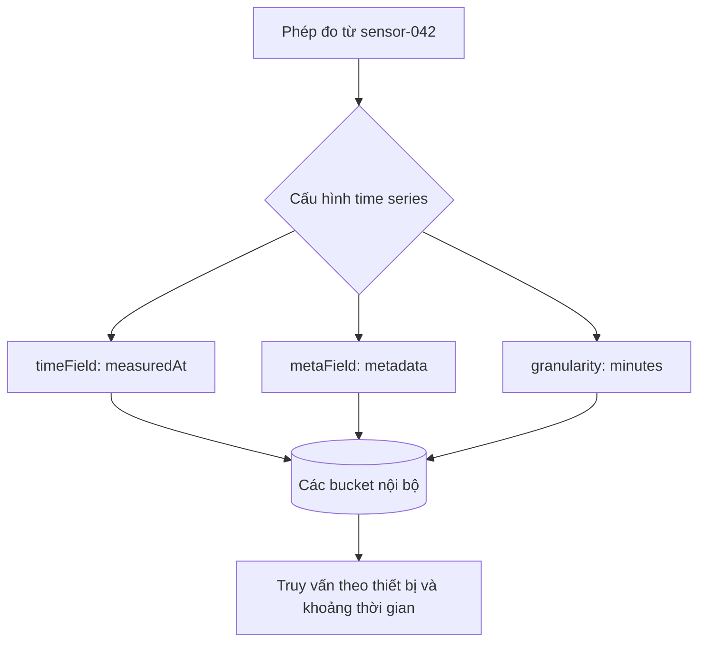

# Chọn `timeField`, `metaField` và `granularity` cho time series trong MongoDB

## Mục tiêu bài học

Khi xây dựng ứng dụng Spring Data MongoDB cho dữ liệu cảm biến, giá sản phẩm theo thời gian, telemetry hoặc nhật ký đo lường, việc chọn đúng ba cấu hình **`timeField`, `metaField` và `granularity`** quyết định cách MongoDB tổ chức dữ liệu trong *time series collection*. Ba lựa chọn này ảnh hưởng đến số lượng bucket, khả năng nén, hiệu quả truy vấn và chi phí vận hành.

Sau bài học, bạn có thể:

- Phân biệt thời điểm phát sinh sự kiện với thời điểm hệ thống nhận dữ liệu và chọn một trường ngày giờ hợp lệ làm `timeField`.
- Chọn thông tin nhận diện nguồn đo ổn định làm `metaField` để các phép đo liên quan có cơ hội được gom vào cùng nhóm bucket.
- Chọn `granularity` theo nhịp lấy mẫu của **từng chuỗi dữ liệu**, hiểu đây là gợi ý tổ chức bucket chứ không phải phép làm tròn thời gian hoặc lịch lấy mẫu.
- Tạo collection trong MongoDB, ánh xạ document với Spring Data MongoDB, truy vấn và kiểm tra cấu hình đã dùng.

## 1. Bài toán: nhiều phép đo của cùng một thiết bị

Giả sử có 5.000 cảm biến, mỗi thiết bị gửi nhiệt độ và độ ẩm một lần mỗi năm phút. Mỗi bản ghi thể hiện **một phép đo tại một thời điểm**, với nhận diện thiết bị và vị trí lắp đặt:

```javascript
{
  measuredAt: ISODate("2026-11-20T09:00:00Z"),
  metadata: {
    deviceId: "sensor-042",
    siteId: "warehouse-a"
  },
  temperatureC: 26.4,
  humidityPct: 61.2
}
```

Các phép đo tiếp theo có `measuredAt` và chỉ số mới, trong khi `metadata` thường giữ nguyên:

| Trường | Thay đổi theo từng lần đo? | Vai trò |
| --- | --- | --- |
| `measuredAt` | Có | Thời điểm thực tế của phép đo, dùng làm `timeField`. |
| `metadata.deviceId` | Thường không | Xác định cảm biến sinh dữ liệu. |
| `metadata.siteId` | Ít thay đổi | Thông tin về địa điểm/nhóm thiết bị. |
| `temperatureC`, `humidityPct` | Có | Các giá trị đo, không phù hợp làm metadata cố định. |

MongoDB time series tối ưu cách lưu các phép đo theo **khoảng thời gian** và **giá trị metadata**. Dữ liệu vẫn được truy vấn như các document riêng lẻ, còn MongoDB quản lý các bucket nội bộ để chứa nhiều phép đo. Không cần tự tạo hay chỉnh sửa collection bucket.



## 2. Chọn `timeField`: thời điểm nào đại diện cho phép đo?

`timeField` là **tên trường cấp cao nhất** của mỗi document chứa thời điểm đo. Giá trị của trường này phải là BSON `Date`. Khi khai báo `timeField: "measuredAt"`, document hợp lệ cần có một `measuredAt` dạng ngày giờ, ví dụ `ISODate(...)`.

### Thời gian sự kiện và thời gian nhận dữ liệu

Trong hệ thống có hàng đợi hoặc thiết bị offline, hai thời điểm có thể khác nhau:

| Loại thời gian | Ví dụ | Khi nào dùng |
| --- | --- | --- |
| *Event time* (`measuredAt`) | Cảm biến đo lúc 09:00 UTC. | Phân tích diễn biến vật lý, biểu đồ, tổng hợp theo lúc thực sự đo. |
| *Ingestion time* (`receivedAt`) | Server nhận bản tin lúc 09:07 UTC. | Theo dõi độ trễ, xử lý dữ liệu đến muộn, giám sát pipeline. |

Đối với chuỗi nhiệt độ, **ưu tiên `measuredAt` làm `timeField`** vì đó là mốc thời gian người dùng muốn phân tích. Vẫn có thể lưu `receivedAt` như một trường đo phụ để tính độ trễ. Nếu nghiệp vụ quan tâm đến tải hệ thống theo thời điểm nhận request, thời gian nhận có thể mới là lựa chọn phù hợp.

Ví dụ một phép đo tới muộn nhưng vẫn giữ thời điểm gốc:

```javascript
{
  measuredAt: ISODate("2026-11-20T09:00:00Z"),
  receivedAt: ISODate("2026-11-20T09:07:12Z"),
  metadata: { deviceId: "sensor-042", siteId: "warehouse-a" },
  temperatureC: 26.4
}
```

### Quy tắc chọn `timeField`

1. **Dùng BSON `Date`, không dùng chuỗi hay số nguyên.** `"2026-11-20T09:00:00Z"` là chuỗi, không thay thế được `ISODate(...)` khi ghi trực tiếp qua `mongosh`.
2. **Giữ trường ở cấp cao nhất.** Nếu tạo collection với `timeField: "measuredAt"` thì trường thời gian phải ở `measuredAt`, không đặt bên trong `metadata.measuredAt`.
3. **Thống nhất cách hiểu múi giờ.** BSON `Date` lưu mốc thời gian dưới dạng UTC; chuyển đổi timezone khi hiển thị hoặc phân tích theo giờ địa phương.
4. **Kiểm tra đồng hồ thiết bị.** Thời điểm quá xa trong quá khứ/tương lai do thiết bị sai giờ có thể làm phát sinh những bucket không mong muốn.
5. **Không tự ghi đè thời điểm gốc bằng thời gian server** chỉ vì bản tin tới muộn; hãy tách `receivedAt` nếu cần theo dõi trễ.

Chọn tên `timeField` ngay từ thiết kế ban đầu. Các tùy chọn tạo time series và cấu trúc lưu trữ có những giới hạn thay đổi; việc đổi mô hình trường thời gian thường cần tạo collection mới và di chuyển dữ liệu.

## 3. Chọn `metaField`: điều gì xác định một chuỗi?

`metaField` là **tên một trường cấp cao nhất, tùy chọn**, chứa thông tin mô tả nguồn dữ liệu. Trường đó có thể là một giá trị đơn hoặc một document lồng các thuộc tính. Khi dùng `metaField: "metadata"`:

```javascript
metadata: {
  deviceId: "sensor-042",
  siteId: "warehouse-a"
}
```

MongoDB có thể tổ chức những phép đo có **giá trị metadata tương ứng** vào các bucket thích hợp theo thời gian. Vì thế, metadata nên **ổn định** qua nhiều lần đo của cùng nguồn. Một lựa chọn khác là dùng trường đơn `deviceId` làm `metaField` khi chỉ cần định danh thiết bị; khi cần nhiều thuộc tính ổn định để lọc, document `metadata` thường linh hoạt hơn.

### Nên và không nên đặt gì vào metadata?

| Thuộc tính | Đề xuất | Lý do |
| --- | --- | --- |
| `deviceId` | Nên | Định danh nguồn đo; thường ổn định theo chuỗi. |
| `siteId` / `machineId` | Có thể | Hữu ích nếu ổn định và thường được dùng để lọc. |
| `sensorType` | Có thể | Phù hợp khi loại cảm biến cố định. |
| `temperatureC` | Không | Thay đổi theo mỗi phép đo, làm mất tính ổn định của metadata. |
| `batteryPct`, `signalStrength` | Không | Là giá trị đo vận hành, thay đổi thường xuyên. |
| `requestId` ngẫu nhiên | Không | Mỗi bản ghi có metadata riêng, giảm cơ hội gom phép đo. |
| `receivedAt` | Không | Phản ánh thời điểm đến của từng bản ghi, không mô tả nguồn đo. |

**Điểm cần cân nhắc:** `siteId` tưởng như ổn định nhưng có thể thay đổi khi di chuyển cảm biến. Nếu đưa `siteId` vào `metadata`, giá trị metadata sẽ đổi khi thiết bị chuyển nơi, và phép đo có thể được tổ chức vào nhóm bucket khác. Đây có thể là ý nghĩa nghiệp vụ mong muốn (phân tích theo nơi lắp đặt), hoặc là chi phí không cần thiết. Nếu địa điểm đổi liên tục, cân nhắc giữ `metadata` chỉ gồm định danh bền vững và lưu địa điểm như thông tin của từng phép đo/tra cứu ngoài.

### Metadata và tính chọn lọc của truy vấn

Giả sử phần lớn truy vấn có dạng “lấy 100 phép đo gần nhất của `sensor-042`”. Một cấu trúc phù hợp là:

```javascript
db.sensor_readings.find({
  "metadata.deviceId": "sensor-042",
  measuredAt: {
    $gte: ISODate("2026-11-20T00:00:00Z"),
    $lt: ISODate("2026-11-21T00:00:00Z")
  }
}).sort({ measuredAt: -1 }).limit(100);
```

Cặp điều kiện **thiết bị + khoảng thời gian** thường là nền tảng thiết kế truy vấn cho chuỗi đo. Không nên mặc định rằng metadata tự tạo đủ index cho mọi truy vấn; phải xem kế hoạch thực thi và tạo index phù hợp với phiên bản MongoDB cùng tải thực tế.

## 4. Chọn `granularity`: mức độ chi tiết khi tạo bucket

`granularity` mô tả **tần suất dự kiến của dữ liệu** để MongoDB lựa chọn cách tổ chức khoảng thời gian cho bucket. Các giá trị hợp lệ là:

| Giá trị | Dữ liệu thường gặp | Ví dụ |
| --- | --- | --- |
| `"seconds"` | Được đo cách nhau vài giây hoặc ngắn hơn vài phút. | Telemetry ghi mỗi 2 giây, độ rung máy mỗi 10 giây. |
| `"minutes"` | Được đo cách nhau vài phút. | Nhiệt độ kho mỗi 5 phút, điện năng mỗi 15 phút. |
| `"hours"` | Được đo cách nhau vài giờ. | Chỉ số môi trường mỗi 6 giờ, tổng công suất theo chu kỳ giờ. |

Với cảm biến đo **5 phút/lần**, `granularity: "minutes"` là điểm khởi đầu hợp lý. Nếu cùng thiết bị gửi mỗi 3 giây, dùng `"seconds"`; nếu chỉ đo một lần mỗi 12 giờ, cân nhắc `"hours"`.

Hai hiểu nhầm cần tránh:

- **`granularity` không làm tròn timestamp.** Bản ghi có `measuredAt = 09:05:17.250Z` vẫn giữ mốc đó; `"minutes"` không biến nó thành 09:05:00Z.
- **`granularity` không tự lấy mẫu hay tổng hợp dữ liệu.** Muốn chuyển chuỗi 5 phút thành báo cáo theo giờ, cần aggregation, ví dụ `$dateTrunc` hoặc `$dateToString`/`$group` tùy yêu cầu; lựa chọn `granularity` không tạo các dòng tổng hợp.

### Cách ra quyết định

1. Xác định **một nguồn dữ liệu tương ứng với một giá trị metadata** và khoảng thời gian điển hình giữa hai phép đo của nguồn đó.
2. Chọn `seconds`, `minutes` hoặc `hours` theo khoảng cách thời gian đó; nếu nhịp đo thay đổi mạnh, xem xét từng loại nguồn có cần collection riêng không.
3. Đo hiệu năng ghi, kích thước lưu trữ và truy vấn trong điều kiện thực tế thay vì chọn theo tên trường hoặc độ chính xác timestamp.
4. Xác nhận phiên bản MongoDB trước khi điều chỉnh tham số bucket. Một số phiên bản hỗ trợ tăng granularity theo chiều `seconds → minutes → hours`, nhưng có ràng buộc và không nên giả định có thể giảm ngược dễ dàng.

Khi không khai báo `granularity`, MongoDB sử dụng giá trị mặc định `"seconds"`. Hãy chỉ định rõ nếu đã biết nhịp lấy mẫu và muốn cấu hình dễ đọc, dễ kiểm chứng.

## 5. Tạo time series collection bằng `mongosh`

Tạo collection **trước khi ứng dụng ghi bản ghi đầu tiên**. Ví dụ chọn `measuredAt` làm trường thời gian, `metadata` chứa định danh thiết bị và `minutes` cho dữ liệu gửi mỗi năm phút:

```javascript
db.createCollection("sensor_readings", {
  timeseries: {
    timeField: "measuredAt",
    metaField: "metadata",
    granularity: "minutes"
  }
});
```

Chèn hai phép đo:

```javascript
db.sensor_readings.insertMany([
  {
    measuredAt: ISODate("2026-11-20T09:00:00Z"),
    metadata: { deviceId: "sensor-042", siteId: "warehouse-a" },
    temperatureC: 26.4,
    humidityPct: 61.2
  },
  {
    measuredAt: ISODate("2026-11-20T09:05:00Z"),
    metadata: { deviceId: "sensor-042", siteId: "warehouse-a" },
    temperatureC: 26.7,
    humidityPct: 60.8
  }
]);
```

Để xác minh collection là time series và ba tùy chọn đã được áp dụng:

```javascript
db.getCollectionInfos({ name: "sensor_readings" })[0].options.timeseries;
```

Kết quả dự kiến có ba trường đã khai báo (MongoDB có thể bổ sung hoặc trình bày thêm tùy phiên bản):

```javascript
{
  timeField: "measuredAt",
  metaField: "metadata",
  granularity: "minutes"
}
```

**Tránh lỗi tạo nhầm collection thông thường:** Nếu ứng dụng gọi `insert` khi `sensor_readings` chưa tồn tại, MongoDB có thể tự tạo một collection thông thường. Gắn `@Document` trong Java chỉ định tên collection để ánh xạ, **không tự bảo đảm** collection thực tế là time series. Vì vậy nên tạo bằng migration/khâu khởi tạo cơ sở dữ liệu rồi xác minh cấu hình trước khi đưa ứng dụng chạy.

## 6. Ánh xạ và truy vấn với Spring Data MongoDB

Trong Spring Data MongoDB, lớp document mô tả dữ liệu phép đo; các lựa chọn `timeField`, `metaField` và `granularity` là tùy chọn của **collection MongoDB**, cần nhất quán với tên trường được ánh xạ.

Ví dụ Java sử dụng record (Java 17+):

```java
import java.util.Date;

import org.bson.types.ObjectId;
import org.springframework.data.annotation.Id;
import org.springframework.data.mongodb.core.mapping.Document;

@Document(collection = "sensor_readings")
public record SensorReading(
        @Id ObjectId id,
        Date measuredAt,
        SensorMetadata metadata,
        double temperatureC,
        double humidityPct
) {}

public record SensorMetadata(String deviceId, String siteId) {}
```

Hai record này là **hai kiểu Java độc lập**; trong dự án thực tế đặt mỗi `public record` vào một file riêng tương ứng với tên kiểu, hoặc thay `SensorMetadata` bằng kiểu package-private/kiểu lồng phù hợp. Chúng không yêu cầu một bảng MongoDB riêng: `SensorMetadata` được lưu như document bên trong `metadata`.

Ghi bản đo bằng `MongoTemplate`:

```java
import java.time.Instant;
import java.util.Date;
import org.springframework.data.mongodb.core.MongoTemplate;

public class SensorWriter {
    private final MongoTemplate mongoTemplate;

    public SensorWriter(MongoTemplate mongoTemplate) {
        this.mongoTemplate = mongoTemplate;
    }

    public SensorReading recordMeasurement(String deviceId,
                                           String siteId,
                                           Instant measuredAt,
                                           double temperatureC,
                                           double humidityPct) {
        SensorReading reading = new SensorReading(
                null,
                Date.from(measuredAt),
                new SensorMetadata(deviceId, siteId),
                temperatureC,
                humidityPct
        );
        return mongoTemplate.insert(reading);
    }
}
```

`Date.from(measuredAt)` bảo đảm thuộc tính Java được chuyển thành BSON `Date`, phù hợp với cấu hình `timeField: "measuredAt"`. Phần code ghi nhận nhiệm vụ lưu dữ liệu; ứng dụng thực tế còn cần kiểm tra input, độ hợp lệ của timestamp và quyền ghi cho từng thiết bị.

Truy vấn theo cảm biến và khoảng thời gian:

```java
import java.time.Instant;
import java.util.Date;
import java.util.List;

import org.springframework.data.domain.Sort;
import org.springframework.data.mongodb.core.MongoTemplate;
import org.springframework.data.mongodb.core.query.Criteria;
import org.springframework.data.mongodb.core.query.Query;

public List<SensorReading> latestReadings(MongoTemplate template,
                                          String deviceId,
                                          Instant from,
                                          Instant to) {
    Query query = Query.query(
            Criteria.where("metadata.deviceId").is(deviceId)
                    .and("measuredAt")
                    .gte(Date.from(from))
                    .lt(Date.from(to))
    );
    query.with(Sort.by(Sort.Direction.DESC, "measuredAt")).limit(100);
    return template.find(query, SensorReading.class);
}
```

Với trường dữ liệu hiện tại, ví dụ dùng trực tiếp `MongoTemplate` vì đây là API quen thuộc của Spring Data MongoDB. Nếu dùng repository và derived query, tên thuộc tính Java phải phù hợp với ánh xạ, còn điều kiện thời gian và metadata vẫn cần được giữ rõ ràng.

### Index và kiểm tra thực tế

Nếu truy vấn theo `metadata.deviceId` và `measuredAt` thường xuyên, xem xét một index phù hợp:

```javascript
db.sensor_readings.createIndex({
  "metadata.deviceId": 1,
  measuredAt: -1
});
```

Đánh giá bằng kế hoạch thực thi thay vì mặc định index luôn có lợi:

```javascript
db.sensor_readings.find({
  "metadata.deviceId": "sensor-042",
  measuredAt: { $gte: ISODate("2026-11-20T00:00:00Z") }
}).explain("executionStats");
```

Time series có các quy tắc index riêng và đã thay đổi giữa các phiên bản MongoDB. Hãy kiểm tra khả năng hỗ trợ của phiên bản triển khai, index sẵn có, độ chọn lọc và chi phí ghi trước khi bổ sung nhiều index.

## 7. Những quyết định gây ảnh hưởng lớn khi vận hành

| Quyết định chưa phù hợp | Tác động có thể gặp | Hướng cải thiện |
| --- | --- | --- |
| Dùng `receivedAt` dù người dùng cần biểu đồ theo giờ đo | Dữ liệu tới muộn hiện sai vị trí thời gian trên biểu đồ. | Dùng `measuredAt` cho event time và giữ `receivedAt` riêng. |
| Ghi `measuredAt` dưới dạng `String` | Không đáp ứng kiểu BSON Date của `timeField`. | Chuyển/kiểm tra về `Date` trước khi insert. |
| Cho `temperatureC` hoặc `requestId` vào `metaField` | Metadata thay đổi từng bản ghi, gây phân mảnh nhóm bucket. | Chỉ giữ các thuộc tính nhận diện ít thay đổi. |
| Đưa `siteId` vào metadata dù thiết bị di chuyển liên tục | Giá trị metadata đổi thường xuyên, nhiều nhóm dữ liệu hơn. | Cân nhắc giữ định danh thiết bị ổn định và địa điểm là trường đo. |
| Chọn `granularity: "hours"` khi thiết bị gửi mỗi giây | Cách tổ chức bucket không tương xứng với nhịp đo. | Chọn `"seconds"` và đo hiệu quả trên dữ liệu thực. |
| Đánh đồng granularity với phép tổng hợp theo giờ | Báo cáo/biểu đồ không được downsample như mong đợi. | Dùng aggregation theo thời gian để tính trung bình, min/max hoặc tổng. |
| Dùng `@Document` rồi giả định collection tự có time series | Ứng dụng có thể ghi vào collection thường. | Tạo/kiểm tra cấu hình collection trước khi ghi. |

Thực tế còn cần theo dõi **khối lượng dữ liệu ghi, số nguồn đo, độ lệch thời gian giữa các bản tin, truy vấn phổ biến và thời hạn lưu trữ**. Nếu có nhu cầu tự xóa dữ liệu cũ, hãy thiết kế `expireAfterSeconds` (theo hỗ trợ của phiên bản MongoDB) riêng với `granularity`; thời gian lưu dữ liệu là chính sách retention, không phải tần suất đo.

Đừng dùng một bộ cấu hình duy nhất cho mọi loại telemetry nếu chúng có nhịp lấy mẫu và đặc tính metadata quá khác biệt. Chẳng hạn, log rung 1 giây/lần và báo cáo nhiệt độ 6 giờ/lần có thể phù hợp hơn với hai collection riêng để dễ tối ưu và vận hành.

## 8. Bài tập thực hành

1. Thiết kế một collection cho 500 thiết bị đo điện năng mỗi 15 phút: chọn tên `timeField`, cấu trúc `metaField` và giá trị `granularity`; giải thích vì sao.
2. Tạo collection bằng `db.createCollection(...)`, chèn ba phép đo có cùng metadata và các mốc thời gian khác nhau. Dùng `getCollectionInfos` kiểm tra cấu hình.
3. Thêm trường `receivedAt` trễ hơn `measuredAt` 20 phút, viết truy vấn trả dữ liệu đúng theo giờ đo để thấy hai khái niệm thời gian khác nhau.
4. Thử thay đổi `batteryPct` theo mỗi bản ghi và giải thích tại sao trường này nên nằm ngoài `metadata`.
5. Viết truy vấn `MongoTemplate` lọc theo `metadata.deviceId` trong khoảng một ngày, sắp xếp giảm dần theo `measuredAt` và giới hạn số kết quả.

**Ghi nhớ:** `timeField` chọn **khi nào** phép đo xảy ra; `metaField` mô tả **đo từ nguồn nào**; `granularity` cho MongoDB biết **dữ liệu của mỗi nguồn thường đến dày hay thưa**. Chọn đúng ba trường theo câu hỏi nghiệp vụ và nhịp ghi thực tế, sau đó kiểm tra hiệu năng và cấu hình collection trong môi trường triển khai.
