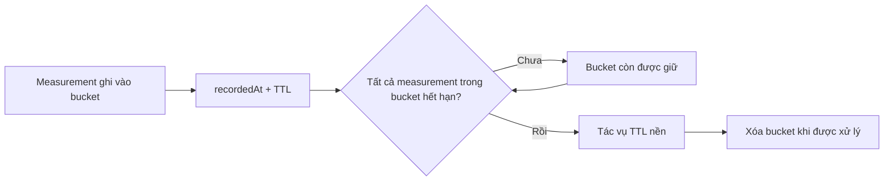

# TTL và chính sách giữ dữ liệu theo phiên bản

## 1. Bài toán: dữ liệu chuỗi thời gian cần được giữ bao lâu?

Trong ứng dụng dùng **Spring Data MongoDB**, một collection time series thường lưu dữ liệu có thời điểm phát sinh: nhiệt độ từ cảm biến, chỉ số vận hành, giao dịch đo đạc, sự kiện quan sát hệ thống. Dữ liệu mới liên tục được ghi vào; dữ liệu cũ có thể mất giá trị phân tích nhưng vẫn chiếm dung lượng, làm tăng chi phí lưu trữ và ảnh hưởng việc vận hành.

**TTL (Time To Live)** cho phép MongoDB tự loại bỏ dữ liệu đã quá hạn. Với time series collection, chính sách giữ dữ liệu (*retention policy*) thường được định nghĩa bằng số giây `expireAfterSeconds` ở **mức collection**. Khi cần thời hạn khác nhau theo nhóm metadata, MongoDB 7.0 trở lên còn hỗ trợ **partial TTL index**.

Sau bài này, bạn có thể:

- Phân biệt TTL của time series collection với TTL index trên collection thông thường.
- Tạo, đọc, thay đổi và tắt thời hạn lưu giữ mà không nhầm `timeField` với thời điểm ghi nhận vào cơ sở dữ liệu.
- Chọn phương án tương thích với phiên bản MongoDB và Spring Data MongoDB đang chạy.
- Thiết kế, kiểm thử và giám sát chính sách lưu giữ dữ liệu trong một ứng dụng Spring.

Ví dụ xuyên suốt: hệ thống thu thập số đo cảm biến có `recordedAt` (thời điểm đo), `sensor` (metadata gồm `sensorId` và `tier`) và `temperatureC` (nhiệt độ). Mục tiêu ban đầu là giữ số đo **30 ngày**, sau đó muốn giữ dữ liệu `tier: "debug"` chỉ **7 ngày**.

## 2. TTL hoạt động thế nào trong time series collection?

### 2.1. Mốc tính thời gian là `timeField`

Khi tạo time series collection, phải khai báo `timeseries.timeField`. Trường này chứa giá trị ngày giờ BSON `Date` của mỗi measurement. Với `expireAfterSeconds = N`, một measurement **đủ điều kiện hết hạn** khi:

```text
thời điểm hết hạn = giá trị timeField + N giây
```

Chẳng hạn, `recordedAt = 2026-01-01T08:00:00Z` và TTL là `2_592_000` giây (30 × 24 × 60 × 60) thì phép tính cho ra `2026-01-31T08:00:00Z`. Đây là **thời điểm đủ điều kiện xóa**, không phải cam kết sẽ bị xóa đúng giây đó.

Hệ quả quan trọng: nếu thiết bị mất kết nối và gửi bù bản ghi có `recordedAt` rất cũ, thời hạn TTL vẫn được tính từ **thời điểm đo**, không phải từ lúc ứng dụng gọi `save()`. Nếu yêu cầu nghiệp vụ là “giữ 30 ngày kể từ khi tiếp nhận”, cần thiết kế riêng cách biểu diễn thời gian và dữ liệu; không thể tùy ý thay `timeField` bằng `insertedAt` mà bỏ qua ý nghĩa của phép đo và truy vấn chuỗi thời gian.

### 2.2. MongoDB xóa theo bucket, theo tiến trình nền

Time series collection gom nhiều measurement có metadata và thời gian gần nhau vào **bucket**. MongoDB chỉ có thể dọn bucket khi **mọi measurement trong bucket đều đã hết hạn**. Một tác vụ nền kiểm tra bucket đã hết hạn theo chu kỳ khoảng **60 giây**; tải hệ thống có thể khiến việc xóa chậm hơn nữa.

| `granularity` của collection | Khoảng thời gian tối đa bucket có thể bao phủ |
| --- | ---: |
| `seconds` (mặc định) | 1 giờ |
| `minutes` | 24 giờ |
| `hours` | 30 ngày |

Các giá trị trên là giới hạn bucket được tài liệu MongoDB mô tả; chúng không phải thời lượng TTL. Ví dụ: chính sách TTL 7 ngày **không có nghĩa** dữ liệu luôn biến mất đúng sau 7 ngày, đặc biệt khi một bucket còn chứa measurement mới hơn và khi cấu hình bucket bao phủ thời gian dài.



**TTL là cơ chế dọn dữ liệu bất đồng bộ**, không phải bộ hẹn giờ xóa chính xác từng bản ghi. Vì vậy, không nên dùng TTL làm bảo đảm duy nhất cho thời điểm xóa tuyệt đối theo hợp đồng hoặc quy định pháp lý. Nếu cần ngừng truy cập dữ liệu ngay sau thời hạn, hãy bổ sung điều kiện lọc theo thời gian trong truy vấn và quy trình xóa/kiểm toán riêng.

## 3. Tạo time series collection với TTL

Trong `mongosh`, khởi tạo collection 30 ngày như sau (cần MongoDB **5.0 trở lên**):

```javascript
db.createCollection("sensor_readings", {
  timeseries: {
    timeField: "recordedAt",
    metaField: "sensor",
    granularity: "seconds"
  },
  expireAfterSeconds: 30 * 24 * 60 * 60
});

db.sensor_readings.insertOne({
  recordedAt: new Date(),
  sensor: { sensorId: "s-101", tier: "standard" },
  temperatureC: 27.4
});
```

Ở đây:

- `recordedAt` phải có kiểu ngày giờ hợp lệ; Java `Instant` thường được Spring Data ánh xạ thành BSON `Date`.
- `sensor` là `metaField`, dùng để nhóm measurement theo đặc tính cảm biến; không nên đặt giá trị thay đổi liên tục như từng số đo vào metadata.
- `granularity: "seconds"` phù hợp với dữ liệu xuất hiện theo giây/phút. Chọn theo chu kỳ lấy mẫu thực tế và cân nhắc độ trễ xóa theo bucket.
- `expireAfterSeconds` nằm **cùng cấp** với `timeseries`, không nằm trong object `timeseries`.

Collection phải được tạo dưới dạng time series **trước khi ghi dữ liệu**. Tạo một collection thông thường rồi đặt annotation Java về sau không tự biến collection ấy thành time series collection.

### 3.1. Spring Data MongoDB: ánh xạ entity và khởi tạo collection

Với Spring Data MongoDB **4.4 trở lên**, `@TimeSeries` hỗ trợ thuộc tính `expireAfter`. Có thể dùng `30d`, `720h`, chuỗi thời lượng ISO-8601 như `P30D`, hoặc placeholder cấu hình.

```java
import java.time.Instant;
import java.util.Map;

import org.springframework.data.annotation.Id;
import org.springframework.data.mongodb.core.mapping.TimeSeries;

@TimeSeries(
    collection = "sensor_readings",
    timeField = "recordedAt",
    metaField = "sensor",
    expireAfter = "30d"
)
public class SensorReading {
    @Id
    private String id;

    private Instant recordedAt;
    private Map<String, String> sensor;
    private double temperatureC;

    // Constructor, getter và setter theo mô hình dự án.
}
```

Annotation là **khai báo cấu hình tạo collection**, không phải tác vụ tự chỉnh sửa TTL của một collection đang tồn tại. Khi triển khai ứng dụng mới, chủ động tạo collection từ metadata của entity:

```java
import org.springframework.boot.ApplicationRunner;
import org.springframework.context.annotation.Bean;
import org.springframework.context.annotation.Configuration;
import org.springframework.data.mongodb.core.MongoTemplate;

@Configuration
class MongoCollectionSetup {

    @Bean
    ApplicationRunner createSensorReadings(MongoTemplate template) {
        return args -> {
            if (!template.collectionExists(SensorReading.class)) {
                template.createCollection(SensorReading.class);
            }
        };
    }
}
```

Đoạn khởi tạo phù hợp cho ví dụ học tập hoặc môi trường có **một tiến trình thực hiện migration**. Với hệ thống nhiều instance, nên dùng quy trình migration có kiểm soát để tránh hai instance cùng tạo collection và để phát hiện collection đã tồn tại nhưng sai loại/cấu hình. `collectionExists()` chỉ kiểm tra tồn tại, **không xác nhận** collection có đúng `timeField` và TTL.

Với Spring Data MongoDB đã hỗ trợ `@TimeSeries` nhưng **chưa hỗ trợ `expireAfter`** (trước 4.4), có thể tạo time series collection bằng `MongoTemplate`/MongoDB Driver rồi đặt thời hạn lưu qua tùy chọn `expireAfterSeconds` của collection. Cách này cũng hữu ích khi muốn quản lý TTL tập trung ở migration thay vì annotation:

```java
// Trường hợp không dùng annotation: khởi tạo time series bằng MongoTemplate.
template.createCollection(
    "sensor_readings",
    org.springframework.data.mongodb.core.CollectionOptions
        .timeSeries("recordedAt")
);
// Thiết lập metaField và expireAfterSeconds trong quy trình tạo collection
// theo API Driver/Spring Data tương ứng phiên bản đang sử dụng.
```

Đoạn cuối chỉ minh họa điểm vào của `MongoTemplate`, **chưa tương đương** với ví dụ `mongosh` có `metaField` và TTL. Khi triển khai, phải thiết lập đủ hai tùy chọn này bằng API phù hợp phiên bản, hoặc dùng chính lệnh `db.createCollection` ở trên. Không được tạo collection thiếu TTL rồi mặc nhiên coi như retention đã có hiệu lực.

> **Reactive:** `ReactiveMongoTemplate` cũng hỗ trợ tạo collection, nhưng thao tác trả về publisher; cần đưa vào luồng được subscribe (ví dụ trong quy trình khởi động có kiểm soát), nếu không lệnh sẽ không chạy.

## 4. Khác biệt quan trọng theo phiên bản

Khả năng sử dụng TTL cần xét **hai phiên bản độc lập**: MongoDB Server quyết định tính năng lưu trữ/xóa, còn Spring Data MongoDB quyết định API và annotation ứng dụng có thể dùng.

### 4.1. MongoDB Server

| Phiên bản | Khả năng liên quan đến TTL trên time series | Chiến lược phù hợp |
| --- | --- | --- |
| Trước **5.0** | Chưa có time series collection chuyên dụng. | Collection thường và TTL index thông thường (mô hình khác). |
| **5.0 – 6.2** | Time series collection với `expireAfterSeconds` ở mức collection; không có partial TTL index cho từng nhóm metadata. | Một TTL chung/collection; nếu các nhóm cần thời hạn khác nhau, tách collection. |
| **6.3 – 6.x** | Bổ sung cấu hình bucket tùy chỉnh `bucketMaxSpanSeconds`/`bucketRoundingSeconds`; tự tạo compound index `metaField` + `timeField` cho collection mới. | Vẫn nên tổ chức chính sách TTL cơ bản ở mức collection; không dựa vào partial TTL của 7.0. |
| **7.0 trở lên** | Có **partial TTL index** trên time series, với điều kiện lọc chỉ dựa trên `metaField`. | Một TTL chung và TTL ngắn hơn cho nhóm metadata, hoặc chỉ áp dụng TTL cho nhóm được chọn. |
| **8.x/9.x** | Có các khả năng TTL nêu trên; hạn chế và tùy chọn khác vẫn phải tra theo bản server/FCV thực tế. | Xác minh collection hiện có và điều kiện hạ cấp trước khi thay đổi cấu hình. |

*Lưu ý:* `bucketMaxSpanSeconds` và `bucketRoundingSeconds` được giới thiệu ở 6.3, phải khai báo **cùng nhau** với giá trị bằng nhau và không dùng đồng thời với `granularity`. Các tính năng còn phụ thuộc **Feature Compatibility Version (FCV)** khi nâng/hạ cấp; không nên suy từ phiên bản thư viện Java.

### 4.2. Spring Data MongoDB

| Phiên bản Spring Data MongoDB | Ứng dụng cần chú ý |
| --- | --- |
| **3.3 trở lên** | Có `@TimeSeries` để mô tả collection, `timeField`, `metaField`, `granularity`. |
| **4.4 trở lên** | Có thêm `@TimeSeries(expireAfter = "30d")` (hỗ trợ đơn vị, ISO-8601, placeholder và SpEL). |
| Các bản không có thuộc tính `expireAfter` | Dùng `createCollection`/`collMod` qua Driver hoặc migration; không sao chép annotation của bản mới vào code cũ. |

Để lập ma trận hỗ trợ chính xác, kiểm tra phiên bản MongoDB Server, FCV, dependency Spring Data và MongoDB Driver đang triển khai. Ví dụ một ứng dụng dùng Spring Data 5.x **không làm xuất hiện** partial TTL index nếu MongoDB Server vẫn ở 6.x.

## 5. Thay đổi chính sách TTL của collection đang chạy

Các thao tác quản lý được thực hiện qua `collMod`. Ví dụ đổi từ **30 ngày sang 14 ngày**:

```javascript
db.runCommand({
  collMod: "sensor_readings",
  expireAfterSeconds: 14 * 24 * 60 * 60
});
```

Kiểm tra cấu hình thật từ MongoDB, thay vì chỉ nhìn annotation hoặc file cấu hình ứng dụng:

```javascript
db.getCollectionInfos({ name: "sensor_readings" })
  .map(({ name, type, options }) => ({
    name,
    type,
    timeField: options.timeseries?.timeField,
    expireAfterSeconds: options.expireAfterSeconds
  }));
```

Khi muốn vô hiệu TTL ở mức collection, có thể dùng `expireAfterSeconds: "off"` trên server hỗ trợ cú pháp này:

```javascript
db.runCommand({ collMod: "sensor_readings", expireAfterSeconds: "off" });
```

Giảm TTL từ 30 xuống 14 ngày có thể khiến một lượng lớn dữ liệu cũ **đồng loạt đủ điều kiện xóa**. Nên ước lượng khối lượng bản ghi/bucket, kiểm soát tải đĩa và I/O, chuẩn bị lưu trữ dữ liệu cần thiết trước khi thay đổi. Tăng TTL hoặc tắt TTL **không khôi phục** dữ liệu đã xóa; muốn khôi phục phải có nguồn backup/archive thích hợp.

## 6. Chính sách khác nhau cho từng nhóm metadata: MongoDB 7.0+

Giả sử hệ thống giữ dữ liệu chuẩn 30 ngày nhưng muốn loại bỏ số đo debug sau 7 ngày. Trên MongoDB 7.0 trở lên, có thể giữ TTL chung 30 ngày và tạo **partial TTL index** lọc theo `metaField`:

```javascript
db.sensor_readings.createIndex(
  { recordedAt: 1 },
  {
    name: "debug_ttl_7d",
    expireAfterSeconds: 7 * 24 * 60 * 60,
    partialFilterExpression: { "sensor.tier": "debug" }
  }
);
```

Lưu ý các quy tắc:

1. Khóa TTL index dùng **`timeField`** (`recordedAt`), còn `partialFilterExpression` dựa **chỉ trên `metaField`** (`sensor`). Không viết điều kiện dựa vào `temperatureC` hay trường đo lường không phải metadata.
2. Partial TTL 7 ngày **rút ngắn** retention cho nhóm `debug`; nó **không thể kéo dài** thời hạn 30 ngày của nhóm nào khác khi collection vẫn có TTL chung.
3. Nếu collection **không đặt TTL chung**, partial TTL có thể chỉ xóa nhóm được chọn, còn nhóm không khớp điều kiện không bị TTL đó tác động.
4. Không coi `@Indexed(expireAfter = ...)` trên một thuộc tính bất kỳ là cách thay thế cho cú pháp partial TTL của time series; index phải đáp ứng đúng hạn chế của server.
5. Kiểm tra index thực tế sau migration:

```javascript
db.sensor_readings.getIndexes();
```

**Nếu server vẫn ở 5.x hoặc 6.x**, thiết kế dễ vận hành là **tách collection** theo retention, ví dụ `sensor_readings_debug_7d` và `sensor_readings_standard_30d`, rồi định tuyến ghi/đọc tương ứng trong service hoặc repository. Việc tách sẽ tăng số collection, index và độ phức tạp truy vấn hợp nhất, nhưng tránh phụ thuộc tính năng chưa hỗ trợ.

| Nhu cầu | Thiết kế đề xuất |
| --- | --- |
| Mọi measurement giữ 30 ngày | TTL 30 ngày tại collection. |
| `debug` 7 ngày, `standard` 30 ngày, MongoDB 7.0+ | TTL chung 30 ngày + partial TTL index 7 ngày cho `sensor.tier = "debug"`. |
| Mỗi khách hàng có kỳ hạn tùy biến trên MongoDB 5/6 | Tách collection theo nhóm retention hoặc dùng quy trình lưu/xóa riêng được quản lý chặt chẽ. |
| Dữ liệu bắt buộc giữ dài hạn | Lưu sang kho lưu trữ phù hợp trước khi TTL xử lý; không dựa vào việc tăng TTL sau khi xóa. |

## 7. Quản lý chính sách giữ dữ liệu khi nâng cấp và thay đổi phiên bản

Chính sách có thể thay đổi theo **phiên bản quy định nghiệp vụ** (`retention-policy-v1`, `retention-policy-v2`) và **phiên bản MongoDB Server**. Đừng gộp hai khái niệm: máy chủ 7.0 cho phép cách thực thi mới, nhưng không tự quyết định thời gian giữ dữ liệu của doanh nghiệp.

Ví dụ kế hoạch tiến hóa:

| Mốc triển khai | Quy định nghiệp vụ | MongoDB | Cách thực thi |
| --- | --- | --- | --- |
| Chính sách `v1` | Mọi số đo giữ 30 ngày. | 6.0 | Collection TTL 30 ngày. |
| Chính sách `v2` | Debug 7 ngày, chuẩn 30 ngày. | 6.0 | Tách collection theo loại nếu chưa thể nâng cấp. |
| Chính sách `v3` | Debug 7 ngày, chuẩn 30 ngày. | 7.0+ | Có thể dùng partial TTL trên `sensor.tier`; cần kiểm tra kế hoạch chuyển dữ liệu. |

Một migration retention nên ghi rõ: **phiên bản chính sách**, thời điểm hiệu lực, collection bị tác động, cấu hình trước/sau, số bản ghi/bucket dự kiến hết hạn, tác động đọc/ghi, phương án rollback dữ liệu (từ backup nếu cần), và người chịu trách nhiệm. Khi thay đổi từ nhiều collection về một collection, phải thiết kế luồng di chuyển dữ liệu; chỉ thêm index không tự hợp nhất những collection cũ.

Không nên dùng “phiên bản document” như một `metaField` thay cho chính sách nếu mỗi bản ghi cần ngày hết hạn riêng. TTL mức collection/partial TTL có những giới hạn rõ ràng; nếu retention phải linh hoạt theo từng bản ghi, hãy xem xét schema và cơ chế lưu trữ khác, thay vì cố áp TTL time series vượt khả năng server.

## 8. Kiểm thử và quan sát retention

### 8.1. Kịch bản kiểm thử có ý nghĩa

Đối với một môi trường thử nghiệm dùng TTL ngắn, nên kiểm tra:

| Kịch bản | Điều cần quan sát |
| --- | --- |
| Measurement có `recordedAt` mới | Vẫn truy vấn được khi chưa đủ tuổi TTL. |
| Measurement có `recordedAt` quá cũ | Cuối cùng sẽ bị loại bỏ sau khi **toàn bucket** đủ điều kiện và tác vụ nền chạy. |
| Hai nhóm `sensor.tier` khác nhau (MongoDB 7.0+) | Partial TTL áp dụng đúng nhóm, không xóa nhầm nhóm chuẩn trước hạn chung. |
| Gửi bù measurement cũ | Tuổi TTL vẫn tính theo `recordedAt`, không tính từ lúc insert. |
| Thay đổi `expireAfterSeconds` | `listCollections`/`getCollectionInfos()` cho thấy cấu hình mới; dự liệu được khối lượng xóa bổ sung. |

Ví dụ dữ liệu thử nghiệm:

```javascript
db.sensor_readings.insertMany([
  {
    recordedAt: new Date(Date.now() - 35 * 24 * 60 * 60 * 1000),
    sensor: { sensorId: "s-test-old", tier: "standard" },
    temperatureC: 22.1
  },
  {
    recordedAt: new Date(),
    sensor: { sensorId: "s-test-new", tier: "standard" },
    temperatureC: 22.2
  }
]);
```

Không viết kiểm thử giả định tài liệu cũ biến mất sau đúng `N` giây. Hãy dùng cơ chế **poll với thời hạn chờ hợp lý**, và bố trí metadata/timestamp sao cho hiểu rõ bucket nào có thể đã đủ điều kiện xóa; nếu có dữ liệu cùng bucket còn mới thì bucket chưa bị xóa.

### 8.2. Theo dõi vận hành

Kiểm tra định kỳ cấu hình collection và index (`getCollectionInfos`, `getIndexes`). Có thể xem thêm thống kê tác vụ TTL của **toàn server** bằng:

```javascript
db.serverStatus().metrics.ttl;
```

Các metric TTL của server không mặc nhiên phản ánh riêng collection `sensor_readings`. Để đánh giá việc thực thi retention theo collection, kết hợp đo số lượng/dung lượng theo khoảng `recordedAt`, độ trễ từ ngưỡng hết hạn đến khi bản ghi thực sự biến mất, và tải hệ thống trong các đợt dọn lớn.

Trong ứng dụng Spring, truy vấn phục vụ người dùng có thể lọc theo mốc dữ liệu được phép hiển thị ngay cả khi bucket chưa bị dọn:

```java
Instant cutoff = Instant.now().minus(Duration.ofDays(30));

Query query = Query.query(
    Criteria.where("recordedAt").gte(cutoff)
);

List<SensorReading> recent = mongoTemplate.find(
    query, SensorReading.class
);
```

Ví dụ cần import `java.time.Duration`, `org.springframework.data.mongodb.core.query.Query`, `Criteria`, `java.util.List` và inject `MongoTemplate`. Điều kiện truy vấn này **không thay thế xóa dữ liệu**; nó chỉ giới hạn kết quả trả về cho người dùng theo chính sách hiển thị.

## 9. Những sai lầm thường gặp

| Sai lầm | Hậu quả | Cách khắc phục |
| --- | --- | --- |
| Nhầm `recordedAt` với giờ insert | Dữ liệu gửi bù có thể hết hạn ngay. | Xác định rõ mốc thời gian nghiệp vụ trước khi thiết kế `timeField`. |
| Tin rằng TTL sẽ xóa đúng giây | Kiểm thử chập chờn; chính sách truy cập quá hạn. | Tính tới bucket, chu kỳ nền, tải máy chủ; lọc truy vấn khi cần. |
| Thay `expireAfter` trong annotation rồi nghĩ DB tự đổi TTL | Cấu hình ứng dụng và collection khác nhau. | Dùng migration/`collMod` và đọc lại options từ server. |
| Thêm partial TTL index vào MongoDB 6.x | Lỗi tính năng hoặc thiết kế không hoạt động. | Kiểm tra server/FCV; tách collection nếu chưa lên 7.0. |
| Cố kéo dài retention một nhóm bằng partial TTL | TTL chung vẫn xóa nhóm đó. | Chọn TTL chung dài nhất, dùng partial TTL để rút ngắn nhóm khác; hoặc tách collection. |
| Giảm TTL đột ngột trên dữ liệu lớn | Bùng tải xóa và mất dữ liệu không thể hồi phục bằng đổi cấu hình. | Đánh giá dữ liệu trước migration, backup/archive, giám sát tải. |
| Coi TTL là lưu trữ lịch sử | Dữ liệu hết hạn sẽ mất khỏi collection. | Phân tầng dữ liệu nóng/lạnh và xuất archive trước mốc xóa. |

## 10. Bài tập vận dụng

Thiết kế retention cho hệ thống có ba nhóm thiết bị: `debug` cần 3 ngày, `standard` 30 ngày, `audit` 365 ngày. Hãy giải thích:

1. Cấu hình cần tạo trên MongoDB 6.0 để bảo đảm mỗi nhóm có retention riêng.
2. Cấu hình trên MongoDB 7.0+ nếu muốn dùng chung một time series collection: TTL chung nên là bao nhiêu, và tạo những partial TTL index nào?
3. Điều gì xảy ra nếu đổi TTL chung từ 365 ngày xuống 30 ngày trong khi vẫn cần dữ liệu `audit` 365 ngày?
4. Với `granularity: "hours"`, vì sao không nên kiểm thử bằng cách chờ đúng 3 ngày rồi khẳng định bản ghi debug phải biến mất?
5. Bạn sẽ kiểm tra những cấu hình và số liệu vận hành nào trước/sau một migration retention?

**Gợi ý:** Trên 7.0+, đặt TTL chung 365 ngày, thêm partial TTL 3 ngày cho `debug` và 30 ngày cho `standard`; trên 6.0 tách nhóm theo collection. Khi dùng TTL chung 30 ngày, nhóm `audit` cũng có thể bị xóa sau 30 ngày, dù có một partial TTL dài hơn. Mọi lựa chọn đều phải tính đến độ trễ xóa theo bucket.

## Tài liệu tham khảo

- [MongoDB — Set up Automatic Removal for Time Series Collections (TTL)](https://www.mongodb.com/docs/manual/core/timeseries/timeseries-automatic-removal/)
- [MongoDB — Time Series Indexes](https://www.mongodb.com/docs/manual/core/timeseries/timeseries-index/)
- [MongoDB — Create and Query a Time Series Collection](https://www.mongodb.com/docs/manual/core/timeseries/timeseries-procedures/)
- [MongoDB — `collMod` command](https://www.mongodb.com/docs/manual/reference/command/collmod/)
- [Spring Data MongoDB — Index and Collection Management](https://docs.spring.io/spring-data/mongodb/reference/mongodb/template-collection-management.html)
- [Spring Data MongoDB — `@TimeSeries` API](https://docs.spring.io/spring-data/mongodb/docs/current/api/org/springframework/data/mongodb/core/mapping/TimeSeries.html)
