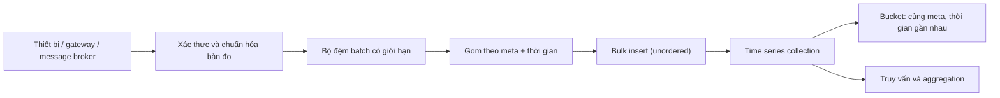

# Nạp dữ liệu theo lô và thiết kế metadata ổn định cho Time Series

## Mục tiêu học tập

Trong module **SPRING_DATA_MONGODB**, Spring Data MongoDB giúp ứng dụng Java kết nối MongoDB, ánh xạ document, truy vấn bằng `MongoTemplate` hoặc repository, thực hiện aggregation, quản lý index, kiểm thử và theo dõi hiệu năng. Với dữ liệu **time series**, số lượng phép ghi tăng nhanh theo thời gian: một hệ thống IoT có hàng nghìn thiết bị có thể tạo hàng triệu bản đo mỗi ngày. Cách **gom dữ liệu thành lô** và chọn **metadata ít thay đổi** ảnh hưởng trực tiếp đến tốc độ ghi, mật độ bucket, chi phí lưu trữ và hiệu quả truy vấn.

Sau bài học, bạn có thể:

- Phân biệt `timeField`, `metaField` và các trường đo đạc trong document time series.
- Thiết kế metadata mô tả đúng danh tính chuỗi dữ liệu, ổn định theo thời gian và phù hợp mẫu truy vấn.
- Tạo time series collection rồi ghi theo batch bằng MongoDB/Spring Data MongoDB.
- Chọn kích thước batch, nhóm bản đo theo metadata, dùng chế độ unordered hợp lý và kiểm soát bộ nhớ.
- Xử lý batch lỗi một phần, retry, trùng bản đo, dữ liệu đến muộn và khôi phục ingestion.
- Kiểm chứng kết quả, đo throughput và nhận diện dấu hiệu phân mảnh bucket do metadata không ổn định.

## 1. Bối cảnh: time series collection lưu dữ liệu như thế nào?

Time series collection trong MongoDB dành cho các document biểu diễn một sự kiện hoặc phép đo tại một thời điểm: nhiệt độ, dòng điện, mức dùng CPU, tốc độ giao dịch, số liệu sản xuất...

Khi tạo collection, ta chỉ định:

| Thành phần | Ví dụ | Vai trò |
|---|---|---|
| `timeField` | `observedAt` | Thời điểm xảy ra phép đo; phải là giá trị BSON Date hợp lệ. |
| `metaField` | `meta` | Mô tả chuỗi dữ liệu (sensor, tenant, loại chỉ số); nên hiếm khi đổi. |
| Trường đo đạc | `value`, `batteryPercent`, `quality` | Giá trị thay đổi theo từng mẫu đo, thường không thuộc metadata. |

Document ví dụ:

```javascript
{
  observedAt: ISODate("2026-11-20T03:30:00Z"),
  meta: {
    tenantId: "factory-a",
    sensorId: "line-02-temp-07",
    metric: "temperature",
    unit: "celsius"
  },
  value: 24.8,
  batteryPercent: 82,
  quality: "OK",
  eventId: "gateway-05:1732073400000:007"
}
```

MongoDB tổ chức nội bộ các bản đo có **`metaField` giống nhau** và thời gian gần nhau vào những **bucket lưu trữ** được tối ưu. Đây là bucket nội bộ của time series, **khác** với bucket `files/chunks` của GridFS. Phần lớn ứng dụng truy vấn trực tiếp collection time series, không truy cập collection lưu bucket nội bộ.



**Hai quyết định liên quan chặt chẽ:** (1) chọn metadata để MongoDB gom các bản đo liên quan; (2) tổ chức batch để những bản đo có cùng metadata có thể được ghi gần nhau, giảm số lần gọi mạng và làm việc với bucket hiệu quả hơn.

## 2. Thiết kế metadata ổn định

### 2.1. Metadata dùng để xác định chuỗi dữ liệu

Với hệ thống theo dõi nhiệt độ nhà máy, tổ hợp sau có thể đại diện cho một chuỗi:

```json
{
  "tenantId": "factory-a",
  "sensorId": "line-02-temp-07",
  "metric": "temperature",
  "unit": "celsius"
}
```

Các trường này mô tả **ai/cái gì** tạo ra chỉ số và chỉ số được hiểu như thế nào. Khi nhiệt độ từ `24.8` lên `24.9` hoặc pin từ `82%` xuống `81%`, metadata không đổi. MongoDB có cơ hội lưu nhiều điểm đo vào các bucket có độ đầy tốt.

Hãy so sánh:

| Trường | Đặt ở đâu? | Lý do |
|---|---|---|
| `tenantId` | Thường trong `meta` | Phân vùng logic dữ liệu theo tenant, thường dùng để lọc; cần ổn định. |
| `sensorId` | `meta` | Xác định nguồn tạo chuỗi, dùng thường xuyên trong truy vấn. |
| `metric` | `meta` nếu mỗi loại chỉ số là một chuỗi | Phân biệt nhiệt độ, độ ẩm, áp suất. |
| `unit` | `meta` nếu là thuộc tính lâu dài của chuỗi | Tránh đọc lẫn giá trị ở các đơn vị khác nhau. |
| `observedAt` | `timeField` | Thay đổi từng bản đo; không đưa vào `meta`. |
| `value`, `batteryPercent` | Trường đo | Thay đổi liên tục. |
| `quality`, `alarm` | Trường đo | Trạng thái có thể đổi từng phút; nếu đưa vào meta sẽ chia chuỗi thành nhiều nhóm. |
| `ingestedAt` | Trường thường hoặc bảng vận hành | Thời gian nhận/ghi nhận, đổi theo từng mẫu; khác `observedAt`. |
| `requestId`, `eventId` | Trường thường hoặc kho idempotency riêng | Có độ biến thiên rất cao, sẽ khiến gần như mỗi bản đo có metadata riêng nếu đưa vào meta. |

**Ví dụ metadata không ổn định:**

```javascript
// Thiết kế không tốt: mỗi mẫu có meta khác nhau
{
  observedAt: ISODate("2026-11-20T03:30:00Z"),
  meta: {
    sensorId: "line-02-temp-07",
    receivedAt: ISODate("2026-11-20T03:30:01Z"),
    requestId: "req-123",
    batteryPercent: 82
  },
  value: 24.8
}
```

`receivedAt` và `requestId` liên tục đổi; bản đo khó được nhóm với các điểm liền kề trong cùng một chuỗi. Hậu quả có thể là **nhiều bucket thưa**, thêm chi phí lưu trữ và giảm hiệu quả của các truy vấn theo chuỗi.

### 2.2. Cardinality và tính ổn định là hai chiều cần cân bằng

**Cardinality của meta** là số giá trị metadata khác nhau. Một hệ có 10.000 sensor thường đã có nhiều chuỗi và điều đó có thể đúng nghiệp vụ. Vấn đề xuất hiện khi mỗi sensor tạo thêm hàng nghìn biến thể metadata không cần thiết (request id, trạng thái tức thời, timestamp tiếp nhận).

Chọn metadata chỉ vì cardinality thấp cũng không đủ. Nếu bỏ `sensorId` để gom mọi cảm biến vào một nhóm, truy vấn theo sensor kém chọn lọc và làm mất ý nghĩa danh tính chuỗi. Cần giữ **đủ trường ổn định để phân biệt đúng chuỗi**, nhất là các trường thường xuất hiện trong điều kiện lọc.

MongoDB có thể sắp xếp lại thứ tự trường của object `meta`; để truy vấn an toàn và dễ tận dụng index, nên lọc các trường con dạng scalar như `"meta.sensorId"` thay vì so sánh nguyên object `meta` theo thứ tự field. Đồng thời chuẩn hóa tên field, kiểu dữ liệu, chữ hoa/thường, đơn vị và giá trị thiếu trước khi ghi.

### 2.3. Khi metadata thực sự thay đổi

Giả sử thiết bị `sensor-17` được chuyển từ `site-a` sang `site-b`. Nếu site là một phần của danh tính chuỗi, bản đo mới có thể dùng metadata `{sensorId: "sensor-17", siteId: "site-b"}`; dữ liệu quá khứ vẫn giữ site tại thời điểm đo. Đây là sự thay đổi có ý nghĩa nghiệp vụ, không phải lỗi.

Quy ước cần được ghi rõ:

1. Giá trị nào tạo ra **chuỗi mới** (chẳng hạn đổi đơn vị hoặc sensor được gán lại cho site)?
2. Giá trị nào là **phép đo** hoặc trạng thái ngắn hạn, phải nằm ngoài meta?
3. Khi bổ sung trường meta mới, dữ liệu cũ được diễn giải ra sao?
4. Tenant, sensor và metric có dùng kiểu dữ liệu thống nhất không? Ví dụ luôn dùng chuỗi cho `sensorId`.

Một `metaField` đã được khai báo khi tạo collection không thể đổi sang **tên field khác** chỉ bằng cách đổi giá trị dữ liệu. Nếu thiết kế danh tính chuỗi thay đổi sâu, thường cần kế hoạch chuyển đổi collection/schema. Không tự ý cập nhật metadata hàng loạt để sửa dữ liệu lịch sử nếu chưa đánh giá giới hạn update và tác động bucket của time series.

## 3. Tạo collection trước khi bắt đầu nạp dữ liệu

Một collection thông thường không tự trở thành time series chỉ vì các document có trường thời gian. Cần tạo collection với tùy chọn `timeseries` **trước lần insert đầu tiên**.

Dùng `mongosh`:

```javascript
db.createCollection("sensor_readings", {
  timeseries: {
    timeField: "observedAt",
    metaField: "meta",
    granularity: "minutes"
  }
})
```

`granularity` là một gợi ý bố trí bucket theo nhịp dữ liệu, không phải cách làm tròn hoặc thay đổi timestamp bản đo. Chọn `seconds`, `minutes` hoặc `hours` theo mật độ/thời gian giữa các điểm dữ liệu thực tế, rồi đo hiệu quả. Các phiên bản MongoDB mới còn hỗ trợ tham số bucket tùy chỉnh; không trộn `granularity` với tham số bucket tùy chỉnh trong cùng khai báo.

Có thể tạo bằng driver tích hợp qua `MongoTemplate`, phù hợp với migration/khởi tạo có kiểm soát:

```java
import com.mongodb.client.model.CreateCollectionOptions;
import com.mongodb.client.model.TimeSeriesGranularity;
import com.mongodb.client.model.TimeSeriesOptions;
import org.springframework.data.mongodb.core.MongoTemplate;

public final class TimeSeriesCollectionProvisioner {

    private TimeSeriesCollectionProvisioner() {}

    public static void create(MongoTemplate template) {
        template.execute(database -> {
            CreateCollectionOptions options = new CreateCollectionOptions()
                .timeSeriesOptions(new TimeSeriesOptions("observedAt")
                    .metaField("meta")
                    .granularity(TimeSeriesGranularity.MINUTES));
            database.createCollection("sensor_readings", options);
            return null;
        });
    }
}
```

Đây là thao tác **tạo một lần** trong quá trình provisioning. Nếu collection đã tồn tại, cần kiểm tra tùy chọn thực tế trước khi quyết định bỏ qua lỗi hoặc thực hiện migration. Tránh dựa vào hành vi tự tạo collection thông thường khi ghi lần đầu.

Kiểm tra cấu hình:

```javascript
db.getCollectionInfos({ name: "sensor_readings" })
```

Kết quả cần cho thấy khai báo `timeseries.timeField = "observedAt"` và `timeseries.metaField = "meta"` theo mong đợi. MongoDB có thể quản lý collection bucket nội bộ, nhưng code ứng dụng chỉ nên thao tác qua `sensor_readings`.

## 4. Nạp dữ liệu theo lô (batch insert)

### 4.1. Vì sao batch tốt hơn từng document một?

Giả sử mỗi giây có 5.000 phép đo. Nếu ứng dụng gửi 5.000 lệnh `insertOne` độc lập, chi phí network round trip, điều phối lệnh và quản lý connection có thể lớn. Gửi nhiều document trong một lệnh `insertMany` hoặc bulk insert giúp giảm số request.

MongoDB khuyến nghị cho time series:

- **Ghi nhiều document bằng một batch** thay vì nhiều lần `insertOne`.
- Khi có thể, **gom các bản đo có cùng giá trị `metaField` vào cùng batch** hoặc đặt gần nhau trong batch.
- Dùng `ordered: false` khi ứng dụng không cần thực thi các insert theo đúng thứ tự gửi, vì chế độ này có thể cải thiện throughput.

Ví dụ với `mongosh`:

```javascript
db.sensor_readings.insertMany(
  [
    {
      observedAt: ISODate("2026-11-20T03:00:00Z"),
      meta: { tenantId: "factory-a", sensorId: "s-01", metric: "temperature", unit: "celsius" },
      value: 23.7
    },
    {
      observedAt: ISODate("2026-11-20T03:01:00Z"),
      meta: { tenantId: "factory-a", sensorId: "s-01", metric: "temperature", unit: "celsius" },
      value: 23.8
    },
    {
      observedAt: ISODate("2026-11-20T03:00:00Z"),
      meta: { tenantId: "factory-a", sensorId: "s-02", metric: "temperature", unit: "celsius" },
      value: 24.1
    },
    {
      observedAt: ISODate("2026-11-20T03:01:00Z"),
      meta: { tenantId: "factory-a", sensorId: "s-02", metric: "temperature", unit: "celsius" },
      value: 24.2
    }
  ],
  { ordered: false }
)
```

Hai bản đo đầu có cùng `meta`, hai bản đo sau cũng vậy. Cách nhóm này giúp hệ thống có cơ hội xử lý dữ liệu theo chuỗi hiệu quả hơn. **Unordered không bảo đảm thứ tự ghi hoặc thứ tự hoàn tất** của từng document; chính `observedAt` mới xác định trục thời gian khi truy vấn.

### 4.2. Chọn kích thước batch

Không có một giá trị batch tối ưu cho mọi ứng dụng. Một cấu hình thử nghiệm thường bắt đầu từ khoảng **500–2.000 document/lô**, sau đó đo:

| Tiêu chí | Batch quá nhỏ | Batch quá lớn |
|---|---|---|
| Số lần gọi mạng | Nhiều | Ít hơn |
| Dung lượng RAM chờ ghi | Thấp | Cao hơn |
| Độ trễ của mẫu mới | Thấp nếu flush ngay | Có thể tăng do chờ đủ batch |
| Xử lý lỗi/partial success | Dễ khoanh vùng | Khó đối soát từng document hơn |
| Áp lực lên MongoDB | Nhiều lệnh nhỏ | Lệnh nặng hoặc dồn tải |
| Khả năng phục hồi | Có nhiều checkpoint | Có thể phải rà soát lô lớn |

Kích thước nên giới hạn theo **cả số document, tổng số byte, thời gian chờ và số lô đồng thời**. Driver cũng có giới hạn riêng về batch và kích thước BSON/message; đừng cho rằng mọi danh sách Java đều có thể gửi như một gói duy nhất.

Ví dụ chính sách:

- Flush khi đủ 1.000 document, hoặc đạt 2 MiB dữ liệu ước tính, hoặc chờ quá 500 ms.
- Giới hạn số batch đang gửi đồng thời; nếu hàng đợi đầy, áp dụng backpressure.
- Trong một batch, sắp xếp hoặc phân nhóm theo khóa metadata ổn định trước khi thực thi, nếu chi phí CPU/RAM hợp lý.
- Các ngưỡng trên chỉ là điểm khởi đầu để benchmark, không phải giới hạn của MongoDB.

## 5. Ghi batch bằng Spring Data MongoDB

### 5.1. Ánh xạ document

Ví dụ dùng Java record để mô tả một bản đo. Các trường `meta` phải thống nhất kiểu và ý nghĩa trong suốt vòng đời dữ liệu.

```java
import java.time.Instant;

import org.springframework.data.mongodb.core.mapping.Document;

@Document(collection = "sensor_readings")
public record SensorReading(
        Instant observedAt,
        SensorMeta meta,
        double value,
        int batteryPercent,
        String quality,
        String eventId
) {
    public record SensorMeta(
            String tenantId,
            String sensorId,
            String metric,
            String unit
    ) {}
}
```

Spring Data MongoDB ánh xạ `Instant` sang ngày BSON và lưu `SensorMeta` thành nested document `meta` theo mặc định. Trong hệ thống thực tế, kiểm tra mapping khi sử dụng converter tùy chỉnh hoặc đổi kiểu dữ liệu.

### 5.2. Dùng `BulkOperations.BulkMode.UNORDERED`

Với `MongoTemplate`, có thể gom một danh sách bản đo vào một bulk operation:

```java
import java.util.ArrayList;
import java.util.Comparator;
import java.util.Iterator;
import java.util.List;
import java.util.Objects;

import com.mongodb.bulk.BulkWriteResult;
import org.springframework.data.mongodb.core.BulkOperations.BulkMode;
import org.springframework.data.mongodb.core.MongoTemplate;
import org.springframework.stereotype.Service;

@Service
public class SensorReadingBatchWriter {

    private static final int BATCH_SIZE = 1_000;
    private final MongoTemplate mongoTemplate;

    public SensorReadingBatchWriter(MongoTemplate mongoTemplate) {
        this.mongoTemplate = mongoTemplate;
    }

    public int writeBatch(List<SensorReading> readings) {
        if (readings.isEmpty()) {
            return 0;
        }
        if (readings.size() > BATCH_SIZE) {
            throw new IllegalArgumentException("Batch exceeds limit");
        }

        for (SensorReading reading : readings) {
            validate(reading);
        }

        // Gom các bản đo có cùng meta; không thay đổi observedAt.
        List<SensorReading> sorted = readings.stream()
            .sorted(Comparator
                .comparing((SensorReading r) -> r.meta().tenantId())
                .thenComparing(r -> r.meta().sensorId())
                .thenComparing(r -> r.meta().metric())
                .thenComparing(r -> r.meta().unit())
                .thenComparing(SensorReading::observedAt))
            .toList();

        BulkWriteResult result = mongoTemplate
            .bulkOps(BulkMode.UNORDERED, SensorReading.class)
            .insert(sorted)
            .execute();

        return result.getInsertedCount();
    }

    public long importFrom(Iterator<SensorReading> source) {
        List<SensorReading> batch = new ArrayList<>(BATCH_SIZE);
        long inserted = 0;

        while (source.hasNext()) {
            batch.add(source.next());

            if (batch.size() == BATCH_SIZE) {
                inserted += writeBatch(batch);
                batch.clear();
            }
        }
        if (!batch.isEmpty()) {
            inserted += writeBatch(batch);
        }
        return inserted;
    }

    private static void validate(SensorReading reading) {
        Objects.requireNonNull(reading, "reading");
        Objects.requireNonNull(reading.observedAt(), "observedAt");
        SensorReading.SensorMeta meta =
            Objects.requireNonNull(reading.meta(), "meta");

        if (meta.tenantId() == null || meta.tenantId().isBlank()
                || meta.sensorId() == null || meta.sensorId().isBlank()
                || meta.metric() == null || meta.metric().isBlank()
                || meta.unit() == null || meta.unit().isBlank()) {
            throw new IllegalArgumentException("Missing stable metadata");
        }

        if (!Double.isFinite(reading.value())) {
            throw new IllegalArgumentException("Invalid measurement value");
        }
    }
}
```

Cần hiểu đúng phạm vi ví dụ:

1. `writeBatch` chỉ xử lý **tối đa 1.000 bản đo**; `importFrom` đọc dần qua `Iterator` thay vì nạp toàn bộ nguồn vào RAM. Nguồn dữ liệu thật (Kafka consumer, CSV parser, HTTP stream) cần được quản lý vòng đời và checkpoint riêng.
2. `BulkMode.UNORDERED` có thể tiếp tục xử lý một số document sau khi có lỗi ở document khác. Kết quả không đảm bảo tất cả đều đã được ghi chỉ vì một phần thành công.
3. `sorted` giữ các chuỗi gần nhau trong danh sách gửi; không bảo đảm server ghi theo thứ tự, vì vậy ứng dụng phải dựa vào `observedAt` khi đọc.
4. `return result.getInsertedCount()` chỉ chạy khi `execute()` trả về bình thường. Nếu một lô phát sinh ngoại lệ, code gọi phải ghi nhận lỗi và thực hiện quy trình đối soát; không được tăng checkpoint như thể cả lô thành công.
5. Không dùng `save()` để thay thế insert trong pipeline append-only. `save()` có semantics cập nhật/thay thế theo `_id`, trong khi time series được tối ưu cho ghi thêm các phép đo và có giới hạn update.
6. Code ví dụ chưa bao gồm write concern, retry, cơ chế bảo đảm không trùng, metrics hoặc phân quyền tenant; các vấn đề này cần được triển khai trong pipeline vận hành.

Với trường hợp chỉ cần chèn nhiều bản đo mà không cần lựa chọn ordered/unordered cụ thể, Spring Data cũng hỗ trợ `mongoTemplate.insert(list, SensorReading.class)`. Khi cần quyền điều khiển `ordered: false` một cách minh bạch, `BulkOperations` hoặc MongoDB driver `insertMany` kèm `InsertManyOptions` là lựa chọn phù hợp.

### 5.3. Nếu dùng MongoDB Java driver trực tiếp

Đối với dữ liệu đã được ánh xạ sẵn thành `Document`, có thể dùng:

```java
import com.mongodb.client.MongoCollection;
import com.mongodb.client.model.InsertManyOptions;
import org.bson.Document;

import java.util.List;

public void insertUnordered(
        MongoCollection<Document> collection,
        List<Document> docs) {

    if (!docs.isEmpty()) {
        collection.insertMany(docs, new InsertManyOptions().ordered(false));
    }
}
```

Cách này hữu ích khi bạn có một pipeline xử lý BSON trực tiếp. Nó **không đi qua các bước mapping entity Spring Data** như khi dùng `MongoTemplate`; hãy thống nhất converter và contract dữ liệu nếu hai cách ghi cùng tồn tại.

## 6. Xử lý dữ liệu đến muộn, sai thứ tự và thời gian

Nguồn dữ liệu time series không nhất thiết đến đúng thứ tự. Gateway có thể mất kết nối trong 15 phút, sau đó gửi bù hàng trăm bản đo cũ. MongoDB vẫn có thể nhận document mang `observedAt` cũ; tuy nhiên mật độ bucket, throughput và hành vi lưu trữ có thể khác với luồng ghi đều theo thời gian.

**Phân biệt hai thời điểm:**

- `observedAt`: lúc cảm biến đo; dùng để hiển thị đồ thị và tính thống kê theo thời gian sự kiện.
- `ingestedAt`: lúc hệ thống nhận/bắt đầu xử lý; hữu ích cho đo độ trễ ingest và phát hiện dữ liệu đến muộn, nhưng **không đặt vào meta** vì đổi từng document.

Ví dụ:

```javascript
{
  observedAt: ISODate("2026-11-20T03:00:00Z"),
  ingestedAt: ISODate("2026-11-20T03:16:05Z"),
  meta: {
    tenantId: "factory-a",
    sensorId: "s-01",
    metric: "temperature",
    unit: "celsius"
  },
  value: 23.7
}
```

Để tránh biến dạng dữ liệu:

- Chuẩn hóa timestamp về `Instant`/UTC ở API và xử lý múi giờ khi hiển thị. Trường thời gian phải là BSON Date, không phải chuỗi ISO dạng text trong MongoDB.
- Không tự sửa `observedAt` thành giờ nhập liệu chỉ để các bản đo trong batch có thứ tự đẹp hơn.
- Khi cần sắp xếp, ưu tiên nhóm theo metadata rồi theo `observedAt` trong nhóm, nhưng nhớ rằng unordered insert không bảo đảm thứ tự hoàn tất.
- Với dữ liệu nguồn có độ phân giải microsecond/nanosecond, xác định chính sách quy đổi về độ chính xác timestamp được lưu dưới dạng BSON Date (millisecond).
- Nếu nghiệp vụ có TTL, dữ liệu gửi muộn quá thời hạn lưu có thể bị loại bỏ theo chính sách lưu trữ sau khi được ghi; cần quy định rõ cách xử lý sự kiện cũ.

## 7. Lỗi một phần và retry: điểm khó nhất của batch

### 7.1. Một batch có thể thành công một phần

Giả sử batch chứa 1.000 document. MongoDB ghi thành công 700 document, sau đó một lỗi mạng xảy ra. Tùy thời điểm và loại lỗi, phía ứng dụng có thể **không biết chính xác** 700, 999 hay 1.000 document đã được lưu, ngay cả khi lời gọi kết thúc bằng ngoại lệ.

Chế độ `ordered: false` giúp hệ thống không bắt buộc dừng ngay ở lỗi từng document, nhưng **không làm batch trở thành giao dịch all-or-nothing**. Time series collection cũng có giới hạn: **không hỗ trợ ghi trong transaction**, vì vậy không thể bọc toàn bộ batch time series và bảng trạng thái nghiệp vụ trong một transaction MongoDB để giải quyết mọi lỗi.

Không làm:

```java
// Ví dụ ý tưởng sai: retry mù toàn bộ batch cho mọi ngoại lệ.
try {
    writer.writeBatch(readings);
} catch (Exception ex) {
    writer.writeBatch(readings);
}
```

Retry mù có thể tạo **bản đo trùng**. MongoDB không tạo unique index cho time series giống collection thường; dựa riêng vào `_id` hay `eventId` mà không có cơ chế ràng buộc ngoài sẽ không bảo đảm chống trùng trong mọi trường hợp.

### 7.2. Thiết kế idempotency ở tầng ingestion

Một quy trình thực tế có thể dùng:

1. Mỗi bản đo hoặc từng đoạn nguồn có **khóa sự kiện ổn định** (`eventId` hoặc tổ hợp `tenantId + sensorId + metric + sourceSequence`).
2. Lưu trạng thái tiếp nhận/checkpoint trong **collection thường** hoặc một hệ thống message có offset và quy trình đối soát; nơi này có thể dùng unique index để loại trùng.
3. Chỉ xác nhận hoàn tất với nguồn sau khi batch ghi thành công theo chính sách đã chọn và trạng thái được cập nhật an toàn.
4. Nếu kết quả ghi không chắc chắn, đối soát bằng event ID, khoảng thời gian và dữ liệu nguồn trước khi phát lại.
5. Thiết kế khôi phục cho trường hợp ghi time series thành công nhưng checkpoint chưa hoàn tất; không giả định ghi ở hai nơi là atomic.

**Lưu ý:** một unique index trên collection theo dõi receipt không tự động cho bảo đảm exactly-once từ đầu đến cuối. Nếu luồng xử lý có khoảng trống giữa ghi receipt và ghi time series, vẫn có thể mất hoặc trùng khi crash. Hệ thống cần định nghĩa rõ semantics thực tế (at-least-once, chống trùng cuối kỳ, hay bảo đảm mạnh hơn thông qua kiến trúc ngoài) và có reconciliation.

### 7.3. Phân loại lỗi để xử lý phù hợp

| Lỗi hoặc triệu chứng | Xử lý gợi ý |
|---|---|
| Giá trị `observedAt` không hợp lệ | Từ chối bản ghi ngay tại validation; đưa vào dead-letter nếu cần |
| Metadata thiếu hoặc không đúng kiểu | Sửa/chuẩn hóa nguồn; không retry vô hạn cùng payload |
| Mất kết nối, timeout, kết quả ghi không chắc chắn | Ghi log batch ID và trạng thái không chắc chắn; đối soát trước hoặc trong quá trình retry |
| MongoDB quá tải, lỗi tạm thời | Backoff có jitter, giới hạn số lần retry và số batch đồng thời |
| Một số bản đo sai, số còn lại hợp lệ | Cô lập bản ghi lỗi, kiểm tra kết quả từng operation nếu driver cung cấp; lưu báo cáo partial result |
| Cùng event phát lại | Dùng cơ chế kiểm soát idempotency ngoài time series hoặc quy trình dedup/reconciliation |
| Batch quá lớn hoặc backlog tăng | Giảm batch/đồng thời, điều chỉnh backpressure và khả năng tiêu thụ |

Ứng dụng cần ghi nhận cả **số bản đo được nhận, được chấp nhận để gửi, xác nhận ghi, lỗi và đang chờ đối soát**. Không cộng “đã lưu” chỉ dựa trên số phần tử `List` đã đưa vào lời gọi bulk.

## 8. Truy vấn theo meta và thời gian

Lợi ích của metadata ổn định thể hiện rõ khi truy vấn thường bắt đầu từ một sensor, metric và khoảng thời gian.

```javascript
db.sensor_readings.find(
  {
    "meta.tenantId": "factory-a",
    "meta.sensorId": "s-01",
    "meta.metric": "temperature",
    observedAt: {
      $gte: ISODate("2026-11-20T00:00:00Z"),
      $lt: ISODate("2026-11-21T00:00:00Z")
    }
  },
  {
    _id: 0,
    observedAt: 1,
    value: 1,
    "meta.unit": 1
  }
).sort({ observedAt: 1 })
```

Với Spring Data:

```java
import java.time.Instant;
import java.util.List;

import org.springframework.data.domain.Sort;
import org.springframework.data.mongodb.core.MongoTemplate;
import org.springframework.data.mongodb.core.query.Criteria;
import org.springframework.data.mongodb.core.query.Query;

public List<SensorReading> readRange(
        MongoTemplate template,
        String tenantId,
        String sensorId,
        String metric,
        Instant fromInclusive,
        Instant toExclusive) {

    Query query = Query.query(
        Criteria.where("meta.tenantId").is(tenantId)
            .and("meta.sensorId").is(sensorId)
            .and("meta.metric").is(metric)
            .and("observedAt").gte(fromInclusive).lt(toExclusive)
    ).with(Sort.by(Sort.Direction.ASC, "observedAt"));

    return template.find(query, SensorReading.class);
}
```

`find()` ở đây trả về danh sách vật thể nên phù hợp với **khoảng thời gian nhỏ hoặc dữ liệu có phân trang/giới hạn**. Với truy vấn rất lớn, dùng streaming/aggregation, giới hạn kết quả và xử lý theo từng phần để tránh giữ hàng triệu điểm trong RAM. Luôn ràng buộc tenant từ ngữ cảnh xác thực của ứng dụng, không tin tham số tenant do người dùng tùy ý đưa vào.

Index tối ưu thường bắt đầu từ trường metadata được lọc và `timeField`; MongoDB có hành vi tạo index mặc định khác nhau theo phiên bản. Cần xem `getIndexes()`, kế hoạch `explain()` và workload trước khi bổ sung index:

```javascript
db.sensor_readings.getIndexes()

db.sensor_readings.createIndex({
  "meta.tenantId": 1,
  "meta.sensorId": 1,
  "meta.metric": 1,
  observedAt: 1
})
```

Không tạo hàng loạt index theo mọi trường: chúng chiếm dung lượng và làm tăng chi phí ghi. Time series không hỗ trợ mọi loại index như collection thông thường; ví dụ **unique index không được hỗ trợ**. Khả năng tạo index và tên index mặc định có thể khác giữa các phiên bản MongoDB, vì vậy cần xác minh với môi trường triển khai.

## 9. Đo hiệu năng và theo dõi chất lượng ingestion

Một pipeline batch hiệu quả cần đo cả **tốc độ** lẫn **tính chính xác dữ liệu**.

| Chỉ số | Ý nghĩa |
|---|---|
| `ingest_received_total` | Số bản đo đã nhận từ nguồn. |
| `ingest_valid_total` và `ingest_rejected_total` | Bao nhiêu bản đo hợp lệ, bao nhiêu bản đo cần xử lý lỗi dữ liệu. |
| `ingest_batch_size` | Phân phối số document và byte thực tế trên mỗi lô. |
| `ingest_batch_duration_seconds` | Độ trễ ghi của mỗi batch; nên xem P50/P95/P99. |
| `ingest_confirmed_total` | Số bản đo được xác nhận đã ghi theo chính sách của pipeline. |
| `ingest_unknown_total` | Số bản đo có trạng thái không chắc chắn sau timeout/mất kết nối. |
| `ingest_queue_depth` | Backlog đang chờ batch; tăng liên tục là dấu hiệu hệ thống không theo kịp nguồn. |
| `ingest_lag_seconds` | Chênh lệch giữa thời điểm nhận và thời điểm đo/được phát hành. |
| `ingest_duplicate_suspected_total` | Khả năng phát lại hoặc trùng dữ liệu. |
| Tỷ lệ metadata distinct / bản đo | Dấu hiệu metadata cardinality bất thường, cần xem theo từng tenant/sensor. |

### Công thức kiểm tra throughput

Giả sử có 10.000 sensor, mỗi sensor gửi một bản đo mỗi 10 giây:

```text
Số bản đo/giây = 10.000 / 10 = 1.000
Số bản đo/ngày = 1.000 × 86.400 = 86.400.000

Nếu trung bình 1.000 bản đo/batch:
Số batch/giây xấp xỉ 1.000 / 1.000 = 1
```

Đây chỉ là phép tính ở mức trung bình. Trong thực tế, dữ liệu có thể dồn cục, batch được chia theo tenant hoặc sensor, flush theo thời gian nên số lô thực tế thường lớn hơn. Cần tính đến overhead BSON, index, write concern và cấu hình cluster khi dự báo công suất.

### Query kiểm tra cardinality của metadata

Phép aggregation dưới đây đếm số chuỗi metadata khác nhau trên dữ liệu trong một khoảng thời gian; chạy với phạm vi dữ liệu vừa phải để tránh chi phí lớn:

```javascript
db.sensor_readings.aggregate([
  {
    $match: {
      observedAt: {
        $gte: ISODate("2026-11-20T00:00:00Z"),
        $lt: ISODate("2026-11-21T00:00:00Z")
      }
    }
  },
  {
    $group: {
      _id: {
        tenantId: "$meta.tenantId",
        sensorId: "$meta.sensorId",
        metric: "$meta.metric",
        unit: "$meta.unit"
      },
      samples: { $sum: 1 }
    }
  },
  {
    $group: {
      _id: null,
      distinctSeries: { $sum: 1 },
      totalSamples: { $sum: "$samples" },
      minSamplesPerSeries: { $min: "$samples" },
      maxSamplesPerSeries: { $max: "$samples" }
    }
  }
])
```

Nếu mỗi chuỗi chỉ có 1–2 bản đo dù hệ thống đáng ra ghi liên tục, cần xem lại thiết kế metadata, dữ liệu đến quá phân tán hoặc các yếu tố khác (không kết luận chỉ từ một thống kê).

## 10. Bài thực hành: nạp một triệu bản đo của nhà máy

**Bối cảnh:** hai nhà máy, tổng 500 sensor; mỗi sensor gửi nhiệt độ hoặc độ ẩm mỗi phút. Dữ liệu nằm trong `sensor_readings`, lưu theo `observedAt`. Bạn cần tối ưu throughput và giữ metadata ổn định.

Thực hiện:

1. Tạo collection với `timeField = observedAt`, `metaField = meta`, `granularity = minutes`. Kiểm tra bằng `getCollectionInfos()`.
2. Định nghĩa `meta` gồm `tenantId`, `sensorId`, `metric` và `unit`. Đưa `value`, `quality`, `batteryPercent`, `eventId` ra ngoài meta.
3. Sinh dữ liệu thử với nhiều bản đo có cùng metadata nhưng khác `observedAt`; thêm các bản đo đến muộn để mô phỏng gateway offline.
4. Thử hai cách ghi: gọi insert cho từng bản đo và gom 1.000 bản đo/lô bằng `BulkMode.UNORDERED`. Đo tổng thời gian, P95 mỗi batch, CPU/RAM, số lệnh ghi và độ trễ hiển thị dữ liệu.
5. Thử thêm `requestId` vào `meta` để thấy cardinality thay đổi; sau đó đưa trường này ra khỏi `meta` và đo lại trong **collection thử nghiệm khác** để tránh làm hỏng dữ liệu đang được dùng.
6. Gây lỗi kết nối có kiểm soát giữa batch, đánh dấu trạng thái không chắc chắn, thử cơ chế đối soát/khôi phục, ghi nhận việc dữ liệu có bị thiếu hoặc lặp.
7. Chạy query lọc theo `meta.sensorId` + khoảng `observedAt`; kiểm tra `getIndexes()` và `explain()` để xem hành vi truy vấn.

**Tiêu chí hoàn thành:**

- Các document có timestamp BSON Date đúng và metadata ổn định cho mỗi chuỗi.
- Pipeline xử lý dữ liệu bằng những batch có giới hạn, không tích lũy cả triệu document trong RAM.
- Các batch lỗi không bị ghi nhận thành công giả; có cơ chế phát hiện kết quả không chắc chắn và phục hồi.
- Truy vấn theo metadata + thời gian trả kết quả đúng dù một số điểm được nhập muộn.
- Có số đo thực tế để chọn kích thước batch và quyết định có cần điều chỉnh index hay không.

## 11. Những nhầm lẫn phổ biến

| Nhầm lẫn | Cách hiểu đúng |
|---|---|
| “Càng nhiều field trong `meta` càng tốt” | Metadata phải mô tả danh tính chuỗi và ít thay đổi; field biến động làm tăng số bucket. |
| “Cứ bật unordered là dữ liệu tự được sắp theo thời gian” | Unordered chỉ ảnh hưởng cách thực thi ghi; muốn kết quả đúng thứ tự phải truy vấn/sort theo `observedAt`. |
| “Ghi 1.000 bản đo là một transaction” | Bulk insert không mặc nhiên all-or-nothing, time series không hỗ trợ ghi trong transaction. |
| “Có `eventId` trong document là đã chống trùng” | Không có unique index time series cho trường này; cần idempotency và đối soát ở tầng khác. |
| “Đổi metadata sẽ chỉ sửa nhãn hiển thị” | Metadata còn quyết định cách bucket được tổ chức và tính hiệu quả truy vấn. |
| “Phải chờ đủ batch mới ghi” | Nên có giới hạn thời gian flush để cân bằng throughput và độ trễ. |
| “Chỉ đo insert/second là đủ” | Phải đo thêm partial failure, lag, chi phí lưu trữ, RAM, query latency và độ chính xác. |

## Tóm tắt

Với time series, **batch insert** giảm số lần giao tiếp MongoDB; việc gom những bản đo có cùng `metaField` tạo điều kiện tổ chức bucket hiệu quả. **Metadata ổn định** nên chứa danh tính chuỗi và các thuộc tính thường dùng để lọc, còn số liệu, trạng thái tức thời và mã request nằm ở trường đo/thuộc tính thông thường.

Trong Spring Data MongoDB, `MongoTemplate.bulkOps(BulkMode.UNORDERED, ...)` là một cách triển khai nạp theo lô. Cần giới hạn kích thước và thời gian tích lũy batch, giữ timestamp gốc của sự kiện, theo dõi partial failure, và xây dựng idempotency phù hợp khi retry. Tối ưu thật sự đòi hỏi đo hiệu năng và tính đúng đắn trên workload gần với hệ thống sản xuất.

### Tài liệu tham khảo

- [MongoDB — Best Practices for Time Series Collections](https://www.mongodb.com/docs/manual/core/timeseries/timeseries-best-practices/)
- [MongoDB — Time Series Collection Considerations](https://www.mongodb.com/docs/manual/core/timeseries/timeseries-considerations/)
- [MongoDB — Time Series Collection Limitations](https://www.mongodb.com/docs/manual/core/timeseries/timeseries-limitations/)
- [Spring Data MongoDB — Index and Collection Management](https://docs.spring.io/spring-data/mongodb/reference/mongodb/template-collection-management.html)
- [Spring Data MongoDB — Saving, Updating, and Removing Documents](https://docs.spring.io/spring-data/mongodb/reference/mongodb/template-crud-operations.html)
