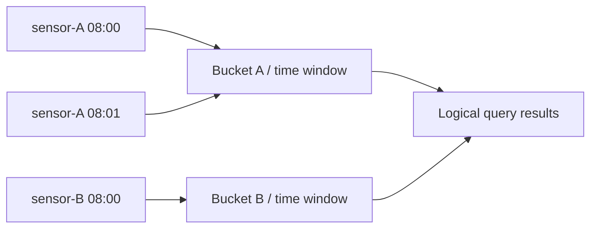

# Giới hạn index, update, delete và transaction theo phiên bản

MongoDB **time series collections** tối ưu dữ liệu theo thời gian bằng cách gom các measurements có `metaField` tương đồng và `timeField` gần nhau vào những buckets. Mô hình này hữu ích cho IoT, metrics, telemetry, sensor logs và dữ liệu quan sát lớn, nhưng **không hoàn toàn tương đương regular collection** khi tạo index, cập nhật, xóa hoặc dùng transaction.

Điều dễ sai nhất là **thay đổi khả năng theo MongoDB Server version**: 5.0 hầu như chỉ insert/read; 5.1 cho phép update/delete giới hạn; 6.0 mở rộng secondary indexes; 6.3 bổ sung default compound index; 7.0 nới delete và hỗ trợ partial TTL; các phiên bản mới vẫn có nhiều ràng buộc update/transaction. Spring Data MongoDB tạo lệnh cho server chứ không làm các lệnh bị cấm trở nên hợp lệ.

Bài thuộc chương **Time series** của module `SPRING_DATA_MONGODB`. Module hướng dẫn kết nối và ánh xạ document, thao tác qua `MongoTemplate` hoặc repository, thiết kế truy vấn, aggregation, index, transaction, reactive access, kiểm thử và chẩn đoán hiệu năng. Trọng tâm duy nhất của bài là **giới hạn index, update, delete và transaction theo phiên bản** trong MongoDB time series và cách sử dụng đúng từ Spring Data.

> **Quy tắc nền tảng:** Time series được thiết kế **append-oriented**. Không mặc định có unique `_id` index, không tùy ý update measurement như regular document, không ghi time series trong **multi-document transaction**, và phải kiểm tra **server binary + Feature Compatibility Version (FCV) + collection options** trước khi dùng tính năng phụ thuộc phiên bản.

## 1. Mục tiêu học tập

Sau bài này, bạn có thể:

1. Giải thích bucketing và khác biệt giữa time series với regular collections.
2. Đọc bảng version compatibility từ MongoDB 5.0 qua 8.3 và tài liệu hiện hành.
3. Kiểm tra server version, FCV, collection options và index catalog.
4. Tạo time series bằng `db.createCollection` hoặc `CollectionOptions.timeSeries(...)`.
5. Phân biệt `timeField`, `metaField` và measurement fields.
6. Hiểu tại sao time series không mặc định tạo `_id` index như regular collection.
7. Biết compound metadata/time index mặc định từ 6.3.
8. Biết secondary index trên measurement fields được mở rộng từ 6.0.
9. Tránh các index types bị cấm, điển hình `unique` và `text`.
10. Thiết kế TTL collection-level và partial TTL từ 7.0.
11. Dùng `updateMany` chỉ sửa metadata theo giới hạn server.
12. Phân biệt `updateFirst`, `updateMulti`, `upsert` và replacement update.
13. Hiểu deleteMany hạn chế trước 7.0 và deleteOne/deleteMany từ 7.0.
14. Phân biệt TTL bất đồng bộ với manual delete.
15. Giải thích transaction read được phép nhưng transaction write bị cấm.
16. Hiểu vì sao `@Transactional` không vượt qua MongoDB Server constraints.
17. Tránh dựa vào `MongoRepository.save` và `@Version` cho mutable time series.
18. Chọn chiến lược sửa measurement lỗi bằng append correction/rebuild.
19. Viết Spring Data integration tests theo server versions.
20. Kiểm tra `explain`, FCV compatibility và rủi ro downgrade.

## 2. Bảng tương thích theo phiên bản

Các mốc sau lấy từ MongoDB Server Manual/Release Notes. Khi triển khai thực, đọc trang tài liệu **đúng phiên bản**, vì nhánh mới, FCV và topology có thể thay đổi điều kiện cụ thể.

| Version | Index thay đổi đáng chú ý | Update | Delete thủ công | Ghi trong transaction |
| --- | --- | --- | --- | --- |
| **MongoDB 5.0** | Time series ra mắt, khả năng index ban đầu còn giới hạn | Không | Không | Không |
| **5.1–5.2** | Cải tiến internals và bucketing | Chỉ match/sửa `metaField`, `multi:true` | Giới hạn filter `metaField`, deleteMany | Không |
| **6.0–6.2** | Secondary indexes trên **measurement fields** | Chỉ metadata theo điều kiện | Vẫn giới hạn filter metadata và xóa nhiều | Không |
| **6.3–6.x** | Default compound index `metaField + timeField` khi tạo collection phù hợp | Vẫn meta-only | Vẫn giới hạn kiểu 5.1–6.x | Không |
| **7.0–7.x** | Partial TTL theo `metaField` | Vẫn meta-only | Nới đáng kể: `deleteOne`/`deleteMany`, filter fields đa dạng | Không |
| **8.0–8.2** | Index/FCV rules theo nhánh 8.x | Manual vẫn yêu cầu meta-only | Theo semantics mở rộng từ 7.0 | Không |
| **8.3+ / manual mới** | Giới hạn bổ sung cho tên/hint `_id_`; kiểm tra manual đúng version | Manual vẫn ghi meta-only restrictions | Kiểm tra phương thức/FCV của nhánh đang chạy | Manual vẫn nêu không ghi time series trong transactions |

**Không gộp hai thay đổi độc lập:** việc MongoDB 7.0 nới **delete** không làm `updateOne` hay thay đổi `temperatureC` tự nhiên trở thành thao tác update được hỗ trợ. Đây là nguồn nhầm lẫn phổ biến khi đọc release notes.

### 2.1. Version binary khác Feature Compatibility Version

Một cluster đã nâng binary MongoDB nhưng chưa nâng FCV có thể chưa kích hoạt đầy đủ hành vi/tính năng như cluster mới. Secondary indexes dùng tính năng mới có thể khiến **hạ FCV/downgrade thất bại** nếu chưa xử lý. Hãy kiểm tra cả hai.

### 2.2. Spring Data version không quyết định MongoDB Server features

`MongoTemplate.updateMulti` có thể biên dịch ở nhiều phiên bản Spring Data. Nhưng MongoDB 5.0 không hỗ trợ manual updates time series; MongoDB 8.x vẫn áp các restrictions lên trường nào được sửa. **Driver/library không thay thế phép kiểm tra khả năng trên server.**

## 3. Kiểm tra version, FCV và options

Trong `mongosh` kết nối đúng cluster/database mục tiêu:

```javascript
db.version();
db.adminCommand({ buildInfo: 1 });

// Cần role phù hợp để xem FCV.
db.adminCommand({
  getParameter: 1,
  featureCompatibilityVersion: 1
});

// Time series hay regular? Các timeField/metaField nào?
db.getCollectionInfos({ name: "sensor_readings" });

// Indexes thực sự đang tồn tại:
db.sensor_readings.getIndexes();
```

Không tự chạy `setFeatureCompatibilityVersion` hay `rs.reconfig` trong production để thử tính năng. Đây là thao tác quản trị có ảnh hưởng rộng và cần runbook riêng.

### 3.1. Đọc kết quả collection options

Một collection đúng time series có `options.timeseries` nêu `timeField`, `metaField`/granularity tương ứng. Nếu collection đã tồn tại dạng regular do một lệnh insert chạy trước migration, thêm annotation Java không biến nó thành time series.

### 3.2. Không đổi loại collection tùy ý

Bạn chỉ chọn loại collection khi tạo. Không thể chuyển trực tiếp một regular collection thành time series hoặc ngược lại bằng cách đổi `@Document` annotation; muốn đổi, hãy tạo namespace khác và migrate dữ liệu với kế hoạch backup/validation.

## 4. Tạo time series và documents mẫu

Ví dụ trên database test riêng:

```javascript
use time_series_lab

db.createCollection("sensor_readings", {
  timeseries: {
    timeField: "observedAt",
    metaField: "sensorId",
    granularity: "minutes"
  },
  expireAfterSeconds: 60 * 60 * 24 * 30
});

db.sensor_readings.insertMany([
  {
    _id: "A-001",
    sensorId: "sensor-A",
    observedAt: ISODate("2026-11-20T08:00:00Z"),
    temperatureC: 27.2,
    humidityPct: 61
  },
  {
    _id: "A-002",
    sensorId: "sensor-A",
    observedAt: ISODate("2026-11-20T08:01:00Z"),
    temperatureC: 27.6,
    humidityPct: 60
  },
  {
    _id: "B-001",
    sensorId: "sensor-B",
    observedAt: ISODate("2026-11-20T08:00:00Z"),
    temperatureC: 29.1,
    humidityPct: 57
  }
]);
```

Đây là dữ liệu **giả lập để học cú pháp**, không phải measurements đã được xác minh. Lưu ý `_id` chuỗi trong ví dụ chỉ giúp dễ đọc, không hàm ý server tạo unique index time series.

| Trường | Vai trò |
| --- | --- |
| `observedAt` | `timeField`, BSON Date của measurement |
| `sensorId` | `metaField`, định danh nguồn/sensor |
| `temperatureC`, `humidityPct` | Measurement values |
| `granularity` | Tham số tối ưu bucket timespan |
| `expireAfterSeconds` | TTL toàn collection, xử lý theo buckets |

### 4.1. Vì sao không thay timeField/metaField sau tạo?

MongoDB không cho phép đổi các tham số `timeField` và `metaField` của collection sau khi tạo. Một số granularity/bucket parameters có thể tăng trong giới hạn nhất định qua `collMod`, nhưng không được xem việc đổi domain schema là chỉnh sửa không rủi ro.

### 4.2. Bucket là đơn vị tối ưu



MongoDB nhóm nhiều measurements vào buckets. Các hiệu ứng index, retention và delete có thể diễn ra theo bucket, khác trực giác “mỗi document được giữ/xóa độc lập đúng giờ”.

## 5. Spring Data: @TimeSeries và CollectionOptions

Spring Data MongoDB có annotation `@TimeSeries` và `CollectionOptions.timeSeries(...)` cho explicit provisioning.

```java
package dev.learning.telemetry;

import java.time.Instant;
import org.springframework.data.annotation.Id;
import org.springframework.data.mongodb.core.mapping.TimeSeries;

@TimeSeries(
    collection = "sensor_readings",
    timeField = "observedAt",
    metaField = "sensorId"
)
public record SensorReading(
    @Id String id,
    Instant observedAt,
    String sensorId,
    double temperatureC,
    int humidityPct
) {}
```

Tạo collection trước khi ingest (trong migration/test fixture, không trong mỗi request):

```java
import org.springframework.data.mongodb.core.CollectionOptions;

// MongoTemplate đã được inject.
mongoTemplate.createCollection(
    "sensor_readings",
    CollectionOptions.timeSeries(
        "observedAt",
        options -> options.metaField("sensorId"))
);
```

Hoặc `mongoTemplate.createCollection(SensorReading.class)` để Spring Data đọc `@TimeSeries` mapping, nếu cấu hình dự án hỗ trợ. Khi dùng reactive template, Publisher tạo collection phải **được subscribe** có kiểm soát.

### 5.1. Annotation không tự bảo đảm collection đúng

`@TimeSeries` mô tả mapping, nhưng ứng dụng vẫn phải provision time series collection thực sự. Nếu lệnh insert trước đó vô tình tạo regular collection, code tiếp tục chạy nhưng không nhận được bucketing/index/TTL semantics của time series.

### 5.2. Vì sao ưu tiên insert hơn save?

Time series là dữ liệu **append-oriented**. `mongoTemplate.insert(reading)` hoặc repository insert thể hiện đúng ý định. `save` thường có semantics update/replacement/upsert trên record đã có, vướng hạn chế server time series. Không dùng `@Version` làm giả định mọi time series measurement hỗ trợ optimistic locking.

## 6. Index hoạt động trên buckets, không như regular collection

MongoDB time series logical collection trả lại measurements cho ứng dụng nhưng storage engine nhóm chúng theo `metaField` và cửa sổ `timeField`. Từ MongoDB 6.0, secondary indexes trên measurement fields có thể dựa trên **min/max values của buckets** để loại những buckets không liên quan rồi unpack và kiểm tra measurements.

```javascript
db.sensor_readings.find({
  sensorId: "sensor-A",
  observedAt: {
    $gte: ISODate("2026-11-20T00:00:00Z"),
    $lt: ISODate("2026-11-21T00:00:00Z")
  }
}).sort({ observedAt: 1 });
```

### 6.1. Chọn index theo pattern truy vấn

Với hầu hết telemetry, truy vấn chủ đạo là **sensor hoặc tenant+sensor** trong một khoảng thời gian. Vì vậy đánh giá index `sensorId + observedAt` trước khi tạo mọi index đo lường.

Không chỉ nhìn `keysExamined` bằng 0 hoặc một plan name; cần đánh giá số buckets/measurements bị giải nén, latency và write overhead trên dataset đại diện.

### 6.2. Đừng tự truy cập system.buckets

MongoDB quản lý internal bucket storage. Tránh thao tác trực tiếp lên `system.buckets.*` từ code ứng dụng để vượt giới hạn update/delete. Điều đó có thể phá invariant, gây lỗi upgrade và không được xem là API nghiệp vụ được hỗ trợ.

## 7. Default index metadata/time từ MongoDB 6.3

**MongoDB 6.3+** tạo **compound index** mặc định trên `metaField` và `timeField` cho time series collection mới có metadata. Trước khi bổ sung index, hãy kiểm tra:

```javascript
db.sensor_readings.getIndexes();
```

Một cách tạo thủ công nếu thiếu index phù hợp:

```javascript
db.sensor_readings.createIndex(
  { sensorId: 1, observedAt: 1 },
  { name: "sensor_time_lookup" }
);
```

Đừng mặc nhiên tạo thêm index cùng key pattern chỉ khác tên trong một migration: indexes trùng hoặc gần trùng có thể bị từ chối hoặc khiến writes tốn thêm tài nguyên.

### 7.1. Collection cũ sau upgrade

Không khẳng định mọi collection tạo từ MongoDB 5.x/6.0 đều được backfill index mới ngay khi nâng binary lên 6.3+. Kiểm tra index catalog trong chính database đã nâng cấp và provision những index còn thiếu khi có nhu cầu.

### 7.2. Collection không có metaField

Không có `metaField` thì không có cặp metadata/time tương ứng để tạo index dạng trên. Có thể cần index `timeField` riêng, nhưng còn phải xem lại mô hình bucketing và cardinality của nguồn dữ liệu.

## 8. Secondary index trên measurement fields từ 6.0

Từ **MongoDB 6.0**, MongoDB cho phép thêm secondary index trên measurement fields như `temperatureC`. Ví dụ chỉ chạy trên server/FCV hỗ trợ:

```javascript
db.sensor_readings.createIndex(
  { temperatureC: 1 },
  { name: "temperature_lookup" }
);

db.sensor_readings.find({
  temperatureC: { $gte: 35 }
});
```

MongoDB tổ chức secondary indexes theo buckets; với measurement field, **min/max của bucket** giúp đánh giá phạm vi ứng viên. Nếu một bucket chứa values dao động mạnh, nhiều buckets vẫn phải unpack nên index chưa chắc cải thiện latency đáng kể.

### 8.1. Không index tất cả measurement fields

Một sensor gửi mỗi giây nhiều numeric metrics; tạo 20 index đơn trường khiến inserts phải cập nhật nhiều index. Lựa chọn dựa trên query frequency, selectivity, dashboard latency và chi phí ingest.

### 8.2. Query thường lọc metadata trước

```javascript
db.sensor_readings.find({
  sensorId: "sensor-A",
  observedAt: {
    $gte: ISODate("2026-11-20T00:00:00Z"),
    $lt: ISODate("2026-11-21T00:00:00Z")
  },
  temperatureC: { $gte: 35 }
});
```

Cần so `explain` giữa index metadata+time và measurement index để xem query nào thật sự có lợi. Không suy index `temperatureC` luôn có hiệu quả như một regular B-tree với mỗi measurement một entry.

### 8.3. Các loại index đặc biệt

Time series có những giới hạn riêng về **multikey, partial, sparse và geospatial indexes**. MongoDB Manual cho biết multikey indexing bị giới hạn theo `metaField`; không lấy index array measurement của regular collection làm mẫu portable. `2dsphere` có use cases nhất định, nhưng không thể dùng `$near`/`$nearSphere` tùy ý trên time series; khi dùng `$geoNear` cần chỉ định `key` và không dùng `query` trong stage.

Một số phần tài liệu index có diễn đạt không đồng nhất về `2d`/`sparse` trong những nhánh/version. Đối với production, tránh thiết kế phụ thuộc loại này khi chưa tạo thử và kiểm chứng trên đúng server version/FCV.

## 9. Index không hỗ trợ và bẫy _id

Khác regular collections, time series collections **không tự có index `_id`** khi tạo. MongoDB cũng **không hỗ trợ unique indexes** hoặc text indexes trên time series.

| Giả định | Thực tế cần kiểm tra |
| --- | --- |
| `@Id` tạo unique index như regular collection | **Không** tự có unique `_id` index |
| `unique:true` trên sensor+time | **Không hỗ trợ** unique index time series |
| `text` index cho note/comment | **Không hỗ trợ** |
| `_id_` luôn có thể hint | **Không**; 8.3+ còn từ chối hint/name `_id_` |
| Measurement field có thể index trên 5.0 | **Không** theo khả năng mở rộng từ 6.0 |
| Compound metadata+time mặc định trên mọi bản | Chỉ được tạo tự động từ 6.3 theo điều kiện |

### 9.1. Dữ liệu có thể có trùng _id

`@Id` trên Java entity giúp map sang MongoDB `_id`, nhưng không có unique index như regular collection. Nếu application nhận duplicates, một lệnh `findById` hoặc `save` có thể mang semantics khác dự kiến.

Nếu nghiệp vụ bắt buộc idempotency/uniqueness, dùng một **regular companion collection có unique index**, một ingestion registry hoặc contract unique event keys ở boundary, thay vì kỳ vọng time series tự enforce.

### 9.2. Quy tắc MongoDB 8.3 cho tên/hint _id_

MongoDB Manual mới ghi rõ: từ **MongoDB 8.3**, **tạo index có tên `_id_` hoặc hint bằng `"_id_"`** trên time series sẽ báo lỗi. Không hardcode `hint("_id_")` từ repository/query plan của regular collection rồi áp sang time series.

Ngay cả khi phiên bản khác cho phép tạo non-unique index trên `_id`, **nó không thay thế unique index** và không khiến `save` mutable trở thành API đúng cho time series.

### 9.3. Index build trên dữ liệu mixed schema cũ

Time series collections tạo trước MongoDB 5.2 có thể chứa mixed-schema buckets. Với index trên measurement field, server có thể từ chối build cho đến khi dữ liệu được remediation. Kiểm tra `validate`/warnings, backup và dùng quy trình hỗ trợ chính thức, không tự update internal bucket documents từ Spring Data.

## 10. TTL và partial TTL theo version

TTL toàn collection được cấu hình bằng `expireAfterSeconds` lúc tạo hoặc qua configuration phù hợp. MongoDB sẽ loại những **buckets đủ điều kiện hết hạn**, không thực hiện delete ngay từng measurement ở đúng millisecond.

```javascript
db.createCollection("sensor_readings_30d", {
  timeseries: {
    timeField: "observedAt",
    metaField: "sensorId"
  },
  expireAfterSeconds: 30 * 24 * 60 * 60
});
```

### 10.1. Partial TTL từ MongoDB 7.0

Từ **7.0**, bạn có thể tạo TTL index với `partialFilterExpression` dựa vào **metaField** để một nhóm sensor có retention ngắn hơn nhóm khác.

```javascript
// MongoDB 7.0+; cần xác minh FCV/index options.
db.sensor_readings.createIndex(
  { observedAt: 1 },
  {
    name: "ttl_test_sensor_7d",
    expireAfterSeconds: 7 * 24 * 60 * 60,
    partialFilterExpression: {
      sensorId: "sensor-test"
    }
  }
);
```

**Lưu ý:** partial filter dựa vào `metaField`; TTL vẫn xét thời gian theo `timeField`. Không tạo một unique/text/partial index tùy ý rồi nghĩ nó sẽ hoạt động như regular collection.

### 10.2. Hai loại retention tương tác

Nếu collection TTL là 30 ngày, partial TTL là 7 ngày cho `sensor-test`, nhóm test có thể bị loại sớm hơn. Partial TTL không dùng để gia hạn một nhóm đã bị giới hạn bởi collection-wide expiration.

### 10.3. TTL không phải delete ngay

TTL monitor chạy bất đồng bộ và buckets có thể chứa timestamps khác nhau. Dùng TTL để bảo đảm eventual retention, **không** thay thế yêu cầu business xóa tức thời và nhận kết quả xác nhận. Với delete thủ công phải xét phiên bản MongoDB.

## 11. Spring Data index management và FCV

Với Spring Data `MongoTemplate`, index được tạo qua `IndexOperations`, ví dụ:

```java
import org.springframework.data.domain.Sort;
import org.springframework.data.mongodb.core.index.Index;

// Chỉ chạy trong migration khi index còn thiếu và version hỗ trợ.
mongoTemplate.indexOps(SensorReading.class).ensureIndex(
    new Index()
        .on("sensorId", Sort.Direction.ASC)
        .on("observedAt", Sort.Direction.ASC)
        .named("sensor_time_lookup")
);
```

**Không gọi ensureIndex trong mỗi HTTP request.** Kiểm tra `db.sensor_readings.getIndexes()` vì từ 6.3+ có thể đã có compound index hữu ích.

### 11.1. Annotation không vượt qua server restriction

`@Indexed(unique=true)` trên field time series vẫn có thể khiến index creation thất bại. Spring Data không có quyền “bật unique indexes” nơi server cấm. Khi auto-index creation được bật có chủ đích, cần test startup để tránh service fail do một annotation không phù hợp.

### 11.2. Downgrade và secondary indexes

Nếu bạn dùng index features được thêm ở 6.x/7.x rồi cần downgrade FCV, MongoDB có thể yêu cầu **drop những secondary indexes không tương thích** trước. Dùng migration plan có backup và rollback; không xóa index tùy tiện trên production chỉ để chạy một bản binary cũ.

## 12. Update từ MongoDB 5.1: chỉ metadata

Trong MongoDB **5.0**, time series về cơ bản chỉ cho insert/read, **không hỗ trợ manual update**. Từ **5.1**, update được phép nhưng có ràng buộc nghiêm ngặt:

1. Query chỉ được match theo `metaField`.
2. Chỉ được sửa `metaField`, không sửa `timeField` hay measurement.
3. Update document phải dùng **update operator expressions**.
4. Chỉ update nhiều, tức `multi:true`/`updateMany`.
5. `upsert:true` bị cấm.

Mẫu hợp lệ trên server/FCV hỗ trợ:

```javascript
db.sensor_readings.updateMany(
  { sensorId: "sensor-A" },
  { $set: { sensorId: "sensor-renamed-A" } }
);
```

Ví dụ sẽ cập nhật metadata của **nhiều measurements** đang có `sensorId:"sensor-A"`, không chỉ một measurement. Hãy xác nhận phạm vi tác động trước khi chạy, đặc biệt trong dữ liệu multi-tenant.

### 12.1. Vì sao không sửa nhiệt độ?

```javascript
// Không hợp lệ trên các phiên bản theo giới hạn nêu trên:
db.sensor_readings.updateMany(
  { sensorId: "sensor-A" },
  { $set: { temperatureC: 38.1 } }
);
```

`temperatureC` là measurement, không phải `metaField`. Server có thể từ chối với lỗi time series update restriction. **Nâng lên MongoDB 7.0 không tự bỏ hạn chế này**; đó là thay đổi của delete, không phải một bảo đảm mở rộng update.

### 12.2. Vì sao không filter theo thời gian?

```javascript
// Không hợp lệ cho update time series meta-only:
db.sensor_readings.updateMany(
  {
    sensorId: "sensor-A",
    observedAt: {
      $lt: ISODate("2026-11-21T00:00:00Z")
    }
  },
  { $set: { sensorId: "sensor-renamed-A" } }
);
```

Khi có thêm `observedAt` trong filter, nó không còn là truy vấn **chỉ match metaField**, trái với update restrictions. Đừng copy filter phức tạp từ regular collection sang time series update.

## 13. Update operations không được dùng như regular CRUD

| Operation | Tương thích theo quy tắc time series? | Lý do |
| --- | --- | --- |
| `insertOne/insertMany` | Có | Dữ liệu append-oriented |
| `updateMany` chỉ match/sửa `metaField` | Có từ 5.1, trong giới hạn | Metadata-only |
| `updateOne` | Không theo meta-only contract | Chỉ multi updates |
| `replaceOne`/replacement update | Không | Update phải dùng operators |
| `upsert:true` | Không | Server cấm upsert time series |
| `$set: {temperatureC:...}` | Không | Measurement immutable theo update rules |
| `$set: {observedAt:...}` | Không | timeField không sửa qua update |
| `findOneAndUpdate`/`findAndModify` | Không xem là thay thế hợp lệ | Single-document update semantics không phù hợp |
| `MongoRepository.save(existing)` | Không nên dựa vào | Thường update/replacement/upsert |
| `@Version` optimistic save | Không được đảm bảo | Không vượt qua time series constraints |

### 13.1. UpdateMany là theo metaField, không theo mọi time

Một operation đổi `sensorId` nghĩa là có thể đổi nhãn của **mọi measurements** cùng metadata matching. Nếu chỉ một reading sai, hãy xem cách ghi correction hoặc tái dựng dataset, không cố lọc theo `_id` rồi update measurement.

### 13.2. Đừng âm thầm chuyển updateFirst thành updateMulti

Nếu service trước đây dùng `updateFirst` cho một record thì thay bằng `updateMulti` có thể biến thay đổi một measurement thành thay đổi **hàng nghìn bản ghi**. Đây là rủi ro dữ liệu nghiêm trọng, không chỉ một cách sửa lỗi API.

## 14. MongoTemplate.updateMulti: ví dụ có kiểm soát

Spring Data MongoDB vẫn có thể dùng `MongoTemplate.updateMulti` để tạo update command hợp lệ theo server:

```java
package dev.learning.telemetry;

import org.springframework.data.mongodb.core.MongoTemplate;
import org.springframework.data.mongodb.core.query.Criteria;
import org.springframework.data.mongodb.core.query.Query;
import org.springframework.data.mongodb.core.query.Update;
import com.mongodb.client.result.UpdateResult;

public class SensorMetadataRenamer {

    private final MongoTemplate mongoTemplate;

    public SensorMetadataRenamer(MongoTemplate mongoTemplate) {
        this.mongoTemplate = mongoTemplate;
    }

    public UpdateResult renameSensor(
            String originalSensor, String newSensor) {

        if (originalSensor == null || newSensor == null
                || originalSensor.isBlank()
                || newSensor.isBlank()) {
            throw new IllegalArgumentException("Sensor ID không hợp lệ");
        }

        Query onlyMeta = Query.query(
            Criteria.where("sensorId").is(originalSensor));

        Update onlyMetaUpdate =
            new Update().set("sensorId", newSensor);

        return mongoTemplate.updateMulti(
            onlyMeta,
            onlyMetaUpdate,
            SensorReading.class
        );
    }
}
```

**Hợp đồng quan trọng:** `renameSensor` có thể sửa metadata của **nhiều measurements**. Nếu sensor ID được chứa trong object metadata phức tạp, cần xác minh path mapping và restrictions của server cụ thể. Không nhận filter/update expression thô từ HTTP request.

### 14.1. Kiểm tra kết quả UpdateResult

`matchedCount` phản ánh số documents match theo semantics MongoDB update; `modifiedCount` cho biết số measurements được sửa thực sự theo kết quả driver/server. Đừng dùng số lượng này để suy tài liệu đã được re-bucket theo kiểu một regular collection chưa nén, hoặc coi một metadata rename là thao tác không tốn chi phí trên dataset lớn.

### 14.2. Vì sao không dùng updateFirst?

`updateFirst` phát single-update semantics, trong khi time series update restrictions yêu cầu `multi:true`. Nếu business cần chỉnh một measurement riêng lẻ, không âm thầm đổi sang `updateMulti` vì hậu quả có thể lan tới toàn bộ lịch sử sensor.

### 14.3. ReactiveMongoTemplate

`ReactiveMongoTemplate.updateMulti(...)` có thể dùng cùng `Query`/`Update` nhưng trả `Mono<UpdateResult>`. Operation chỉ được thực thi khi subscribe; lỗi server sẽ phát vào `onError`. Đừng gọi `onErrorResume(Mono.empty())` rồi thông báo cập nhật thành công.

## 15. Delete trên MongoDB 5.0 và 5.1–6.x

**MongoDB 5.0:** Manual ghi time series chỉ có insert/read; manual delete không được hỗ trợ.

**MongoDB 5.1 đến trước 7.0:** delete được mở một phần với hai điều kiện quan trọng:

1. Filter chỉ được match trên `metaField`.
2. Lệnh phải **xóa nhiều**, dùng `deleteMany` hoặc raw delete với `limit:0`; không dùng `deleteOne`.

Ví dụ trên MongoDB 5.1–6.x:

```javascript
// Hợp lệ trong phạm vi version hỗ trợ:
db.sensor_readings.deleteMany({
  sensorId: "sensor-test"
});
```

Lệnh trên có thể xóa **toàn bộ các measurements thuộc sensor-test**, không chỉ một khoảng thời gian. Nếu sensor metadata được dùng nhiều năm, rủi ro dữ liệu rất lớn; không chạy trong production khi chưa xác minh phạm vi và có backup.

### 15.1. Filter time không hợp lệ ở phiên bản cũ

```javascript
// KHÔNG hợp lệ trong các giới hạn delete từ 5.1 đến 6.x:
db.sensor_readings.deleteMany({
  sensorId: "sensor-test",
  observedAt: {
    $lt: ISODate("2026-11-01T00:00:00Z")
  }
});
```

Lý do: filter chứa `observedAt`, không còn chỉ match `metaField`. Một service cần xóa theo thời gian nên dùng TTL/retention policy phù hợp, hoặc nâng MongoDB theo quy trình được duyệt khi cần manual selective delete.

### 15.2. deleteOne cũng không hợp lệ ở 5.1–6.x

```javascript
// Không được hỗ trợ trong những version bị giới hạn:
db.sensor_readings.deleteOne({
  sensorId: "sensor-test"
});
```

Không chỉ đổi `deleteMany` thành `deleteOne` vì muốn xóa một document. Trước 7.0, semantics time series delete giới hạn xóa nhiều theo metadata.

## 16. Delete được mở rộng từ MongoDB 7.0

MongoDB **7.0** gỡ bỏ **hầu hết giới hạn time-series-specific** với các operations dựa trên `delete` command, trong đó có `deleteOne`, `deleteMany` và các bulk deletes tương ứng.

Ví dụ trên MongoDB 7.0+:

```javascript
// Có thể xóa theo time range, không chỉ metaField.
db.sensor_readings.deleteMany({
  sensorId: "sensor-test",
  observedAt: {
    $lt: ISODate("2026-11-01T00:00:00Z")
  }
});

// Có thể xóa một matching measurement.
db.sensor_readings.deleteOne({
  sensorId: "sensor-A",
  observedAt: ISODate("2026-11-20T08:01:00Z")
});
```

**Nhưng:** vẫn **không được thực hiện delete trên time series trong multi-document transaction**. Nới hạn chế filter/limit không đồng nghĩa hỗ trợ transactional writes.

### 16.1. deleteOne có an toàn theo ID không?

Time series không mặc định có unique `_id` index. Nếu filter chỉ là `{ _id: "A-001" }` và có duplicates, `deleteOne` có thể xóa **một document khớp** nhưng không đảm bảo đó là duy nhất theo business expectations. Dùng metadata/time và ingestion identity phù hợp, đồng thời kiểm tra count và quyền trước khi xóa.

### 16.2. Không nhầm nới delete với nới update

`deleteOne` hỗ trợ từ 7.0+ **không có nghĩa** `updateOne` sửa temperature được hỗ trợ. MongoDB Manual hiện vẫn nêu update phải meta-only/multi/no-upsert trong các nhánh được đối chiếu.

### 16.3. Delete và bucket repacking

Một measurement bị xóa khỏi bucket có thể khiến server phải repack bucket còn lại; nếu toàn bộ measurements trong bucket bị xóa, server có thể xóa bucket. Đừng dự đoán chi phí delete dựa trên một record duy nhất như regular collection. Test với dữ liệu đủ lớn và quan sát latency.

## 17. Spring Data xóa dữ liệu theo version

Nếu cần xóa toàn bộ metadata group trên MongoDB 5.1–6.x, `MongoTemplate.remove(Query,Class)` tạo multi-delete semantics tương ứng:

```java
import org.springframework.data.mongodb.core.query.Criteria;
import org.springframework.data.mongodb.core.query.Query;
import com.mongodb.client.result.DeleteResult;

Query onlyMetadata = Query.query(
    Criteria.where("sensorId").is("sensor-test"));

DeleteResult result =
    mongoTemplate.remove(onlyMetadata, SensorReading.class);
```

Cần xác minh driver method mapping và permission trong integration test đúng server version. `remove` có thể xóa **nhiều measurements**, nên không dùng như một “xóa một record” theo mặc định.

### 17.1. Delete by time trên 7.0+

```java
import java.time.Instant;

Query oldData = Query.query(
    Criteria.where("sensorId").is("sensor-test")
        .and("observedAt").lt(
            Instant.parse("2026-11-01T00:00:00Z")));

DeleteResult deleted =
    mongoTemplate.remove(oldData, SensorReading.class);
```

Spring Data ánh xạ `Instant` thành BSON Date theo converter; chú ý timezone và định dạng. Query này **không phù hợp với MongoDB 5.1–6.x** theo giới hạn delete cũ.

### 17.2. Không giả định repository.deleteById luôn an toàn

Derived repository delete và `deleteById` có thể tạo các lệnh/filter khác nhau tùy version/implementation, và `_id` time series không có unique constraint mặc định. Hãy kiểm tra câu lệnh thực, loại delete command và tính phù hợp version; dùng explicit `MongoTemplate`/driver operation khi cần semantics được kiểm soát.

### 17.3. Delete hàng loạt có rủi ro

Xóa nhiều measurements có thể tác động đến nhiều buckets. Giới hạn người được gọi, xác minh tenant/sensor/time filters, xét read/write load và không làm một request HTTP đồng bộ chạy vô hạn trên hàng triệu documents mà thiếu quota.

## 18. Transaction: read được, write bị cấm

Theo MongoDB Manual hiện hành, **không thể ghi time series collections bên trong multi-document transactions**. Điều này bao gồm:

- Insert measurement vào time series trong transaction.
- Update metadata của time series bên trong transaction.
- Delete measurements từ time series bên trong transaction.

**Đọc** time series trong transaction **được hỗ trợ**, với các giới hạn read concern/snapshot liên quan. Đây là khác biệt cần nói rõ; không viết chung chung “time series không hỗ trợ transactions” rồi suy cả read cũng bị cấm.

### 18.1. Ví dụ sai: insert trong @Transactional

```java
import org.springframework.transaction.annotation.Transactional;

@Transactional
public void recordMeasurement(SensorReading reading) {
    mongoTemplate.insert(reading); // Time series write trong tx.
}
```

Giả sử transaction thực sự được mở qua `MongoTransactionManager` trên replica set, server sẽ từ chối write time series trong transaction theo rules đã nêu. Chỉ gắn `@Transactional` không phải cách kích hoạt atomic writes bị cấm.

### 18.2. Trường hợp @Transactional không được áp dụng

Nếu ứng dụng **không có MongoTransactionManager được cấu hình** hoặc lời gọi không đi qua Spring AOP proxy, `@Transactional` có thể không thực sự mở MongoDB transaction. Một insert “chạy được” không chứng minh time series hỗ trợ transactional writes; cần xác minh `ClientSession`/transaction boundary thực tế trong test.

### 18.3. Đọc trong transaction

`mongoTemplate.find(query, SensorReading.class)` có thể nằm trong MongoDB transaction read-only, nếu topology, read concern và các constraints khác được thỏa. Nhưng không được suy điều đó cho phép **ghi** measurements cùng transaction.

### 18.4. Snapshot isolation và concurrent DDL

MongoDB lưu ý snapshot read trên time series có các giới hạn khi collection đồng thời bị drop/rename/recreate. Không coi snapshot isolation là lời hứa bao trùm những thay đổi DDL dạng này.

## 19. Atomicity của từng insert và giao dịch phân tán

MongoDB vẫn có atomicity ở phạm vi một document operation theo quy tắc storage. Nhưng time series bucketing có internal behavior đặc thù; không biến một `insertMany` thành distributed transaction bao gồm những collections khác chỉ vì MongoDB ghi compressed buckets.

Nếu nghiệp vụ cập nhật `orders` và lưu measurement/telemetry cùng lúc, cần quyết định:

| Yêu cầu | Hướng xử lý |
| --- | --- |
| Cần ghi measurement theo log/event, chấp nhận eventual consistency | Insert time series **ngoài transaction** sau bước xác nhận |
| Cần nguyên tử giữa business write và việc phát sự kiện | **Transactional outbox** trong regular collection, relay riêng |
| Cần transaction cho nhiều mutable records | Lưu chúng trong **regular collection** có transaction support |
| Cần chỉnh sửa measurement và audit mọi thay đổi | Regular mutable collection + history, hoặc append correction |
| Cần retention quan sát lớn | Time series TTL + data reconciliation |

### 19.1. Transactional outbox không đồng nghĩa insert hai collection trong cùng tx

Một transaction có thể ghi business document và outbox record trong **regular collections**. Sau commit, relay đọc outbox và insert measurement vào time series hoặc publish message. Nếu relay crash, retry/idempotency xử lý duplicate risks; không quảng cáo “exactly once” không có kiểm chứng.

### 19.2. Đừng tắt transaction tùy tiện để che lỗi

Khi time series insert thất bại trong transaction, chuyển code sang gọi insert ngoài transaction **có thay đổi semantics consistency**. Phải review business invariant và error handling, không chỉ xóa annotation `@Transactional` rồi coi mọi lỗi đã giải quyết.

## 20. Thiết kế corrections cho measurement sai

Một tình huống điển hình: sensor-A gửi nhiệt độ `270.0` thay vì `27.0`. Ở regular collection ta có thể `updateOne({_id}, {$set:{temperatureC:27}})`, nhưng với time series meta-only rules, **không có update measurement trực tiếp như thế**.

Các phương án:

1. **Append correction:** ghi bản đo hiệu chỉnh mới kèm `correctionOf`/`revision` và logic chọn bản mới nhất ở query layer.
2. **Sidecar corrections collection:** lưu corrections theo event key trong regular collection, áp khi đọc/aggregate.
3. **Re-ingest/migrate:** tạo time series collection mới, làm sạch/loại records sai, migrate và cutover có kế hoạch.
4. **Separate mutable state:** dữ liệu cần sửa thường xuyên lưu regular collection; time series chỉ giữ lịch sử quan sát.

### 20.1. Ví dụ correction event

```javascript
db.sensor_corrections.insertOne({
  readingKey: {
    sensorId: "sensor-A",
    observedAt: ISODate("2026-11-20T08:00:00Z")
  },
  correctedTemperatureC: 27.0,
  reason: "sensor calibration",
  correctedAt: new Date()
});
```

`sensor_corrections` là **regular collection** với indexes/authorization riêng; nó không sửa lại measurement trong time series. Query/reporting phải có quy tắc join/apply correction và lịch sử rõ ràng.

### 20.2. Xóa-sau-đó-insert có transaction không?

Từ MongoDB 7.0+, có thể xóa measurement theo filter rồi insert một bản đúng, nhưng **không thể bọc cả hai time series writes trong một multi-document transaction**. Ở giữa chúng có window không nhất quán; phải thiết kế reconciliation hoặc versioned dataset nếu cần atomic visibility.

## 21. @Version, optimistic locking và save của repository

Spring Data repository giúp giảm boilerplate nhưng không xóa ranh giới của MongoDB Server:

- `@Version` thông thường dựa trên expected version và update semantics.
- `MongoRepository.save(existing)` có thể thực hiện replace/upsert/update command.
- Time series meta-only update rules cấm các đường mutation thông thường.
- `_id` không có unique index mặc định nên không đủ identity guarantee.
- Các update/delete operations có thể tác động nhiều measurements trong cùng metadata group.

**Do đó:** Với time series, ưu tiên repository `insert` và truy vấn đọc; dùng `MongoTemplate` explicit cho metadata update hoặc delete theo server version. Không xây API “CRUD full” trên time series nếu business thực sự cần mutable entities.

### 21.1. Đừng dùng @Id làm khóa nghiệp vụ duy nhất

Nếu logic idempotency chỉ kiểm tra `repository.existsById(id)` rồi insert, hai writers đồng thời vẫn có thể cùng ghi `_id`, vì không có unique index mặc định để cưỡng chế. Cần một dedup registry có unique key trong regular collection hoặc ingestion process có guarantees phù hợp.

### 21.2. Time series không phù hợp mọi mô hình

Những dữ liệu như users, orders, workflow states, cart items hoặc documents cần thay đổi từng field thường xuyên không nên chuyển sang time series chỉ vì có một field `createdAt`.

## 22. Test server capability thay vì chỉ kiểm tra Java API

Một unit test với Mockito có thể chứng minh `MongoTemplate.updateMulti` được gọi, nhưng **không** chứng minh MongoDB Server chấp nhận update time series. Với tính năng khác biệt theo version, phải có **integration test kết nối đúng server binary và FCV**.

Các nhóm ca kiểm thử:

| Test | Dữ liệu/điều kiện | Kỳ vọng |
| --- | --- | --- |
| Time series collection created | `getCollectionInfos` trả `timeseries` | Storage đúng |
| Insert và query time range | Trên MongoDB 5.0+ | Thành công |
| Measurement secondary index | MongoDB 6.0+ | Tạo được index được hỗ trợ |
| Unique index | Các version được nêu | Bị server từ chối |
| Text index | Các version được nêu | Bị server từ chối |
| Metadata `updateMany` | MongoDB 5.1+ | Thành công khi đúng meta-only rules |
| Measurement `updateMany` | Các manual version nêu | Bị server từ chối |
| `updateOne`/upsert | Meta-only update contract | Không hợp lệ |
| DeleteMany by metadata | MongoDB 5.1+ | Thành công nếu filter hợp lệ |
| DeleteOne by timestamp | MongoDB 7.0+ | Thành công khi syntax/quyền đúng |
| DeleteMany by time trên 6.x | Metadata-only delete restriction | Bị từ chối |
| Partial TTL | MongoDB 7.0+ | Index tạo được với meta filter |
| Write trong transaction | Các version được nêu | Bị từ chối |
| Read trong transaction | Replica set/transaction config hợp lệ | Được phép theo limitations |
| Hint `_id_` | MongoDB 8.3+ | Bị từ chối theo manual |

### 22.1. Tránh test “chạy được trên máy tôi” nhưng khác production

Nếu môi trường local là MongoDB 8.0 và production là 6.0, test `deleteOne` có thể pass local nhưng fail production. Pin **MongoDB test image version** theo từng deployment target, đồng thời ghi FCV trong test report.

### 22.2. Đừng assert thông báo lỗi theo từng chữ

Thông báo và error codes có thể thay đổi giữa MongoDB versions hoặc Spring Data exception translation. Assert **class/loại lỗi**, rejected operation và dữ liệu không bị thay đổi; không khóa test vào một chuỗi English error message.

## 23. Testcontainers: ví dụ kiểm thử trên MongoDB 8.0

Ví dụ dùng **Spring Boot 3.x + Testcontainers Java 1.x**, trên một test database riêng. MongoDBContainer tạo single-node replica set phù hợp để kiểm tra transaction limitations và time series:

```java
package dev.learning.telemetry;

import static org.assertj.core.api.Assertions.*;

import java.time.Instant;
import java.util.List;
import java.util.UUID;

import org.bson.Document;
import org.junit.jupiter.api.BeforeEach;
import org.junit.jupiter.api.Test;
import org.springframework.beans.factory.annotation.Autowired;
import org.springframework.boot.test.context.SpringBootTest;
import org.springframework.data.mongodb.core.CollectionOptions;
import org.springframework.data.mongodb.core.MongoTemplate;
import org.springframework.data.mongodb.core.query.Criteria;
import org.springframework.data.mongodb.core.query.Query;
import org.springframework.data.mongodb.core.query.Update;
import org.springframework.test.context.DynamicPropertyRegistry;
import org.springframework.test.context.DynamicPropertySource;
import org.testcontainers.containers.MongoDBContainer;
import org.testcontainers.junit.jupiter.Container;
import org.testcontainers.junit.jupiter.Testcontainers;
import org.testcontainers.utility.DockerImageName;

@Testcontainers
@SpringBootTest
class TimeSeriesCompatibilityIntegrationTest {

    @Container
    static final MongoDBContainer mongo =
        new MongoDBContainer(DockerImageName.parse("mongo:8.0"));

    @DynamicPropertySource
    static void mongoProperties(DynamicPropertyRegistry registry) {
        // Spring Boot 3.x property; Boot mới cần kiểm tra namespace.
        registry.add("spring.data.mongodb.uri",
            mongo::getReplicaSetUrl);
    }

    @Autowired MongoTemplate template;

    @BeforeEach
    void provisionCollection() {
        if (!template.collectionExists("sensor_readings")) {
            template.createCollection(
                "sensor_readings",
                CollectionOptions.timeSeries(
                    "observedAt",
                    options -> options.metaField("sensorId")));
        }
        // Production-like tests nên xác minh metadata capped/time-series.
    }

    @Test
    void allowsMetadataUpdateMany() {
        String key = UUID.randomUUID().toString();
        String before = "sensor-before-" + key;
        String after = "sensor-after-" + key;

        template.insert(new SensorReading(
            "READING-" + key,
            Instant.parse("2026-11-20T08:00:00Z"),
            before,
            27.1,
            60));

        var updated = template.updateMulti(
            Query.query(Criteria.where("sensorId").is(before)),
            new Update().set("sensorId", after),
            SensorReading.class);

        assertThat(updated.getModifiedCount())
            .isGreaterThanOrEqualTo(1L);

        List<SensorReading> reloaded = template.find(
            Query.query(Criteria.where("sensorId").is(after)),
            SensorReading.class);

        assertThat(reloaded)
            .extracting(SensorReading::id)
            .contains("READING-" + key);
    }

    @Test
    void rejectsMeasurementUpdate() {
        String key = UUID.randomUUID().toString();
        String sensor = "sensor-test-" + key;

        template.insert(new SensorReading(
            "READING-" + key,
            Instant.parse("2026-11-20T08:10:00Z"),
            sensor,
            27.1,
            60));

        assertThatThrownBy(() ->
            template.updateMulti(
                Query.query(Criteria.where("sensorId").is(sensor)),
                new Update().set("temperatureC", 99.0),
                SensorReading.class))
            .isInstanceOf(RuntimeException.class);

        SensorReading actual = template.findOne(
            Query.query(Criteria.where("sensorId").is(sensor)),
            SensorReading.class);

        assertThat(actual).isNotNull();
        assertThat(actual.temperatureC()).isEqualTo(27.1);
    }
}
```

**Giải thích:** Test fixture dùng UUID để cách ly data. Kiểm thử đòi dependency Spring Data, JUnit, AssertJ và MongoDB Testcontainers. Nếu project dùng Testcontainers 2.x, tên module/imports có thể khác. Chỉ chạy trên database test; không gọi `dropCollection` trên namespace chia sẻ.

### 23.1. Vì sao test chưa chứng minh mọi version?

Container chỉ pin **MongoDB 8.0**. Đây là test của 8.0, không phải ma trận 5.x/6.x/7.x. Để kiểm chứng một giả định về 6.0 hoặc 7.0, chạy test riêng với image/version đó và kiểm tra FCV tương ứng.

### 23.2. Cấu hình @TimeSeries phải được load

Test có `SensorReading` và `@TimeSeries` từ mục 5. Application phải discover entity/repository/mapping đúng package. Nếu còn một regular collection cùng tên do fixture khác tạo, điều kiện `collectionExists` không đủ để chứng minh đúng storage; nên kiểm tra `getCollectionInfos` trong setup.

### 23.3. Không cần Gradle test khi viết tài liệu

Các ví dụ này là hướng dẫn cho người học chạy trên môi trường test có MongoDB/Docker. Bước viết Markdown không đồng nghĩa đã thực thi Testcontainers hoặc có Docker trong workspace.

## 24. Bài kiểm thử delete theo 6.x so với 7.x

Một bài kiểm tra tương thích thực tế nên provision **hai test environments khác version** (hoặc test matrix CI riêng), rồi chạy cùng một dataset và so kết quả.

```javascript
// Test fixture: chỉ trên database thử nghiệm.
db.sensor_readings.insertMany([
  {
    sensorId: "sensor-delete-test",
    observedAt: ISODate("2026-01-01T00:00:00Z"),
    temperatureC: 20
  },
  {
    sensorId: "sensor-delete-test",
    observedAt: ISODate("2026-02-01T00:00:00Z"),
    temperatureC: 21
  }
]);
```

Trên **MongoDB 6.x**:

```javascript
// Có thể xóa tất cả metadata group:
db.sensor_readings.deleteMany({
  sensorId: "sensor-delete-test"
});

// Không dùng deleteOne hay filter observedAt cho time series delete.
```

Trên **MongoDB 7.0+**:

```javascript
// Có thể xóa chọn lọc một measurement theo time:
db.sensor_readings.deleteOne({
  sensorId: "sensor-delete-test",
  observedAt: ISODate("2026-01-01T00:00:00Z")
});
```

Hai ví dụ phải chạy trên **test dataset riêng hoặc reset fixture**; nếu xóa toàn bộ trước, lệnh xóa chọn lọc sau chỉ còn zero matches.

### 24.1. Khác biệt nằm ở server, không phải cú pháp driver

Hai lệnh đều là MongoDB delete commands. Driver có thể expose `deleteOne` từ trước; MongoDB 6.x vẫn từ chối trên time series vì giới hạn collection type. API tồn tại trong Java không chứng minh server hỗ trợ.

### 24.2. Test deleted count

Đọc `deletedCount`/`DeleteResult` và kiểm tra danh sách documents còn lại. Không chỉ assert command không throw, vì filter sai hoặc tenant mismatch có thể khiến kết quả là zero deleted mà không có exception.

## 25. Performance, explain và capacity

Time series buckets thường giúp giảm storage/index footprint và tăng tốc những truy vấn theo metadata+time, nhưng không đảm bảo mọi query tốt hơn regular collection.

```javascript
db.sensor_readings.explain("executionStats").find({
  sensorId: "sensor-A",
  observedAt: {
    $gte: ISODate("2026-11-20T00:00:00Z"),
    $lt: ISODate("2026-11-21T00:00:00Z")
  },
  temperatureC: { $gte: 30 }
});
```

Quan sát:

- Index nào đã được chọn, nhất là metadata/time và measurement indexes.
- Số keys/buckets/documents examined so với measurements trả về.
- Thời gian unpack/filter và kết quả trả cho Spring Data converter.
- Ingestion latency trước/sau thêm index.
- Query plans cho sensor cardinality cao/thấp.
- Độ chọn lọc của time range và measurement threshold.
- TTL backlog và công việc xóa/repacking.
- Tác động của các manual delete/update lớn.
- Disk space và cache footprint sau migration.
- Hiệu năng sau thay đổi FCV/index catalog.

### 25.1. Đừng so index count của time series với regular collection đơn giản

Time series có internal buckets; một measurement index có thể biểu diễn min/max trên bucket. Vì vậy “index có ít entries hơn” không đủ để khẳng định latency của mọi query nhanh hơn. Dùng workload đại diện và `explain`.

### 25.2. Measurements có timestamp rất xa

MongoDB có lưu ý đặc biệt đối với `timeField` trước **1970-01-01** hoặc sau **2038-01-19**: tạo index trên timeField có thể cần để cải thiện query optimization. Không suy mọi dữ liệu lịch sử tương lai xa có cùng mức tối ưu với timestamps thường.

### 25.3. Time series khác append-only event store

Time series retention và bucketing phục vụ time-oriented measurements. Nếu cần audit trail chống sửa, strict ordering, exactly-once messaging, consumer offsets hoặc transaction với business entity, kết hợp event store/outbox/broker thích hợp thay vì ép toàn bộ yêu cầu vào time series.

## 26. Bảo mật và multi-tenant

Cần kiểm soát không chỉ index/query, mà cả khả năng **update/delete nhầm toàn bộ metadata group**.

### 26.1. Metadata-only update có thể ảnh hưởng nhiều tenants

Nếu `sensorId` không unique giữa tenants mà query chỉ có `sensorId:"A"`, `updateMany` đổi metadata có thể sửa dữ liệu của nhiều tenants. Thiết kế `metaField` phản ánh tenant identity (ví dụ object `meta:{tenantId,sensorId}`) và policy query/authorization được kiểm chứng. Tuy nhiên, update time series chỉ match trên metaField nên phải xác nhận path/query hợp lệ theo server version.

### 26.2. Không đưa query/filter thô từ client

Không cho client gửi raw `Query`/`Update` để bypass validation. Validate các IDs, roles, timestamps và delete ranges; dùng DTO hoặc business command rõ quyền. Với thao tác xóa nhiều, áp quota/approval và logging các điều kiện đã xác thực.

### 26.3. Không log measurements nhạy cảm

Telemetry có thể chứa location, health-related metrics hoặc operational secrets. Khi debug lỗi update/delete, không log nguyên toàn bộ documents. Ưu tiên correlation ID, tenant ID đã chuẩn hóa, loại lệnh, server version, số matched/modified/deleted và exception category.

## 27. Những lỗi thường gặp

| Triệu chứng | Nguyên nhân | Cách khắc phục |
| --- | --- | --- |
| `@TimeSeries` nhưng không được bucketing | Collection tồn tại dạng regular | Check `getCollectionInfos`, migrate |
| Tạo unique index báo lỗi | Time series không hỗ trợ unique | Companion regular collection/ingest dedup |
| Text index bị từ chối | Không hỗ trợ text | Search trên hệ thống/collection khác |
| Measurement index thất bại trên 5.x | Chưa có hỗ trợ 6.0 | Upgrade phù hợp/thiết kế khác |
| Index build mixed-schema lỗi | Buckets cũ trước 5.2 | Backup + official remediation |
| `hint("_id_")` lỗi trên 8.3+ | Server hạn chế tên/hint | Bỏ hint hoặc dùng index khác hợp lệ |
| Lookup _id trả trùng | Không có unique _id mặc định | Dedup business key |
| `updateFirst` báo lỗi | Multi update required | Meta-only `updateMulti` nếu business cho phép |
| `updateMany` temperature báo lỗi | Chỉ sửa metaField | Correction/re-ingest |
| `upsert` báo lỗi | Time series update không upsert | Insert riêng, idempotency |
| Filter update theo observedAt lỗi | Match chỉ metaField | Redesign operation |
| `deleteOne` lỗi trên MongoDB 6.x | Delete một document chưa hỗ trợ | 7.0+ hoặc TTL/alternate storage |
| `deleteMany` theo time lỗi trên 6.x | Chỉ filter metaField | TTL hoặc nâng version |
| `deleteOne` hoạt động 7.x nhưng không như kỳ vọng | Filter không unique, duplicates | Verify data/key/rights |
| Transaction write thất bại | Không hỗ trợ time series writes trong tx | Outbox/regular collection |
| Read transaction bị hiểu nhầm là cấm | Nhầm read và write | Đọc được theo các điều kiện |
| TTL chưa xóa đúng giờ | Bucket expiration bất đồng bộ | Quan sát TTL/buckets |
| Partial TTL không tạo trên 6.x | Feature bắt đầu 7.0 | Version/FCV check |
| Downgrade FCV bị chặn | Index features không tương thích | Migration/drop index có backup |
| Query chậm dù có measurement index | Bucket min/max kém chọn lọc | Explain, metadata+time index |
| Spring repository save lỗi | Replacement/upsert không hợp lệ | Append inserts, explicit operations |
| Xóa đúng sensor nhưng quá nhiều measurements | Meta group rộng | Count/scope trước delete |

### 27.1. Quy trình debug có thứ tự

1. Đọc MongoDB binary version và FCV trên đúng server/cluster.
2. Kiểm tra collection có `timeseries.timeField`/`metaField` hợp lệ.
3. Kiểm tra `getIndexes`, default index và indexes được tạo sau upgrade.
4. Operation là insert, updateMany, updateOne, deleteOne hay deleteMany?
5. Với update: filter và fields sửa đều chỉ là metaField?
6. Với delete: server đã là 7.0+ hay còn 5.1–6.x?
7. Có `@Transactional` thật sự mở MongoDB transaction?
8. Có dùng unsupported unique/text index, hint hoặc TTL index?
9. Có object/key collision giữa các tenants?
10. Có mixed-schema old buckets hoặc FCV downgrade plan?
11. `explain` cho thấy buckets examined và latency thế nào?
12. Dữ liệu đọc lại từ database đã phản ánh kết quả mong muốn?

## 28. Bài tập thực hành

**Bài 1 — Phiên bản.** Dùng `db.version()`, `buildInfo` và `featureCompatibilityVersion` trên database test. Vì sao chỉ biết binary version chưa đủ?

**Bài 2 — Tạo collection.** Provision `sensor_readings` với `timeField=observedAt`, `metaField=sensorId` và 3 records mẫu; kiểm tra `getCollectionInfos`.

**Bài 3 — Default index.** Kiểm tra `getIndexes` trên time series mới tạo bằng MongoDB 6.3+; đối chiếu với tập đã tạo từ version cũ.

**Bài 4 — Measurement index.** Từ MongoDB 6.0, tạo index `temperatureC`. Dùng `explain` so với index metadata+time.

**Bài 5 — Unique constraint.** Thử tạo unique index sensor/time trên collection test; lý giải vì sao phải dùng regular companion registry.

**Bài 6 — _id.** Giải thích tại sao `@Id` không đồng nghĩa có unique index mặc định trong time series, và rủi ro từ concurrent producers.

**Bài 7 — Metadata update.** Trên 5.1+, dùng `updateMany` đổi `sensorId` cho một metadata group. Xác minh số measurements affected.

**Bài 8 — Measurement update.** Thử sửa `temperatureC` bằng `$set`; ghi nhận lỗi và thiết kế correction record.

**Bài 9 — updateFirst.** Phân tích vì sao `MongoTemplate.updateFirst` không đáp ứng multi-update restrictions.

**Bài 10 — Delete phiên bản cũ.** Trên MongoDB 6.x, thử `deleteMany` theo sensor và `deleteOne`; giải thích kết quả.

**Bài 11 — Delete 7.0+.** Xóa một reading theo sensor+timestamp và đọc lại kết quả, không chạy trên production.

**Bài 12 — TTL.** Tạo collection với retention 30 ngày; giải thích vì sao TTL không bảo đảm xóa đúng tại giây hết hạn.

**Bài 13 — Partial TTL.** Trên MongoDB 7.0+, cấu hình retention ngắn hơn cho `sensor-test` bằng metadata filter.

**Bài 14 — Transaction.** Trên replica set test, tạo `MongoTransactionManager` và thử insert time series trong `@Transactional`. Phân biệt với read-only transaction.

**Bài 15 — Outbox.** Thiết kế atomic write cho order+outbox trong regular collections, rồi relay measurement sau commit.

**Bài 16 — FCV.** Viết checklist secondary indexes cần xem xét khi downgrade; phân biệt backup, migration và rollback.

**Bài 17 — Time range.** Giải thích vì sao measurement timeField rất xa khoảng 1970–2038 có thể cần index riêng.

**Bài 18 — Multi-tenant.** Sửa metadata khi hai tenants cùng dùng sensor ID. Thiết kế metadata schema và safe filter.

**Bài 19 — Model choice.** Nếu entity cần thay đổi trạng thái hàng ngày, vì sao regular collection thường phù hợp hơn time series?

**Bài 20 — Test matrix.** Viết kế hoạch chạy test trên MongoDB 6.0/7.0/8.0 với các expected outcomes của index, update, delete và transaction write.

## 29. Checklist trước khi triển khai

- [ ] Biết MongoDB Server binary version **và FCV**.
- [ ] Collection thực sự có `timeseries.timeField` và `metaField` theo schema.
- [ ] Không coi `@TimeSeries` Java annotation là migration tự động.
- [ ] Chọn timeField là BSON Date và metadata có cardinality phù hợp.
- [ ] Thiết kế ingest append-oriented, không dùng regular mutable CRUD vô chủ.
- [ ] Không giả định `_id` có unique index mặc định.
- [ ] Không tạo unsupported unique/text index.
- [ ] Index measurement chỉ khi server hỗ trợ 6.0+ và workload cần.
- [ ] Kiểm tra default compound index metadata+time từ 6.3.
- [ ] Không tạo index tương đương/trùng lặp làm tăng chi phí writes.
- [ ] Partial TTL chỉ từ 7.0+ và filter theo metadata.
- [ ] TTL được hiểu là bất đồng bộ theo bucket, không phải deadline xóa tức thì.
- [ ] Update time series chỉ match và sửa `metaField`, dùng operators và `multi:true`, không upsert.
- [ ] Không thay `updateFirst` bằng `updateMulti` khi chưa đánh giá số records impacted.
- [ ] Với MongoDB 5.1–6.x, delete chỉ dựa trên metaField và dùng deleteMany.
- [ ] Với MongoDB 7.0+, deleteOne/time filter được kiểm tra trên server thật.
- [ ] Không ghi time series trong multi-document transaction.
- [ ] Phân biệt read transaction được hỗ trợ với write bị cấm.
- [ ] Không dựa vào `@Transactional` để bypass server restriction.
- [ ] Không dùng `MongoRepository.save` và `@Version` như regular mutable CRUD.
- [ ] Có policy correction/re-ingest cho measurement sai.
- [ ] Có unique/dedup registry bên ngoài time series nếu cần.
- [ ] Query/update/delete có tenant authorization và bounded scope.
- [ ] Không thao tác trực tiếp `system.buckets.*` để bypass rules.
- [ ] Đã chạy `explain` trên workload đại diện.
- [ ] Có integration tests được phép/bị cấm theo version và FCV thực.
- [ ] Có backup/migration/rollback khi thay indexes/TTL/FCV.
- [ ] Kiểm tra giới hạn tên/hint `_id_` từ 8.3+.
- [ ] `WRITTEN` chỉ xác nhận viết tài liệu, chưa phải Content QA hoặc publish.

## 30. Tài liệu chính thức và kết luận

### 30.1. Tài liệu MongoDB Server

1. [Time Series Collections](https://www.mongodb.com/docs/manual/core/timeseries-collections/): giới thiệu time series từ MongoDB 5.0.
2. [Time Series Collection Limitations — current](https://www.mongodb.com/docs/manual/core/timeseries/timeseries-limitations/): restrictions hiện hành của index, update và transaction.
3. [Time Series Limitations — MongoDB 7.0](https://www.mongodb.com/docs/v7.0/core/timeseries/timeseries-limitations/): đối chiếu hành vi nhánh 7.0.
4. [Time Series Limitations — MongoDB 8.0](https://www.mongodb.com/docs/v8.0/core/timeseries/timeseries-limitations/): đối chiếu hành vi nhánh 8.0.
5. [Time Series Indexes](https://www.mongodb.com/docs/manual/core/timeseries/timeseries-index/): secondary measurement indexes 6.0, compound index 6.3 và partial TTL 7.0.
6. [MongoDB 7.0 Release Notes](https://www.mongodb.com/docs/manual/release-notes/7.0/): thay đổi delete-based operations.
7. [db.collection.updateMany](https://www.mongodb.com/docs/manual/reference/method/db.collection.updateMany/): metadata-only updates từ 5.1.
8. [db.collection.deleteOne](https://www.mongodb.com/docs/manual/reference/method/db.collection.deleteOne/): singleton deletes theo phiên bản.
9. [db.collection.deleteMany](https://www.mongodb.com/docs/manual/reference/method/db.collection.deleteMany/): filter và delete semantics.
10. [TTL Indexes](https://www.mongodb.com/docs/manual/core/index-ttl/): collection retention/partial TTL considerations.
11. [Time Series Bucketing](https://www.mongodb.com/docs/manual/core/timeseries/timeseries-bucketing/): bucket storage, delete và retention.
12. [Time Series Best Practices](https://www.mongodb.com/docs/manual/core/timeseries/timeseries-best-practices/): chọn metadata và query.
13. [Feature Compatibility Version](https://www.mongodb.com/docs/manual/reference/command/setFeatureCompatibilityVersion/): upgrade/downgrade safeguards.
14. [Transactions and Operations](https://www.mongodb.com/docs/manual/core/transactions-operations/): các giới hạn transaction.

### 30.2. Tài liệu Spring Data và kiểm thử

15. [Spring Data MongoDB — Collection Management](https://docs.spring.io/spring-data/mongodb/reference/mongodb/template-collection-management.html): `@TimeSeries` và `CollectionOptions.timeSeries`.
16. [Spring Data MongoDB — TimeSeries Annotation](https://docs.spring.io/spring-data/mongodb/docs/current/api/org/springframework/data/mongodb/core/mapping/TimeSeries.html): time/meta/granularity/expireAfter.
17. [Spring Data MongoDB — CollectionOptions](https://docs.spring.io/spring-data/mongodb/docs/current/api/org/springframework/data/mongodb/core/CollectionOptions.html): chương trình provision collection.
18. [Spring Data MongoDB — MongoTemplate CRUD](https://docs.spring.io/spring-data/mongodb/reference/mongodb/template-crud-operations.html): insert, update, remove APIs.
19. [Spring Data MongoDB — Index Management](https://docs.spring.io/spring-data/mongodb/reference/mongodb/mapping/mapping-index-management.html): `IndexOperations` và mapping.
20. [Testcontainers — MongoDB Module](https://java.testcontainers.org/modules/databases/mongodb/): integration test bằng MongoDB thực.
21. [MongoDB Manual — Explain Results](https://www.mongodb.com/docs/manual/reference/explain-results/): phân tích query plan/performance.

### 30.3. Bảng quyết định nhanh

| Mục tiêu | Hướng đề xuất |
| --- | --- |
| Ingest readings mới | Time series `insert` |
| Tìm sensor trong time range | Index `metaField + timeField`, đo `explain` |
| Index giá trị temperature | MongoDB 6.0+ và FCV phù hợp |
| Bảo đảm sensor/time uniqueness | Regular companion collection/ingest registry |
| Đổi metadata | `updateMany` meta-only từ MongoDB 5.1+ |
| Sửa temperature/timeField | Correction/re-ingest, không dùng normal update |
| Delete group trên 6.x | `deleteMany` filter metadata |
| Delete một reading hoặc theo time | MongoDB 7.0+ delete semantics |
| Retention tự động | Collection TTL; partial TTL từ 7.0 |
| Ghi atomically với business entity | Regular collection + transactional outbox |
| Downgrade MongoDB/FCV | Rà soát secondary index compatibility |

**Kết luận:** MongoDB time series tối ưu dữ liệu theo thời gian bằng bucketing, đi kèm những **giới hạn có chủ đích**. Secondary indexes trên measurement được mở rộng từ **6.0**, default compound metadata/time từ **6.3**, partial TTL và delete linh hoạt hơn từ **7.0**. Update từ **5.1** vẫn bị ràng buộc **chỉ match/sửa metadata, multi, không upsert**, còn **write trong multi-document transaction không được hỗ trợ** theo tài liệu các phiên bản đã đối chiếu, dù read có thể được phép. Với Spring Data MongoDB, hãy ưu tiên `insert`, explicit metadata update/delete đúng version, migrations cho index/TTL, tests trên server+FCV thực và outbox/correction model khi nghiệp vụ cần atomicity hoặc sửa measurement.


