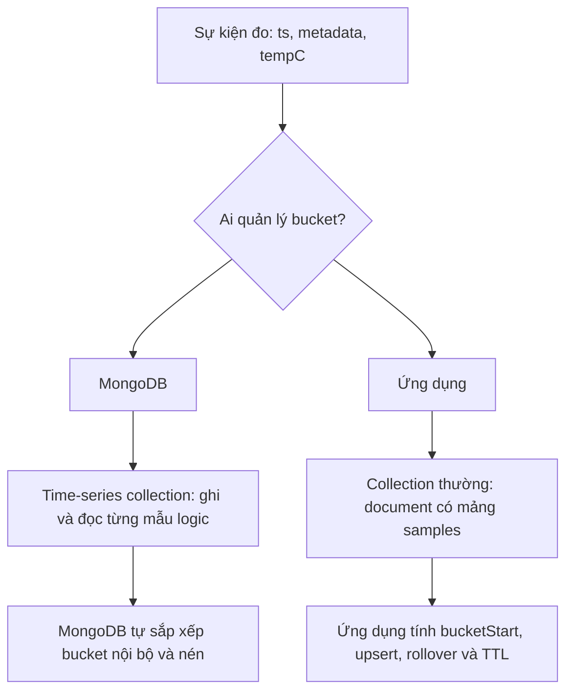

# So sánh time-series collection với mô hình bucket do ứng dụng tự quản lý

## 1. Bài toán và hai cách nhìn về “bucket”

Trong hệ thống sử dụng **Spring Data MongoDB**, dữ liệu đo đạc thường là chuỗi sự kiện gồm thời điểm, nguồn phát và giá trị: nhiệt độ của cảm biến, CPU của máy chủ, công suất điện, vị trí thiết bị hoặc số liệu giao dịch. Chẳng hạn, 1.000 thiết bị gửi một bản ghi mỗi 10 giây sẽ tạo khoảng **8,64 triệu bản ghi/ngày**. Ứng dụng cần ghi liên tục, truy vấn theo thiết bị và khoảng thời gian, tính trung bình theo phút, đồng thời hết hạn dữ liệu cũ.

Ví dụ một mẫu đo:

```javascript
{
  ts: ISODate("2026-11-20T13:00:15Z"),
  metadata: {
    tenantId: "t7",
    deviceId: "s9",
    siteId: "factory-a"
  },
  eventId: "evt-10001",
  tempC: 22.7
}
```

Có hai cách lưu trữ cần phân biệt:

- **Time-series collection**: ứng dụng ghi từng mẫu đo như một document logic; **MongoDB tự gom các mẫu vào bucket nội bộ**, quản lý bố cục lưu trữ và nén dữ liệu. Ứng dụng vẫn truy vấn mẫu đo theo cú pháp collection thông thường.
- **Bucket do ứng dụng tự quản lý**: ứng dụng xác định ranh giới bucket (chẳng hạn một phút/thiết bị), lưu một document chứa mảng `samples` và tự kiểm soát việc thêm mẫu, tách bucket, chỉ số tổng hợp, xử lý ghi lại và hết hạn.

Hai cách đều “gom dữ liệu theo thời gian”, nhưng **chủ thể quyết định cấu trúc bucket và chịu trách nhiệm bảo trì** khác nhau. Không nên nhầm document bucket của ứng dụng với collection nội bộ `system.buckets.*` mà MongoDB tạo cho time-series collection.



## 2. Time-series collection: MongoDB quản lý bucket

### Tạo collection và ghi dữ liệu

Khởi tạo collection trước khi có bản ghi đầu tiên; `timeField` chỉ trường thời gian, còn `metaField` là metadata gắn với một chuỗi đo (ví dụ tenant, thiết bị, địa điểm). `granularity` cho MongoDB biết mức độ thường xuyên tương đối của dữ liệu để tổ chức bucket phù hợp.

```javascript
db.createCollection("sensor_readings", {
  timeseries: {
    timeField: "ts",
    metaField: "metadata",
    granularity: "seconds"
  },
  expireAfterSeconds: 30 * 24 * 60 * 60
});

db.sensor_readings.insertMany([
  {
    ts: ISODate("2026-11-20T13:00:15Z"),
    metadata: { tenantId: "t7", deviceId: "s9", siteId: "factory-a" },
    eventId: "evt-10001",
    tempC: 22.7
  },
  {
    ts: ISODate("2026-11-20T13:00:25Z"),
    metadata: { tenantId: "t7", deviceId: "s9", siteId: "factory-a" },
    eventId: "evt-10002",
    tempC: 22.9
  }
]);
```

Mỗi đối tượng trong `insertMany` là **một measurement logic**. Người lập trình không tạo document chứa mảng các measurement. MongoDB tự gom các measurement có metadata và khoảng thời gian phù hợp vào bucket nội bộ, duy trì thông tin hỗ trợ lọc theo thời gian và nén các giá trị theo cột. Cách này thường giảm chi phí lưu trữ khi nhiều bản ghi có trường và metadata ổn định.

Đặt ở `metadata` những thuộc tính mô tả chuỗi đo ít thay đổi, chẳng hạn `tenantId`, `deviceId` và địa điểm ổn định. Tránh đưa timestamp, UUID của từng sự kiện hoặc giá trị nhiệt độ vào `metadata`: metadata thay đổi ở mỗi mẫu làm tăng số chuỗi và giảm hiệu quả gom bucket. Nếu thiết bị chuyển địa điểm và `siteId` thay đổi, các nhóm metadata trước và sau sẽ được lưu thành các chuỗi khác nhau.

### Truy vấn và aggregation trên measurement

```javascript
const from = ISODate("2026-11-20T13:00:00Z");
const to = ISODate("2026-11-20T14:00:00Z");

// Lọc theo tenant, thiết bị và khoảng [from, to).
db.sensor_readings.find({
  "metadata.tenantId": "t7",
  "metadata.deviceId": "s9",
  ts: { $gte: from, $lt: to }
}).sort({ ts: 1 });

// Thống kê nhiệt độ trung bình theo từng phút.
db.sensor_readings.aggregate([
  {
    $match: {
      "metadata.tenantId": "t7",
      "metadata.deviceId": "s9",
      ts: { $gte: from, $lt: to }
    }
  },
  {
    $group: {
      _id: { $dateTrunc: { date: "$ts", unit: "minute" } },
      avgTempC: { $avg: "$tempC" },
      minTempC: { $min: "$tempC" },
      maxTempC: { $max: "$tempC" },
      count: { $sum: 1 }
    }
  },
  { $sort: { _id: 1 } }
]);
```

Ứng dụng xử lý như collection thông thường; MongoDB đảm nhận việc lọc bucket và mở các measurement cần thiết khi thực thi truy vấn. Có thể cân nhắc index trên metadata và thời gian dựa trên `explain` của workload thực tế:

```javascript
db.sensor_readings.createIndex({
  "metadata.tenantId": 1,
  "metadata.deviceId": 1,
  ts: 1
});
```

**Lưu ý:** time-series collection có quy tắc riêng về index, cập nhật, xóa, transaction, sharding và một số thao tác quản trị; các khả năng này thay đổi theo phiên bản MongoDB. Không mặc định rằng mọi hành vi của collection thường đều áp dụng. Đặc biệt, time-series collection không hỗ trợ unique index trên từng measurement theo cách collection thường; nếu cần chống ghi trùng `eventId`, phải thiết kế cơ chế idempotency ở đầu vào hoặc một kho khóa sự kiện riêng.

### TTL và dữ liệu đến muộn

`expireAfterSeconds` giúp tự động dọn dữ liệu time-series hết hạn. Vì dữ liệu được chứa trong bucket, thời điểm giải phóng thực tế phụ thuộc ranh giới bucket và chu kỳ chạy của TTL monitor; **không nên coi TTL là cam kết xóa chính xác từng measurement ngay tại giây hết hạn**.

Dữ liệu đến muộn hoặc không theo thứ tự thời gian có thể làm tăng chi phí xử lý và ảnh hưởng hiệu quả bucket. Nên đo độ trễ ingest, tỷ lệ mẫu đến muộn và kích thước lưu trữ theo nguồn thiết bị thay vì suy rằng dữ liệu append-only luôn đến đúng thứ tự.

## 3. Bucket do ứng dụng tự quản lý: tự định dạng và cập nhật

### Thiết kế document và quy tắc bucket

Giả sử ứng dụng chọn **một bucket cho mỗi thiết bị trong mỗi phút UTC**. Một document được lưu trong collection thường `sensor_buckets`:

```javascript
{
  _id: "t7|s9|2026-11-20T13:00:00.000Z",
  tenantId: "t7",
  deviceId: "s9",
  bucketStart: ISODate("2026-11-20T13:00:00Z"),
  bucketEnd: ISODate("2026-11-20T13:01:00Z"), // mốc kết thúc độc quyền
  expiresAt: ISODate("2026-12-20T13:01:00Z"),
  count: 2,
  minTempC: 22.7,
  maxTempC: 22.9,
  samples: [
    { eventId: "evt-10001", ts: ISODate("2026-11-20T13:00:15Z"), tempC: 22.7 },
    { eventId: "evt-10002", ts: ISODate("2026-11-20T13:00:25Z"), tempC: 22.9 }
  ]
}
```

Mỗi mẫu giờ là **phần tử trong mảng của một document**, không phải document độc lập. Ứng dụng quyết định liệu phải tách thêm bucket khi mảng lớn, khi cùng thiết bị ghi quá nhanh hoặc khi dữ liệu đến muộn.

Cần xác định rõ các bất biến:

1. Khóa bucket duy nhất theo tenant, thiết bị và thời điểm đầu bucket, tính trong UTC.
2. Khoảng thời gian nửa mở `[bucketStart, bucketEnd)`; mẫu đúng mốc kết thúc thuộc bucket kế tiếp.
3. Giới hạn số mẫu và kích thước document; MongoDB có giới hạn BSON **16 MiB/document**.
4. Mọi bản ghi có `eventId` và cơ chế xử lý lặp; việc `$push` không tự chống duplicate.
5. `count`, `minTempC` và `maxTempC` phải được cập nhật đồng bộ với mảng, hoặc được tính lại một cách có kiểm soát.

### Ví dụ cập nhật nguyên tử ở cấp document

```javascript
const reading = {
  ts: ISODate("2026-11-20T13:00:15Z"),
  tenantId: "t7",
  deviceId: "s9",
  eventId: "evt-10001",
  tempC: 22.7
};

const bucketStart = new Date(
  Math.floor(reading.ts.getTime() / 60_000) * 60_000
);
const bucketEnd = new Date(bucketStart.getTime() + 60_000);
const bucketId =
  [reading.tenantId, reading.deviceId, bucketStart.toISOString()].join("|");

db.sensor_buckets.updateOne(
  { _id: bucketId },
  {
    $setOnInsert: {
      tenantId: reading.tenantId,
      deviceId: reading.deviceId,
      bucketStart,
      bucketEnd,
      expiresAt: new Date(bucketEnd.getTime() + 30 * 24 * 60 * 60 * 1000)
    },
    $push: {
      samples: {
        eventId: reading.eventId,
        ts: reading.ts,
        tempC: reading.tempC
      }
    },
    $inc: { count: 1 },
    $min: { minTempC: reading.tempC },
    $max: { maxTempC: reading.tempC }
  },
  { upsert: true }
);
```

Ví dụ minh họa **atomicity trong một document**: thêm mẫu, tăng `count` và điều chỉnh giá trị cực trị trong cùng thao tác. Nó **chưa phải giải pháp production hoàn chỉnh**:

- Retry cùng `eventId` sẽ đẩy thêm mẫu và tăng `count` lần nữa. Cần một cơ chế dedup/idempotency nhất quán (ví dụ khóa sự kiện riêng có unique index và quy trình ghi phù hợp).
- Hai yêu cầu đồng thời tạo cùng bucket có thể cạnh tranh ở lần upsert đầu; dùng khóa bucket duy nhất, xử lý lỗi duplicate key và retry có kiểm soát.
- `$push` không giới hạn độ dài mảng; phải đặt ngưỡng rollover (số mẫu, kích thước BSON, độ nóng của document). Không thể chỉ dựa vào khoảng một phút nếu nguồn gửi quá nhanh.
- Mỗi lần ghi cùng bucket có thể tạo **hot document**, tăng tranh chấp ghi. Đây là khác biệt hiệu năng lớn so với việc ứng dụng ghi từng measurement vào time-series collection.

### Đọc mẫu đo và TTL bucket

```javascript
db.sensor_buckets.createIndex({
  tenantId: 1,
  deviceId: 1,
  bucketStart: 1
});

// TTL xóa toàn bộ document bucket sau expiresAt.
db.sensor_buckets.createIndex(
  { expiresAt: 1 },
  { expireAfterSeconds: 0 }
);

const from = ISODate("2026-11-20T13:00:10Z");
const to = ISODate("2026-11-20T13:02:00Z");

db.sensor_buckets.aggregate([
  {
    $match: {
      tenantId: "t7",
      deviceId: "s9",
      bucketStart: { $lt: to },
      bucketEnd: { $gt: from }
    }
  },
  { $unwind: "$samples" },
  { $match: { "samples.ts": { $gte: from, $lt: to } } },
  { $project: { _id: 0, ts: "$samples.ts", tempC: "$samples.tempC" } },
  { $sort: { ts: 1 } }
]);
```

Index giúp tìm **bucket ứng viên**. Sau đó pipeline phải lọc các phần tử trong mảng, có thể phải `$unwind` và sắp xếp. Nếu thường xuyên hỏi “nhiệt độ chính xác ở từng giây” trên hàng triệu mẫu, chi phí mở mảng có thể đáng kể. Ngược lại, nếu chỉ cần `count`, `minTempC` hoặc `maxTempC` ở cấp bucket, ứng dụng có thể đọc trực tiếp các giá trị đã tiền tính.

Với TTL của bucket tự quản lý, một document bị xóa nguyên khối tại `expiresAt`. Chọn `expiresAt` sau thời điểm cuối bucket cộng thời gian giữ dữ liệu; nếu đặt theo đầu bucket, có nguy cơ xóa các mẫu mới trong bucket quá sớm. TTL monitor có thể xóa trễ, nên không sử dụng TTL cho yêu cầu xóa đồng bộ tức thời.

## 4. Đưa vào Spring Data MongoDB

Đối với time-series collection, nên dùng migration hoặc bước khởi tạo có kiểm soát để chạy `db.createCollection(...)` **trước khi** `MongoTemplate` ghi bản ghi đầu tiên. Chỉ gắn `@Document` không bảo đảm collection đã được tạo với tùy chọn time-series; nếu collection thường có cùng tên đã tồn tại, cần chiến lược tạo collection mới và chuyển dữ liệu.

Ví dụ ánh xạ measurement trong Java (mỗi record đặt đúng file Java phù hợp):

```java
import java.time.Instant;
import org.springframework.data.annotation.Id;
import org.springframework.data.mongodb.core.mapping.Document;

@Document(collection = "sensor_readings")
public record SensorReading(
    @Id String id,
    Instant ts,
    SensorMeta metadata,
    double tempC
) {}

record SensorMeta(String tenantId, String deviceId, String siteId) {}
```

```java
import java.time.Instant;
import java.util.List;
import org.springframework.data.domain.Sort;
import org.springframework.data.mongodb.core.MongoTemplate;
import org.springframework.data.mongodb.core.query.Criteria;
import org.springframework.data.mongodb.core.query.Query;

// MongoTemplate được Spring inject vào service.
mongoTemplate.insert(new SensorReading(
    null,
    Instant.parse("2026-11-20T13:00:15Z"),
    new SensorMeta("t7", "s9", "factory-a"),
    22.7
));

Instant from = Instant.parse("2026-11-20T13:00:00Z");
Instant to = Instant.parse("2026-11-20T14:00:00Z");
Query query = Query.query(
    Criteria.where("metadata.tenantId").is("t7")
        .and("metadata.deviceId").is("s9")
        .and("ts").gte(from).lt(to)
);
query.with(Sort.by(Sort.Direction.ASC, "ts"));

List<SensorReading> readings =
    mongoTemplate.find(query, SensorReading.class);
```

Đoạn service là trích đoạn minh họa; biến `mongoTemplate` được cung cấp từ bean Spring, các import và cấu trúc class/service thực tế tùy ứng dụng.

Nếu dùng bucket tự quản lý, ánh xạ một entity `SensorBucket` với các trường `bucketStart`, `bucketEnd`, `samples` và gọi `MongoTemplate.updateFirst(...)` / `upsert(...)` hoặc dùng trực tiếp MongoDB driver cho các toán tử `$push`, `$inc`, `$min`, `$max`. Nên để **một service quản lý duy nhất quy tắc bucket**: tính khóa, xác nhận thời gian UTC, giới hạn kích thước, idempotency, rollover và retry. Không rải logic đó trong các repository hoặc controller.

Với đọc time-series, có thể dùng Spring Data repository cho các truy vấn đơn giản, `MongoTemplate` cho truy vấn động và `Aggregation` cho thống kê theo cửa sổ thời gian. Với bucket tự quản lý, query trả về bucket hoặc pipeline mở mảng; **không thể dùng cùng một repository trả về measurement để thay thế trực tiếp** nếu schema và ngữ nghĩa dữ liệu đã đổi.

## 5. Bảng so sánh theo nhu cầu thực tế

| Tiêu chí | Time-series collection | Bucket ứng dụng tự quản lý |
|---|---|---|
| Mô hình logic | Một document/mẫu đo | Một document/chùm mẫu đo |
| Gom bucket | MongoDB quyết định nội bộ | Ứng dụng tự tính khóa, kích thước và ranh giới |
| Ghi liên tục | Ghi measurement đơn giản, phù hợp ingest lớn | Thường là `upsert`/`$push` vào document hiện có |
| Nén và bố cục lưu trữ | Có cơ chế tối ưu và nén dành cho time series | Tùy schema và nén chung của MongoDB; ứng dụng tự tối ưu |
| Truy vấn theo mốc thời gian | Trực tiếp trên `ts` và metadata | Lọc bucket rồi lọc phần tử `samples` |
| Thống kê theo khoảng | Aggregation trên measurement | Aggregation mở mảng hoặc đọc summary đã duy trì |
| Chỉnh sửa từng mẫu | Chịu các giới hạn time-series theo phiên bản | Có thể cập nhật phần tử mảng, nhưng tăng độ phức tạp |
| Đồng thời ghi cùng nguồn | MongoDB xử lý bucket nội bộ | Có nguy cơ hot document và tranh chấp cập nhật |
| Chống trùng dữ liệu | Cần thiết kế idempotency ngoài unique index của measurement | Có thể tùy biến, nhưng `$push` đơn thuần vẫn gây trùng |
| Hết hạn | TTL time-series, độ chính xác chịu ranh giới bucket/monitor | TTL document bucket do ứng dụng chọn `expiresAt` |
| Rủi ro vận hành | Phụ thuộc khả năng/giới hạn tính năng theo phiên bản | Lỗi chia bucket, giới hạn 16 MiB, retry, count sai, rollover |
| Mức độ kiểm soát cấu trúc | Ít, thuận lợi cho mẫu đo truyền thống | Cao, phù hợp logic bucket đặc thù |

**Không thể kết luận “một document chứa nhiều mẫu luôn nhanh hơn nhiều document”.** Mô hình tự quản lý giảm số document logic nhưng làm tăng kích thước, tranh chấp cập nhật và chi phí mở mảng. Time-series collection đã gom các measurement thành bucket nội bộ, nên phép so sánh chỉ theo số document nhìn từ ứng dụng là sai lệch.

## 6. Chọn mô hình dựa trên workload

**Ưu tiên time-series collection** khi dữ liệu chủ yếu append-only, mỗi mẫu có timestamp rõ ràng, metadata tương đối ổn định, thường truy vấn theo dải thời gian và tính thống kê bằng aggregation. Đây thường là điểm xuất phát phù hợp cho số liệu cảm biến, giám sát hạ tầng và telemetry.

**Cân nhắc bucket do ứng dụng tự quản lý** khi bucket là một thực thể nghiệp vụ thực sự: cần tính toán và sửa một nhóm mẫu như một đơn vị, lưu bản tóm tắt đặc thù, giới hạn kích thước theo quy tắc riêng, hoặc phục vụ một giao diện luôn đọc trọn một nhóm. Lựa chọn này đòi hỏi chấp nhận chi phí tự thiết kế vòng đời bucket.

Một số tình huống:

- **Dashboard CPU theo từng phút, truy vấn linh hoạt 1 giờ–7 ngày:** time-series collection cộng pipeline `$dateTrunc`/`$group` thường đơn giản hơn.
- **Nhật ký thiết bị được nhập từng đợt, mỗi lô phải có trạng thái phê duyệt, checksum và phiên bản riêng:** document bucket/lô nghiệp vụ có thể hợp lý hơn.
- **Cần p95 trong khoảng 30 ngày cho hàng trăm triệu sự kiện:** benchmark aggregation time-series, cân nhắc bảng rollup riêng; đừng tự động nhét mọi measurement vào một mảng dài.
- **Ghi lặp do retry mạng:** cả hai mô hình phải định nghĩa idempotency từ khóa nguồn, thời gian và `eventId`. Không giả định insertion đơn giản loại được trùng lặp.

Có thể kết hợp: lưu dữ liệu gốc trong time-series collection và tạo **collection rollup** theo phút/giờ cho dashboard. Rollup là sản phẩm tổng hợp có thể tái tạo từ dữ liệu gốc, khác với việc thay thế hoàn toàn dữ liệu gốc bằng bucket ứng dụng.

## 7. Phép thử so sánh công bằng

Trước khi quyết định, dựng cùng tập mẫu gồm nhiều tenant, thiết bị, số mẫu/giây, độ lệch timestamp và phân phối metadata. Dùng cùng retention, cùng yêu cầu trả về, phần cứng và chính sách write concern.

| Kịch bản đo | Quan sát cần thu thập |
|---|---|
| Ingest ổn định, spike gấp 5–10 lần | Throughput, p50/p95/p99 latency, CPU, lỗi/retry |
| 1–5% sự kiện đến muộn hoặc out-of-order | Mức tăng latency, số bucket phát sinh, kích thước |
| Truy vấn một thiết bị 15 phút | `explain("executionStats")`, keys/docs examined, thời gian thực thi |
| Truy vấn nhiều thiết bị trong 30 ngày | Dung lượng scan, memory aggregation, độ trễ |
| Truy vấn dữ liệu thô so với thống kê phút | Chi phí mở measurement/mảng và chi phí tính rollup |
| 30 ngày retention, ghi liên tục | Dung lượng disk, tốc độ TTL, thời điểm dữ liệu thật sự được xóa |
| Retry trùng event, ghi đồng thời một bucket | Số event bị trùng/mất, độ chính xác count/min/max, xung đột ghi |

Ví dụ bắt đầu kiểm tra execution plan:

```javascript
db.sensor_readings.find({
  "metadata.tenantId": "t7",
  "metadata.deviceId": "s9",
  ts: {
    $gte: ISODate("2026-11-20T13:00:00Z"),
    $lt: ISODate("2026-11-20T14:00:00Z")
  }
}).explain("executionStats");
```

Ngoài `totalDocsExamined` và độ trễ, cần so **dung lượng thực tế** của collection và index sau khi nạp cùng dữ liệu. Thực hiện đo sau giai đoạn warm-up và với lượng dữ liệu đủ lớn để phản ánh retention. Báo cáo riêng chi phí triển khai/migration, vì một mô hình có benchmark tốt nhưng xử lý trùng lặp không đúng vẫn không đạt yêu cầu.

## 8. Checklist thiết kế trước khi đưa lên production

1. **Đúng thời gian:** thống nhất UTC, nửa mở `[from, to)`, chính sách dữ liệu đến muộn và thời gian giữ dữ liệu.
2. **Đúng metadata:** nhóm theo tenant/device và metadata ổn định; không biến metadata thành định danh riêng của từng event.
3. **Đúng idempotency:** có khóa sự kiện rõ ràng và phép thử retry; đặc biệt kiểm tra `$push` và bộ đếm.
4. **Đúng dung lượng:** với bucket ứng dụng, áp ngưỡng document dưới 16 MiB và giảm hot document; với time-series, đo hiệu quả gom/nén theo nguồn.
5. **Đúng index:** xem kế hoạch truy vấn thật, tránh thêm index theo thói quen vì index làm tăng chi phí ghi.
6. **Đúng phiên bản:** đối chiếu khả năng time-series (update, delete, index, sharding, transaction, TTL) với **phiên bản MongoDB và Spring Data MongoDB đang triển khai**.
7. **Đúng vận hành:** có dashboard ingest lag, duplicate rate, query latency, kích thước lưu trữ và tốc độ TTL; thử khôi phục/rebuild summary khi cần.

**Khuyến nghị triển khai:** bắt đầu từ time-series collection khi đối tượng chính là *measurement theo thời gian*. Chỉ tự quản lý bucket nếu có yêu cầu nghiệp vụ hoặc kết quả benchmark cụ thể chứng minh lợi ích của cấu trúc đó. Dù chọn cách nào, hãy giữ ranh giới giữa dữ liệu gốc, dữ liệu tổng hợp và quy tắc idempotency đủ rõ để kiểm thử được.
