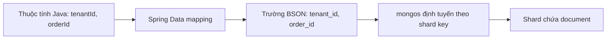

# `@Sharded` và ánh xạ trường shard key trong Spring Data MongoDB

Khi một collection được **shard** trên MongoDB, các document được phân phối giữa nhiều shard theo **shard key**. Trong ứng dụng Spring Data MongoDB, `@Sharded` mô tả shard key ở cấp entity để framework có thể hỗ trợ một số thao tác ghi; `@Field` quyết định tên trường thực sự được lưu trong BSON. Hai lớp tên này phải được đối chiếu chính xác với cấu hình sharding trên MongoDB.

Bài học tập trung vào cách khai báo `@Sharded`, ánh xạ khóa đơn/khóa ghép, tạo shard key tương ứng trên cluster, truy vấn qua `MongoTemplate` và những giới hạn cần kiểm tra khi vận hành. Ví dụ sử dụng Java và Spring Data MongoDB, nhưng nguyên tắc ánh xạ cũng áp dụng cho repository và reactive access.

## 1. Shard key thuộc về collection, còn `@Sharded` thuộc về entity

Shard key gồm một hoặc nhiều trường BSON, được MongoDB dùng để phân vùng dữ liệu và định tuyến truy vấn. Ví dụ collection `shop.orders` shard theo hai trường theo thứ tự `{ tenant_id: 1, order_id: 1 }`. Mọi document nghiệp vụ nên có giá trị ổn định cho cả hai trường; truy vấn cung cấp đầy đủ khóa thường giúp router `mongos` xác định shard đích hiệu quả hơn.

`@Sharded` nằm trong package `org.springframework.data.mongodb.core.mapping` và khai báo **metadata để Spring Data hiểu entity đang được lưu trong một collection sharded**. Annotation **không tự tạo sharded cluster, không thực hiện `shardCollection`, không tự bảo đảm tạo index**. Collection phải được cấu hình ở phía MongoDB, còn entity và cấu hình server phải đồng nhất.



Các thuộc tính chính của `@Sharded`:

| Thuộc tính | Ý nghĩa | Lưu ý |
| --- | --- | --- |
| `shardKey = {"..."}` | Danh sách **tên thuộc tính trên entity**, theo thứ tự khóa đơn hoặc khóa ghép. | Spring Data ánh xạ chúng sang tên BSON tương ứng, bao gồm `@Field`. |
| `value = {"..."}` | Bí danh của `shardKey`. | Nên chọn một cách khai báo nhất quán trong dự án. |
| `shardingStrategy` | `ShardingStrategy.RANGE` (mặc định) hoặc `ShardingStrategy.HASH`. | Chiến lược phải phù hợp với shard key/index thực sự trên MongoDB. |
| `immutableKey` | Mặc định `false`; khi `true`, Spring Data giả định shard key của entity không đổi và bỏ bước kiểm tra thay đổi khóa trong đường ghi liên quan. | Đây là giả định tối ưu hóa, **không phải ràng buộc bất biến do annotation thực thi**. |

Nếu không chỉ rõ `shardKey`, `@Sharded` sử dụng thuộc tính định danh của entity, tương ứng với `_id`, theo mặc định. Trong thực tế, cần chọn shard key theo phân bố dữ liệu và kiểu truy vấn chứ không mặc nhiên chọn `_id` cho mọi bài toán.

## 2. Ví dụ: khai báo shard key ghép và đổi tên trường BSON

Ứng dụng quản lý đơn hàng đa khách hàng (`tenant`). Mỗi đơn có `tenantId` và `orderId`; tên các trường trong BSON theo quy ước `snake_case`.

```java
import org.bson.types.ObjectId;
import org.springframework.data.annotation.Id;
import org.springframework.data.mongodb.core.mapping.Document;
import org.springframework.data.mongodb.core.mapping.Field;
import org.springframework.data.mongodb.core.mapping.Sharded;

@Document(collection = "orders")
@Sharded(
    shardKey = { "tenantId", "orderId" },
    immutableKey = true
)
public class OrderDocument {

    @Id
    private ObjectId id;

    @Field("tenant_id")
    private String tenantId;

    @Field("order_id")
    private String orderId;

    private String status;

    protected OrderDocument() { }

    public OrderDocument(String tenantId, String orderId, String status) {
        this.tenantId = tenantId;
        this.orderId = orderId;
        this.status = status;
    }

    public ObjectId getId() { return id; }
    public String getTenantId() { return tenantId; }
    public String getOrderId() { return orderId; }
    public String getStatus() { return status; }
}
```

Với dữ liệu `tenantId = "tenant-a"`, `orderId = "ord-001"`, `status = "NEW"`, document được ghi có dạng:

```javascript
{
  _id: ObjectId("65fd4e0f0a01020304050607"),
  tenant_id: "tenant-a",
  order_id: "ord-001",
  status: "NEW"
}
```

Phân biệt rõ **tên thuộc tính Java** và **tên trường MongoDB**:

| Mục đích | Tên sử dụng |
| --- | --- |
| Thuộc tính trong `OrderDocument` | `tenantId`, `orderId` |
| `@Sharded(shardKey = { ... })` | `"tenantId"`, `"orderId"` |
| `@Field` trên thuộc tính | `"tenant_id"`, `"order_id"` |
| Shard key trong lệnh MongoDB / BSON | `{ tenant_id: 1, order_id: 1 }` |
| Điều kiện trong `Criteria` gắn với entity | `"tenantId"`, `"orderId"` |

Thứ tự của khóa ghép cũng quan trọng: `tenantId` đứng trước `orderId` trong annotation thì định nghĩa shard key ở server phải có `tenant_id` trước `order_id`. Nếu đặt tên BSON trực tiếp vào annotation mà framework mong đợi tên thuộc tính Java, hoặc tạo shard key server theo `tenantId` thay vì `tenant_id`, mô hình ứng dụng và collection sẽ lệch nhau.

`immutableKey = true` chỉ phù hợp khi nghiệp vụ không cho phép chuyển đơn hàng giữa các tenant hoặc sửa định danh đơn. Nếu shard key cần đổi, hãy dùng cấu hình mặc định và thiết kế riêng luồng cập nhật có kiểm soát theo quy tắc của MongoDB, thay vì giả định `save()` sẽ xử lý mọi trường hợp.

## 3. Chuẩn bị collection sharded có tên trường khớp entity

Ví dụ sau chạy trong **`mongosh` kết nối tới router `mongos`** của một sharded cluster đã cấu hình, với tài khoản có quyền quản trị phù hợp. Đây là thao tác triển khai cơ sở dữ liệu, không phải lệnh tự chạy khi ứng dụng Spring Boot khởi động.

```javascript
use shop

// Tạo trước index hỗ trợ shard key; bắt buộc nếu collection đã có dữ liệu.
db.orders.createIndex({ tenant_id: 1, order_id: 1 })

// Các tên ở đây là tên trường BSON, không phải tên thuộc tính Java.
sh.shardCollection(
  "shop.orders",
  { tenant_id: 1, order_id: 1 }
)

// Kiểm tra cấu hình sharding và index.
sh.status()
db.orders.getIndexes()
```

Với collection trống, MongoDB có thể tự tạo index shard key khi chạy `sh.shardCollection`; việc tạo index tường minh trong ví dụ giúp dễ đối chiếu cấu hình. Với collection đã có dữ liệu, cần chuẩn bị index tương thích trước khi shard. Index và shard key phải phù hợp thứ tự trường; chỉ khai báo `@Sharded` sẽ không thực hiện hai bước này.

Nếu chọn chiến lược hashed, cấu hình MongoDB phải dùng thành phần khóa `{ field_name: "hashed" }` và index tương ứng; `ShardingStrategy.HASH` trên Java tự nó không chuyển một collection range-sharded thành hashed-sharded. Lựa chọn hashed hay range cần dựa trên đặc điểm phân bố và kiểu truy vấn; ví dụ chính ở đây dùng range.

## 4. Đọc, cập nhật và lưu qua `MongoTemplate`

`Criteria`/`Query` dành cho entity làm việc với **tên thuộc tính Java**; Spring Data ánh xạ chúng qua `@Field` khi sinh truy vấn gửi tới MongoDB.

```java
import org.springframework.data.mongodb.core.MongoTemplate;
import org.springframework.data.mongodb.core.query.Criteria;
import org.springframework.data.mongodb.core.query.Query;
import org.springframework.data.mongodb.core.query.Update;

// mongoTemplate đã được cấu hình bởi ứng dụng Spring.
Query byKey = Query.query(
    Criteria.where("tenantId").is("tenant-a")
            .and("orderId").is("ord-001")
);

OrderDocument found = mongoTemplate.findOne(byKey, OrderDocument.class);

// updateFirst dùng điều kiện định tuyến tường minh, gồm đầy đủ shard key.
mongoTemplate.updateFirst(
    byKey,
    new Update().set("status", "PAID"),
    OrderDocument.class
);

// Thêm một entity mới có đầy đủ giá trị của shard key.
OrderDocument created = new OrderDocument("tenant-b", "ord-002", "NEW");
mongoTemplate.insert(created);

// Khi lưu entity hiện có, Spring Data có thể bổ sung shard key vào
// bộ lọc của thao tác replaceOne, theo các điều kiện mà API hỗ trợ.
// mongoTemplate.save(found);
```

Điều kiện `byKey` ở mức BSON về cơ bản tương đương:

```javascript
{ tenant_id: "tenant-a", order_id: "ord-001" }
```

Spring Data thực hiện hỗ trợ **best effort** cho một số đường ghi thay thế toàn bộ document, điển hình `MongoTemplate.save(...)`, `CrudRepository.save(...)` và các biến thể reactive tương ứng. Khi cần, framework có thể truy vấn thêm để biết shard key đang lưu của entity trước khi tạo bộ lọc cho `replaceOne`. Cơ chế này **không có nghĩa mọi truy vấn được tự động thêm shard key**. Với `find`, `updateFirst`, `remove` và các thao tác nhận `Query`, ứng dụng phải chủ động đưa điều kiện shard key phù hợp khi cần định tuyến đúng và hiệu quả.

Truy vấn chỉ theo `orderId` khi shard key là `{ tenant_id, order_id }` có thể phải đi qua nhiều shard và thường không tối ưu bằng truy vấn đủ khóa. Việc truy vấn được nhắm tới một shard hay nhiều shard phải kiểm chứng qua `explain` trên cluster thực tế, vì còn phụ thuộc cấu hình và điều kiện lọc.

## 5. Xác minh mapping trước khi triển khai

Có thể kiểm tra riêng bước chuyển entity sang BSON mà không cần tạo sharded cluster. Đoạn kiểm tra minh họa dưới đây dùng converter đã cấu hình trong ứng dụng và AssertJ:

```java
OrderDocument order = new OrderDocument("tenant-a", "ord-001", "NEW");
org.bson.Document bson = new org.bson.Document();

mongoTemplate.getConverter().write(order, bson);

assertThat(bson.getString("tenant_id")).isEqualTo("tenant-a");
assertThat(bson.getString("order_id")).isEqualTo("ord-001");
assertThat(bson).doesNotContainKeys("tenantId", "orderId");
```

Sau khi triển khai lên môi trường có sharding, kiểm tra thêm từ `mongosh`:

```javascript
use shop

// Kiểm tra tên trường thực tế trong document.
db.orders.findOne({ tenant_id: "tenant-a", order_id: "ord-001" })

// Quan sát kế hoạch định tuyến, không giả định mọi truy vấn đều nhắm một shard.
db.orders.find({ tenant_id: "tenant-a", order_id: "ord-001" })
  .explain("executionStats")

sh.status()
```

Nên xác minh ba điểm độc lập: (1) converter ghi đúng tên trường, (2) index/shard key thật của collection khớp tên và thứ tự, (3) các truy vấn nghiệp vụ quan trọng có điều kiện định tuyến dự kiến. Test unit về mapping không thể thay thế kiểm thử tích hợp trên sharded cluster.

## 6. Những lỗi dễ gặp

| Hiện tượng | Nguyên nhân thường gặp | Cách xử lý |
| --- | --- | --- |
| `@Sharded` đã có nhưng collection vẫn chưa shard | Annotation chỉ cung cấp metadata trong Spring Data. | Tạo index, triển khai `sh.shardCollection` bằng quy trình vận hành riêng và kiểm tra bằng `sh.status()`. |
| Cluster shard theo `tenantId`, còn document lưu `tenant_id` | Nhầm tên thuộc tính Java với tên BSON của `@Field`. | Dùng `tenantId` trong annotation/`Criteria`, `tenant_id` trong lệnh MongoDB. |
| Truy vấn một đơn hàng chậm khi dữ liệu tăng | Chỉ lọc theo `orderId`, bỏ thành phần đầu của shard key ghép. | Đưa `tenantId` vào điều kiện truy vấn, đánh giá lại shard key theo workload và kiểm tra `explain`. |
| `save` hoặc cập nhật gặp vấn đề liên quan shard key | Khóa bị đổi, thiếu giá trị, hoặc cấu hình Java và cluster không đồng nhất. | Cố định khóa theo nghiệp vụ, kiểm tra dữ liệu hiện có và dùng query chứa shard key khi cập nhật. |
| Bật `immutableKey = true` nhưng code vẫn sửa `tenantId` | Annotation không tự khóa setter hoặc chặn thay đổi ở domain. | Bảo vệ bất biến trong thiết kế entity/service; chỉ bật tối ưu hóa khi bảo đảm được điều kiện. |
| Kiểm tra `@Sharded` thấy đúng nhưng phân bố dữ liệu lệch | Shard key có độ phân biệt thấp hoặc lượng ghi tập trung vào một khoảng giá trị. | Đánh giá cardinality, phân bố ghi/đọc và chiến lược range/hashed trước khi vận hành. |

Đặc biệt, khóa ghép không mặc nhiên bảo đảm tính duy nhất toàn cluster: nếu cần ràng buộc unique, phải thiết kế index unique phù hợp quy tắc của MongoDB đối với sharded collections. `_id` cũng không nên được giả định là duy nhất trên toàn cluster trong mọi cấu hình khi `_id` không thuộc shard key.

## 7. Bài thực hành ngắn

Giả sử `OrderDocument` ở trên được triển khai trong dịch vụ quản lý đơn đa tenant:

1. Khai báo entity với `@Sharded(shardKey = {"tenantId", "orderId"})` và hai `@Field` tương ứng; giải thích vì sao MongoDB thấy `tenant_id`, `order_id`.
2. Cấu hình collection `shop.orders` trên một sharded cluster thử nghiệm với shard key `{ tenant_id: 1, order_id: 1 }` và index hỗ trợ.
3. Thêm đơn hàng cho hai tenant, đọc và cập nhật đơn bằng `MongoTemplate` với cả hai thành phần khóa; so sánh `explain` của truy vấn đủ khóa với truy vấn chỉ có `orderId`.
4. Kiểm tra việc đổi `tenantId` trong luồng nghiệp vụ và quyết định có đủ điều kiện bật `immutableKey = true` không. Ghi lại cách ứng dụng ngăn thay đổi khóa.

**Tiêu chí hoàn thành:** tên trường ở Java, BSON và cấu hình cluster khớp nhau; đọc/ghi đúng đơn hàng thuộc đúng tenant; chỉ ra được phạm vi hỗ trợ của `@Sharded` và giới hạn của việc tự động thêm shard key.

## Tài liệu tham khảo

- [Spring Data MongoDB — Sharding](https://docs.spring.io/spring-data/mongodb/reference/mongodb/sharding.html): cách Spring Data dùng `@Sharded`, ánh xạ tên trường và xử lý shard key khi ghi.
- [Spring Data MongoDB — API `@Sharded`](https://docs.spring.io/spring-data/mongodb/reference/api/java/org/springframework/data/mongodb/core/mapping/Sharded.html): các thuộc tính và giá trị mặc định.
- [MongoDB — Shard Keys](https://www.mongodb.com/docs/manual/core/sharding-shard-key/): khái niệm shard key, chọn khóa, cập nhật giá trị khóa.
- [MongoDB — Shard Key Indexes](https://www.mongodb.com/docs/manual/core/sharding-shard-key-indexes/): điều kiện index và unique index cho sharded collections.
