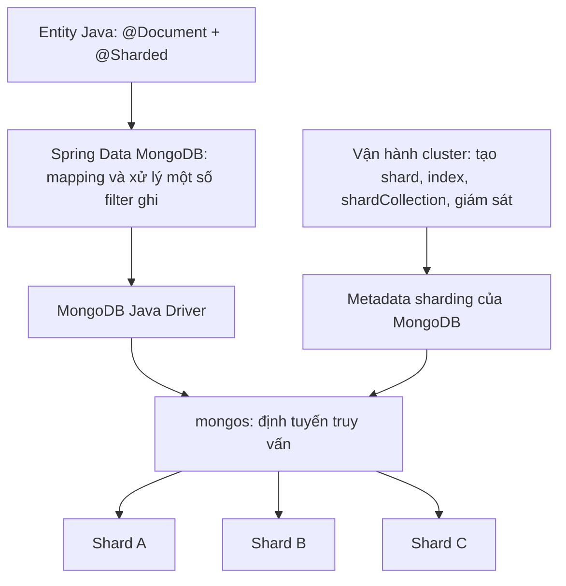

# Phân biệt metadata `@Sharded` với việc cấu hình cluster thực tế

> **Chương:** Sharding  
> **Phạm vi:** Spring Data MongoDB — kết nối, ánh xạ document và thao tác MongoDB qua `MongoTemplate` hoặc repository trong một hệ thống có phân mảnh dữ liệu.

## 1. Vấn đề cần hiểu

Giả sử một ứng dụng bán hàng dùng Spring Data MongoDB và muốn phân tán hàng triệu đơn hàng qua nhiều shard. Lập trình viên khai báo:

```java
@Document("orders")
@Sharded(shardKey = {"tenantId", "orderNo"})
public class PurchaseOrder {
    @Id String id;
    String tenantId;
    String orderNo;
}
```

Sau khi chạy ứng dụng, **collection `orders` không tự động trở thành sharded collection**. Annotation `@Sharded` mô tả cách entity tương ứng với *shard key* và giúp Spring Data xử lý một số thao tác ghi; việc tạo kiến trúc cluster, index và cấu hình sharding là trách nhiệm của MongoDB và quy trình triển khai.

Đây là hai tầng cần phân biệt:

- **Tầng ứng dụng (metadata):** `@Sharded` gắn thông tin shard key vào kiểu Java; Spring Data có thể dùng thông tin đó khi tạo bộ lọc của một số lệnh ghi.
- **Tầng cơ sở dữ liệu (cluster thực tế):** MongoDB phải có cluster hỗ trợ sharding, một collection được bật sharding với shard key cụ thể, index phù hợp và bộ định tuyến `mongos`; MongoDB mới phân phối dữ liệu qua các shard.

Một ứng dụng có annotation chính xác vẫn có thể đang ghi vào collection chưa shard. Ngược lại, MongoDB có thể shard collection dù Java entity không gắn `@Sharded`; khi ấy ứng dụng không nhận được các hỗ trợ liên quan đến shard key do annotation mang lại.

## 2. Sơ đồ ranh giới trách nhiệm



Mũi tên từ annotation tới driver thể hiện luồng xử lý ứng dụng, **không phải** một lệnh tạo shard. Việc thay đổi annotation không thay thế việc thực hiện lệnh quản trị trên cluster.

| Thành phần | Khai báo hoặc thực hiện ở đâu? | Tác dụng | `@Sharded` có tự thực hiện không? |
| --- | --- | --- | --- |
| Tên collection và ánh xạ field | `@Document`, `@Field` | Ánh xạ entity sang BSON | Không; đây là chức năng mapping chung |
| Shard key mà Spring Data biết | `@Sharded(shardKey = ...)` | Hỗ trợ tạo filter cho một số thao tác ghi | **Có**, ở tầng metadata |
| Index hỗ trợ shard key | MongoDB index, quy trình migration hoặc `IndexOperations` | Cho phép và hỗ trợ thao tác shard collection | **Không** |
| Collection được shard | `sh.shardCollection(...)` hoặc lệnh quản trị tương đương | Đăng ký namespace và shard key tại MongoDB | **Không** |
| Config server, shard, `mongos`, balancer | Hạ tầng MongoDB/nhà cung cấp dịch vụ | Lưu metadata, định tuyến và phân phối dữ liệu | **Không** |
| Chọn shard và di chuyển range/chunk | MongoDB dựa trên shard key, metadata cluster | Phân bố dữ liệu khi cluster vận hành | **Không** |

## 3. Chính xác `@Sharded` cung cấp thông tin gì?

`@Sharded` thuộc package `org.springframework.data.mongodb.core.mapping`, gắn trên entity hoặc annotation dùng làm meta-annotation. Các thuộc tính chính:

| Thuộc tính | Ý nghĩa | Mặc định |
| --- | --- | --- |
| `shardKey = {"tenantId", "orderNo"}` | Tên **property Java** cấu thành shard key, có thứ tự | Mảng rỗng, hiểu là thuộc tính ID của entity |
| `value` | Bí danh của `shardKey` | Mảng rỗng |
| `shardingStrategy` | Metadata về chiến lược sharding | `ShardingStrategy.RANGE` |
| `immutableKey` | Cho Spring Data biết ứng dụng không thay đổi giá trị shard key sau khi tạo entity | `false` |

Lưu ý về tên trường: `@Sharded` tham chiếu property của entity, trong khi lệnh `shardCollection` dùng **tên field BSON thực tế**. Nếu property có `@Field("tenant_id")` thì ở phía MongoDB phải dùng `tenant_id`. Không thể giả định hai tên luôn trùng nhau.

### Hỗ trợ ghi là phạm vi hẹp, theo nguyên tắc *best effort*

Spring Data có thể tự bổ sung giá trị shard key vào filter của `replaceOne` phát sinh từ các thao tác lưu entity, chẳng hạn:

- `CrudRepository.save(...)`, `saveAll(...)` và các biến thể reactive;
- `MongoTemplate.save(...)`, `ReactiveMongoTemplate.save(...)`;
- một số thao tác update/upsert thay thế toàn bộ entity, khi `UpdateDefinition` chứa bản sao đầy đủ của entity.

Mục đích là làm cho thao tác ghi có đủ thông tin shard key trong những trường hợp cần thiết. Tùy trường hợp, Spring Data có thể phải đọc thêm dữ liệu hiện tại để xác định shard key thực tế trước khi thay thế. `immutableKey = true` báo rằng khóa sẽ không đổi và giúp tránh việc kiểm tra bổ sung đó; đây **không phải** ràng buộc bất biến do server tự tạo.

**Không suy rộng hỗ trợ trên sang mọi API.** Với `find`, `updateFirst`, `updateMulti`, `remove` hoặc truy vấn repository tùy chỉnh, lập trình viên cần tự cung cấp điều kiện shard key thích hợp trong `Query` khi muốn định tuyến chính xác hoặc khi thao tác đòi hỏi điều kiện ấy. Annotation không tự thêm điều kiện tenant vào mọi truy vấn và không thay thế kiểm soát phân quyền dữ liệu.

## 4. Ví dụ nhất quán từ Java đến MongoDB

Xét database `sales` và collection `orders`. Đơn hàng được định danh trong phạm vi một tenant bằng `tenantId` và `orderNo`; các giá trị này được giữ ổn định sau khi tạo. Ví dụ chọn **range sharding** trên cặp trường theo thứ tự đó. Việc shard key này có tối ưu hay không còn phụ thuộc phân bố tải và mẫu truy vấn thực tế.

### Bước A — Khai báo entity cho Spring Data

```java
import java.math.BigDecimal;
import org.springframework.data.annotation.Id;
import org.springframework.data.mongodb.core.mapping.Document;
import org.springframework.data.mongodb.core.mapping.Field;
import org.springframework.data.mongodb.core.mapping.Sharded;
import org.springframework.data.mongodb.core.mapping.ShardingStrategy;

@Document("orders")
@Sharded(
    shardKey = {"tenantId", "orderNo"},
    shardingStrategy = ShardingStrategy.RANGE,
    immutableKey = true
)
public class PurchaseOrder {
    @Id
    private String id;

    @Field("tenant_id")
    private String tenantId;

    @Field("order_no")
    private String orderNo;

    private BigDecimal amount;

    // Constructor và getter/setter theo quy ước model của ứng dụng.
}
```

Điều Spring Data hiểu là khóa gồm hai **property** `tenantId`, `orderNo`. Vì có `@Field`, BSON tương ứng chứa `tenant_id` và `order_no`. Thêm `@Sharded` vào Java **không chạy** `shardCollection`, không tạo topology cluster và không đảm bảo index được sinh.

### Bước B — Chuẩn bị cluster và index

Trước bước này, đội vận hành đã cung cấp một sharded cluster đang hoạt động và endpoint **`mongos`** (hoặc endpoint tương đương do dịch vụ quản lý cung cấp), cùng quyền quản trị phù hợp. Chạy `mongosh` kết nối vào router, không kết nối trực tiếp đến một shard riêng lẻ để thao tác với collection của ứng dụng.

```javascript
// Trong mongosh, đã kết nối tới mongos:
use sales

// Đặc biệt cần tạo index hỗ trợ trước nếu collection đã có dữ liệu.
db.orders.createIndex(
  { tenant_id: 1, order_no: 1 },
  { name: "tenant_order_shard_key" }
)

// Thao tác cấu hình ở MongoDB:
sh.shardCollection(
  "sales.orders",
  { tenant_id: 1, order_no: 1 }
)
```

Với **collection đã có dữ liệu**, MongoDB cần index hỗ trợ shard key từ trước; index có shard key làm tiền tố (prefix) là một dạng hợp lệ. Với collection trống, MongoDB có thể tự tạo index hỗ trợ trong lúc shard collection, nhưng chủ động quản lý index bằng migration giúp việc triển khai và kiểm tra rõ ràng hơn.

Từ MongoDB 6.0, không bắt buộc chạy `sh.enableSharding("sales")` trước `sh.shardCollection(...)`. Một số tài liệu hoặc môi trường phiên bản cũ vẫn có bước enable database; cần đối chiếu phiên bản server và chính sách của dịch vụ MongoDB đang dùng.

### Bước C — Kết nối ứng dụng và dùng shard key trong truy vấn

Ứng dụng cấu hình MongoDB Java Driver/Spring Data kết nối tới endpoint của cluster qua `mongos`, đồng thời chỉ định đúng database `sales`. URI, cơ chế xác thực, TLS và pool kết nối phụ thuộc môi trường triển khai; annotation `@Sharded` không tạo hay thay đổi kết nối.

Đối với truy vấn cập nhật một phần, hãy đưa các trường shard key vào `Query`, nhất là khi ứng dụng thường tìm một đơn hàng theo cặp tenant và mã đơn:

```java
import org.springframework.data.mongodb.core.MongoTemplate;
import org.springframework.data.mongodb.core.query.Criteria;
import org.springframework.data.mongodb.core.query.Query;
import org.springframework.data.mongodb.core.query.Update;

class PurchaseOrderWriter {
    void markPaid(MongoTemplate mongoTemplate,
                  String tenantId, String orderNo) {
        Query query = Query.query(
            Criteria.where("tenantId").is(tenantId)
                    .and("orderNo").is(orderNo)
        );
        Update update = new Update().set("state", "PAID");
        mongoTemplate.updateFirst(query, update, PurchaseOrder.class);
    }
}
```

`MongoTemplate` ánh xạ property `tenantId`/`orderNo` sang `tenant_id`/`order_no` cho truy vấn entity này. Filter đầy đủ giúp router có cơ sở nhắm đến shard phù hợp; tác dụng cụ thể cần xác minh bằng `explain`. Nếu truy vấn chỉ có `state = "PAID"`, annotation sẽ không tự bổ sung tenant hay order number.

### Bước D — Xác minh cluster đã shard thật

```javascript
// Trong mongosh, kết nối tới mongos:
sh.status()                        // Kiểm tra namespace sales.orders và shard key
use sales
db.orders.getIndexes()             // Kiểm tra index hỗ trợ

db.orders.find({
  tenant_id: "tenant-a",
  order_no: "ORD-1001"
}).explain("executionStats")
```

Đọc `sh.status()` để xác minh `sales.orders` được đăng ký là sharded collection với key `{ tenant_id: 1, order_no: 1 }`. Đọc `getIndexes()` để kiểm tra cấu trúc index thực tế. Với `explain`, quan sát thông tin về các shard được truy cập và kế hoạch thực thi; sau đó so sánh với một truy vấn thiếu shard key để hiểu sự khác biệt giữa truy vấn có khả năng định tuyến tập trung và truy vấn phải xem xét nhiều shard.

**Không lấy việc khởi động ứng dụng thành công hoặc gọi `repository.save(...)` thành công làm bằng chứng collection đã shard.** Các thao tác đó vẫn có thể hoạt động trên replica set hoặc collection chưa shard.

## 5. Đổi chiến lược shard key: metadata phải khớp cấu hình thực tế

MongoDB phân biệt range và hashed sharding. Spring Data có enum `ShardingStrategy.RANGE` và `ShardingStrategy.HASH` (tên chính xác là **`HASH`**, không phải `HASHED`); MongoDB dùng literal `"hashed"` trong lệnh cấu hình.

Ví dụ một thiết kế **khác** muốn hash theo một field `tenantId`:

```java
@Document("orders_by_tenant")
@Sharded(
    shardKey = "tenantId",
    shardingStrategy = ShardingStrategy.HASH
)
class HashedOrder {
    @Id String id;
    @Field("tenant_id") String tenantId;
}
```

```javascript
// Minh họa cấu hình tương ứng cho collection mới/được triển khai riêng:
sh.shardCollection("sales.orders_by_tenant", { tenant_id: "hashed" })
```

Ví dụ này minh họa **sự tương ứng về ý nghĩa** giữa metadata và server; `@Document` phải trỏ đúng collection thực tế ở từng môi trường. Không áp dụng hai cấu hình range và hash lên cùng một collection đang chạy. Đổi `shardingStrategy` hoặc `shardKey` trong mã nguồn **không** tự đổi shard key mà cluster đã lưu; việc thay shard key thật cần quy trình thay đổi dữ liệu phù hợp, chẳng hạn resharding, có đánh giá ảnh hưởng và kiểm chứng riêng.

## 6. Những tình huống dễ hiểu sai

| Tình huống | Điều xảy ra | Cách xử lý đúng |
| --- | --- | --- |
| Entity có `@Sharded`, chạy trên MongoDB standalone/replica set | Metadata vẫn nằm trong ứng dụng; dữ liệu không tự phân tán thành sharded collection | Triển khai sharded cluster và shard collection bằng cơ chế quản trị |
| Cluster đã shard `orders`, entity bỏ `@Sharded` | Server vẫn phân phối dữ liệu theo cấu hình hiện tại | Cân nhắc khai báo metadata cho entity để Spring Data hỗ trợ các lệnh ghi phù hợp |
| Java khai báo `tenantId` nhưng MongoDB shard theo `tenant_id` | Đây là cấu hình **đúng** nếu property có `@Field("tenant_id")` | Kiểm tra tên field BSON thực tế; giữ đúng thứ tự khóa |
| Chỉ có `@CompoundIndex` hoặc `@Indexed` | Có thể có index (nếu thật sự được tạo), nhưng collection chưa chắc đã shard | Xác minh cả index **và** trạng thái sharding ở server |
| Mã đổi `RANGE` sang `HASH` | Cluster không tự reshard; cấu hình Java và MongoDB có thể bất nhất | Lập kế hoạch thay đổi cluster và dữ liệu, sau đó cập nhật entity |
| Đặt `immutableKey = true` rồi vẫn sửa shard key | Spring Data có thể bỏ qua bước đọc bổ sung dựa trên giả định khóa bất biến | Chỉ dùng `true` khi quy tắc nghiệp vụ thực sự giữ khóa không đổi |
| Truy vấn chỉ lọc theo trường không nằm trong shard key | Router có thể phải gửi truy vấn tới nhiều shard | Thiết kế shard key theo mẫu truy vấn, truyền điều kiện shard key khi có thể, đo bằng `explain` |
| Gọi `save` thành công và cho rằng đã scale ngang | Không chứng minh được sự phân bố hay khả năng chịu tải | Kiểm tra namespace, index, số shard truy cập, phân bố dữ liệu và số liệu vận hành |

### Ba điều annotation không bảo đảm

1. **Không bảo đảm shard key tốt.** Một khóa có độ phân biệt thấp, phân bố lệch hoặc tăng đơn điệu có thể dẫn đến hotspot và mất cân bằng. Chọn khóa cần xem cardinality, tần suất ghi, truy vấn điển hình và yêu cầu locality.
2. **Không bảo đảm nhất quán index và uniqueness.** Quy tắc unique index của sharded collection có ràng buộc riêng. Không thể suy ra duy nhất toàn cluster chỉ vì Java entity có tên trường giống shard key.
3. **Không bảo đảm giao dịch, truy vấn hoặc hiệu năng.** Transaction đa shard, query fan-out, aggregation và cập nhật shard key chịu quy tắc MongoDB tương ứng; annotation chỉ tham gia một phần nhỏ của đường đi ứng dụng.

## 7. Quy trình kiểm tra trước và sau triển khai

Khi đưa một entity gắn `@Sharded` vào ứng dụng có sharded cluster, nên xác nhận theo thứ tự:

1. **Đối chiếu thiết kế:** ghi rõ tên database, collection, thứ tự property trong `@Sharded`, ánh xạ `@Field` và key BSON mong muốn. Kiểm tra các truy vấn quan trọng có thể truyền shard key hay không.
2. **Kiểm tra hạ tầng:** xác nhận ứng dụng và công cụ quản trị đi qua endpoint `mongos`/endpoint router đúng môi trường; số shard, cơ chế xác thực và quyền quản trị đã được cấu hình.
3. **Chuẩn bị index và sharding:** kiểm tra index cần thiết, chạy migration quản trị `shardCollection` theo phiên bản MongoDB và môi trường; bảo đảm migration có kiểm soát khi dữ liệu đã tồn tại.
4. **Xác minh bằng server:** dùng `sh.status()` và `getIndexes()` để nhìn trạng thái thực tế; đối chiếu key server với field BSON của entity.
5. **Xác minh truy vấn/ghi:** chạy thao tác lưu, thay thế, cập nhật và đọc có shard key; đối chiếu kế hoạch `explain("executionStats")`; đo round trip, phân bố tải, số shard được truy cập và các lỗi ghi nếu có.
6. **Theo dõi sau triển khai:** quan sát tốc độ tăng dữ liệu, độ lệch phân bố, tình trạng balancer, latency và truy vấn phải đi qua nhiều shard. Cân nhắc điều chỉnh index hoặc thiết kế shard key dựa trên số liệu.

Ở môi trường test, có thể thực nghiệm theo hai lần chạy: đầu tiên chỉ thêm `@Sharded` mà chưa gọi `shardCollection`, sau đó thực sự shard collection và so sánh `sh.status()`. Thí nghiệm này cho thấy rõ ranh giới giữa metadata ở phía Java và trạng thái do MongoDB quản lý.

## 8. Kết luận kỹ thuật cần nhớ

- `@Sharded` là **metadata ở tầng Spring Data MongoDB**: xác định shard key của entity và hỗ trợ một số đường ghi có nhu cầu bổ sung khóa vào filter.
- **MongoDB mới quyết định collection có shard thật hay không**, dựa trên topology, index và metadata được tạo bằng lệnh quản trị. Spring Data không tự dựng sharded cluster hay bật sharding chỉ từ annotation.
- Hai bên cần thống nhất **database, collection, tên field BSON, thứ tự shard key và chiến lược phân vùng**; xác nhận bằng thông tin từ server và số liệu truy vấn, không suy đoán từ mã Java.

## Tài liệu tham khảo

- [Spring Data MongoDB — `@Sharded` API](https://docs.spring.io/spring-data/mongodb/docs/current/api/org/springframework/data/mongodb/core/mapping/Sharded.html): phạm vi hỗ trợ ghi, field mapping, index và `immutableKey`.
- [Spring Data MongoDB — `ShardingStrategy` API](https://docs.spring.io/spring-data/mongodb/docs/current/api/org/springframework/data/mongodb/core/mapping/ShardingStrategy.html): tên enum `RANGE` và `HASH`.
- [Spring Data MongoDB — Sharding Reference](https://docs.spring.io/spring-data/mongodb/reference/mongodb/sharding.html): ví dụ entity, collection và shard key handling.
- [MongoDB — `sh.shardCollection()`](https://www.mongodb.com/docs/manual/reference/method/sh.shardcollection/): lệnh bật sharding cho collection.
- [MongoDB — Shard Key Indexes](https://www.mongodb.com/docs/manual/core/sharding-shard-key-indexes/): điều kiện index của shard key.
- [MongoDB — `sh.enableSharding()`](https://www.mongodb.com/docs/manual/reference/method/sh.enablesharding/): thay đổi yêu cầu từ MongoDB 6.0.
