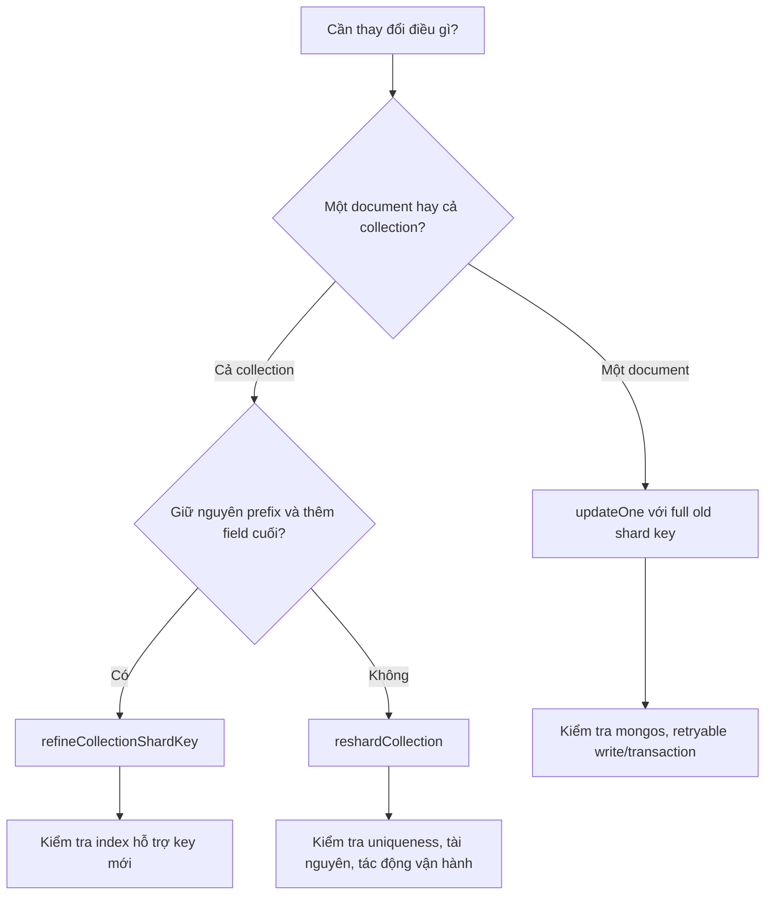

# Cập nhật shard key và giới hạn thao tác theo phiên bản

**Shard key** quyết định cách MongoDB phân phối document giữa các shard và cách `mongos` định tuyến truy vấn. Trong ứng dụng **Spring Data MongoDB**, việc sửa một trường là shard key, mở rộng shard key và thay hẳn shard key của collection là **ba thao tác khác nhau**, với yêu cầu vận hành và hỗ trợ phiên bản khác nhau.

Bài học thuộc chương **Sharding** của `SPRING_DATA_MONGODB`: dùng Spring Data MongoDB để kết nối, ánh xạ document và làm việc qua `MongoTemplate` hoặc repository, đồng thời hiểu các ràng buộc của server đối với truy vấn, update, index, giao dịch và hiệu năng.

> Phạm vi: ví dụ thao tác trên sharded cluster qua **`mongos`**. Hãy kiểm tra phiên bản thực tế của MongoDB Server, tính năng của cụm Atlas/self-managed, phiên bản driver và Spring Data trước khi áp dụng lên dữ liệu thật. Những thay đổi về shard key có thể làm tăng chi phí đọc/ghi hoặc thay đổi nơi document được lưu.

## 1. Mục tiêu học tập

Sau bài này, bạn có thể:

1. Phân biệt **cập nhật giá trị shard key của một document**, **refine shard key** và **reshard collection**.
2. Giải thích vì sao đổi giá trị shard key cần filter bằng toàn bộ shard key cũ, `mongos` và retryable write hoặc transaction.
3. Nhận biết các giới hạn về `_id`, `updateOne`, `updateMany`, `upsert`, missing shard key và unique index.
4. Chọn đúng thao tác theo phiên bản MongoDB Server, đặc biệt các mốc 4.2, 4.4, 5.0, 7.1 và 8.0.
5. Viết ví dụ có kiểm soát bằng `mongosh` và `MongoTemplate`.
6. Kiểm tra metadata, index và truy vấn sau khi thay đổi shard key.

## 2. Ba loại “thay đổi shard key” rất dễ nhầm lẫn

Xét collection `fulfillment.shipments` đang có shard key `{ region: 1 }`:

```javascript
{
  _id: "SHP-1001",
  region: "apac",
  tenantId: "shop-a",
  trackingCode: "TRK-1001",
  status: "CREATED"
}
```

| Nhu cầu | Thao tác | Phạm vi tác động |
| --- | --- | --- |
| Chuyển shipment từ `region="apac"` sang `"emea"` | **Update shard key value** | Một document được cập nhật, có thể phải chuyển sang shard khác |
| Giữ `region` là tiền tố, thêm `tenantId` để tăng độ chi tiết | **Refine shard key** | Đổi định nghĩa shard key từ `{ region: 1 }` sang `{ region: 1, tenantId: 1 }` |
| Bỏ `region`, shard theo `{ trackingCode: "hashed" }` | **Reshard collection** | Thay định nghĩa phân phối toàn collection và tổ chức lại dữ liệu |



**Thay đổi giá trị của document** không làm thay đổi định nghĩa shard key của collection. Ngược lại, **refine/reshard** là thao tác quản trị collection; thêm `@Sharded` trên entity Java không thực hiện các thay đổi này trên server.

## 3. Ma trận khả năng theo phiên bản MongoDB

| Mốc server | Khả năng cần nhớ | Giới hạn quan trọng |
| --- | --- | --- |
| **Trước 4.2** | Không hỗ trợ thay đổi giá trị shard key hiện có theo cơ chế update hiện đại | Thường phải thiết kế quy trình di chuyển/tạo lại dữ liệu phù hợp phiên bản |
| **4.2+** | Cho phép đổi **giá trị shard key của document**, ngoại trừ trường `_id` bất biến | Phải qua `mongos`; dùng transaction hoặc retryable write; filter equality bằng **toàn bộ shard key cũ** |
| **4.4+** | `refineCollectionShardKey` thêm field **ở cuối** shard key | Không được đổi thứ tự, bỏ field hay chuyển kiểu `1` sang `"hashed"` của field cũ; cần supporting index |
| **5.0+** | `reshardCollection` cho phép thay shard key của collection | Kiểm tra quyền, index/unique, tài nguyên và các thao tác bị hạn chế trong khi resharding |
| **7.1+** | Nới điều kiện targeting cho một số thao tác trên sharded collection, như `updateOne` / `findAndModify` không cung cấp shard key hoặc `_id` trong query | Không đồng nghĩa được bỏ filter **full old shard key** khi chính update đang đổi giá trị shard key |
| **8.0+** | Hỗ trợ `reshardCollection` trên **chính shard key hiện tại** với `forceRedistribution: true`; tài liệu phương thức `updateOne`/`replaceOne` mô tả upsert linh hoạt hơn | Không suy rộng khả năng của `updateOne` sang `updateMany` hoặc mọi driver/mọi command |
| **8.0.10+** | Có thể reshard **time series collection** theo điều kiện của MongoDB | Tất cả shard chứa time series collection phải chạy phiên bản tối thiểu tương ứng; còn các giới hạn khác của time series |

Các mốc trên là **MongoDB Server**, không phải phiên bản Spring Boot hoặc Spring Data. Thực tế có thể khác giữa lệnh `update` cổ điển, `updateOne`, `replaceOne`, `findAndModify` và cách driver phát lệnh.

**Lưu ý tài liệu theo phiên bản:** release notes MongoDB 8.0 ghi nhận việc nới điều kiện `updateOne(..., { upsert: true })` từ nhánh 7.1; trang tham chiếu `updateOne` hiện hành mô tả khả năng này từ 8.0. Đối với code cần chạy trên nhiều phiên bản, giải pháp tương thích hơn là **giữ equality filter trên toàn bộ shard key cho upsert** và chỉ dựa vào hành vi nới lỏng sau khi kiểm tra đúng bản server/driver.

Kiểm tra server thực tế:

```javascript
// Chạy qua mongos
db.version();
db.adminCommand({ buildInfo: 1 }).version;
sh.status();
```

Một cluster có thể đang trong quá trình rolling upgrade. Trước thao tác quản trị, cần xác nhận **feature compatibility version (FCV)** phù hợp, ví dụ qua `getParameter` theo hướng dẫn vận hành của đúng bản MongoDB; chỉ nhìn số version của một `mongos` chưa đủ.

## 4. Cập nhật giá trị shard key của một document (4.2+)

### 4.1. Điều kiện bắt buộc

MongoDB cho phép đổi giá trị shard key nếu field cần đổi không phải `_id` bất biến. Đối với việc thay đổi shard key **đã tồn tại**:

1. Gửi lệnh đến **`mongos`**, không kết nối trực tiếp vào `mongod` của một shard để sửa.
2. Dùng **single-document write**: chẳng hạn `updateOne`, `replaceOne` hoặc `findOneAndUpdate` theo quy định của phương thức.
3. Chạy trong **multi-document transaction** hoặc dưới dạng **retryable write** đủ điều kiện.
4. Query filter phải chứa điều kiện **equality cho tất cả thành phần shard key cũ**. Có thể bổ sung `_id` và điều kiện nghiệp vụ để xác định đúng một document.
5. Bảo toàn ràng buộc schema/index; nếu shard key mới làm document nằm ở chunk của shard khác, server có thể phải thực hiện việc chuyển document giữa các shard.

Giả sử shard key gồm `{ region: 1, tenantId: 1 }`, filter đúng là:

```javascript
{
  _id: "SHP-1001",
  region: "apac",
  tenantId: "shop-a"
}
```

Chỉ có `{ _id: "SHP-1001" }`, hoặc `{ region: "apac" }`, **không đáp ứng** yêu cầu full equality filter cho thao tác đổi shard key phức hợp, dù một số thao tác single-document thông thường trên phiên bản mới có thể target được document với filter khác.

### 4.2. Ví dụ `mongosh` dùng retryable write

Ví dụ này dành cho **sharded cluster thử nghiệm**. Kết nối vào địa chỉ router `mongos` bằng một MongoDB URI bật `retryWrites=true`. Tên host, quyền và cấu hình TLS cần thay bằng thông tin của môi trường thực.

```bash
mongosh "mongodb://mongos-host:27017/fulfillment?retryWrites=true"
```

Chuẩn bị collection mẫu (chỉ thực hiện nếu chưa shard):

```javascript
use fulfillment

db.createCollection("shipments");
db.shipments.createIndex({ region: 1 });
sh.shardCollection("fulfillment.shipments", { region: 1 });

db.shipments.insertOne({
  _id: "SHP-1001",
  region: "apac",
  tenantId: "shop-a",
  trackingCode: "TRK-1001",
  status: "CREATED"
});
```

Cập nhật region:

```javascript
const filter = {
  _id: "SHP-1001",
  region: "apac" // equality trên TOÀN BỘ shard key cũ
};

const result = db.shipments.updateOne(
  filter,
  { $set: { region: "emea" } },
  { upsert: false }
);

printjson({
  matchedCount: result.matchedCount,
  modifiedCount: result.modifiedCount
});

db.shipments.findOne({ _id: "SHP-1001", region: "emea" });
```

Kết quả mong đợi với document chưa từng được đổi là `matchedCount=1` và `modifiedCount=1`. MongoDB có thể giữ document trên cùng shard hoặc chuyển nó sang shard khác tùy metadata chunk; không nên suy ra vị trí vật lý chỉ từ tên region.

Sau update, nếu chạy lại với filter **cũ** `region: "apac"` thì `matchedCount=0`, vì document đã mang giá trị mới. Đây là hành vi hữu ích để tránh cập nhật nhầm nếu có yêu cầu xác nhận trạng thái trước khi đổi.

**Retryable write không phải mọi thao tác đều có thể retry.** `updateOne` đủ điều kiện khi driver/session/write concern và cấu hình triển khai thỏa yêu cầu; `updateMany` không phải lối thay thế cho thao tác này. Tính idempotent ở lớp nghiệp vụ, khả năng retry sau lỗi mạng và xử lý kết quả không chắc chắn vẫn phải được thiết kế.

### 4.3. Ví dụ trong transaction

Nếu thay đổi `region` phải đi cùng một ghi nghiệp vụ khác, có thể dùng transaction. Ví dụ sau giữ cả bước chuyển region và ghi audit trong cùng transaction; transaction có thể bị server yêu cầu retry khi gặp lỗi tạm thời.

```javascript
// Ví dụ minh họa, chạy trên replica set-backed sharded cluster hỗ trợ transactions.
const session = db.getMongo().startSession();
const txDb = session.getDatabase("fulfillment");

try {
  session.startTransaction();

  const result = txDb.shipments.updateOne(
    { _id: "SHP-1001", region: "emea" },
    { $set: { region: "apac" } }
  );
  if (result.matchedCount !== 1) {
    throw new Error("Không tìm thấy shipment với shard key cũ");
  }

  txDb.shipmentAudit.insertOne({
    shipmentId: "SHP-1001",
    action: "REGION_CHANGED",
    previousRegion: "emea",
    newRegion: "apac"
  });

  session.commitTransaction();
} catch (error) {
  try { session.abortTransaction(); } catch (_) {}
  throw error;
} finally {
  session.endSession();
}
```

Đây là **cấu trúc minh họa**, chưa có retry loop cho `TransientTransactionError` / `UnknownTransactionCommitResult`. Trong production, dùng cơ chế retry transaction có kiểm soát của driver và kiểm tra chính sách `writeConcern`, timeout, dữ liệu audit, khả năng lặp lại logic nghiệp vụ. Không đặt `writeConcern` riêng cho từng update bên trong transaction.

### 4.4. Những trường hợp phải tách riêng

- **Shard key chứa `_id`:** `_id` bất biến; không được đổi `_id` chỉ bằng `$set` hoặc replace document.
- **Shard key là hợp phần:** mỗi thành phần cũ cần có điều kiện equality trong filter khi đổi giá trị shard key.
- **Document thiếu shard key:** MongoDB có cơ chế update giá trị thiếu; `null` match có thể tìm cả document thiếu field lẫn document có `null` thật. Dùng thêm `_id` và làm theo yêu cầu riêng của method/phiên bản.
- **`updateMany`:** không dùng để đồng loạt đổi giá trị shard key hiện có. Việc đặt giá trị cho *missing shard key* có quy tắc riêng, chẳng hạn một số `updateMany` được phép đặt giá trị `null`.
- **`bulkWrite`:** nếu việc đổi shard key làm document chuyển shard, có giới hạn batch; đừng gộp tùy ý nhiều lần thay đổi cross-shard trong một bulk.
- **Upsert:** tránh gộp logic “tìm hoặc tạo” vào việc **di chuyển** một document đang tồn tại khi chưa phân tích rõ filter và bảo đảm unique.

## 5. Targeting, upsert và missing shard key theo phiên bản

Một lỗi thường gặp là lấy quy tắc **thao tác một document** áp dụng cho **thay đổi giá trị shard key**. Hai phạm vi có các điều kiện khác nhau.

### 5.1. Filter cho update thông thường

Ví dụ collection shard theo `{ region: 1 }`:

```javascript
// Dễ target một shard nhờ shard key:
db.shipments.updateOne(
  { _id: "SHP-1001", region: "apac" },
  { $set: { status: "IN_TRANSIT" } }
);

// Update field không thuộc shard key bằng _id, không đổi region.
// Khả năng target/filter và chi phí routing tùy phiên bản.
db.shipments.updateOne(
  { _id: "SHP-1001" },
  { $set: { status: "DELIVERED" } }
);
```

Từ MongoDB 7.1, một số phương thức được phép thực hiện single-document write mà filter không chứa shard key hoặc `_id`; tùy query, MongoDB phải tìm shard đích qua nhiều giai đoạn. Quy tắc tốt cho hiệu năng là **đưa full shard key vào filter nếu ứng dụng biết giá trị đó**.

Không vì việc `updateOne` chấp nhận filter thiếu shard key trên phiên bản mới mà bỏ điều kiện equality cũ khi **chính field shard key đang bị thay đổi**.

### 5.2. Filter cho upsert

`Upsert` có thể chèn document mới nếu không tìm thấy bản ghi. Trên các phiên bản cũ, filter upsert ở sharded collection thường bắt buộc chứa toàn bộ shard key. Trang tham chiếu `updateOne`/`replaceOne` MongoDB 8.0 cho phép trường hợp `upsert: true` không chứa toàn bộ key; `updateMany` và `update` cổ điển có quy tắc riêng.

Để tránh phụ thuộc một khả năng mới khi hỗ trợ nhiều phiên bản, viết rõ shard key:

```javascript
db.shipments.updateOne(
  { _id: "SHP-1002", region: "apac" },
  {
    $setOnInsert: { tenantId: "shop-a" },
    $set: { status: "CREATED" }
  },
  { upsert: true }
);
```

Filter này giúp chỉ rõ vùng dữ liệu mới khi chèn. Tuy nhiên **upsert không tự đảm bảo uniqueness toàn cluster** đối với mọi field; nếu cần uniqueness nghiệp vụ phải có unique index tương thích shard key hoặc một mô hình bảo đảm tương đương.

### 5.3. Document thiếu trường shard key

Một document có thể thiếu field thuộc shard key; server có thể xem giá trị thiếu giống `null` trong quá trình matching/routing.

```javascript
// Chỉ minh họa filter có thể match document thiếu hoặc null:
db.shipments.find({ region: null });

// Khi sửa trường thiếu, nên bổ sung _id cụ thể để tránh chọn nhầm.
db.shipments.find({ _id: "SHP-2001", region: null });
```

Với thao tác chuyển từ missing/`null` sang **non-null**, cần dùng `mongos`, và trong các trường hợp tương ứng phải dùng retryable write hoặc transaction. Các phương thức `updateOne` / `replaceOne` / `findAndModify` có điều kiện filter khác nhau; không suy ra rằng tất cả thao tác `$set` trên missing shard key đều tương đương cập nhật shard key hiện hữu.

### 5.4. Bảng quyết định nhanh

| Tình huống | Quy tắc nên áp dụng |
| --- | --- |
| Sửa `status` của document, biết shard key | Lọc bằng shard key và `_id` hoặc khóa nghiệp vụ phù hợp |
| Đổi `region` của một document | `mongos` + full equality filter trên **old shard key** + retryable write/transaction + single-document update |
| Đổi shard key của nhiều document | Xử lý có kiểm soát từng document, đánh giá transaction/retry; không mặc nhiên dùng `updateMany` |
| `upsert: true` trên nhiều version | Có full shard key trong filter để giữ khả năng tương thích, đồng thời kiểm soát uniqueness |
| Sửa field shard key đang thiếu | Kiểm tra quy tắc riêng cho missing field, phân biệt missing và `null` |
| Muốn thay field shard key của **cả collection** | Dùng `reshardCollection`, không lặp `updateOne` từng document để giả vờ đổi định nghĩa cluster |

## 6. Refine shard key: chỉ thêm field ở cuối (4.4+)

### 6.1. Khi nào refine phù hợp?

Giả sử collection `fulfillment.tenantOrders` hiện dùng:

```javascript
{ tenantId: 1 }
```

Một tenant rất lớn có thể tạo vùng dữ liệu khó chia nhỏ vì nhiều document chia sẻ cùng giá trị shard key. Ta muốn chuyển thành:

```javascript
{ tenantId: 1, orderNumber: 1 }
```

Đây là **refinement**: giữ nguyên tiền tố `tenantId`, thêm `orderNumber` ở cuối. Việc bổ sung này tăng độ chi tiết để các khoảng giá trị có thể được chia nhỏ hơn. Nó **không đảm bảo** mọi hotspot biến mất, vì queries/traffic của một tenant có thể vẫn lệch.

Không thể dùng refine để đổi `{ tenantId: 1 }` thành:

- `{ orderNumber: 1 }`: đã bỏ tiền tố cũ.
- `{ orderNumber: 1, tenantId: 1 }`: đã đổi thứ tự trường.
- `{ tenantId: "hashed", orderNumber: 1 }`: đã đổi kiểu của trường shard key cũ.

Những nhu cầu này thuộc **resharding**, nếu phiên bản và dữ liệu cho phép.

### 6.2. Prerequisite và lệnh thực hành

Collection đã sharded theo `{ tenantId: 1 }` và có dữ liệu. Trước refine, cần index hỗ trợ **key mới**; supporting index phải bắt đầu bằng key mới, không phải partial/sparse index. Với collection có collation không phải simple, kiểm tra quy định `simple collation`.

```javascript
use fulfillment

// Kiểm tra index hiện hữu trước khi thực hiện.
db.tenantOrders.getIndexes();

// Chuẩn bị index hỗ trợ key refined.
db.tenantOrders.createIndex({ tenantId: 1, orderNumber: 1 });

// Thực hiện ở router mongos, với quyền quản trị phù hợp.
db.adminCommand({
  refineCollectionShardKey: "fulfillment.tenantOrders",
  key: { tenantId: 1, orderNumber: 1 }
});

sh.status();
```

**Refine không tạo lại toàn bộ dữ liệu như resharding** và không tự phân phối đều ngay lập tức các chunk hiện tại. Sau refine, cần quan sát split/balancer, index và phân bố truy vấn để biết cluster đã đáp ứng mục tiêu hay chưa.

Đặc biệt với collection có **unique shard key index** hiện hữu, yêu cầu refinement nghiêm ngặt hơn: key refined phải có unique index phù hợp, và tài liệu MongoDB hướng dẫn xử lý index shard key cũ trước khi chạy `refineCollectionShardKey`. Không được lấy ví dụ non-unique trên rồi áp dụng nguyên xi cho collection có các unique constraints.

### 6.3. Ảnh hưởng tới application query

Sau refine, shard key trở thành compound key. Spring Data MongoDB phải biết metadata key mới trong ánh xạ entity, và các query nghiệp vụ cần cân nhắc bổ sung các trường để cải thiện targeting:

```javascript
// Sau refine, có toàn bộ shard key mới:
db.tenantOrders.findOne({
  tenantId: "shop-a",
  orderNumber: "ORD-2026-1001"
});
```

Định nghĩa index/`@Sharded` trong ứng dụng cũng cần phù hợp; nếu deployment gồm nhiều phiên bản ứng dụng, phải lên kế hoạch chuyển đổi đồng bộ với thời điểm cluster đổi định nghĩa shard key.

## 7. Reshard collection: thay shard key toàn tập (5.0+)

### 7.1. Khác biệt với refine

`reshardCollection` cho phép chọn shard key **khác**: ví dụ từ `{ tenantId: 1 }` sang `{ orderNumber: "hashed" }`. MongoDB tạo và phân phối dữ liệu theo key mới trong một quy trình quản trị collection.

```text
Trước:
  collection: tenantOrders
  shard key: { tenantId: 1 }

  shard A -> các khoảng tenantId
  shard B -> các khoảng tenantId

Reshard:
  donor -> sao chép/sắp xếp dữ liệu theo key mới -> recipient
  đồng bộ thay đổi đang diễn ra -> commit

Sau:
  collection: tenantOrders
  shard key: { orderNumber: "hashed" }
```

Đây là thao tác tiêu tốn I/O, CPU, disk và thời gian; cần đọc hướng dẫn của đúng phiên bản, lập kế hoạch dung lượng và quan sát hệ thống khi chạy.

### 7.2. Ví dụ lệnh `reshardCollection`

```javascript
// Ví dụ quản trị: chỉ thực hiện trên môi trường đã đánh giá điều kiện.
// Collection ban đầu đã sharded trên { tenantId: 1 }.
db.adminCommand({
  reshardCollection: "fulfillment.tenantOrders",
  key: { orderNumber: "hashed" }
});
```

Không phải tạo trước index hỗ trợ **new shard key** theo cách của refine; thao tác resharding có giai đoạn xây dựng index cần thiết. Nhưng những index bổ sung phục vụ query và nhất là các **unique indexes đang tồn tại** vẫn phải được đánh giá kỹ.

Ví dụ, unique index `{ tenantId: 1, orderNumber: 1 }` sẽ **không tự phù hợp** với một shard key mới chỉ gồm `{ orderNumber: "hashed" }`. MongoDB không chấp nhận hashed index làm unique index, và resharding chỉ thành công khi ràng buộc unique index thỏa quy tắc của new shard key.

### 7.3. Giới hạn vận hành trong khi resharding

- Chỉ có thể reshard **một collection tại một thời điểm** trên cluster.
- Trong lúc reshard, không chạy các DDL bị chặn trên collection như `createIndexes`, `dropIndexes`, `collMod`, `renameCollection`.
- Không bắt đầu reshard khi đang có index build; tài liệu MongoDB cảnh báo index build trong giai đoạn resharding có thể thất bại.
- Cần dự phòng **dung lượng và thông lượng** đáng kể cho cả donor/recipient shard, giám sát latency của ứng dụng và lượng dữ liệu thay đổi.
- Quy trình có giai đoạn commit **tạm chặn ghi** ngắn; tài liệu MongoDB mô tả mức tối đa mặc định khoảng hai giây, nhưng đây không phải cam kết latency đầu-cuối của ứng dụng.
- Retryable writes đã khởi tạo trước/trong resharding có thời hạn retry liên quan đến lịch sử giao dịch; sau một khoảng thời gian, có thể xuất hiện `IncompleteTransactionHistory`.
- Phải kiểm tra các ràng buộc đối với time series, encrypted collection, Search indexes và các tính năng cluster cụ thể.
- Việc abort bị giới hạn theo phase; **không** giả định có thể hủy sau khi đã bước vào commit.

### 7.4. Reshard về cùng key trên MongoDB 8.0+

Từ 8.0, MongoDB cho phép **redistribute dữ liệu** mà vẫn giữ nguyên định nghĩa shard key, bằng tùy chọn `forceRedistribution: true`:

```javascript
// Chỉ dùng khi server hỗ trợ MongoDB 8.0+.
db.adminCommand({
  reshardCollection: "fulfillment.events",
  key: { eventId: "hashed" },
  forceRedistribution: true
});
```

Tình huống tiêu biểu: thêm shard mới, thay vùng phân phối hoặc tái cân bằng dữ liệu. Điều này **khác** với việc thay shard key sang field khác.

## 8. Spring Data MongoDB: áp dụng đúng ở tầng ứng dụng

### 8.1. Annotation `@Sharded` và `immutableKey`

Spring Data MongoDB có annotation `@Sharded` từ Spring Data MongoDB 3.0; annotation này mô tả shard key của entity, hỗ trợ bổ sung thông tin shard key vào filter ở **một số thao tác replacement/save**. Nó không ra lệnh cho cluster chạy `shardCollection`, `refineCollectionShardKey` hoặc `reshardCollection`.

```java
import org.springframework.data.annotation.Id;
import org.springframework.data.mongodb.core.mapping.Document;
import org.springframework.data.mongodb.core.mapping.Sharded;
import org.springframework.data.mongodb.core.mapping.ShardingStrategy;

@Document(collection = "shipments")
@Sharded(
    shardKey = "region",
    shardingStrategy = ShardingStrategy.RANGE,
    immutableKey = false
)
public class Shipment {

    @Id
    private String id;

    private String region;
    private String tenantId;
    private String trackingCode;
    private String status;

    // Constructor, getters, setters...
}
```

`immutableKey = false` là mặc định. Khi shard key có thể thay đổi và Spring Data cần tạo filter cho một số thao tác save/replace, thư viện có thể phải **đọc shard key hiện tại từ server** để xác định đúng document.

Chỉ đặt `immutableKey = true` khi **quy tắc nghiệp vụ bảo đảm shard key không đổi** và ứng dụng duy trì cam kết đó. Thuộc tính này giúp tránh thêm round trip trong những trường hợp phù hợp; nó **không tạo ràng buộc immutability mới ở MongoDB Server**.

Nếu ứng dụng dùng field Java khác tên field BSON (ví dụ `@Field("region_code")`), hãy kiểm tra cách Spring Data ánh xạ tên property trong annotation, query và index, tránh filter trỏ nhầm tên trường.

### 8.2. Sửa shard key bằng `MongoTemplate.updateFirst`

Với yêu cầu chuyển shipment giữa hai region, code nên cung cấp **old shard key** trực tiếp trong `Query`:

```java
import com.mongodb.client.result.UpdateResult;
import org.springframework.data.mongodb.core.MongoTemplate;
import org.springframework.data.mongodb.core.query.Criteria;
import org.springframework.data.mongodb.core.query.Query;
import org.springframework.data.mongodb.core.query.Update;

public class ShipmentService {

    private final MongoTemplate mongoTemplate;

    public ShipmentService(MongoTemplate mongoTemplate) {
        this.mongoTemplate = mongoTemplate;
    }

    public boolean changeRegion(
            String shipmentId,
            String oldRegion,
            String newRegion
    ) {
        Query query = Query.query(
            Criteria.where("_id").is(shipmentId)
                    .and("region").is(oldRegion)
        );
        Update update = new Update().set("region", newRegion);

        UpdateResult result =
                mongoTemplate.updateFirst(query, update, Shipment.class);

        return result.getMatchedCount() == 1;
    }
}
```

Để đoạn code hoạt động đúng với việc **đổi shard key**:

- Spring Data/Java driver cần được cấu hình để kết nối **`mongos`**.
- Lệnh phải chạy như **retryable write đủ điều kiện** hoặc trong transaction; ví dụ kết nối qua `mongodb://.../fulfillment?retryWrites=true` nếu driver và server hỗ trợ.
- Filter cần equality cho **toàn bộ shard key hiện tại**; ở ví dụ này shard key chỉ có `region`.
- Trước khi gọi update, ứng dụng cần biết `oldRegion`. Nếu dữ liệu có thể bị thay đổi đồng thời, kiểm tra matched count và xem xét optimistic locking hoặc điều kiện phiên bản trong filter.
- Xử lý lỗi driver, write conflict, timeout và kết quả không chắc chắn theo cơ chế retry thích hợp. Không biến mọi exception thành `false` và bỏ qua.

Nếu shard key là compound key, thêm tất cả thành phần:

```java
Query query = Query.query(
    Criteria.where("_id").is(shipmentId)
            .and("region").is(oldRegion)
            .and("tenantId").is(tenantId)
);
```

Hãy phân biệt `@Sharded` hỗ trợ auto-inclusion cho một số thao tác `save`/`replace` với phương thức `updateFirst` có `Query` tường minh. Không trông chờ annotation tự thêm điều kiện shard key cho **mọi** loại update.

### 8.3. Khi nào cần `MongoTransactionManager`?

Một single-document shard-key update **không bắt buộc dùng transaction** nếu đã là retryable write đủ điều kiện. Khi cập nhật cần atomic cùng các document khác, có thể dùng `MongoTransactionManager` và `@Transactional`, với điều kiện cluster được cấu hình hỗ trợ transactions.

```java
import org.springframework.stereotype.Service;
import org.springframework.transaction.annotation.Transactional;

@Service
public class ShipmentWorkflow {

    private final ShipmentService shipmentService;

    public ShipmentWorkflow(ShipmentService shipmentService) {
        this.shipmentService = shipmentService;
    }

    @Transactional
    public void moveShipment(
            String shipmentId, String oldRegion, String newRegion
    ) {
        if (!shipmentService.changeRegion(
                shipmentId, oldRegion, newRegion)) {
            throw new IllegalStateException(
                "Shipment không còn ở region ban đầu"
            );
        }

        // Ghi thêm dữ liệu nghiệp vụ bằng cùng transaction nếu cần.
    }
}
```

`@Transactional` chỉ thực sự tạo MongoDB transaction khi có **transaction manager phù hợp** và toàn bộ lời gọi nằm trong context transaction của Spring. Khi cấu hình kết hợp nhiều database/transaction managers, cần khai báo rõ transaction manager nào được sử dụng. Lỗi transient transaction cần cơ chế retry đúng phạm vi nghiệp vụ.

### 8.4. Refine/reshard và rollout ứng dụng

Nếu thay đổi **định nghĩa** shard key:

1. Chuẩn bị entity, query và index cho schema mới; xác định compatibility của cả ứng dụng cũ và mới.
2. Thực hiện thao tác quản trị trên server bằng `mongosh`/migration đã được xem xét; không thêm reshard vào mỗi lần application startup.
3. Sau khi metadata thay đổi, triển khai cấu hình `@Sharded` và những filter cần thiết trên ứng dụng.
4. Theo dõi truy vấn có hoặc thiếu shard key, độ trễ write, scatter-gather và các trường hợp upsert.
5. Với deploy nhiều instance, lên kế hoạch giai đoạn chuyển tiếp để không có một nhóm instance dùng hiểu biết shard key đã lỗi thời cho các thao tác nhạy cảm.

Không nên coi `repository.save(entity)` là cách an toàn mặc định để “di chuyển” entity giữa shard trong mọi phiên bản. Khả năng tự bổ sung shard key cho replacement phụ thuộc Spring Data, tình trạng entity và query; các thao tác đổi key cần kiểm thử qua `mongos` với chính driver/version sẽ triển khai.

## 9. Uniqueness, index và `_id` khi thay đổi shard key

### 9.1. Unique index phải tương thích với new shard key

Một sharded collection thường chỉ có thể bảo đảm uniqueness trên toàn cluster khi unique index có **full shard key làm tiền tố** (đối với ranged shard key), trừ các ngoại lệ và giới hạn đặc biệt của `_id`.

Giả sử collection có:

```javascript
db.tenantOrders.createIndex(
  { tenantId: 1, orderNumber: 1 },
  { unique: true }
);
```

Nếu new shard key là `{ orderNumber: "hashed" }`, index hiện tại không thỏa quy tắc tiền tố của new shard key. Không thể giả định resharding sẽ tự chuyển unique index cũ thành index hợp lệ. Cần phân tích lại model hoặc phương án uniqueness trước khi reshard.

`_id` mặc định là immutable. Khi `_id` không phải shard key, unique index mặc định trên `_id` chỉ được kiểm tra **trong mỗi shard**. Điều này đặc biệt đáng chú ý khi reshard: MongoDB có thể từ chối thao tác nếu dữ liệu đang có các `_id` trùng nhau giữa shard; ứng dụng nên chủ động sinh ID toàn cục.

### 9.2. Index để refine khác index để reshard

| Thao tác | Quy tắc index tiêu biểu |
| --- | --- |
| Sửa giá trị shard key của document | Không cần tạo index “để đổi key”; index shard key hiện hữu vẫn cần hợp lệ |
| Refine `{ a: 1 }` → `{ a: 1, b: 1 }` | **Tạo trước** index hỗ trợ key mới; nếu có unique index, xử lý yêu cầu bổ sung |
| Reshard sang `{ b: "hashed" }` | Server xây index shard key mới trong resharding; tránh tạo index đồng thời và kiểm tra unique constraints |
| Sau thay đổi key | Đánh giá lại index phục vụ query, filter của repository, chi phí routing |

## 10. Kiểm chứng và xử lý lỗi

### 10.1. Kiểm tra trạng thái trước/sau

```javascript
// Kết nối đến mongos.
db.version();
sh.status();

use fulfillment

db.shipments.getIndexes();
db.tenantOrders.getIndexes();

// Kiểm tra document sau cập nhật shard-key value.
db.shipments.findOne({
  _id: "SHP-1001",
  region: "emea"
});

// So sánh truy vấn có/không có shard key.
db.shipments.find({
  region: "emea",
  status: "CREATED"
}).explain("executionStats");

db.shipments.find({
  status: "CREATED"
}).explain("executionStats");
```

Mục tiêu kiểm tra không chỉ là lệnh trả `ok: 1`. Cần xác nhận metadata shard key, index, document đúng vị trí logic, số shard tham gia truy vấn và sự thay đổi latency.

### 10.2. Bảng lỗi điển hình

| Dấu hiệu | Nguyên nhân có thể | Cách xử lý |
| --- | --- | --- |
| Update shard key bị từ chối khi kết nối thẳng shard | Không chạy qua `mongos` | Cấu hình client/router đúng |
| Update đổi key báo lỗi điều kiện | Thiếu full old shard key trong filter, hoặc lệnh không thuộc retryable write/transaction | Thêm equality filter và sửa chế độ ghi |
| `matchedCount=0` | Giá trị shard key cũ đã đổi hoặc document không tồn tại | Đọc lại document, dùng điều kiện chống update sai |
| Cố đổi `_id` | `_id` immutable | Thiết kế ID mới và quy trình migration phù hợp |
| Refine thất bại | Chưa có supporting index, sai thứ tự field, unique/collation không phù hợp | Kiểm tra `getIndexes()` và quy tắc refine |
| Reshard thất bại hoặc bị kẹt | Thiếu dung lượng, xung đột thao tác, unique index không tương thích, duplicate `_id` | Kiểm tra prerequisites, capacity và trạng thái reshard |
| Sau reshard query chậm | Ứng dụng vẫn lọc theo shard key cũ | Sửa query theo shard key mới, tạo index query thích hợp |
| Upsert hoạt động trên test nhưng lỗi ở production | Hai nơi khác version/FCV/driver hoặc dùng command khác | Lấy full shard key trong filter, kiểm tra feature/version riêng |
| `@Sharded` không shard collection | Annotation chỉ là metadata của Spring Data | Chạy lệnh sharding/refine/reshard tại server |

### 10.3. Kiểm thử tối thiểu trước khi đưa vào production

- **Version/FCV:** xác nhận MongoDB Server và FCV của cụm; biết phiên bản Spring Data/driver đang triển khai.
- **Targeting:** thử update có full old shard key và thử một query thiếu shard key để đánh giá chi phí routing.
- **Correctness:** kiểm tra `matchedCount`, document mới, duplicate ID và uniqueness của mã nghiệp vụ.
- **Concurrency:** thử hai yêu cầu cùng đổi một document từ cùng region cũ; chỉ một yêu cầu nên match khi đã thay đổi.
- **Fault tolerance:** thử retry hợp lệ khi xảy ra lỗi mạng/transaction transient, tránh ghi audit trùng.
- **Operations:** với refine/reshard, kiểm tra index, disk/I/O, giới hạn DDL và kế hoạch giám sát/rollback theo phase.

## 11. Tình huống thực hành để tự đánh giá

**Tình huống A.** Collection `shipments` shard theo `{ region: 1 }`. Người dùng chuyển một shipment từ APAC sang EMEA. Đây là thay đổi **giá trị của document**: dùng `updateOne` có `region` cũ và `_id` trong filter, thông qua `mongos` và retryable write hoặc transaction.

**Tình huống B.** Collection `tenantOrders` shard theo `{ tenantId: 1 }`. Một số tenant chứa rất nhiều đơn, bạn muốn tăng khả năng chia nhỏ bằng `orderNumber` mà vẫn giữ `tenantId` là tiền tố. Đây là bài toán **refine shard key**: lập index hỗ trợ rồi gọi `refineCollectionShardKey`, quan sát tác động phân phối sau đó.

**Tình huống C.** Collection `events` đang shard theo thời gian nên phần lớn insert dồn vào khoảng mới nhất. Bạn cần chuyển sang `eventId` hashed để phân phối ghi tốt hơn. Đây là **reshard collection**: kiểm tra server 5.0+, uniqueness, chi phí vận hành và sửa filter phía ứng dụng.

**Tình huống D.** Sau khi thêm shard mới, collection đã dùng hashed shard key tốt và bạn chỉ muốn phân phối lại dữ liệu, không đổi key. Với **MongoDB 8.0+**, xem xét `reshardCollection` trên cùng key với `forceRedistribution: true` nếu đáp ứng prerequisites.

Một lựa chọn đúng phải giải quyết **đúng cấp độ thay đổi**: document, định nghĩa shard key mở rộng, hoặc định nghĩa shard key mới cho cả collection.

## 12. Tài liệu tham khảo

- MongoDB Manual — [Change a Document's Shard Key Value](https://www.mongodb.com/docs/manual/core/sharding-change-shard-key-value/)
- MongoDB Manual — [Change a Shard Key](https://www.mongodb.com/docs/manual/core/sharding-change-a-shard-key/)
- MongoDB Manual — [Refine a Shard Key](https://www.mongodb.com/docs/manual/core/sharding-refine-a-shard-key/)
- MongoDB Manual — [refineCollectionShardKey command](https://www.mongodb.com/docs/manual/reference/command/refinecollectionshardkey/)
- MongoDB Manual — [Reshard a Collection](https://www.mongodb.com/docs/manual/core/sharding-reshard-a-collection/)
- MongoDB Manual — [Shard Key Indexes](https://www.mongodb.com/docs/manual/core/sharding-shard-key-indexes/)
- MongoDB Manual — [Set Missing Shard Key Fields](https://www.mongodb.com/docs/manual/core/sharding-set-missing-shard-key-fields/)
- MongoDB Manual — [updateOne() on sharded collections](https://www.mongodb.com/docs/manual/reference/method/db.collection.updateone/)
- MongoDB Manual — [Maintain Uniqueness in Sharded Clusters](https://www.mongodb.com/docs/manual/tutorial/maintain-uniqueness-in-sharded-clusters/)
- MongoDB — [MongoDB 8.0 Release Notes](https://www.mongodb.com/docs/v8.0/release-notes/8.0/)
- Spring Data MongoDB — [`@Sharded` API](https://docs.spring.io/spring-data/mongodb/reference/api/java/org/springframework/data/mongodb/core/mapping/Sharded.html)

**Ghi nhớ khi thực hành:** đổi **giá trị shard key** của một document là một write operation với filter/transaction cụ thể; **refine** là thêm suffix vào shard key của collection; **reshard** là tái tổ chức collection theo shard key mới hoặc phân phối lại theo cùng key trên các phiên bản hỗ trợ. Mỗi thao tác cần đối chiếu giới hạn của đúng phiên bản MongoDB và query thực tế của Spring Data.
