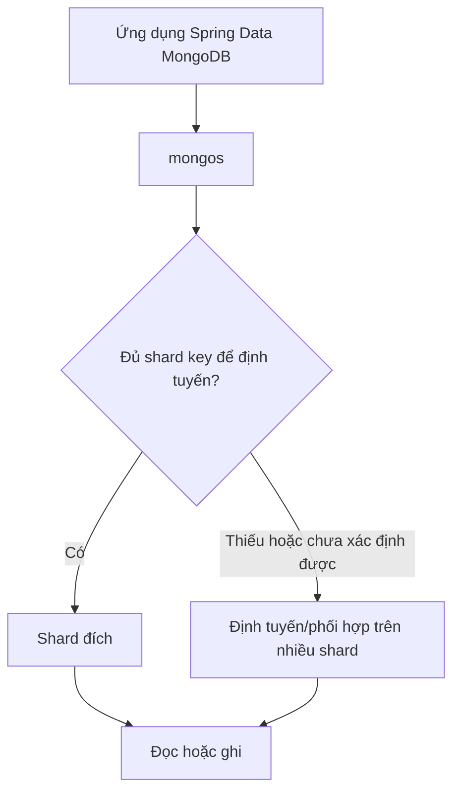
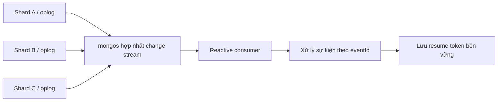
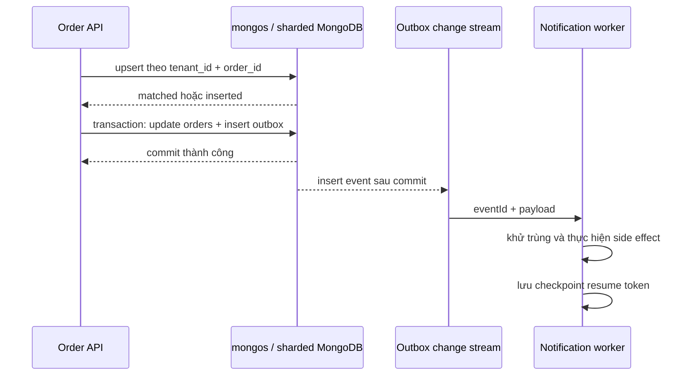

# Tác động của sharding lên upsert, transaction và change stream trong Spring Data MongoDB

Sharding giúp MongoDB phân phối dữ liệu và tải trên nhiều shard, nhưng nó cũng thay đổi cách định tuyến thao tác ghi, chi phí giao dịch và cách ứng dụng theo dõi thay đổi. Trong Spring Data MongoDB, cùng một câu lệnh `MongoTemplate.upsert(...)`, phương thức `@Transactional` hay đăng ký change stream có thể hoạt động khác khi collection được shard. Những khác biệt đó liên quan trực tiếp đến **shard key**, router **`mongos`**, phiên bản MongoDB và cơ chế retry/resume.

Bài học dùng dịch vụ đơn hàng đa tenant để lần lượt phân tích ba thao tác. Trọng tâm là kết nối giữa thiết kế truy vấn, index, transaction, reactive access và chẩn đoán hiệu năng; các đoạn mã Java minh họa Spring Data MongoDB, còn cấu hình collection chạy riêng trong `mongosh` của một sharded cluster.

## 1. Bối cảnh: cùng một collection, nhiều shard

Giả sử namespace `shop.orders` có shard key ghép theo thứ tự `{ tenant_id: 1, order_id: 1 }`. Trong ứng dụng, `tenantId` và `orderId` là tên thuộc tính Java; MongoDB lưu `tenant_id` và `order_id` thông qua `@Field`.

```java
import java.time.Instant;
import org.bson.types.ObjectId;
import org.springframework.data.annotation.Id;
import org.springframework.data.mongodb.core.mapping.Document;
import org.springframework.data.mongodb.core.mapping.Field;
import org.springframework.data.mongodb.core.mapping.Sharded;

@Document(collection = "orders")
@Sharded(shardKey = { "tenantId", "orderId" }, immutableKey = true)
public class OrderDocument {
    @Id
    private ObjectId id;

    @Field("tenant_id")
    private String tenantId;

    @Field("order_id")
    private String orderId;

    private String status;
    private Instant createdAt;

    // Constructor/getter và quy tắc bất biến của shard key được lược bớt.
}
```

`@Sharded` cung cấp metadata cho Spring Data; annotation này không tự tạo sharded cluster hay gọi `shardCollection`. Trong ví dụ, `immutableKey = true` chỉ là giả định rằng `tenantId`/`orderId` không đổi sau khi tạo đơn; nghiệp vụ và dữ liệu phải thực sự bảo đảm điều đó.

Chuẩn bị collection và unique index trên một cluster thử nghiệm, kết nối `mongosh` tới **`mongos`**:

```javascript
use shop

// Unique trên toàn cặp (tenant_id, order_id), không phải từng thành phần.
db.orders.createIndex(
  { tenant_id: 1, order_id: 1 },
  { unique: true }
)

// Với range sharding, yêu cầu unique shard key phù hợp index bên trên.
sh.shardCollection("shop.orders", { tenant_id: 1, order_id: 1 }, true)

sh.status()
db.orders.getIndexes()
```

Nếu collection đã sharded hoặc đã có dữ liệu/index khác, cần kiểm tra tiền điều kiện trước khi áp dụng các lệnh này; không chạy lặp một cách máy móc. Unique index trên shard key ghép giúp ngăn hai document có cùng cặp `(tenant_id, order_id)`, một thuộc tính quan trọng khi các request upsert đến đồng thời.



Các thao tác trên collection sharded đều phải được xem xét ở hai lớp: **ngữ nghĩa nghiệp vụ** (đúng document, tính duy nhất, tính nguyên tử) và **ngữ nghĩa phân tán** (định tuyến, phối hợp các shard, lỗi tạm thời).

## 2. Upsert: điều kiện lọc quyết định độ an toàn và hiệu năng

**Upsert** nghĩa là cập nhật document phù hợp với bộ lọc, hoặc chèn document mới nếu không có bản ghi phù hợp. Trên sharded collection, router cần xác định vị trí cập nhật hoặc chèn; vì vậy thiết kế filter và shard key rất quan trọng.

### 2.1. Yêu cầu theo phiên bản MongoDB

| Trường hợp | Hành vi/ràng buộc cần nhớ |
| --- | --- |
| `updateOne(..., { upsert: true })` trên MongoDB trước 8.0 | Bộ lọc upsert phải chứa điều kiện bằng trên **đầy đủ shard key**, theo yêu cầu của các phiên bản đó. |
| `updateOne(..., { upsert: true })` từ MongoDB 8.0 | Không còn bắt buộc cung cấp đầy đủ shard key trong filter để thực hiện upsert. |
| `replaceOne(..., { upsert: true })` từ MongoDB 8.0 | Quy tắc cho `replaceOne` cũng được nới lỏng; cần xem đúng tài liệu theo version và API đang dùng. |
| Thiết kế nghiệp vụ đa tenant | Vẫn nên đưa **đầy đủ shard key và khóa nghiệp vụ** vào filter để định tuyến rõ ràng, giảm nguy cơ chèn trùng hoặc thao tác nhầm tenant. |

Vì yêu cầu thay đổi theo phiên bản và lệnh MongoDB cụ thể, không nên phát biểu tuyệt đối rằng "mọi upsert trên sharded collection luôn bắt buộc đủ shard key". Quy tắc an toàn của ví dụ là sử dụng đủ `{ tenant_id, order_id }` bất kể đang dùng MongoDB 7.x hay 8.x.

### 2.2. `MongoTemplate.upsert` với shard key ghép

```java
import java.time.Instant;
import com.mongodb.client.result.UpdateResult;
import org.springframework.data.mongodb.core.MongoTemplate;
import org.springframework.data.mongodb.core.query.Criteria;
import org.springframework.data.mongodb.core.query.Query;
import org.springframework.data.mongodb.core.query.Update;

public UpdateResult createOrderIfAbsent(
        MongoTemplate mongoTemplate, String tenantId, String orderId) {

    Query byBusinessKey = Query.query(
        Criteria.where("tenantId").is(tenantId)
                .and("orderId").is(orderId)
    );

    Update onInsert = new Update()
            .setOnInsert("tenantId", tenantId)
            .setOnInsert("orderId", orderId)
            .setOnInsert("status", "NEW")
            .setOnInsert("createdAt", Instant.now());

    return mongoTemplate.upsert(
        byBusinessKey, onInsert, OrderDocument.class
    );
}
```

`Criteria` và `Update` dùng **tên thuộc tính Java**. Spring Data ánh xạ chúng sang `tenant_id` và `order_id` trong BSON. `$setOnInsert` chỉ đặt giá trị khi MongoDB thực sự chèn bản ghi; gọi lặp lại phương thức này với cùng cặp khóa không thay `status` hiện hữu thành `NEW`. `UpdateResult.getUpsertedId()` giúp nhận biết một bản ghi mới được tạo, còn `getMatchedCount()` cho biết có document đã khớp filter. Không nên diễn giải `modifiedCount = 0` là thao tác thất bại: một phép ghi idempotent có thể không thay đổi gì.

Ở mức `mongosh`, thao tác tương đương về ý tưởng:

```javascript
db.orders.updateOne(
  { tenant_id: "tenant-a", order_id: "ord-001" },
  {
    $setOnInsert: {
      tenant_id: "tenant-a",
      order_id: "ord-001",
      status: "NEW",
      createdAt: new Date()
    }
  },
  { upsert: true }
)
```

Hai request đồng thời có thể đều quan sát chưa có document trước khi insert. **Unique index phù hợp** mới là lớp bảo đảm chống trùng bền vững; nếu một request nhận `DuplicateKey`, mã xử lý cần đọc lại document hoặc retry có giới hạn dựa trên khóa nghiệp vụ, thay vì giả định upsert tự cung cấp giao thức exactly-once. Với upsert làm thay đổi trạng thái, cần quyết định rõ thao tác có được phép ghi đè trạng thái hiện tại hay không và dùng filter có điều kiện trạng thái khi cần.

### 2.3. Các điều kiện cần xem xét khi upsert

- **Thiếu một phần shard key:** từ MongoDB 8.0 một số lệnh upsert cho phép filter thiếu khóa, nhưng điều đó không loại bỏ nguy cơ scatter/gather, chèn document thiếu trường hay chọn sai khóa nghiệp vụ.
- **Đổi shard key:** cập nhật giá trị shard key là thao tác khác với upsert thông thường và chịu các yêu cầu riêng về `mongos`, retryable write/transaction, điều kiện bằng trên khóa đầy đủ; `_id` là bất biến.
- **Tên trường BSON:** `@Field("tenant_id")` phải thống nhất với index và định nghĩa shard key server. Dùng sai tên gây lọc sai hoặc định tuyến không như mong muốn.
- **`save()` không đồng nghĩa `upsert(Query, Update, ...)`:** `save()` có thể dùng đường ghi thay thế document và có hỗ trợ shard key theo metadata `@Sharded`; không giả định mọi API tự động bổ sung cùng một bộ lọc.

## 3. Transaction: tính nguyên tử vẫn có, chi phí phân tán thay đổi

MongoDB hỗ trợ multi-document ACID transaction trên sharded cluster. Khi toàn bộ thao tác đụng tới một shard, chi phí thường gần với transaction trên replica set. Nếu thao tác liên quan nhiều shard, MongoDB phải phối hợp commit giữa chúng, làm tăng độ trễ và chi phí tài nguyên.

| Khía cạnh | Transaction một shard | Transaction nhiều shard |
| --- | --- | --- |
| Phạm vi | Một shard xử lý phần lớn thao tác ghi. | Nhiều shard cùng tham gia một transaction. |
| Commit | Ít phối hợp phân tán hơn. | Phải phối hợp commit xuyên shard; latency thường cao hơn. |
| Snapshot đọc | Theo cơ chế transaction. | Khi cần snapshot nhất quán trên nhiều shard, dùng read concern `snapshot`. |
| Lỗi khi migration | Vẫn phải xử lý lỗi transaction. | Giao thoa với chunk/range migration có thể khiến commit lỗi và transaction bị abort. |
| Thiết kế | Cố gắng nhóm dữ liệu hay ghi cùng shard theo truy cập nghiệp vụ khi phù hợp. | Chỉ dùng khi cần đảm bảo nguyên tử trên nhiều document/shard; đo chi phí thực tế. |

Sharding **không làm mất atomicity của transaction đã commit**. Tuy nhiên, mã ứng dụng phải xử lý đúng kết quả commit chưa rõ, transient error, timeout và các hạn chế của transaction; nó không tự biến mọi hệ thống bên ngoài (email, Kafka, HTTP) thành một phần của transaction MongoDB.

### 3.1. Kích hoạt `@Transactional` cho `MongoTemplate`

Ví dụ cấu hình imperative Spring Data MongoDB:

```java
import org.springframework.context.annotation.Bean;
import org.springframework.context.annotation.Configuration;
import org.springframework.data.mongodb.MongoDatabaseFactory;
import org.springframework.data.mongodb.MongoTransactionManager;

@Configuration
class MongoTxConfig {
    @Bean
    MongoTransactionManager mongoTransactionManager(MongoDatabaseFactory factory) {
        return new MongoTransactionManager(factory);
    }
}
```

`MongoTemplate` và transaction manager phải sử dụng cùng `MongoDatabaseFactory`; `@Transactional` cần chạy qua proxy Spring (ví dụ phương thức `public` của bean được bean khác gọi). Với reactive access, dùng `ReactiveMongoTransactionManager` và Reactor context thay vì transaction manager imperative. Ứng dụng phải kết nối qua `mongos` đến cluster đã hỗ trợ transaction; không dùng kết nối trực tiếp đến từng shard để chạy luồng ứng dụng này.

### 3.2. Cập nhật trạng thái đơn và ghi outbox trong cùng transaction

Ứng dụng muốn đánh dấu đơn đã giao và ghi một sự kiện nội bộ vào `order_outbox`. Hai thao tác phải cùng commit hoặc cùng rollback; việc đẩy sự kiện ra hệ thống ngoài sẽ do consumer thực hiện sau.

```java
import org.bson.Document;
import org.springframework.stereotype.Service;
import org.springframework.transaction.annotation.Transactional;
import org.springframework.data.mongodb.core.MongoTemplate;
import org.springframework.data.mongodb.core.query.Criteria;
import org.springframework.data.mongodb.core.query.Query;
import org.springframework.data.mongodb.core.query.Update;

@Service
public class ShippingService {
    private final MongoTemplate mongoTemplate;

    public ShippingService(MongoTemplate mongoTemplate) {
        this.mongoTemplate = mongoTemplate;
    }

    @Transactional
    public void markShipped(String tenantId, String orderId) {
        Query readyOrder = Query.query(
            Criteria.where("tenantId").is(tenantId)
                    .and("orderId").is(orderId)
                    .and("status").is("PAID")
        );

        var result = mongoTemplate.updateFirst(
            readyOrder,
            new Update().set("status", "SHIPPED"),
            OrderDocument.class
        );

        if (result.getMatchedCount() != 1) {
            throw new IllegalStateException("Không tìm thấy đơn ở trạng thái PAID");
        }

        String eventId = tenantId + ":" + orderId + ":SHIPPED";
        Document outbox = new Document("_id", eventId)
                .append("eventId", eventId)
                .append("tenant_id", tenantId)
                .append("order_id", orderId)
                .append("event_type", "ORDER_SHIPPED");

        mongoTemplate.insert(outbox, "order_outbox");
    }
}
```

Ví dụ giả định `shop.orders` và `shop.order_outbox` **đã tồn tại** với index/ràng buộc phù hợp; không tạo collection ngầm trong transaction xuyên shard. Nếu `order_outbox` thuộc shard khác, transaction có thể trở thành transaction nhiều shard và phải đo chi phí. `_id` sự kiện được tạo ổn định theo khóa nghiệp vụ để thuận tiện nhận diện khi retry; nếu outbox cũng là collection sharded, việc chống trùng toàn cluster phải tuân thủ quy tắc unique index của shard key tương ứng.

Khi transaction có lỗi mang nhãn `TransientTransactionError` hoặc `UnknownTransactionCommitResult`, cần xử lý retry theo hướng dẫn MongoDB driver/Spring Data, có giới hạn và bảo đảm idempotency. **Không retry mù cả nghiệp vụ** khi không rõ commit đã thành công hay chưa: có thể đọc lại trạng thái đơn, sự kiện outbox và dùng khóa nghiệp vụ để đối soát. Spring Data khuyến nghị cơ chế retry có kiểm soát, chẳng hạn Spring Retry trong luồng imperative.

### 3.3. Những giới hạn vận hành không thể bỏ qua

- **Read concern:** trong transaction xuyên shard, `snapshot` là mức cung cấp snapshot nhất quán trên các shard; quyết định read/write concern cần khớp yêu cầu nghiệp vụ.
- **Timeout:** transaction có giới hạn thời gian; transaction kéo dài giữ tài nguyên và có thể cản trở chunk migration. Tránh chờ API ngoài hoặc xử lý CPU lâu bên trong transaction.
- **DDL:** chuẩn bị collection, index và cấu hình sharding trước; transaction có ghi xuyên shard không được phép tạo collection mới.
- **Migration:** phân phối lại các range/chunk có thể giao thoa với commit và gây abort; ghi nhận lỗi, retry đúng nhãn và quan sát latency commit.
- **Arbiter:** transaction chạm nhiều shard sẽ abort nếu shard liên quan chứa arbiter; đây là ràng buộc deployment cần kiểm tra.

## 4. Change stream: sự kiện được hợp nhất qua `mongos`

Change stream cho phép ứng dụng theo dõi các thay đổi đã commit mà không tự đọc oplog. Tính năng này hoạt động trên replica set và sharded cluster; với sharded cluster, client mở stream **qua `mongos`**. Router mở stream trên các shard, hợp nhất/sắp xếp các sự kiện, lọc và có thể tra lại `fullDocument` nếu yêu cầu.



Lưu ý quan trọng: dù ứng dụng lọc theo một tenant hay một khoảng shard key, `mongos` vẫn có thể mở stream đến **mọi shard** để giữ thứ tự sự kiện toàn cục. Shard ít hoạt động cũng có thể ảnh hưởng thời gian phát sự kiện do router phải kiểm tra tiến độ logic của các shard khác. Số lượng cursor đang mở, connection pool, bộ lọc event và áp lực ghi đều tác động tới hiệu năng.

### 4.1. Đọc change stream với Spring Data Reactive MongoDB

Ví dụ consumer theo dõi **insert** vào `order_outbox` sau commit của transaction:

```java
import org.bson.Document;
import org.springframework.data.mongodb.core.ChangeStreamEvent;
import org.springframework.data.mongodb.core.ReactiveMongoTemplate;
import reactor.core.publisher.Flux;

// reactiveMongoTemplate đã được cấu hình kết nối mongos.
Flux<ChangeStreamEvent<Document>> events = reactiveMongoTemplate
        .changeStream(Document.class)
        .watchCollection("order_outbox")
        .listen();

// Subscribe và quản lý vòng đời ở một bean/worker dài hạn trong ứng dụng;
// xử lý từng sự kiện, lỗi stream và checkpoint phải do consumer đảm nhiệm.
```

Ở chế độ reactive, `listen()` trả về `Flux` nên các subscription cần được quản lý theo vòng đời ứng dụng. Nếu dùng driver đồng bộ, Spring Data có `DefaultMessageListenerContainer`/`ChangeStreamRequest` để quản lý listener blocking. Phạm vi watch có thể là collection, database hoặc toàn deployment; tránh mở một stream cho từng tenant khi một stream có bộ lọc phù hợp có thể đáp ứng nhu cầu.

Một `ChangeStreamEvent` cung cấp `getOperationType()`, `getBody()`, `getResumeToken()` và `getTimestamp()`. Với event `insert`, `getBody()` thường chứa document mới. Với `update`, `fullDocument` có thể không sẵn theo mặc định; nếu bật `UPDATE_LOOKUP`, đó là lookup trạng thái document tại thời điểm thực hiện tra cứu, **không được mặc định coi là bản snapshot chính xác ngay tại thời điểm update**. Với `delete`, có thể không còn full document; dùng `documentKey` trong raw event nếu cần xác định bản ghi.

### 4.2. Resume token và ngữ nghĩa giao nhận

MongoDB cung cấp **resume token** ở `_id` của change event; Spring Data trả về token này qua `ChangeStreamEvent.getResumeToken()`. Ứng dụng phải lưu token ở nơi bền vững và phục hồi stream sau restart:

```java
import org.bson.BsonValue;
import org.bson.Document;
import org.springframework.data.mongodb.core.ChangeStreamEvent;
import reactor.core.publisher.Flux;

// checkpointStore là adapter của ứng dụng, đọc token BSON đã lưu bền vững.
BsonValue lastProcessedToken = checkpointStore.loadLastToken();

Flux<ChangeStreamEvent<Document>> resumed = reactiveMongoTemplate
        .changeStream(Document.class)
        .watchCollection("order_outbox")
        .resumeAfter(lastProcessedToken)
        .listen();
```

Đoạn mã chỉ minh họa API `resumeAfter` và giả định `checkpointStore.loadLastToken()` trả về token `BsonValue` **khác null**. Ở lần khởi chạy chưa có token, phải chọn chính sách bootstrap riêng (ví dụ watch từ thời điểm hiện tại kết hợp đối soát outbox đã tồn tại), không gọi `resumeAfter(null)`. **Chỉ ghi checkpoint sau khi xử lý nghiệp vụ tương ứng đã hoàn tất bền vững**. Nếu ghi token trước khi xử lý mà tiến trình chết, sự kiện có thể bị bỏ qua. Nếu xử lý thành công nhưng chết trước khi lưu token, sự kiện có thể được phát lại; consumer cần khử trùng bằng `eventId` hoặc một khóa idempotency.

`resumeAfter` không dùng để tiếp tục sau event `invalidate` (ví dụ drop/rename collection); trường hợp phù hợp có thể dùng `startAfter`. Resume còn phụ thuộc khoảng lịch sử oplog còn giữ token và sự tương thích pipeline/options; shard removal, thời gian ngắt dài hoặc oplog bị cuốn quá xa có thể khiến phải khởi tạo lại bằng quy trình đối soát. Không dùng `clusterTime` đơn lẻ để kết luận hai event là cùng transaction: nhiều event khác transaction có thể chia sẻ timestamp; kiểm tra `lsid` và `txnNumber` trong raw event khi nghiệp vụ cần nhóm transaction.

### 4.3. Change stream phản ánh upsert và transaction thế nào?

| Thao tác ghi | Điều thường thấy trên stream | Lưu ý xử lý |
| --- | --- | --- |
| Upsert **chèn mới** | Event `insert`. | Dựa vào `operationType`/`documentKey` và định danh nghiệp vụ, tránh gửi thông báo trùng. |
| Upsert **cập nhật** | Event `update` hoặc `replace` tùy kiểu thao tác ghi thực tế. | Không giả định luôn có bản `fullDocument`; kiểm tra update description hoặc lookup. |
| Update không thực sự thay đổi dữ liệu | Có thể không tạo data-change event. | `matchedCount > 0` không đồng nghĩa có notification mới. |
| Transaction commit nhiều document | Các thay đổi đã commit trở thành sự kiện của các thao tác tương ứng. | Stream không thay thế transaction log nghiệp vụ; event có thể phát lại khi resume. |
| Transaction abort | Các thay đổi bị rollback không xuất hiện như dữ liệu đã commit. | Không phát sự kiện ngoài ứng dụng trước commit. |
| Chunk/range migration | Không được coi việc di chuyển dữ liệu nội bộ là một sự kiện nghiệp vụ mới. | Phân biệt thay đổi document do ứng dụng với chuyển vị trí lưu trữ. |

Với stream trên sharded collection, `documentKey` trong event còn có thể chứa các trường shard key để định danh và định tuyến document. Đối với sự kiện tạo bởi transaction, raw event có thể chứa `lsid` và `txnNumber`; muốn theo dõi logic một đơn hàng xuyên nhiều collection thì nên dùng định danh nghiệp vụ trong outbox, tránh suy diễn toàn bộ từ timestamp.

## 5. Kết hợp ba cơ chế thành luồng nhất quán

Một cách triển khai phổ biến là **transactional outbox**: upsert tạo bản ghi đơn an toàn theo shard key; transaction cập nhật trạng thái và chèn bản ghi outbox; change stream chuyển sự kiện đã commit đến worker bên ngoài.



Đây là cách phối hợp **at-least-once** ở ranh giới gửi sự kiện: event chỉ xuất hiện sau commit, nhưng hệ thống xử lý ngoài MongoDB vẫn có thể nhận lại event khi restart hoặc retry. Để đạt hiệu ứng đúng một lần ở nghiệp vụ, consumer phải có idempotency key và quản lý đồng bộ kết quả xử lý với checkpoint. Transaction MongoDB không thể tự rollback một email hoặc HTTP request đã gửi trước đó.

### Ví dụ tình huống lỗi

Giả sử worker đã gọi hệ thống vận chuyển để tạo vận đơn nhưng chết trước khi lưu resume token. Khi khởi động lại, change stream phát lại event `ORDER_SHIPPED`. Nếu worker gọi lại vô điều kiện, hệ thống ngoài có thể tạo hai vận đơn. Cách xử lý là gửi `eventId` làm idempotency key tới đối tác (nếu được hỗ trợ), hoặc lưu kết quả xử lý theo `eventId` trong kho bền vững, rồi mới đánh dấu checkpoint tiến lên. Đồng thời cần có quy trình đối soát những event mà token đã hết hiệu lực.

## 6. Kiểm thử và chẩn đoán trên sharded cluster

Thực hành trên cluster có **ít nhất hai shard**, dữ liệu thử nghiệm đã được phân phối, kết nối qua `mongos`; không thể suy ra hành vi xuyên shard chỉ bằng MongoDB standalone hoặc mock repository.

| Kịch bản | Thao tác | Tiêu chí kiểm chứng |
| --- | --- | --- |
| Upsert lần đầu | Gửi `tenant-a/ord-001`. | Thêm đúng một document, `upsertedId` hiện diện, tên trường BSON đúng. |
| Upsert lặp/concurrent | Gửi đồng thời cùng cặp khóa. | Không có hai đơn trùng nhờ unique index; lỗi cạnh tranh được xử lý theo khóa nghiệp vụ. |
| Filter thiếu shard key | Thử filter chỉ có `orderId` ở môi trường thử nghiệm theo phiên bản. | Ghi nhận chính xác lỗi/hành vi của version và cách định tuyến, không suy luận từ bản khác. |
| Transaction một shard | Cập nhật đơn và bản ghi liên quan có cùng vị trí shard. | Cùng commit/rollback; đo p95/p99 thời gian commit. |
| Transaction nhiều shard | Ghi hai document thực sự nằm trên hai shard. | Commit nguyên tử; so sánh latency và xử lý thử lỗi tạm thời. |
| Transaction bị abort | Cố tình ném exception trước commit. | Cả đơn lẫn outbox không được commit; stream không phát event từ thay đổi rollback. |
| Restart consumer | Lưu token, dừng listener, ghi thêm sự kiện, khởi động lại. | Nhận tiếp từ token, không mất sự kiện trong cửa sổ oplog; xử lý idempotent. |
| Shard ít ghi | Đọc stream khi một shard gần như không có sự kiện. | Quan sát độ trễ và tài nguyên thay vì giả định thông báo luôn tức thời. |

Các lệnh `mongosh` hữu ích:

```javascript
use shop

// Trạng thái sharding, key và phân bố chunk/range.
sh.status()

// Index độc nhất và thứ tự các trường shard key.
db.orders.getIndexes()

// Kiểm tra định tuyến của truy vấn theo đủ shard key.
db.orders.find({ tenant_id: "tenant-a", order_id: "ord-001" })
  .explain("executionStats")

// Watch đơn giản từ mongos; vòng lặp chờ event, thoát bằng Ctrl+C.
const stream = db.order_outbox.watch([{ $match: { operationType: "insert" } }])
while (stream.hasNext()) {
  printjson(stream.next())
}
```

Với workload thật, cần thêm metric về transaction abort/retry, độ trễ commit, số change stream cursor, mức sử dụng connection pool, resume failures và độ trễ từ `clusterTime` tới lúc consumer hoàn tất. Khi chọn shard key, cân bằng mục tiêu phân bố tải với khả năng **định tuyến cùng shard các thao tác thường đi chung transaction**.

## 7. Những hiểu nhầm cần tránh

1. **"Upsert đã an toàn vì có `upsert: true`"**: vẫn cần unique index phù hợp, khóa nghiệp vụ ổn định, filter đúng tenant và xử lý concurrency.
2. **"Tất cả transaction trên cluster sharded đều chậm"**: transaction một shard có thể gần tương đương replica set; chính phạm vi xuyên shard và tải thực tế mới quyết định chi phí.
3. **"`@Transactional` tự bật cho MongoDB"**: phải có transaction manager/session và cấu hình MongoDB phù hợp; proxy Spring cần thực sự áp dụng.
4. **"Change stream chỉ đọc shard chứa tenant"**: `mongos` có thể phải phối hợp stream từ mọi shard để giữ thứ tự toàn cục.
5. **"Có resume token nghĩa là exactly-once"**: token chỉ giúp tiếp tục luồng; xử lý bên ngoài cần idempotency và checkpoint bền vững.
6. **"Mỗi event của một transaction có cùng `clusterTime` duy nhất"**: không được đồng nhất transaction bằng timestamp; dùng session/transaction metadata khi cần.

## 8. Bài thực hành tổng hợp

Xây dựng chức năng `POST /orders` cho nhiều tenant trên cluster thử nghiệm:

1. Cấu hình `shop.orders` theo shard key `{ tenant_id: 1, order_id: 1 }` và unique index phù hợp. Viết `MongoTemplate.upsert` dùng đầy đủ khóa, `setOnInsert` cho trạng thái ban đầu.
2. Bổ sung `MongoTransactionManager`. Trong transaction, cập nhật trạng thái đơn và tạo một bản ghi `order_outbox`; kiểm chứng rollback bằng cách chủ động gây exception.
3. Dùng `ReactiveMongoTemplate` theo dõi insert vào outbox; lưu `eventId`, kết quả xử lý và resume token. Tạo lại consumer, chủ động gây lỗi và xác nhận không có side effect trùng.
4. Tạo workload một shard và xuyên shard để so sánh latency commit; kiểm tra kế hoạch truy vấn bằng `explain` và các metric change stream.
5. Ghi rõ phiên bản MongoDB đang chạy và kiểm thử thêm upsert thiếu shard key, không áp dụng kết luận của MongoDB 8.0 cho 7.x.

**Hoàn thành bài** khi giải thích được sự thay đổi quy tắc upsert theo phiên bản, nguyên nhân tăng chi phí transaction xuyên shard, cơ chế hợp nhất event qua `mongos` và cách thiết kế consumer có resume/idempotency. Kết quả thực hành cần đi kèm log hoặc số đo từ cluster thật, không chỉ unit test đối với mapping.

## Tài liệu tham khảo

- [MongoDB — `updateOne` trên sharded collection và upsert](https://www.mongodb.com/docs/manual/reference/method/db.collection.updateone/): quy tắc định tuyến, yêu cầu shard key theo phiên bản.
- [MongoDB — `replaceOne` và upsert](https://www.mongodb.com/docs/manual/reference/method/db.collection.replaceone/): giới hạn riêng của thao tác replace.
- [MongoDB — Enforce Uniqueness on the Shard Key Values](https://www.mongodb.com/docs/manual/tutorial/enforce-uniqueness-on-shard-key-values/): unique index cho shard key.
- [MongoDB — Production Considerations for Sharded Transactions](https://www.mongodb.com/docs/manual/core/transactions-sharded-clusters/): chi phí, read concern và các tình huống abort.
- [MongoDB — Change Streams](https://www.mongodb.com/docs/manual/changestreams/): cơ chế trên sharded cluster, resume token và invalidate.
- [MongoDB — Change Streams Production Recommendations](https://www.mongodb.com/docs/manual/administration/change-streams-production-recommendations/): thứ tự toàn cục, cold shards và hiệu năng.
- [Spring Data MongoDB — Sessions & Transactions](https://docs.spring.io/spring-data/mongodb/reference/mongodb/client-session-transactions.html): `MongoTransactionManager`, `@Transactional`, reactive transaction.
- [Spring Data MongoDB — Change Streams](https://docs.spring.io/spring-data/data-mongo/reference/mongodb/change-streams.html): reactive change streams, API resume và listener.
