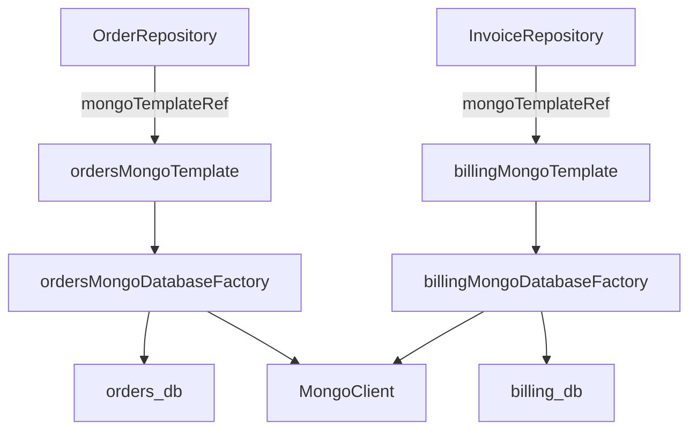
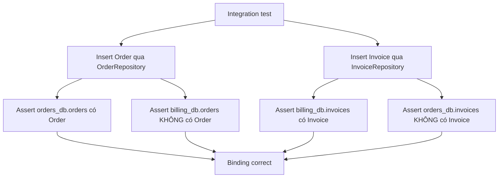

# Liên kết nhóm repository với đúng template

Một ứng dụng **Spring Data MongoDB** có thể làm việc với nhiều MongoDB databases: ví dụ `orders_db` lưu đơn hàng và `billing_db` lưu hóa đơn. Nếu cấu hình thiếu chặt chẽ, `OrderRepository` có thể bị Spring gắn vào `MongoTemplate` của billing database dù tên entity, tên collection và các phương thức repository đều trông hợp lệ. Hậu quả nguy hiểm nhất là **ghi dữ liệu vào nhầm database nhưng không báo lỗi**, đặc biệt khi hai database có cùng tên collection.

Giải pháp chính là tạo các template có **bean name rõ ràng** và liên kết từng nhóm repository qua `@EnableMongoRepositories(mongoTemplateRef = "...")`. Với reactive repositories, dùng `@EnableReactiveMongoRepositories(reactiveMongoTemplateRef = "...")`. Cần kết hợp cách nhóm package, `MongoDatabaseFactory`/`ReactiveMongoDatabaseFactory`, `@Qualifier` khi inject template và integration test để kiểm tra dữ liệu thực sự đi đến database nào.

Bài thuộc chương **Nhiều database** của module `SPRING_DATA_MONGODB`. Module hướng dẫn sử dụng Spring Data MongoDB để kết nối, ánh xạ documents và thao tác qua `MongoTemplate`/repository, thực hành truy vấn, aggregation, index, transaction, reactive access, kiểm thử và chẩn đoán hiệu năng. Trong bài này, phạm vi cụ thể là **liên kết nhóm repository với đúng template**, không phải một hệ thống phân tuyến tenant động tùy ý.

> **Điểm cần nhớ:** `@Document(collection = "orders")` chỉ chọn **collection**, không chọn database. `@Primary` chỉ ưu tiên dependency injection theo type khi có nhiều bean, **không thay cho** việc đặt `mongoTemplateRef`/`reactiveMongoTemplateRef` trên từng repository group. Nếu tên bean trong annotation sai, ứng dụng thường lỗi lúc khởi động; nếu nhóm package bị quét sai nhưng vẫn có một template hợp lệ, ứng dụng có thể **chạy và ghi sai nơi**.

## 1. Mục tiêu học tập

Sau bài này, bạn có thể:

1. Phân biệt `MongoClient`, `MongoDatabaseFactory`, `MongoTemplate` và repository proxy.
2. Giải thích repository được gắn tới database thông qua **template**, không chỉ qua `@Document`.
3. Phân biệt hai database trong cùng MongoDB deployment với hai MongoDB clusters riêng.
4. Tạo hai `MongoDatabaseFactory` cho hai database nhưng có thể dùng chung một `MongoClient`.
5. Tạo hai `MongoTemplate` với tên bean nhất quán: `ordersMongoTemplate` và `billingMongoTemplate`.
6. Tách repository interfaces theo các package không chồng lấn.
7. Dùng `@EnableMongoRepositories(basePackageClasses = ..., mongoTemplateRef = "...")` cho từng nhóm.
8. Hiểu fallback mặc định `mongoTemplateRef = "mongoTemplate"` nếu không chỉ định.
9. Dùng `@Qualifier` ở service cần truy cập trực tiếp một template cụ thể.
10. Phân biệt `@Primary` với explicit repository-to-template binding.
11. Cấu hình Spring Boot để tránh repository auto-scanning rộng hơn dự định.
12. Hiểu package marker/`basePackageClasses` và rủi ro refactor tên package.
13. Đọc bảng mapping “repository → template → factory → database”.
14. Khai báo repository cho cùng loại entity ở hai databases mà không làm lẫn scope.
15. Tách index creation/migration theo đúng database.
16. Dùng `MongoTemplate` đúng để thực thi `find`, aggregation và update.
17. Cấu hình nhiều nhóm **reactive repositories** bằng `reactiveMongoTemplateRef`.
18. Phân biệt sync `MongoClient` với reactive MongoDB `MongoClient`.
19. Chọn `MongoTransactionManager` cùng `MongoDatabaseFactory` mà template sử dụng.
20. Không giả định có distributed transaction giữa hai MongoDB clusters.
21. Tránh request-scoped switching của một shared template.
22. Cấu hình test dùng hai databases/URI cố định trong môi trường thử nghiệm.
23. Kiểm tra được cả **dữ liệu nằm đúng nơi** và **không có bản ghi tại nơi sai**.
24. Chẩn đoán missing template bean, duplicate repository, ambiguous autowiring và wrong database.
25. Triển khai quyền MongoDB least privilege và quan sát truy vấn theo database.

## 2. Cơ chế gắn repository với database

Một repository Spring Data là proxy do framework tạo. Trong cấu hình imperative, proxy sử dụng một `MongoOperations`/`MongoTemplate` được chỉ định. Template này nhận `MongoDatabaseFactory` có database mặc định.



Chuỗi quyết định:

1. `@EnableMongoRepositories` quét các repository interface trong phạm vi package đã cấu hình.
2. `mongoTemplateRef` chỉ định **tên bean** template của các repositories tìm thấy.
3. Template được tạo từ một `MongoDatabaseFactory` được cấu hình với database name.
4. MongoDB Driver mở database đó và collection do mapping/operation chỉ định.
5. `@Document` chỉ ảnh hưởng collection name, type alias và mapping context — **không tự chuyển sang database khác**.

### 2.1. Bean name là một phần hợp đồng

`mongoTemplateRef = "ordersMongoTemplate"` phải trùng **chính xác** tên Spring bean. `mongoTemplateRef` không phải URI, database name hay tên Java field. Đặt tên rõ và giữ ổn định khi refactor configuration.

### 2.2. Database name không phải collection name

Hai database có thể cùng có collection `orders` nhưng chứa dữ liệu hoàn toàn khác nhau. Vì vậy một test chỉ kiểm tra `repository.count() == 1` là chưa đủ; phải kiểm tra **database đích** trực tiếp.

## 3. Hai kiểu triển khai nhiều database

| Mô hình | Ví dụ | Driver client | Database factories | Lưu ý |
| --- | --- | --- | --- | --- |
| Hai databases trên **cùng MongoDB deployment** | `orders_db` và `billing_db` | Có thể **chung một sync MongoClient** | Hai factories khác database name | Chia sẻ connection pool, deployment và credentials |
| Hai databases trên **hai deployments khác nhau** | Order cluster A, billing cluster B | **Hai MongoClient** theo URI | Mỗi factory dùng client phù hợp | Network/credentials/pool riêng |
| Một template và động truyền database name qua raw driver | `getDatabase(name)` | Có thể một | Thường một factory | Không tự làm repository group tự chuyển |
| Một database, nhiều collections | `orders`, `invoices` cùng DB | Một | Một | Không cần hai template chỉ vì nhiều collections |

### 3.1. Khi nào không cần multi-database config?

Nếu chỉ có nhiều collections trong cùng database, `@Document("orders")` và `@Document("invoices")` với một template đủ. Tạo nhiều template không cần thiết có thể làm repository scanning phức tạp hơn.

### 3.2. Dùng chung MongoClient có an toàn không?

Khi hai databases thuộc cùng deployment và cùng thông tin xác thực được cấp quyền trên cả hai, có thể dùng **một MongoClient được container quản lý** và hai `MongoDatabaseFactory`. MongoClient phù hợp dùng lại, chứa connection pool và topology monitoring.

Ngược lại, nếu hai databases cần **credentials/TLS/cluster khác nhau**, phải cấp clients phù hợp và không cố dùng chung một client để lách quyền.

## 4. Phân biệt các tầng cấu hình

| Tầng | Type chính | Trách nhiệm |
| --- | --- | --- |
| Kết nối sync | `com.mongodb.client.MongoClient` | Kết nối deployment, pooling, auth/TLS |
| Database factory sync | `MongoDatabaseFactory` | Chọn database mặc định, quản lý sessions |
| Operation sync | `MongoTemplate`/`MongoOperations` | Chuyển đổi domain/BSON, CRUD, query |
| Repository sync | `MongoRepository<T,ID>` | Proxy với derived queries/CRUD |
| Kết nối reactive | `com.mongodb.reactivestreams.client.MongoClient` | Reactive Streams Driver |
| Database factory reactive | `ReactiveMongoDatabaseFactory` | Reactive DB/session access |
| Operation reactive | `ReactiveMongoTemplate` | Trả `Mono`/`Flux` |
| Repository reactive | `ReactiveMongoRepository<T,ID>` | Reactive repository proxy |

Spring Data MongoDB có **hai client types khác nhau** cho synchronous và reactive paths. Dù tên interface cùng là `MongoClient`, package của chúng khác; không thể đem sync client bean truyền vào `ReactiveMongoTemplate`.

### 4.1. Vòng đời client

Khi tự tạo MongoClient bằng `MongoClients.create` và đăng ký `@Bean`, Spring có thể quản lý close/destroy theo bean lifecycle. Nếu tự mở clients mới mỗi request, connection pools và monitor threads sẽ tăng. Trong các ví dụ, mỗi client là singleton bean.

## 5. Cấu trúc package không chồng lấn

Một layout minh họa:

```text
dev.learning.multi
  MultiDatabaseApplication.java
  config/
    MultiMongoInfrastructure.java
    OrdersRepositoryConfiguration.java
    BillingRepositoryConfiguration.java
  orders/
    model/
      OrderDocument.java
    repo/
      OrderRepository.java
    service/
      OrderService.java
  billing/
    model/
      InvoiceDocument.java
    repo/
      InvoiceRepository.java
    service/
      BillingService.java
```

**Quan trọng:** `orders.repo` và `billing.repo` là hai package riêng; `@EnableMongoRepositories` của orders chỉ quét `orders.repo`, của billing chỉ quét `billing.repo`.

### 5.1. Vì sao nên basePackageClasses thay vì strings?

`basePackageClasses = OrderRepository.class` khiến Spring scan **package chứa class này**, và những subpackages tương ứng. Nó an toàn hơn việc gõ thủ công một string có thể sai khi đổi tên package. Nếu muốn tách marker khỏi repository, tạo `OrdersRepositoryPackage` là một marker interface rỗng trong package mục tiêu.

### 5.2. Không đặt config scan tại package root

`@EnableMongoRepositories` không có `basePackages`/`basePackageClasses` sẽ quét package của config class. Nếu config nằm ở `dev.learning.multi`, nó có thể quét **cả orders và billing**, làm cả hai groups bị xử lý chung. Luôn chỉ rõ scope trong bài toán nhiều databases.

## 6. Hai domain classes

Một đơn hàng trong orders database:

```java
package dev.learning.multi.orders.model;

import org.springframework.data.annotation.Id;
import org.springframework.data.mongodb.core.mapping.Document;

@Document("orders")
public record OrderDocument(
    @Id String id,
    String tenantId,
    String status,
    long totalCents
) {}
```

Một hóa đơn trong billing database:

```java
package dev.learning.multi.billing.model;

import org.springframework.data.annotation.Id;
import org.springframework.data.mongodb.core.mapping.Document;

@Document("invoices")
public record InvoiceDocument(
    @Id String id,
    String tenantId,
    String orderId,
    long amountCents
) {}
```

### 6.1. @Document không chứa tên database

`@Document("orders")` chỉ cho Spring Data biết collection mặc định `orders`. Một `OrderDocument` được lưu qua `billingMongoTemplate` vẫn có thể tạo/ghi collection `billing_db.orders`. Vì vậy **entity type không phải tường lửa ngăn ghi sai DB**.

### 6.2. Không dùng dữ liệu nhạy cảm trong ví dụ/test

Các IDs, tenant IDs và số tiền `totalCents` là giả lập. Production cần authorization tenant và chính sách lưu PII/financial data riêng, không chỉ dựa vào package separation.

## 7. Hai repository interfaces

```java
package dev.learning.multi.orders.repo;

import dev.learning.multi.orders.model.OrderDocument;
import org.springframework.data.mongodb.repository.MongoRepository;
import java.util.List;

public interface OrderRepository
        extends MongoRepository<OrderDocument, String> {

    List<OrderDocument> findByTenantId(String tenantId);
}
```

```java
package dev.learning.multi.billing.repo;

import dev.learning.multi.billing.model.InvoiceDocument;
import org.springframework.data.mongodb.repository.MongoRepository;
import java.util.List;

public interface InvoiceRepository
        extends MongoRepository<InvoiceDocument, String> {

    List<InvoiceDocument> findByTenantId(String tenantId);
}
```

Repository chỉ khai báo **API domain**, không đặt URI/database name trong interface. Việc nó lưu vào đâu được quyết định ở `@EnableMongoRepositories` + template binding.

### 7.1. @Repository có bắt buộc không?

Thông thường interface mở rộng `MongoRepository` được infrastructure đăng ký khi nằm trong phạm vi scanning; không cần đặt `@Repository` chỉ để proxy được tạo. Để Spring phát hiện repository, yếu tố quyết định là package scanning/repository activation.

## 8. Cấu hình hai factories và hai templates

Ví dụ **hai databases trên cùng deployment**, dùng sync MongoDB Driver và một client được quản lý. Đây là lõi configuration.

```yaml
# application.yml — chỉ là ví dụ dev; production lấy URI từ secrets.
app:
  mongo:
    uri: ${APP_MONGO_URI:mongodb://localhost:27017}
    orders-database: orders_db
    billing-database: billing_db
```

```java
package dev.learning.multi.config;

import com.mongodb.client.MongoClient;
import com.mongodb.client.MongoClients;
import org.springframework.beans.factory.annotation.Qualifier;
import org.springframework.beans.factory.annotation.Value;
import org.springframework.context.annotation.Bean;
import org.springframework.context.annotation.Configuration;
import org.springframework.data.mongodb.MongoDatabaseFactory;
import org.springframework.data.mongodb.core.MongoTemplate;
import org.springframework.data.mongodb.core.SimpleMongoClientDatabaseFactory;

@Configuration(proxyBeanMethods = false)
public class MultiMongoInfrastructure {

    @Bean("sharedMongoClient")
    MongoClient sharedMongoClient(
            @Value("${app.mongo.uri}") String uri) {
        return MongoClients.create(uri);
    }

    @Bean("ordersMongoDatabaseFactory")
    MongoDatabaseFactory ordersMongoDatabaseFactory(
            @Qualifier("sharedMongoClient") MongoClient client,
            @Value("${app.mongo.orders-database}") String name) {
        return new SimpleMongoClientDatabaseFactory(client, name);
    }

    @Bean("billingMongoDatabaseFactory")
    MongoDatabaseFactory billingMongoDatabaseFactory(
            @Qualifier("sharedMongoClient") MongoClient client,
            @Value("${app.mongo.billing-database}") String name) {
        return new SimpleMongoClientDatabaseFactory(client, name);
    }

    @Bean("ordersMongoTemplate")
    MongoTemplate ordersMongoTemplate(
            @Qualifier("ordersMongoDatabaseFactory")
            MongoDatabaseFactory factory) {
        return new MongoTemplate(factory);
    }

    @Bean("billingMongoTemplate")
    MongoTemplate billingMongoTemplate(
            @Qualifier("billingMongoDatabaseFactory")
            MongoDatabaseFactory factory) {
        return new MongoTemplate(factory);
    }
}
```

### 8.1. Vì sao không viết MongoTemplate(client, "orders_db") luôn?

`new MongoTemplate(client, "orders_db")` là constructor hợp lệ, nhưng `new MongoTemplate(MongoDatabaseFactory)` tạo **một factory bean explicit**, tiện cho cấu hình `MongoTransactionManager` dùng **cùng factory instance**, test database name và kiểm soát infrastructure.

### 8.2. Phân biệt @Bean name với database name

| Spring bean | Instance | Default database |
| --- | --- | --- |
| `sharedMongoClient` | Driver client cho một deployment | Không mặc định chọn nghiệp vụ |
| `ordersMongoDatabaseFactory` | `SimpleMongoClientDatabaseFactory` | `orders_db` |
| `billingMongoDatabaseFactory` | `SimpleMongoClientDatabaseFactory` | `billing_db` |
| `ordersMongoTemplate` | `MongoTemplate` | `orders_db` |
| `billingMongoTemplate` | `MongoTemplate` | `billing_db` |

Cùng client có thể quản lý connections chung; hai factories/templates vẫn có database name và operations scope riêng.

### 8.3. Dùng hai clusters khác nhau

Nếu orders và billing ở hai MongoDB deployments, tạo hai `MongoClient` beans từ **hai URIs riêng** và inject mỗi bean vào factory tương ứng. Không dùng chung `sharedMongoClient` trong ví dụ này, vì credentials, topology, latency và transactions không liên thông giữa các deployments.

### 8.4. Không hardcode password

Trong production, lấy URI từ secrets manager/config environment, bảo vệ log tránh lộ URI chứa credentials. Nếu URI đã chỉ định database path, factory explicit database name vẫn quyết định database mặc định của template; tránh cấu hình tên database mâu thuẫn và test thực tế.

## 9. Hai @EnableMongoRepositories với mongoTemplateRef

Lớp cấu hình **orders group**:

```java
package dev.learning.multi.config;

import dev.learning.multi.orders.repo.OrderRepository;
import org.springframework.context.annotation.Configuration;
import org.springframework.data.mongodb.repository.config.EnableMongoRepositories;

@Configuration(proxyBeanMethods = false)
@EnableMongoRepositories(
    basePackageClasses = OrderRepository.class,
    mongoTemplateRef = "ordersMongoTemplate"
)
public class OrdersRepositoryConfiguration {}
```

Lớp cấu hình **billing group**:

```java
package dev.learning.multi.config;

import dev.learning.multi.billing.repo.InvoiceRepository;
import org.springframework.context.annotation.Configuration;
import org.springframework.data.mongodb.repository.config.EnableMongoRepositories;

@Configuration(proxyBeanMethods = false)
@EnableMongoRepositories(
    basePackageClasses = InvoiceRepository.class,
    mongoTemplateRef = "billingMongoTemplate"
)
public class BillingRepositoryConfiguration {}
```

Điểm quyết định:

- `basePackageClasses` xác định **repository nào thuộc group**.
- `mongoTemplateRef` xác định **group dùng bean template nào**.
- Tên template phải trùng `@Bean("...")` trong `MultiMongoInfrastructure`.
- Các package scanning **không được chồng lấn** để một repository bị đăng ký vào hai groups.
- Nếu một repository bị chuyển package, cần kiểm tra nó vẫn thuộc đúng scan scope.

### 9.1. Mặc định nguy hiểm: mongoTemplate

Nếu không chỉ định `mongoTemplateRef`, `@EnableMongoRepositories` mặc định tìm bean tên **`mongoTemplate`**. Có hai bean `ordersMongoTemplate` và `billingMongoTemplate` không đồng nghĩa Spring tự suy đúng một cái theo entity. Không nên để default mapping quyết định ngẫu nhiên database đích.

### 9.2. Không bỏ package scope

`@EnableMongoRepositories(mongoTemplateRef = "ordersMongoTemplate")` mà không chỉ định `basePackages` trong một config package rộng có thể gắn `InvoiceRepository` vào orders template. Bài toán nhiều database đòi hỏi **cả templateRef và scan scope**.

## 10. Spring Boot auto-configuration và scanning trùng lặp

Spring Boot có khả năng auto-detect MongoDB repositories trong application base packages. Khi chuyển sang nhiều databases, việc **vừa tự quét repository, vừa khai báo nhiều @EnableMongoRepositories** có thể gây bean name conflict, duplicate registrations hoặc repository thuộc billing bị kết nối nhầm orders template.

### 10.1. Một repository chỉ nên thuộc đúng một scan scope

```java
@EnableMongoRepositories(
    basePackageClasses = OrderRepository.class,
    mongoTemplateRef = "ordersMongoTemplate")
```

Đối với billing, chỉ quét package chứa `InvoiceRepository` và dùng `billingMongoTemplate`. Đừng thêm một annotation thứ ba trên application root quét cả hai packages.

### 10.2. Vô hiệu hóa auto-repository scanning khi cần

Spring Boot có flag điều khiển **auto-configured MongoDB repositories**. Với các Boot versions hỗ trợ:

```yaml
spring:
  data:
    mongodb:
      repositories:
        type: none
```

Ý định là tắt repository auto-configuration của Boot, **không** tắt nhóm repository explicit qua `@EnableMongoRepositories`. Kiểm tra property metadata theo đúng Boot major version; nếu Boot đã tự back off trước manual configuration thì không cần override thêm.

### 10.3. Tránh bean overriding để che lỗi

`spring.main.allow-bean-definition-overriding=true` có thể che một duplicate registration, khiến kết quả phụ thuộc bean registration order. Không dùng đó làm giải pháp thay cho package boundaries và bean names.

## 11. @Primary không thay thế mongoTemplateRef

Với hai `MongoTemplate`, injection thuần theo type có thể báo `NoUniqueBeanDefinitionException`:

```java
@Autowired MongoTemplate template; // Ambiguous nếu không có default.
```

`@Primary` chỉ chọn bean mặc định khi Spring phải resolve nhiều candidates. Nó **không liên kết nhóm repository** theo domain. Với multi-database, nên dùng explicit `@Qualifier` cho templates và `mongoTemplateRef` cho repository groups.

### 11.1. Inject template ở service bằng qualifier

```java
package dev.learning.multi.orders.service;

import dev.learning.multi.orders.model.OrderDocument;
import dev.learning.multi.orders.repo.OrderRepository;
import org.springframework.beans.factory.annotation.Qualifier;
import org.springframework.data.mongodb.core.MongoOperations;
import org.springframework.data.mongodb.core.query.Query;
import org.springframework.stereotype.Service;

@Service
public class OrderService {

    private final OrderRepository orders;
    private final MongoOperations ordersOps;

    public OrderService(
            OrderRepository orders,
            @Qualifier("ordersMongoTemplate") MongoOperations ordersOps) {
        this.orders = orders;
        this.ordersOps = ordersOps;
    }

    public OrderDocument create(OrderDocument value) {
        return orders.insert(value);
    }

    public long countAll() {
        return ordersOps.count(new Query(), OrderDocument.class);
    }
}
```

`ordersOps` được inject bằng bean name; `OrderRepository` đã được gắn qua `OrdersRepositoryConfiguration`. Cả hai thao tác phải hướng tới `orders_db`.

### 11.2. Khi nào @Primary hữu ích?

Khi ứng dụng có database mặc định rõ ràng cho legacy code, `@Primary` giúp giải quyết injection ambiguity. Tuy nhiên, trước khi bật phải audit mọi chỗ dùng `MongoTemplate` không có qualifier; đừng mong `@Primary` tự chia orders/billing đúng.

## 12. Đặt repository-to-database mapping thành invariant

| Repository group | Template bean | Factory bean | Database |
| --- | --- | --- | --- |
| `OrderRepository` | `ordersMongoTemplate` | `ordersMongoDatabaseFactory` | `orders_db` |
| `InvoiceRepository` | `billingMongoTemplate` | `billingMongoDatabaseFactory` | `billing_db` |

Kiểm tra từng hàng từ **repository scan → templateRef → template bean → factory bean → database name**. Không có hàng nào được phép nhảy sang database khác.

### 12.1. Startup thành công vẫn có thể ghi sai database

Nếu `InvoiceRepository` bị gắn nhầm orders template, MongoDB có thể tự tạo collection `orders_db.invoices` khi insert. Ứng dụng chạy bình thường nhưng hóa đơn không có ở billing DB. Đó là lỗi **data integrity**, không phải lỗi syntax.

### 12.2. Kiểm chứng cả vắng mặt trong database sai

Test chỉ assert `invoiceRepository.findById(id)` trả về hóa đơn là chưa đủ: repository có thể tự đọc lại đúng **database sai** nó vừa ghi. Phải đọc billing bằng template/factory độc lập và xác minh orders DB **không có** record đó.

## 13. Query/aggregation cũng phải dùng đúng template

```java
import java.util.List;
import org.springframework.data.mongodb.core.query.Criteria;
import org.springframework.data.mongodb.core.query.Query;

Query q = Query.query(
    Criteria.where("tenantId").is("tenant-a"));

List<OrderDocument> orders =
    ordersMongoTemplate.find(q, OrderDocument.class);
```

Ví dụ aggregation:

```java
import org.bson.Document;
import org.springframework.data.mongodb.core.aggregation.Aggregation;

var pipeline = Aggregation.newAggregation(
    Aggregation.match(
        Criteria.where("tenantId").is("tenant-a")),
    Aggregation.group("status").count().as("total")
);

var result = ordersMongoTemplate.aggregate(
    pipeline, OrderDocument.class, Document.class);
```

Template quyết định `orders_db`; entity/`@Document` quyết định collection `orders`. Nếu thay bằng `billingMongoTemplate`, truy vấn có thể hướng tới `billing_db.orders` dù không thay dòng mapping nào.

### 13.1. @Field không thay đổi database routing

`@Field("customer_id")` ánh xạ Java property sang BSON field. Nó không chọn database. Mỗi template có thể có mapping converter khác nhau; khi có custom converters, cần test cả field mapping lẫn database binding.

### 13.2. Raw MongoClient có thể bypass repository boundaries

Một service lấy raw `MongoClient` rồi gọi `getDatabase("billing_db")` có thể chạm billing dù nó thuộc orders package. Giới hạn raw client access bằng module/gateway kiến trúc, credentials và code review.

## 14. Custom repository fragments cũng phải dùng đúng template

Giả sử `OrderRepository` mở rộng custom fragment `OrderAnalytics`:

```java
package dev.learning.multi.orders.repo;

public interface OrderAnalytics {
    long countOpenOrders(String tenantId);
}
```

Implementation fragment:

```java
package dev.learning.multi.orders.repo;

import dev.learning.multi.orders.model.OrderDocument;
import org.springframework.beans.factory.annotation.Qualifier;
import org.springframework.data.mongodb.core.MongoOperations;
import org.springframework.data.mongodb.core.query.Criteria;
import org.springframework.data.mongodb.core.query.Query;

public class OrderAnalyticsImpl implements OrderAnalytics {

    private final MongoOperations ordersOps;

    public OrderAnalyticsImpl(
            @Qualifier("ordersMongoTemplate") MongoOperations ordersOps) {
        this.ordersOps = ordersOps;
    }

    @Override
    public long countOpenOrders(String tenantId) {
        return ordersOps.count(
            Query.query(
                Criteria.where("tenantId").is(tenantId)
                    .and("status").is("OPEN")),
            OrderDocument.class);
    }
}
```

Spring Data fragment implementation cần tuân theo naming convention/config của phiên bản. **Repository CRUD có thể đúng template trong khi custom method sai database** nếu fragment inject unqualified template.

### 14.1. Các đường đi không qua repository

Scheduled jobs, indexes/migrations, event listeners, CLI maintenance và aggregation services đều cần đúng template bean. Việc repository đã gắn đúng không chứng minh những đường đi này cũng đúng.

## 15. Cùng entity ở hai databases không đổi quy tắc

Hai templates có thể cùng map `CustomerSnapshot.class` và cùng collection name:

```java
ordersMongoTemplate.insert(snapshot, "customer_snapshots");
billingMongoTemplate.insert(snapshot, "customer_snapshots");
```

Hai lệnh nhắm **hai namespaces khác nhau**. Vì thế một Java entity không thể được dùng như một “type-level database guard”.

### 15.1. Tránh interface beans trùng tên

Hai package đều có interface `CustomerRepository` có thể tạo bean name collision. Nên dùng tên rõ: `OrdersCustomerRepository` và `BillingCustomerRepository`, hoặc cấu hình bean name generator phù hợp. Đừng bật overriding để một repository vô tình thắng cái còn lại.

### 15.2. Không có per-call databaseName parameter mặc định

Một repository đã được bind vào template khi Spring tạo proxy. Truyền một `databaseName` như query parameter không đổi template đang được repository dùng. Routing động cần kiến trúc riêng, không thay thế cấu hình nhóm static trong bài.

## 16. ReactiveMongoRepository có thuộc tính liên kết riêng

Spring Data MongoDB dùng annotation khác cho reactive repositories:

```java
@EnableReactiveMongoRepositories(
    basePackageClasses = ReactiveOrderRepository.class,
    reactiveMongoTemplateRef = "ordersReactiveMongoTemplate")
```

Thuộc tính đúng là **`reactiveMongoTemplateRef`**, không phải `mongoTemplateRef` của imperative repositories. Nếu không khai báo, Javadoc mô tả default bean name `reactiveMongoTemplate`.

| Đường xử lý | Driver MongoClient | Template | Repository |
| --- | --- | --- | --- |
| Sync | `com.mongodb.client.MongoClient` | `MongoTemplate` | `MongoRepository` |
| Reactive | `com.mongodb.reactivestreams.client.MongoClient` | `ReactiveMongoTemplate` | `ReactiveMongoRepository` |

Dù cả hai client có tên class `MongoClient`, **package của chúng khác nhau**; không inject sync client vào reactive database factory.

## 17. Hai reactive factories và templates

Đây là **biến thể reactive** của cấu hình đã xây ở mục 8. Nếu một ứng dụng dùng cả sync và reactive, mỗi loại client cần bean name, pool và lifecycle riêng.

```java
package dev.learning.multi.config;

import com.mongodb.reactivestreams.client.MongoClient;
import com.mongodb.reactivestreams.client.MongoClients;
import org.springframework.beans.factory.annotation.Qualifier;
import org.springframework.beans.factory.annotation.Value;
import org.springframework.context.annotation.Bean;
import org.springframework.context.annotation.Configuration;
import org.springframework.data.mongodb.ReactiveMongoDatabaseFactory;
import org.springframework.data.mongodb.core.ReactiveMongoTemplate;
import org.springframework.data.mongodb.core.SimpleReactiveMongoDatabaseFactory;

@Configuration(proxyBeanMethods = false)
public class MultiReactiveMongoInfrastructure {

    @Bean("sharedReactiveMongoClient")
    MongoClient sharedReactiveClient(
            @Value("${app.mongo.uri}") String uri) {
        return MongoClients.create(uri);
    }

    @Bean("ordersReactiveMongoDatabaseFactory")
    ReactiveMongoDatabaseFactory ordersFactory(
            @Qualifier("sharedReactiveMongoClient") MongoClient client,
            @Value("${app.mongo.orders-database}") String db) {
        return new SimpleReactiveMongoDatabaseFactory(client, db);
    }

    @Bean("billingReactiveMongoDatabaseFactory")
    ReactiveMongoDatabaseFactory billingFactory(
            @Qualifier("sharedReactiveMongoClient") MongoClient client,
            @Value("${app.mongo.billing-database}") String db) {
        return new SimpleReactiveMongoDatabaseFactory(client, db);
    }

    @Bean("ordersReactiveMongoTemplate")
    ReactiveMongoTemplate ordersTemplate(
            @Qualifier("ordersReactiveMongoDatabaseFactory")
            ReactiveMongoDatabaseFactory factory) {
        return new ReactiveMongoTemplate(factory);
    }

    @Bean("billingReactiveMongoTemplate")
    ReactiveMongoTemplate billingTemplate(
            @Qualifier("billingReactiveMongoDatabaseFactory")
            ReactiveMongoDatabaseFactory factory) {
        return new ReactiveMongoTemplate(factory);
    }
}
```

### 17.1. Reactive factory vẫn gắn default DB

`SimpleReactiveMongoDatabaseFactory(client, "orders_db")` cấp database mặc định cho `ordersReactiveMongoTemplate`. Reactor Context/security context **không tự đổi** database của một static template.

### 17.2. Hai deployments reactive

Nếu orders và billing nằm ở hai clusters, tạo hai reactive MongoClient beans từ hai URIs riêng, rồi gắn tương ứng. Không dùng chung credentials nếu có yêu cầu tách quyền.

## 18. Hai reactive repository groups

Ví dụ repositories dùng các packages khác với sync repositories:

```java
package dev.learning.multi.orders.reactive;

import dev.learning.multi.orders.model.OrderDocument;
import org.springframework.data.mongodb.repository.ReactiveMongoRepository;
import reactor.core.publisher.Flux;

public interface ReactiveOrderRepository
        extends ReactiveMongoRepository<OrderDocument, String> {
    Flux<OrderDocument> findByTenantId(String tenantId);
}
```

```java
package dev.learning.multi.billing.reactive;

import dev.learning.multi.billing.model.InvoiceDocument;
import org.springframework.data.mongodb.repository.ReactiveMongoRepository;
import reactor.core.publisher.Flux;

public interface ReactiveInvoiceRepository
        extends ReactiveMongoRepository<InvoiceDocument, String> {
    Flux<InvoiceDocument> findByTenantId(String tenantId);
}
```

Orders config:

```java
package dev.learning.multi.config;

import dev.learning.multi.orders.reactive.ReactiveOrderRepository;
import org.springframework.context.annotation.Configuration;
import org.springframework.data.mongodb.repository.config.EnableReactiveMongoRepositories;

@Configuration(proxyBeanMethods = false)
@EnableReactiveMongoRepositories(
    basePackageClasses = ReactiveOrderRepository.class,
    reactiveMongoTemplateRef = "ordersReactiveMongoTemplate"
)
public class OrdersReactiveRepositoryConfiguration {}
```

Billing config:

```java
package dev.learning.multi.config;

import dev.learning.multi.billing.reactive.ReactiveInvoiceRepository;
import org.springframework.context.annotation.Configuration;
import org.springframework.data.mongodb.repository.config.EnableReactiveMongoRepositories;

@Configuration(proxyBeanMethods = false)
@EnableReactiveMongoRepositories(
    basePackageClasses = ReactiveInvoiceRepository.class,
    reactiveMongoTemplateRef = "billingReactiveMongoTemplate"
)
public class BillingReactiveRepositoryConfiguration {}
```

### 18.1. Sử dụng

```java
import reactor.core.publisher.Flux;
import reactor.core.publisher.Mono;

Mono<OrderDocument> inserted = reactiveOrderRepository.insert(
    new OrderDocument("O-101", "tenant-a", "NEW", 12500));

Flux<OrderDocument> records =
    reactiveOrderRepository.findByTenantId("tenant-a");
```

`Mono`/`Flux` sẽ thực thi khi được subscribe. Repository proxy vẫn hướng tới **ordersReactiveMongoTemplate**, không tự đổi sang billing vì tên entity hay Reactor subscriber.

### 18.2. Khi cần ReactiveMongoOperations

```java
public ReactiveOrderService(
        ReactiveOrderRepository repo,
        @Qualifier("ordersReactiveMongoTemplate")
        ReactiveMongoOperations operations) {
    this.repo = repo;
    this.operations = operations;
}
```

Đây là constructor fragment của service có imports tương ứng. Một `ReactiveMongoOperations` không qualifier trong context có hai templates sẽ dễ ambiguous.

## 19. Transaction manager gắn với đúng MongoDatabaseFactory

MongoDB transactions cần topology hỗ trợ (replica set/sharded cluster) và `ClientSession` phù hợp. Spring Data transaction managers quản lý session theo database factory.

### 19.1. Imperative

```java
import org.springframework.beans.factory.annotation.Qualifier;
import org.springframework.context.annotation.Bean;
import org.springframework.data.mongodb.MongoDatabaseFactory;
import org.springframework.data.mongodb.MongoTransactionManager;

@Bean("ordersTransactionManager")
MongoTransactionManager ordersTransactionManager(
        @Qualifier("ordersMongoDatabaseFactory")
        MongoDatabaseFactory factory) {
    return new MongoTransactionManager(factory);
}
```

Khi dùng ở service:

```java
import org.springframework.transaction.annotation.Transactional;

@Transactional(transactionManager = "ordersTransactionManager")
public void updateOrder(/* args */) {
    // Dùng OrderRepository / ordersMongoTemplate
    // trong transaction scope này.
}
```

Đưa method `@Bean` vào một `@Configuration` class. `ordersTransactionManager` phải sử dụng **cùng factory bean** với `ordersMongoTemplate` để template nhận session được bind theo Spring Data.

### 19.2. Reactive

```java
import org.springframework.beans.factory.annotation.Qualifier;
import org.springframework.context.annotation.Bean;
import org.springframework.data.mongodb.ReactiveMongoDatabaseFactory;
import org.springframework.data.mongodb.ReactiveMongoTransactionManager;

@Bean("ordersReactiveTransactionManager")
ReactiveMongoTransactionManager ordersReactiveManager(
        @Qualifier("ordersReactiveMongoDatabaseFactory")
        ReactiveMongoDatabaseFactory factory) {
    return new ReactiveMongoTransactionManager(factory);
}
```

Reactive transactions dùng Reactor Context và cần Publisher chain được quản lý bởi `TransactionalOperator` hoặc reactive transaction manager, không inner `subscribe()` rời rạc.

### 19.3. Có nhiều transaction managers

Nếu có cả orders và billing transaction managers, `@Transactional` không chỉ rõ manager có thể gây ambiguity hoặc chọn sai default. Khai báo `@Transactional(transactionManager = "ordersTransactionManager")` tại đúng service boundary.

## 20. Không có distributed transaction tự động giữa hai templates

MongoDB có thể thực hiện transaction trên nhiều databases **trong cùng deployment** khi conditions server cho phép. Tuy nhiên:

- Hai `MongoDatabaseFactory` beans **không tự chia sẻ session binding** chỉ vì có chung `MongoClient`.
- `ordersTransactionManager` không tự enlist `billingMongoTemplate` dựng từ billing factory.
- Nếu hai databases ở **hai MongoDB clusters riêng**, không thể dùng một MongoDB-native manager đơn giản để commit atomically hai deployments.
- Cross-database read bằng hai templates không tự cung cấp consistent snapshot.

### 20.1. Cách thiết kế khi cần ghi order + invoice

Với cùng deployment, cần một **explicit session/factory coordination design** và integration test thật nếu đòi một transaction đa database. Với hai deployments, ưu tiên transactional outbox, event-driven reconciliation, saga hoặc idempotent compensation theo business invariant.

### 20.2. Không dùng @Transactional như một lời hứa toàn hệ thống

Một `@Transactional` đặt trên service gọi cả hai repositories không chứng minh tất cả writes đã vào cùng MongoDB session. Kiểm tra transaction manager đã được chọn, factories và actual MongoDB transactions qua integration tests.

## 21. Credentials và phân quyền dữ liệu

Repository-to-template binding là một **ràng buộc ứng dụng**, không phải security boundary duy nhất. Một shared client có quyền trên cả orders và billing vẫn có thể ghi nhầm nếu code chọn sai template.

### 21.1. Least privilege

- Orders runtime principal chỉ cần quyền phù hợp trên `orders_db`.
- Billing runtime principal chỉ cần quyền phù hợp trên `billing_db`.
- Migration/index provisioning dùng quyền quản trị riêng.
- Không hardcode passwords trong `application.yml` hoặc log connection string có credentials.
- Nếu dùng chung một client/credential, phải đánh giá trade-off isolation so với connection pool reuse.

### 21.2. Database separation khác tenant authorization

Trong `orders_db` vẫn có thể chứa nhiều tenants; `@EnableMongoRepositories` không tự lọc `tenantId`. Mọi truy vấn theo user cần tenant authorization, validation và query predicates phù hợp.

### 21.3. Không cho client chọn template tùy ý

Một HTTP input `database=orders_db` hoặc `database=billing_db` không nên được map trực tiếp thành bean name/`MongoClient.getDatabase(...)` nếu chưa có authorization. Điều đó có thể bypass boundaries và lộ dữ liệu giữa các miền nghiệp vụ.

## 22. Kiểm thử repository binding: những điều phải assert

Mục tiêu test là chứng minh **đúng database**, không chỉ chứng minh `repository.save` hoạt động.



Các nhóm kiểm thử nên có:

1. Bean `ordersMongoTemplate` tồn tại và trỏ factory database `orders_db`.
2. Bean `billingMongoTemplate` tồn tại và trỏ `billing_db`.
3. `OrderRepository.insert` thành công và document có trong `orders_db.orders`.
4. `InvoiceRepository.insert` thành công và document có trong `billing_db.invoices`.
5. **Không** có order ở `billing_db.orders`.
6. **Không** có invoice ở `orders_db.invoices`.
7. Derived query tenant ID đúng collection.
8. Template operations/aggregation/custom fragments cũng đúng DB.
9. Migrations/index provisioning nhắm đúng namespace.
10. Nếu có reactive repositories, kiểm tra với `StepVerifier` tương tự.

### 22.1. Vì sao test negative quan trọng?

Nếu `OrderRepository` bị gắn nhầm billing template, test `orders.insert(order)` và `orders.findById(id)` vẫn có thể **pass** do cả insert và find đều chạy vào billing DB. Negative assertions đọc qua một template độc lập phát hiện lỗi ngay.

### 22.2. Tránh dùng tài khoản root cho test quyền

Một test dùng root có thể ghi sai database mà không báo lỗi. Nên có các bài test chức năng và bài test quyền riêng với principals có scope hạn chế. Test quyền không thay thế test routing, và routing test không thay thế least privilege.

## 23. Integration test đầy đủ với Spring Boot và Testcontainers

Ví dụ dưới dùng **Spring Boot 3.x + Testcontainers Java 1.x**, các beans `MultiMongoInfrastructure`, `OrdersRepositoryConfiguration`, `BillingRepositoryConfiguration` và repositories ở các mục trên.

```java
package dev.learning.multi;

import static org.assertj.core.api.Assertions.assertThat;

import java.util.UUID;

import dev.learning.multi.orders.model.OrderDocument;
import dev.learning.multi.orders.repo.OrderRepository;
import dev.learning.multi.billing.model.InvoiceDocument;
import dev.learning.multi.billing.repo.InvoiceRepository;

import org.junit.jupiter.api.Test;
import org.springframework.beans.factory.annotation.Autowired;
import org.springframework.beans.factory.annotation.Qualifier;
import org.springframework.boot.test.context.SpringBootTest;
import org.springframework.data.mongodb.MongoDatabaseFactory;
import org.springframework.data.mongodb.core.MongoTemplate;
import org.springframework.test.context.DynamicPropertyRegistry;
import org.springframework.test.context.DynamicPropertySource;
import org.testcontainers.containers.MongoDBContainer;
import org.testcontainers.junit.jupiter.Container;
import org.testcontainers.junit.jupiter.Testcontainers;
import org.testcontainers.utility.DockerImageName;

@Testcontainers
@SpringBootTest
class RepositoryDatabaseBindingIntegrationTest {

    @Container
    static final MongoDBContainer mongo =
        new MongoDBContainer(
            DockerImageName.parse("mongo:7.0"));

    @DynamicPropertySource
    static void mongoProperties(DynamicPropertyRegistry registry) {
        registry.add("app.mongo.uri", mongo::getReplicaSetUrl);
        registry.add("app.mongo.orders-database", () -> "orders_db");
        registry.add("app.mongo.billing-database", () -> "billing_db");
    }

    @Autowired OrderRepository orderRepository;
    @Autowired InvoiceRepository invoiceRepository;

    @Autowired
    @Qualifier("ordersMongoTemplate")
    MongoTemplate ordersTemplate;

    @Autowired
    @Qualifier("billingMongoTemplate")
    MongoTemplate billingTemplate;

    @Autowired
    @Qualifier("ordersMongoDatabaseFactory")
    MongoDatabaseFactory ordersFactory;

    @Autowired
    @Qualifier("billingMongoDatabaseFactory")
    MongoDatabaseFactory billingFactory;

    @Test
    void repositoriesWriteToCorrectDatabasesOnly() {
        String suffix = UUID.randomUUID().toString();
        String orderId = "order-" + suffix;
        String invoiceId = "invoice-" + suffix;

        OrderDocument order = new OrderDocument(
            orderId, "tenant-test", "NEW", 12500L);
        InvoiceDocument invoice = new InvoiceDocument(
            invoiceId, "tenant-test", orderId, 12500L);

        orderRepository.insert(order);
        invoiceRepository.insert(invoice);

        // Assertion về database factory thực tế.
        assertThat(ordersFactory.getMongoDatabase().getName())
            .isEqualTo("orders_db");
        assertThat(billingFactory.getMongoDatabase().getName())
            .isEqualTo("billing_db");

        // Positive assertions: đúng database.
        assertThat(
            ordersTemplate.findById(orderId, OrderDocument.class))
            .isNotNull();
        assertThat(
            billingTemplate.findById(invoiceId, InvoiceDocument.class))
            .isNotNull();

        // Negative assertions: KHÔNG được nằm database sai.
        assertThat(
            billingTemplate.findById(orderId, OrderDocument.class))
            .isNull();
        assertThat(
            ordersTemplate.findById(invoiceId, InvoiceDocument.class))
            .isNull();

        // Derived queries vẫn phải trả dữ liệu đúng nhóm.
        assertThat(orderRepository.findByTenantId("tenant-test"))
            .extracting(OrderDocument::id)
            .contains(orderId);
        assertThat(invoiceRepository.findByTenantId("tenant-test"))
            .extracting(InvoiceDocument::id)
            .contains(invoiceId);
    }
}
```

### 23.1. Vì sao dùng @DynamicPropertySource?

Vì application config custom dùng `app.mongo.uri`, test phải override **đúng key này** chứ không chỉ đặt `spring.data.mongodb.uri`. MongoDBContainer cung cấp một URI test hợp lệ; explicit database factories vẫn chọn `orders_db` và `billing_db`.

### 23.2. Vì sao test dùng UUID?

IDs unique giúp tránh lẫn fixtures của test khác. Kết quả không phụ thuộc một collection trống hoàn toàn hoặc `deleteAll` có thể xóa dữ liệu người khác. Nên để database test nằm trong container cô lập.

### 23.3. Testcontainers 1.x và 2.x

Ví dụ import `org.testcontainers.containers.MongoDBContainer` là từ Testcontainers Java 1.x. Những nhánh mới có module/package khác; dùng BOM theo dự án và điều chỉnh imports khi nâng. Bài học không yêu cầu chạy MongoDBContainer trên production.

### 23.4. Không cần transaction để xác minh binding

Test chỉ ghi order và invoice độc lập rồi kiểm tra hai namespaces. Nó **không tuyên bố** hai writes có atomicity chung. Nếu nghiệp vụ cần cross-database transaction thì phải xây test riêng theo đúng topology/session strategy.

### 23.5. Bean scanning phải được nạp trong test context

`@SpringBootTest` giả định application scan được các `@Configuration` classes đã nêu và `OrderRepository`/`InvoiceRepository` được explicit repository activation. Nếu dùng test slice `@DataMongoTest`, có thể cần `@Import` manual configurations thay vì giả định slice tự nạp toàn bộ beans.

## 24. Kiểm thử reactive binding

Trong reactive project, dùng `ReactiveOrderRepository`/`ReactiveInvoiceRepository` và reactive templates/factories. Logic vẫn là **positive + negative assertions**, nhưng dùng Publisher và `StepVerifier`:

```java
import reactor.core.publisher.Mono;
import reactor.test.StepVerifier;

String suffix = java.util.UUID.randomUUID().toString();
String id = "R-" + suffix;

Mono<Void> action = reactiveOrderRepository
    .insert(new OrderDocument(id, "tenant-test", "NEW", 100L))
    .then();

StepVerifier.create(action).verifyComplete();

StepVerifier.create(
    ordersReactiveMongoTemplate.findById(id, OrderDocument.class))
    .expectNextMatches(doc -> id.equals(doc.id()))
    .verifyComplete();

StepVerifier.create(
    billingReactiveMongoTemplate.findById(id, OrderDocument.class))
    .verifyComplete(); // Không có record ở billing database.
```

Cần đặt ví dụ vào test class có reactive beans được inject, dùng database test cô lập và có dependency `reactor-test`. Chỉ tạo Publisher không chạy query; **StepVerifier phải subscribe** để thực sự xác minh behavior.

### 24.1. Test cả reactive invoice group

Làm tương tự với `ReactiveInvoiceRepository`, đọc bằng `billingReactiveMongoTemplate` và kiểm tra **không tìm thấy ở `ordersReactiveMongoTemplate`**. Không chỉ test orders group vì có thể chỉ một annotation bị sao chép sai.

### 24.2. Không block trong WebFlux production

Trong test có thể dùng `StepVerifier` với timeout hợp lý; trong reactive service, đừng gọi `block()` để “chắc chắn” chọn đúng DB. Database routing là thuộc cấu hình beans, không phải vấn đề subscribe blocking hay non-blocking.

## 25. Index creation, migration và schema ownership

Tạo index phải dùng **đúng template**:

```java
import org.springframework.data.domain.Sort;
import org.springframework.data.mongodb.core.index.Index;

ordersMongoTemplate.indexOps(OrderDocument.class)
    .ensureIndex(
        new Index()
            .on("tenantId", Sort.Direction.ASC)
            .on("status", Sort.Direction.ASC)
            .named("tenant_status"));

billingMongoTemplate.indexOps(InvoiceDocument.class)
    .ensureIndex(
        new Index()
            .on("tenantId", Sort.Direction.ASC)
            .on("orderId", Sort.Direction.ASC)
            .named("tenant_order"));
```

Nếu chạy cả hai `indexOps` trên `ordersMongoTemplate`, index billing có thể bị tạo vào `orders_db.invoices`, còn `billing_db.invoices` vẫn thiếu index cần thiết.

### 25.1. Tách migration theo logical database

Quy tắc:

- Migration orders chỉ thao tác `orders_db`.
- Migration billing chỉ thao tác `billing_db`.
- Mỗi migration xác minh namespace/collection trước khi create/drop index.
- Không chạy automatic DDL trên từng HTTP request.
- Không dùng template default không qualifier trong migration tasks.
- Dùng principal/roles tương ứng; tách runtime read/write với quyền DDL.

### 25.2. Custom converters có thể khác nhau

Khi hai databases dùng conventions khác nhau (ví dụ field naming, BigDecimal, encryption hoặc type alias), cần cấu hình `MongoConverter`/`MongoMappingContext` cho từng template một cách nhất quán. **Cùng Java entity chưa bảo đảm cùng BSON schema** khi converters khác. Integration test không chỉ kiểm tra DB name mà còn kiểm tra serialization của các fields quan trọng.

### 25.3. Đừng tự chạy index creation theo annotation rồi đoán thành công

Spring Data MongoDB các phiên bản hiện đại thường **không auto-create indexes theo annotation mặc định**. Nếu bật auto-index creation hoặc dùng `@Indexed`, cần xác minh index thực trong mỗi database; repository binding không tự provision index vào cả hai DB.

## 26. Vận hành, performance và observability

Nhiều templates không chỉ là vấn đề Spring injection. Mỗi client/cluster có thể có connection pool, authentication, TLS, read/write concerns và failure domain khác nhau.

### 26.1. Một MongoClient hay nhiều?

| Tình huống | Lựa chọn hợp lý | Đánh đổi |
| --- | --- | --- |
| Hai databases cùng deployment, cùng credential | Có thể **một shared MongoClient** | Pool chung, quyền thường rộng hơn |
| Hai databases cùng deployment nhưng quyền khác | Hai clients/credentials | Tăng resources, tốt hơn cho isolation |
| Hai MongoDB deployments khác nhau | Hai clients riêng | Independent topology, failover và monitoring |
| Một app vừa sync vừa reactive | Hai **client types** khác nhau | Quản lý pool/lifecycle của mỗi driver |

`MongoTemplate` thường được tái sử dụng dạng singleton, **không tạo MongoTemplate mới mỗi request**. Một `MongoClient` mới mỗi lần gọi có thể tạo thêm connections và monitoring resources, gây saturation.

### 26.2. Log tên database, không log credentials

Một log có ích khi startup hoặc trong test là:

```java
String ordersDb =
    ordersFactory.getMongoDatabase().getName();

String billingDb =
    billingFactory.getMongoDatabase().getName();

// Log tên DB đã được cho phép, không log URI credentials.
```

Không log đầy đủ MongoDB URI nếu nó chứa username/password hoặc connection options nhạy cảm. Trong production, dùng structured logs (component, logical database, operation, trace ID) và redaction.

### 26.3. Command monitoring cho từng database

MongoDB Java Driver có `CommandListener`. Trong test/staging, có thể đọc `CommandStartedEvent.getDatabaseName()` để quan sát lệnh thực sự chạy trên DB nào. Chỉ log **database name và command type**, không log raw command documents khi chúng chứa dữ liệu khách hàng.

### 26.4. Các lỗi mạng khác nhau

Nếu orders và billing là hai clusters, orders cluster có thể healthy trong khi billing cluster bị timeout. Không dùng một global `ping` trên orders để tuyên bố toàn ứng dụng healthy. Theo dõi connection pool, latency, server selection time, replica lag và failure rate theo từng database/deployment.

### 26.5. Healthcheck phải test đúng path

Một bean `ordersMongoTemplate` tồn tại không chứng minh credentials cho billing DB có quyền đọc. Readiness checks nên xác minh kết nối và permissions cần thiết của từng miền (với lệnh nhẹ, an toàn), tránh thao tác ghi thử vào production.

## 27. Lỗi thường gặp và cách xử lý

| Triệu chứng | Nguyên nhân thường gặp | Hướng xử lý |
| --- | --- | --- |
| `No bean named ordersMongoTemplate` | `mongoTemplateRef` không khớp bean name | So lại `@Bean("ordersMongoTemplate")` |
| `NoUniqueBeanDefinitionException MongoTemplate` | Hai templates, injection không qualifier | Dùng `@Qualifier` |
| Duplicate repository bean | Scan scopes chồng lấn hoặc Boot auto-scan | Tách packages, kiểm tra auto-config |
| `BeanDefinitionOverrideException` | Hai repository interfaces trùng bean name | Đặt tên khác, tránh scan trùng |
| CRUD thành công nhưng billing DB trống | InvoiceRepository dùng orders template | Negative DB assertions |
| Orders records nằm trong billing DB | `mongoTemplateRef` copy nhầm | Sửa binding, lập kế hoạch migrate dữ liệu đã sai |
| Template bean có đúng tên nhưng sai DB | Factory dùng nhầm database name | Test `MongoDatabaseFactory.getMongoDatabase().getName()` |
| `@Document` đổi nhưng DB không đổi | Annotation chỉ chỉ định collection | Sửa factory/template |
| `@Primary` khiến thao tác sai DB | Unqualified injection chọn default | Dùng qualifier theo domain |
| Derived repository chạy đúng, custom fragment sai | Fragment inject default `MongoTemplate` | Inject qualified operations |
| Index được tạo vào orders_db.invoices | Migration dùng orders template | Tách index jobs |
| Reactive repo không tìm thấy template | Dùng `mongoTemplateRef` thay reactive attr | `reactiveMongoTemplateRef` |
| Reactive client type mismatch | Import sync `MongoClient` vào reactive factory | Dùng `com.mongodb.reactivestreams.client.MongoClient` |
| App boot nhưng repository không được tạo | Scan scope sai/missing annotation | Kiểm tra basePackageClasses |
| Cả sync/reactive repos được scan sai | Package boundaries chồng lấn | Chia repo packages |
| Transaction chạy trên wrong DB | Chọn sai `MongoTransactionManager` | Cùng factory và explicit manager name |
| Cross-DB writes không atomic | Hai factories, sessions khác nhau | Thiết kế coordination/outbox |
| Transaction chỉ hoạt động trên local đơn giản | Standalone MongoDB hoặc manager chưa cấu hình | Test replica set thật |
| Permission denied chỉ ở billing | Credentials/roles không đủ DB billing | Least privilege đúng scope |
| Connection pool tăng mạnh | Tạo client/template mỗi request | Singleton managed beans |
| Thay đổi URI mà data vẫn ghi sai | Factory database name riêng còn sai | So toàn bộ bean graph |
| Spring Boot auto-config trùng beans | Auto repository activation + manual configs | Kiểm tra `repositories.type`/backoff |
| Test repository insert pass dù mapping sai | Chỉ kiểm tra read-back cùng repository | Test positive và negative bằng templates |
| Một tenant đọc dữ liệu tenant khác | Thiếu authorization/tenant filter | Validate principal và query predicates |

### 27.1. Trình tự chẩn đoán

1. `OrderRepository` và `InvoiceRepository` hiện nằm trong packages nào?
2. Có bao nhiêu `@EnableMongoRepositories` và mỗi cái scan package nào?
3. `mongoTemplateRef` của từng nhóm là chuỗi nào?
4. Context có bean trùng đúng tên và type `MongoTemplate` không?
5. Factory của template đang dùng MongoClient/DB name nào?
6. Có Boot auto-scan hoặc component scan rộng gây double registration?
7. Có `@Primary` khiến unqualified services chọn default?
8. Có custom repository fragment/aggregation job dùng template khác?
9. Trong reactive app, `reactiveMongoTemplateRef` và driver type đúng?
10. Transaction manager có đúng factory của template không?
11. Test có xác minh cả **DB đúng** và **DB sai**?
12. Database permissions, credentials và authSource có hợp lệ?
13. Index/migration đang nhắm namespace nào?
14. Có trường hợp cross-database consistency không được thiết kế?
15. Đã lưu các bằng chứng startup/DB mapping mà không lộ credentials?

## 28. Bài tập thực hành

**Bài 1 — Mapping chain.** Vẽ sơ đồ `OrderRepository → ordersMongoTemplate → ordersMongoDatabaseFactory → orders_db` và tương tự cho invoice.

**Bài 2 — Two templates.** Khai báo hai `MongoTemplate` trên cùng `MongoClient`, database names khác nhau.

**Bài 3 — Two clients.** Sửa ví dụ để orders/billing có hai URIs và credentials riêng. Tại sao không dùng shared client?

**Bài 4 — Repo packages.** Tổ chức `orders.repo` và `billing.repo` sao cho scan scopes không chồng lấn.

**Bài 5 — TemplateRef.** Viết hai `@EnableMongoRepositories` annotations với `mongoTemplateRef` chính xác.

**Bài 6 — Default hazard.** Điều gì xảy ra khi một group quên `mongoTemplateRef` và app có bean `mongoTemplate` mặc định?

**Bài 7 — BasePackageClasses.** So sánh type-safe `basePackageClasses` với string `basePackages` khi refactor.

**Bài 8 — Primary vs Qualifier.** Tại sao `@Primary` không thay `mongoTemplateRef`? Viết một service inject `@Qualifier`.

**Bài 9 — No-overlap.** Thử đặt config ở root và bỏ basePackageClasses. Phân tích rủi ro scan cả hai repositories.

**Bài 10 — Duplicate bean.** Tạo hai interfaces cùng tên `CustomerRepository` trong hai packages, quan sát startup và đổi tên hợp lý.

**Bài 11 — Negative assertion.** Insert order bằng repo, xác minh có ở `orders_db.orders` và **không** có ở `billing_db.orders`.

**Bài 12 — Billing mirror.** Insert invoice, kiểm tra có ở billing và không ở orders database.

**Bài 13 — Reactive.** Tạo `ReactiveMongoTemplate` thứ hai và viết `@EnableReactiveMongoRepositories(reactiveMongoTemplateRef=...)`.

**Bài 14 — Reactor.** Dùng `StepVerifier` để chứng minh reactive OrderRepository insert/read ở đúng DB.

**Bài 15 — Fragment.** Viết custom `OrderAnalyticsImpl` với qualified `MongoOperations`; giải thích khi fragment dùng billing template nhầm.

**Bài 16 — Migration.** Tạo index tenant/status cho orders và tenant/orderId cho billing, kiểm tra index catalogs ở hai DB.

**Bài 17 — Transaction.** Tạo `MongoTransactionManager` cho orders factory và dùng `@Transactional(transactionManager=...)`.

**Bài 18 — Cross-db.** Thiết kế outbox/saga khi orders và billing là hai clusters độc lập.

**Bài 19 — Security.** Phân biệt shared client có quyền trên cả hai DB với two-client least privilege.

**Bài 20 — Diagnostics.** Tạo startup diagnostics chỉ log database names và template bean names; không log URI passwords.

**Bài 21 — Resilience.** Khi billing cluster down nhưng orders healthy, nên đặt health status và error handling thế nào?

**Bài 22 — Review.** Kiểm tra một pull request đã thêm repository `RefundRepository`: vào nhóm/template/database nào và test gì chứng minh đúng?

## 29. Checklist review trước khi triển khai

- [ ] Đã quyết định hai databases cùng deployment hay hai deployments.
- [ ] `MongoClient` singleton; không tạo client mới mỗi request.
- [ ] Mỗi DB có `MongoDatabaseFactory` đúng database name.
- [ ] Mỗi group có named `MongoTemplate` hoặc `ReactiveMongoTemplate`.
- [ ] Bean names trong `mongoTemplateRef`/`reactiveMongoTemplateRef` trùng chính xác.
- [ ] `@EnableMongoRepositories` khai báo package scope và templateRef.
- [ ] `@EnableReactiveMongoRepositories` khai báo package scope và reactive templateRef.
- [ ] Không để scan scope giữa các repository groups chồng lấn.
- [ ] Đã xét Spring Boot repository auto-configuration/backoff.
- [ ] Không dùng bean overriding để che đăng ký trùng.
- [ ] `@Primary` chỉ dùng cho default thật sự; domain services có qualifiers.
- [ ] `@Document` được hiểu là collection mapping, không phải database routing.
- [ ] Các custom repository fragments inject đúng operations bean.
- [ ] Các aggregation/scheduled jobs/migrations dùng đúng template.
- [ ] Custom converters và index definitions được kiểm tra trên từng DB.
- [ ] Sync và reactive clients có types/names riêng nếu cùng chạy.
- [ ] Transaction manager dùng cùng factory với template cần giao dịch.
- [ ] Không giả định có transaction atomically spanning two factories/clusters.
- [ ] Database credentials và roles theo nguyên tắc least privilege.
- [ ] Không cho client tùy ý chọn database/template bean bằng raw input.
- [ ] Query filters còn enforce tenant isolation bên trong từng database.
- [ ] Test đọc đúng database bằng factory hoặc qualified template.
- [ ] Test **không có record ở database sai** sau repository insert.
- [ ] Test group billing và orders độc lập, dùng unique IDs/fixtures.
- [ ] Reactive test có `StepVerifier` để thực sự subscribe operations.
- [ ] Performance theo dõi pool, latency, failover của từng deployment.
- [ ] Healthcheck có phân biệt orders/billing availability.
- [ ] Không log URI credentials, BSON payload nhạy cảm.
- [ ] Có kế hoạch migrate/repair nếu từng ghi nhầm database.
- [ ] `WRITTEN` chỉ xác nhận bước viết kỹ thuật, chưa phải Content QA/publish.

## 30. Tài liệu chính thức và kết luận

### 30.1. Spring Data MongoDB

1. [EnableMongoRepositories Javadoc](https://docs.spring.io/spring-data/mongodb/docs/current/api/org/springframework/data/mongodb/repository/config/EnableMongoRepositories.html) — `mongoTemplateRef`, `basePackageClasses`, scanning semantics.
2. [EnableReactiveMongoRepositories Javadoc](https://docs.spring.io/spring-data/mongodb/docs/current/api/org/springframework/data/mongodb/repository/config/EnableReactiveMongoRepositories.html) — `reactiveMongoTemplateRef`, reactive package scanning.
3. [MongoDB Repositories](https://docs.spring.io/spring-data/mongodb/reference/mongodb/repositories/repositories.html) — activation và repository infrastructure.
4. [Creating Repository Instances](https://docs.spring.io/spring-data/mongodb/reference/repositories/create-instances.html) — JavaConfig và package scope.
5. [Connecting to MongoDB](https://docs.spring.io/spring-data/mongodb/reference/mongodb/configuration.html) — `MongoDatabaseFactory`, reactive factory và MongoClient.
6. [MongoTemplate Configuration](https://docs.spring.io/spring-data/mongodb/reference/mongodb/template-config.html) — template constructors, converter và session considerations.
7. [MongoDatabaseFactory Javadoc](https://docs.spring.io/spring-data/mongodb/docs/current/api/org/springframework/data/mongodb/MongoDatabaseFactory.html) — default database và session.
8. [ReactiveMongoDatabaseFactory Javadoc](https://docs.spring.io/spring-data/mongodb/docs/current/api/org/springframework/data/mongodb/ReactiveMongoDatabaseFactory.html) — reactive database access.
9. [SimpleMongoClientDatabaseFactory Javadoc](https://docs.spring.io/spring-data/mongodb/docs/current/api/org/springframework/data/mongodb/core/SimpleMongoClientDatabaseFactory.html) — constructor client + DB name.
10. [SimpleReactiveMongoDatabaseFactory Javadoc](https://docs.spring.io/spring-data/mongodb/docs/current/api/org/springframework/data/mongodb/core/SimpleReactiveMongoDatabaseFactory.html) — reactive client + DB name.
11. [Sessions and Transactions](https://docs.spring.io/spring-data/mongodb/reference/mongodb/client-session-transactions.html) — transaction managers phải dùng cùng factory.
12. [MongoTransactionManager Javadoc](https://docs.spring.io/spring-data/mongodb/docs/current/api/org/springframework/data/mongodb/MongoTransactionManager.html) — session binding.

### 30.2. Spring Boot, framework và kiểm thử

13. [Spring Boot — MongoDB / NoSQL](https://docs.spring.io/spring-boot/reference/data/nosql.html) — MongoDB auto-configuration và repository scanning.
14. [Spring Boot — How-to Data Access](https://docs.spring.io/spring-boot/how-to/data-access.html) — auto-configured repository controls.
15. [Spring Framework — @Qualifier](https://docs.spring.io/spring-framework/reference/core/beans/annotation-config/autowired-qualifiers.html) — disambiguation khi có nhiều beans.
16. [Spring Framework — @Primary](https://docs.spring.io/spring-framework/reference/core/beans/annotation-config/autowired-primary.html) — mặc định cho injection theo type.
17. [Spring Data MongoDB — Index Management](https://docs.spring.io/spring-data/mongodb/reference/mongodb/mapping/mapping-index-management.html) — tạo index theo collection/template.
18. [Testcontainers Java — MongoDB](https://java.testcontainers.org/modules/databases/mongodb/) — MongoDB test environment.
19. [Project Reactor — Testing](https://projectreactor.io/docs/core/release/reference/testing.html) — StepVerifier và reactive tests.
20. [MongoDB Manual — Transactions](https://www.mongodb.com/docs/manual/core/transactions/) — transaction server scope/topology.
21. [MongoDB Java Driver — Monitoring](https://www.mongodb.com/docs/drivers/java/sync/current/monitoring-logging/monitoring/) — command monitoring/database name.

### 30.3. Quy tắc quyết định nhanh

| Yêu cầu | Cách cấu hình |
| --- | --- |
| Hai sync repository groups | Hai `@EnableMongoRepositories` với `mongoTemplateRef` riêng |
| Hai reactive repository groups | Hai `@EnableReactiveMongoRepositories` với `reactiveMongoTemplateRef` riêng |
| Hai DB cùng cluster | Có thể một shared client, hai factories/templates |
| Hai DB khác clusters/credentials | Hai clients/URIs và factories/templates tương ứng |
| Inject template vào service | `@Qualifier("ordersMongoTemplate")` hoặc billing |
| Tránh duplicate repository beans | Disjoint base packages và kiểm tra Boot auto-config |
| Giao dịch riêng orders | `MongoTransactionManager` dùng orders factory |
| Giao dịch xuyên clusters | Outbox/saga, không suy một transaction manager tự làm |
| Kiểm thử routing | Positive **và negative** assertions trên từng database |
| Schema/index migration | Qualified template/database namespace và permissions |

**Kết luận:** Trong Spring Data MongoDB, repository không tự biết database theo `@Document` hay class name. **Nhóm repository phải được quét đúng package và gắn với đúng named template**, thông qua `@EnableMongoRepositories(mongoTemplateRef = "...")` hoặc `@EnableReactiveMongoRepositories(reactiveMongoTemplateRef = "...")`. Template lại phải nhận **database factory chính xác**, đồng thời services, custom fragments, transaction managers và migrations phải sử dụng bean tương ứng. `@Primary` không thay thế liên kết này. Trước khi đưa vào production, hãy kiểm thử cả dữ liệu xuất hiện trong **database đúng** lẫn không xuất hiện trong **database sai**, kiểm soát quyền MongoDB và không suy hai database tự có giao dịch chung.


