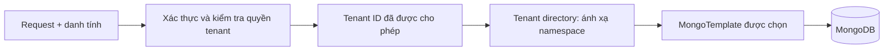

# Chọn database hoặc collection theo tenant trong Spring Data MongoDB

Trong ứng dụng SaaS đa khách hàng (*multi-tenant*), mỗi yêu cầu phải đọc và ghi dữ liệu trong phạm vi tenant mà người gọi được phép sử dụng. Với **Spring Data MongoDB**, có thể cô lập dữ liệu theo **database**, theo **collection**, hoặc dùng collection chung kèm trường `tenantId`. Bài học này giải thích cách chọn database/collection theo tenant bằng `MongoTemplate`, những giới hạn của repository và các lưu ý về truy vấn, index, transaction, reactive access và kiểm thử.

## 1. Chọn mô hình lưu trữ

Giả sử hệ thống có hai khách hàng `alpha` và `beta`, đều cần lưu đơn hàng.

| Mô hình | Vị trí đơn hàng | Phù hợp khi | Điểm cần quản lý |
| --- | --- | --- | --- |
| **Database riêng cho mỗi tenant** | `tenant_alpha.orders` và `tenant_beta.orders` | Muốn ranh giới dữ liệu và vận hành rõ, quyền truy cập/backup theo database | Provision database, index, migration, số lượng tenant |
| **Collection riêng cho mỗi tenant** | `saas.orders_alpha` và `saas.orders_beta` | Muốn tách dữ liệu trong một database chung, số tenant/collection còn quản lý được | Nhiều collection/index, quy trình khởi tạo và bảo trì |
| **Collection chung** | `saas.orders`; mỗi document chứa `tenantId` | Nhiều tenant nhỏ có schema tương đồng, muốn ít namespace | Mọi truy vấn/ghi/xóa đều phải ràng buộc tenant; thiết kế index ghép |

Ví dụ một document:

```json
{
  "_id": "order-123",
  "tenantId": "alpha",
  "externalRef": "PO-001",
  "state": "CREATED"
}
```

Database riêng **không đồng nghĩa** với MongoDB cluster hay máy chủ riêng: nhiều database có thể cùng nằm trên một deployment. Sự cô lập tài nguyên, credential, mạng và backup phụ thuộc vào cách triển khai thực tế. Tương tự, collection riêng chưa tự động ngăn một credential có quyền rộng đọc collection của tenant khác.

## 2. Xác định tenant từ nguồn đáng tin cậy

Điểm quan trọng nhất là **tenant phải được xác thực và phân quyền trước khi chọn namespace**.



1. Xác thực người dùng hoặc dịch vụ. Với ứng dụng cho phép đổi tổ chức đang làm việc, kiểm tra người gọi có quyền với tổ chức được chọn.
2. Lấy `tenantId` từ ngữ cảnh đã được xác thực và phân quyền, chẳng hạn JWT đã xác minh kết hợp thông tin membership. Không tin một header `X-Tenant-Id` hoặc tham số query chỉ vì client gửi lên.
3. Tra một **tenant directory** do server quản lý để lấy tên database hoặc collection đã cấp phát. Tenant lạ, bị khóa hoặc không được phép phải bị từ chối.
4. Định tuyến trước khi thực hiện truy vấn; trong cùng một đơn vị công việc, giữ nhất quán tenant đã chọn.

Ví dụ tenant directory có thể quản lý các ánh xạ:

| Tenant ID | Database riêng | Collection riêng trong database `saas` |
| --- | --- | --- |
| `alpha` | `tenant_alpha` | `orders_alpha` |
| `beta` | `tenant_beta` | `orders_beta` |

Hai cột namespace thể hiện **hai phương án thay thế**: dùng database `tenant_alpha` với collection cố định `orders`, hoặc dùng database chung `saas` với collection `orders_alpha`. Không ghép trực tiếp tên namespace từ chuỗi không được kiểm tra của người dùng. Tenant directory cần lưu tên đã cấp phát, hợp lệ theo quy tắc đặt tên MongoDB và giới hạn quyền của ứng dụng.

## 3. Chọn database theo tenant

### 3.1. Một MongoClient chung và MongoTemplate cho từng database

Nếu các tenant ở cùng MongoDB deployment và dùng chung cấu hình xác thực, ứng dụng có thể tái sử dụng **một `MongoClient`** (cùng connection pool driver), rồi tạo `MongoTemplate` gắn với database tương ứng. Sau khi cấu hình, `MongoTemplate` có thể được dùng đồng thời giữa các request.

Ví dụ Java 17+ dưới đây giả định ứng dụng đã khai báo bean `MongoClient` (có thể do Spring Boot cấu hình). `TenantDirectory` là hợp đồng tra cứu mà ứng dụng triển khai dựa trên dữ liệu tenant được tin cậy.

```java
import com.mongodb.client.MongoClient;
import java.util.concurrent.ConcurrentHashMap;
import java.util.concurrent.ConcurrentMap;
import org.springframework.data.mongodb.core.MongoTemplate;
import org.springframework.data.mongodb.core.SimpleMongoClientDatabaseFactory;
import org.springframework.stereotype.Service;

interface TenantDirectory {
    String databaseNameFor(String authorizedTenantId);
    String orderCollectionNameFor(String authorizedTenantId);
}

@Service
public class TenantMongoRouter {
    private final MongoClient mongoClient;
    private final TenantDirectory directory;
    private final ConcurrentMap<String, MongoTemplate> templates =
            new ConcurrentHashMap<>();

    public TenantMongoRouter(MongoClient mongoClient, TenantDirectory directory) {
        this.mongoClient = mongoClient;
        this.directory = directory;
    }

    public MongoTemplate forTenant(String authorizedTenantId) {
        // Directory kiểm tra tenant và chỉ trả tên database đã cấp phát.
        String database = directory.databaseNameFor(authorizedTenantId);

        return templates.computeIfAbsent(database,
                name -> new MongoTemplate(
                        new SimpleMongoClientDatabaseFactory(mongoClient, name)));
    }
}
```

Trong ví dụ này, `SimpleMongoClientDatabaseFactory` quyết định **database mặc định** cho `MongoTemplate`. `MongoClient` vẫn là nơi quản lý kết nối tới deployment. Cache theo tên database giúp không phải tạo template cho từng request; nếu số tenant lớn hoặc thay đổi liên tục, cần thêm chính sách giới hạn/vòng đời cache. Nếu tenant sử dụng cluster, credential hoặc URI khác nhau, cần quản lý các `MongoClient` và quyền kết nối tương ứng, thay vì giả định một client dùng được cho tất cả.

### 3.2. Lưu document và truy vấn đúng database

Định nghĩa một document:

```java
import org.springframework.data.annotation.Id;
import org.springframework.data.mongodb.core.mapping.Document;

@Document(collection = "orders")
public record TenantOrder(
        @Id String id,
        String tenantId,
        String externalRef,
        String state
) {}
```

Annotation `@Document(collection = "orders")` chỉ đặt collection mặc định. **Database được chọn bởi MongoTemplate**:

```java
import org.springframework.data.mongodb.core.MongoTemplate;
import org.springframework.data.mongodb.core.query.Criteria;
import org.springframework.data.mongodb.core.query.Query;
import org.springframework.stereotype.Service;

@Service
public class TenantOrderService {
    private final TenantMongoRouter router;

    public TenantOrderService(TenantMongoRouter router) {
        this.router = router;
    }

    public TenantOrder create(String authorizedTenantId, TenantOrder input) {
        if (!authorizedTenantId.equals(input.tenantId())) {
            throw new IllegalArgumentException("Tenant mismatch");
        }
        MongoTemplate mongo = router.forTenant(authorizedTenantId);
        return mongo.save(input); // database của tenant, collection "orders"
    }

    public TenantOrder findByExternalRef(String authorizedTenantId, String ref) {
        MongoTemplate mongo = router.forTenant(authorizedTenantId);
        Query query = Query.query(Criteria.where("tenantId")
                .is(authorizedTenantId).and("externalRef").is(ref));
        return mongo.findOne(query, TenantOrder.class);
    }
}
```

Tham số `authorizedTenantId` **đã được xác thực và cho phép ở lớp bảo mật**; service không tự coi chuỗi truyền từ body/request là đáng tin cậy. Giữ trường `tenantId` trên document dù đã tách database có thể hữu ích cho audit, kiểm tra tính nhất quán và migration.

### 3.3. Vì sao repository không tự đổi database?

```java
public interface TenantOrderRepository
        extends org.springframework.data.mongodb.repository.MongoRepository<
                TenantOrder, String> {
}
```

Repository thông thường được gắn với `MongoTemplate`/`MongoDatabaseFactory` khi cấu hình. Việc truyền `tenantId` vào một phương thức repository **không làm nó tự chuyển database**. Nếu database thay đổi theo từng request, dùng router chọn `MongoTemplate` tường minh là cách dễ quan sát. Một cơ chế routing factory/repository tự xây dựng cần giải quyết cả vấn đề session, transaction và truyền ngữ cảnh qua các luồng.

## 4. Chọn collection theo tenant trong một database chung

Với collection riêng, giữ một `MongoTemplate` trỏ tới database chung, rồi truyền **tên collection tường minh vào từng thao tác**. Spring Data MongoDB cung cấp các overload nhận tên collection, ví dụ `save`, `findOne`, `find`, `remove`, `updateFirst` và `aggregate`.

```java
import org.springframework.data.mongodb.core.MongoTemplate;
import org.springframework.data.mongodb.core.query.Criteria;
import org.springframework.data.mongodb.core.query.Query;
import org.springframework.stereotype.Service;

@Service
public class TenantCollectionOrderService {
    private final MongoTemplate sharedDatabaseTemplate;
    private final TenantDirectory directory;

    public TenantCollectionOrderService(
            MongoTemplate sharedDatabaseTemplate, TenantDirectory directory) {
        this.sharedDatabaseTemplate = sharedDatabaseTemplate;
        this.directory = directory;
    }

    public TenantOrder create(String authorizedTenantId, TenantOrder input) {
        if (!authorizedTenantId.equals(input.tenantId())) {
            throw new IllegalArgumentException("Tenant mismatch");
        }
        String collection =
                directory.orderCollectionNameFor(authorizedTenantId);
        return sharedDatabaseTemplate.save(input, collection);
    }

    public TenantOrder findById(String authorizedTenantId, String id) {
        String collection =
                directory.orderCollectionNameFor(authorizedTenantId);
        Query query = Query.query(Criteria.where("_id").is(id)
                .and("tenantId").is(authorizedTenantId));
        return sharedDatabaseTemplate.findOne(query, TenantOrder.class, collection);
    }
}
```

Mặc dù `TenantOrder` có `@Document(collection = "orders")`, đối số collection tường minh sẽ được dùng cho thao tác này. Ngược lại, nếu ai đó gọi `sharedDatabaseTemplate.save(input)`, lệnh có thể ghi vào collection mặc định `orders`: nên đóng gói template sau lớp service/API bắt buộc nhận tenant đã phân quyền, hạn chế nơi truy cập trực tiếp.

Đối với aggregation, cũng phải chỉ rõ collection đầu vào:

```java
// aggregation: Aggregation đã xây dựng; OrderSummary: kiểu kết quả.
// sharedDatabaseTemplate.aggregate(aggregation, collection, OrderSummary.class);
```

Nếu cần nhiều loại document, tenant directory có thể lưu mapping cho từng collection logic (ví dụ đơn hàng, hóa đơn); không cần cho client tự cung cấp tên collection.

## 5. Collection chung: ràng buộc tenant trong mọi câu lệnh

Khi tất cả document nằm trong `saas.orders`, cần dùng `tenantId` làm **điều kiện bắt buộc** trong truy vấn, sửa và xóa. Ví dụ:

```java
Query query = Query.query(
        Criteria.where("tenantId").is(authorizedTenantId)
                .and("_id").is(orderId));
TenantOrder order = mongoTemplate.findOne(query, TenantOrder.class);
```

Chỉ dùng `findById(orderId)` hoặc `deleteById(orderId)` trên repository chung có thể bỏ qua ranh giới tenant. Cần kiểm tra tương tự với `updateFirst`, `findAndModify`, `remove`, `count` và các pipeline aggregation. Tốt nhất là lớp truy cập dữ liệu có hợp đồng rõ ràng: **bắt buộc cung cấp tenant đã được phân quyền**, và không cung cấp những phương thức truy cập thiếu ràng buộc tenant.

Nếu mã đơn hàng `externalRef` chỉ cần duy nhất **trong từng tenant**, hãy dùng unique index ghép:

```javascript
db.orders.createIndex(
  { tenantId: 1, externalRef: 1 },
  { unique: true, name: "uniq_tenant_external_ref" }
);
```

Trong mô hình database/collection riêng, có thể đặt unique index chỉ trên `externalRef` ở **mỗi collection tenant**. Quy tắc unique vì thế phải phù hợp với mô hình lưu trữ.

## 6. Index, transaction và reactive access

### Khởi tạo namespace và index

Với database riêng, tạo collection/index ở mỗi database tenant; với collection riêng, tạo index ở từng collection. Ví dụ khi provision một collection:

```java
import org.springframework.data.domain.Sort.Direction;
import org.springframework.data.mongodb.core.index.Index;

String collection = directory.orderCollectionNameFor(authorizedTenantId);
sharedDatabaseTemplate.indexOps(collection)
        .ensureIndex(new Index().on("externalRef", Direction.ASC).unique());
```

Với database riêng có thể dùng `router.forTenant(tenantId).indexOps(TenantOrder.class).ensureIndex(...)`. Với collection chung, thiết kế index theo truy vấn, thường có trường tenant trong index ghép, chẳng hạn `{ tenantId: 1, state: 1, createdAt: -1 }`. Xác minh bằng `explain` trên dữ liệu đại diện và xem xét cardinality, phân trang, độ chọn lọc.

Không nên mặc định annotation index sẽ tự tạo đầy đủ index cho namespace được sinh động: hành vi tự tạo index phụ thuộc cấu hình và phiên bản Spring Data MongoDB. Hãy đưa việc tạo/xác minh index vào quy trình provisioning/migration có thể chạy lặp an toàn. Theo dõi số database, collection, index, thời gian khởi động và tài nguyên theo số tenant.

### Transaction

`MongoTransactionManager` quản lý transaction dựa trên một `MongoDatabaseFactory`. Nếu service chọn template/database động, chỉ thêm `@Transactional` chưa đủ để chứng minh các thao tác sử dụng đúng session và transaction manager. Cần thiết kế ranh giới transaction nhất quán với factory/template đã chọn và kiểm thử trên deployment MongoDB hỗ trợ transaction (chẳng hạn replica set hoặc sharded cluster được cấu hình phù hợp). Nhiều MongoDB cluster độc lập không thể tham gia một transaction MongoDB duy nhất.

Một nguyên tắc thiết kế dễ kiểm soát là mỗi thao tác nghiệp vụ chỉ ghi trong phạm vi **một tenant**. Nếu phải phối hợp dữ liệu nhiều tenant, thiết kế quy trình riêng với cơ chế xử lý lỗi/idempotency.

### Reactive

Với Spring WebFlux và `ReactiveMongoTemplate`, không dùng `ThreadLocal` để truyền tenant qua pipeline: callback có thể chạy ở các thread khác nhau. Thay vào đó, truyền tenant tường minh hoặc đặt tenant đã xác thực vào Reactor `Context`, rồi lấy nó tại thời điểm thực thi.

Ví dụ minh họa (giả sử `reactiveRouter` là router trả về `ReactiveMongoTemplate` của tenant):

```java
return Mono.deferContextual(context -> {
    String authorizedTenantId = context.get("tenantId");
    return reactiveRouter.forTenant(authorizedTenantId).findOne(
            Query.query(Criteria.where("tenantId").is(authorizedTenantId)
                    .and("externalRef").is(ref)),
            TenantOrder.class);
});
```

Router reactive có thể lưu template theo database bằng factory reactive tương ứng. Giá trị trong Reactor Context phải được security layer xác thực và phân quyền trước; ví dụ trên chỉ thể hiện vị trí đọc tenant và chọn template.

## 7. Kiểm thử cô lập dữ liệu

Ưu tiên kiểm thử tích hợp bằng MongoDB thật (ví dụ Testcontainers), vì mock `MongoTemplate` không xác minh được database/collection thực tế, index hay mapping của `_id`.

| Ca kiểm thử | Kết quả cần thấy |
| --- | --- |
| `alpha` và `beta` cùng tạo đơn có `externalRef` giống nhau | Cùng tồn tại nếu khác namespace, hoặc đúng unique index ghép với collection chung |
| Người dùng `alpha` truy vấn mã đơn chỉ tồn tại ở `beta` | Không đọc được document của `beta` |
| Client gửi tenant không được phép/không tồn tại | Bị từ chối trước khi vào MongoDB |
| Payload ghi dữ liệu chứa `tenantId` khác với tenant đã phân quyền | Bị từ chối, không ghi nhầm |
| Cập nhật, xóa, đếm và aggregation | Không tác động hoặc tiết lộ dữ liệu tenant khác |
| Provision tenant mới | Có đúng namespace, index và quyền truy cập |
| Request bất đồng bộ/reactive chạy liên tiếp | Không rò ngữ cảnh tenant từ request khác |

Trong test database riêng, kiểm tra cả **tên database thật** chứa document; trong test collection riêng, kiểm tra cả **tên collection thật**. Tạo dữ liệu cho ít nhất hai tenant để phát hiện lỗi định tuyến hoặc quên điều kiện tenant.

## 8. Quyết định triển khai

- **Database riêng**: chọn khi cần ranh giới vận hành/backup/quyền truy cập theo tenant; chuẩn bị provisioning, migration và giám sát cho nhiều database.
- **Collection riêng**: chọn khi muốn tách namespace trong một database chung và số lượng collection/index vẫn kiểm soát được.
- **Collection chung**: chọn khi nhiều tenant chia sẻ schema và cần ít namespace; bắt buộc mọi đường truy cập ràng buộc `tenantId` và thiết kế index ghép đúng.

Trong Spring Data MongoDB, hãy phân biệt ba lớp trách nhiệm: `MongoDatabaseFactory`/`MongoTemplate` xác định **database**, đối số của các thao tác `MongoTemplate` có thể chọn **collection**, còn tenant directory cùng security layer quyết định **tenant nào được phép đi tới namespace nào**. Phân biệt rõ ba lớp này là nền tảng để thiết kế hệ thống multi-tenant an toàn và dễ vận hành.
