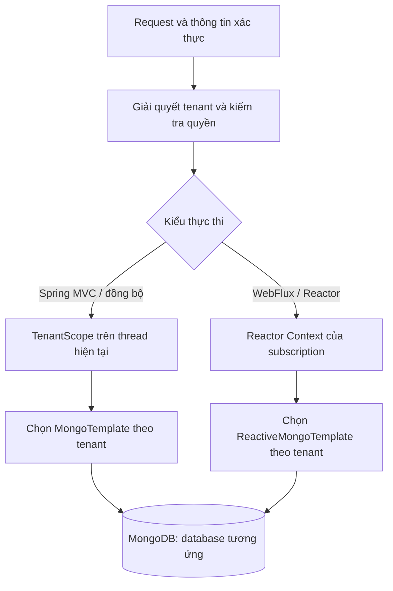

# Giữ đúng tenant trong luồng đồng bộ và Reactor Context

## Mục tiêu học tập

Trong ứng dụng đa tenant dùng **Spring Data MongoDB**, cùng một loại document có thể được lưu vào nhiều database: chẳng hạn tenant `alpha` dùng `orders_alpha`, còn tenant `beta` dùng `orders_beta`. Dù cả hai dùng chung model `Order` và cùng API, một truy vấn của `alpha` tuyệt đối không được chạy trên database của `beta`.

Sau bài này, bạn có thể:

- Thiết lập nguyên tắc chọn MongoDB database theo tenant tại ranh giới tin cậy của request.
- Duy trì tenant trong luồng xử lý **đồng bộ** bằng phạm vi `ThreadLocal` có dọn dẹp đúng cách.
- Duy trì tenant trong luồng **reactive** bằng Reactor `Context` theo từng subscription.
- Sử dụng `MongoTemplate` và `ReactiveMongoTemplate` cho đúng database, nhận diện lỗi khi kết hợp hai mô hình.
- Kiểm thử cách ly tenant, xử lý giao dịch và chẩn đoán các lần truy cập sai database.

## 1. Vì sao tenant dễ bị chọn sai?

Trong chiến lược **mỗi tenant một database** (*database per tenant*), tầng dữ liệu phải giải quyết hai việc riêng biệt: xác nhận request thuộc tenant nào và chọn đúng `MongoDatabase` cho mọi thao tác của request đó. MongoDB không tự hiểu `tenantId` trong HTTP request, `Authentication`, `ThreadLocal` hay Reactor `Context`. Ứng dụng phải đưa tenant đã xác thực vào cơ chế chọn database của Spring Data MongoDB.

Ví dụ về ánh xạ được quản lý phía máy chủ:

| Tenant đã xác thực | Database được phép truy cập | Document mẫu |
| --- | --- | --- |
| `alpha` | `orders_alpha` | `Order` có mã `A-100` |
| `beta` | `orders_beta` | `Order` có mã `B-200` |

`GET /orders/A-100` chỉ có ý nghĩa khi kết hợp với tenant của người gọi. Nếu request `beta` vô tình dùng template trỏ tới `orders_alpha`, chỉ kiểm tra ID của đơn hàng là chưa đủ để bảo đảm cách ly dữ liệu.



**Bất biến cần giữ:** trước khi chạy thao tác dữ liệu, ứng dụng đã biết tenant hợp lệ; tenant đó xác định duy nhất database cần dùng; không có tenant thì thao tác thất bại rõ ràng. Tuyệt đối không âm thầm rơi về database mặc định, nhất là trong các hệ thống có dữ liệu khách hàng.

Phạm vi bài này là định tuyến theo **database riêng cho từng tenant**. Nếu dùng một database chung và thêm `tenantId` trong mỗi document, truy vấn, cập nhật, aggregation và index vẫn phải áp dụng điều kiện tenant; `ThreadLocal` hoặc Reactor `Context` tự nó không thêm bộ lọc MongoDB.

## 2. Chọn tenant tại ranh giới tin cậy

Tenant nên được lấy từ định danh đã xác thực, token/claim đã kiểm chứng hoặc quyền truy cập mà hệ thống đã thiết lập. Nếu API cho phép người dùng chọn tenant thông qua header hay path, phải kiểm tra người đó có quyền truy cập tenant được yêu cầu.

Một quy trình an toàn gồm:

1. Xác thực người gọi, xác định tập tenant được phép truy cập.
2. Xác định tenant hiện hành và đối chiếu với tập được phép.
3. Tra ánh xạ **tenant → tên database** do máy chủ quản lý; từ chối tenant lạ.
4. Đặt tenant vào phạm vi thực thi phù hợp, gọi tầng dữ liệu và luôn giải phóng phạm vi khi hoàn thành.

Không dùng nguyên văn giá trị header để ghép tên database (`"orders_" + header`), vì nó biến một đầu vào không tin cậy thành quyết định định tuyến. Trong các ví dụ sau, `validatedTenant` có nghĩa là tenant đã qua cả bước xác thực lẫn kiểm tra quyền.

## 3. Một registry ánh xạ tenant sang MongoTemplate

Cách đơn giản, dễ quan sát là khởi tạo trước các template theo danh sách tenant được phép. **Spring Data MongoDB** cung cấp `MongoTemplate` cho luồng đồng bộ và `ReactiveMongoTemplate` cho Reactive Streams. Mỗi template được gắn với một `MongoDatabaseFactory` hoặc `ReactiveMongoDatabaseFactory` sử dụng tên database cụ thể.

Ví dụ cấu hình minh họa (các import được lược bỏ, ứng dụng cần cấu hình đủ Mongo client và converter):

```java
@Configuration
class TenantMongoConfiguration {

    @Bean
    TenantMongoRegistry tenantMongoRegistry(
            com.mongodb.client.MongoClient blockingClient,
            com.mongodb.reactivestreams.client.MongoClient reactiveClient,
            MongoConverter converter) {

        // Danh sách ánh xạ được cấu hình và kiểm soát từ phía máy chủ.
        Map<String, String> databases = Map.of(
                "alpha", "orders_alpha",
                "beta",  "orders_beta"
        );

        Map<String, MongoOperations> blocking = new HashMap<>();
        Map<String, ReactiveMongoOperations> reactive = new HashMap<>();

        databases.forEach((tenant, database) -> {
            blocking.put(tenant, new MongoTemplate(
                    new SimpleMongoClientDatabaseFactory(blockingClient, database),
                    converter));

            reactive.put(tenant, new ReactiveMongoTemplate(
                    new SimpleReactiveMongoDatabaseFactory(reactiveClient, database),
                    converter));
        });

        return new TenantMongoRegistry(blocking, reactive);
    }
}

final class TenantMongoRegistry {
    private final Map<String, MongoOperations> blocking;
    private final Map<String, ReactiveMongoOperations> reactive;

    TenantMongoRegistry(Map<String, MongoOperations> blocking,
                        Map<String, ReactiveMongoOperations> reactive) {
        this.blocking = Map.copyOf(blocking);
        this.reactive = Map.copyOf(reactive);
    }

    MongoOperations blockingFor(String tenant) {
        MongoOperations operations = blocking.get(tenant);
        if (operations == null) {
            throw new IllegalArgumentException("Tenant không hợp lệ");
        }
        return operations;
    }

    ReactiveMongoOperations reactiveFor(String tenant) {
        ReactiveMongoOperations operations = reactive.get(tenant);
        if (operations == null) {
            throw new IllegalArgumentException("Tenant không hợp lệ");
        }
        return operations;
    }
}
```

Đây là một lựa chọn triển khai thích hợp khi tập tenant tương đối ổn định. Với tenant được tạo động, registry cần cơ chế nạp cấu hình và quản lý vòng đời tài nguyên có kiểm soát; không tạo `MongoClient` mới cho mỗi request. Nếu các tenant dùng credential, cluster hoặc cấu hình kết nối khác nhau, ánh xạ phải bao gồm factory/client tương ứng và cách ly quyền ở cấp MongoDB.

Registry chỉ quyết định **database nào được truy vấn**. Phần tiếp theo giải quyết **làm sao biết tenant của thao tác hiện tại**.

## 4. Luồng đồng bộ: quản lý `ThreadLocal` bằng phạm vi rõ ràng

Ở ứng dụng Spring MVC chạy đồng bộ trên servlet thread, nhiều lời gọi service/repository có thể diễn ra trên cùng thread trong thời gian request được xử lý. Một `ThreadLocal` có thể chuyển tenant giữa các lớp mà không thêm tham số vào từng lời gọi. Tuy nhiên servlet container **tái sử dụng thread**: nếu không dọn giá trị sau request, request tiếp theo có thể nhìn thấy tenant của request trước.

```java
public final class TenantContext {
    private static final ThreadLocal<String> CURRENT = new ThreadLocal<>();

    private TenantContext() {}

    public static String requireTenant() {
        String tenant = CURRENT.get();
        if (tenant == null) {
            throw new IllegalStateException("Thiếu tenant trong luồng đồng bộ");
        }
        return tenant;
    }

    public static Scope open(String validatedTenant) {
        if (validatedTenant == null || validatedTenant.isBlank()) {
            throw new IllegalArgumentException("Tenant không hợp lệ");
        }
        String previous = CURRENT.get();
        CURRENT.set(validatedTenant);
        return () -> {
            if (previous == null) {
                CURRENT.remove();
            } else {
                CURRENT.set(previous);
            }
        };
    }

    @FunctionalInterface
    public interface Scope extends AutoCloseable {
        @Override
        void close();
    }
}
```

Sau khi xác thực và phân quyền, filter/interceptor hoặc một lớp điều phối có thể tạo phạm vi:

```java
String tenant = tenantResolver.resolveAndAuthorize(request); // Đã kiểm tra quyền
try (TenantContext.Scope ignored = TenantContext.open(tenant)) {
    orderService.processOrder(orderId);
} // close() thực thi cả khi service ném exception
```

Service đọc tenant tại thời điểm thao tác dữ liệu:

```java
@Service
class BlockingOrderService {
    private final TenantMongoRegistry mongoRegistry;

    BlockingOrderService(TenantMongoRegistry mongoRegistry) {
        this.mongoRegistry = mongoRegistry;
    }

    Order findById(String id) {
        String tenant = TenantContext.requireTenant();
        return mongoRegistry.blockingFor(tenant).findById(id, Order.class);
    }
}
```

Giả sử `Order` là một document đã được khai báo mapping Spring Data. Khi `TenantContext` chứa `alpha`, lời gọi `findById` sử dụng template cho `orders_alpha`. Khi tenant là `beta`, cùng đoạn code truy cập `orders_beta`.

**Giới hạn quan trọng:** `ThreadLocal` chỉ gắn với **thread đang chạy**. Nó không tự đi theo `@Async`, `CompletableFuture`, executor, tác vụ lịch, callback ở thread khác, hoặc luồng Reactor đổi thread. Một tác vụ bất đồng bộ cần mang tenant như dữ liệu đầu vào và thiết lập phạm vi mới ở thread thực hiện. Không nên dùng `InheritableThreadLocal` để thay cho cơ chế truyền tenant có kiểm soát với thread pool.

## 5. Luồng reactive: tenant thuộc về subscription, không thuộc về thread

Trong WebFlux và Spring Data MongoDB reactive, một chuỗi `Mono`/`Flux` có thể được thực thi trên nhiều thread, và cùng một thread có thể phục vụ nhiều subscription. Vì vậy, đọc `TenantContext.requireTenant()` trong `map`, `flatMap` hoặc khi template thao tác MongoDB là không đáng tin cậy.

**Reactor `Context`** lưu metadata gắn với một subscription. `contextWrite(...)` cung cấp giá trị cho các operator **ở phía upstream** của vị trí đó trong chuỗi; `deferContextual(...)` đọc giá trị khi subscription diễn ra. Ngữ cảnh tồn tại theo chuỗi reactive dù thực thi qua `publishOn` hay `subscribeOn` thông thường.

```java
final class TenantKeys {
    static final String ID = "tenantId";
    private TenantKeys() {}
}

@Service
class ReactiveOrderService {
    private final TenantMongoRegistry mongoRegistry;

    ReactiveOrderService(TenantMongoRegistry mongoRegistry) {
        this.mongoRegistry = mongoRegistry;
    }

    Mono<Order> findById(String id) {
        return Mono.deferContextual(context -> {
            String tenant = context.getOrDefault(TenantKeys.ID, null);
            if (tenant == null) {
                return Mono.error(new IllegalStateException(
                        "Thiếu tenant trong Reactor Context"));
            }
            return mongoRegistry.reactiveFor(tenant).findById(id, Order.class);
        });
    }
}
```

Tại ranh giới đã kiểm tra quyền, đặt tenant vào context của chuỗi trả về:

```java
Mono<Order> response = reactiveOrderService.findById(orderId)
        .contextWrite(context -> context.put(TenantKeys.ID, validatedTenant));
return response;
```

Giá trị `validatedTenant` là biến đã được quyết định trước khi tạo chuỗi trả về; đoạn trên minh họa phần xử lý trong controller/filter sau xác thực. Nếu thiếu tenant, service phát `onError`, không truy vấn một database mặc định. `deferContextual` được đặt **bên trong** service để quyết định template tại thời điểm đăng ký subscription, thay vì chốt tenant khi lắp ráp pipeline.

### 5.1. Đọc vị trí của `contextWrite` cho đúng

```java
Mono<Order> order = reactiveOrderService.findById("A-100")
        .publishOn(Schedulers.parallel())
        .contextWrite(ctx -> ctx.put(TenantKeys.ID, "alpha"));
```

`findById` nhìn thấy `alpha`: tuy `publishOn` có thể đổi thread, `contextWrite` vẫn cung cấp context cho các operator phía trước nó. Ngược lại, nếu gắn `contextWrite` vào một nhánh không bao bọc truy vấn, nhánh truy vấn sẽ không nhận được tenant:

```java
Mono<Order> order = reactiveOrderService.findById("A-100");
Mono<String> unrelated = Mono.just("ok")
        .contextWrite(ctx -> ctx.put(TenantKeys.ID, "alpha"));
// Context của unrelated không tự động chuyển sang subscription của order.
```

Khi dùng `flatMap`, `zip`, `retry` hoặc thao tác bất đồng bộ, cần thiết kế đường đi của context trong **cùng một chuỗi subscription**. Không nên lưu một publisher đã định tuyến theo tenant vào cache dùng chung mà không phân biệt tenant, vì kết quả cache có thể vượt qua ranh giới dữ liệu dù lúc đầu truy vấn đã đúng database.

### 5.2. Lấy tenant ở WebFlux boundary

Trong `WebFilter`, sau khi lấy được principal và xác định tenant được phép truy cập, có thể bao bọc phần còn lại của chuỗi như sau:

```java
return chain.filter(exchange)
        .contextWrite(ctx -> ctx.put(TenantKeys.ID, validatedTenant));
```

Cần bảo đảm việc resolve/authorize tenant đã hoàn thành trước khi gọi đoạn này và mọi đường xử lý MongoDB cần tenant đều nằm dưới cùng subscription. Nếu một thao tác khởi tạo subscription riêng ngoài request chain, phải truyền tenant sang thao tác đó một cách tường minh.

## 6. Kết hợp mã đồng bộ và reactive mà không đánh mất tenant

Hai mô hình không trao đổi tenant tự động. Ví dụ này **sai** khi chạy trong WebFlux:

```java
return Mono.fromCallable(() -> blockingOrderService.findById(orderId))
        .subscribeOn(Schedulers.boundedElastic());
// blockingOrderService đọc ThreadLocal trên boundedElastic, thường không có tenant.
```

Nếu bắt buộc gọi một API MongoDB đồng bộ từ pipeline reactive, hãy đọc tenant trong Reactor `Context`, rồi thiết lập `ThreadLocal` ngay trên thread thực hiện lời gọi blocking:

```java
return Mono.deferContextual(ctx -> {
    String tenant = ctx.get(TenantKeys.ID);
    return Mono.fromCallable(() -> {
        try (TenantContext.Scope ignored = TenantContext.open(tenant)) {
            return blockingOrderService.findById(orderId);
        }
    }).subscribeOn(Schedulers.boundedElastic());
});
```

`boundedElastic` được dùng để cô lập phần blocking khỏi event-loop; với dịch vụ hoàn toàn reactive, nên ưu tiên `ReactiveMongoTemplate` và tránh chuyển sang blocking. Đoạn bridge trên giữ tenant cả khi có lỗi hoặc hủy phần công việc đã chạy, nhờ `try-with-resources` dọn phạm vi của lời gọi blocking.

Theo chiều ngược lại, nếu mã đồng bộ cố gọi `.block()` trên một `Mono` đọc Reactor `Context`, giá trị `ThreadLocal` hiện tại **không tự xuất hiện** trong Reactor `Context`. Nếu thật sự cần bridge ở một điểm vào đồng bộ được phép blocking, phải đưa tenant vào subscription:

```java
String tenant = TenantContext.requireTenant();
Order order = reactiveOrderService.findById(orderId)
        .contextWrite(ctx -> ctx.put(TenantKeys.ID, tenant))
        .block();
```

Không gọi `.block()` trên WebFlux event-loop: nó có thể gây lỗi hoặc nghẽn xử lý. Trong code mới, truyền tenant rõ ràng qua tham số hàm thường dễ kiểm soát hơn khi băng qua ranh giới công nghệ, đặc biệt với các tác vụ chạy nền.

## 7. Giao dịch, repository và các tác vụ phát sinh

**Transaction:** Với MongoDB, transaction gắn với session và transaction manager tương ứng. Phải chốt tenant và chọn đúng factory/template **trước khi** bắt đầu transaction, sau đó giữ tenant nhất quán cho toàn bộ thao tác trong transaction. `MongoTransactionManager` dùng cho phía đồng bộ; `ReactiveMongoTransactionManager` và `TransactionalOperator` dùng cho phía reactive. Một `@Transactional` dùng transaction manager mặc định cố định không tự chọn transaction manager theo Reactor `Context`. Nếu ứng dụng có nhiều database/template, cần cấu hình cách chọn manager phù hợp hoặc tổ chức boundary giao dịch theo từng tenant.

**Repository:** Một Spring Data repository được tạo với `MongoOperations`/`ReactiveMongoOperations` cố định không tự đổi database chỉ vì `ThreadLocal` hoặc `Context` có tenant mới. Cần cung cấp repository được định tuyến thực sự, hoặc gọi template lấy từ registry như trong ví dụ. Mọi custom query, aggregation, cập nhật hàng loạt và truy vấn qua repository phải tuân theo cùng một cơ chế chọn tenant.

**Background job:** Scheduler, worker nhận message và consumer queue thường không có HTTP request để kế thừa tenant. Hãy mang tenant trong metadata công việc đáng tin cậy, xác minh quyền/phạm vi theo chính sách hệ thống, và đặt context mới cho mỗi job/subscription. Tránh chạy một job nhiều tenant dưới một `ThreadLocal` dùng chung.

**Tài nguyên MongoDB:** Database riêng cần được khởi tạo index, schema validation (nếu sử dụng), dữ liệu cấu hình và quy trình migration theo từng tenant. Phân quyền MongoDB nên giới hạn credential ở mức cần thiết; định tuyến đúng trong ứng dụng không thay thế được kiểm soát truy cập ở database.

## 8. Kiểm thử khả năng cách ly tenant

Thay vì chỉ kiểm tra API trả về dữ liệu, cần kiểm tra **template/database nào đã được chọn**. Nên kết hợp unit test dùng mock cho registry với integration test MongoDB thật hoặc Testcontainers có hai database riêng. Các phép thử có giá trị gồm:

| Tình huống | Kỳ vọng |
| --- | --- |
| Request đồng bộ `alpha`, sau đó `beta` trên cùng thread | Mỗi request dùng đúng template; `ThreadLocal` được phục hồi/xóa sau mỗi phạm vi |
| Service đồng bộ ném exception | `TenantScope.close()` vẫn chạy; request tiếp theo không thấy tenant cũ |
| Thiếu tenant hoặc tenant chưa đăng ký | Thất bại rõ ràng **trước khi** đọc/ghi MongoDB |
| Hai subscription reactive với `alpha` và `beta` chạy đồng thời | Mỗi subscription chỉ truy cập database của mình |
| Reactive chain có `publishOn`, `flatMap`, `retry` | Tenant vẫn được đọc từ cùng `Context` khi phát sinh truy vấn |
| Bridge sang `boundedElastic` | Tenant được đặt trong thread thực thi lời gọi blocking và được dọn sau đó |
| Transaction và repository | Factory/manager và các thao tác đều thuộc tenant đã chọn |

Một kiểm thử tối thiểu xác minh chính sách **fail closed** trong reactive service:

```java
StepVerifier.create(reactiveOrderService.findById("A-100"))
        .expectError(IllegalStateException.class)
        .verify();
```

Kiểm thử định tuyến có thể dùng hai template giả trả về hai `Order` khác nhau cho cùng ID; tạo hai subscription độc lập với `contextWrite(ctx -> ctx.put(TenantKeys.ID, "alpha"))` và tương tự cho `beta`, rồi dùng `StepVerifier` kiểm tra đúng document. Integration test nên ghi một document chỉ vào `orders_alpha`, truy vấn từ `beta` và xác nhận không đọc được, đồng thời kiểm tra hướng ngược lại. Đây là phép thử quan trọng để phát hiện cấu hình template trỏ nhầm database dù logic `Context` có vẻ đúng.

### Quan sát khi chẩn đoán lỗi

Ở lớp chọn template, ghi log có cấu trúc với mã tenant đã chuẩn hóa, database đã chọn, operation và trace/request ID; tránh ghi token xác thực, credential và nội dung nhạy cảm của document. Nếu truy vấn có dấu hiệu sai tenant, kiểm tra lần lượt: tenant đã được phân quyền chưa, có phạm vi nào bị bỏ quên khi request kết thúc, `contextWrite` có bao trùm subscription thực hiện truy vấn không, repository có đang dùng template cố định không, và transaction manager đã chọn đúng factory chưa.

## 9. Những nguyên tắc cần nhớ khi triển khai

- Tenant là quyết định bảo mật và định tuyến; chỉ sử dụng tenant đã xác thực, được phân quyền và ánh xạ trong cấu hình máy chủ.
- Với xử lý đồng bộ, đặt `ThreadLocal` trong phạm vi có `try/finally` hoặc `try-with-resources`; khôi phục hoặc xóa giá trị sau mỗi request, kể cả có exception.
- Với Reactor, dùng `contextWrite` để cấp tenant cho subscription và `deferContextual` để đọc tenant lúc thực thi; không dựa vào `ThreadLocal` hay tên thread.
- Với Spring Data MongoDB, chọn đúng `MongoTemplate`/`ReactiveMongoTemplate` và factory của tenant; repository, aggregation và transaction phải đi qua cùng quy tắc định tuyến.
- Khi qua ranh giới đồng bộ/reactive, executor hoặc job nền, truyền tenant tường minh và thiết lập lại phạm vi tại điểm chạy thực tế.
- Không có tenant hợp lệ nghĩa là không truy vấn. Kiểm thử song song nhiều tenant và thử trường hợp lỗi để chắc chắn không có dữ liệu chéo database.

Khi thực hiện đầy đủ các nguyên tắc này, ứng dụng có thể dùng chung model và mã nghiệp vụ Spring Data MongoDB nhưng vẫn bảo đảm từng thao tác được thực thi trên database của đúng tenant trong cả luồng đồng bộ lẫn pipeline Reactor.
