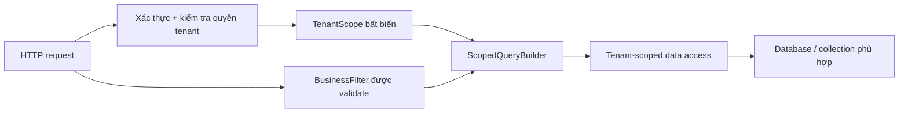
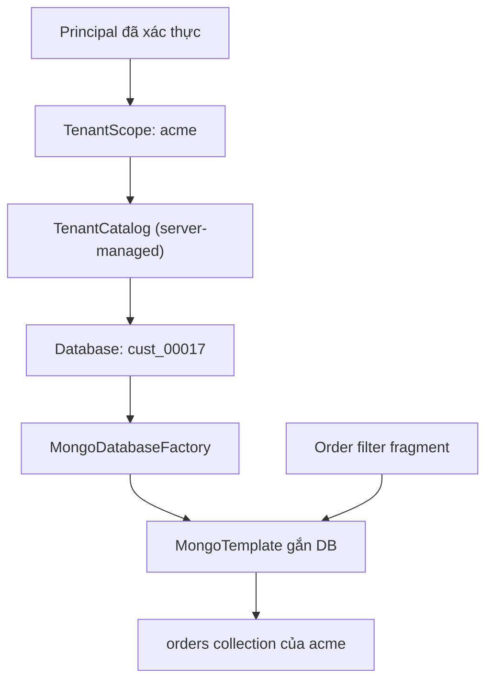

# Ngăn truy vấn chéo tenant khi tái sử dụng bộ lọc hoặc fragment

## 1. Vấn đề và mục tiêu học tập

Trong hệ thống nhiều khách hàng (multi-tenant), một yêu cầu có thể dùng chung **mã xử lý**, **repository**, **MongoTemplate**, một bộ lọc tìm kiếm hoặc một phần aggregation (*fragment*) với yêu cầu của tenant khác. Việc tái sử dụng giúp giảm lặp code, nhưng một bộ lọc thiếu điều kiện tenant hoặc gắn sai điều kiện có thể khiến người dùng thấy, đếm, cập nhật hay xóa dữ liệu không thuộc quyền của mình.

Trong Spring Data MongoDB, ứng dụng truy vấn bằng `MongoTemplate`, repository, `Query` / `Criteria`, aggregation và reactive API. Các API này không mặc định biết quan hệ giữa principal đã đăng nhập và tenant. Ứng dụng phải thực thi ranh giới dữ liệu khi lựa chọn **database** và khi xây dựng **lệnh dữ liệu**.

Bài học thuộc chương **Nhiều database** và tập trung vào lỗi phổ biến: **tái sử dụng một fragment truy vấn vốn hợp lệ cho nhiều tenant nhưng quên hoặc làm mất phạm vi tenant trong lời gọi cụ thể**. Sau khi học, bạn có thể:

1. Phân biệt ranh giới database với điều kiện `tenantId` trong collection, biết mô hình nào cần cả hai.
2. Nhận diện lỗi định tuyến database, bộ lọc rỗng, dấu ngoặc `$or` sai, fragment bị sửa trong bộ nhớ, raw query/aggregation bỏ qua guard.
3. Thiết kế **TenantScope bất biến** được suy ra từ thông tin đã xác thực và xây truy vấn mới cho mỗi request.
4. Dùng một **điểm truy cập dữ liệu có kiểm soát** để mọi hành động đọc, đếm, sửa, xóa, aggregate đều áp dụng phạm vi phù hợp.
5. Viết kiểm thử có hai tenant, dữ liệu trùng ID nghiệp vụ, kịch bản đối kháng và kiểm chứng kết quả tại đúng database.

> Ví dụ Java dùng Spring Data MongoDB imperative với `MongoTemplate`; phần cuối xét repository, reactive và vận hành. Các tên tenant `acme`, `beta`, database và bản ghi đều là dữ liệu giả định. Các import thông dụng của Java/Spring được giản lược khi không ảnh hưởng ý chính; phiên bản thư viện thực tế có thể yêu cầu điều chỉnh nhỏ.

## 2. Phải xác định ranh giới tenant trước khi viết `Query`

Một tenant thường là đơn vị khách hàng/công ty/nhóm sử dụng chung ứng dụng nhưng có quyền và dữ liệu riêng. Một cụm MongoDB có thể chứa nhiều database, mỗi database có nhiều collection. Cấu trúc vật lý ảnh hưởng trực tiếp tới loại guard cần áp dụng.

| Mô hình | Ví dụ | Ranh giới truy cập chính | Nguy cơ khi tái sử dụng fragment |
|---|---|---|---|
| **Database per tenant** | `tenant_acme.orders`, `tenant_beta.orders` | Chọn **đúng database** từ tenant được phép | `MongoTemplate` trỏ nhầm DB, context rò giữa requests, fallback sang DB mặc định |
| **Collection per tenant** (cùng DB) | `app.orders_acme`, `app.orders_beta` | Chọn đúng collection theo catalog | Tên collection được nối từ input không kiểm soát, fragment gọi collection chung |
| **Shared collection** | `app.orders` chứa `tenantId` | Mọi thao tác phải có predicate tenant hiệu lực | Fragment thiếu tenant, `$or` vượt scope, `updateMany`/`deleteMany` không đủ guard |
| **Hybrid** | DB theo vùng + collection nhiều tenant | Chọn đúng DB **và** predicate `tenantId` | Guard ở một tầng đúng nhưng tầng còn lại sai |

Ví dụ hai document đặt trong **một collection dùng chung**:

```javascript
// app.orders
{
  _id: ObjectId("66a000000000000000000001"),
  tenantId: "acme",
  orderNo: "ORD-100",
  status: "OPEN",
  amount: 120
}
{
  _id: ObjectId("66a000000000000000000002"),
  tenantId: "beta",
  orderNo: "ORD-100",
  status: "OPEN",
  amount: 120
}
```

Hai bản ghi có cùng `orderNo` và `status`. Nếu khách `acme` gọi `find({ status: "OPEN" })` trên collection dùng chung, khách đó có thể thấy cả hai đơn hàng. Với mô hình database per tenant, cùng filter chỉ giới hạn kết quả **bên trong DB đã chọn**. Vì vậy, nếu chọn `tenant_beta` cho request `acme` thì filter “đúng” vẫn đọc dữ liệu sai khách hàng.

**Nguyên tắc cốt lõi:** dữ liệu yêu cầu, business filter và ranh giới phân quyền là ba khái niệm khác nhau:

- **Identity:** request đã xác thực thuộc principal nào?
- **Tenant scope:** principal được phép truy cập tenant nào, trên database/collection nào?
- **Business filter:** người dùng muốn tìm các đơn `OPEN`, khoảng ngày hay trạng thái nào?

Business filter là đầu vào có thể biến đổi; tenant scope là ràng buộc do server thiết lập. Fragment tái sử dụng chỉ nên diễn tả điều kiện nghiệp vụ; nó không tự nắm vai trò “chứng minh” scope.

## 3. Mô hình đe dọa: mất tenant guard gây hậu quả gì?

Một API `GET /orders?status=OPEN` trông đơn giản nhưng qua nhiều lớp:



Trong mã không an toàn, `A` có thể được gọi mà kết quả `S` không được truyền xuống `O`. Service lấy `tenantId` từ query param hoặc tạo `Query` từ fragment dùng chung; driver vẫn thực thi lệnh hợp lệ đối với tài khoản database. Vì thế lỗi thường **không gây exception**, mà âm thầm trả kết quả sai.

| Hành động | Một lỗi thiếu scope | Tác hại |
|---|---|---|
| `find` / repository find | Chỉ lọc `status=OPEN` | Lộ document |
| `count` / `exists` | Đếm hoặc xác nhận `orderNo` toàn cục | Rò thông tin ngay cả khi không trả document |
| `findById` | Dựa duy nhất vào `_id` | Đọc object tenant khác nếu ở shared collection |
| `updateFirst` / `updateMulti` | `{orderNo: ...}` không tenant | Sửa trạng thái/balance sai tenant |
| `remove` / `findAndRemove` | Dùng fragment không chứa tenant | Xóa dữ liệu tenant khác |
| Aggregation | `$match` thiếu scope, `$lookup`/`$unionWith` đọc nguồn khác | Lộ dữ liệu trong projection, thống kê |
| Bulk operation | Tái dùng filter chưa khóa tenant | Thay đổi nhiều bản ghi |
| Reactive flow | Tenant context đọc từ `ThreadLocal` khi subscription chạy ở luồng khác | Truy vấn DB/tenant sai do lệch context |
| Scheduled job | Không có authenticated request nên bỏ qua scope | Xử lý dữ liệu ngoài ý định |

Kẻ tấn công không cần gửi JSON có `$where`. Chỉ cần dùng chức năng hợp lệ với `orderNo`, trạng thái hoặc thời gian trùng giữa các tenant là đủ để khai thác lỗi thiếu guard.

## 4. Các phản ví dụ về filter và fragment

### 4.1. Không được nối `$or` ngang hàng với tenant điều kiện ở một nhánh

Một API lọc `OPEN` **hoặc** `URGENT` có thể vô tình tạo filter:

```javascript
// SAI: nhánh thứ hai không giới hạn tenant.
db.orders.find({
  $or: [
    { tenantId: "acme", status: "OPEN" },
    { priority: "URGENT" }
  ]
});
```

Nhánh thứ hai trả cả bản ghi `URGENT` của `beta`. Filter an toàn yêu cầu tenant nằm **ngoài** mọi nhánh nghiệp vụ:

```javascript
// ĐÚNG cho shared collection: tenant luôn bắt buộc.
db.orders.find({
  $and: [
    { tenantId: "acme" },
    { $or: [
        { status: "OPEN" },
        { priority: "URGENT" }
    ]}
  ]
});
```

Có thể kiểm chứng bằng logic:

\[
(\mathrm{tenant}=A\land\mathrm{OPEN})\lor\mathrm{URGENT}
\quad\ne\quad
(\mathrm{tenant}=A)\land(\mathrm{OPEN}\lor\mathrm{URGENT})
\]

Vế thứ hai giữ điều kiện tenant cho **mọi** nhánh nghiệp vụ.

### 4.2. `Query` tĩnh hoặc `Criteria` dùng chung giữa các request

`Criteria` và `Query` là đối tượng dựng truy vấn với các phương thức dạng fluent. Nhiều phương thức thêm tiêu chí hoặc sửa sort, limit, projection. Không coi chúng là DTO bất biến, không lưu một instance ở field `static` để tiếp tục sửa cho các request:

```java
// SAI: một Query chung sẽ bị thay đổi theo request.
static final Query COMMON = Query.query(
    Criteria.where("status").is("OPEN")
);

List<Order> queryFor(String tenantId) {
    COMMON.addCriteria(Criteria.where("tenantId").is(tenantId));
    return mongoTemplate.find(COMMON, Order.class);
}
```

Request kế tiếp có thể gặp duplicate criteria, giữ scope cũ, sai trang/sort hoặc bị race do nhiều luồng cùng sửa object. Lỗi kiểu này thường khó tái hiện vì phụ thuộc thứ tự request.

Giải pháp: chỉ chia sẻ **hàm xây fragment** hoặc tham số bất biến, tạo `Criteria` / `Query` **mới mỗi lần**.

### 4.3. Tạo scope đúng nhưng chuyển nhánh sang query khác

```java
// SAI: thay thế cả Query, vô tình bỏ guard.
Query q = Query.query(Criteria.where("tenantId").is(scope.value()));
if (filter.isAdvancedSearch()) {
    q = Query.query(Criteria.where("status").in(filter.statuses()));
}
return mongoTemplate.find(q, Order.class);
```

Ngay cả khi đoạn code trước đó từng thêm `tenantId`, sự thay thế `Query` bằng branch mới khiến guard biến mất. Không nên phân tán việc “nhớ thêm tenant” trên hàng chục controller hoặc service.

### 4.4. Nhầm `tenantId` từ request với tenant đã xác thực

```java
// SAI: tenantId trong URL không tự chứng minh quyền.
@GetMapping("/tenants/{tenantId}/orders")
List<Order> list(
    @PathVariable String tenantId,
    @RequestParam String status
) {
    return orderService.find(tenantId, status);
}
```

Có thể chấp nhận tenant ở path làm **tenant mục tiêu**, nhưng phải kiểm tra principal có quyền trên tenant đó. Với API chỉ phục vụ tenant hiện tại, lấy tenant từ session/JWT đã được xác minh và quan hệ membership ở server. Không “tin” header `X-Tenant-Id`, cookie tự đặt hoặc body do client gửi.

### 4.5. Fragment `BasicQuery`, JSON hoặc BSON từ người dùng

```java
// SAI: điều kiện query là JSON do client cung cấp nguyên xi.
Query q = new BasicQuery(request.getRawMongoFilter());
return mongoTemplate.find(q, Order.class);
```

Ngay cả khi filter chứa `tenantId` do client gửi, giá trị hoặc cấu trúc có thể bị sửa. Chỉ nên cho client chọn **danh sách trường/operation được cho phép** (`status`, `from`, `to`, `minAmount`) rồi build fragment an toàn. MongoDB operators như `$where`, `$expr`, `$function` hoặc điều kiện tùy ý không được phép xuất hiện qua “advanced filter” nếu không có chính sách kiểm tra độc lập.

## 5. Thiết kế `TenantScope` không thể bị sửa bởi fragment

Một mô hình đơn giản cho hệ thống có tenant trong cùng collection là `TenantScope` bất biến, chỉ được tạo từ dữ liệu phân quyền server đã kiểm tra.

```java
public record TenantScope(String tenantId) {
    public TenantScope {
        if (tenantId == null || tenantId.isBlank()) {
            throw new IllegalArgumentException("tenantId is required");
        }
    }

    // Chỉ cho controller/service gọi từ resolver đã xác thực.
    // Không public factory đọc từ query param.
}
```

`record` chỉ giữ trạng thái bất biến; **bản thân việc tạo record không xác thực quyền**. Cần resolver nhận principal và tenant mục tiêu, kiểm tra membership, trạng thái tenant (active/suspended) và quyền của thao tác.

```java
public interface TenantAuthorization {
    TenantScope requireScope(Authentication principal, String requestedTenant);
}

@Service
public class TenantScopeResolver {
    private final TenantAuthorization authorization;

    public TenantScopeResolver(TenantAuthorization authorization) {
        this.authorization = authorization;
    }

    public TenantScope resolve(
        Authentication principal,
        String requestedTenant
    ) {
        if (principal == null || !principal.isAuthenticated()) {
            throw new AccessDeniedException("Unauthenticated");
        }
        return authorization.requireScope(principal, requestedTenant);
    }
}
```

Đặt quyết định cấp quyền ở **biên tin cậy**: ví dụ Spring Security xác thực JWT và dịch vụ membership quyết định scope. `TenantScopeResolver` ở trên minh họa hợp đồng; triển khai `TenantAuthorization` phải kiểm tra principal không phải principal nặc danh, tenant đang active, membership còn hiệu lực và role có quyền `orders:read`, `orders:write` tương ứng.

**Fail closed:** nếu scope thiếu, tenant không tồn tại, principal không đủ quyền, service phải trả lỗi hoặc dừng; không đổi ngầm thành `tenant=default` hay query không lọc.

### 5.1. ID tenant và tên database không nhất thiết giống nhau

Tenant ID `acme` là **định danh logic**. Tên database có thể là `cust_00017`, được lưu trong catalog đã quản lý. Không dùng phép nối string tự do như `"tenant_" + requestTenant` rồi truyền thẳng cho `MongoTemplate`. Catalog cho phép rename, migration, khu vực và thu hồi tenant.

```text
Verified principal + membership
            |
     TenantScope("acme")
            |
     TenantCatalog lookup
            |
   dbName = "cust_00017"
            |
 MongoDatabaseFactory / MongoTemplate
```

Dù DB mỗi tenant riêng, phân quyền ở server vẫn là bắt buộc để chống **IDOR**: người dùng có thể đoán ID khác và yêu cầu catalog chọn database không thuộc quyền.

## 6. Khi nhiều tenant cùng collection: xây query bằng phép AND bắt buộc

Để tái sử dụng fragment an toàn, tách **business predicate builder** (có thể tái sử dụng) khỏi **scope composer** (không cho phép bỏ qua). Ví dụ API tìm theo status hoặc priority:

```java
public record OrderSearch(
    List<String> statuses,
    boolean urgentOnly,
    Instant fromInclusive,
    Instant toExclusive,
    int page,
    int size
) {}
```

Trước khi build `Criteria`, validate: `size` trong giới hạn, `page` không âm, `from` trước `to`, `statuses` thuộc tập giá trị cho phép. Không cho phép caller truyền raw `Criteria` / `Document` vào API public.

Fragment nghiệp vụ có thể là một function thuần tạo **một Criteria mới**:

```java
public final class OrderPredicates {
    private OrderPredicates() {}

    public static Criteria business(OrderSearch search) {
        List<Criteria> parts = new ArrayList<>();

        if (search.statuses() != null && !search.statuses().isEmpty()) {
            parts.add(Criteria.where("status").in(search.statuses()));
        }
        if (search.urgentOnly()) {
            parts.add(Criteria.where("priority").is("URGENT"));
        }
        if (search.fromInclusive() != null) {
            parts.add(Criteria.where("createdAt").gte(search.fromInclusive()));
        }
        if (search.toExclusive() != null) {
            parts.add(Criteria.where("createdAt").lt(search.toExclusive()));
        }

        // Nếu không có điều kiện nghiệp vụ, vẫn trả về predicate hữu hạn.
        return parts.isEmpty()
            ? Criteria.where("archived").ne(true)
            : new Criteria().andOperator(parts.toArray(Criteria[]::new));
    }
}
```

`archived != true` trong ví dụ là một quy tắc nghiệp vụ riêng của ứng dụng. Không dùng nó thay tenant guard. Nếu API cho phép “truy vấn tất cả đơn thuộc tenant”, fragment có thể biểu diễn điều kiện thật của nghiệp vụ; scope composer vẫn phải bắt buộc thêm tenant.

Bộ kết hợp duy nhất dùng logical `AND` độc lập với cấu trúc của fragment:

```java
public final class TenantQueryBuilder {
    private TenantQueryBuilder() {}

    public static Query scoped(
        TenantScope scope,
        Criteria business
    ) {
        Objects.requireNonNull(scope, "scope");
        Objects.requireNonNull(business, "business");

        Criteria restricted = new Criteria().andOperator(
            Criteria.where("tenantId").is(scope.tenantId()),
            business
        );

        return Query.query(restricted);
    }
}
```

Ví dụ business fragment gồm `$or`:

```java
Criteria business = new Criteria().orOperator(
    Criteria.where("status").is("OPEN"),
    Criteria.where("priority").is("URGENT")
);

Query query = TenantQueryBuilder.scoped(scope, business);
```

Kết quả logic:

```javascript
{
  $and: [
    { tenantId: "acme" },
    {
      $or: [
        { status: "OPEN" },
        { priority: "URGENT" }
      ]
    }
  ]
}
```

Ngay cả khi fragment nghiệp vụ có nhiều nhánh phức tạp, điều kiện ngoài cùng `tenantId=acme` vẫn hạn chế kết quả trong shared collection. Điều này **không** biến mọi fragment thành an toàn: người dùng vẫn không được gửi raw operator tùy ý, và aggregation `$lookup`/`$unionWith` có thể mở thêm nguồn dữ liệu.

### 6.1. Cách tạo query riêng cho mỗi lần gọi

```java
public Query toQuery(TenantScope scope, OrderSearch filter) {
    validate(filter);

    Query query = TenantQueryBuilder.scoped(
        scope,
        OrderPredicates.business(filter)
    );

    query.with(
        Sort.by(Sort.Order.desc("createdAt"), Sort.Order.asc("_id"))
    );
    query.skip(Math.multiplyExact((long) filter.page(), filter.size()));
    query.limit(filter.size());
    return query;
}
```

Mỗi request nhận một `Query` mới, sort mới, limit riêng. Hàm `Math.multiplyExact` làm tràn số phát sinh exception thay vì tạo offset sai; validation nên hạn chế trang lớn và dùng keyset pagination khi thích hợp. Dù người dùng truyền `sortBy`, chỉ cho phép danh sách trường sort đã kiểm tra, không cho phép sort theo field tùy ý.

### 6.2. Bắt buộc scope tại data access, không ở controller

Đặt các thao tác nhạy cảm sau một lớp chỉ chấp nhận `TenantScope` và DTO filter:

```java
@Service
public class ScopedOrderReader {
    private final MongoTemplate mongoTemplate;

    public ScopedOrderReader(MongoTemplate mongoTemplate) {
        this.mongoTemplate = mongoTemplate;
    }

    public List<Order> find(TenantScope scope, OrderSearch filter) {
        Query q = toQuery(scope, filter); // Hàm builder ở trên.
        return mongoTemplate.find(q, Order.class);
    }

    public long count(TenantScope scope, OrderSearch filter) {
        Query q = TenantQueryBuilder.scoped(
            scope,
            OrderPredicates.business(filter)
        );
        return mongoTemplate.count(q, Order.class);
    }
}
```

Lớp trên **chỉ an toàn nếu** mọi đường gọi tới collection `orders` đi qua nó. Nếu service khác có thể autowire raw `MongoTemplate` và tự gọi `findAll`, “scoped reader” không phải cơ chế cô lập hệ thống. Cần giới hạn đường truy cập dữ liệu theo module/repository interface, code review và kiểm thử hợp đồng; lớp phân quyền ở database tăng mức phòng vệ.

## 7. Read, count, update, delete phải dùng cùng scope

Lỗi thường xuất hiện khi `find` đã được bảo vệ nhưng `update` hoặc `remove` vẫn dùng filter cũ. Thay vì kiểm tra tenant bằng `findById` trước rồi mới cập nhật bằng ID (có race và có thể cập nhật sai tenant), đưa tenant vào **chính điều kiện update/delete**.

```java
@Service
public class ScopedOrderCommands {
    private final MongoTemplate mongoTemplate;

    public ScopedOrderCommands(MongoTemplate mongoTemplate) {
        this.mongoTemplate = mongoTemplate;
    }

    public Order findById(TenantScope scope, String id) {
        Query q = TenantQueryBuilder.scoped(
            scope, Criteria.where("_id").is(id)
        );
        Order order = mongoTemplate.findOne(q, Order.class);
        if (order == null) {
            throw new OrderNotFoundException(); // Cùng lỗi cho ID sai tenant.
        }
        return order;
    }

    public void setStatus(
        TenantScope scope, String id, String newStatus
    ) {
        Query q = TenantQueryBuilder.scoped(
            scope, Criteria.where("_id").is(id)
        );
        Update u = new Update()
            .set("status", newStatus)
            .currentDate("updatedAt");

        UpdateResult result = mongoTemplate.updateFirst(q, u, Order.class);
        if (result.getMatchedCount() == 0) {
            throw new OrderNotFoundException();
        }
    }

    public void delete(TenantScope scope, String id) {
        Query q = TenantQueryBuilder.scoped(
            scope, Criteria.where("_id").is(id)
        );
        DeleteResult result = mongoTemplate.remove(q, Order.class);
        if (result.getDeletedCount() == 0) {
            throw new OrderNotFoundException();
        }
    }
}
```

Trong ví dụ, `OrderNotFoundException` là exception ứng dụng trả 404/không tồn tại, giúp tránh phân biệt “ID có nhưng thuộc tenant khác”. Khuyến nghị tách xác thực quyền đọc, sửa, xóa theo role; có scope hợp lệ chưa đồng nghĩa được phép xóa.

**Không gộp quyền sở hữu với giá trị của `_id`**. MongoDB `ObjectId` thường duy nhất, nhưng tính duy nhất không chứng minh được phép truy cập. Với ID nghiệp vụ chỉ duy nhất **trong tenant**, predicate `tenantId + orderNo` càng bắt buộc.

Bảng thao tác nên qua scoped API:

| API Spring Data MongoDB | Guard bắt buộc trong shared collection | Lưu ý |
|---|---|---|
| `find`, `findOne`, `exists`, `count` | `tenantId == scope.tenantId` | Filter raw rỗng có thể rò hoặc đếm xuyên tenant |
| `updateFirst`, `updateMulti` | Scope trong chính `Query` của update | Không chỉ kiểm tra quyền ở bước đọc trước |
| `findAndModify`, `findAndRemove` | Scope trong query nguyên tử | Trả document cũ/mới chỉ khi match đúng tenant |
| `remove(Query, ...)` | Scope trong query xóa | Phân biệt clear-tenant với admin maintenance |
| `BulkOperations` | Scope trên từng model `updateOne/updateMany/delete` | Một item thiếu guard vẫn gây lỗi lớn |
| `aggregate` | Scope ở nguồn và ở mọi nguồn bổ sung | `$lookup`/`$unionWith` cần đánh giá riêng |
| `save` / `insert` | Kiểm tra/gán tenant từ scope và kiểm tra ID/ownership | Không có `Query` guard; tránh nhận entity `tenantId` từ client |
| `findAll` / `removeAll` | Không đưa vào tenant-facing port | Dành riêng tác vụ quản trị được kiểm soát |

### 7.1. Upsert là một nhánh đặc biệt

`upsert` tạo bản ghi mới khi chưa match. Query có tenant phải được phản ánh trong dữ liệu tạo mới; định danh tenant phải do server kiểm soát. Xây operator ghi rõ tenant và bất biến danh tính nghiệp vụ:

```java
public void upsertDraft(TenantScope scope, String orderNo) {
    Query q = TenantQueryBuilder.scoped(
        scope,
        Criteria.where("orderNo").is(orderNo)
            .and("status").is("DRAFT")
    );

    Update u = new Update()
        .setOnInsert("tenantId", scope.tenantId())
        .setOnInsert("orderNo", orderNo)
        .setOnInsert("status", "DRAFT")
        .currentDate("updatedAt");

    mongoTemplate.upsert(q, u, Order.class);
}
```

Đây chỉ là ví dụ kỹ thuật cho tình huống upsert draft. Trong nghiệp vụ thực, việc giữ `status=DRAFT` trong điều kiện match có thể gây tạo bản ghi khác nếu đã có đơn cùng số ở trạng thái khác; cần thiết kế khóa duy nhất và xử lý `DuplicateKeyException` phù hợp. Với collection dùng chung, index độc nhất theo `{tenantId:1, orderNo:1}` giảm nguy cơ trùng ID nghiệp vụ giữa các request đồng thời.

### 7.2. Ghi bằng `save` cần guard ở tầng khác

`MongoTemplate.save(entity)` không nhận `Query`. Nếu dùng entity có sẵn từ client và một `_id` chỉ sang document của tenant khác, `save` có thể ghi đè document đó (theo ID, không kèm tenant). Bởi vậy:

1. Tạo entity mới từ DTO, gán `tenantId` bằng `scope.tenantId()`; không map tự động `tenantId` từ body.
2. Khi cập nhật entity hiện có, ưu tiên `updateFirst` kèm `tenantId` và `_id`, dùng `@Version` khi cần optimistic locking.
3. Nếu buộc phải dùng `save`, phải chứng minh ownership trong cùng boundary và thiết kế concurrency phù hợp; một lần đọc trước rồi save không tự tạo ra điều kiện bảo vệ ở câu lệnh ghi.
4. Đặt invariant qua service/validation và quyền database khi cần; converter callback chỉ là một lớp bổ sung, không thay thế kiểm soát mọi đường ghi.

## 8. Khi mỗi tenant có database riêng: ràng buộc `MongoTemplate` đúng database

Trong mô hình **database per tenant**, document có thể không mang `tenantId` vì toàn bộ collection đã thuộc một tenant. Khi đó điều kiện `Criteria.where("tenantId")` đơn lẻ không giúp gì nếu template đã trỏ vào DB sai. Phải chọn đúng `MongoDatabaseFactory` hoặc `MongoTemplate` **trước khi build query**.

Sơ đồ đơn giản:



### 8.1. Định tuyến từ catalog được phép truy cập

```java
public interface TenantCatalog {
    // Chỉ nhận tenant đã được TenantAuthorization cho phép.
    String databaseFor(TenantScope scope);
}

@Service
public class TenantTemplateProvider {
    private final MongoClient client;
    private final TenantCatalog catalog;
    private final ConcurrentMap<String, MongoTemplate> byDatabase =
        new ConcurrentHashMap<>();

    public TenantTemplateProvider(
        MongoClient client,
        TenantCatalog catalog
    ) {
        this.client = client;
        this.catalog = catalog;
    }

    public MongoTemplate forTenant(TenantScope scope) {
        Objects.requireNonNull(scope, "scope");

        String databaseName = catalog.databaseFor(scope);
        if (databaseName == null || databaseName.isBlank()) {
            throw new IllegalStateException("Unknown tenant database");
        }

        return byDatabase.computeIfAbsent(databaseName, name ->
            new MongoTemplate(
                new SimpleMongoClientDatabaseFactory(client, name)
            )
        );
    }
}
```

Điều kiện an toàn của đoạn code:

- `TenantCatalog` do server quản lý, từ `scope` đã được xác thực; **không** trả database do client tự khai.
- Catalog phải trả đúng tenant đang hoạt động, không có default DB khi lookup lỗi.
- Không tạo `MongoClient` cho mỗi request; client có connection pool và chi phí quản lý riêng.
- Cache template ở đây chỉ minh họa. Khi tenant nhiều/hay migrate, phải có giới hạn, invalidation/version và quản lý lifecycle; không cache một `TenantScope` tùy ý vào field static.
- Dùng `MongoDatabaseFactory` tương thích transaction manager/converter khi triển khai transaction; `new MongoTemplate(client, dbName)` tuy hỗ trợ cấu hình đơn giản nhưng không mặc nhiên tham gia transaction manager sử dụng factory khác.
- Tài khoản MongoDB có quyền trên nhiều database vẫn cho phép ứng dụng đọc DB sai nếu routing có bug. Nếu đòi hỏi cách ly mạnh hơn, xem cơ chế user/role giới hạn theo database/tenant, database deployment riêng và kiểm chứng quyền thực tế.

### 8.2. Không mở lối sử dụng raw template cho bên gọi

Một service ràng buộc template trong **một lời gọi**:

```java
@Service
public class IsolatedOrderReader {
    private final TenantTemplateProvider provider;

    public IsolatedOrderReader(TenantTemplateProvider provider) {
        this.provider = provider;
    }

    public List<Order> find(
        TenantScope scope, OrderSearch filter
    ) {
        MongoTemplate template = provider.forTenant(scope);

        Query query = Query.query(OrderPredicates.business(filter));
        query.limit(filter.size());
        return template.find(query, Order.class);
    }
}
```

Trong mô hình DB riêng, query này không thêm `tenantId` vì chính **database đã được xác thực và cố định** trong `template`. Nếu mô hình hybrid, phải thêm `TenantQueryBuilder.scoped(...)` cả trong DB được chọn.

Thiết kế tốt hơn cho hệ thống lớn là để API data access công khai chỉ có phương thức nghiệp vụ (`findOrders(scope, filter)`, `updateOrder(scope, ...)`), giữ `TenantTemplateProvider` nội bộ; tránh service bất kỳ tự gọi `provider.forTenant(forgedScope)`. Đồng thời hạn chế `MongoTemplate` không có scope được autowire vào các service phục vụ tenant.

### 8.3. Cache không phải quyền truy cập

Một `MongoTemplate` gắn DB có thể tái sử dụng giữa request nếu cấu hình của nó cố định. Nhưng không được đặt một **biến mutable** “currentDatabase” hay “currentTenant” trên bean singleton.

```java
// SAI: trạng thái toàn cục thay đổi giữa request.
class UnsafeRepository {
    volatile MongoTemplate currentTemplate;

    void selectTenant(MongoTemplate template) {
        currentTemplate = template;
    }

    List<Order> findOpen() {
        return currentTemplate.find(
            Query.query(Criteria.where("status").is("OPEN")),
            Order.class
        );
    }
}
```

Hai request đồng thời có thể thay `currentTemplate` giữa lúc chọn và truy vấn. Kể cả đã gắn `synchronized` cho một method, các thao tác async, reactive hoặc gọi nhiều bước vẫn dễ dùng sai context. Hãy lấy template **từ scope của chính lời gọi** và giữ nó trong biến local, hoặc encapsulate toàn bộ lệnh trong tenant-scoped port.

## 9. `$or`, `$nor`, `$expr` và phép phủ định: kiểm tra bằng logic

Tái sử dụng các fragment phức tạp làm mất guard nếu không hiểu vị trí của phép boolean.

### 9.1. Một toán tử `$or` có thể hợp lệ khi ở bên trong `AND`

```javascript
// Query an toàn cho collection dùng chung.
{
  $and: [
    { tenantId: "acme" },
    { $or: [
        { status: "OPEN" },
        { tags: "VIP" }
    ]}
  ]
}
```

Các nhánh business `status=OPEN`, `tags=VIP` vẫn được reuse, nhưng không nhánh nào vượt điều kiện `tenantId=acme`.

### 9.2. Phủ định sai phạm vi

```javascript
// SAI: yêu cầu "không phải acme OPEN" bao gồm toàn bộ beta.
{ $nor: [ { tenantId: "acme", status: "OPEN" } ] }

// ĐÚNG: "trong acme, không phải OPEN".
{
  $and: [
    { tenantId: "acme" },
    { status: { $ne: "OPEN" } }
  ]
}
```

Phép phủ định trên **toàn bộ** điều kiện tenant và trạng thái sẽ biến dữ liệu tenant khác thành kết quả hợp lệ của logic. Cần quy định rõ “not” chỉ áp dụng cho **business fragment**, sau đó kết hợp scope ở ngoài.

### 9.3. Nguyên tắc fail closed với điều kiện rỗng

Một fragment `Criteria` rỗng hoặc filter người dùng không truyền trường nào không được vô tình thành `findAll`. Có hai chiến lược hợp lệ:

- API chỉ cho phép tìm có điều kiện: nếu filter rỗng → trả lỗi 400 hoặc từ chối.
- API cho phép liệt kê toàn bộ **bên trong tenant**: fragment rỗng → query chỉ còn `tenantId=scope` (và có phân trang/quyền).

Lựa chọn là yêu cầu nghiệp vụ; **không bao giờ** bỏ `TenantScope` do filter trống. Query builder ở mục 6 dùng rule `archived != true` như ví dụ nghiệp vụ và vẫn AND với tenant.

### 9.4. Chỉ filter tenant trong kết quả trả về là quá muộn

```java
// SAI: đã đọc dữ liệu ngoài quyền qua network/bộ nhớ.
return mongoTemplate.find(businessQuery, Order.class).stream()
    .filter(order -> order.getTenantId().equals(scope.tenantId()))
    .toList();
```

Dù response cuối có thể chỉ chứa dữ liệu đúng tenant, số liệu đếm, phân trang, latency, log, tracing hoặc logic xử lý trước `filter` đã nhìn thấy dữ liệu sai. Phải đưa guard vào **predicate gửi tới MongoDB** để cơ sở dữ liệu chỉ trả bản ghi trong phạm vi.

## 10. Aggregation fragment cũng là bề mặt rò rỉ dữ liệu

Một aggregation có thể chia sẻ `match`, `group`, `project` và sort giữa nhiều tenant. Lỗi xảy ra khi fragment được chèn vào pipeline mà không có match tenant hiệu lực, hoặc một stage bổ sung đọc collection khác không được giới hạn.

### 10.1. Query nguồn an toàn trước `group`

```java
public record OrderTotals(String status, long count) {}

public List<OrderTotals> totals(
    MongoTemplate template,
    TenantScope scope,
    Criteria business
) {
    Criteria restricted = new Criteria().andOperator(
        Criteria.where("tenantId").is(scope.tenantId()),
        business
    );

    Aggregation pipeline = Aggregation.newAggregation(
        Aggregation.match(restricted),
        Aggregation.group("status").count().as("count"),
        Aggregation.project("count")
            .and("_id").as("status")
    );

    return template.aggregate(
        pipeline, "orders", OrderTotals.class
    ).getMappedResults();
}
```

Nếu pipeline dùng `Order.class` làm input type, kiểm tra mapping `@Field`, tên collection và các stage custom để không nhầm tên Java property với tên BSON field. Đặt `$match` ở đầu pipeline thường giảm dữ liệu vào `$group` và giúp index, nhưng một số stage **bắt buộc** đứng đầu pipeline (chẳng hạn `$geoNear`, `$search`, `$vectorSearch` trong những môi trường hỗ trợ). Khi đó tenant constraint phải được đưa vào pre-filter/điều kiện tương ứng của stage theo API của phiên bản đang dùng, rồi kiểm tra execution plan. Không tự ý thêm `$match` trước stage bắt buộc đứng đầu.

### 10.2. `$lookup` và `$unionWith` có nguồn riêng

```javascript
// SAI nếu app.orders và app.customers đều đa tenant:
db.orders.aggregate([
  { $match: { tenantId: "acme" } },
  {
    $lookup: {
      from: "customers",
      localField: "customerNo",
      foreignField: "customerNo",
      as: "customer"
    }
  }
]);
```

Nếu cả `acme` và `beta` có `customerNo="C-100"`, `$lookup` có thể đính kèm customer của tenant khác vào order của acme. Guard ở collection ngoài **không tự giới hạn nguồn join**.

Ví dụ logic lookup an toàn trong **cùng database**, dùng `let` và `pipeline` ràng buộc tenant hai đầu:

```javascript
db.orders.aggregate([
  { $match: { tenantId: "acme" } },
  {
    $lookup: {
      from: "customers",
      let: {
        tid: "$tenantId",
        cno: "$customerNo"
      },
      pipeline: [
        { $match: {
          $expr: {
            $and: [
              { $eq: ["$tenantId", "$$tid"] },
              { $eq: ["$customerNo", "$$cno"] }
            ]
          }
        }}
      ],
      as: "customer"
    }
  }
]);
```

Trong mô hình database per tenant, `$lookup` ở ví dụ mặc định join các collection trong **cùng database** (điều kiện hỗ trợ cụ thể phụ thuộc MongoDB version/topology); cần bảo đảm template đã trỏ đúng database và foreign collection không phải collection chung đa tenant. Một số kiểu lookup giữa database khác không được MongoDB hỗ trợ như mong muốn, nên không lấy giả định “tên collection giống nhau là an toàn”.

Với `$unionWith`, mỗi nhánh nguồn bổ sung cũng phải có tenant match tương ứng. Với `$facet`, cần hiểu các nhánh dùng đầu vào sau các stage phía trước; nếu đặt `$facet` trước tenant match, mỗi nhánh phải tự bảo vệ. Với `$out` / `$merge`, phải kiểm soát đích ghi và namespace, không cho fragment tự quyết định collection/database đích.

### 10.3. Danh sách stage được phép

Một API báo cáo cho người dùng chỉ nên cho chọn fragments đã định nghĩa sẵn như `statusTotals`, `sumByDay`, `topProducts`; không nhận cả pipeline JSON từ client. Nếu hỗ trợ plugin nội bộ có stage động, cần cơ chế policy kiểm tra **nguồn và đích** của tất cả stage. Việc prepend một `$match` ban đầu chưa đủ để chứng minh an toàn cho mọi pipeline.

## 11. Repository, `@Query` và derived method không tự mang tenant guard

Spring Data MongoDB repository có thể sinh query từ tên method hoặc `@Query`. Repository giúp giảm mã nhưng không tự thêm `tenantId` trừ khi method thật sự khai báo/được custom bảo vệ.

```java
public interface OrderRepository extends MongoRepository<Order, String> {
    // NGUY HIỂM khi dùng trên shared collection nhiều tenant:
    List<Order> findByStatus(String status);

    // Có scope, nhưng caller phải được xác thực tenant:
    List<Order> findByTenantIdAndStatus(
        String tenantId, String status
    );

    @Query("{ 'tenantId': ?0, 'status': ?1 }")
    List<Order> findScopedByJson(
        String tenantId, String status
    );
}
```

Method thứ hai và ba chỉ an toàn khi `tenantId` lấy từ `TenantScopeResolver`, không dùng ID do client tùy chọn. Những method mặc định như `findAll`, `findById`, `deleteById`, `count` và `existsById` vẫn có thể vượt scope trên shared collection; cần tránh public chúng trong service hướng tenant.

Không nhầm một tên method chứa `TenantId` với chính sách phân quyền. `@Query` và SpEL biểu thức động cũng có thể bị thiết kế thiếu scope. Nếu dùng custom repository fragment, hãy đưa `TenantScope` và builder bắt buộc vào phần triển khai chung, có kiểm thử xác nhận tất cả đường gọi.

### 11.1. Thiết kế port thay vì expose raw `MongoRepository`

```java
public interface TenantOrderPort {
    List<Order> find(TenantScope scope, OrderSearch filter);
    Order get(TenantScope scope, String orderId);
    void updateStatus(
        TenantScope scope, String orderId, String newStatus
    );
    void delete(TenantScope scope, String orderId);
}
```

Ứng dụng phục vụ tenant chỉ phụ thuộc `TenantOrderPort`. Implementer chọn database đúng và thêm predicate đúng tùy mô hình. Các repository nội bộ/`MongoTemplate` raw không nên được trả trực tiếp qua controller hoặc giao diện service nơi ai cũng gọi `findAll`.

### 11.2. Vấn đề với fragment dùng chung ở repository

Spring Data repository fragments là cách chia sẻ phương thức custom giữa nhiều repository. Fragment code có thể chứa một `MongoTemplate` được inject cố định. Nếu cùng fragment phục vụ tenant ở database khác nhau, template cố định có thể trỏ sai database. Cần truyền scope rõ ràng và chọn đúng template trong lời gọi, hoặc tạo repository/fragment theo factory gắn tenant với lifecycle kiểm soát.

Khi dùng shared collection, fragment generic như `searchOrders(criteria)` mà nhận `Criteria` của caller có thể vô tình cho phép truy vấn không tenant. Thiết kế tốt hơn là `searchOrders(scope, validatedFilter)` và scope composer nằm **trong** fragment implementation.

## 12. Reactive access: lấy scope tại thời điểm subscription

Spring WebFlux xử lý request qua nhiều scheduler; lưu tenant vào `ThreadLocal` rồi đọc nó ở thread chạy `ReactiveMongoTemplate` có thể sai hoặc mất context. Với Reactor, nên lấy scope từ `Context` của **subscriber** đã được xác thực và dựng query khi subscription diễn ra.

```java
@Service
public class ReactiveScopedOrderReader {
    private final ReactiveMongoTemplate template;

    public ReactiveScopedOrderReader(ReactiveMongoTemplate template) {
        this.template = template;
    }

    public Flux<Order> findOpen() {
        return Flux.deferContextual(context -> {
            TenantScope scope = context.get(TenantScope.class);
            Query q = TenantQueryBuilder.scoped(
                scope, Criteria.where("status").is("OPEN")
            );
            return template.find(q, Order.class);
        });
    }
}
```

`Context` phải do middleware hoặc service sau bước authorization thiết lập. Không tin một object `TenantScope` do client truyền qua body/headers chỉ vì nó được đặt vào Reactor Context. Nếu thiếu context, `context.get(...)` gây lỗi rõ ràng; không tự chuyển sang tenant mặc định.

Một test đơn giản cho reactive shared collection:

```java
StepVerifier.create(
    reader.findOpen()
        .contextWrite(Context.of(
            TenantScope.class,
            new TenantScope("acme")
        ))
)
.expectNextMatches(order ->
    "acme".equals(order.getTenantId()))
.verifyComplete();
```

Dữ liệu fixture ở test trên phải chứa một bản ghi `acme` và một bản ghi `beta` cùng `status=OPEN`. Scope trong test được giả lập như đã xác thực; test authorization thật cần được đặt ở lớp web/security.

Với **database per tenant**, chọn template reactive từ catalog ngay trong `Flux.deferContextual`:

```java
public Flux<Order> findFromTenantDatabase() {
    return Flux.deferContextual(ctx -> {
        TenantScope scope = ctx.get(TenantScope.class);
        ReactiveMongoTemplate scopedTemplate = provider.forTenant(scope);
        return scopedTemplate.find(
            Query.query(Criteria.where("status").is("OPEN")),
            Order.class
        );
    });
}
```

`provider` ở đây là phiên bản reactive của `TenantTemplateProvider`, sử dụng `ReactiveMongoDatabaseFactory` gắn đúng DB. Không thể dùng provider imperative của mục 8 rồi ép kiểu. Tương tự, `ReactiveMongoRepository` với `findByStatus` không tự thêm điều kiện tenant chỉ vì request có security context.

Khi `retryWhen`/`repeat` tái đăng ký stream, phải giữ scope theo mỗi subscription. Job kéo dài có thể cần kiểm tra lại quyền đã bị thu hồi, theo chính sách của hệ thống. Không truyền mutable `currentTenant` trong singleton qua các request đồng thời.

## 13. Transaction, session và tính nhất quán của scope

Một transaction giúp nhóm nhiều thao tác lại với nhau; **transaction không thực thi phân quyền tenant thay ứng dụng**. Nếu query không có scope hoặc routing sai DB, transaction vẫn có thể cập nhật sai tenant một cách nguyên tử.

Với Spring Data MongoDB, `MongoTransactionManager` / `ReactiveMongoTransactionManager` kết hợp `MongoTemplate` / `ReactiveMongoTemplate` sử dụng **cùng database factory** phù hợp để tham gia transaction. Tài liệu Spring Data cảnh báo tạo template tùy ý từ `MongoClient` và database name có thể không tham gia session theo cấu hình mặc định nếu transaction manager đang dùng factory khác.

```text
request đã xác thực -> TenantScope acme
                     -> chọn DB/Factory của acme
                     -> mở transaction tương ứng
                     -> query/update WITH tenant scope
                     -> ghi audit đúng tenant
                     -> commit
```

Khi một service cần cập nhật order và payment, truyền **cùng scope** vào cả hai cổng dữ liệu:

```java
void approve(TenantScope scope, String orderId) {
    Order order = orders.get(scope, orderId);
    payments.charge(scope, order.getPaymentReference());
    orders.updateStatus(scope, orderId, "APPROVED");
}
```

Ví dụ minh họa propagation; một workflow thật còn phải thiết kế idempotency, lỗi thanh toán, transaction boundary và tính nhất quán với hệ thống ngoài MongoDB. Tránh mở transaction theo tenant A rồi thay giữa chừng mutable routing sang tenant B. Khi nghiệp vụ thật sự cho phép thao tác xuyên tenant, hãy dùng quy trình quản trị riêng có hai scope nguồn/đích, kiểm tra quyền, audit và cơ chế nhất quán rõ ràng.

## 14. Cache, batch, cursor và ID nghiệp vụ phải có tenant namespace

Query MongoDB có thể đúng nhưng kết quả vẫn lẫn tenant nếu tầng khác tái sử dụng khóa không chứa tenant.

### 14.1. Cache key

```java
// SAI: hai tenant có thể có orderNo giống nhau.
@Cacheable(cacheNames = "orders", key = "#orderNo")
public Order getOrder(String orderNo) { /* ... */ }

// Mẫu key đúng về ý tưởng:
public record OrderCacheKey(String tenantId, String orderNo) {}
```

Trong mô hình database per tenant, `orderNo` là duy nhất **trong database**, không mặc nhiên duy nhất toàn hệ thống. Cache key nên mang tenant, loại tài nguyên, truy vấn/sort khi cần và version của dữ liệu. Cache dành cho tenant A không được trả cho B kể cả khi cả hai cùng request `ORD-100`.

### 14.2. Bulk operations

Một batch chứa nhiều update vẫn phải có tenant predicate **trên từng item**. Không có guard tổng quát “bao” tất cả `BulkOperations` nếu các update bên trong nhận filter tùy ý.

```java
BulkOperations bulk = template.bulkOps(
    BulkOperations.BulkMode.ORDERED, Order.class
);

for (OrderCommand command : commands) {
    Query scoped = TenantQueryBuilder.scoped(
        scope,
        Criteria.where("_id").is(command.orderId())
    );
    bulk.updateOne(
        scoped, new Update().set("status", "APPROVED")
    );
}
bulk.execute();
```

`template` phải chọn đúng DB; `commands` được validate và giới hạn số lượng. `BulkMode.ORDERED` không thay thế quyền tenant. Xem kết quả match/modified để phát hiện bất thường; khi có thao tác không được phép, fail closed trước khi gửi bulk nếu có thể.

### 14.3. Keyset cursor và pagination

Cursor do tenant A nhận không được tái sử dụng trực tiếp cho tenant B. Payload cursor nếu người dùng có thể sửa nên được ký và ràng buộc với tenant, query fingerprint, sort và thời hạn; mỗi request trang sau phải dựng lại filter `tenantId AND businessPredicate AND seekPredicate`. Chỉ dùng `_id > cursorId` mà thiếu scope có thể đọc bản ghi từ tenant khác.

### 14.4. Unique index theo tenant

Nếu `orderNo` chỉ duy nhất trong phạm vi tenant, với shared collection cần index ghép:

```javascript
db.orders.createIndex(
  { tenantId: 1, orderNo: 1 },
  { unique: true }
);

db.idempotency_keys.createIndex(
  { tenantId: 1, requestId: 1 },
  { unique: true }
);
```

Ở database per tenant, `{orderNo:1}` có thể unique trong từng namespace. Unique index bảo vệ tính nhất quán, **không** tự kiểm tra quyền đọc/sửa. Xác thực scope vẫn cần thiết.

## 15. Tham chiếu, export và background job là những đường truy cập ẩn

### 15.1. `@DBRef` và `@DocumentReference`

Một Order có thể tham chiếu khách hàng bằng `customerNo` hoặc `ObjectId`. Nếu trình giải tham chiếu dùng repository mặc định `findById` trên shared collection, tham chiếu có thể vô tình trỏ tới document tenant B. `@DBRef` còn có thể mang thông tin database của tài liệu được tham chiếu. Hãy kiểm tra việc load foreign document và dùng scoped lookup với cả `tenantId` lẫn business key; auto-resolve reference không phải lớp phân quyền.

### 15.2. Reporting và export

`count`, tổng doanh thu hay báo cáo nhóm trạng thái là dữ liệu nhạy cảm: kể cả không trả từng order, số liệu có thể tiết lộ hoạt động của khách hàng khác. Các export CSV/Excel hoặc object storage cũng phải scope tenant trong nguồn truy vấn, cache, tên file và quyền tải file.

Các pipeline báo cáo có `$lookup`/`$unionWith` cần rà cả **namespace bên ngoài** và các nguồn bổ sung. `$out` / `$merge` có thể ghi kết quả sang collection khác; không để fragment do user chọn tự quyết định destination.

### 15.3. Change streams và consumer

Một listener ở mức database/cluster có thể nhìn event của nhiều tenant. Event `{ orderId }` không đủ khi các database đều có cùng ID. Envelope nên có tenant identifier từ nguồn tin cậy, được xác minh rồi map catalog trước khi xử lý. Không tin `tenantId` chỉ vì nằm trong message: phải xác thực producer/signature/schema hoặc quyền nguồn internal.

```java
public record OrderEvent(
    String tenantId,
    String orderId,
    String eventId
) {}
```

Nếu event thiếu tenant mà không có phương thức suy ra đáng tin cậy, dừng và chuyển DLQ/quarantine có audit. Tránh “chọn tenant mặc định” để consumer vẫn chạy.

## 16. Integration test cô lập: hai tenant có dữ liệu giống nhau

Một test chỉ có dữ liệu tenant A rất dễ PASS dù query thiếu guard. Fixture bảo mật phải cố tình chứa dữ liệu B **trùng status, orderNo, customerNo**, và phải kiểm chứng sau các thao tác ghi.

| Ca kiểm thử | Fixture / hành động | Kết quả mong đợi |
|---|---|---|
| `find` | A/B cùng OPEN, A tìm OPEN | Chỉ A |
| `findById` | A truy cập ID thật của B | Không tìm thấy |
| `count`/`exists` | B có dữ liệu trùng lọc | Không tính/không thấy B |
| `$or` | B có priority URGENT | Không trả B |
| `$nor` | B có status CLOSED | Không trả B |
| Update | A gửi ID của B | `matchedCount=0`, B không đổi |
| Delete | A gửi ID của B | `deletedCount=0`, B tồn tại |
| `$lookup` | A/B cùng customerNo | Không join customer B |
| Aggregation | A=1, B=5 | Tổng của A chỉ có A |
| DB routing | A/B có cùng `_id` ở hai DB | Lấy đúng database của A |
| Concurrency | A/B thay phiên đồng thời | Không lẫn template/query |
| Missing scope | Tenant không được cấp quyền | Fail closed, không gửi query |
| Reactive | Subscribe A/B xen kẽ | Kết quả tách theo context |
| Cache | A/B cùng orderNo | Key/result tách tenant |

### 16.1. Spring Data integration test với shared collection

Ví dụ sau dùng MongoDB integration fixture (có thể cấp URI từ Testcontainers trong CI). Đây là test cho **khả năng scope của query**, còn authentication được test ở lớp khác.

```java
@Document("orders")
record OrderDoc(
    @Id String id,
    String tenantId,
    String orderNo,
    String status,
    String priority
) {}

class TenantIsolationIT {
    static MongoClient client;
    static MongoTemplate template;

    @BeforeAll
    static void connect() {
        String uri = System.getProperty("test.mongo.uri");
        if (uri == null || uri.isBlank()) {
            throw new IllegalStateException(
                "Specify -Dtest.mongo.uri for isolated test MongoDB"
            );
        }
        client = MongoClients.create(uri);
        template = new MongoTemplate(client, "it_shared_orders");
    }

    @AfterAll
    static void close() {
        if (client != null) client.close();
    }

    @BeforeEach
    void seed() {
        template.dropCollection(OrderDoc.class);
        template.insert(new OrderDoc(
            "a-1", "acme", "ORD-100", "OPEN", "NORMAL"
        ));
        template.insert(new OrderDoc(
            "b-1", "beta", "ORD-100", "OPEN", "URGENT"
        ));
    }

    @Test
    void orPredicateCannotEscapeTenant() {
        Criteria business = new Criteria().orOperator(
            Criteria.where("status").is("OPEN"),
            Criteria.where("priority").is("URGENT")
        );

        Query query = TenantQueryBuilder.scoped(
            new TenantScope("acme"), business
        );

        List<OrderDoc> rows = template.find(query, OrderDoc.class);
        assertEquals(1, rows.size());
        assertEquals("a-1", rows.get(0).id());
    }

    @Test
    void foreignIdCannotBeReadOrDeleted() {
        Query query = TenantQueryBuilder.scoped(
            new TenantScope("acme"),
            Criteria.where("_id").is("b-1")
        );

        assertNull(template.findOne(query, OrderDoc.class));
        assertEquals(0,
            template.remove(query, OrderDoc.class).getDeletedCount());

        // Test admin đọc trực tiếp để xác nhận dữ liệu B còn nguyên.
        assertNotNull(template.findById("b-1", OrderDoc.class));
    }

    @Test
    void countIsTenantScoped() {
        Query query = TenantQueryBuilder.scoped(
            new TenantScope("acme"),
            Criteria.where("status").is("OPEN")
        );
        assertEquals(1, template.count(query, OrderDoc.class));
    }
}
```

Test harness đọc `b-1` không scope ở dòng cuối để **xác minh hậu quả**, không phải ví dụ API production. Database `it_shared_orders` phải là DB test độc lập, không chạy `dropCollection` trên môi trường thật. Các import tiêu chuẩn JUnit 5, Java driver, Spring Data MongoDB được lược bỏ cho gọn.

### 16.2. Database-per-tenant test với cùng ID

```java
@Test
void sameIdIsIsolatedByDatabase() {
    MongoTemplate acme = new MongoTemplate(client, "it_acme");
    MongoTemplate beta = new MongoTemplate(client, "it_beta");

    acme.dropCollection(OrderDoc.class);
    beta.dropCollection(OrderDoc.class);
    acme.insert(new OrderDoc(
        "same-id", "acme", "ORD-100", "OPEN", "NORMAL"
    ));
    beta.insert(new OrderDoc(
        "same-id", "beta", "ORD-100", "OPEN", "NORMAL"
    ));

    assertEquals("acme",
        acme.findById("same-id", OrderDoc.class).tenantId());
    assertEquals("beta",
        beta.findById("same-id", OrderDoc.class).tenantId());
}
```

Test này chứng minh MongoTemplate đang gắn đúng namespace cụ thể. Nó **chưa chứng minh** resolver/catalog từ principal có thể ngăn A chọn DB B; cần test riêng với membership giả lập và provider thật. Case “unknown tenant” phải fail closed, không dùng DB mặc định.

### 16.3. Test bất biến của builder và race

```java
@Test
void eachCallBuildsIndependentQuery() {
    Query a = TenantQueryBuilder.scoped(
        new TenantScope("acme"),
        Criteria.where("status").is("OPEN")
    );
    Query b = TenantQueryBuilder.scoped(
        new TenantScope("beta"),
        Criteria.where("status").is("OPEN")
    );
    assertNotSame(a, b);
    assertNotEquals(
        a.getQueryObject().toJson(),
        b.getQueryObject().toJson()
    );
}
```

Đây chỉ là test cấu trúc, cần thêm test thực thi trên hai tenant. Với concurrency, dùng latch/phaser để xen kẽ việc chọn database và query giữa A/B; nếu production code có `currentTemplate` mutable, test có thể tái hiện rò dữ liệu. Test reactive nên subscribe cùng một publisher với hai `Context` khác nhau và khẳng định mỗi subscription chỉ trả đúng scope.

### 16.4. Negative cases cần cover

```text
principal null / anonymous                  -> deny
requested tenant không thuộc membership      -> deny
tenant đã suspended                          -> deny
catalog không tìm thấy database              -> deny; no fallback
filter raw chứa operator không được phép     -> reject
sort/limit/regex vượt allowlist              -> reject
tenant scope missing in reactive context     -> error
update/delete target id tenant khác          -> modified/deleted == 0
query filter rỗng                            -> vẫn scope hoặc reject
bulk request có một item tenant khác          -> deny item/batch
aggregation $lookup thiếu tenant foreign     -> contract test fail
```

Spy/fake provider nên xác nhận case deny **không phát sinh database call**, không chỉ assert HTTP 403.

## 17. Property-based và mutation test: kiểm tra invariant

Một thuộc tính hữu ích:

> Với mọi business fragment `F` thuộc tập operation được phép và mọi tenant scope `T`, tất cả document trả về từ tenant-facing port phải có `tenantId=T`; mọi thay đổi dữ liệu chỉ có thể xảy ra ở document của `T`.

Sinh ngẫu nhiên tổ hợp `AND`/`OR`/phủ định trên các business field (`status`, `priority`, `createdAt`); luôn lắp scope ở composer. Có fixture A/B trùng trạng thái để phát hiện filter không guard.

```text
for each generated permittedBusinessFilter:
    q = tenantScopedQuery(A, permittedBusinessFilter)
    rows = testMongo.find(q)
    assert all(rows.tenantId == A)

for each updateTargetId:
    beforeB = adminReadAll(B)
    tenantFacingPortForA.update(updateTargetId)
    afterB = adminReadAll(B)
    assert afterB == beforeB
```

**Mutation test:** tạm thời đổi `scoped(scope, business)` thành `Query.query(business)` hoặc đặt scope trong một nhánh `OR`. Bộ test phải FAIL. Nếu không, fixture hoặc assertion chưa đủ mạnh. Property test không chứng minh mọi `$lookup`, raw pipeline hay third-party extension đều an toàn, nên kết hợp contract tests và code review.

## 18. Observability cho lỗi chéo tenant

Telemetry chủ yếu giúp tìm regression sau refactor/migration, không thay được kiểm soát quyền.

| Tín hiệu | Cách phát hiện | Hành động |
|---|---|---|
| Scope thiếu | `tenant_scope_missing_total` tại scoped port | Chặn và điều tra caller |
| Tenant không được phép | `tenant_authorization_denied_total` | Trả lỗi; audit truy cập |
| DB mapping không tồn tại | `tenant_db_lookup_failure_total` | Cảnh báo catalog; không fallback |
| Query builder bị bypass | Static analysis, review, test contract | Chuyển raw access về scoped port |
| Return document sai tenant | Kiểm tra invariant khi ánh xạ kết quả | Không trả dữ liệu; cảnh báo sự cố |
| Update/delete số lượng bất thường | Matched/modified count theo operation | Rà filter và nghiệp vụ |
| Fragment gây full scan | `explain`/slow query | Điều chỉnh index, giữ guard |
| Caching/routing tăng bất thường | Cache hit, template count, pool metrics | Kiểm tra isolation và lifecycle |

Không dùng `tenantId` có cardinality lớn làm label Prometheus/Micrometer vô hạn; có thể log correlation ID đã pseudonymize khi chính sách cho phép. Tránh ghi raw JWT, toàn bộ document, query chứa PII hoặc foreign tenant data vào log.

Ở test/staging, có thể dùng `CommandListener` của MongoDB Java driver để inspect namespace và command `find`/`aggregate`/`update`/`delete` sau khi loại dữ liệu nhạy cảm. Lưu ý `getMore`, `commitTransaction` không chứa filter tenant trực tiếp. Với shared collection, cần kiểm chứng predicate; với DB-per-tenant, cần kiểm chứng namespace thực thi. Regex đơn giản trên JSON command không thể đảm bảo tính đúng logic của các pipeline phức tạp.

## 19. Thiết kế index để scoped query có hiệu năng tốt

Với shared collection, index có `tenantId` ở prefix có thể hỗ trợ query equality tenant/status và range thời gian:

```javascript
db.orders.createIndex({
  tenantId: 1,
  status: 1,
  createdAt: -1
});

db.orders.find({
  $and: [
    { tenantId: "acme" },
    { status: "OPEN" },
    {
      createdAt: {
        $gte: ISODate("2026-11-01T00:00:00Z")
      }
    }
  ]
}).sort({ createdAt: -1 }).explain("executionStats");
```

Không có một index phù hợp mọi query shape. Đo `keysExamined`, `docsExamined`, latency, RAM/index footprint và tốc độ ghi. `$and` bọc ngoài `$or` không mặc nhiên vô hiệu hóa index; optimizer có thể chọn plan theo từng nhánh, nên kiểm tra trên workload thật. Không bỏ predicate tenant chỉ vì nó làm query chậm; sửa index, model hoặc thiết kế truy vấn.

Ở database per tenant, index phải được tạo/migrate trên từng DB; catalog migration có thể khiến một tenant thiếu index và latency cao dù scope đúng. Quản lý schema/index version cùng onboarding tenant.

## 20. Ba lớp bảo vệ thường kết hợp

| Lớp | Bảo vệ chính | Giới hạn |
|---|---|---|
| Scoped query builder + scoped port | Giới hạn mọi operation trên shared collection theo tenant | Bị bypass nếu có raw template/repository khác |
| Catalog + tenant template/factory | Chọn chính xác DB/collection thuộc tenant | Client DB credential quá rộng có thể vẫn đọc sai DB nếu routing lỗi |
| MongoDB RBAC / credentials giới hạn DB | Giảm blast radius khi ứng dụng thao tác sai namespace | RBAC database không tự hạn chế document theo `tenantId` trong shared collection |

Với mô hình hybrid, cả predicate tenant và database routing cần chính xác. Dù dùng nhiều lớp, bắt đầu bằng **authorization tại request boundary**; `TenantScope` chỉ là dữ liệu mà app tin cậy sau khi kiểm tra quyền.

## 21. Runbook điều tra khi nghi rò dữ liệu

1. Xác định endpoint, operation, service version, request/correlation ID, tenant nguồn/đích, thời gian và namespace thực thi.
2. Cô lập hoặc chặn đường truy cập nghi vấn theo quy trình ứng phó; giữ log/audit và snapshot phù hợp, tránh sửa dữ liệu bằng filter chưa có scope.
3. Kiểm tra scope được lấy từ đâu, principal có membership hay không, catalog có trả đúng DB và có fallback nào không.
4. Kiểm tra query cuối: `$and`/`$or`, `$lookup`/`$unionWith`, raw `@Query`, repository method, cache key và background path.
5. Nếu có write, so sánh trạng thái document khác tenant qua test/admin audit và lịch sử thay đổi có sẵn.
6. Sửa tại điểm chung (scoped port/query composer hoặc tenant provider), thêm regression test đối kháng, rà tất cả caller dùng fragment.
7. Sau triển khai, theo dõi missing scope, denied, lỗi mapping và các dấu hiệu dữ liệu lẫn tenant mà không ghi PII.

Ví dụ thay đổi root cause cho shared collection:

```diff
- Query q = Query.query(Criteria.where("status").is(status));
- return template.find(q, Order.class);
+ Criteria business = Criteria.where("status").is(status);
+ Query q = TenantQueryBuilder.scoped(scope, business);
+ return template.find(q, Order.class);
```

Patch trên chỉ đủ khi template đã gắn DB đúng và mọi thao tác khác cũng được bảo vệ. Với DB per tenant, thêm `provider.forTenant(scope)` được authorize.

## 22. Bài tập tình huống có lời giải

### Bài 1: Một nhánh `OR` không có tenant

Filter `{ $or: [{ tenantId: "A", status: "PAID" }, { priority: "URGENT" }] }` có an toàn không?

**Lời giải:** Không. Nhánh priority có thể match B. Chuyển tenant ra ngoài: `{ $and: [{tenantId:"A"},{$or:[{status:"PAID"},{priority:"URGENT"}]}] }`. Test B có priority URGENT.

### Bài 2: Fragment đúng nhưng DB sai

Hai tenant có DB riêng. Code lưu template vào `lastTemplate` toàn cục. Request A chọn DB A, request B chọn DB B, rồi A query.

**Lời giải:** Race ở routing. Bỏ `lastTemplate` mutable; chọn template từ catalog theo scope trong biến local cho từng lời gọi. Test đồng thời A/B có cùng `_id` nhưng document khác nhau.

### Bài 3: `countByStatus` không giới hạn tenant

`findByTenantIdAndStatus` đã đúng; `countByStatus` vẫn trả 9 khi A có 2 đơn và B có 7.

**Lời giải:** Count phải dùng cùng scope với find. Kiểm tra cả `exists`, thống kê và paging total.

### Bài 4: `$lookup` join theo `customerNo`

Order A và B đều có `customerNo=C-1`. Pipeline match A rồi lookup customer bằng `customerNo`.

**Lời giải:** Foreign data cần tenant match riêng. Dùng `let` + `$expr` với tenantId/custNo; test customer B không vào projection A.

### Bài 5: Không có status filter

Service gọi `findAll` khi user không truyền `status`.

**Lời giải:** Business filter rỗng không có nghĩa tenant scope rỗng. Hoặc luôn chạy query có tenant, hoặc reject request thiếu filter theo contract.

### Bài 6: `save` từ body

Client đưa entity có `_id` trỏ document B, tự khai `tenantId=A`; service gọi `save`.

**Lời giải:** `save` không có `Query` guard. Dùng patch/update có `_id AND tenantId`, chỉ cho phép field sửa, kiểm tra optimistic locking nếu cần.

### Bài 7: Cache theo `orderNo`

A và B đều có `ORD-123`. Cache key chỉ là `ORD-123`.

**Lời giải:** Có thể trả nhầm kết quả dù DB query đúng. Cache key phải gồm tenant và loại dữ liệu/query context.

### Bài 8: Background job mất context

Consumer đọc event chỉ chứa `orderId`, sau restart nó chọn DB default.

**Lời giải:** Event envelope cần tenant tin cậy, service xác minh nguồn, resolve catalog và scope trước truy vấn; thiếu tenant → quarantine/DLQ.

### Bài 9: Hybrid theo vùng

DB `us_east` chứa nhiều tenant. Provider đã chọn đúng DB theo region. Có cần `tenantId` không?

**Lời giải:** Có. DB chỉ cô lập region; trong collection vẫn cần tenant predicate và các nguồn join riêng.

### Bài 10: Subscription cùng publisher

Hai reactive subscriber của A/B dùng cùng `Flux<Order>` tạo trước. Code chọn template ngoài `deferContextual`.

**Lời giải:** Có thể chốt template sai hoặc mất scope. Lấy scope và chọn template/query tại thời điểm subscribe; test hai context xen kẽ.

## 23. Checklist triển khai

**Identity và routing**

- [ ] Principal xác thực; tenant target đã qua membership/role check.
- [ ] Tenant scope đến từ server-side resolver; không lấy trực tiếp từ request tùy ý.
- [ ] Catalog map tenant → DB/collection được quản lý; lookup fail closed.
- [ ] Template/factory không có biến `currentTenant` mutable singleton.
- [ ] Không expose raw `MongoTemplate`/repository `findAll` cho tenant-facing service.
- [ ] Transaction manager và template dùng factory tương thích cho scope.

**Query và ghi**

- [ ] `find`, `count`, `exists`, update/delete/findAndModify dùng tenant guard.
- [ ] Tenant guard nằm ngoài mọi business `$or`/`$nor`/phủ định.
- [ ] Fragment builders tạo `Query`/`Criteria` mới, không cache object mutable.
- [ ] `upsert`, `save`, insert, bulk bảo vệ tenant và unique index phù hợp.
- [ ] Aggregation rà namespace và mọi `$lookup`/`$unionWith`/`$out`/`$merge`.
- [ ] Repo derived methods/`@Query`/custom fragments không bypass port.
- [ ] Filter, sort, limit, projection từ client qua allowlist và validation.

**Các đường phụ trợ**

- [ ] Cache, cursor, idempotency key, search index và export có tenant namespace.
- [ ] Reactive context fail closed; background event chứa tenant đáng tin.
- [ ] Tham chiếu chéo collection/DB được truy xuất qua scoped loader.

**Test và vận hành**

- [ ] Fixture có hai tenant với business key, status, customerNo trùng nhau.
- [ ] Test read/count/exists/update/delete/aggregate/lookup và DB routing.
- [ ] Test negative scope, concurrency, reactive subscription và cache.
- [ ] Mutation test bỏ scope phải làm test FAIL.
- [ ] Metrics/audit phát hiện missing scope và DB mapping lỗi, không để lộ PII.

## 24. Câu hỏi tự kiểm tra

**Hỏi:** Có cần `tenantId` trên filter khi mỗi tenant một DB riêng? **Đáp:** Không nhất thiết nếu template đã chọn đúng DB theo tenant được authorize và nguồn liên quan không chia sẻ dữ liệu; lỗi định tuyến vẫn là nguy cơ cần kiểm tra.

**Hỏi:** Vì sao chỉ thêm `tenantId` ở một nhánh `OR` không đủ? **Đáp:** Các nhánh khác có thể trả document tenant khác. Tenant phải AND ngoài toàn bộ biểu thức nghiệp vụ.

**Hỏi:** Query có tenant guard thì `save` đã an toàn? **Đáp:** `save` không nhận query filter; cần bảo vệ ownership và lựa chọn cách update có điều kiện riêng.

**Hỏi:** `findByStatus` trong repository có tự lấy tenant từ security context? **Đáp:** Không. Service/repository custom phải thêm predicate hoặc chọn DB đúng theo hợp đồng.

**Hỏi:** `$match tenant=A` đầu pipeline có bảo vệ mọi `$lookup`? **Đáp:** Không. Foreign collection có thể chứa dữ liệu B; cần điều kiện join tenant ở nhánh foreign.

**Hỏi:** Test một tenant A có đủ? **Đáp:** Không. Cần tenant B có key/status trùng và assert cả dữ liệu B không thay đổi sau thao tác ghi của A.

## 25. Ghi nhớ

**TenantScope là ràng buộc bất biến của data access; business fragment chỉ là điều kiện tái sử dụng.** Với shared collection, áp `tenantId` từ quyền đã xác thực bằng AND bên ngoài các fragment. Với DB per tenant, chọn template/factory từ tenant catalog do server kiểm soát. Với hybrid, cần cả hai. Không dùng singleton mutable `Query`/`Criteria` hoặc biến current tenant để chia sẻ giữa request.

Bảo vệ phải đồng nhất ở read, count, exists, update, delete, save, upsert, aggregation, repository, reactive, export, cache và background jobs. Thước đo đáng tin là **test thực thi với hai tenant có dữ liệu dễ nhầm**: mọi kết quả và mọi thay đổi vẫn nằm trong scope đã được phân quyền.

## 26. Tài liệu tham khảo

- [Spring Data MongoDB — Connecting to MongoDB](https://docs.spring.io/spring-data/mongodb/reference/mongodb/configuration.html): `MongoDatabaseFactory`, `ReactiveMongoDatabaseFactory` và chọn database.
- [Spring Data MongoDB — MongoTemplate Configuration](https://docs.spring.io/spring-data/mongodb/reference/mongodb/template-config.html): khởi tạo `MongoTemplate` theo database.
- [Spring Data MongoDB — Querying Documents](https://docs.spring.io/spring-data/mongodb/reference/mongodb/template-query-operations.html): `Query`, `Criteria`, `andOperator`, `orOperator`.
- [Spring Data MongoDB — Repository Query Methods](https://docs.spring.io/spring-data/mongodb/reference/mongodb/repositories/query-methods.html): derived queries, `@Query` và SpEL.
- [Spring Data MongoDB — Aggregation Framework](https://docs.spring.io/spring-data/mongodb/reference/mongodb/aggregation-framework.html): `Aggregation`, `match`, `group` và custom stages.
- [Spring Data MongoDB — Sessions and Transactions](https://docs.spring.io/spring-data/mongodb/reference/mongodb/client-session-transactions.html): cùng factory cho template và transaction manager.
- [MongoDB — Role-Based Access Control](https://www.mongodb.com/docs/manual/core/authorization/): phân quyền database và collection.
- [MongoDB — `$lookup`](https://www.mongodb.com/docs/manual/reference/operator/aggregation/lookup/): `let`, `$expr` và subpipeline join.
- [MongoDB — `$unionWith`](https://www.mongodb.com/docs/manual/reference/operator/aggregation/unionWith/): union nhiều nguồn.
- [MongoDB — Explain Results](https://www.mongodb.com/docs/manual/reference/explain-results/): kiểm tra query plan khi có tenant predicate.
