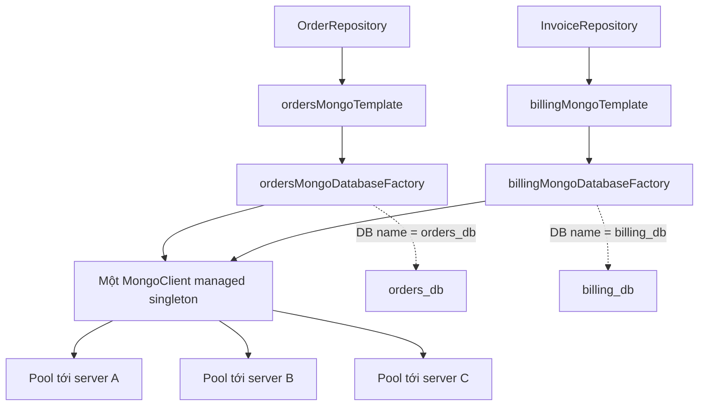
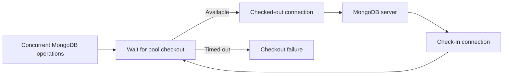

# Kiểm thử tính cô lập và giới hạn số pool kết nối

Trong Spring Data MongoDB, một ứng dụng có thể sử dụng nhiều database để tách dữ liệu đơn hàng, thanh toán, phân tích hoặc các miền nghiệp vụ khác. Việc cấu hình được hai `MongoTemplate` và hai nhóm repository chưa đủ để kết luận hệ thống an toàn. Cần **kiểm thử rằng một repository không đọc/ghi sang database khác**, kiểm tra quyền của tài khoản MongoDB, và tránh tạo quá nhiều `MongoClient` dẫn đến nhiều **connection pools** không cần thiết.

Một sai lầm phổ biến là cho rằng “mỗi database cần một MongoClient”, dẫn đến một client/pool cho mỗi tenant hoặc mỗi repository. MongoDB Java Driver thực tế quản lý **connection pool theo từng MongoClient và từng server trong topology**, không tự sinh pool mới cho mỗi collection, repository hay database. Khi hai database nằm trên **cùng deployment**, cùng credential/TLS/policy, chúng có thể dùng **một MongoClient được quản lý**, với hai `MongoDatabaseFactory` và hai `MongoTemplate` khác nhau. Khi tách cluster/credential để cô lập bảo mật, phải dùng clients riêng và **tính ngân sách kết nối theo tổng số clients × số server × số app instances**.

Bài thuộc chương **Nhiều database** của module `SPRING_DATA_MONGODB`. Module bao quát việc kết nối MongoDB, ánh xạ document, thao tác qua `MongoTemplate`/repository, thiết kế truy vấn, aggregation, index, transaction, reactive access, kiểm thử và chẩn đoán hiệu năng. Chủ đề trực tiếp của bài là **“Kiểm thử tính cô lập và giới hạn số pool kết nối”**: viết integration tests có kiểm tra âm tính, cấu hình pool hợp lý và quan sát tài nguyên thực tế.

> **Quy tắc trọng tâm:** Có nhiều `MongoTemplate` không đồng nghĩa có nhiều pools nếu chúng cùng dùng **một MongoClient**. Ngược lại, hai `MongoClient` tới cùng một cluster tạo **các pool độc lập**. `maxPoolSize` giới hạn **mỗi pool trên từng server của mỗi client**, không phải số socket tối đa của cả JVM hay cả cluster. Việc chia sẻ client giúp giảm tài nguyên nhưng không thay thế kiểm thử **database isolation, tenant authorization và credential scope**.

## 1. Mục tiêu học tập

Hoàn thành bài này, bạn có thể:

1. Phân biệt tính cô lập theo **database namespace, tenant, principal, client/pool và deployment**.
2. Đọc sơ đồ repository → template → factory → client → MongoDB database.
3. Biết khi nào hai databases nên dùng chung một `MongoClient`.
4. Biết khi nào cần hai clients vì khác cluster, TLS hoặc credentials.
5. Giải thích mỗi `MongoClient` quản lý pool theo **server**, không theo database.
6. Hiểu `maxPoolSize`, `minPoolSize`, `maxConnecting`, `maxConnectionIdleTime` và `maxWaitTime`.
7. Tránh nhầm `waitQueueTimeoutMS` cũ với cấu hình thời gian chờ ở driver mới.
8. Tính cận trên gần đúng số application connections khi scale pods.
9. Nhận biết monitoring sockets ngoài pool và sự thay đổi topology/role.
10. Dùng Spring-managed singleton client thay cho client-per-request.
11. Viết cấu hình hai `MongoDatabaseFactory` và hai `MongoTemplate` dùng chung client.
12. Bind hai nhóm repositories vào đúng template với `mongoTemplateRef`.
13. Cấu hình reactive client/template tương đương mà không trộn driver sync/reactive.
14. Viết test **positive và negative** để phát hiện ghi nhầm database.
15. Kiểm tra tenant isolation ngay trong cùng một database.
16. Kiểm thử least privilege bằng hai principals khi cần boundary bảo mật mạnh.
17. Dùng Testcontainers tạo môi trường MongoDB cô lập, không sửa production.
18. Đo pool usage qua `ConnectionPoolListener`/JMX/metrics.
19. Thiết kế load test nhằm đo checkout wait, timeout và pool saturation.
20. Phân biệt timeout do checkout, server selection và socket/network.
21. Kiểm tra shutdown không làm rò clients/pools.
22. Xử lý configuration drift, leak connection và startup theo phiên bản.
23. Hiểu vì sao reactive backpressure không tự giới hạn tổng số clients.
24. Không giả định chia sẻ pool đồng nghĩa chia sẻ một transaction.
25. Biết khi nào chọn tái sử dụng pool, khi nào ưu tiên phân tách bảo mật.

## 2. Cô lập trong nhiều database có nghĩa là gì?

“Tính cô lập” không chỉ có một tầng. Cần đặt câu hỏi **đang cô lập điều gì**:

| Tầng | Mục tiêu | Ví dụ test đúng |
| --- | --- | --- |
| Namespace database | Order không ghi vào billing | `orders_db.orders` có order; `billing_db.orders` không có |
| Repository → template | Repo không chọn nhầm template | `OrderRepository` dùng `ordersMongoTemplate` |
| Tenant trong cùng database | Tenant A không đọc của B | Query/principal A không trả document B |
| Credential/authorization | Orders principal không thao tác billing | Lệnh vào billing bị `Unauthorized` |
| Client/pool | Không mở client/pool thừa | Hai templates cùng client, số clients/pools có kiểm soát |
| Deployment/network | Tách failure domain/cluster | Billing cluster lỗi không làm kết nối orders bị chuyển |
| Transaction/session | Không nhầm boundary | Manager/factory/session tương ứng |

**Hai database khác nhau** không tạo bảo mật tuyệt đối nếu cả hai dùng cùng principal có quyền `readWrite` trên cả hai. Với shared client, cấu hình đúng giúp tránh lỗi logic nhưng một đoạn raw driver code vẫn có thể dùng `client.getDatabase("billing_db")` nếu credential cho phép.

### 2.1. Cô lập dữ liệu phải có kiểm tra âm tính

Chỉ xác minh `orderRepository.findById(id)` trả ra order là chưa đủ: nếu repository vô tình gắn vào billing template, nó có thể **ghi và đọc lại ở database sai** mà test vẫn xanh.

Một test đáng tin phải chứng minh đồng thời:

- Order **có** ở `orders_db.orders`.
- Order **không có** ở `billing_db.orders`.
- Invoice **có** ở `billing_db.invoices`.
- Invoice **không có** ở `orders_db.invoices`.
- Các queries theo tenant không trả dữ liệu tenant khác.

### 2.2. Cô lập pool không phải cô lập dữ liệu

Dùng một MongoClient chung **không trộn lẫn** namespace `orders_db` và `billing_db`; hai templates/factories vẫn chọn database riêng. Nhưng nó **chia sẻ connection pool, credentials, network và tài nguyên client**, vì vậy một workload nặng có thể ảnh hưởng latency checkout của workload còn lại.

## 3. Sơ đồ đúng: hai templates, một client, một bộ pools theo topology



Một `MongoClient` cho replica set có thể giữ **pool riêng cho từng server** nó làm việc, cùng các monitoring connections. Không phải toàn bộ server connection pools đều luôn mở đủ `maxPoolSize`; chúng tăng theo hoạt động, kết nối có thể bị thu hồi khi idle/lifetime hoặc topology thay đổi.

### 3.1. Số template không bằng số pool

| Số templates | Số MongoClient instances | Số servers liên quan | Pools có thể có |
| --- | --- | --- | --- |
| 2 templates / 2 databases | **1** shared client | 1 server | Khoảng **1 pool** |
| 10 templates / 10 databases | **1** shared client | 3 servers | Theo **3 servers**, không 10 DB |
| 2 templates / 2 databases | **2** clients riêng | 3 servers | Có thể **6 client-server pools** |
| 100 tenants, client mỗi tenant | **100** clients | 3 servers | Có thể **300 pools** |

Số lượng trên mô tả **cặp client-server tiềm năng**, không khẳng định mọi pool đã có socket/đã checkout, hay tất cả 3 replica set members đều nhận cùng lưu lượng. Pool topology phụ thuộc driver, read preference và server selection.

### 3.2. Shared client có giới hạn

Chỉ nên dùng chung client khi các databases cùng MongoDB deployment, cùng cấu hình authentication/TLS/read preferences ở cấp client và security policy cho phép shared credentials. Nếu orders và billing ở hai clusters hoặc cần hai principals tách quyền, dùng **hai clients**; tối ưu số pool không được đánh đổi ranh giới bảo mật.

## 4. Pool có phạm vi thế nào trong MongoDB Java Driver?

MongoDB Java Sync Driver/Reactive Streams Driver ghi rõ: **mỗi MongoClient có connection pool cho mỗi server trong topology**. Driver sử dụng pooled connections để xử lý operations và tái dùng chúng; client còn có connections phục vụ monitoring topology ngoài các checkout connections thông thường.

| Thành phần | Tạo một pool mới? | Ghi chú |
| --- | --- | --- |
| `new MongoClient` | **Có thể**, theo các servers nó kết nối | Mỗi client quản lý pools độc lập |
| `MongoClient.getDatabase("orders_db")` | **Không** | Lấy handle database, không tạo client |
| `MongoClient.getDatabase("billing_db")` | **Không** | Cùng client dùng pools hiện có |
| `new MongoTemplate(factory)` | **Không nếu factory dùng shared client** | Template chọn database/mapping |
| `new MongoRepository proxy` | **Không tự tạo** | Dùng template đã bind |
| Mở thêm Spring Boot pod | **Có client/pool riêng ở pod mới** | Pool không chia sẻ xuyên JVM |
| Mở reactive client ngoài sync client | **Có pools riêng** | Hai driver client types |

### 4.1. Mặc định quan trọng nhưng không phải đề xuất cố định

Theo hướng dẫn MongoDB Java Driver hiện hành:

- `maxPoolSize` mặc định **100** connections **cho mỗi pool/server/client**.
- `minPoolSize` mặc định **0**.
- `maxConnecting` mặc định **2** connections đang tạo đồng thời trên mỗi pool.
- `maxIdleTimeMS` mặc định **0** (không giới hạn idle time theo option đó).
- Java Sync Driver có các monitoring sockets ngoài pooled application connections.

Các mặc định và cơ chế client-level timeout có thể thay đổi theo driver major version. Đọc tài liệu driver đang pin, không dùng một giá trị trong bảng làm SLA hay giới hạn cluster tuyệt đối.

### 4.2. Phân biệt checkout và giữ connection

Một operation thường **checkout** connection khỏi pool, dùng rồi **checkin**; MongoClient không mở socket mới cho mỗi lệnh nếu pool có connection khả dụng. Khi tất cả connections cho server đang bận và pool đạt giới hạn, operation phải **đợi checkout** hoặc thất bại theo timeout chính sách.

### 4.3. Monitoring sockets ngoài maxPoolSize

Không khẳng định `maxPoolSize=50` nghĩa là JVM chỉ có tối đa 50 TCP sockets tới cluster. Driver có thể có **monitoring connections** cho mỗi server cùng sockets của clients khác, sessions, DNS/TLS/routers và application dependencies.

## 5. Ước lượng ngân sách kết nối khi scale

Cận trên đơn giản cho **application pooled connections** khi giả định mọi client mở pools đến cùng `S` server endpoints:

\[
C_{\mathrm{pooled,max}} \approx P \times K \times S \times M
\]

Trong đó:

- `P`: số application instances/pods.
- `K`: số MongoClient instances **trong mỗi instance**.
- `S`: số servers mà mỗi client có pool.
- `M`: `maxPoolSize` **mỗi client-server pool**.

Đây là **cận trên minh họa**, không phải dự báo sockets sẽ thực sự được mở. Phải cộng thêm monitoring connections, các processes khác, topology churn và dự phòng.

### 5.1. Ví dụ hai clients mỗi pod

Giả sử:

```text
6 pods × 2 MongoClients/pod × 3 endpoints × maxPoolSize 40
= 1440 pooled connections tối đa theo giả định các pools đầy
```

Nếu cùng deployment, cùng auth/policy và dùng **một shared MongoClient mỗi pod**:

```text
6 pods × 1 MongoClient/pod × 3 endpoints × maxPoolSize 40
= 720 pooled connections tối đa theo cùng giả định
```

Hai con số **không bao gồm monitoring sockets**, không phản ánh exact active connections và không phải một mức được khuyến nghị cho production. Trong replica set, read preference/primary routing có thể khiến các pools sử dụng không đồng đều.

### 5.2. Một sai lầm về phép nhân

“2 databases × maxPoolSize=40 = 80 connections” là sai nếu cả hai dùng **cùng MongoClient** tới cùng một server: vẫn là **một pool có trần 40** pooled connections trên server đó, được chia sẻ bởi workload hai databases.

### 5.3. Thêm app replicas có thể gây connection storm

Khi deployment scale từ 4 lên 40 pods, dù mỗi pod giữ client singleton, số clients/pools tổng thể tăng gấp 10. `minPoolSize` cao, `maxConnecting` cao và các healthchecks đồng loạt có thể khiến nhiều pods tạo connections cùng lúc. Cần tính cả chiến lược rollout, readiness và MongoDB connection limits.

## 6. Pool settings: ý nghĩa, ảnh hưởng và rủi ro

| Setting | Ý nghĩa | Nếu cấu hình sai |
| --- | --- | --- |
| `maxPoolSize` / `maxSize` | Connections tối đa trong mỗi server pool | Quá nhỏ → checkout queue; quá lớn → áp lực cluster |
| `minPoolSize` / `minSize` | Số connection tối thiểu pool cố duy trì | Quá cao × nhiều pods → nhiều idle sockets |
| `maxConnecting` | Connections có thể được thiết lập song song | Quá thấp → chậm warmup; quá cao → connection storm |
| `maxIdleTimeMS` | Giới hạn idle time cho pooled connections | Quá thấp → churn; quá cao → idle giữ lâu |
| `maxLifeTimeMS` | Giới hạn lifetime của connection | Cần phù hợp LB/firewall/network policies |
| `maxWaitTime` | Thời gian chờ có connection khả dụng | Hết hạn → checkout failure |
| `waitQueueTimeoutMS` | URI setting cũ, đã deprecated trong driver docs mới | Ưu tiên client-level timeout theo version |
| `serverSelectionTimeoutMS` | Thời gian tìm server phù hợp | Không phải checkout wait |
| `connectTimeoutMS` | Timeout thiết lập socket/network | Không phải pool-size cap |

**Quan trọng:** `waitQueueTimeoutMS` được MongoDB docs hiện hành ghi là **deprecated**; khi driver hỗ trợ **client-level timeout** nên cấu hình theo API và hướng dẫn phù hợp phiên bản. Nếu dùng Spring Boot/driver đời cũ, xác minh khác biệt trước khi thay property.

### 6.1. Không chọn giá trị bằng cảm tính

Ví dụ `maxPoolSize=20` là một thí nghiệm hợp lệ, không phải best practice cho mọi workload. Cần đo concurrency, số lệnh đang chờ, p95/p99 checkout latency, command latency, pool cleared events và MongoDB server resources; nâng pool size chỉ khi bottleneck thực sự ở checkout.

### 6.2. Không đặt minPoolSize bằng maxPoolSize một cách máy móc

`minPoolSize=100` trên 20 pods và 3 servers có thể khiến rất nhiều connections tồn tại ngay cả khi app ít traffic. Giữ `minPoolSize` thấp nếu không cần warm pools; benchmark cold-start/latency và chọn dựa trên SLO.

## 7. Ví dụ cấu hình một shared MongoClient với pool có giới hạn

Xét hai databases `orders_db` và `billing_db` trên **cùng MongoDB deployment**, dùng cùng credentials. Dùng một client singleton và hai database factories. Đây là cách tiết kiệm số client-server pools khi yêu cầu bảo mật cho phép.

```yaml
# application.yml (development example)
app:
  mongo:
    uri: ${APP_MONGO_URI:mongodb://localhost:27017}
    pool:
      max-size: 24
    orders-db: orders_db
    billing-db: billing_db
```

```java
package dev.learning.multidb.config;

import com.mongodb.ConnectionString;
import com.mongodb.MongoClientSettings;
import com.mongodb.client.MongoClient;
import com.mongodb.client.MongoClients;
import java.util.concurrent.TimeUnit;
import org.springframework.beans.factory.annotation.Qualifier;
import org.springframework.beans.factory.annotation.Value;
import org.springframework.context.annotation.Bean;
import org.springframework.context.annotation.Configuration;
import org.springframework.data.mongodb.MongoDatabaseFactory;
import org.springframework.data.mongodb.core.MongoTemplate;
import org.springframework.data.mongodb.core.SimpleMongoClientDatabaseFactory;

@Configuration(proxyBeanMethods = false)
public class SharedMongoConfiguration {

    @Bean(value = "sharedMongoClient", destroyMethod = "close")
    MongoClient sharedMongoClient(
            @Value("${app.mongo.uri}") String uri,
            @Value("${app.mongo.pool.max-size:24}") int maxSize) {

        if (maxSize < 1) {
            throw new IllegalArgumentException(
                "MongoDB maxPoolSize must be positive");
        }

        MongoClientSettings settings =
            MongoClientSettings.builder()
                .applyConnectionString(new ConnectionString(uri))
                .applyToConnectionPoolSettings(pool -> pool
                    .minSize(0)
                    .maxSize(maxSize)
                    .maxConnecting(2)
                    .maxWaitTime(5, TimeUnit.SECONDS))
                .build();

        return MongoClients.create(settings);
    }

    @Bean("ordersMongoDatabaseFactory")
    MongoDatabaseFactory ordersMongoDatabaseFactory(
            @Qualifier("sharedMongoClient") MongoClient client,
            @Value("${app.mongo.orders-db}") String database) {

        return new SimpleMongoClientDatabaseFactory(client, database);
    }

    @Bean("billingMongoDatabaseFactory")
    MongoDatabaseFactory billingMongoDatabaseFactory(
            @Qualifier("sharedMongoClient") MongoClient client,
            @Value("${app.mongo.billing-db}") String database) {

        return new SimpleMongoClientDatabaseFactory(client, database);
    }

    @Bean("ordersMongoTemplate")
    MongoTemplate ordersMongoTemplate(
            @Qualifier("ordersMongoDatabaseFactory")
            MongoDatabaseFactory factory) {
        return new MongoTemplate(factory);
    }

    @Bean("billingMongoTemplate")
    MongoTemplate billingMongoTemplate(
            @Qualifier("billingMongoDatabaseFactory")
            MongoDatabaseFactory factory) {
        return new MongoTemplate(factory);
    }
}
```

**Giải thích:** `max-size:24` là giá trị **minh họa cần benchmark**, không phải ngưỡng khuyến nghị chung. `maxWaitTime(5, SECONDS)` tồn tại trong Java Driver pool settings API; với driver versions có timeout model mới, đối chiếu MongoDB Driver docs. Cấu hình pool ở **MongoClientSettings**, không tạo một pool riêng cho từng template.

### 7.1. Vì sao factory không đóng shared client?

Javadoc `SimpleMongoClientDatabaseFactory(MongoClient, String)` nêu factory nhận một client đã được quản lý **không đóng client đó khi factory bị destroy**. Spring bean `sharedMongoClient` sở hữu lifecycle và đóng client một lần khi application context shutdown.

### 7.2. Nếu properties có hai database nhưng URI chỉ định một database?

`ordersMongoDatabaseFactory` và `billingMongoDatabaseFactory` nhận database names tường minh. Path database trong URI có thể dùng cho default/authentication behavior tùy cấu hình; cần kiểm tra **authSource**, permissions và effective database từ factory. Không suy URI một mình quyết định database mà repository sẽ truy cập.

### 7.3. Kiểm tra giới hạn mỗi pool

Cùng client có một `maxSize` setting áp cho các pools của nó. Hai templates không thể tự “đặt pool orders 10 và pool billing 20” khi dùng chung MongoClient vì chúng chia sẻ connection pools tới cùng server. Nếu workloads cần isolation capacity cứng, cân nhắc tách clients/pools hoặc rate limiting ở application layer.

## 8. Liên kết hai repository groups để test được

Ví dụ domain classes:

```java
package dev.learning.multidb.orders;

import org.springframework.data.annotation.Id;
import org.springframework.data.mongodb.core.mapping.Document;

@Document("orders")
public record OrderDoc(
    @Id String id,
    String tenantId,
    long totalCents
) {}
```

```java
package dev.learning.multidb.billing;

import org.springframework.data.annotation.Id;
import org.springframework.data.mongodb.core.mapping.Document;

@Document("invoices")
public record InvoiceDoc(
    @Id String id,
    String tenantId,
    String orderId
) {}
```

Hai repository interfaces riêng package:

```java
package dev.learning.multidb.orders;

import org.springframework.data.mongodb.repository.MongoRepository;
import java.util.List;

public interface OrderRepository
        extends MongoRepository<OrderDoc, String> {

    List<OrderDoc> findByTenantId(String tenantId);
}
```

```java
package dev.learning.multidb.billing;

import org.springframework.data.mongodb.repository.MongoRepository;
import java.util.List;

public interface InvoiceRepository
        extends MongoRepository<InvoiceDoc, String> {

    List<InvoiceDoc> findByTenantId(String tenantId);
}
```

Hai cấu hình scan và bind vào **named template**:

```java
package dev.learning.multidb.config;

import dev.learning.multidb.orders.OrderRepository;
import org.springframework.context.annotation.Configuration;
import org.springframework.data.mongodb.repository.config.EnableMongoRepositories;

@Configuration(proxyBeanMethods = false)
@EnableMongoRepositories(
    basePackageClasses = OrderRepository.class,
    mongoTemplateRef = "ordersMongoTemplate"
)
public class OrdersRepositoriesConfiguration {}
```

```java
package dev.learning.multidb.config;

import dev.learning.multidb.billing.InvoiceRepository;
import org.springframework.context.annotation.Configuration;
import org.springframework.data.mongodb.repository.config.EnableMongoRepositories;

@Configuration(proxyBeanMethods = false)
@EnableMongoRepositories(
    basePackageClasses = InvoiceRepository.class,
    mongoTemplateRef = "billingMongoTemplate"
)
public class BillingRepositoriesConfiguration {}
```

### 8.1. Tại sao cần cả hai thuộc tính?

- `basePackageClasses`: repository nào thuộc nhóm.
- `mongoTemplateRef`: nhóm đó dùng bean template nào.
- Template dùng factory có database name cụ thể.
- Factory dùng `sharedMongoClient`.

Nếu thiếu `mongoTemplateRef`, Spring Data có default bean name `mongoTemplate`; đừng để một default client/template trong Boot tự trở thành database đích của repository group.

### 8.2. Tránh scan chồng

Nếu orders config quét parent package `dev.learning.multidb`, `InvoiceRepository` có thể bị đăng ký sai. Hãy dùng disjoint repository packages hoặc marker classes riêng, và kiểm tra Spring Boot auto-repository scanning/backoff.

### 8.3. @Document không là một security/routing rule

`@Document("invoices")` chỉ chọn collection, không chọn `billing_db`. Nếu `InvoiceRepository` dùng orders template, insert có thể tạo `orders_db.invoices` mà không báo lỗi. Đó chính là loại regression mà integration test phải phát hiện.

## 9. Trường hợp bắt buộc hai clients và hai pools độc lập

Nếu orders và billing dùng **hai clusters khác nhau**, hoặc cùng cluster nhưng **credentials/role/TLS options khác nhau** để đạt isolation bảo mật, cấu hình hai MongoClients.

```yaml
app:
  mongo:
    orders-uri: ${ORDERS_MONGO_URI}
    billing-uri: ${BILLING_MONGO_URI}
```

```java
@Bean(value = "ordersMongoClient", destroyMethod = "close")
MongoClient ordersMongoClient(
        @Value("${app.mongo.orders-uri}") String uri) {
    return MongoClients.create(uri);
}

@Bean(value = "billingMongoClient", destroyMethod = "close")
MongoClient billingMongoClient(
        @Value("${app.mongo.billing-uri}") String uri) {
    return MongoClients.create(uri);
}
```

Trong configuration này, mỗi database factory inject **client tương ứng**. Không dùng `sharedMongoClient` của mục 7 cùng lúc nếu kiến trúc yêu cầu hai principals độc lập.

### 9.1. Bảo mật quan trọng hơn số pool thấp

Một client chung đòi cùng credential có thể truy cập cả hai DB. Nếu yêu cầu là “orders principal không thể đọc billing ngay cả khi lập trình viên dùng nhầm template”, phải dùng **credentials/roles tách biệt**. Không gộp hai clients chỉ vì tiết kiệm connection pool.

### 9.2. Hai clients có thể trỏ cùng cluster

Dù cùng MongoDB deployment, hai credentials khác nhau phải được cấu hình trong hai clients; chúng có pools riêng. Cần tính ngân sách tài nguyên và test **lệnh bị từ chối khi credentials không có quyền** thay vì chỉ tin tưởng vào tên bean.

### 9.3. Client lifetime và shutdown

Không tạo/đóng clients trong từng service method. Hai clients là Spring-managed singleton beans. `close()` khi application context shutdown giải phóng pools/monitor threads; không `try-with-resources` quanh client đang được nhiều templates dùng chung.

## 10. Anti-pattern: một MongoClient cho mỗi request hoặc tenant

Sai:

```java
public OrderDoc readOrder(String uri, String id) {
    MongoClient newClient = MongoClients.create(uri);
    MongoTemplate newTemplate = new MongoTemplate(
        new SimpleMongoClientDatabaseFactory(
            newClient, "orders_db"));
    return newTemplate.findById(id, OrderDoc.class);
}
```

Lỗi của cách làm này:

- Mỗi request có thể tạo client/pool/monitoring connections riêng.
- Không đóng client khiến leak; đóng ngay lại gây handshake/TLS churn.
- Cho URI do client điều khiển có nguy cơ SSRF/unauthorized DB access.
- Pool metrics bị phân mảnh, khó áp quota.
- Không tái sử dụng topology discovery hay credentials quản lý trung tâm.

Đúng hơn: inject `OrderRepository` hoặc `@Qualifier("ordersMongoTemplate") MongoOperations` từ application context và tái sử dụng.

### 10.1. Per-tenant database cần kiến trúc riêng

Nếu có 500 tenant databases trên **một deployment với cùng credential/policy**, tạo 500 MongoClients chỉ để chọn 500 database names thường lãng phí. Nhưng dùng một client chung cũng không tự bảo vệ dữ liệu từng tenant; phải thiết kế tenant-to-database resolver được ủy quyền, giới hạn database names, mapping storage, quota và consistency. Không biến input `tenantId` thành raw `getDatabase` tùy ý.

### 10.2. Đừng gọi MongoClients.create trong một @Bean MongoTemplate khác

`@Bean MongoTemplate orders() { return new MongoTemplate(MongoClients.create(uri), "orders_db"); }` và billing tương tự sẽ tạo **hai clients** dù bạn chỉ nhìn thấy hai template beans. Đọc bean graph chứ không đếm templates rồi suy pool count.

## 11. Tách các phép thử: correctness, authorization và capacity

| Loại kiểm thử | Câu hỏi | Công cụ |
| --- | --- | --- |
| Database routing | Repository ghi đúng DB? | Testcontainers, MongoTemplate trực tiếp |
| Negative isolation | Có lẫn dữ liệu DB khác? | Kiểm tra vắng mặt tại DB sai |
| Tenant isolation | A có thấy records của B? | Service/security integration test |
| Credential isolation | Orders principal đọc billing được không? | Test roles/credentials |
| Pool topology | Có một client hay nhiều clients? | Spring context/Pool listener |
| Pool capacity | Checkout queue/timeout khi tải cao? | Bounded load test + metrics |
| Resource lifecycle | Có leak qua restart/dispose? | Listener, JMX, thread/socket monitoring |
| Failure isolation | Billing outage ảnh hưởng orders thế nào? | Chaos/staging, latency/error measurements |

**Không cố gộp mọi mục vào một integration test**. Test đọc/ghi đúng DB thường chạy nhanh và quyết định; test quyền cần MongoDB roles setup; load test đo pool saturation cần workload/metrics riêng.

### 11.1. Unit test của service không chứng minh database đích

Mock `OrderRepository` chỉ chứng minh service gọi đúng method. Để phát hiện sai `mongoTemplateRef` hoặc factory database name, phải chạy Spring context + MongoDB thật.

### 11.2. Đếm bean không giống đếm socket

`ApplicationContext.getBeansOfType(MongoClient.class).size()==1` có thể xác minh số **MongoClient beans được Spring quản lý**, nhưng không biết client tạo bao nhiêu sockets, server hosts hay có raw clients ngoài context. Kết hợp với pool events và metrics để xác minh resource usage.

## 12. Test environment: Testcontainers và cấu hình Spring Boot

Dùng một MongoDB test deployment độc lập cho integration tests. Testcontainers Java 1.x có `MongoDBContainer` hỗ trợ tạo replica set trong container, rất tiện khi test cả MongoDB transactions; bản thân việc kiểm thử database isolation **không đòi replica set**, nhưng dùng container đó giúp fixture nhất quán.

Một ứng dụng mẫu chỉ cần component scan các configs và repositories:

```java
package dev.learning.multidb;

import org.springframework.boot.SpringApplication;
import org.springframework.boot.autoconfigure.SpringBootApplication;

@SpringBootApplication
public class MultiDatabaseApplication {

    public static void main(String[] args) {
        SpringApplication.run(MultiDatabaseApplication.class, args);
    }
}
```

Các configuration classes ở `dev.learning.multidb.config` và entity/repository classes ở hai packages con. Với hai `@EnableMongoRepositories` đã chỉ rõ group, tránh một annotation thứ ba quét root package. Nếu Spring Boot auto repository scan của phiên bản cụ thể gây trùng, kiểm tra back-off và điều chỉnh cấu hình explicit; không bật bean overriding để che lỗi.

### 12.1. Dependency ví dụ

```groovy
dependencies {
    implementation "org.springframework.boot:spring-boot-starter-data-mongodb"
    testImplementation "org.springframework.boot:spring-boot-starter-test"
    testImplementation "org.testcontainers:junit-jupiter"
    testImplementation "org.testcontainers:mongodb"
}
```

Ví dụ tương ứng **Testcontainers Java 1.x**. Ở Testcontainers 2.x, modules/imports có thể thay đổi; pin BOM/version phù hợp. Nếu CI không có Docker, dùng MongoDB test service độc lập có hai databases và roles tách biệt.

### 12.2. Mọi DB trong bài test phải tách production

Ví dụ `orders_it` và `billing_it` chỉ là test databases. Không chạy `dropDatabase`, `dropCollection` hoặc tạo principals test trên production. Dùng unique IDs thay vì reset cả shared database để tránh ảnh hưởng các tests chạy song song.

## 13. Integration test: đúng nơi và không ở nơi sai

Một test đầy đủ (Spring Boot 3.x và Testcontainers Java 1.x) phải kiểm chứng **positive + negative assertions**:

```java
package dev.learning.multidb;

import static org.assertj.core.api.Assertions.assertThat;

import java.util.Map;
import java.util.UUID;

import com.mongodb.client.MongoClient;
import dev.learning.multidb.orders.OrderDoc;
import dev.learning.multidb.orders.OrderRepository;
import dev.learning.multidb.billing.InvoiceDoc;
import dev.learning.multidb.billing.InvoiceRepository;

import org.junit.jupiter.api.Test;
import org.springframework.beans.factory.annotation.Autowired;
import org.springframework.beans.factory.annotation.Qualifier;
import org.springframework.boot.test.context.SpringBootTest;
import org.springframework.context.ApplicationContext;
import org.springframework.data.mongodb.MongoDatabaseFactory;
import org.springframework.data.mongodb.core.MongoTemplate;
import org.springframework.test.context.DynamicPropertyRegistry;
import org.springframework.test.context.DynamicPropertySource;
import org.testcontainers.containers.MongoDBContainer;
import org.testcontainers.junit.jupiter.Container;
import org.testcontainers.junit.jupiter.Testcontainers;
import org.testcontainers.utility.DockerImageName;

@Testcontainers
@SpringBootTest
class MongoDatabaseIsolationTest {

    @Container
    static final MongoDBContainer mongo =
        new MongoDBContainer(DockerImageName.parse("mongo:7.0"));

    @DynamicPropertySource
    static void testProperties(DynamicPropertyRegistry registry) {
        registry.add("app.mongo.uri", mongo::getReplicaSetUrl);
        registry.add("app.mongo.orders-db", () -> "orders_it");
        registry.add("app.mongo.billing-db", () -> "billing_it");
        registry.add("app.mongo.pool.max-size", () -> "8");
    }

    @Autowired OrderRepository orderRepository;
    @Autowired InvoiceRepository invoiceRepository;
    @Autowired ApplicationContext context;

    @Autowired
    @Qualifier("ordersMongoTemplate")
    MongoTemplate ordersTemplate;

    @Autowired
    @Qualifier("billingMongoTemplate")
    MongoTemplate billingTemplate;

    @Autowired
    @Qualifier("ordersMongoDatabaseFactory")
    MongoDatabaseFactory ordersFactory;

    @Autowired
    @Qualifier("billingMongoDatabaseFactory")
    MongoDatabaseFactory billingFactory;

    @Test
    void writesStayInTheirDatabases() {
        String suffix = UUID.randomUUID().toString();

        OrderDoc order = new OrderDoc(
            "order-" + suffix, "tenant-A", 12345L);

        InvoiceDoc invoice = new InvoiceDoc(
            "invoice-" + suffix, "tenant-A", order.id());

        orderRepository.insert(order);
        invoiceRepository.insert(invoice);

        assertThat(ordersFactory.getMongoDatabase().getName())
            .isEqualTo("orders_it");
        assertThat(billingFactory.getMongoDatabase().getName())
            .isEqualTo("billing_it");

        // Có dữ liệu tại database đúng.
        assertThat(
            ordersTemplate.findById(order.id(), OrderDoc.class))
            .isNotNull();
        assertThat(
            billingTemplate.findById(invoice.id(), InvoiceDoc.class))
            .isNotNull();

        // Tuyệt đối không có record tại database sai.
        assertThat(
            billingTemplate.findById(order.id(), OrderDoc.class))
            .isNull();
        assertThat(
            ordersTemplate.findById(invoice.id(), InvoiceDoc.class))
            .isNull();
    }

    @Test
    void springManagesOnlyOneSyncMongoClient() {
        Map<String, MongoClient> clients =
            context.getBeansOfType(MongoClient.class);

        assertThat(clients)
            .containsKey("sharedMongoClient")
            .hasSize(1);
    }
}
```

Test trên dùng đúng `app.mongo.*` properties của cấu hình ở mục 7. Nó kiểm tra **một managed sync MongoClient bean**, không tự chứng minh chỉ có một TCP connection hoặc không có client raw nào được tự tạo ngoài container.

### 13.1. Tại sao phải kiểm tra absence ở database sai?

Nếu `OrderRepository` trỏ nhầm `billingMongoTemplate`, cả `orderRepository.insert` và `orderRepository.findById` có thể pass vì hai thao tác đều trên database sai. Chỉ so repository readback sẽ bỏ qua regression. Đọc trực tiếp bằng **hai qualified templates** bắt được lỗi.

### 13.2. Vì sao dùng UUID thay vì xóa sạch collection?

Unique IDs tránh collision và hạn chế ảnh hưởng test khác. Không dùng `deleteAll` hoặc `dropDatabase` trên một MongoDB instance chia sẻ chỉ để làm test ngắn gọn.

### 13.3. Test DB names khác với production names

Integration test đặt `orders_it` và `billing_it` để xác nhận factories lấy đúng **property injection**, không hardcode `orders_db` trong Java. Nếu config vô tình hardcode, assertion factory database name sẽ fail.

### 13.4. Test một client bean khác test pool

Count Spring beans không đo được:
- number of **pools per server**,
- active sockets hay monitoring connections,
- clients được tạo ngoài Spring context,
- số clients của **những pod khác**.

Vì thế cần thêm listener/metrics ở các mục sau.

## 14. Kiểm thử cô lập tenant trong cùng database

Tách orders và billing databases không có nghĩa **tenant A không thấy tenant B** nếu cả hai cùng nằm trong `orders_it`. Repository cần query theo tenant do **server-side authenticated principal** cung cấp.

Bổ sung vào `OrderRepository`:

```java
import java.util.Optional;

// Method bổ sung trong OrderRepository.
Optional<OrderDoc> findByIdAndTenantId(
    String id, String tenantId);
```

Một service chỉ chấp nhận `trustedTenantId` từ authentication boundary:

```java
package dev.learning.multidb.orders;

import java.util.Optional;
import org.springframework.stereotype.Service;

@Service
public class OrderReadService {
    private final OrderRepository repository;

    public OrderReadService(OrderRepository repository) {
        this.repository = repository;
    }

    public Optional<OrderDoc> findOwned(
            String id, String trustedTenantId) {
        if (trustedTenantId == null
                || trustedTenantId.isBlank()) {
            return Optional.empty();
        }
        return repository.findByIdAndTenantId(
            id, trustedTenantId);
    }
}
```

Test service với order tenant A và user tenant B:

```java
@Test
void tenantBDoesNotSeeTenantAOrder() {
    String id = "tenant-isolation-" + UUID.randomUUID();

    orderRepository.insert(
        new OrderDoc(id, "tenant-A", 500L));

    OrderReadService service =
        new OrderReadService(orderRepository);

    assertThat(service.findOwned(id, "tenant-A")).isPresent();
    assertThat(service.findOwned(id, "tenant-B")).isEmpty();
}
```

Ví dụ dùng method service nhận `trustedTenantId` vì bài tập trung data boundary. Production phải lấy giá trị từ authenticated principal, không cho người dùng HTTP tự khai một tenant ID khác. Ngoài `findOwned`, mọi update/delete/aggregation cũng phải áp filter tenant phù hợp.

### 14.1. Negative test cho từng method, không chỉ findById

Nếu service có `findAll`, `search`, `aggregate` hoặc bulk delete, mỗi đường truy cập có thể quên tenant predicate. Test một method đúng không bảo đảm các methods khác đã được cô lập.

### 14.2. Tenant không phải MongoDB database

Có thể có `tenant-A` và `tenant-B` cùng `orders_db`; `@EnableMongoRepositories` chỉ gắn repository vào database, không tự enforce row/document-level tenant policy.

## 15. Kiểm thử least-privilege với hai MongoDB principals

Nếu yêu cầu “orders service không thể truy cập billing” là **security invariant**, nên tạo **hai users/roles có scope riêng** trong môi trường test đã bật MongoDB authentication. Ví dụ command mang tính minh họa cho administrator trên database test:

```javascript
// Thực thi bởi test admin trên một MongoDB test deployment.
use orders_it
db.createUser({
  user: "orders_app_test",
  pwd: "<secret-from-test-env>",
  roles: [
    { role: "readWrite", db: "orders_it" }
  ]
});

use billing_it
db.createUser({
  user: "billing_app_test",
  pwd: "<secret-from-test-env>",
  roles: [
    { role: "readWrite", db: "billing_it" }
  ]
});
```

Để kiểm tra permissions thực tế, các test clients phải **đăng nhập bằng đúng users** với `authSource` tương ứng, không bằng root/test admin:

- Orders principal đọc/ghi `orders_it` được phép.
- Orders principal đọc/ghi `billing_it` bị `Unauthorized`.
- Billing principal được phép với `billing_it`.
- Billing principal bị từ chối trên `orders_it`.

### 15.1. TestContainers mặc định không chứng minh authorization isolation

Một Testcontainers MongoDB không bật auth/role enforcement có thể cho cả hai templates đọc mọi database. Test `MongoDatabaseIsolationTest` ở mục 13 xác minh **routing**, không chứng minh MongoDB user permissions. Cần một **test profile riêng** bật auth để xác nhận least privilege.

### 15.2. Fail vì Unauthorized khác không tìm thấy

Nếu orders client đọc billing DB nhưng tài khoản không có quyền, mong đợi **command bị từ chối**, không phải `find(...) == null`. Test có MongoDB auth cần phân biệt server `Unauthorized`/permission failure với document thật sự không tồn tại.

### 15.3. Đừng hardcode passwords trong bài test

Lấy test secrets từ fixtures/environment và đảm bảo logging redaction. Không dùng account production để chạy negative tests; phải tránh hành động có thể làm thay đổi dữ liệu thật.

## 16. Đo pools qua ConnectionPoolListener

MongoDB Java Driver cung cấp `com.mongodb.event.ConnectionPoolListener` để nhận các events như:

- `connectionPoolCreated`, `connectionPoolClosed`.
- `connectionCreated`, `connectionClosed`.
- `connectionCheckedOut`, `connectionCheckedIn`.
- `connectionCheckOutStarted`, `connectionCheckOutFailed`.
- `connectionPoolCleared`, khi pool được clear trong những kịch bản network/topology.

Ví dụ một listener **dùng counters, không log raw credentials/BSON**:

```java
package dev.learning.multidb.metrics;

import java.util.concurrent.atomic.LongAdder;
import com.mongodb.event.ConnectionPoolListener;
import com.mongodb.event.ConnectionCheckedOutEvent;
import com.mongodb.event.ConnectionCheckOutFailedEvent;
import com.mongodb.event.ConnectionPoolCreatedEvent;

public final class MongoPoolCounters
        implements ConnectionPoolListener {

    private final LongAdder poolsCreated = new LongAdder();
    private final LongAdder checkouts = new LongAdder();
    private final LongAdder checkoutFailures = new LongAdder();

    @Override
    public void connectionPoolCreated(
            ConnectionPoolCreatedEvent event) {
        poolsCreated.increment();
    }

    @Override
    public void connectionCheckedOut(
            ConnectionCheckedOutEvent event) {
        checkouts.increment();
    }

    @Override
    public void connectionCheckOutFailed(
            ConnectionCheckOutFailedEvent event) {
        checkoutFailures.increment();
    }

    public long poolsCreated() {
        return poolsCreated.sum();
    }

    public long checkouts() {
        return checkouts.sum();
    }

    public long checkoutFailures() {
        return checkoutFailures.sum();
    }
}
```

Đăng ký listener **trước khi MongoClient được tạo**:

```java
@Bean
MongoPoolCounters mongoPoolCounters() {
    return new MongoPoolCounters();
}

// Sửa method @Bean sharedMongoClient ở mục 7 để inject counters.
MongoClientSettings settings = MongoClientSettings.builder()
    .applyConnectionString(new ConnectionString(uri))
    .applyToConnectionPoolSettings(pool -> pool
        .minSize(0)
        .maxSize(maxSize)
        .maxConnecting(2)
        .addConnectionPoolListener(counters))
    .build();
```

Đoạn cuối là **phần thay thế trong method bean**, với `uri`, `maxSize` và `counters` đã được inject; không phải một configuration class hoàn chỉnh thứ hai. Không gọi `MongoClients.create` lần thứ hai chỉ để gắn listener.

### 16.1. Đếm poolCreated không phải đếm connection hiện tại

`poolsCreated()` là **số events từ lúc listener hoạt động**, không phải số active pools hay sockets hiện tại. Nếu topology đổi, pool được clear/recreate hoặc client restart, counters tăng nhưng không có nghĩa đang tồn tại từng ấy pools.

### 16.2. Dùng JMX/Micrometer khi cần gauge

MongoDB Java drivers có khả năng pool monitoring qua JMX/`ConnectionPoolListener`. Một gauge phù hợp cần theo dõi per-server **current size, checked-out count, waiters** nếu driver/metrics setup cung cấp. Không dùng `checkouts` tổng từ khi boot làm “số connection đang dùng”.

### 16.3. Chú ý labels/cardinality

Để tránh metrics cardinality explosion, labels nên gồm `application`/`clientRole`/`serverAddress` và environment; **không** thêm raw tenant ID hoặc full connection URI/password làm metric label.

## 17. Test xem pool có bị nhân lên theo số database không

Một phép thử cô lập tài nguyên nên phân biệt ba lớp:

1. **Static configuration:** chỉ tạo một `sharedMongoClient` bean cho hai factories.
2. **Runtime events:** một listener được gắn vào client đó trước khi kết nối.
3. **Server connections:** metrics/JMX hoặc server-side monitoring cho biết sockets thực tế.

Trong test một MongoDBContainer single-node, khi cùng client truy cập `orders_it` rồi `billing_it`, client vẫn sử dụng pool tới **cùng server**. Không nên dựa vào **số database = số pool**.

### 17.1. Test cấu hình không tạo client thứ hai

Thêm test vào `MongoDatabaseIsolationTest`:

```java
@Test
void twoFactoriesStillUseOneManagedClient() {
    Map<String, MongoClient> clients =
        context.getBeansOfType(MongoClient.class);

    assertThat(clients.keySet())
        .containsExactly("sharedMongoClient");

    assertThat(ordersFactory.getMongoDatabase().getName())
        .isEqualTo("orders_it");

    assertThat(billingFactory.getMongoDatabase().getName())
        .isEqualTo("billing_it");
}
```

**Giới hạn kiểm chứng:** Test chỉ đảm bảo một **managed client bean** và factories chọn hai DB names; nó không phát hiện client tự tạo trong custom Java code ngoài Spring, hoặc đo số TCP sockets. Cần code review/static search và metrics thực tế.

### 17.2. Pool events không tăng theo số repositories

Trong môi trường test **ổn định, một server address**, có thể ghi `connectionPoolCreated` trước và sau lần đầu truy cập từng DB. Không nên giả định sau mỗi `MongoTemplate.insert` xuất hiện một event tạo pool: pool đã có thì client tái sử dụng.

Nhưng tránh assert một số cứng nếu test chạy trên replica set nhiều nodes hoặc có topology changes; server endpoints, monitoring state và failover có thể làm event counts khác nhau.

### 17.3. Phép thử giả mạo lỗi cấu hình

Để bảo vệ architecture contract, bạn có thể tạo một **configuration test riêng** cố tình dùng hai clients thay cho một rồi quan sát:

- Spring managed MongoClient bean count tăng.
- `ConnectionPoolListener` mỗi client ghi nhận lifecycle riêng.
- Server-side connection count có thể tăng khi các pools warm up.

Không triển khai cấu hình sai này vào ứng dụng thật chỉ để chạy benchmark production. Hãy dùng profile test hoặc test harness độc lập.

## 18. Load test giới hạn pool: đo thời gian chờ, không chỉ throughput

Pool saturation là trạng thái nhiều operations muốn dùng server cùng lúc hơn số connections khả dụng. Khi tất cả pooled connections đang được checkout và `maxPoolSize` đã đạt giới hạn, requests phải chờ, sau đó có thể fail theo timeout policy.



### 18.1. Đặt test objective rõ ràng

Một load test có thể dùng một client với `maxPoolSize=2` và chạy nhiều concurrent reads/writes, nhưng phải đo:

- `connectionCheckOutStarted`, `connectionCheckedOut`, `connectionCheckOutFailed`.
- p50/p95/p99 **checkout wait time**.
- p50/p95/p99 database command latency.
- Concurrent in-flight operations / thread or reactive demand.
- Server CPU, I/O, locks, available connections.
- Timeouts và retry attempts.
- Số clients và app replicas trong thử nghiệm.
- Độ ổn định khi workload đổi từ orders sang billing.

**Không khẳng định** chỉ cần 20 quick `findById` là chắc chắn phải checkout timeout: nếu queries rất nhanh, hai connections có thể phục vụ hết. Muốn tái hiện saturation cần workload có thời gian giữ connection đủ dài và phép đo khách quan.

### 18.2. Không chạy thao tác làm chậm server trên production

Nếu cần test pool chờ hết connections, dùng **load-test database/cluster** riêng, bounded concurrency, timeouts và cleanup. Không khóa collections, chạy lệnh chậm vô hạn hoặc tạo hàng nghìn sockets trên production chỉ để chứng minh `maxPoolSize` hoạt động.

### 18.3. Công thức đo thực dụng

Khi concurrency ổn định:

\[
\text{inFlightOperations} \approx
\text{throughputPerSecond} \times
\text{averageOperationLatencySeconds}
\]

Đây là áp dụng sơ bộ của Little's Law; nó giúp **ước lượng** mức đồng thời cần phục vụ, không phải công thức chính xác để đặt `maxPoolSize`. Một request có thể dùng nhiều database operations, một operation có thể có retries, và topology selection có thể dồn lên một primary.

### 18.4. Orders workload có thể tranh pool với billing

Vì `ordersMongoTemplate` và `billingMongoTemplate` dùng chung client, một batch job orders tạo nhiều write operations có thể làm checkout latency của billing tăng **nếu cùng kết nối server pool**. Nếu business cần isolation latency nghiêm ngặt, dùng rate limits/bulkhead per workflow, hoặc tách clients khi hợp lý.

## 19. Thực hành sizing và giới hạn tổng kết nối

Mục tiêu không phải “càng ít pool càng tốt” mà là **đủ throughput, giữ server connection budget và đáp ứng isolation requirements**.

### 19.1. Bảng kịch bản minh họa

| Kịch bản | Pods | Clients/pod | Server endpoints/client | MaxSize | Cận trên pooled connections* |
| --- | ---: | ---: | ---: | ---: | ---: |
| Shared client | 4 | 1 | 3 | 20 | 240 |
| Hai credentials | 4 | 2 | 3 | 20 | 480 |
| 12 DB, một client | 4 | 1 | 3 | 20 | 240 |
| Một client mỗi DB (12 DB) | 4 | 12 | 3 | 20 | 2.880 |
| Shared sau scale-out | 16 | 1 | 3 | 20 | 960 |

*Giả định mọi client có pool tới mỗi endpoint, và tất cả pools đều đầy. Không tính monitoring sockets, admin tools, backup agents hoặc các processes khác.

### 19.2. Một pool 20 không phải 20 requests tối đa

Mỗi connection có thể được dùng lại qua nhiều operations theo thời gian; throughput phụ thuộc latency và server resources. Một HTTP request còn có thể gọi 2–5 database commands; không suy 20 concurrent HTTP clients là mức tối đa chính xác.

### 19.3. Đừng tăng maxPoolSize khi query chậm do thiếu index

Nếu p99 command latency tăng vì collection scan/index thiếu, tăng pool size có thể **làm MongoDB quá tải hơn**, không chữa gốc vấn đề. Đọc `explain("executionStats")`, index metrics và server resource usage trước khi chỉ tăng connection limit.

### 19.4. Có ngân sách cluster-level riêng

MongoDB server/Atlas tier có giới hạn connections và các clients khác (admin, backups, CDC, monitoring). Dành budget cho các process đó và failover/spikes. Cận trên `P × K × S × M` là một công cụ **capacity planning**, không tự là ràng buộc thực trên toàn hệ thống.

## 20. ReactiveMongoTemplate cũng có pool theo client/server

Một ứng dụng dùng Spring Data MongoDB reactive cần **Reactive Streams Driver MongoClient**:

```java
import com.mongodb.ConnectionString;
import com.mongodb.MongoClientSettings;
import com.mongodb.reactivestreams.client.MongoClient;
import com.mongodb.reactivestreams.client.MongoClients;
import org.springframework.data.mongodb.ReactiveMongoDatabaseFactory;
import org.springframework.data.mongodb.core.ReactiveMongoTemplate;
import org.springframework.data.mongodb.core.SimpleReactiveMongoDatabaseFactory;

MongoClient reactiveClient = MongoClients.create(
    MongoClientSettings.builder()
        .applyConnectionString(
            new ConnectionString("mongodb://localhost:27017"))
        .applyToConnectionPoolSettings(pool -> pool
            .minSize(0)
            .maxSize(24)
            .maxConnecting(2))
        .build());

ReactiveMongoDatabaseFactory ordersFactory =
    new SimpleReactiveMongoDatabaseFactory(
        reactiveClient, "orders_db");

ReactiveMongoDatabaseFactory billingFactory =
    new SimpleReactiveMongoDatabaseFactory(
        reactiveClient, "billing_db");

ReactiveMongoTemplate ordersOps =
    new ReactiveMongoTemplate(ordersFactory);

ReactiveMongoTemplate billingOps =
    new ReactiveMongoTemplate(billingFactory);
```

Đây là **đoạn minh họa cấu trúc**; trong ứng dụng thật đăng ký client/factories/templates thành named singleton beans và đóng reactive client khi shutdown. Không tạo client trong mỗi `Flux.defer`/request.

### 20.1. Reactive repositories bind bằng thuộc tính khác

```java
@EnableReactiveMongoRepositories(
    basePackageClasses = ReactiveOrderRepository.class,
    reactiveMongoTemplateRef = "ordersReactiveMongoTemplate")
```

`reactiveMongoTemplateRef` phải trùng bean name, và repository classes phải nằm trong packages không chồng lấn. Một `ReactiveMongoRepository` được bind vào đúng template mới phát lệnh tới database cần thiết khi được subscribe.

### 20.2. Reactive driver không dùng chung pool với sync driver

Nếu app đồng thời có `com.mongodb.client.MongoClient` và `com.mongodb.reactivestreams.client.MongoClient`, đây là **hai client types độc lập** với connection pools riêng, dù cùng URI/cluster. Tính **cả hai** vào ngân sách connections.

### 20.3. Reactor backpressure không giới hạn số MongoClient

`Flux`/`Mono` có demand control, nhưng nếu mỗi subscriber tạo một new MongoClient thì số pools vẫn tăng. Reactive không có nghĩa “không tốn connections”. Dùng singleton client, bounded concurrency và subscription cancellation.

### 20.4. Bounded concurrency

```java
Flux<OrderDoc> result = Flux.fromIterable(ids)
    .flatMap(
        id -> reactiveOrderRepository.findById(id),
        8 // Limit concurrent inner subscriptions.
    );
```

`ids` và `reactiveOrderRepository` là nguồn đã được xác định trong application. Giới hạn concurrency có thể giảm áp lực checkout, nhưng con số 8 phải được đo theo workload, không chọn tùy tiện như SLA. `flatMap` cũng không bảo đảm preserve order; dùng `concatMap` khi business cần serial processing.

## 21. Đừng nhầm pool limits với timeout và retries

Khi query thất bại, cần phân biệt các lớp:

| Lỗi/triệu chứng | Khả năng nguyên nhân | Bằng chứng cần xem |
| --- | --- | --- |
| Checkout wait cao | Connections đang bận, pool quá nhỏ, operations chậm | Pool listener: checked-out/wait |
| Checkout timeout | Không checkout được trong deadline | `connectionCheckOutFailed` reason, client timeout |
| Server selection timeout | Không tìm được server phù hợp (primary/down/URI) | Cluster/heartbeat events |
| Connect timeout | TCP/TLS/network handshake chậm | Connect errors, network |
| Socket/read timeout | Lệnh I/O vượt timeout | Driver errors, server latency |
| `Unauthorized` | MongoDB principal thiếu quyền | Auth role, database/collection |
| `NoSuchBeanDefinition` | Spring template ref sai | Bean names/scanning |
| Wrong DB có dữ liệu | Factory/template binding sai | Positive + negative DB assertions |
| Throughput thấp nhưng pool rảnh | Server index/I/O/lock/query design | Explain, server metrics |

### 21.1. Retry có thể làm pool quá tải nặng hơn

Nếu mỗi request timeout rồi retry ngay, tổng operations đồng thời có thể tăng, đẩy pool/cluster vào vòng quá tải. Sử dụng backoff, retry budgets và idempotency khi retry writes. Không dùng retry để che lỗi credentials sai hoặc repository trỏ nhầm database.

### 21.2. maxConnecting không là maxPoolSize

`maxConnecting` chỉ điều tiết tốc độ tạo **connections mới đang được thiết lập song song**, trong khi `maxPoolSize` giới hạn số pooled connections sau khi tạo. Tăng `maxConnecting` có thể giúp warmup nhanh hơn nhưng gây connection storms trong scale-out.

### 21.3. Deprecated waitQueueTimeoutMS

MongoDB Driver docs hiện hành đánh dấu `waitQueueTimeoutMS` là deprecated và hướng dẫn dùng client-level timeout phù hợp. Nếu phiên bản Spring Boot đang pin driver khác, đừng tự thay toàn bộ config theo bài viết mới mà không test; xem `MongoClientSettings`, driver version và failure semantics.

## 22. Transaction và database isolation là hai vấn đề khác nhau

Hai `MongoTemplate` chia sẻ `MongoClient` không có nghĩa tất cả operations qua chúng tự tham gia **cùng MongoDB transaction**.

- `MongoTransactionManager` gắn transaction/session với `MongoDatabaseFactory` cụ thể.
- `ordersMongoTemplate` và `billingMongoTemplate` có **hai factories** trong ví dụ.
- Một manager cho orders **không tự enlist** billing factory vào session.
- MongoDB server có thể hỗ trợ transaction nhiều databases **trong cùng deployment**, nhưng Spring app cần thiết kế session coordination đúng.
- Hai clusters độc lập không có một MongoDB-native transaction manager đơn giản commit atomic cả hai.

### 22.1. Một bài test riêng cho transaction boundary

Với MongoDB replica set test và `MongoTransactionManager`:

1. Dùng một orders transaction manager gắn vào `ordersMongoDatabaseFactory`.
2. Ghi orders trong transaction đã xác minh đang active.
3. Cố tình ném exception để rollback.
4. Kiểm tra orders không commit.
5. Nếu service cũng gọi billing template khác, **không** giả định billing rollback theo trừ khi đã thiết kế và kiểm thử session coordination.

Không dùng integration test DB routing ở mục 13 để kết luận cross-database atomicity.

### 22.2. Khi cần consistency giữa hai databases

Nếu orders và billing thuộc hai deployments, cân nhắc **transactional outbox**, idempotent event consumer, saga/compensation và reconciliation. Việc giảm số connection pools không thay đổi giới hạn giao dịch phân tán.

## 23. Scale-out, restart và connection storms

Một `MongoClient` singleton chỉ singleton **trong một Spring application context/JVM**. Nếu Kubernetes chạy 20 pods, có khoảng 20 shared-client instances, không phải một client chung cho toàn deployment.

### 23.1. Startup connection growth

Khi `minPoolSize` cao và rollout nhiều pods cùng lúc, mỗi pod có thể bắt đầu tạo sockets trên các server. Ngoài ra còn TLS/auth handshakes và monitoring connections. Hãy giới hạn rollout surge, benchmark warmup và giữ `minPoolSize` hợp lý.

### 23.2. Liveness/readiness

- **Liveness** không nên giết pod liên tục chỉ vì một database tạm chậm, gây restart storms.
- **Readiness** có thể đánh dấu một chức năng phụ thuộc billing là degraded nếu billing unreachable.
- Với hai clusters, theo dõi khả dụng từng deployment, không chỉ ping orders rồi kết luận billing khỏe.
- Test khi một cluster down không được tự động chuyển billing operation sang orders database.

### 23.3. Shutdown và graceful release

Spring-managed `MongoClient` có thể được đóng khi context ngừng. Với một shared client, không đóng client ở service billing khi “billing bị tắt”, vì orders vẫn cần nó. Đóng ở lifecycle owner cấp application sau khi dừng nhận requests/jobs và hoàn tất in-flight operations trong giới hạn hợp lý.

### 23.4. ConnectionPoolCleared event

Failover/network errors có thể dẫn đến `connectionPoolCleared`. Event này không chứng minh ứng dụng tạo một client mới; nó phản ánh pool state của driver. Phải phân biệt **pool cleared**, **pool created**, **connection created**, **connection checked out** trong dashboard.

## 24. Kịch bản fault injection nên kiểm thử ở staging

Một hệ thống nhiều databases có thể gặp lỗi hiển thị trong nghiệp vụ dù pool metrics vẫn bình thường. Thiết kế test theo các failure domains khác nhau:

| Kịch bản | Điều cần xác minh | Không được làm |
| --- | --- | --- |
| Orders principal mất quyền billing | Lệnh billing bị Unauthorized theo credential orders | Tự fallback sang orders |
| Billing cluster timeout | Orders tiếp tục hoạt động nếu độc lập cluster | Tái sử dụng orders DB cho invoice |
| Replica set failover | Driver phục hồi/topology updated | Vội tạo MongoClient mới mỗi retry |
| Pool đạt maxSize | Queue/wait/fail có metrics | Mở thêm clients vô giới hạn |
| TLS certificate hết hạn | Kết nối thất bại rõ ràng | Tắt verification để bypass |
| Một application pod chết | Pools tại pod ngừng, pods khác phục vụ | Nghĩ singleton client là cluster-wide |
| Bulk orders import | Billing latency vẫn trong SLO hoặc có bulkhead | Chấp nhận starvation không theo dõi |
| Sai factory DB name | Positive/negative integration test fail | Chỉ test repository readback |
| Một tenant không hợp lệ | Request bị từ chối/không trả dữ liệu | Chọn database theo raw request input |

### 24.1. Cách thực hiện an toàn

Dùng Testcontainers cho faults logic và environment staging dành riêng cho cluster/network failures. Không cố tình khóa server, xóa DB hoặc thay firewall trên production để “kiểm thử độ bền”; những thao tác này cần quy trình vận hành và phạm vi thử nghiệm riêng.

### 24.2. Quan sát sau fault

Đo các chỉ số trước và sau khi fault: pool size, checked-out count, check-out failures, p99 command latency, number of MongoClient beans/process, retry rate, error types, cùng trạng thái của hai domain business. Dừng test khi metrics vượt ngưỡng tài nguyên được phép.

## 25. Đánh giá trade-off: pool sharing hay pool isolation?

Không tồn tại đáp án “luôn dùng chung một MongoClient” cho mọi ứng dụng nhiều database.

| Tiêu chí | Shared client | Separate clients |
| --- | --- | --- |
| Số pools tới cùng server | Thường ít hơn | Tăng theo số clients |
| Connection reuse | Giữa workloads hai databases | Chỉ trong từng client |
| Credentials | Thường chung | Có thể tách credentials |
| TLS/client settings | Chung | Có thể tách |
| Checkout contention | Có thể tranh cùng server pool | Có pool quotas riêng |
| Server resources | Thường thấp hơn khi idle | Thường cao hơn |
| Fault isolation | Cùng client/topology settings | Có thể tách khi clusters khác |
| Phù hợp | Cùng deployment, cùng trust/policy | Khác cluster, role, SLO hoặc hard quotas |

### 25.1. Khi nào chia pool là lựa chọn tốt?

Khi orders và billing cùng MongoDB deployment, cùng principal được phép, throughput vừa phải và cần đơn giản hóa vận hành, một shared MongoClient per application instance thường có lợi. **Đừng tạo client mới chỉ vì thêm collection, repository hoặc một database handle.**

### 25.2. Khi nào không nên chia pool?

- Hai domains có **credentials bắt buộc tách biệt**.
- Hai clusters có topology/TLS/options khác nhau.
- Billing có latency SLO cần quota riêng không thể xử lý bằng application bulkhead.
- Một workload batch dữ liệu lớn làm pool chung bị checkout contention.
- Security policy yêu cầu “orders code không thể truy cập billing” ở tầng principal.

Trong các trường hợp đó, hãy chấp nhận thêm clients/pools, **đo ngân sách và giới hạn từng client**, thay vì cố gộp để giảm một con số metrics.

### 25.3. Pool isolation không đảm bảo business isolation

Dù đã tách clients, một service có thể vẫn inject sai `billingMongoTemplate`. Phải tiếp tục positive/negative DB tests và bảo vệ API authorization. Không coi hai clients là lý do bỏ test repository binding.

## 26. Bảng lỗi thường gặp và hướng xử lý

| Triệu chứng | Nguyên nhân có thể | Phương pháp kiểm tra/khắc phục |
| --- | --- | --- |
| Có 10 DB, sợ 10 pools dù dùng chung client | Nhầm database với MongoClient | Kiểm tra client beans/pool events |
| Số sockets tăng theo số templates | Mỗi template tự tạo MongoClient | Tái dùng singleton client/factory |
| Server báo too many connections | Quá nhiều clients/pods, pool caps cao | Tính P × K × S × M và monitoring sockets |
| `maxPoolSize=20` nhưng server có hơn 20 sockets | Có nhiều servers/clients, monitoring sockets | Phân loại per-client/per-server |
| Checkout latency cao | Pool bão hòa hoặc queries giữ conn lâu | Listener + command latency + explain |
| CheckOutFailed nhiều | Connection unavailable hoặc timeout | Pool failures, budgets và latency |
| ServerSelectionTimeout | Topology/URI/primary unreachable | Cluster monitoring, không chỉ tăng pool |
| Startup nhiều pods chậm | `minPoolSize`/`maxConnecting` quá cao | Giảm connection storm, rollout staged |
| Idle connections nhiều | min pool cao hoặc idle policy | Benchmark `minPoolSize`/idle lifetime |
| Không còn MongoDB sau một service shutdown | Shared MongoClient bị đóng quá sớm | Đóng tại app lifecycle owner |
| Bean MongoClient trùng | Boot auto config + custom factory sai | Kiểm tra bean definitions/back-off |
| Orders data trong billing database | `mongoTemplateRef`/factory sai | Positive + negative DB test |
| Repository CRUD đúng nhưng custom aggregation sai | Custom fragment inject wrong template | `@Qualifier` cho operations |
| Cross-tenant leak trong orders_db | Thiếu principal/tenant predicate | Service security tests |
| Orders user vẫn đọc billing | Shared credentials có quyền rộng | Hai credentials/clients, permission tests |
| Unauthorized ở billing | Billing client dùng orders credentials | Kiểm tra authSource/roles |
| Một user bị lỗi nhưng route test pass | Test routing không test auth | Test role isolation riêng |
| `MongoTemplate` count đúng nhưng cluster thật sai | Test chỉ dùng mock | Testcontainers thật, DB factory name |
| Mất database sau khi đổi URI | URI path khác factory default database | Kiểm tra effective database names |
| Concurrent load test không thấy checkout failure | Queries quá nhanh, pool chưa bão hòa | Đo wait/checked-out, tạo controlled load |
| Test pool count flaky | Dựa vào exact sockets/topology events | Test managed client count, metrics riêng |
| `waitQueueTimeoutMS` không như kỳ vọng | Driver mới deprecated option | Dùng client timeout theo driver version |
| Retry khiến throughput giảm | Retry storm nhân operations | Backoff, retry budget, idempotency |
| Sync và reactive tạo hai pools | Hai MongoClient types khác nhau | Tính cả hai trong capacity |
| Reactive stream bị memory pressure | Unbounded concurrency/buffer | Bounded concurrency, cancel, metrics |
| Transaction không rollback cả billing | Hai factories không tự share session | Transaction boundary/outbox |
| Billing outage khiến mọi health xanh | Chỉ ping orders | Health readiness per dependency |
| Pool creations nhiều sau failover | Pool cleared/recreated | Phân biệt pool lifecycle events |
| Metrics chứa full MongoDB URI | Ghi lộ credentials | Redact URI, chỉ label role/host |
| Multi-tenant tạo client mỗi request | Dynamic client creation | Caching/tenant resolver có quota |
| Cải thiện pool size nhưng query vẫn chậm | Index/query/server bottleneck | Explain, server metrics |

### 26.1. Quy trình debug 12 câu hỏi

1. Ứng dụng có bao nhiêu **MongoClient beans** sync/reactive?
2. Có raw `MongoClients.create(...)` ngoài Spring config không?
3. Mỗi client kết nối tới MongoDB deployment/credential nào?
4. Mỗi deployment có bao nhiêu server endpoints mà driver tạo pools?
5. `maxPoolSize`/`minPoolSize`/`maxConnecting` được set ở **client nào**?
6. Có bao nhiêu pods/JVM instances đang chạy?
7. `@EnableMongoRepositories`/`mongoTemplateRef` đúng nhóm?
8. `MongoDatabaseFactory.getMongoDatabase().getName()` là gì?
9. Có positive/negative test đọc trực tiếp hai templates?
10. Tenant principal có bắt buộc và được kiểm tra trong query?
11. Checkout failure hay server selection/command timeout đang xảy ra?
12. Pool budget, server resources và retry rates có đủ để đạt SLO?

## 27. Bài tập thực hành

**Bài 1 — Vẽ sơ đồ.** Vẽ hai repository groups tới hai templates/factories và một shared client, tiếp tục phân tách pools theo mỗi server.

**Bài 2 — Hai factories.** Tạo `ordersMongoDatabaseFactory` và `billingMongoDatabaseFactory` bằng cùng `MongoClient`.

**Bài 3 — Pool config.** Viết `MongoClientSettings` với `minSize(0)`, `maxSize(24)`, `maxConnecting(2)`, rồi nêu vì sao đây chỉ là giá trị thử nghiệm.

**Bài 4 — Bean count.** Dùng `ApplicationContext.getBeansOfType(MongoClient.class)` để test chỉ có một sync client bean.

**Bài 5 — Positive isolation.** Insert một `OrderDoc` và xác minh ở `orders_it.orders`.

**Bài 6 — Negative isolation.** Xác minh order đó **không** có ở `billing_it.orders`.

**Bài 7 — Billing mirror.** Insert `InvoiceDoc` và kiểm tra có ở billing, không có ở orders.

**Bài 8 — Sai template.** Cố ý đổi `mongoTemplateRef` của billing sang orders trong test profile và giải thích vì sao negative test bắt được lỗi.

**Bài 9 — @Document.** Tại sao đổi `@Document("orders")` thành `@Document("other")` không giúp chuyển sang database khác?

**Bài 10 — Tenant.** Viết `findByIdAndTenantId` và test tenant B không truy cập order của tenant A.

**Bài 11 — Roles.** Cấp `readWrite` test role trên orders DB, kiểm tra truy cập billing bị Unauthorized.

**Bài 12 — Same deployment.** Hai databases cùng MongoDB deployment và credential: vì sao có thể dùng chung client mà không trộn namespace?

**Bài 13 — Different clusters.** Đổi sang hai MongoClients với riêng URI/TLS/credentials; tính ảnh hưởng pool budget.

**Bài 14 — Pool per server.** Với replica set ba members, giải thích tại sao `maxPoolSize=24` không là trần 24 sockets cho toàn JVM.

**Bài 15 — Sizing.** Tính cận trên pooled connections của 6 pods, 2 clients/pod, 3 server endpoints, maxPoolSize=40. Bổ sung giới hạn của phép tính.

**Bài 16 — MaxConnecting.** Phân biệt giới hạn tạo connections đồng thời với giới hạn tổng connections trong pool.

**Bài 17 — Monitoring.** Cài `ConnectionPoolListener` đếm poolCreated/checkoutFailed, phân biệt counters với gauges.

**Bài 18 — Load test.** Thử maxPoolSize nhỏ trên test cluster, tăng concurrency dần; đo p95 checkout wait, command latency và server resource usage.

**Bài 19 — Query tuning.** Một query thiếu index làm latency tăng; vì sao tăng maxPoolSize có thể làm tình hình tệ hơn?

**Bài 20 — Scale.** Nếu số pods tăng gấp bốn, tính lại connection budget và tác động tới startup.

**Bài 21 — Reactive.** Cấu hình một reactive client dùng cho hai `ReactiveMongoTemplate`. Vì sao nó không share pools với sync client?

**Bài 22 — Fault.** Billing cluster không sẵn sàng: làm sao tránh fallback ghi invoices sang orders database?

**Bài 23 — Lifecycle.** Tìm lỗi của code tạo/đóng MongoClient trong mỗi HTTP request.

**Bài 24 — Transactions.** Chứng minh một `MongoTransactionManager` theo orders factory không tự quản lý billing factory.

**Bài 25 — Decision.** So sánh một shared client với hai clients riêng về security boundary, pool contention và operational complexity.

## 28. Checklist triển khai và kiểm thử

- [ ] Các repositories được liên kết với named templates đúng nhóm.
- [ ] Mỗi template dùng factory có database name đúng.
- [ ] Cấu hình scan packages không chồng lấn.
- [ ] `@Document` được hiểu là collection mapping, không chọn database.
- [ ] Integration test dùng MongoDB test thật, không chỉ mocks.
- [ ] Order xuất hiện ở orders DB và **không có ở billing DB**.
- [ ] Invoice xuất hiện ở billing DB và **không có ở orders DB**.
- [ ] Test sử dụng unique IDs/isolated fixtures, không xóa bừa database chia sẻ.
- [ ] Có test tenant isolation trong từng DB.
- [ ] Nếu cần strong separation, có test hai MongoDB users/roles với auth bật.
- [ ] Không xem shared client là security boundary.
- [ ] Không hardcode URI passwords hoặc log raw credentials.
- [ ] Có Spring-managed singleton MongoClient cho mỗi nhóm cấu hình hợp lý.
- [ ] Không có client-per-request/repository/tenant vô kiểm soát.
- [ ] Hai databases cùng cluster có shared client nếu policy cho phép.
- [ ] Hai clusters/credentials khác nhau có clients riêng.
- [ ] Đã tính `maxPoolSize` là **per client-server pool**.
- [ ] Đã tính tất cả pods, sync/reactive clients và server endpoints.
- [ ] Có capacity headroom cho monitoring sockets và các processes khác.
- [ ] `minPoolSize`/`maxConnecting` được chọn theo rollout/peak load.
- [ ] Không coi `waitQueueTimeoutMS` cũ là best practice trên driver mới.
- [ ] Có checkout wait/failure metrics qua listener/JMX hoặc telemetry.
- [ ] Phân biệt pool saturation với server selection/network/query slowness.
- [ ] Load test có giới hạn và trên môi trường không phải production.
- [ ] Không kỳ vọng exact socket count bất biến trong replica set failover.
- [ ] Metrics labels không chứa raw URI/tenant IDs nhạy cảm.
- [ ] Shared MongoClient chỉ được đóng khi application lifecycle dừng.
- [ ] Không giả định hai templates tự có chung session/transaction.
- [ ] Có resilience/health checks theo từng dependency database/cluster.
- [ ] Có kế hoạch migration/repair nếu từng phát hiện data ghi sai DB.
- [ ] `WRITTEN` chỉ xác nhận bài viết đã được lưu/kiểm tra kỹ thuật, chưa là Content QA.

## 29. Nguồn tham khảo chính thức

### 29.1. MongoDB Java Driver — connection pools và monitoring

1. [MongoDB Java Sync Driver — Connection Pools](https://www.mongodb.com/docs/drivers/java/sync/current/connection/specify-connection-options/connection-pools/): per-client/per-server pools, `maxPoolSize`, `minPoolSize`, `maxConnecting` và wait settings.
2. [MongoDB Java Reactive Streams Driver — Connection Pools](https://www.mongodb.com/docs/languages/java/reactive-streams-driver/current/connect/specify-connection-options/connection-pools/): pool settings với reactive client.
3. [MongoDB Java Sync Driver — Create MongoClient](https://www.mongodb.com/docs/drivers/java/sync/current/connection/mongoclient/): thread-safe client reuse, connection lifecycle.
4. [MongoDB Manual — Connection String Options](https://www.mongodb.com/docs/manual/reference/connection-string-options/): pool settings và version-dependent options.
5. [MongoDB Java Sync Driver — Monitoring](https://www.mongodb.com/docs/drivers/java/sync/current/logging-monitoring/monitoring/): command/connection pool listeners.
6. [MongoDB Java Reactive Driver — Monitoring](https://www.mongodb.com/docs/languages/java/reactive-streams-driver/current/logging-monitoring/monitoring/): reactive metrics và JMX/pool listeners.
7. [MongoDB Java Driver — ConnectionPoolListener Javadoc](https://mongodb.github.io/mongo-java-driver/5.12/apidocs/driver-core/com/mongodb/event/ConnectionPoolListener.html): pool create/checkin/checkout/failure events.
8. [MongoDB Manual — serverStatus](https://www.mongodb.com/docs/manual/reference/command/serverStatus/): server-side connections và operational metrics.
9. [MongoDB Java Sync Driver — Connection Troubleshooting](https://www.mongodb.com/docs/drivers/java/sync/current/connection/connection-troubleshooting/): phân loại connection/timeout/auth failures.

### 29.2. Spring Data, Spring Boot và kiểm thử

10. [Spring Data MongoDB — Connecting to MongoDB](https://docs.spring.io/spring-data/mongodb/reference/mongodb/configuration.html): factories, templates, sync/reactive drivers.
11. [Spring Data — SimpleMongoClientDatabaseFactory Javadoc](https://docs.spring.io/spring-data/mongodb/docs/current/api/org/springframework/data/mongodb/core/SimpleMongoClientDatabaseFactory.html): constructor dùng managed client, lifecycle semantics.
12. [Spring Data — SimpleReactiveMongoDatabaseFactory Javadoc](https://docs.spring.io/spring-data/mongodb/docs/current/api/org/springframework/data/mongodb/core/SimpleReactiveMongoDatabaseFactory.html): reactive factory client và database.
13. [Spring Data — EnableMongoRepositories Javadoc](https://docs.spring.io/spring-data/mongodb/docs/current/api/org/springframework/data/mongodb/repository/config/EnableMongoRepositories.html): repository group và `mongoTemplateRef`.
14. [Spring Data — EnableReactiveMongoRepositories Javadoc](https://docs.spring.io/spring-data/mongodb/docs/current/api/org/springframework/data/mongodb/repository/config/EnableReactiveMongoRepositories.html): `reactiveMongoTemplateRef`.
15. [Spring Data MongoDB — Sessions and Transactions](https://docs.spring.io/spring-data/mongodb/reference/mongodb/client-session-transactions.html): MongoDB sessions/transaction factory compatibility.
16. [Spring Boot — Data Access How-to](https://docs.spring.io/spring-boot/how-to/data-access.html): Mongo repositories auto-configuration và explicit registration.
17. [Spring Framework — @Qualifier](https://docs.spring.io/spring-framework/reference/core/beans/annotation-config/autowired-qualifiers.html): chọn bean khi nhiều templates.
18. [Testcontainers Java — MongoDB](https://java.testcontainers.org/modules/databases/mongodb/): test bằng MongoDB thật.
19. [MongoDB Java Driver — Testcontainers Integration](https://www.mongodb.com/docs/drivers/java/sync/current/integrations/testcontainers/): test MongoDB container với Spring Boot.
20. [Project Reactor — Testing](https://projectreactor.io/docs/core/release/reference/testing.html): `StepVerifier` reactive tests.
21. [MongoDB Manual — Transactions](https://www.mongodb.com/docs/manual/core/transactions/): transaction topology/scope và giới hạn server.

## 30. Kết luận và bảng quyết định

| Tình huống | Lựa chọn |
| --- | --- |
| Hai databases cùng cluster, một credential phù hợp | **Một shared MongoClient** + hai factories/templates |
| Hai databases khác clusters hoặc phân quyền cứng | **Hai MongoClients** + roles/URIs riêng |
| Cần chứng minh routing | Test dữ liệu **có ở đúng DB, không ở DB sai** |
| Cần chứng minh tenant isolation | Test principal/tenant predicates trong từng DB |
| Cần chứng minh credential boundary | Test `Unauthorized` bằng role có scope riêng |
| Cần kiểm soát connections | `maxPoolSize` **per server/client**, monitor checkout |
| Nhiều pods làm tăng connection load | Ước tính `P × K × S × M`, cộng headroom |
| App dùng sync lẫn reactive | Tính các pool của **hai driver clients** |
| Pool wait cao | Đo checkout và query latency trước khi tăng size |
| Cần transaction xuyên hai deployments | Outbox/saga, không coi shared pool là transaction |
| Cần audit resource leak | Client bean count + listener/JMX/server metrics |

**Kết luận:** Với Spring Data MongoDB nhiều database, hãy kiểm thử **cả logic cô lập dữ liệu lẫn cấu hình kết nối**. Repository phải gắn với đúng template/factory, test phải chứng minh dữ liệu **có ở database mong muốn và không xuất hiện ở database khác**, đồng thời kiểm tra tenant và credential boundaries khi nghiệp vụ yêu cầu. Để hạn chế số connection pools, hãy **tái sử dụng một MongoClient singleton khi các database cùng deployment và security policy cho phép**; đừng tạo client cho mỗi repository/request/tenant. Pool được quản lý **theo MongoClient và từng server**, vì vậy giới hạn `maxPoolSize` phải tính cùng topology và số pod instances, không nhân sai theo số database. Với workloads hoặc credentials cần tách biệt, sử dụng nhiều clients một cách có chủ đích, đo checkout/latency/connection budget, xử lý lifecycle và kiểm thử lỗi để cân bằng **tính cô lập, hiệu năng và độ tin cậy**.


