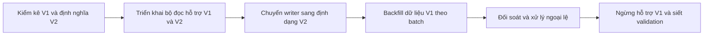

# Quản lý thay đổi document bằng schema version trong Spring Data MongoDB

## 1. Vì sao document vẫn cần quản lý phiên bản schema?

MongoDB không bắt buộc mọi document trong cùng collection có cấu trúc giống nhau. Điều đó giúp ứng dụng tiến hóa nhanh, nhưng cũng có nghĩa là sau nhiều lần triển khai, dữ liệu có thể tồn tại ở nhiều hình dạng khác nhau. Với **Spring Data MongoDB**, sự khác biệt này ảnh hưởng trực tiếp đến việc ánh xạ document sang Java object, truy vấn bằng `MongoTemplate` hoặc repository, xây dựng aggregation, tạo index và bảo trì dữ liệu lâu dài.

Ví dụ, collection `customers` ban đầu lưu tên và email như sau:

```json
{
  "_id": "c-101",
  "name": "Nguyễn An",
  "email": "an@example.test"
}
```

Ở phiên bản tiếp theo, ứng dụng chuẩn hóa cách đặt tên trường và yêu cầu mỗi document thể hiện rõ phiên bản cấu trúc:

```json
{
  "_id": "c-101",
  "schemaVersion": 2,
  "fullName": "Nguyễn An",
  "primaryEmail": "an@example.test"
}
```

Nếu chỉ đổi thuộc tính của entity Java từ `name` thành `fullName`, Spring Data không tự chuyển tên trường trong các document cũ. Một document chưa được migration có thể đọc ra `fullName == null`; các truy vấn lọc theo `fullName` cũng bỏ sót nó. **Schema version** là một trường dữ liệu có chủ đích, giúp ứng dụng biết document đang tuân theo quy ước cấu trúc nào và cần chuyển đổi ra sao.

Trong bài này, quy ước là:

| Giá trị | Ý nghĩa | Cấu trúc chính |
| --- | --- | --- |
| Không có `schemaVersion` | Dữ liệu lịch sử, được nhận diện là v1 theo hợp đồng migration cụ thể này | `name`, `email` |
| `schemaVersion: 1` | V1 được đánh dấu tường minh | `name`, `email` |
| `schemaVersion: 2` | V2 hiện hành | `fullName`, `primaryEmail` |
| Phiên bản khác | Chưa được bộ đọc hiện tại hỗ trợ | Cần xử lý có chủ đích, không tự đoán |

Quy tắc coi trường bị thiếu là v1 **chỉ hợp lệ khi đã kiểm kê và xác nhận dữ liệu lịch sử**. Với collection mới, nên yêu cầu mọi document có `schemaVersion` ngay từ đầu.

## 2. Phân biệt schema version và `@Version`

Hai khái niệm dễ bị nhầm lẫn trong Spring Data MongoDB:

| `schemaVersion` do ứng dụng định nghĩa | `@Version` của Spring Data |
| --- | --- |
| Cho biết hình dạng và quy tắc diễn giải document | Dùng cho **optimistic locking** khi cập nhật entity |
| Thường tăng khi thay đổi cấu trúc dữ liệu | Có thể tăng mỗi lần ghi thành công qua cơ chế lưu hỗ trợ version |
| Migration xử lý v1 → v2 → v3 | Phát hiện xung đột ghi đồng thời |
| Không tự được Spring Data quản lý | Được Spring Data MongoDB hỗ trợ qua `org.springframework.data.annotation.Version` |

Hai trường có thể cùng xuất hiện:

```java
@Document("customers")
public class CustomerDocument {
    @Id
    private String id;

    private Integer schemaVersion;
    private String fullName;
    private String primaryEmail;

    @Version
    private Long revision;

    // Constructor, getter và setter theo quy ước của dự án.
}
```

Đoạn trên minh họa **hai mục đích khác nhau**. Không dùng `revision` để nhận diện schema và không chờ annotation `@Version` tự thực hiện migration. Các lệnh cập nhật trực tiếp trên collection (chẳng hạn `updateMulti` theo tên collection) cũng không tự mang đầy đủ cơ chế kiểm soát cạnh tranh của thao tác lưu một entity đã gắn `@Version`.

## 3. Thiết kế hợp đồng schema trước khi sửa dữ liệu

Mỗi phiên bản cần định nghĩa được **invariant**: document hợp lệ phải có những trường nào, kiểu dữ liệu ra sao, giá trị nào được phép thiếu và ý nghĩa nghiệp vụ của từng trường.

Ví dụ với bài toán khách hàng:

- **V1:** `name` và `email` là chuỗi không rỗng; `schemaVersion` có thể thiếu hoặc bằng `1`.
- **V2:** `schemaVersion` bằng `2`; `fullName` và `primaryEmail` là chuỗi không rỗng; dữ liệu chuẩn không còn sử dụng `name`, `email`.
- **Đầu vào lỗi:** document không đủ trường bắt buộc, có kiểu không mong đợi hoặc chứa cả hai bộ trường với giá trị mâu thuẫn được đưa vào danh sách xử lý riêng; không tự nâng phiên bản.

Nên tăng version khi thay đổi làm **bộ đọc hoặc quy tắc nghiệp vụ cũ không còn hiểu dữ liệu đúng nghĩa**, chẳng hạn đổi tên/kiểu trường, tách một trường thành nhiều trường, di chuyển cấu trúc lồng nhau, hoặc đổi ý nghĩa giá trị. Thêm trường tùy chọn có mặc định rõ ràng đôi khi không cần version mới, nhưng quyết định phải nhất quán trong toàn ứng dụng.

Một thiết kế dễ bảo trì có các đặc điểm:

1. Dùng một tên trường cố định, chẳng hạn `schemaVersion`, với số nguyên tăng dần (`1`, `2`, `3`...).
2. Giữ một nguồn định nghĩa phiên bản mới nhất trong mã ứng dụng; mọi luồng tạo document mới đều ghi version đúng.
3. Viết rõ đường nâng cấp liền kề: v1 → v2, v2 → v3. Nếu bỏ qua trung gian, phải chứng minh phép chuyển đổi tương đương.
4. Xác định chiến lược đọc dữ liệu cũ, thời điểm bắt đầu ghi cấu trúc mới, điều kiện cho phép xóa trường cũ và cách khôi phục khi triển khai gặp sự cố.
5. Ghi lại số lượng document theo version, lỗi chuyển đổi và thời gian xử lý; tránh log nguyên văn dữ liệu cá nhân.

## 4. Đọc dữ liệu nhiều phiên bản một cách tường minh

Trong giai đoạn chuyển tiếp, repository gắn với entity V2 chỉ phù hợp khi dữ liệu đã có thể ánh xạ an toàn sang V2. Với document V1 chưa migration, có thể dùng `MongoTemplate` đọc dạng BSON `Document`, kiểm tra phiên bản rồi chuyển về một mô hình nghiệp vụ ổn định.

```java
import org.bson.Document;

record CustomerView(String id, String fullName, String primaryEmail) {}

public final class CustomerSchemaReader {
    private CustomerSchemaReader() {}

    public static CustomerView toView(Document document) {
        Object rawVersion = document.get("schemaVersion");
        if (rawVersion != null && !(rawVersion instanceof Integer)) {
            throw new IllegalStateException("schemaVersion phải là số nguyên BSON Int32");
        }

        int version = rawVersion == null ? 1 : (Integer) rawVersion;
        String id = String.valueOf(document.get("_id"));

        return switch (version) {
            case 1 -> new CustomerView(
                id,
                requiredString(document, "name"),
                requiredString(document, "email")
            );
            case 2 -> new CustomerView(
                id,
                requiredString(document, "fullName"),
                requiredString(document, "primaryEmail")
            );
            default -> throw new IllegalStateException(
                "Chưa hỗ trợ schemaVersion=" + version + ", id=" + id
            );
        };
    }

    private static String requiredString(Document document, String field) {
        Object value = document.get(field);
        if (!(value instanceof String text) || text.isBlank()) {
            throw new IllegalStateException("Thiếu hoặc sai kiểu field: " + field);
        }
        return text;
    }
}
```

Ví dụ tích hợp `MongoTemplate` khi cần đọc một document thô:

```java
import static com.mongodb.client.model.Filters.eq;

import org.bson.Document;
import org.springframework.data.mongodb.core.MongoTemplate;

public class CustomerLookup {
    private final MongoTemplate mongoTemplate;

    public CustomerLookup(MongoTemplate mongoTemplate) {
        this.mongoTemplate = mongoTemplate;
    }

    public CustomerView find(String id) {
        Document document = mongoTemplate.getCollection("customers")
            .find(eq("_id", id))
            .first();

        if (document == null) {
            throw new java.util.NoSuchElementException("Customer không tồn tại: " + id);
        }
        return CustomerSchemaReader.toView(document);
    }
}
```

Các ví dụ dùng `_id` kiểu chuỗi và version BSON `Int32` theo hợp đồng đã nêu. Nếu collection thực tế dùng `ObjectId` hoặc đã lưu version dưới dạng `Int64`, cần chuẩn hóa định dạng hoặc điều chỉnh bộ đọc có kiểm soát. Không nên ép mọi kiểu về số rồi mặc nhiên tin rằng dữ liệu hợp lệ.

**Điểm quan trọng:** chuyển đổi ở tầng đọc giúp ứng dụng trả về một DTO thống nhất trong khi document V1 vẫn còn, nhưng bản thân việc đọc **không nhất thiết phải ghi ngược**. Không nên âm thầm ghi lại từng document chỉ vì người dùng xem dữ liệu, trừ khi đã lựa chọn rõ chiến lược lazy migration và kiểm soát được cạnh tranh ghi.

## 5. Migration V1 → V2 bằng `MongoTemplate`

Với thay đổi đổi tên trường đơn giản, MongoDB hỗ trợ toán tử `$rename` và `$set`. Spring Data cung cấp `Update.rename(...)`, `Update.set(...)` và `MongoTemplate.updateMulti(...)` để diễn đạt cùng thao tác.

```java
import com.mongodb.client.result.UpdateResult;
import org.springframework.data.mongodb.core.MongoTemplate;
import org.springframework.data.mongodb.core.query.Criteria;
import org.springframework.data.mongodb.core.query.Query;
import org.springframework.data.mongodb.core.query.Update;

public class CustomerV1ToV2Migration {
    private final MongoTemplate mongoTemplate;

    public CustomerV1ToV2Migration(MongoTemplate mongoTemplate) {
        this.mongoTemplate = mongoTemplate;
    }

    public long migrate() {
        Criteria oldVersion = new Criteria().orOperator(
            Criteria.where("schemaVersion").exists(false),
            Criteria.where("schemaVersion").is(1)
        );

        Query query = new Query(new Criteria().andOperator(
            oldVersion,
            Criteria.where("name").type(2).regex("\\S"),
            Criteria.where("email").type(2).regex("\\S"),
            Criteria.where("fullName").exists(false),
            Criteria.where("primaryEmail").exists(false)
        ));

        Update update = new Update()
            .rename("name", "fullName")
            .rename("email", "primaryEmail")
            .set("schemaVersion", 2);

        UpdateResult result = mongoTemplate.updateMulti(query, update, "customers");
        return result.getModifiedCount();
    }
}
```

Đây là **minh họa cho tập dữ liệu đã xác nhận V1 hợp lệ**. Điều kiện `type(2)` yêu cầu kiểu BSON string và regex kiểm tra có ký tự không phải khoảng trắng trong trường hợp chuỗi thông thường. MongoDB có quy tắc so khớp đặc biệt với giá trị mảng, vì vậy bước tiền kiểm vẫn phải phát hiện và cách ly dữ liệu dạng mảng, trường thiếu, sai kiểu hoặc có dữ liệu xung đột. Vì truy vấn loại bỏ document đã có `fullName` hoặc `primaryEmail`, những document V1 được chuyển dở từ trước sẽ **không được tự sửa**; phải kiểm tra và xử lý từng trường hợp theo quy tắc nghiệp vụ.

### Tại sao migration này có thể chạy lại?

Sau lần cập nhật thành công, document đã có `schemaVersion: 2` nên không còn khớp điều kiện V1. Chạy lại lệnh không tiếp tục đổi tên trường hoặc ghi đè thông tin của V2. Đây là **idempotency**: cùng một đợt migration được chạy nhiều lần mà không gây thay đổi lặp ngoài dự kiến.

Cần phân biệt các cấp độ nguyên tử:

- Việc đổi tên trường và đặt `schemaVersion` trong **một update trên một document** là nguyên tử ở cấp document.
- `updateMulti` cập nhật **nhiều document**; toàn bộ lần chạy không phải một transaction nguyên tử cho cả collection. Khi bị ngắt giữa chừng, một phần document có thể đã lên V2. Bộ đọc phải hỗ trợ trạng thái hỗn hợp và migration phải chạy tiếp được.
- Nếu một writer V1 vẫn ghi `name`/`email` sau khi document lên V2, nó có thể tạo dữ liệu lai. Điều kiện lọc theo version không thay thế việc điều phối rollout và quản lý các writer đang hoạt động.

Đối với collection rất lớn, ví dụ `updateMulti` trên toàn bộ document phù hợp để giải thích cú pháp nhưng chưa phải quy trình vận hành tối ưu. Nên chọn từng nhóm `_id` với kích thước được kiểm soát, cập nhật có điều kiện version cho từng nhóm, theo dõi độ trễ/replication lag và lưu checkpoint có thể khởi động lại. Tránh dùng phân trang `skip` lớn khi quét dữ liệu khối lượng cao.

### Khi migration phức tạp hơn đổi tên trường

Các trường hợp tách `address` thành object lồng nhau, chuyển chuỗi ngày sang BSON Date, chuẩn hóa dữ liệu mảng hay tính toán lại trường tổng hợp thường đòi hỏi **aggregation update pipeline** hoặc logic chuyển đổi có kiểm thử trong Java. Khi đó:

1. Viết phép chuyển đổi vN → vN+1 có đầu vào/đầu ra được định nghĩa rõ.
2. Giữ điều kiện version trong thao tác ghi, đồng thời kiểm tra dữ liệu nguồn trước khi nâng version.
3. Không đánh dấu V2 trước khi tất cả trường bắt buộc của V2 được tạo thành công.
4. Tránh áp dụng bất cẩn một phép biến đổi không thể đảo ngược; cân nhắc snapshot/backup và lưu thông tin đối soát theo yêu cầu nghiệp vụ.

Nếu thay đổi liên quan đến nhiều document/collection cần bất biến xuyên suốt, mới cân nhắc MongoDB transaction với điều kiện môi trường triển khai hỗ trợ. Transaction không giải quyết thay cho cơ chế version hoặc quy trình rollout.

## 6. Triển khai an toàn qua nhiều phiên bản ứng dụng

Đổi schema có thể phá vỡ tiến trình ứng dụng cũ đang chạy, đặc biệt khi triển khai rolling update. Một lộ trình thường dùng là **expand → migrate → contract**:



**Giai đoạn expand:** ứng dụng mới phải đọc đúng cả V1 lẫn V2. Nếu còn instance cũ chỉ đọc được V1, chưa thể lập tức cho mọi writer tạo V2 mà không có chiến lược tương thích: có thể cập nhật tất cả reader trước, dùng tính năng dual-read/dual-write tạm thời có quy tắc đồng bộ rõ ràng, hoặc triển khai theo các phiên bản trung gian. Cần tính đến background worker, job theo lịch, consumer và hệ thống tích hợp, không chỉ HTTP API.

**Giai đoạn migrate:** sau khi các writer phát sinh V1 đã ngừng hoặc đã được kiểm soát, chạy backfill. Trong suốt thời gian này, dữ liệu hỗn hợp V1/V2 là trạng thái bình thường; read path phải phân nhánh theo version. Đừng đặt kỳ vọng collection lập tức đồng nhất sau một lệnh cập nhật.

**Giai đoạn contract:** khi toàn bộ document hợp lệ ở V2, các reader cũ đã được loại bỏ và metric xác nhận không còn nguồn ghi V1, mới xóa đường tương thích cùng index/trường cũ nếu không còn cần thiết. Có thể bổ sung MongoDB JSON Schema validation hoặc quy tắc kiểm tra ở tầng ứng dụng để ngăn document sai cấu trúc tiếp tục xuất hiện.

Quy trình rollback cần được quyết định từ trước: nếu dữ liệu đã được ghi bằng V2, rollback trực tiếp về phiên bản ứng dụng chỉ hiểu V1 có thể không an toàn. Một phương án phổ biến là giữ bản build trước đó đã **đọc được cả V1 và V2**, hoặc chuẩn bị migration ngược đã kiểm chứng nếu việc khôi phục hình dạng dữ liệu thật sự cần thiết.

## 7. Quan sát, đối soát và xử lý dữ liệu bất thường

Trước và sau migration, có thể đếm số document theo version bằng MongoDB aggregation:

```javascript
db.customers.aggregate([
  {
    $group: {
      _id: { $ifNull: ["$schemaVersion", 1] },
      count: { $sum: 1 }
    }
  },
  { $sort: { _id: 1 } }
]);
```

Cách đếm này gom document thiếu version vào V1 theo **quy ước của ví dụ**; báo cáo riêng các giá trị version sai kiểu nếu collection có dữ liệu bẩn. Không chỉ kiểm tra `count(V1) == 0`: còn phải xác thực V2 có đủ trường, đúng kiểu, không có giá trị bị mất hoặc trùng lặp ngoài quy tắc nghiệp vụ.

Một số chỉ số đáng theo dõi là số document đã xét/đã cập nhật/bị bỏ qua, số trường hợp cần xử lý thủ công, thời gian mỗi batch, tỷ lệ lỗi đọc theo version, độ trễ truy vấn, replica lag và tốc độ xuất hiện document V1 mới. Log nên dùng `_id`, version, mã lỗi, batch hoặc checkpoint; hạn chế ghi dữ liệu khách hàng nguyên văn.

Truy vấn lọc version có thể tốn chi phí trên collection lớn. Hãy dùng `explain()` với truy vấn và thống kê dữ liệu thực để quyết định index thích hợp; index trên `schemaVersion` có thể hữu ích tùy độ chọn lọc, nhưng `schemaVersion` thiếu ở dữ liệu lịch sử và số lượng giá trị version ít có thể khiến index không mang lại lợi ích như kỳ vọng. Cũng phải tính đến chi phí ghi và bảo trì index khi migration hàng loạt.

## 8. Kiểm thử trước khi đưa vào môi trường thật

Nên dùng một MongoDB test instance phù hợp phiên bản production (ví dụ Testcontainers với JUnit) để kiểm tra **tài liệu thực trong BSON**, thay vì chỉ unit test hàm chuyển đổi Java.

| Tình huống kiểm thử | Kết quả mong đợi |
| --- | --- |
| Document V1 thiếu `schemaVersion` | Bộ đọc trả DTO đúng; migration đổi tên trường và đặt version = 2 |
| Document có `schemaVersion: 1` | Được chuyển sang V2 tương tự document lịch sử |
| Document V2 hợp lệ | Bộ đọc hoạt động; migration không thay đổi document |
| Chạy migration liên tiếp hai lần | Lần thứ hai không làm thay đổi dữ liệu đã lên V2 |
| Document V1 thiếu `email`, sai kiểu `name` hoặc có trường đích xung đột | Không tự nâng version; được phát hiện và đưa vào luồng xử lý ngoại lệ |
| Document có version không được hỗ trợ, ví dụ V3 | Bộ đọc báo lỗi có thể theo dõi, không diễn giải nhầm thành V1/V2 |
| Ghi đồng thời trong lúc backfill | Không có giá trị bị mất; chiến lược điều phối writer hoặc kiểm soát cạnh tranh được xác minh |
| Dừng migration khi mới cập nhật một phần dữ liệu rồi chạy tiếp | Dữ liệu hỗn hợp vẫn đọc được; các document còn lại được xử lý, không trùng thao tác |

Nên kiểm chứng cả luồng repository/`MongoTemplate`, aggregation và index thực sự được dùng trong ứng dụng. Chẳng hạn, code repository kiểu `findByFullName(...)` sẽ không tìm được document chỉ có `name`; đọc bằng adapter chỉ giải quyết việc ánh xạ **sau khi document được tìm thấy**. Trong giai đoạn hỗn hợp, truy vấn tìm kiếm cũng phải tương thích hai schema hoặc dữ liệu phải được migration trước khi dùng truy vấn chỉ hỗ trợ V2.

## 9. Những sai lầm thường gặp

| Sai lầm | Hậu quả | Cách phòng tránh |
| --- | --- | --- |
| Xem MongoDB “schema-less” là không cần migration | Dữ liệu cũ không ánh xạ đúng vào model mới | Định nghĩa invariant và kiểm kê version |
| Dùng `@Version` thay `schemaVersion` | Không biết hình dạng document để chuyển đổi | Tách riêng version cấu trúc và version khóa lạc quan |
| Chỉ sửa entity và repository | Query, projection hoặc aggregation bỏ sót V1 | Xem xét toàn bộ đường đọc và ghi |
| Nâng version trước khi chuyển dữ liệu xong | Document bị gắn nhãn V2 nhưng không thỏa schema V2 | Cập nhật trường đích và version trong cùng thao tác phù hợp |
| Chạy script có thể ghi đè khi chạy lại | Thất thoát hoặc nhân đôi dữ liệu | Ràng buộc update theo version, thiết kế idempotent |
| Xóa reader V1 ngay khi bắt đầu backfill | Lỗi đọc trong thời gian hai schema cùng tồn tại | Chỉ contract sau đối soát và ngừng writer V1 |
| Bỏ qua document lỗi hoặc tự ép kiểu | Mất dữ liệu, dữ liệu không còn đúng nghĩa nghiệp vụ | Tách nhánh xử lý ngoại lệ, kiểm tra kiểu và nội dung |

## 10. Bài thực hành gợi ý

Tạo collection `customers` với một nhóm document V1 thiếu `schemaVersion`, một nhóm V1 có version tường minh, một nhóm V2 và một document V1 có trường dữ liệu lỗi. Sau đó:

1. Cài bộ đọc có thể trả về `CustomerView` từ V1 và V2, nhưng báo rõ lỗi với version không hỗ trợ.
2. Viết migration đổi `name` → `fullName`, `email` → `primaryEmail` và cập nhật `schemaVersion: 2` có điều kiện.
3. Chạy migration hai lần; so sánh document trước/sau để chứng minh tính idempotent và không mất giá trị.
4. Kiểm tra document lỗi vẫn chưa bị gắn V2, ghi nguyên nhân rồi xử lý theo quy tắc đã thống nhất.
5. Tạo truy vấn tìm theo tên hỗ trợ cả V1 và V2 trong giai đoạn chuyển tiếp; sau backfill, chuyển sang truy vấn chỉ dành cho V2 và xác nhận kết quả tương đương.
6. Giả lập migration dừng giữa chừng và tiếp tục; xác minh mọi document còn hợp lệ đều chuyển được sang V2.

Tiêu chí hoàn thành là mỗi document có **hình dạng phù hợp với version đã khai báo**, ứng dụng đọc đúng trong giai đoạn chuyển tiếp, migration có thể chạy lại, và không còn nguồn tạo dữ liệu V1 trước khi bỏ hỗ trợ schema cũ.
