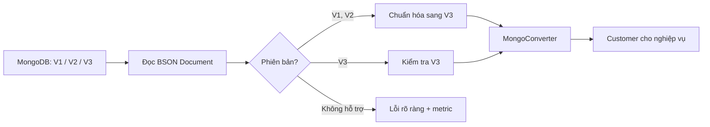

# Đọc tương thích nhiều phiên bản cấu trúc dữ liệu

Trong một hệ thống hoạt động lâu năm, cùng một collection MongoDB có thể chứa document do nhiều phiên bản ứng dụng tạo ra. Đổi tên field, chuyển dữ liệu vào object lồng nhau, thay đổi kiểu BSON hoặc thêm quy tắc bắt buộc có thể khiến entity Java hiện tại không còn ánh xạ đúng document cũ. **Đọc tương thích nhiều phiên bản** (multi-version read compatibility) là khả năng nhận diện từng cấu trúc đã công bố, chuyển chúng sang mô hình nghiệp vụ thống nhất và báo lỗi rõ ràng với dữ liệu ngoài hợp đồng.

Với **Spring Data MongoDB**, ta có thể dùng repository cho cấu trúc ổn định và dùng `MongoTemplate`, `MongoConverter` hoặc custom converter khi cần kiểm soát quá trình đọc. Cách thiết kế này đặc biệt hữu ích khi migration được triển khai dần; đồng thời cần xét đến query, aggregation, index, transaction, reactive access, kiểm thử và chẩn đoán hiệu năng.

## 1. Bài toán: một collection, ba cấu trúc

Giả sử collection `customers` được ghi qua ba lần phát hành. Cả ba document có cùng ý nghĩa nghiệp vụ nhưng hình dạng khác nhau:

**V1 — chưa có `schemaVersion`**: tên và email nằm ngay ở cấp gốc.

```javascript
{
  _id: "c-001",
  name: "An",
  email: "an@example.test"
}
```

**V2 — `schemaVersion: 2`**: đổi `name` thành `fullName`, đưa email vào `contact`.

```javascript
{
  _id: "c-002",
  schemaVersion: 2,
  fullName: "Bình",
  contact: { email: "binh@example.test" }
}
```

**V3 — `schemaVersion: 3`**: chuyển tên hiển thị vào `profile`.

```javascript
{
  _id: "c-003",
  schemaVersion: 3,
  profile: { displayName: "Chi" },
  contact: { email: "chi@example.test" }
}
```

| Thành phần | V1 | V2 | V3 (hiện tại) |
| --- | --- | --- | --- |
| Dấu hiệu phiên bản | Không có `schemaVersion` theo quy ước lịch sử | `schemaVersion: 2` | `schemaVersion: 3` |
| Tên hiển thị | `name` | `fullName` | `profile.displayName` |
| Email | `email` | `contact.email` | `contact.email` |
| Khi đọc | Chuẩn hóa sang V3 | Chuẩn hóa sang V3 | Kiểm tra rồi ánh xạ |
| Khi tạo mới | Không ghi V1 | Không ghi V2 | Ghi V3 khi tất cả reader đã tương thích |

`schemaVersion` ở đây là **phiên bản cấu trúc dữ liệu do ứng dụng quản lý**. Nó không phải phiên bản MongoDB/Spring Data và cũng không phải trường `@Version` phục vụ optimistic locking.

## 2. Hợp đồng đọc tương thích

Trước khi viết converter, cần xác định rõ:

1. **Các phiên bản hỗ trợ.** Ví dụ chỉ V1, V2, V3. Nếu gặp `schemaVersion: 4`, reader cũ phải báo phiên bản chưa hỗ trợ; không âm thầm coi là V3.
2. **Quy tắc nhận diện.** Chỉ xem field `schemaVersion` *không tồn tại* là V1 khi lịch sử dữ liệu bảo đảm điều đó. Giá trị `null`, số âm, chuỗi `"2"` và kiểu lạ phải được xử lý minh bạch.
3. **Bất biến nghiệp vụ.** Ví dụ tên hiển thị và email là chuỗi không rỗng. Field tùy chọn được phép vắng mặt, còn field bắt buộc không được tự tạo dữ liệu giả.
4. **Xung đột giữa các field.** Một document có cả `name` và `profile.displayName` nhưng nội dung khác nhau phải tuân thủ chính sách ưu tiên theo phiên bản hoặc bị cách ly để xử lý.
5. **Hướng ghi.** Sau thời điểm chuyển writer, mọi document mới dùng schema chuẩn; reader cũ chỉ còn trách nhiệm hỗ trợ lịch sử.

Chuẩn hóa khi đọc là một phép chuyển đổi **trong bộ nhớ**, không phải thao tác cập nhật database. Tách hai bước này để có thể triển khai reader tương thích trước khi bắt đầu backfill.



## 3. Ví dụ đầy đủ với Spring Data MongoDB

Ví dụ sử dụng **Java 17+**, Spring Data MongoDB và `_id` lưu dưới dạng **chuỗi** (như `"c-001"`). Nếu collection thực tế dùng BSON `ObjectId`, phải điều chỉnh kiểu ID và bộ lọc truy vấn tương ứng.

### 3.1. Định nghĩa model chuẩn

File `Customer.java`:

```java
package example.customer;

import org.springframework.data.annotation.Id;
import org.springframework.data.mongodb.core.mapping.Document;

@Document(collection = "customers")
public record Customer(
        @Id String id,
        int schemaVersion,
        Profile profile,
        Contact contact
) {
    public record Profile(String displayName) {}
    public record Contact(String email) {}
}
```

Tầng nghiệp vụ chỉ cần biết `customer.profile().displayName()` và `customer.contact().email()`. Các field `name` và `fullName` thuộc về tầng tương thích dữ liệu.

### 3.2. Đọc dữ liệu gốc và chuẩn hóa

File `CustomerReader.java`:

```java
package example.customer;

import com.mongodb.client.model.Filters;
import org.bson.Document;
import org.springframework.data.mongodb.core.MongoTemplate;
import org.springframework.stereotype.Service;

import java.util.Optional;

@Service
public class CustomerReader {
    private static final int CURRENT_VERSION = 3;
    private final MongoTemplate mongoTemplate;

    public CustomerReader(MongoTemplate mongoTemplate) {
        this.mongoTemplate = mongoTemplate;
    }

    public Optional<Customer> findById(String id) {
        // Lấy BSON gốc để các field cũ chưa bị mất khi ánh xạ entity.
        Document raw = mongoTemplate.getCollection("customers")
                .find(Filters.eq("_id", id))
                .first();

        if (raw == null) {
            return Optional.empty();
        }

        Document canonical = normalize(raw);
        return Optional.of(
                mongoTemplate.getConverter().read(Customer.class, canonical));
    }

    // Hàm thuần: không sửa raw, không ghi MongoDB.
    public static Document normalize(Document raw) {
        int version = detectVersion(raw);
        return switch (version) {
            case 1 -> canonical(
                    raw,
                    requiredString(raw, "name"),
                    requiredString(raw, "email"));
            case 2 -> canonical(
                    raw,
                    requiredString(raw, "fullName"),
                    requiredString(requiredDocument(raw, "contact"), "email"));
            case 3 -> {
                requiredString(requiredDocument(raw, "profile"), "displayName");
                requiredString(requiredDocument(raw, "contact"), "email");
                yield new Document(raw);
            }
            default -> throw new IllegalStateException(
                    "Unsupported customer schemaVersion: " + version);
        };
    }

    private static Document canonical(
            Document raw, String displayName, String email) {
        return new Document("_id", requiredString(raw, "_id"))
                .append("schemaVersion", CURRENT_VERSION)
                .append("profile", new Document("displayName", displayName))
                .append("contact", new Document("email", email));
    }

    private static int detectVersion(Document raw) {
        // Chỉ trường hợp field hoàn toàn vắng mặt mới được xem là V1.
        if (!raw.containsKey("schemaVersion")) {
            return 1;
        }
        Object value = raw.get("schemaVersion");
        if (value instanceof Integer version && version > 0) {
            return version;
        }
        if (value instanceof Long version
                && version > 0 && version <= Integer.MAX_VALUE) {
            return version.intValue();
        }
        throw new IllegalStateException("Invalid customer schemaVersion");
    }

    private static Document requiredDocument(Document source, String key) {
        Object value = source.get(key);
        if (value instanceof Document nested) {
            return nested;
        }
        throw new IllegalStateException("Expected document at: " + key);
    }

    private static String requiredString(Document source, String key) {
        Object value = source.get(key);
        if (value instanceof String text && !text.isBlank()) {
            return text;
        }
        throw new IllegalStateException("Expected nonblank string at: " + key);
    }
}
```

Đoạn mã sử dụng `MongoTemplate.getCollection(...)` để lấy `org.bson.Document` qua MongoDB Java Driver, sau đó gọi `MongoConverter.read(...)` để ánh xạ document đã chuẩn hóa sang `Customer`. Đường đọc BSON trực tiếp bỏ qua bước ánh xạ/sự kiện chuyển đổi thường xảy ra khi gọi `MongoTemplate.find(...)`; vì vậy nên đặt nó trong một adapter rõ ràng và duy trì chính sách chung cho toàn bộ nơi sử dụng collection.

Các nhánh thực hiện:

- V1: đổi `name` thành `profile.displayName` và chuyển email vào `contact.email`.
- V2: chuyển `fullName` vào `profile.displayName` và giữ `contact.email`.
- V3: kiểm tra các field bắt buộc rồi dùng cấu trúc đã có.
- Phiên bản không hỗ trợ hoặc cấu trúc hỏng: ném lỗi để tầng gọi ghi nhận và xử lý. Không tự làm rơi document hoặc giả định giá trị.

Hàm `normalize(...)` cố ý chỉ mô tả những field liên quan ví dụ. **Không lấy entity vừa đọc rồi gọi `save(customer)` để "migrate" document cũ**: các field mở rộng chưa có trong entity có thể bị mất khi ghi lại toàn bộ document. Quy trình backfill phải chỉ định rõ field nào được giữ, biến đổi hoặc xóa.

### 3.3. Repository, `@Field` và converter

Một `MongoRepository<Customer, String>` đọc V1/V2 trực tiếp không tự sinh `profile` từ `name` hay `fullName`. Repository có thể tiếp tục dùng cho các đường ghi/đọc chuẩn, còn đường đọc dữ liệu trộn cần adapter hoặc converter tương thích.

| Trường hợp | Giải pháp thích hợp | Giới hạn cần nhớ |
| --- | --- | --- |
| Thêm field tùy chọn | Entity và mặc định tại tầng nghiệp vụ | Phân biệt vắng mặt với dữ liệu sai |
| Một tên BSON ổn định | `@Field("tên_field")` | Chỉ chỉ định một tên lưu trữ, không tự hỗ trợ nhiều alias |
| Nhiều cấu trúc aggregate | Service dùng `MongoTemplate` + `normalize` | Kiểm soát rõ phiên bản và kiểm thử |
| Converter tái sử dụng rộng | `@ReadingConverter` trong `MongoCustomConversions` | Chọn phạm vi cẩn thận để tránh ảnh hưởng kiểu khác |
| Dashboard hoặc báo cáo | MongoDB aggregation/projection | Cần xem hiệu năng và fallback field |

Với `ReactiveMongoTemplate`, nên giữ hàm chuẩn hóa thuần dữ liệu rồi thực hiện trong bước `map(...)` của pipeline reactive. Không gọi driver đồng bộ hoặc `block()` ngay trên luồng request reactive.

## 4. Truy vấn, aggregation và index cũng phải tương thích

**Chuẩn hóa sau khi đọc không làm query MongoDB tự nhận ra field cũ.** Nếu repository tìm theo `profile.displayName`, V1 (`name`) và V2 (`fullName`) sẽ bị bỏ sót.

Trong giai đoạn quá độ, tìm chính xác tên hiển thị bằng điều kiện cho cả ba đường dẫn:

```java
import org.bson.Document;
import org.springframework.data.mongodb.core.query.Criteria;
import org.springframework.data.mongodb.core.query.Query;

Query query = new Query(new Criteria().orOperator(
        Criteria.where("name").is(keyword),
        Criteria.where("fullName").is(keyword),
        Criteria.where("profile.displayName").is(keyword)
));

var customers = mongoTemplate.find(query, Document.class, "customers")
        .stream()
        .map(CustomerReader::normalize)
        .map(doc -> mongoTemplate.getConverter().read(Customer.class, doc))
        .toList();
```

Nếu document có đồng thời nhiều field trùng nghĩa, nhánh `$or` vẫn có thể tìm thấy một tên cũ mà reader không dùng nữa. Khi dữ liệu thực tế có xung đột, nên giới hạn nhánh theo phiên bản hoặc đặt điều kiện và quy tắc giải quyết cụ thể. Đặc biệt, tìm kiếm case-insensitive, so khớp không dấu và collation phải dùng cùng một hợp đồng chuẩn hóa chuỗi.

Với aggregation, một phép chiếu có thể tạo ra tên hiển thị hợp nhất:

```javascript
db.customers.aggregate([
  {
    $project: {
      schemaVersion: 1,
      displayName: {
        $ifNull: [
          "$profile.displayName",
          { $ifNull: ["$fullName", "$name"] }
        ]
      }
    }
  }
])
```

`$ifNull` coi cả field vắng mặt và giá trị `null` là trường hợp cần fallback. Nếu nghiệp vụ cần phân biệt *không có field*, *field có null* và *field rỗng*, hãy dùng biểu thức có điều kiện rõ ràng như `$type` / `$cond` hoặc xử lý tại adapter.

### Index trong thời gian còn nhiều phiên bản

Ví dụ các index cho ba đường dẫn truy vấn, nếu phân tích lưu lượng xác nhận chúng cần thiết:

```javascript
db.customers.createIndex({ name: 1 }, { sparse: true })
db.customers.createIndex({ fullName: 1 }, { sparse: true })
db.customers.createIndex({ "profile.displayName": 1 }, { sparse: true })
```

Không mặc định tạo cả ba index ở hệ thống thật: index tăng chi phí lưu trữ và ghi. Dùng `explain("executionStats")` trên truy vấn thực để quan sát `totalDocsExamined`, `totalKeysExamined` và việc từng nhánh `$or` được index hỗ trợ ra sao.

Sắp xếp và phân trang cũng cần xem xét: `sort({ "profile.displayName": 1 })` không tạo thứ tự tên thống nhất cho V1/V2. Khi collection lớn, có thể hoàn tất backfill hoặc duy trì field chuẩn dùng cho tìm kiếm/sắp xếp. Phép `$ifNull` trong aggregation tạo ra giá trị hợp nhất nhưng có thể khiến thao tác sort phải xử lý nhiều document hơn.

## 5. Triển khai từng bước: đọc trước, ghi sau

Chiến lược **expand → migrate → contract** giúp hệ thống tiếp tục hoạt động:

1. **Kiểm kê dữ liệu:** đếm document V1 (thiếu `schemaVersion`), V2, V3; lấy mẫu dữ liệu sai kiểu, `null`, thiếu trường và các field xung đột. Ghi rõ quy tắc xử lý cho từng loại.
2. **Phát hành reader tương thích:** triển khai đến mọi instance, background job, API, consumer và ứng dụng khác có quyền đọc collection. Kiểm thử cả trường hợp phiên bản mới chưa hỗ trợ.
3. **Đổi writer sang V3:** chỉ bật ghi V3 sau khi toàn bộ reader đang hoạt động có thể đọc V3. Trong rolling deployment, nên dùng thứ tự phát hành hoặc feature flag để ngăn reader cũ gặp dữ liệu chưa hiểu.
4. **Backfill theo lô:** chọn document cũ, chuyển đổi, ghi với điều kiện trên phiên bản nguồn, theo dõi số đọc/sửa/bỏ qua/lỗi, giới hạn tải lên database. Giữ checkpoint để khởi động lại sau gián đoạn.
5. **Đối soát rồi loại bỏ hỗ trợ cũ:** kiểm tra dữ liệu, query, index, truy cập từ ứng dụng phụ thuộc; chỉ xóa nhánh V1/V2 khi chắc chắn không còn dữ liệu hoặc writer cũ tương ứng.

Ví dụ cập nhật **một document V2 đã được kiểm tra** lên V3:

```javascript
db.customers.updateOne(
  { _id: "c-002", schemaVersion: 2 },
  {
    $set: {
      "profile.displayName": "Bình",
      schemaVersion: 3
    },
    $unset: { fullName: "" }
  }
)
```

Trong job thật, phải lấy tên từ nội dung hiện có, xác minh email và các field nghiệp vụ khác, đồng thời xử lý tranh chấp cập nhật. Bộ lọc `schemaVersion: 2` tránh ghi nhầm document đã chuyển đổi; nếu job chạy lại và bản ghi đã ở V3, thao tác không sửa thêm. Với V1, dùng điều kiện `schemaVersion` *không tồn tại* thay vì so sánh với giá trị 1 chưa từng được lưu.

Cập nhật một document trong MongoDB là nguyên tử. Nếu migration đòi hỏi bảo toàn bất biến trên nhiều document hoặc nhiều collection, cần đánh giá transaction và điều kiện hạ tầng, cùng chi phí vận hành của nó. Reader chỉ chuẩn hóa dữ liệu trong bộ nhớ thì không cần transaction.

Kế hoạch rollback phải xét đến document V3 đã được ghi: khôi phục binary cũ chỉ an toàn nếu nó đọc được V3 hoặc có cơ chế khôi phục dữ liệu được kiểm chứng. Cần chuẩn bị bản sao lưu, thống kê migration và checkpoint trước khi backfill quy mô lớn.

## 6. Những lỗi thường gặp

| Hiện tượng | Nguyên nhân | Cách xử lý |
| --- | --- | --- |
| Đọc V1 nhưng `profile == null` | Entity V3 ánh xạ trực tiếp, bỏ qua field cũ | Chuẩn hóa trước bước chuyển BSON sang entity |
| Tìm kiếm bỏ sót khách hàng cũ | Query chỉ tìm field V3 | Truy vấn đủ phiên bản hoặc backfill field tìm kiếm |
| Dữ liệu mới bị hiểu nhầm thành V1 | Mặc định mọi document thiếu version là V1 | Chỉ áp dụng quy ước lịch sử đã kiểm chứng, theo dõi writer |
| `null` bị xem là field vắng mặt | Dùng `get(...) == null` để nhận diện | Dùng `containsKey(...)` và kiểm tra kiểu |
| Dữ liệu phụ bị mất khi gọi `save(...)` | Entity không có các field cũ/chưa biết | Tách adapter đọc khỏi writer migration |
| Đổi `String` sang BSON Date bị lệch thời gian | Ép kiểu ngầm, không quy định timezone | Chuyển đổi tường minh, thống nhất UTC và test biên |
| Hai field chứa thông tin mâu thuẫn | Dual-write hoặc rolling deployment thiếu đồng bộ | Chính sách ưu tiên theo phiên bản; đo và cách ly xung đột |
| Ứng dụng cũ không đọc được V3 | Đổi writer trước khi phát hành reader | Phát hành reader cho toàn hệ thống trước |
| Query `$or` hoặc sort chậm | Thiếu index hoặc sort trên field tính toán | Kiểm tra `explain`, đo tải, giảm dần dữ liệu cũ |

Giữ cả `oldField` và `newField` trong thời gian dài có thể gây lệch dữ liệu. Nếu cần dual-write, phải chỉ rõ nguồn dữ liệu chuẩn, cách đối chiếu và thời điểm ngừng ghi hai nơi.

## 7. Kiểm thử và quan sát

### 7.1. Unit test cho chuyển đổi thuần

Đặt test trong package `example.customer`:

```java
package example.customer;

import org.bson.Document;
import org.junit.jupiter.api.Test;

import static org.junit.jupiter.api.Assertions.*;

class CustomerReaderTest {
    @Test
    void normalizesV1WithoutMutatingSource() {
        Document old = new Document("_id", "c-001")
                .append("name", "An")
                .append("email", "an@example.test");

        Document result = CustomerReader.normalize(old);

        assertEquals(3, result.getInteger("schemaVersion"));
        assertEquals("An",
                result.get("profile", Document.class).getString("displayName"));
        assertEquals("an@example.test",
                result.get("contact", Document.class).getString("email"));
        assertFalse(old.containsKey("schemaVersion"));
    }

    @Test
    void normalizesV2() {
        Document old = new Document("_id", "c-002")
                .append("schemaVersion", 2)
                .append("fullName", "Bình")
                .append("contact", new Document("email", "binh@example.test"));

        Document result = CustomerReader.normalize(old);

        assertEquals(3, result.getInteger("schemaVersion"));
        assertEquals("Bình",
                result.get("profile", Document.class).getString("displayName"));
    }

    @Test
    void rejectsFutureVersionAndMalformedField() {
        Document future = new Document("_id", "c-004")
                .append("schemaVersion", 4);
        Document malformed = new Document("_id", "c-005")
                .append("schemaVersion", 2)
                .append("fullName", 123)
                .append("contact", new Document("email", "x@example.test"));

        assertThrows(IllegalStateException.class,
                () -> CustomerReader.normalize(future));
        assertThrows(IllegalStateException.class,
                () -> CustomerReader.normalize(malformed));
    }
}
```

Cần bổ sung kiểm thử tích hợp với MongoDB thật (có thể dùng Testcontainers) để xác nhận cách ánh xạ `_id`, record lồng nhau, BSON types, aggregation, collation và index. Tập ca kiểm thử nên có: V1/V2/V3 hợp lệ; field thiếu, `null`, sai kiểu hoặc rỗng; version là chuỗi, số âm hoặc phiên bản tương lai; document chứa cả field cũ và mới; truy vấn/pagination qua nhiều phiên bản; việc backfill chạy lại; tranh chấp cập nhật và rollback khi triển khai xen kẽ binary cũ/mới.

### 7.2. Theo dõi vận hành

Đo tỷ lệ đọc V1/V2/V3, lỗi chuẩn hóa, phiên bản chưa hỗ trợ, số document còn cần backfill và độ trễ của query. Ghi log có mã lỗi, phiên bản và định danh truy vết thích hợp; không đưa email hoặc thông tin cá nhân vào log. Chỉ xóa nhánh tương thích khi số lần đọc schema cũ ở mức chấp nhận được trong khoảng theo dõi đủ dài **và** đã xác minh không còn producer ghi schema đó.

## 8. Bài tập thực hành

**Bài 1 — Thêm V4.** Giả sử V4 đổi `contact.email` thành `contacts.primaryEmail` nhưng giữ `profile.displayName`. Mở rộng hợp đồng đọc để V1–V4 đưa về cấu trúc V4; thêm test cho V4 có email thiếu. Không thay email thiếu bằng chuỗi rỗng.

**Bài 2 — Query có schema trộn.** Viết truy vấn MongoDB tìm khách hàng tên `"An"` trên cả V1–V3; giải thích vì sao sort chỉ trên `profile.displayName` không đảm bảo thứ tự trước khi backfill. Đề xuất chiến lược cho collection hàng triệu document cần phân trang ổn định.

**Bài 3 — Migration lặp lại an toàn.** Thiết kế job nâng V2 lên V3 theo batch với điều kiện cập nhật theo phiên bản, checkpoint, thống kê `matched/modified`, xử lý document lỗi và kiểm chứng sau chạy. Giải thích điều gì xảy ra nếu job chạy lại hoặc writer cũ vẫn ghi V2.

**Tiêu chí hoàn thành:** phân biệt schema version với optimistic locking version; xây dựng reader đọc được nhiều cấu trúc qua Spring Data MongoDB; xử lý dữ liệu lỗi rõ ràng; đảm bảo query/index phù hợp dữ liệu trộn; triển khai đúng thứ tự reader, writer, backfill và dừng hỗ trợ schema cũ.
