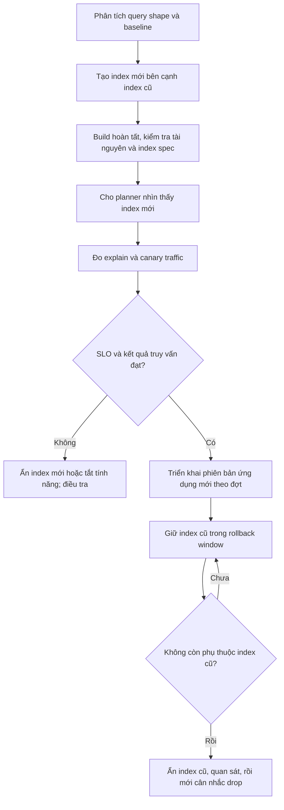

# Chuẩn bị và thay đổi chỉ mục mà không làm gián đoạn ứng dụng

> **Chương:** Migration dữ liệu · **Module:** `SPRING_DATA_MONGODB`. Trong Spring Data MongoDB, ứng dụng dùng `MongoTemplate`, repository hoặc reactive access để đọc/ghi document. Chỉ mục (index) quyết định kế hoạch thực thi truy vấn, nhưng bản thân thao tác thêm, ẩn, đổi thuộc tính hay xóa chỉ mục cũng tiêu thụ CPU, I/O, bộ nhớ và có thể thay đổi hành vi ghi. Bài này trình bày cách chuẩn bị và triển khai thay đổi chỉ mục khi ứng dụng vẫn phục vụ lưu lượng, kèm ví dụ MongoDB và Spring Data MongoDB.

## 1. Tại sao migration chỉ mục cần kế hoạch riêng?

Một phiên bản ứng dụng mới muốn đọc danh sách đơn hàng theo `tenantId`, `status` và `createdAt`. Collection `orders` đang có chỉ mục:

```javascript
{ tenantId: 1, createdAt: -1 }    // idx_orders_tenant_created_v1
```

Phiên bản mới dự kiến dùng truy vấn:

```javascript
db.orders.find({
  tenantId: "tenant-a",
  status: "PAID"
}).sort({ createdAt: -1 }).limit(50);
```

Nếu chỉ mục cũ không đáp ứng tốt điều kiện lọc và sắp xếp, MongoDB có thể phải quét nhiều khóa hoặc document. Giải pháp có vẻ đơn giản là tạo:

```javascript
{ tenantId: 1, status: 1, createdAt: -1 }
```

Nhưng việc đổi index trên hệ thống đang chạy đặt ra bốn câu hỏi:

1. Có đủ dung lượng và tài nguyên để **xây dựng chỉ mục mới** trên toàn bộ dữ liệu hiện có không?
2. Liệu các phiên bản ứng dụng đang chạy, kể cả những instance chưa được nâng cấp, có còn hoạt động bình thường không?
3. Sau khi tạo index, query planner có chọn nó và hiệu năng thực tế có cải thiện không?
4. Nếu triển khai sai, có thể **hoàn tác nhanh** mà không phải xây dựng lại chỉ mục hàng giờ không?

Mục tiêu của triển khai là duy trì **khả dụng và tính tương thích** trong khi giảm thiểu ảnh hưởng hiệu năng, không phải giả định mọi thao tác index đều hoàn toàn không có khóa hay miễn phí.

### Hiểu đúng về index build trực tuyến

Trên các phiên bản MongoDB hiện đại, thao tác xây dựng chỉ mục hỗ trợ ứng dụng đọc/ghi trong **phần lớn quá trình build**. Tuy vậy, vẫn có các giai đoạn lấy khóa độc quyền ngắn ở đầu và cuối build; tải CPU, I/O, áp lực bộ nhớ, dung lượng và đồng bộ replica set có thể gây tăng độ trễ. Nếu có tải nặng hoặc thiếu tài nguyên, một index build trực tuyến vẫn có thể ảnh hưởng SLO.

Từ MongoDB 4.2, tùy chọn `background` cũ đã bị bỏ qua vì cơ chế index build mới; đặt `background: true` không tạo ra bảo đảm “không gián đoạn”. Trên replica set, index build cần quan tâm tình trạng các node tham gia và **commit quorum**; không tùy ý thay đổi cấu hình quorum hay xây index theo kiểu thủ công từng node nếu chưa có runbook riêng cho phiên bản cụ thể.

## 2. Thiết kế chỉ mục dựa trên truy vấn thực tế

Trước khi thay đổi, cần xác định **query shape**: tập điều kiện lọc, sort, projection, giới hạn kết quả, collation, phân bố dữ liệu và tần suất. Đừng suy ra chỉ mục chỉ từ danh sách field trong entity Java.

### 2.1. Đọc query shape từ ứng dụng

Với ví dụ `orders`, có hai kiểu đọc:

| Query shape | Truy vấn tiêu biểu | Nhu cầu |
|---|---|---|
| Q1 — Tra cứu gần đây theo tenant | `{tenantId}`, sort `createdAt:-1` | Giữ hành vi cũ, phản hồi nhanh |
| Q2 — Tra cứu theo tenant và trạng thái | `{tenantId,status}`, sort `createdAt:-1` | Bổ sung index phục vụ phiên bản mới |
| Q3 — Tìm theo mã đơn | `{tenantId,orderNo}` | Có thể cần chỉ mục unique riêng |

Với Q2, chỉ mục `{tenantId:1,status:1,createdAt:-1}` có tiền tố equality `tenantId,status` rồi tới sort `createdAt`, thường phù hợp. Tuy nhiên index mới **không tự động thay thế mọi công dụng** của index cũ: Q1 không lọc `status` nên thứ tự khóa `createdAt` phía sau `status` không nhất thiết hỗ trợ sort theo `createdAt` trên toàn tenant. Do đó, có thể cần giữ **cả hai** chỉ mục.

Nguyên tắc tham khảo khi thiết kế index ghép là **ESR — Equality, Sort, Range**. Đây là hướng dẫn, không phải công thức bất biến. Với một truy vấn có điều kiện range rất chọn lọc, thứ tự field cần được kiểm chứng qua `explain` và dữ liệu thực tế.

### 2.2. Những điều kiện làm một index không hữu dụng

- **Collation:** chỉ mục có collation khác với truy vấn có thể không được sử dụng cho so sánh chuỗi/sort như mong đợi.
- **Partial index:** nếu truy vấn không bảo đảm điều kiện của `partialFilterExpression`, planner thường không thể dùng partial index vì có nguy cơ thiếu kết quả.
- **Multikey:** khi index chứa field mảng, đặc biệt nhiều field mảng trong cùng document, có các giới hạn xây dựng và sắp xếp cần kiểm tra.
- **Độ chọn lọc:** field có quá ít giá trị phân biệt (ví dụ `status` có ba giá trị) có thể không hiệu quả nếu đặt một mình ở đầu chỉ mục.
- **Số lượng index:** mỗi `insert`, `update` ảnh hưởng field được lập chỉ mục và `delete` phải duy trì các index tương ứng. Thêm index giúp đọc nhưng có thể làm chậm ghi và tăng dung lượng.
- **Hint:** nếu ứng dụng đang `hint()` tên index cũ, xóa hoặc ẩn index đó có thể khiến truy vấn thất bại. Phải thống kê các hint trước khi đổi.

Ví dụ cùng một field có thể được lưu trong MongoDB dưới tên khác với property Java qua `@Field`. Khi thao tác bằng Spring Data, ưu tiên API ánh xạ entity để tránh viết nhầm tên field lưu trữ; khi dùng `mongosh`, luôn dùng tên field **thực trong BSON**.

## 3. Checklist chuẩn bị trước khi triển khai

### 3.1. Kiểm kê và chốt baseline

Thực hiện trên môi trường phản ánh dữ liệu và tải production, với quyền đọc phù hợp.

```javascript
use shop

// Xác định các index đang tồn tại và các tùy chọn của chúng.
db.orders.getIndexes();

// Xem kích thước dữ liệu và index để ước lượng tăng dung lượng.
db.orders.stats();

// Kiểm tra plans, số document/khóa được đọc và thời gian xử lý.
db.orders.find({
  tenantId: "tenant-a",
  status: "PAID"
}).sort({ createdAt: -1 }).limit(50).explain("executionStats");

// Thống kê mức sử dụng index từ thời điểm server thống kê còn hiệu lực.
db.orders.aggregate([{ $indexStats: {} }]);
```

Ghi lại tối thiểu: p50/p95/p99 latency các API quan trọng, throughput đọc/ghi, error rate, CPU, RAM, disk IOPS, dung lượng trống, cache pressure, replication lag, độ dài hàng đợi và kết quả `explain` của từng query shape. Với `explain("executionStats")`, quan sát `winningPlan` (có `IXSCAN` hay `COLLSCAN`), `totalKeysExamined`, `totalDocsExamined`, `nReturned` và `executionTimeMillis`.

**Đừng xem một lần `explain` trên vài document là bằng chứng đủ:** bộ đệm ấm/lạnh, tenant lớn/nhỏ, dữ liệu skew, sort/limit, phân trang và tải ghi ảnh hưởng lớn. `$indexStats` phản ánh bộ đếm thao tác, có thể được reset khi server restart hoặc index được xây lại; không kết luận “không dùng” chỉ từ một khoảng quan sát ngắn.

### 3.2. Kiểm tra điều kiện hạ tầng và dữ liệu

| Kiểm tra | Lý do | Quyết định trước khi làm |
|---|---|---|
| Phiên bản MongoDB, FCV, topology | Khả năng `hidden`, `collMod`, cơ chế build và commit quorum phụ thuộc phiên bản | Chọn cú pháp và phương án áp dụng tương thích |
| Sức khỏe replica set/sharded cluster | Build và commit index cần tình trạng node ổn định | Xử lý replica lag, node lỗi trước khi triển khai |
| Dung lượng đĩa và tài nguyên | Index mới tồn tại đồng thời với index cũ trong pha chuyển đổi | Có headroom và ngưỡng hủy/dừng triển khai |
| Tải cao điểm và nhu cầu ứng dụng | Index build cạnh tranh I/O/CPU với các thao tác thường ngày | Chọn khung giờ tải thấp, phân công người trực |
| Data quality | Unique, partial, collation và TTL thay đổi ý nghĩa dữ liệu | Kiểm tra trùng lặp, null, missing, ngày hết hạn |
| Các phiên bản ứng dụng đang chạy | Rollout theo đợt dẫn đến nhiều query shape cùng tồn tại | Giữ tương thích trong suốt thời gian chuyển đổi |
| Quyền và quy trình triển khai | `createIndexes`/`collMod`/`dropIndexes` cần quyền quản trị tương ứng | Có migration job, log, giám sát và phương án rollback |

Đặc biệt với collection lớn, ước lượng chi phí index build bằng thử nghiệm trên bản sao có kích thước và phân bố dữ liệu gần thực tế. Không lấy thời gian build của tập dữ liệu vài nghìn dòng làm dự đoán cho hàng trăm triệu document.

### 3.3. Chốt SLO và điều kiện dừng

Trước thao tác, thống nhất các ngưỡng có thể đo được, ví dụ p95 latency không vượt quá mức cho phép, error rate không tăng bất thường, replication lag ở ngưỡng chấp nhận và free disk không xuống dưới mức an toàn. Khi xuất hiện vi phạm, dừng rollout ứng dụng, đánh giá tiến trình build và làm theo runbook; hành động hủy build hoặc rollback phải cân nhắc trạng thái của các node và phiên bản MongoDB.

## 4. Quy trình triển khai dạng mở rộng → chuyển đổi → thu hẹp

Một thay đổi chỉ mục an toàn là **migration nhiều giai đoạn**, không sửa trực tiếp khai báo rồi lập tức xóa index cũ.



| Pha | Hệ thống vẫn đáp ứng | Công việc chính |
|---|---|---|
| **Prepare** | Mã cũ, index cũ | Kiểm kê query, kiểm tra dữ liệu và nguồn lực |
| **Expand** | Mã cũ, **index cũ + mới** | Build index mới, đợi hoàn tất, đối chiếu spec |
| **Verify** | Mã cũ + canary | Cho planner dùng index mới, chạy `explain` và đo SLO |
| **Switch** | Mã cũ + mới đồng thời | Rollout ứng dụng theo đợt, có feature flag nếu cần |
| **Stabilize** | Mã mới, giữ index cũ | Quan sát đủ thời gian, giữ phương án rollback nhanh |
| **Contract** | Mã mới, index mới | Ẩn index cũ để thử, sau đó chỉ xóa khi đã chứng minh không còn phụ thuộc |

Tên index là một phần của hợp đồng vận hành nếu ứng dụng, báo cáo, thủ tục backfill hoặc `hint` đang tham chiếu đến nó. Nên đặt tên có version, chẳng hạn `idx_orders_tenant_status_created_v2`, để giữ hai thế hệ chỉ mục cùng tồn tại.

## 5. Thực hành MongoDB: tạo index mới và đưa vào sử dụng

Ví dụ dưới đây dùng MongoDB hỗ trợ **hidden indexes** (MongoDB 4.4 trở lên). Hidden index vẫn được duy trì khi ghi nhưng query planner không chọn nó; dùng để chuẩn bị chỉ mục trước khi cho lưu lượng đọc sử dụng.

### Bước 1. Tạo index mới ở trạng thái hidden

```javascript
use shop

db.orders.createIndex(
  { tenantId: 1, status: 1, createdAt: -1 },
  {
    name: "idx_orders_tenant_status_created_v2",
    hidden: true
  }
);

// Chỉ tiếp tục khi thao tác build hoàn thành và spec đúng.
db.orders.getIndexes().filter(
  index => index.name === "idx_orders_tenant_status_created_v2"
);
```

Lệnh `createIndex` chỉ được coi là hoàn tất khi server trả về thành công. Nếu chạy trên replica set/sharded cluster, cần quan sát tiến độ và trạng thái các node theo phiên bản triển khai. Nếu đã có index cùng tên nhưng **key/options khác**, không được coi là migration thành công: MongoDB có thể báo xung đột. `ensureIndex` hoặc `createIndex` không phải công cụ thay đổi tùy ý định nghĩa một index đang tồn tại.

Một index được đặt `hidden: true` **vẫn chiếm dung lượng và tăng chi phí ghi**. Đó là trạng thái hỗ trợ rollout, không phải cách làm cho index “miễn phí”.

### Bước 2. Cho planner nhìn thấy index

```javascript
db.runCommand({
  collMod: "orders",
  index: {
    name: "idx_orders_tenant_status_created_v2",
    hidden: false
  }
});
```

Việc ẩn/bỏ ẩn index đổi khả năng planner chọn index, không xây dựng lại dữ liệu chỉ mục. Sau khi bỏ ẩn, đối chiếu `explain` ở nhiều tenant và tập dữ liệu:

```javascript
const predicate = { tenantId: "tenant-a", status: "PAID" };

db.orders.find(predicate)
  .sort({ createdAt: -1 })
  .limit(50)
  .explain("executionStats");

// Chỉ dùng hint để đo kiểm có chủ đích sau khi index đã visible.
db.orders.find(predicate)
  .sort({ createdAt: -1 })
  .limit(50)
  .hint("idx_orders_tenant_status_created_v2")
  .explain("executionStats");
```

Không thể `hint` một **hidden index**; muốn benchmark nó phải cho visible trước. Sau khi visible, query planner vẫn có thể chọn index khác vì chi phí ước lượng. Cần phân biệt **index đã tồn tại**, **planner có thể nhìn thấy** và **planner thực sự sử dụng**.

### Bước 3. Triển khai ứng dụng dần dần

Bật luồng truy vấn Q2 cho tỷ lệ nhỏ traffic, theo dõi p95/p99, `totalDocsExamined`, CPU và I/O, sau đó tăng dần. Không xóa `idx_orders_tenant_created_v1` trong pha này vì Q1 vẫn có thể cần nó.

Nếu kết quả xấu, trước hết tắt feature flag hoặc rollback mã gọi Q2; nếu cần loại bỏ index khỏi các phương án của planner, có thể **ẩn index v2**:

```javascript
db.runCommand({
  collMod: "orders",
  index: {
    name: "idx_orders_tenant_status_created_v2",
    hidden: true
  }
});
```

Tác động của việc ẩn index là trên hoạt động lập kế hoạch truy vấn trong phạm vi tương ứng, nên phải kiểm tra tất cả query shape. Truy vấn đang `hint` tên index v2 sẽ không hoạt động như bình thường khi index bị ẩn; đó là lý do nên tránh hardcode hint khi chuyển đổi.

### Bước 4. Chỉ xem xét xóa index cũ khi an toàn

Khi Q1 vẫn cần index cũ thì **giữ nguyên**. Nếu sau này mọi query shape đều có phương án thay thế và rollback window đã kết thúc, có thể thử ẩn index cũ:

```javascript
db.runCommand({
  collMod: "orders",
  index: {
    name: "idx_orders_tenant_created_v1",
    hidden: true
  }
});

// Theo dõi đủ tải thật và thời gian đại diện; chưa vội drop.
```

Nếu phát hiện query thoái hóa, bỏ ẩn lại ngay:

```javascript
db.runCommand({
  collMod: "orders",
  index: {
    name: "idx_orders_tenant_created_v1",
    hidden: false
  }
});
```

Chỉ sau khi xác nhận không còn phụ thuộc:

```javascript
db.orders.dropIndex("idx_orders_tenant_created_v1");
```

`dropIndex` giải phóng tài nguyên chỉ mục và không có thao tác “undo” tức thì: để phục hồi index đã xóa, cần xây lại và chịu chi phí của một index build mới. Vì vậy, **hide trước, drop sau** thường là cách thu hẹp có thể rollback nhanh. Ngoài ra, không được xóa index `_id` mặc định.

## 6. Tích hợp Spring Data MongoDB

### 6.1. Khai báo mô hình và định nghĩa index

Ví dụ một entity:

```java
import java.time.Instant;
import org.springframework.data.annotation.Id;
import org.springframework.data.mongodb.core.mapping.Document;

@Document("orders")
public class Order {
    @Id
    private String id;
    private String tenantId;
    private String status;
    private Instant createdAt;

    // Constructor, getter và setter phù hợp với ứng dụng.
}
```

Có thể mô tả index bằng annotation:

```java
import org.springframework.data.mongodb.core.index.CompoundIndex;
import org.springframework.data.mongodb.core.index.CompoundIndexes;
import org.springframework.data.mongodb.core.mapping.Document;

@Document("orders")
@CompoundIndexes({
    @CompoundIndex(
        name = "idx_orders_tenant_created_v1",
        def = "{ 'tenantId': 1, 'createdAt': -1 }"
    ),
    @CompoundIndex(
        name = "idx_orders_tenant_status_created_v2",
        def = "{ 'tenantId': 1, 'status': 1, 'createdAt': -1 }"
    )
})
public class Order {
    // Các field được khai báo như ví dụ phía trên.
}
```

**Điểm cần nhớ:** annotation chỉ là **metadata** cho Spring Data. Việc annotation tồn tại không chứng minh index tương ứng đã được triển khai thành công trên database. Từ Spring Data MongoDB 3.0, **tự động tạo index không bật mặc định**. Với hệ thống production, nên dùng migration job có kiểm soát, có quyền và có giám sát; tránh để mọi instance của ứng dụng cùng tự build index ngay lúc khởi động.

### 6.2. Tạo index trong một migration job có kiểm soát

Spring Data cung cấp `IndexOperations` và `Index`. Ví dụ dưới đây được gọi bởi một job riêng đã qua bước chuẩn bị, không chạy ngầm trong constructor hoặc request HTTP:

```java
import org.springframework.data.domain.Sort.Direction;
import org.springframework.data.mongodb.core.MongoTemplate;
import org.springframework.data.mongodb.core.index.Index;

public final class OrderIndexMigration {

    private final MongoTemplate mongoTemplate;

    public OrderIndexMigration(MongoTemplate mongoTemplate) {
        this.mongoTemplate = mongoTemplate;
    }

    public String createV2Index() {
        Index v2 = new Index()
            .on("tenantId", Direction.ASC)
            .on("status", Direction.ASC)
            .on("createdAt", Direction.DESC)
            .named("idx_orders_tenant_status_created_v2");

        return mongoTemplate.indexOps(Order.class).ensureIndex(v2);
    }
}
```

`ensureIndex(v2)` tạo index khi chưa tồn tại, hoặc xác nhận index cùng định nghĩa có thể dùng được. Nó **không** sửa mọi khác biệt key, collation, unique, TTL hoặc hidden của index cũ. Nếu cần `hidden: true` và chiến lược `collMod`, có thể dùng MongoDB shell/driver trong migration job có kiểm soát; hãy xác minh rằng thư viện Spring Data đang dùng hỗ trợ đúng tùy chọn cần thiết.

Lưu ý khi phối hợp hai cách: nếu đã tạo chỉ mục v2 bằng `mongosh` với `hidden:true`, đừng mặc định rằng việc gọi `ensureIndex` với cùng tên nhưng không khai báo `hidden` sẽ biến nó thành visible; hãy điều khiển hidden state bằng thao tác phù hợp và kiểm tra kết quả `getIndexes()`.

Có thể đọc danh sách metadata index từ Spring Data:

```java
var indexInfo = mongoTemplate.indexOps(Order.class).getIndexInfo();
indexInfo.forEach(System.out::println);
```

Với `@Field("db_field_name")`, nên dùng cách ánh xạ entity thống nhất trong toàn ứng dụng. Sau migration, xác minh cả **spec trên server**, **truy vấn thực tế** và **phiên bản ứng dụng** đang chạy; một kết quả `ensureIndex` trả về tên index chưa phản ánh hiệu năng.

### 6.3. Tránh ép hint sớm trong repository/template

Truy vấn bằng `MongoTemplate`:

```java
import org.springframework.data.domain.Sort;
import org.springframework.data.mongodb.core.query.Criteria;
import org.springframework.data.mongodb.core.query.Query;

Query query = new Query(
    Criteria.where("tenantId").is("tenant-a")
            .and("status").is("PAID")
).with(Sort.by(Sort.Direction.DESC, "createdAt")).limit(50);

// Để query planner tự chọn index sau khi đã unhide và kiểm chứng.
var orders = mongoTemplate.find(query, Order.class);
```

Chỉ khi có lý do rõ ràng và đã xác minh index visible/tồn tại mới cân nhắc `query.withHint("idx_orders_tenant_status_created_v2")`. Hint gắn vòng đời mã ứng dụng với tên index và làm giảm khả năng rollback bằng cách hide.

## 7. Trường hợp đặc biệt: chuyển sang UNIQUE index

Chuyển từ non-unique sang **unique** là migration có khả năng làm **ghi thất bại**, không chỉ thay đổi tốc độ truy vấn. Không có cách an toàn để bật unique trên dữ liệu trùng lặp mà bỏ qua bước xử lý chất lượng dữ liệu.

Giả sử mỗi cặp `(tenantId, emailNorm)` phải duy nhất. Trước khi build, kiểm tra trùng:

```javascript
db.customers.aggregate([
  {
    $group: {
      _id: { tenantId: "$tenantId", emailNorm: "$emailNorm" },
      count: { $sum: 1 }
    }
  },
  { $match: { count: { $gt: 1 } } },
  { $limit: 20 }
]);
```

Quy trình hợp lý:

1. Định nghĩa chính xác chuẩn hóa `emailNorm` (ví dụ lowercase, trim) và cơ chế xử lý field null/missing, collation, dữ liệu đã bị trùng.
2. Triển khai mã mới kiểm tra input và cập nhật chuẩn hóa nhất quán; làm sạch/backfill dữ liệu cũ theo lô, có kiểm soát các cập nhật đồng thời.
3. Xử lý các bản ghi trùng; ngăn **trùng mới phát sinh trong lúc build** bằng quy tắc ghi hoặc cơ chế phối hợp phù hợp.
4. Xây unique index khi dữ liệu đã thỏa invariant; kiểm tra thành công rồi theo dõi lỗi `DuplicateKeyException` trong ứng dụng.
5. Chỉ loại bỏ index không còn cần thiết sau khi chứng minh các query shape và rollback đã an toàn.

Ví dụ tạo unique index:

```javascript
db.customers.createIndex(
  { tenantId: 1, emailNorm: 1 },
  {
    unique: true,
    name: "uq_customers_tenant_email_norm_v1"
  }
);
```

**Null/missing không tự động được miễn ràng buộc.** Với unique index, các giá trị thiếu hoặc `null` có quy tắc trùng lặp tương ứng với khóa index tạo ra. Nếu chỉ muốn áp ràng buộc cho document đã có `emailNorm` dạng chuỗi, có thể cân nhắc **partial unique index**:

```javascript
db.customers.createIndex(
  { tenantId: 1, emailNorm: 1 },
  {
    name: "uq_customers_tenant_email_norm_partial_v1",
    unique: true,
    partialFilterExpression: { emailNorm: { $type: "string" } }
  }
);
```

Partial unique **không bảo đảm** tính duy nhất cho document nằm ngoài filter; đây phải là chủ đích rõ ràng trong hợp đồng dữ liệu. Với collection sharded, unique index còn bị giới hạn theo shard key và phiên bản MongoDB; cần xác minh topology thay vì sao chép cấu hình của replica set.

**Cảnh báo hidden unique:** việc ẩn unique index chỉ làm query planner không sử dụng nó; **ràng buộc unique vẫn được thực thi**. Hide không phải công tắc rollback tính duy nhất. Nếu muốn thay đổi hành vi ghi, phải có phương án mã/dữ liệu rõ ràng và thao tác index thích hợp.

## 8. Trường hợp đặc biệt: TTL, partial index và thay đổi option

### 8.1. TTL có thể làm mất dữ liệu thật

Một TTL index tự động loại bỏ document khi hết hạn, ví dụ:

```javascript
db.sessions.createIndex(
  { expiresAt: 1 },
  {
    name: "ttl_sessions_expires_at_v1",
    expireAfterSeconds: 0
  }
);
```

`expireAfterSeconds: 0` nghĩa là document hết hạn theo timestamp lưu trong `expiresAt`, không phải xóa ngay khi câu lệnh tạo index kết thúc. TTL monitor chạy nền, nên thời điểm xóa có thể trễ so với hạn; đừng dùng TTL thay thế cơ chế lập lịch cần độ chính xác đến giây.

Trước khi tạo TTL index trên collection đang có dữ liệu:

- Đếm document đã quá hạn và mô phỏng số lượng sẽ bị xóa.
- Kiểm tra `expiresAt` là BSON Date hợp lệ (không phải chuỗi ISO lưu sai kiểu).
- Dọn dữ liệu hết hạn theo batch nếu việc xóa ồ ạt sẽ gây tải bất thường.
- Có backup và xác nhận thời hạn retention với chủ sở hữu dữ liệu.

Không dùng `hidden:true` để “thử an toàn” TTL: hidden TTL vẫn có thể xóa document. Đổi `expireAfterSeconds` trên index hiện hữu có thể dùng `collMod` trên các phiên bản MongoDB hỗ trợ; hãy xác nhận điều kiện của phiên bản, data retention và lượng dữ liệu sẽ đến hạn trước khi thay đổi.

### 8.2. Đổi key, collation, partial filter hoặc loại index

Không có một lệnh chung “ALTER INDEX” cho mọi thuộc tính. Với thay đổi **key pattern**, **collation**, `partialFilterExpression` hoặc ràng buộc quan trọng, thông thường phải **tạo một index mới**, chuyển traffic, rồi cân nhắc xóa index cũ. Một vài thuộc tính nhất định như `hidden` (và TTL trên phiên bản tương ứng) có thể thay đổi bằng `collMod`.

Đặc biệt, MongoDB có quy tắc về **equivalent indexes** và những tổ hợp index được phép cùng tồn tại; không được mặc định rằng có thể tạo hai chỉ mục chỉ khác tên. Nếu hai index trùng key pattern và option không được phép đồng tồn tại, phải thiết kế phương án chuyển đổi riêng theo phiên bản MongoDB.

## 9. Vận hành index migration khi có lưu lượng

### 9.1. Giám sát trong lúc build và sau rollout

```javascript
// Quan sát thao tác đang chạy, tùy quyền của tài khoản quản trị:
db.currentOp({ "command.createIndexes": "orders" });

// Kiểm tra index cuối cùng:
db.orders.getIndexes();

// Theo dõi mức sử dụng index theo thời gian:
db.orders.aggregate([{ $indexStats: {} }]);
```

`db.currentOp()` hữu ích để quan sát một số thao tác đang hoạt động, nhưng cấu trúc output và cách index build hiển thị phụ thuộc phiên bản/topology. Cần kết hợp log server, chỉ số giám sát của cluster và các truy vấn `explain` thực tế. Không coi “không thấy trong currentOp” là bằng chứng chắc chắn rằng build đã thành công; hãy chờ lệnh tạo index trả kết quả và kiểm tra lại `getIndexes()`.

Giữ dashboard tối thiểu cho:

- API latency/error rate theo route và tenant;
- MongoDB query latency, scanned keys/documents, slow queries;
- CPU, I/O, memory, disk free và cache pressure;
- replication lag, tình trạng member và thông báo lỗi liên quan đến index;
- write latency, write errors (đặc biệt `DuplicateKeyException` khi có unique).

### 9.2. Ranh giới giữa rollback code và rollback index

| Sự cố | Phương án ưu tiên | Điều kiện/giới hạn |
|---|---|---|
| Truy vấn phiên bản mới chậm | Tắt feature flag hoặc rollback mã | Giữ index cũ để rollback không cần build |
| Planner chọn index v2 kém | Ẩn v2, kiểm tra lại plans | Cẩn thận truy vấn hardcode hint v2 |
| Xóa index v1 làm Q1 chậm | Nếu chỉ **hidden**, bỏ ẩn v1 | Nếu đã **drop**, phải xây lại, có thể rất tốn thời gian |
| Unique index làm ghi lỗi | Sửa luồng dữ liệu/đầu vào; đánh giá migration constraint | Hidden unique vẫn enforce; không tự ý drop khi chưa đánh giá invariant |
| TTL xóa nhầm dữ liệu | Dừng thay đổi gây xóa, khôi phục từ backup nếu có | Hide TTL không dừng expiry; rollback code không khôi phục document |
| Build gây áp lực tài nguyên | Dừng rollout, điều tra build/quorum/hạ tầng | Hủy build có hậu quả và thủ tục khác nhau theo topology/phiên bản |

Điều cần tránh nhất là biến thao tác **xóa index cũ** thành bước mặc định ngay sau khi phát hành phiên bản mới. Nhiều ứng dụng còn batch job, report đêm, maintenance script hoặc client chưa nâng cấp; chúng có thể phụ thuộc index cũ dù API chính trông vẫn ổn.

### 9.3. Phương pháp kiểm thử có ý nghĩa

Trước production, kiểm tra trên dữ liệu gần thực tế:

1. **Correctness:** truy vấn trả đúng kết quả và đúng thứ tự trước/sau migration; kiểm tra tenant nhỏ/lớn, null/missing và collation.
2. **Performance:** `explain`, latency p95/p99, write throughput trên tải hỗn hợp; xác nhận Q1 và Q2, không chỉ query mới.
3. **Compatibility:** đồng thời chạy phiên bản cũ và mới trong pha chuyển đổi; kiểm tra repository, `MongoTemplate` và các job ngoài API.
4. **Failure injection:** rollback mã khi index v2 đang visible; hide/unhide v2; thử tình huống kết nối thất bại, node lag và áp lực tài nguyên trong staging phù hợp.
5. **Data safety:** với unique/TTL, kiểm tra dữ liệu trùng/đến hạn, migration backfill và kịch bản khôi phục backup.

Không cần chạy các phép thử phá hoại trên production để xác nhận hành vi; staging với replica set và dataset đại diện là nơi phù hợp cho các kịch bản thất bại.

## 10. Ví dụ runbook triển khai thực tế

Mục tiêu: thêm `idx_orders_tenant_status_created_v2` để hỗ trợ Q2, **duy trì Q1**.

| Thời điểm | Thực hiện | Bằng chứng phải có | Nếu sai |
|---|---|---|---|
| T-1: Chuẩn bị | Thu query shape, `explain`, index spec, baseline SLO; kiểm tra disk/node | Báo cáo Q1/Q2 và tài nguyên đủ | Hoãn rollout |
| T0: Expand | Tạo v2 hidden trên collection `orders` | Lệnh thành công, index spec và health đạt | Dừng chuyển đổi, điều tra |
| T1: Verify | Unhide v2, so `explain`, chạy canary Q2 | Q2 có lợi ích, Q1 không thoái hóa | Hide v2, giữ mã cũ |
| T2: Switch | Rollout ứng dụng dần dần | Error rate/latency/replication lag đạt SLO | Rollback code/flag |
| T3: Stabilize | Giữ cả v1 và v2 qua chu kỳ tải đại diện | Báo cáo, batch job, client cũ vẫn đúng | Giữ v1, bổ sung đo |
| T4: Contract | Chỉ đánh giá hide/drop v1 nếu Q1 không còn cần | Không còn hint/phụ thuộc; rollback window kết thúc | Bỏ ẩn v1 khi cần |

Trong ví dụ này, **v1 có thể cần được giữ lâu dài** vì nó phục vụ query chỉ lọc `tenantId` rồi sort `createdAt`. “Migration hoàn thành” có thể nghĩa là **đã thêm đúng chỉ mục mới và kiểm soát chi phí**, chứ không bắt buộc phải xóa chỉ mục cũ.

### Mẫu checklist quyết định triển khai

- [ ] Nắm rõ các query shape, sort, collation, projection, hint và phiên bản ứng dụng.
- [ ] Chụp baseline latency, scanned keys/docs, write throughput và tình trạng cluster.
- [ ] Xác nhận đủ tài nguyên, quyền, khả năng build index và phương án dừng.
- [ ] Kiểm tra dữ liệu trùng/thiếu field, retention nếu có unique, partial hoặc TTL.
- [ ] Tạo index v2 bên cạnh v1 với tên riêng; xác nhận build hoàn tất và spec đúng.
- [ ] Kiểm thử plans bằng `explain` và canary trước khi mở rộng traffic.
- [ ] Giữ v1 qua giai đoạn rollback; chỉ hide/drop sau khi không còn phụ thuộc.
- [ ] Ghi lại index spec, thời điểm deploy, số liệu trước/sau và người chịu trách nhiệm.

## 11. Câu hỏi tự kiểm tra

1. Vì sao chỉ mục `{tenantId:1,status:1,createdAt:-1}` có thể tối ưu Q2 nhưng không thay thế được `{tenantId:1,createdAt:-1}` cho Q1?
2. Index build “online” có đồng nghĩa không tăng latency đọc/ghi trong production không? Những tài nguyên nào bị cạnh tranh?
3. Tạo index ở trạng thái hidden mang lại khả năng gì? Nó có tránh được chi phí ghi và ràng buộc unique/TTL không?
4. Tại sao phải chuyển mã ứng dụng trước khi xóa index cũ? Điều gì xảy ra nếu repository đang `hint` index bị xóa?
5. Vì sao chuyển sang unique index cần giải quyết race condition của các bản ghi mới phát sinh ngay trong lúc index build?
6. Nếu đã `dropIndex` v1, có thể rollback ngay bằng `unhide` không?
7. Khi nào `ensureIndex` trong Spring Data phù hợp, và vì sao không nên coi nó là công cụ migration mọi thuộc tính index?

## Tài liệu tham khảo

- [MongoDB Manual — Indexes](https://www.mongodb.com/docs/manual/indexes/)
- [MongoDB Manual — Index Builds on Populated Collections](https://www.mongodb.com/docs/manual/core/index-creation/)
- [MongoDB Manual — Hidden Indexes](https://www.mongodb.com/docs/manual/core/index-hidden/)
- [MongoDB Manual — Unique Indexes](https://www.mongodb.com/docs/manual/core/index-unique/)
- [MongoDB Manual — TTL Indexes](https://www.mongodb.com/docs/manual/core/index-ttl/)
- [MongoDB Manual — Explain Results](https://www.mongodb.com/docs/manual/reference/explain-results/)
- [Spring Data MongoDB Reference — Index Creation](https://docs.spring.io/spring-data/mongodb/reference/mongodb/mapping/mapping-index-management.html)
- [Spring Data MongoDB API — IndexOperations](https://docs.spring.io/spring-data/mongodb/docs/current/api/org/springframework/data/mongodb/core/IndexOperations.html)
